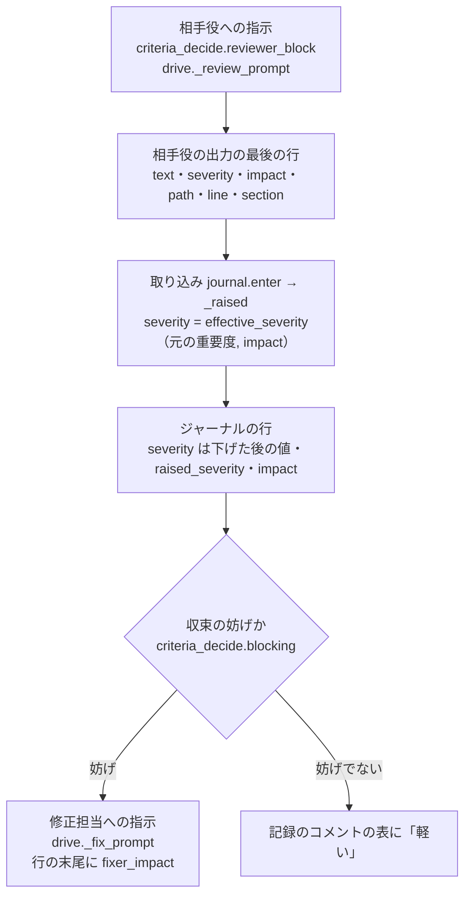
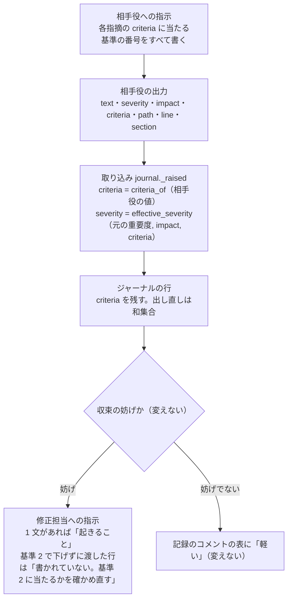

# cross-review: 起きることの 1 文が欠けた基準 2 の重い指摘を、下げずに修正担当へ渡す（#4045）

#4014 の規則では、相手役が起きることの 1 文を書き損じただけで、秘密・認証認可・利用者のデータ・戻せない操作に触れる重い指摘（基準 2）も `minor` へ下がり、直されずに残る。相手役に指摘が当たる基準の番号の並び（`criteria`）を書かせ、2 を含む重い指摘は 1 文が無くても下げずに修正担当へ渡す。修正担当への指示には、1 文が無いことと基準 2 に当たるかを確かめ直すことを添える。相手役に書き直させる案などの採らなかった案は「決定の記録」に、調べた標準と製品は付録の「外部の調査」にある。

## 今の姿

何が起きたか・目的・受け入れ条件は要求仕様（[issue-4045-requirements.md](./issue-4045-requirements.md)、正は #4045 の本文）にある。この文書は「どう解くか」と「なぜその解き方か」だけを書く。前提にするコードは、#4014 の実装をマージしたスプリントブランチ `sprint/p12-lcrfast-r1`（head `68d887913`）の形である。



変える箇所は、相手役への指示と出力の形（図の 1・2 段目）、取り込みの重要度の決め方（3 段目）、修正担当への添え書き（`fixer_impact`）である。収束の妨げかの判定・記録のコメントの表・スレッド・引き継ぎは、行の `severity` を読むだけなので変えない。

設計に要る今の構造:

| 部品 | 今の振る舞い | 場所 |
| --- | --- | --- |
| 相手役への指示 | 基準の行（1・2・4 と、重点があれば 3）に続けて、`critical`・`major` には `impact` に 1 文を書き、書けない指摘は `minor` にすると書く（文は `review-criteria.json` の `impact.reviewer`） | `criteria_decide.reviewer_block` |
| 出力の形 | `text`・`severity`・`impact`・`path`・`line`・`section`。指摘がどの基準に当たるかの項目は無い | `drive._review_prompt` |
| 取り込みの重要度 | `effective_severity(severity, impact)`。1 文の無い `critical`・`major` と重要度の無い指摘は `minor`、1 文のある重要度の無い指摘は `major`、`minor`・`nit` はそのまま | `criteria_decide.effective_severity`・`journal._raised` |
| 出し直し | 下げた後の値と既にある値の重い方を残す。1 文は既にある行に無いときだけ足す | `journal._raised_again` |
| 修正担当への添え書き | 行が 1 文を持てば「— 起きること: <1 文>」、無ければ空 | `criteria_decide.fixer_impact` |
| 見送った指摘の出し直し | 修正担当が理由を添えて見送った指摘は、同じキーで出し直されても未解決へ戻さない（手順書 `01-state-and-review.md` の手順 3「理由を添えて見送った指摘は、出し直されても扱わない」） | `journal.enter` |

#4014 の設計の決定 1 は「基準 2 の指摘は 1 文が無くても下げない」案を採らなかった。理由は、駆動が指摘の基準を持たず、相手役の申告に頼ると、1 文を書かずに基準 2 と名乗る指摘が止める側に残ることである。この設計はその危険を引き受け、修正担当の確かめ直しと実測（受け入れ条件 7）で抑える（決定 1）。

## 文脈と制約

- 重要度の尺度と収束の妨げになるか（`severities.json` の `rank`・`blocking`）は変えない（要求の「含まない」）
- 基準 1・3・4 の 1 文の無い重い指摘は、#4014 のとおり `minor` へ下げる（要求の「含まない」）
- 相手役は NDF が起動する CLI で、出力の JSON は利用者が書く入力ではない。項目の無い古い出力は、基準 2 に当たらない指摘として読む（前提 2）
- 引き継いだ行と前の版の状態ファイルの行は付け直さない（#4014 の決定 7 のまま）
- MVV に反する指摘（基準 5・`mvv` の項目）の重さは #4076 が設計している。重なる所は決定 6 が分ける
- 決定の根拠に引く MVV の項目は main の `.ndf/mvv.md`（MVV バージョン 11）にある
- この文書の「取り込み」は、相手役の出力の指摘をジャーナルの行にすること（`journal.enter`）を指す。「1 文」は指摘の項目 `impact`、「基準の並び」は指摘の項目 `criteria` を指す

## 解き方の全体像



- 相手役は指摘ごとに、当たる基準の番号をすべて `criteria` に書く（決定 2）
- 相手役への指示（`impact.reviewer`）から、1 文を書けない指摘を相手役自身に `minor` へ下げさせる文と、1 文の無い重い指摘が無条件に `minor` として扱われるという説明を外す。1 文を書く要求は残す（決定 7）
- 取り込みは、1 文の無い重い指摘のうち、基準の並びに `review-criteria.json` の「1 文が無くても下げない基準」（2）を含むものを下げない。重要度の無い指摘は `major` にする。ほかは #4014 のまま（決定 1・3）

| 相手役が付けた重要度 | 1 文あり | 1 文なし・基準 2 を含む | 1 文なし・基準 2 を含まない |
| --- | --- | --- | --- |
| `critical`・`major` | そのまま | そのまま（変える） | `minor` |
| 無い・尺度に無い値 | `major` | `major`（変える） | `minor` |
| `minor`・`nit` | そのまま | そのまま | そのまま |

- ジャーナルの行は基準の並びを持ち、出し直しでは両方を合わせる（決定 4）
- 修正担当は、基準 2 で下げずに渡された行を見分け、基準 2 に当たるかを確かめ直す。当たるかの判断を結果の `criteria_met` に書き、当たらなければ理由を添えて見送り、その指摘は出し直されても扱われない（決定 5）
- 例外を当てた入力・例外で修正担当へ渡した時点・修正担当の判断を、行の `kept_round`・`kept_handed_round`・`criteria_met` に残す。引き継いだ行への出し直しで例外を当てたときも残す。受け入れ条件 7 はこの 3 つから数える（決定 8）

## データ構造

状態ファイル（`cross-review-pr<元の番号>-state.json`）のジャーナルの行（`findings[]`）に 4 つの項目を足す。

| 項目 | 型 | 置く条件 | 中身 |
| --- | --- | --- | --- |
| `criteria`（足す） | 文字列の配列 | 取り込みと出し直しで、基準の並びが空でないとき | 指摘が当たる基準の番号。`review-criteria.json` にある番号だけを、重ねずに番号の順で持つ |
| `kept_round`（足す） | 整数 | 取り込みか出し直しの入力に例外を当てたとき（下の「例外を当てる入力」）。行が既に持てば置き直さない | 例外を初めて当てた入力のラウンドの番号。引き継いだ行（`raised_severity` が無い）への出し直しでも置く |
| `kept_handed_round`（足す） | 整数 | 修正担当を起動する直前に、渡す行のうち `kept_without_impact` が真の行。既に持てば置き直さない | 1 文の無いまま例外で修正担当へ初めて渡したラウンドの番号。後で 1 文が補われても消さない |
| `criteria_met`（足す） | 真偽値 | `kept_handed_round` を持つ行で、修正担当の結果のその指摘が真偽値の `criteria_met` を持つとき。後の結果で置き直す | 修正担当が、指摘が `kept_criteria` の基準に当たると判断したか（当たる = 真、当たらない = 偽）。見送りの理由が範囲外などほかの理由かを、`outcome` と別に見分ける |

例外を当てる入力は、相手役の 1 件のうち、重要度が収束の妨げになる重さか無い・尺度に無い値で、1 文が無く、基準の並びが `impact.kept_criteria` と重なるものである。この判定は純粋な関数 `criteria_decide.kept_applies(severity, impact, criteria)` の 1 か所に置き、`effective_severity` もこの関数で下げるかを決める。

| 行の出所 | `criteria` |
| --- | --- |
| 取り込み | 基準の並びが空でなければ置く |
| 出し直し | 既にある値と今回の値を合わせて置き直す（どちらも空なら置かない） |
| 引き継ぎ（`t<コメントの id>`・`p-<元の id>`） | 置かない（記録のコメントは基準を持たない）。出し直されたら上の規則で足す。`kept_round` も同じ（引き継いだ時点の重要度と `raised_severity` の無さは変えない） |
| 組み直しの足すべき内容・前の版で書いた行 | 置かない・無い |

基準 2 で下げずに渡す行は「`kept_round` を持ち、`severity` が収束の妨げになる重さで、`impact` が無い」行である。この規則は `criteria_decide.kept_without_impact(row)` の 1 か所に置く。`raised_severity` の有無で決めないので、引き継いだ軽い行が基準 2 を含む 1 文の無い `major` で出し直され、重い方の `major` へ上がった場合も真になり、確かめ直しの添え書きが付く。`criteria_decide.downgraded(row)`（下げた行か）は変えない。下げずに渡した行の `severity` は妨げになる重さなので、`downgraded` は偽を返す。

## 入出力のコントラクト

相手役へ渡す出力の形（`drive._review_prompt` の最後の行の指示）に 1 項目を足す。

```text
{"findings": [{"text": "<指摘>", "severity": "<重要度>", "impact": "<critical・major のとき、利用者の経路で何が起きるか 1 文 か 空>",
  "criteria": ["<当たる基準の番号>", ...], "path": "<ファイルのパス か 空>", "line": <行の番号 か null>, "section": "<パス#見出し か 空>"}]}
```

| `criteria` の値 | 読み方 |
| --- | --- |
| 文字列か整数の配列 | 要素ごとに、前後の空白を除いた文字列（整数は 10 進の文字列）が `review-criteria.json` の基準の番号にあれば採る。無い番号・ほかの型の要素は捨てる |
| 文字列か整数の 1 つの値 | 要素 1 つの配列と同じに読む（形の崩れで基準 2 が落ちないため） |
| 無い・`null`・真偽値・オブジェクト・ほかの型 | 空の並び（基準 2 に当たらない指摘） |

`review-criteria.json` に足すキー:

| キー | 中身 |
| --- | --- |
| `criteria_field` | 相手役への指示の文。「criteria には、指摘が当たる基準の番号（上の番号）をすべて書く。」の意味 |
| `impact.kept_criteria` | 1 文が無くても下げない基準の番号の配列。値は `["2"]` |
| `impact.fixer_missing` | 下げずに渡した行の添え書き。「書かれていない（基準 {criteria} の指摘として下げずに渡した。当たるかを確かめ直し、結果のこの指摘に criteria_met（当たれば true、当たらなければ false）を足す。当たらなければ理由を添えて見送る）」の意味。`{criteria}` は `kept_criteria` から埋める |

`review-criteria.json` で文を変えるキー（決定 7）:

| キー | 今の文のうち外す部分 | 置き換える文 |
| --- | --- | --- |
| `impact.reviewer` | 「書けない指摘は {light_first} にする（impact の無い {blocking} は {light_first} として扱われる）。」 | 「重要度は指摘そのものの重さで選び、impact を書けないことを理由に下げない（impact の無い {blocking} は、当たる基準によって {light_first} として扱われる）。」。前半の 1 文を書く要求（基準ごとの書き方の例を含む）と、後ろの「{light} は収束を止めず、修正担当へ渡らない。」は残す |

`sprint/p12-lcrfast-r1` の `reviewer_block(())` を実際に組んで確かめた。今の文は「書けない指摘は minor にする（impact の無い critical・major は minor として扱われる）」と出て、相手役が 1 文を書けない基準 2 の指摘を自分で `minor` にすると、取り込みは明示の `minor` をそのまま残すので、この設計の例外が届かない。置き換えた文では、組んだ出力の重要度の行は「…重要度は指摘そのものの重さで選び、impact を書けないことを理由に下げない（impact の無い critical・major は、当たる基準によって minor として扱われる）。minor・nit は収束を止めず、修正担当へ渡らない。」になり、その次の行に `criteria_field` の文が並ぶ。

相手役への指示には「基準 2 は 1 文が無くても下げない」と書かない。書くと、1 文を省いて基準 2 と名乗る書き方を相手役へ促すためである。`ndf cross-review run` の引数と結果 JSON（`cross-review.result.schema.json`）は変えない。

修正担当の結果ファイルの指摘の 1 件は、`kept_handed_round` を持つ行に限り、任意の項目 `criteria_met`（真偽値）を持てる。結果の形を指示する `drive._fix_prompt` の行は変えず、`fixer_missing` の添え書きが、その指摘にだけ書かせる。真偽値でない値と、`kept_handed_round` の無い行への値は捨てる。

## 決定の記録

### 決定 1: 基準 2 の指摘が書き損じで消えないよう、1 文の無い基準 2 の重い指摘を下げずに渡す

- **質問**: 期待する結果の 2 案（基準 2 の指摘は 1 文が無くても下げない / 1 文の欠けた重い指摘を相手役に 1 度だけ書き直させてから下げる）のどちらを採るか
- **選んだ案**: 基準 2 を含む 1 文の無い `critical`・`major` は下げず、重要度の無い指摘は `major` にする。相手役に書き直させない
- 採らなかった案: 1 文の欠けた重い指摘を相手役に 1 度だけ書き直させる（1 文の欠けた指摘のあるラウンドごとに、相手役の起動が 1 人につき 1 回増える。起動し直しは差分を読み直すので、#3941 の読めなかった相手役の起動し直しと同じく 1 回に数分と token が掛かる。書き直しでも欠ければ基準 2 の指摘はやはり下がり、書き直しの出力は実行ごとに変わる）
- 採らなかった案: 基準を問わず、1 文の無い重い指摘を下げない（#4014 の前に戻り、#4014 が減らした後半のラウンドが戻る）
- 採らなかった案: 下げた指摘を、ほかの指摘で修正担当を起動するラウンドに限って一緒に渡す（ほかの指摘が無いラウンドでは渡らず、直るかがほかの指摘の有無で変わる）
- **代償**: 基準 2 を名乗って 1 文を書かない指摘は、ラウンドを止めて修正担当へ渡る（#4014 の決定 1 が退けた危険）。修正担当が当たらないとして理由を添えて見送れば、その指摘は出し直されても扱わないので、1 件につき修正担当の 1 回の確かめで止まる。件数は受け入れ条件 7 で数える
- 作り方: 自前で作る
- 比べた候補: STD1 / PRD2 / PRD3 / PRD4 / PRD5
- 根拠: Value 7「人を害する・秘密・利用者のデータ・戻せない操作に関わる指摘は、効率に寄与しなくても直される」・Value 2「役に立たない繰り返し（同じ指摘の出し直し、指摘の無いレビューの追加）に費用を使わない」・Value 3「判断の要らない手順は仕組みが進めるので、結果が実行ごとにばらつかない」（MVV バージョン 11）

### 決定 2: 駆動が基準 2 を見分けられるよう、相手役にすべての指摘で当たる基準の番号の並び `criteria` を書かせる

- **質問**: 指摘が基準 2 に当たるかを、駆動は何から知るか
- **選んだ案**: 出力の指摘に `criteria`（当たる基準の番号の配列）を足し、基準 2 に限らずすべての指摘で書かせる。番号は `review-criteria.json` の基準の番号の文字列で、整数と 1 つの値も受ける（入出力のコントラクトの表）。読み方は純粋な関数 `criteria_decide.criteria_of(value)` の 1 か所に置く
- 採らなかった案: 1 つの番号 `criterion` を書かせる（1 つの指摘が基準 1 と 2 に同時に当たると、小さい番号だけが書かれて基準 2 が落ちる）
- 採らなかった案: 基準 2 の指摘にだけ印（`sensitive: true` など）を書かせる（基準ごとの件数を後から数えられず、基準が増えるたびに印が増える）
- 採らなかった案: 指摘の本文の語（トークン・認可など）から駆動が推す（語の一覧の漏れと誤りが規則になり、同じ指摘の扱いが書き方で変わる）
- 採らなかった案: 番号の代わりに基準の文を書かせる（表記が揺れ、照らす規則が要る）
- **代償**: 相手役の出力の項目が 1 つ増え、指摘ごとに出力の token が少し増える。相手役が `criteria` も書き損じれば、基準 2 の指摘はやはり下がる
- 作り方: 標準に倣う
- 比べた候補: STD1 / STD2 / PRD1 / PRD4
- 根拠: Value 8「業務の規則は、コードだけでなくデータの制約でも守られる」・Value 13「効果は実測（費用・秒・件数）で示され」（MVV バージョン 11）

### 決定 3: 規則を 1 か所に置くため、下げない基準の番号を `review-criteria.json` に置き、`effective_severity` が基準の並びを受ける

- **質問**: 「基準 2 は下げない」をどこに書き、重要度を決める関数へどう渡すか
- **選んだ案**: `review-criteria.json` の `impact.kept_criteria` に `["2"]` を置く。`effective_severity(severity, impact, criteria=())` に基準の並びを足し、1 文が無くても基準の並びが `kept_criteria` と重なれば、妨げになる重さはそのまま、重要度の無い指摘は `major` にする。表は「解き方の全体像」のとおり
- 採らなかった案: コードに `"2"` を書く（基準の番号の保存先が JSON とコードに分かれ、基準の番号を変えると直す場所が 2 つになる）
- 採らなかった案: 基準 2 でも重要度の無い指摘は `minor` のまま（重要度の形が崩れただけでも直されず、事象と同じことが起きる）
- 採らなかった案: 基準 2 を含む `minor`・`nit` も `major` へ上げる（相手役が軽いと判断した指摘で、この Issue の事象（1 文の欠け）ではない。要求の起票者の推定 S4）
- **代償**: `effective_severity` の引数が 1 つ増え、呼ぶ側（`journal._raised`）が先に基準の並びを読む
- 根拠: Value 11「同じ規則・定数・処理は 1 か所にまとまり、ほかはそこを参照する」（MVV バージョン 11）

### 決定 4: 打ち直しても同じ行になるよう、ジャーナルの行に `criteria` を残し、出し直しは和集合にする

- **質問**: 同じ指摘が別の相手役か別のラウンドから違う基準の並びで出し直されたとき、行の `criteria` をどうするか
- **選んだ案**: 既にある値と今回の値を合わせ、重ねずに番号の順で置き直す。重要度は今と同じく、今回の指摘を `effective_severity` で決めた値と既にある値の重い方を残す。基準 2 を含む出し直しは今回の値が妨げになる重さになるので、行は止める側へ移る
- 採らなかった案: 最初の値を保つ（後から基準 2 で出し直された指摘も記録では基準 2 に見えず、受け入れ条件 7 の件数が狂う）
- 採らなかった案: 最後の値で上書きする（相手役の並びの順で行が変わり、同じ入力でも並びが変わると結果が変わる）
- **代償**: ジャーナルの行の項目が 1 つ増える。和集合の値は、1 人の相手役が付けた値ではなくなる
- 根拠: Value 3「同じ操作を打ち直しても、結果は 1 回打ったときと変わらない」・Value 13「効果は実測（費用・秒・件数）で示され」（MVV バージョン 11）

### 決定 5: 修正担当が基準 2 を確かめ直せるよう、下げずに渡した行に「起きることが書かれていない」と添える

- **質問**: 基準 2 で下げずに渡した指摘を、修正担当にどう伝えるか
- **選んだ案**: `fixer_impact(row)` が、行が 1 文を持てば今のまま「— 起きること: <1 文>」を、持たずに `kept_without_impact(row)` が真なら `impact.fixer_missing` の文を「— 起きること: 」の後に添える。添え書きは、当たるかの判断を結果の `criteria_met` に書くことも求める（決定 8）。記録のコメントの表とスレッドの書式は変えない
- 採らなかった案: 何も添えない（修正担当は 1 文の欠けを知らず、基準 2 と名乗っただけの指摘を確かめずに直しに掛かる）
- 採らなかった案: 記録のコメントの表とスレッドにも出す（次の実行の引き継ぎが表とスレッドを読み戻すので、書式を変えると引き継ぎの読み取りが変わる。#4014 の決定 6 と同じ理由）
- **代償**: 修正担当への指示の文が 1 つ増える。PR を読む人は、下げずに渡した理由を状態ファイルでだけ読める
- 根拠: Value 7「人を害する・秘密・利用者のデータ・戻せない操作に関わる指摘は、効率に寄与しなくても直される」・Value 2「役に立たない繰り返しに費用を使わない」（MVV バージョン 11）

### 決定 6: #4076 と重ならないよう、基準 2 の規則はこの Issue が、MVV の指摘の重さの固定は #4076 が持つ

- **質問**: 同じ取り込みの重要度を触る #4076（MVV に反する指摘を収束を止める重さで修正担当へ渡す。設計中）と、どちらが何を持つか
- **選んだ案**: 次の表で分ける。MVV の指摘は #4076 の固定が `effective_severity` より先に効き（#4076 の詳細設計の `ingest` の順）、どちらの規則でも妨げになる重さ以上になるので、2 つの規則は食い違わない

| 持ち主 | 持つもの |
| --- | --- |
| #4045（この Issue） | 出力の `criteria`・`criteria_of`・`review-criteria.json` の `criteria_field` と `impact.kept_criteria`・`impact.fixer_missing`・`impact.reviewer` の 1 文を書けないときの文・`effective_severity` の基準の並び・`kept_applies`・`kept_without_impact`・行の `criteria`・`kept_round`・`kept_handed_round`・`criteria_met` |
| #4076 | 基準 5（MVV への適合）・出力の `mvv`・`mvv_item`・MVV の指摘の重さの固定（`mvv_pinned` の行に `effective_severity` を当てない）・1 文の無い MVV の指摘の注意 |

  - `criteria_of` が採る番号は `review-criteria.json` の基準の番号から作る。#4076 が基準 5 をその表に置けば `"5"` も採り、置かなければ捨てる。どちらでも基準 2 の規則は変わらない
- 採らなかった案: #4076 の `mvv` を `criteria` の `"5"` で置き換える（#4076 は反する MVV の項目（`Value 5` など）を持つ必要があり、番号の並びでは表せない。#4076 は設計中で、この Issue が形を決めない）
- 採らなかった案: 基準 2 の規則を #4076 へ寄せる（#4076 の主題は MVV の確かめで、基準 2 の規則は承認済みの MVV が無いリポジトリでも要る）
- **代償**: 実装では `journal._raised`（#4076 では `ingest`）・`reviewer_block`・`_review_prompt`・`review-criteria.json` の `summary` を 2 つの Issue が触り、後に入る方が先の形に合わせる
- 根拠: Value 9「1 つのモジュール・クラス・関数が 1 つの責務を持ち」・Value 11「同じ規則・定数・処理は 1 か所にまとまり」（MVV バージョン 11）

### 決定 7: 相手役が基準 2 の指摘を自分で下げないよう、1 文を書けない指摘を `minor` にさせる指示を外す

- **質問**: `impact.reviewer` の「書けない指摘は minor にする（impact の無い critical・major は minor として扱われる）」をどうするか
- **選んだ案**: 1 文を書く要求は残し、上の文を「重要度は指摘そのものの重さで選び、impact を書けないことを理由に下げない（impact の無い critical・major は、当たる基準によって minor として扱われる）」へ置き換える（入出力のコントラクトの表）。1 文の無い重い指摘を下げるのは、相手役でなく取り込みの `effective_severity` だけにする
- 採らなかった案: `criteria_field` の文だけを足し、`impact.reviewer` を変えない（指示に従った相手役は 1 文を書けない基準 2 の指摘を明示の `minor` で出し、取り込みは `minor` を上げないので、受け入れ条件 1 の指摘が修正担当へ渡らない）
- 採らなかった案: 「基準 2 の指摘は 1 文が無くても下げない」と相手役へ書く（1 文を省いて基準 2 と名乗る書き方を促す。入出力のコントラクトの末尾と同じ理由）
- 採らなかった案: 下げられる仕組みの説明も消す（1 文を書く理由が相手役へ伝わらず、基準 1・3・4 の指摘でも 1 文の欠けが増え得る）
- **代償**: 1 文を書けない基準 1・3・4 の重い指摘を、相手役は `major` のまま出し、取り込みが `minor` へ下げる。行の `raised_severity` が `major` になる件が増え、#4014 の「下げた行」（`downgraded`）の件数が増え得る。ラウンドの止まり方は変わらない
- 根拠: Value 7「人を害する・秘密・利用者のデータ・戻せない操作に関わる指摘は、効率に寄与しなくても直される」・Value 11「同じ規則・定数・処理は 1 か所にまとまり」（MVV バージョン 11）

### 決定 8: 受け入れ条件 7 を最後の行の形に頼らず数えられるよう、例外を当てた入力・渡した時点・修正担当の判断を別々に残す

- **質問**: 例外を当てたこと、例外で修正担当へ渡したこと、修正担当が基準 2 に当たらないと判断したことを、行の何で表すか
- **選んだ案**: 行に `kept_round`（例外を当てた入力のラウンド）・`kept_handed_round`（1 文の無いまま例外で修正担当へ渡したラウンド）・`criteria_met`（修正担当の判断）を置く（データ構造の表）。`kept_round` は取り込みと出し直しの両方で置き、引き継いだ行でも置く。`kept_handed_round` は `drive._fix` が修正担当を起動する直前に `FindingJournal.mark_kept_handed` で置く。`criteria_met` は `fixer_missing` の添え書きで修正担当に書かせ、`FindingJournal.apply_fix` が行へ写す。受け入れ条件 7 の「下げずに渡した件数」は `kept_handed_round` を持つ行、「当たらないとして見送った件数」はそのうち `criteria_met` が偽の行で数える
- 採らなかった案: 最後の行の `kept_without_impact` と `outcome: deferred` で数える（後の出し直しで 1 文が補われた行は `kept_without_impact` が偽になって数えから消え、範囲外などほかの理由で見送った行が「基準 2 に当たらない」に入る）
- 採らなかった案: `raised_severity` の有無で例外を当てた行を決める（引き継いだ行への出し直しで例外が当たって修正担当へ渡っても、確かめ直しの添え書きが付かない）
- 採らなかった案: 見送りの理由の文の書き出しで当たらない判断を見分ける（文の揺れで数えが狂い、規則が文字列の照合になる）
- 採らなかった案: 修正担当の結果の形を指示する `_fix_prompt` の行に `criteria_met` を足す（例外で渡した行が無いラウンドでも指示の token が増え、#4013 が触る行と重なる）
- **代償**: 行の項目が 3 つ増え、`drive._fix` に呼び出しが 1 つ増える。修正担当が `criteria_met` を書かなかった行は、判断の分からない行として数える
- 根拠: Value 13「効果は実測（費用・秒・件数）で示され」・Value 8「業務の規則は、コードだけでなくデータの制約でも守られる」・Value 2「役に立たない繰り返しに費用を使わない」（MVV バージョン 11）

## 影響と危険

- **働く範囲**: 利用先のリポジトリでも働く。`ndf cross-review run` を打つすべての設計・実装・リファクタリングの PR のレビューに効く
- **プロジェクトごとに違うもの**: 無い。規則の番号と指示の文は NDF の契約（`review-criteria.json`）が持つ。`.ndf/review.json` の重点（基準 3）の読み方は変えない
- **当たるモード**: cross-review を通すすべてのモード（`standard`・`light`・`legacy-refactor` など）
- **#4014 より止まるラウンドが増え得る**: 基準 2 を含む 1 文の無い重い指摘で修正担当が起動される。相手役が基準 2 を広く付けると、#4014 が減らしたラウンドの一部が戻る。件数と、修正担当が当たらないとして見送った件数は受け入れ条件 7 でリリースの後に数える
- **実装の起点**: この設計は `sprint/p12-lcrfast-r1` の #4014 の形（`impact`・`effective_severity`・`fixer_impact`）を前提にする。実装はこのスプリントが main へ入った後の main から切る
- **同じファイルを触る別の変更**:
  - #4076（レーン lcrfast が設計中）: `review-criteria.json`・`criteria_decide.reviewer_block`・`drive._review_prompt`・`journal`（`_raised`・`ingest`）を触る。持ち物の分け方は決定 6。後に入る方が `summary` の文と `ingest` の順を合わせる
  - #4013（レーン lcrfast が実装中。修正担当の会話を続ける）: `drive._fix_prompt` と修正担当の起動を触る。この設計は `_fix_prompt` を変えず、そこから呼ぶ `criteria_decide.fixer_impact` の返す文だけを変える。`drive._fix` には起動の直前に `run.journal.mark_kept_handed(open_, round_no)` の 1 行を足すので、衝突は `criteria_decide.py` の同じ周りと `_fix` のこの 1 行に限られる
  - 手順書 `development-workflow` の `references/parallel.md`（レーン lctx が触っている）: この設計は触らない
- **既存のテストの前提**: 偽の相手役（`test_crossreview_run.py` の `Fake`）の指摘は `criteria` を持たないので、今の結果は変わらない。`effective_severity` を 2 つの引数で呼ぶテストは、3 つ目の引数の既定値（空）で今のまま通る
- **用語集**: 足す語は無い。実装で足す語が出たら、実装の PR で用語集へ足す

### 代表のリポジトリでの振る舞い

| 代表のリポジトリ | 設定の要点 | 直した後に起きること | この種類で扱えなくなること |
| --- | --- | --- | --- |
| Web サービス（nd-factory） | 実装とリファクタリングの PR を cross-review が見る。重点（`.ndf/review.json`）は任意 | 秘密・認可・利用者のデータに触れる重い指摘は、相手役が 1 文を書き損じても修正担当へ渡り、直されるか理由を添えて見送られる | 無し |
| モバイルアプリ | 同上 | 同上 | 無し |
| 業務文書だけ | 設計・文書の PR を cross-review が見る（基準 4 が主） | 基準 2 に当たる指摘（文書に秘密が書かれているなど）は 1 文が無くても修正担当へ渡る。基準 4 の指摘は #4014 のとおり | 無し |

### ai-plugins だけの事情

- 無し（規則と指示の文は NDF の契約が持ち、このリポジトリの宣言の値を使わない）

## テスト設計

| 受け入れ条件 | どの振る舞いで縛るか | どう壊したら落ちるべきか |
| --- | --- | --- |
| 1. 基準 2 を含む 1 文の無い `critical`・`major` は下げずに修正担当へ渡り、収束を止める | 取り込んだ行の `severity` が元の値のままで、ラウンドが修正担当を起動する | `effective_severity` が基準の並びを見ない・`kept_criteria` を読まない |
| 2. 基準 2 を含む重要度の無い指摘は `major` | 取り込んだ行の `severity` が `major` | 重要度の無い指摘を基準によらず `minor` にする |
| 3. 基準 2 を含まない指摘は今のまま `minor`。`minor`・`nit` はそのまま | 基準の並びが無い・空・形が違う（オブジェクト・真偽値・表に無い番号）重い指摘が `minor`、基準 2 を含む `minor`・`nit` がそのまま | どれか 1 つの基準の番号でも下げない・形の違う値を基準 2 と読む・`minor` を上げる |
| 4. 下げずに渡した行の修正担当への指示に、1 文が無いことと確かめ直すことが載る | `fixer_impact` が `kept_without_impact` の行で `fixer_missing` の文を返し、1 文のある行では今の文を返す。引き継いだ `minor` の行が基準 2 を含む 1 文の無い `major` で出し直されると、行が `major` になり `kept_round` を持ち、修正担当への指示に `fixer_missing` の文が載る | 添え書きが空になる・1 文のある行にも添える・`raised_severity` の無い行で添え書きが落ちる |
| 5. 相手役への指示と出力の形に `criteria` がある | `reviewer_block` の出力に `criteria_field` の文があり、1 文を書けない指摘を相手役に `minor` へ下げさせる文と、無条件に `minor` として扱われるという文が無い。1 文を書く要求は残る。`_review_prompt` の出力の形に `criteria` がある | 指示の文か出力の形から `criteria` が抜ける・`impact.reviewer` が今の文のまま・1 文を書く要求ごと消える |
| 6. 行に `criteria` が残り、出し直しで合わさる | 取り込んだ行に正規化した並びがあり、違う並びの出し直しで和集合になる。重い方の重要度が残る | 最初か最後の値だけが残る・重複や順の違いが残る |
| 7. リリース後の件数 | 件数そのものはテストでは縛らない（リリース後の確認の計画）。数える元の記録は縛る: 例外で渡した行が `kept_handed_round` を持ち、後の出し直しで 1 文が補われても残る。修正担当の結果の `criteria_met` が行へ写り、範囲外で見送った行（`criteria_met` が真）と当たらないとして見送った行（偽）が分かれる | 1 文が補われて `kept_handed_round` が消える・`criteria_met` が行へ写らない・`kept_handed_round` の無い行に写る |

## どこを変えるか

新設する関数が 4 つ（`criteria_of`・`kept_applies`・`kept_without_impact`・`FindingJournal.mark_kept_handed`）・シグネチャを変える関数が 2 つ（`effective_severity`・`journal._raised`）あるため、詳細設計は [issue-4045-design-detail.md](./issue-4045-design-detail.md) に分けた。

## 設計の結果

| 課題 | 扱い | 統合先 | 触るファイル |
| --- | --- | --- | --- |
| #4045 | 実装する | — | `plugins/ndf/contracts/data/review-criteria.json`、`plugins/ndf/src/ndf/domains/crossreview/criteria_decide.py`、`plugins/ndf/src/ndf/domains/crossreview/journal.py`、`plugins/ndf/src/ndf/domains/crossreview/drive.py`、`plugins/ndf/skills/cross-review/docs/01-state-and-review.md`、`plugins/ndf/skills/cross-review/docs/02-fix-and-rotation.md`、`plugins/ndf/tests/domains/crossreview/test_crossreview_criteria.py`、`plugins/ndf/tests/domains/crossreview/test_crossreview_journal.py`、`plugins/ndf/tests/domains/crossreview/test_crossreview_run.py` |

## 未確認のまま残ること

| 項目 | 内容 |
| --- | --- |
| 基準 2 を名乗る 1 文の無い指摘の件数 | 相手役が `criteria` をどれだけ正しく書き、基準 2 を名乗って 1 文を省く指摘がどれだけ出るかは、入れる前の記録に `criteria` が無いので分からない。リリースの後の 5 回以上の実行の状態ファイルから数える（受け入れ条件 7）。下げずに渡した件数は `kept_handed_round` を持つ行、基準 2 に当たらないとして見送った件数はそのうち `criteria_met` が偽の行、修正担当が判断を書かなかった件数は `criteria_met` の無い行で数える（決定 8）。最後の行の `kept_without_impact` と `outcome` では数えない |

## 外部の調査

| 種類 | 調べるか | 理由 |
| --- | --- | --- |
| 標準・仕様 | 調べる | 所見がどの規則・分類に当たるかを所見の項目で持つ公開の形式（SARIF）と分類（CWE）がある |
| 主要な製品 | 調べる | 静的解析とコードスキャンの製品が、セキュリティの所見を欄の欠けたときにどう扱い、止める重さをどう分けているかを比べる |
| ライブラリとサービス | 調べない | 変えるのは、既にある重要度の規則（`effective_severity`）に基準の並びを 1 つ足す数行の純粋な関数と指示の文で、置き換えられる部品の形が無い |

### 標準・仕様

| # | 標準・仕様 | 何を定めているか | 設計への反映 | 出典 |
| --- | --- | --- | --- | --- |
| STD1 | SARIF 2.1.0（静的解析の結果の交換形式。OASIS 標準、Errata 01） | 所見（result）は、破った規則の安定した識別子を `ruleId` で持つ（3.27.5）。所見が当たる分類（taxon）は `taxa` の配列で持ち、CWE は「標準の分類（standard taxonomy）」の例に挙がる（3.27.8、3.19.3）。分類への所属をタグで表さず、分類（taxonomy）で表すよう求める（3.8.2.1）。重さ（`level`）は `error`・`warning`・`note`・`none` の 4 値で、所見に `level` が無いときは、規則の既定の設定（`defaultConfiguration.level`）から決め、それも無ければ `warning` とする（3.27.10）。人が見て問題かを決める所見は、`kind` を `review` にする（3.27.9） | **倣う点:** 所見が当たる規則を所見の項目で持つ形は、基準の項目と同じ形である。重さの欄が欠けたときに、最も軽い値へ落とさず、当たる規則の既定の重さから決める手順は、「基準 2 を含む指摘は 1 文が無くても下げない」の根拠になる。重さを決める元が所見の説明文ではなく規則の側にある点も同じである。**倣わない点:** SARIF は 1 つの所見に 1 つの規則（`ruleId`）を持たせる。基準の項目は複数の基準の番号を並べる形で、分類の `taxa` の配列のほうに近い。人の確認を求める `kind: review` の状態は、相手役の指摘を修正の対象にする案と目的が違うため取り入れない | https://docs.oasis-open.org/sarif/sarif/v2.1.0/errata01/os/sarif-v2.1.0-errata01-os-complete.html （3.8.2.1・3.19.3・3.27.5・3.27.7〜3.27.10・3.49.14）（2026-11-22） |
| STD2 | CWE の根本原因の対応付けの指針（MITRE、CVE → CWE Root Cause Mapping Guidance、文書の版 1.1、2024-03-22） | 脆弱性を、根本原因を表す CWE の番号へ対応付ける。対応付けには、具体度の高い Base と Variant の階層の CWE を使い、当たるものが無いときだけ Class の階層を使う。Category の CWE へは対応付けない | **倣う点:** 所見へ付ける分類は、まとまりの名前ではなく番号で持つ（決定 2 の `criteria` は基準の番号を持つ）。**倣わない点:** 基準 2 の中のどれ（秘密・認証認可・利用者のデータ・戻せない操作）に当たるかまでは書かせない。下げるかの判定は基準 2 に当たるかだけで決まり、細かい分類は判定にも受け入れ条件 7 の件数にも使わないため。階層を持つ分類の体系（Base・Variant・Class・Category）も取り入れない | https://cwe.mitre.org/documents/cwe_usage/guidance.html（2026-11-22） |

### 主要な製品

| # | 製品 | 何を定めているか | 設計への反映 | 出典 |
| --- | --- | --- | --- | --- |
| PRD1 | GitHub code scanning の SARIF の取り込み | セキュリティの重さ（`security-severity`）は、規則（`reportingDescriptor`）の `properties` に置く 0.0 より大きく 10.0 以下の数値で、9.0 を超えると critical、7.0〜8.9 は high、4.0〜6.9 は medium、0.1〜3.9 は low になる。「この値を書いた規則の所見は、セキュリティの所見として扱われる」。0.0 と範囲の外の値は「セキュリティの重さを持たない」とみなす。所見の `level` は規則の既定の重さを上書きする。規則の `defaultConfiguration.level` の既定は `warning` | **倣う点:** 所見がセキュリティに当たるかを、所見の説明文ではなく、当たる規則に付いた値で決める。基準の項目に基準 2 があるかで扱いを決める案と同じ考え方である。**倣わない点:** 重さを 0〜10 の点数で持つ形は、cross-review の重さの段階（critical・major・minor）と合わないため取り入れない | https://docs.github.com/en/code-security/code-scanning/integrating-with-code-scanning/sarif-support-for-code-scanning（2026-11-22） |
| PRD2 | GitHub code scanning の重さとマージを止める設定（code scanning merge protection） | 所見はすべて `Error`・`Warning`・`Note` のどれかの重さを持ち、CodeQL のセキュリティの所見はそれと別に `Critical`・`High`・`Medium`・`Low` のセキュリティの重さを持つ。「セキュリティの重さを持つ所見では、その重さを重さ（severity）より優先して表示し、使う」。CodeQL のセキュリティの重さは、そのクエリに当たる CVE の CVSS（共通脆弱性評価システム）の点数の 75 パーセンタイルから決める。リポジトリのルールセット（ruleset）で、マージを止める閾値を 2 本立てで決める。セキュリティの所見は「None・Critical・High or higher・Medium or higher・All」、それ以外の所見は「None・Errors・Errors and Warnings・All」から選ぶ。必須のツールの解析が終わっていないとき・必須のツールが設定されていないときもマージを止める | **倣う点:** セキュリティの所見とそれ以外の所見で、重さの軸と止める閾値を分ける。基準 2 を含む指摘だけ、下げる規則を別に持つ案と同じ形である。必須の解析が終わっていないこと・設定されていないことでもマージを止める点は、欄が欠けたことを「問題が無い」とみなさない例になる。**倣わない点:** セキュリティの重さを過去の CVE の点数から統計で決める手順は、相手役が 1 件ずつ書く指摘には当てられないため取り入れない | https://docs.github.com/en/code-security/code-scanning/managing-code-scanning-alerts/about-code-scanning-alerts ・ https://docs.github.com/en/code-security/code-scanning/managing-your-code-scanning-configuration/set-code-scanning-merge-protection ・ https://docs.github.com/en/repositories/configuring-branches-and-merges-in-your-repository/managing-rulesets/available-rules-for-rulesets（2026-11-22） |
| PRD3 | CodeQL のクエリのメタデータ | 重さ（`@problem.severity`。`error`・`warning`・`recommendation`）は「セキュリティでないクエリの所見の重さ」を決める。セキュリティの重さ（`@security-severity`。0.0〜10.0）は、タグ（`@tags`）に `security` を持つクエリに付ける。正しさの割合（`@precision`）は、真陽性の割合を表し、重さと合わせて GitHub での表示を決める | **倣う点:** セキュリティに当たるかどうかで、重さを決める欄そのものを分ける。基準 2 を含む指摘は、起きることの 1 文の有無で重さを決める規則から外す案と同じ形である。**倣わない点:** 正しさの割合を規則ごとに持つ形は、基準の番号ごとに真陽性の割合を測る手段が無いため取り入れない | https://codeql.github.com/docs/writing-codeql-queries/metadata-for-codeql-queries/（2026-11-22） |
| PRD4 | Semgrep の規則のメタデータと規則の動作の区分（Policies） | 公開の規則集へ載せる規則で `category: security` を持つものは、`cwe`・`owasp`・`confidence`・`likelihood`・`impact`・`subcategory`（`vuln`・`audit`・`secure default`）・`vulnerability_class` を必須とする。起きやすさ（likelihood）と被害の大きさ（impact）を別の欄に分け、それぞれ LOW・MEDIUM・HIGH で書く。重さは LOW・MEDIUM・HIGH・CRITICAL で、規則の書き手が決める。マージを止めるかは規則の動作の区分（Monitor・Comment・Block）だけで決まり、Block の規則の所見は走査の処理を終了コード 1 で落とす。重さと確信度は、規則を一覧で絞るときの条件に使われ、止めるかの判定の条件ではない。同じ規則が複数の方針に入るときは Block → Comment → Monitor の順で強いほうを採る | **倣う点:** セキュリティの分類の規則に、CWE と OWASP の分類と影響の欄を必須にする。基準 2 の指摘に、当たる基準の番号を必須の欄として書かせる案の前例になる。起きやすさと被害の大きさを別の欄に分ける点は、基準 2 が「起きる確率によらず書く」と定めることと合う。複数の扱いが重なったときに強いほうを採る規則は、基準の項目に基準 2 が 1 つでもあれば下げない判定と同じ形である。**倣わない点:** 止めるかを所見ごとに決めず規則ごとに人が決める運用は、相手役の指摘を 1 件ずつ判定する cross-review には当てられないため取り入れない | https://docs.semgrep.dev/contributing/contributing-to-semgrep-rules-repository ・ https://docs.semgrep.dev/semgrep-code/policies（2026-11-22） |
| PRD5 | SonarQube Server 2026.5 の Security Hotspot と品質ゲート（quality gate） | Security Hotspot は、セキュリティに敏感なコードを示すが、アプリケーションの安全に影響するとは限らないもので、修正が要るかを開発者が決める。脆弱性は、安全に影響する問題が見つかり、すぐ直す必要があるもの。新しい Hotspot の状態は既定で「To review」で、人が「Acknowledged」「Fixed」「Safe」のどれかにする。既定の品質ゲート（Sonar way）は「新しい Security Hotspot がすべてレビュー済みであること」（新しいコードのレビュー済みの割合が 100% 未満なら不合格）を条件に持つ。同じページに「Security Hotspot は段階的に廃止される」とあり、Hotspot を出していた規則は、脆弱性かセキュリティの問題（security issue）を出すようになった | **倣う点:** セキュリティに敏感な所見は、問題かどうかが決まっていなくても、軽い扱いで黙って通さず、確かめ終えるまで品質ゲートを通さない。基準 2 の指摘を、説明の欄の有無によらず下げない案と同じ向きである。Hotspot を廃止して脆弱性の扱いへ寄せた点は、セキュリティに当たる所見を「人が見るだけ」の別枠にせず、直す対象として扱う向きへ動いた例になる。**倣わない点:** 人のレビューの状態を所見ごとに持つ仕組みは、相手役の指摘を修正の対象にする案と目的が違い、製品の側でも廃止が進んでいるため取り入れない | https://docs.sonarsource.com/sonarqube-server/user-guide/security-hotspots ・ https://docs.sonarsource.com/sonarqube-server/quality-standards-administration/managing-quality-gates/introduction-to-quality-gates ・ https://docs.sonarsource.com/sonarqube-cloud/managing-your-projects/issues/reviewing-security-hotspots（2026-11-22） |

### 確かめられなかったこと

| 対象 | 試した手段 | 結果と理由 |
| --- | --- | --- |
| GitHub code scanning で、セキュリティの重さ（`security-severity`）を持たない所見を、マージを止める閾値のどちらの軸で扱うか | SARIF の取り込みの文書・所見の重さの文書・マージを止める設定の文書の 3 ページを取得し、重さが無いときの扱いを探した | 3 ページのどれにも記述が無い。所見の重さの文書は「セキュリティの重さを持つ所見ではそれを優先する」とだけ書く。重さが無ければ `Error`・`Warning`・`Note` の軸で扱うと読めるが、明記は無いため未確認とする |
| GitHub code scanning で、タグ `security` だけを持ち、セキュリティの重さを持たない規則の所見を、セキュリティの所見として扱うか | SARIF の取り込みの文書を取得した | 文書はタグを「絞り込みに使う」とだけ書き、セキュリティの所見になる条件は「セキュリティの重さの値を書いたこと」と書く。タグだけの場合の記述は無い |
| Semgrep で、`category: security` の必須のメタデータが欠けた規則が公開の規則集で受け入れられないか | 規則集への寄稿の文書を取得した | 「必須の欄は規則の直下に置く」と書くが、欠けたときに不合格になるかは書かれていない。検査の実装は見ていない |
| Semgrep の Unified Policies の条件の論理（重さ・確信度で動作の区分を自動で決められるか） | Policies の文書を取得した | 文書は「条件の論理を足す」とだけ書き、中身は書かれていない |
| SonarQube の Hotspot の廃止の後、もとの規則の所見の重さをどう決めるか | Security Hotspot の文書（Server 2026.5・Cloud）を取得した | 「脆弱性かセキュリティの問題を出す」とだけ書き、重さの決め方は書かれていない |
| SARIF の所見の説明（`message`）が必須の項目かどうか | 仕様の全文を取得し、3.27.5〜3.27.10 を抜き出した | 3.27.11 の本文は抜き出していない。設計の案に直接は関わらないため読まずに止めた |
| OWASP Top 10 の分類を所見に付ける慣行 | 取得していない | 分類を所見に付ける慣行の候補は 1 件までとされ、CWE の文書を選んだ。Semgrep が `owasp` を必須の欄に挙げることは PRD4 で確かめた |
| 取得の試みのうち 1 回 | GitHub code scanning の既定の設定を変える文書を取得した | 主題に関わる記述が無く、表には使っていない |

調べた量: 候補 7 件・取得の試み 17 回。
