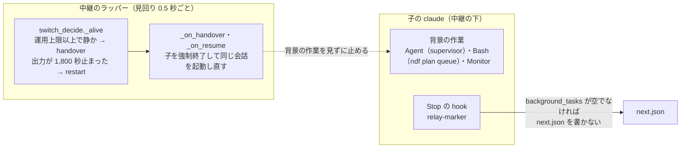
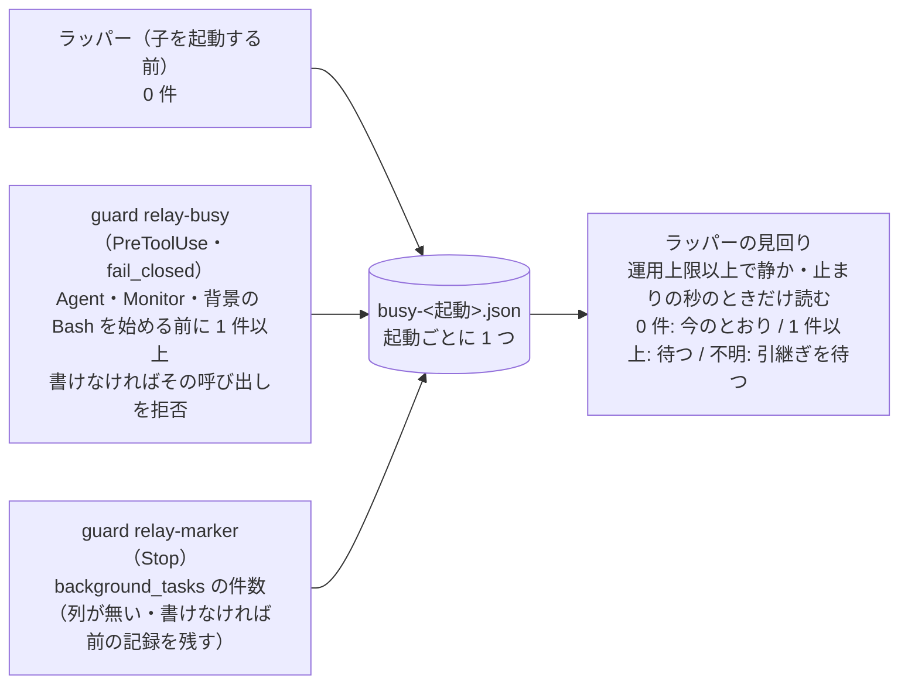
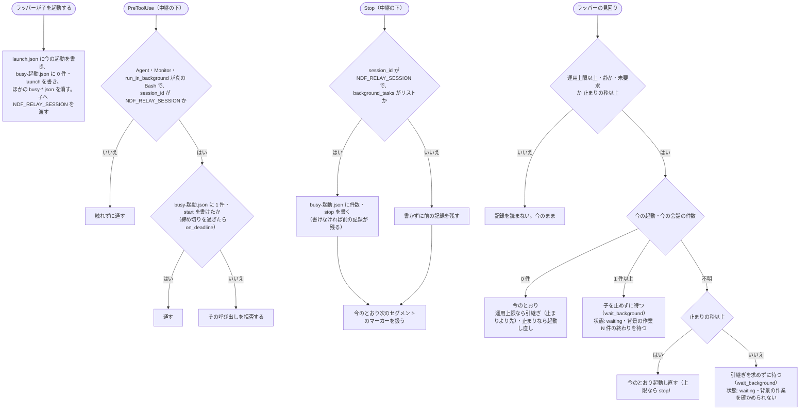

# 中継のラッパー: 背景の作業が残る子を引継ぎと止まりの判定で止めず、終わるのを待つ（#4049）

中継のラッパーは、文脈の量が運用上限を超えた子と出力が 30 分止まった子を、背景で supervisor や `ndf plan queue` が動いていても強制終了し、そのフェーズの作業を失わせていた。子の起動ごとに背景の作業の記録を 1 つ置き、起動の前・背景の作業の開始・Stop（Claude Code の `background_tasks`）の 3 つの時点で件数を書く。ラッパーは 0 件と確かめた子だけを引継ぎで止め、1 件以上の間は引継ぎも起動し直しもせずに待つ。記録は起動ごとの別のファイルで、書くのは子の会話の hook だけなので、止めた子と入れ子の claude は今の子の記録に届かず、排他を持たない。#4041 の下書きの仕組みを採らなかった理由は「決定の記録」に、調べた製品は付録の「外部の調査」にある。

## 今の姿

何が起きたか・目的・受け入れ条件は要求仕様（[issue-4049-requirements.md](./issue-4049-requirements.md)、正は #4049 の本文）にある。この文書は「どう解くか」と「なぜその解き方か」だけを書く。パスは `plugins/ndf/` からの相対で書く。

設計に要る今の構造:

| 部品 | 今の振る舞い | 場所 |
| --- | --- | --- |
| 引継ぎの判定 | 文脈の量が上限以上（今は `relay.context` の 800,000、#3995 の後は `context.limit` の 500,000）で、子の出力か端末の入力が `relay.quiet`（5 秒）無く、このセグメントでまだ求めていなければ `handover`。止まりより先に判定する | `src/ndf/domains/relay/switch_decide.py` の `_alive` |
| 止まりの判定 | 子の出力か端末の入力が `relay.stall`（1,800 秒）無ければ `restart`、今日起動し直した回数が上限なら `stop`。止まりの `restart` は最初の入力を持たない（`_on_resume` が空の文で `--resume` だけを打つ） | 同上・`src/ndf/domains/relay/wrapper.py` の `_on_resume`・`_start` |
| 子を止める | 質問のロックを待たずに取り、質問のファイルが無ければ子を強制終了し、今の起動の記録（`launch.json`）を外す（子が終わらなかったときも外す） | `wrapper.py` の `_stop_if_clear` |
| 起動の ID | 子を起動するたびに ID を作り、`launch.json` に書いてから子へ `NDF_RELAY_DIR`・`NDF_RELAY_LAUNCH` で渡す（#3814） | `wrapper.py` の `_start`・`src/ndf/domains/relay/signals.py` の `launch_env` |
| 状態の表示 | 手の種類ごとの動き（`_ACTIONS`）が状態のファイルを書き、`ndf relay ls` が一覧に出す。`wait` は動きを持たず、状態のファイルを書かない | `wrapper.py` の `_act`・`_write_state` |
| 背景の作業の列 | Claude Code が Stop の入力に `background_tasks` を渡す。読むのは `relay-marker`（空でなければ次のセグメントのマーカーを書かない）と `unattended` だけで、ラッパーは読まない | `src/ndf/domains/hooks/guards/relay_mark.py`・`guards/unattended.py` |

## 文脈と制約

- **Claude Code の公式の文書は、Stop の入力の `background_tasks` を「会話が終わったのか、背景の作業に起こされるのを待っているのか」を見分けるための列と書く**（外部の調査の PRD1）。種類は `shell`・`subagent`・`monitor`・`workflow` などで、タスクの登録簿に届かないときは項目そのものが無い。2026-11-22 に Claude Code 2.1.330 で、背景の Agent と背景の Bash を起動して応答を終えた会話の Stop の入力を採った。`subagent` と `shell` の 2 件が載り、Agent が終わった後の Stop では Agent の行が消えた。サブエージェントの中の hook も親と同じ `session_id` を持ち、`agent_id` だけが違った
- **Stop は利用者の中断（Esc）では発火しない**（PRD1）。背景の作業を始めた応答を Esc で止めると、その応答の Stop の列は届かない
- **Stop の後にも会話の記録へ行が足される。** 2026-11-22 の実測で、Stop の hook の時点の記録は 27 行、4 秒後は 36 行（`stop_hook_summary`・`last-prompt` など）だった。会話の記録の更新の時刻では、Stop の記録がその後の動きより新しいかを判定できない
- **子のシェルから起動した claude は、中継の環境変数を引き継ぐ。** `NDF_RELAY_DIR`・`NDF_RELAY_LAUNCH` を外すのはアカウントの登録だけで（`relay/account_login.py` の `AUTH_ENV`）、`ndf plan queue` の worker や `claude -p` の hook も同じ起動の ID で動く。見分けられるのは入力の `session_id` である
- ラッパーが子を止めて起動し直すと、背景の作業は子と一緒に終わり、新しい子の Claude Code の列には残らない（要求の前提 2）。止めた子の hook のプロセスは、子の終わりの後にも残りうる
- 子が応答の途中にある間は、Claude Code の画面が動き続け、子の出力は 5 秒止まらない。今の引継ぎの判定も、この前提で応答の途中の子を止めない（要求の前提 1）
- hook の経路は `ndf.contracts` を import せず、シグナルファイルは標準ライブラリだけで書く（`signals.py` の冒頭・決定 111）。hook は予算（PreToolUse は 1 秒、Stop は 3.5 秒の締め切り）の中で走り、`fail_closed` でない guard の失敗と締め切りは通す側へ倒れる。`fail_closed` の guard は予算を使い切っても呼ばれ、締め切りでは `on_deadline` が拒否を返せる（`hooks/main.py` の `_deadline_out`。`ask-forward` が使う型）
- この課題は #3995 の運用上限（`context.limit`。`context_thresholds.thresholds` が返す値）をそのまま使い、閾値の値と置き場を変えない。#3995 の止める文の「supervisor・`ndf plan queue` は止めずに報告を待つ」と `HANDOVER_PROMPT` の「背景の作業は終わった」は、この課題の後に、ラッパーの振る舞いと合う
- NDF は普及のフェーズの前で、シグナルファイル・hook の表・環境変数の形を変えても互換の経路を持たない（MVV Value 4）

## 解き方の全体像

- 子の起動ごとに、中継の保存先に背景の作業の記録 `busy-<起動の ID>.json` を 1 つ置く。書くのは、ラッパーが子を起動する前（0 件）と、子の会話（`session_id` が子のもの）の hook だけである。guard `relay-busy` は背景の作業を始める呼び出しの PreToolUse で「1 件以上」を書き、書けなければその呼び出しを拒否する。`relay-marker` は Stop で `background_tasks` の件数を書き、列が無い・書けないときは前の記録を残す
- このため、記録が 0 件なら、その記録の後に背景の作業は始まっていない（hook から見える開始の呼び出しに限る。要求の前提 5）。止めた子の hook と入れ子の claude は、今の子の記録に届かない
- ラッパーは、文脈の量が運用上限以上で子が静かなときと、止まりの秒に達したときだけ記録を読む。0 件なら今のとおり引継ぎ・起動し直しへ進み、1 件以上なら子を止めずに待ち、`ndf relay ls` の状態の理由に件数と記録の時刻を出す。記録が無い・読めないときは引継ぎを待ち、止まりの判定は今のとおり行う
- 背景の作業が終わると Claude Code が知らせで子を起こし、その応答の Stop が件数を書き直す。運用上限以上の子は #3995 の guard に引継ぎへ進まされ、0 件になった後の静かな見回りでラッパーも引継ぎを求められる

## データ構造

背景の作業の記録（`<中継の保存先>/busy-<起動の ID>.json`。実行の間だけ。コミットしない）。一時の名前で書いて名前を変える（`signals.replace_json`）。

| 項目 | 型 | 意味 |
| --- | --- | --- |
| `launch` | 文字列 | 書いた起動の ID。ファイルの名前と同じ |
| `session_id` | 文字列 | 書いた会話の ID（子の会話） |
| `count` | 0 以上の整数 | 背景の作業の件数。`source` が `start` なら「少なくとも 1 件」 |
| `source` | `launch` / `start` / `stop` | 書いた時点（ラッパーが起動する前・背景の作業を始める前・Stop） |
| `at` | ISO 8601 の時刻 | 書いた時刻。状態の理由に出す |

例: `{"launch": "9f2c…", "session_id": "e1ed…", "count": 2, "source": "stop", "at": "2026-11-22T03:19:34+00:00"}`

ラッパーが読む値は 3 つに分かれる。

| 読んだ記録 | ラッパーが読む値 | 引継ぎ | 止まりの判定 |
| --- | --- | --- | --- |
| 今の起動・今の会話で `count` が 0 | 0 件 | 今のとおり | 今のとおり |
| 今の起動・今の会話で `count` が 1 以上 | 1 件以上 | 待つ | 待つ |
| ファイルが無い・読めない・形が違う・会話が違う | 不明 | 待つ | 今のとおり |

ラッパーは子を起動するたびに、今の起動のもの以外の `busy-*.json` を消す（止めた子の遅れた hook が後から書いたものも、次の起動で消える）。

## 処理の流れ

背景の supervisor を待つレーンの conductor の例を時間の順に追う。

1. conductor が supervisor を背景の Agent で起動する。その PreToolUse で記録が「1 件以上」になる。応答を終えた Stop の `background_tasks` は `subagent` の 1 件で、件数 1 に置き換わる
2. 文脈の量が運用上限を超え、子が 5 秒静かになる。ラッパーは記録を読んで 1 件と知り、子を止めずに待つ。`ndf relay ls` は `waiting` と「背景の作業 1 件の終わりを待つ（記録 <時刻>）」を出す。30 分を超えて知らせが来なくても起動し直さない
3. supervisor が報告を返すと、Claude Code が知らせで conductor を起こす。#3995 の guard が引継ぎに要る呼び出しだけを通すので、conductor は監視（`ndf plan wait`）を TaskStop で止め、引継ぎ文書と `ndf-next` のブロックを書いて応答を終える
4. その Stop の件数は 0 になる。`relay-marker` が次のセグメントのマーカーを書き、ラッパーは新しいセッションで次のセグメントを起動する。マーカーを書かずに応答を終えたときは、次の静かな見回りで 0 件を読んで今のとおり引継ぎを求める

## 決定の記録

### 決定 1: 子の背景の作業を Claude Code の数え方で知るため、Stop の `background_tasks` の件数を hook がシグナルファイルへ書き、ラッパーが読む

- **質問**: ラッパーは、子が背景の作業を抱えているかを何で知るか
- **選んだ案**: Claude Code が Stop の入力に渡す `background_tasks` の件数を、中継の下の Stop の hook が中継の保存先の記録へ書き、ラッパーが読む。列は Claude Code が「背景の作業に起こされるのを待っている」ことを見分けるために渡すもので、背景の Agent・背景の Bash・Monitor・ワークフローを同じ形で含む（PRD1。Agent と Bash は 2026-11-22 に実測）。監視と作業を見分けずに、列に載る作業はすべて待つ
- 採らなかった案: ラッパーが子のプロセスの木から背景の作業を知る（背景の Agent は子の claude のプロセスの中で動き、プロセスの木に現れない）
- 採らなかった案: ラッパーが会話の記録から背景の作業の起動と完了の知らせを数える（記録の行の形は公式の文書に無く、Stop の後にも行が足されるので、記録の読み方が Claude Code の版で変わりうる）
- 採らなかった案: サブエージェントの会話の記録の置き場（`<セッション>/subagents/`）の有無で背景の Agent を知る（背景の Bash と Monitor を覆えず、終わった Agent の記録も残る）
- 採らなかった案: 列の `type` と `command` で監視（`ndf lanes wait`・`ndf plan wait`・Monitor）を見分け、監視だけが残る子は今のとおり止める（コマンドの文で見分ける規則がコマンドの名前と打ち方に縛られる。待つ間の子は応答を終えていて費用を使わず、監視が戻れば #3995 の guard が引継ぎへ進ませるので、待つことで失うものが無い）
- **代償**: 何時間も戻らない監視（オーガナイザーの `ndf lanes wait` など）だけが残る子も、監視が戻るまで引継ぎを待つ。終わらない監視（`tail -f` の Monitor など）だけが残る子は、待ち続ける。その間の子は入力を待つだけで token を使わない。`background_tasks` の形を Claude Code が変えると、件数を書けずに前の記録が残る
- 作り方: 自前で作る・標準に倣う（Claude Code の hook の入力の項目を読み、今のシグナルファイルの書き方で書く）
- 比べた候補: PRD1
- 根拠: Value 3 / Value 12（MVV バージョン 11）

### 決定 2: 記録の 0 件を「その後に背景の作業が始まっていない」と読めるよう、開始の記録を書けない呼び出しを拒否し、Stop は列が無ければ書かない

- **質問**: Stop が届かない（Esc の中断）・書けない・列が無い場面で、ラッパーが古い 0 件を読んで背景の作業を抱えた子を止めないには、だれがいつ何を書き、書けないときにどう扱うか
- **選んだ案**: 書き手を 3 つにし、どれも前の中身を読まない置き換えにする。(1) ラッパーが子を起動する前に 0 件（起動したばかりの子は背景の作業を持たない）。(2) 新しい guard `relay-busy`（PreToolUse・`fail_closed`）が、背景の作業を始める呼び出し（Agent・Monitor・`run_in_background` が真の Bash）の前に「1 件以上」（件数 1・`source: start`）。書けないときと、書き終える前に締め切りを過ぎたとき（`on_deadline`）は、その呼び出しだけを拒否する。呼び出しが別の guard に拒否されて実行されなくても書くので、次の Stop までは 1 件以上のままになる（多めに倒す）。(3) `relay-marker`（Stop）が、入力の `background_tasks` がリストのときだけ件数を書き、項目が無い・リストでないとき（タスクの登録簿に届かなかった）と書けないときは前の記録を残す。こうすると、記録が 0 件なら、その記録の後に hook から見える背景の作業の開始は無い。判定に使うのは 0 件か 1 件以上かだけで、正確な件数は次の Stop が書き直す
- 採らなかった案: 開始の記録を書けなくても呼び出しを通す（開始の記録の失敗が 1 回でも、その応答を Esc で止めると Stop が来ず、前の 0 件で子を止める）
- 採らなかった案: #4041 の下書きの形（PreToolUse で前の件数に 1 を足す読み書きを排他 `busy.json.lock` の中で行い、ラッパーは子を止める直前に同じ排他を持って 0 件を確かめ直す。1 を足す読み書きが排他を要し、排他が hook の締め切り・質問のロック・子の強制終了の順序と絡み、cross-review のラウンド 2〜5 の指摘 20 件がこの細部に集まった。判定に要るのは 0 件か 1 件以上かだけで、正確な件数は Stop が書き直すので、読み書きも排他も要らない）
- 採らなかった案: 記録がすでに 1 件以上なら、開始の呼び出しでは書き直さない（Stop の 0 件の後の最初の開始は必ず書く必要があるが、2 回目以降の開始は同じ「1 件以上」を書き直すだけである。ただし、書き直しを省くかを決めるには、呼び出しのたびに前の記録を読み、起動・会話・件数を確かめることになる。呼び出しごとのファイルの操作は無くならず、省けるのは 2 回目以降の小さなファイルの置き換えだけで、その代わりに記録が無い・壊れた・別の会話である場合の分岐が hook に増える。毎回書けば、前の中身がどうであっても 1 回の置き換えで正しい記録になる）
- 採らなかった案: Stop の項目が無いときに件数を不明（`null`）で書く（開始が書いた 1 件以上を不明へ弱め、止まりの判定で起動し直させる）
- 採らなかった案: 列の件数を Stop の文脈の `ctx.background_tasks` で数える（項目が無い・リストでない入力を空のリストに畳むので、不明が 0 件になる。入力の `background_tasks` を直に見る）
- 採らなかった案: `relay-marker` に PreToolUse を足して開始も書かせる（`relay-marker` は `fail_closed` でなく、`fail_closed` にすると Stop の例外が変更要求（応答を続けさせる）に変わる。開始と Stop で失敗の倒し方が逆なので、行を分ける）
- 採らなかった案: 排他にライブラリ（`filelock`）を使う（この形は排他を要らない。hook の経路に依存も増える）
- **代償**: 中継の下で背景の作業を始める呼び出しは、記録を書けない（中継の保存先のディスクの失敗・hook の締め切り）と拒否され、モデルが呼び直す。拒否されても記録が 1 件以上になった呼び出しの後に Esc で中断すると、次の Stop まで背景の作業の無い子を待つ（その子は入力を待つだけで、人が入力すれば Stop が書き直す）。hook から見えない開始（利用者の Ctrl+B・Claude Code の自動の切り替えで背景へ回った Bash、ワークフローなど）の後に Esc で中断した応答は、前の 0 件で止め得る（今と同じ振る舞い）。Stop の 0 件の書き込みだけが失敗すると、前の 1 件以上が残り、次の Stop まで待つ。PreToolUse は背景の作業を始める呼び出しごとに 1 回、Stop は応答ごとに 1 回、小さなファイルを書く（中継の下だけ）
- 作り方: 自前で作る（今のシグナルファイルの書き方 `replace_json` と `fail_closed` の guard の `on_deadline`）
- 比べた候補: PRD1 / LIB1
- 根拠: Value 3 / Value 9（MVV バージョン 11）

### 決定 3: 止めた子と入れ子の claude に今の子の記録を書き換えさせないため、記録を起動ごとのファイルにし、子の会話の hook だけが書く

- **質問**: 止めた子の遅れた hook と、子のシェルから起動した claude（同じ `NDF_RELAY_DIR`・`NDF_RELAY_LAUNCH` を引き継ぐ）の hook が、今の子の記録を書き換えないには、何で見分けるか
- **選んだ案**: 記録を起動ごとのファイル `busy-<起動の ID>.json` にする（起動の ID は `[0-9a-f]{32}` の形だけを受け、ほかの値ではファイルの名前を作らずに書かない）。ラッパーは子を起動するときに、子の会話の ID を新しい環境変数 `NDF_RELAY_SESSION` で渡し、hook は入力の `session_id` がそれと同じときだけ書く。入れ子の claude は別の `session_id` を持つので書かず、サブエージェントの中の hook は親と同じ `session_id` を持つので書く（2026-11-22 に実測）。止めた子の hook は自分の起動のファイルにしか書けない。ラッパーは今の起動のファイルだけを読み、会話の ID も照らす。子を起動するたびに、ほかの起動のファイルを消す
- 採らなかった案: 1 つのファイル `busy.json` に起動の ID を書き、書き手が書く前に `launch.json` と照らす（照らした後に止まった遅れた hook が、新しい起動の記録を旧い起動の記録で置き換え、今の子の記録が不明になる。不明の子は止まりの判定で起動し直され、背景の作業を失う）
- 採らなかった案: 書き手が排他の中で `launch.json` と照らしてから書く（下書きの形。排他の待ちが hook の締め切りに入り、決定 2 の拒否が増える。起動ごとのファイルなら照らす必要が無い）
- 採らなかった案: 入れ子の claude を起動する側（`ndf plan queue`・`external-ai` など）が中継の環境変数を外す（起動する経路がコマンドごとに散らばり、1 つでも外し忘れると今の子の記録を書き換える。書き手の側で 1 か所で見分けるほうが漏れない）
- 採らなかった案: 次のセグメントのマーカー（`next.json`）にも起動の ID を書いて照らす（下書きの形。止めた子の Stop の hook が子を止めた直後に遅れて書く場面は、背景の作業に依らない今の切り替えの話である。ラッパーが子を止めるのは子が 5 秒以上静かな後で、この課題の範囲の外）
- **代償**: 中継の環境変数が 1 つ増える（`NDF_RELAY_SESSION`）。起動ごとのファイルは次の起動まで残り、ラッパーの実行が終わると中継の保存先と一緒に片付く
- 根拠: Value 3 / Value 8（MVV バージョン 11）

### 決定 4: 確かめられない子と背景の作業を待つ子を区別するため、不明なら引継ぎだけを待ち、1 件以上なら止まりの判定でも起動し直さない

- **質問**: 記録が不明なときと 1 件以上のときに、引継ぎと止まりの判定をどう扱うか。止まりの判定は背景の作業が残る子に何で止まりを見るか
- **選んだ案**: 判定の順は今のとおり引継ぎを止まりより先に見る。0 件なら今のとおり（運用上限・静か・未要求なら引継ぎ、止まりなら起動し直しか上限の `stop`）。1 件以上なら、どちらの条件でも子を止めずに待つ（新しい手 `wait_background`）。子は応答を終えて知らせを待っているだけで、止まってはいない。止まりで起動し直すと背景の作業は子と一緒に終わり、起動し直した会話は最初の入力も知らせも受け取らない（止まりの `restart` は空の文で `--resume` だけを打つ）ので、入力を待つだけで進まない。不明なら引継ぎを待ち、止まりの判定は今のとおり行う（応答の途中で固まった子を救う今の手を残す）
- 採らなかった案: 背景の作業が残る間は、子の出力と会話の記録（本体とサブエージェントの記録）の新しいほうの更新で止まりを見る（下書きの形。背景の Bash（`ndf plan queue`）は会話の記録を書かないので、30 分を超えるキューは今のとおり止められる。サブエージェントの記録の置き場は公式の文書に無い。起動し直しても止まった作業は進まない）
- 採らなかった案: 背景の作業が残る間の止まりの秒を別の上限で長くする（どの値でも、超えた後の起動し直しが作業を失わせる時点を遅らせるだけで、上限の設定が 1 つ増える）
- 採らなかった案: 不明を 0 件として扱う（壊れた記録で背景の作業を抱えた子を止める）
- 採らなかった案: 不明でも止まりの判定で起動し直さない（記録の無い起動で応答の途中に固まった子が救われない）
- **代償**: 背景の作業そのものが止まった（supervisor が戻らない）子は、ラッパーが待ち続ける。止まりは人かオーガナイザーが `ndf relay ls` の理由（背景の作業 N 件の終わりを待つ・記録の時刻）で見て、`ndf relay restart` で起動し直す。待つ間は止まりの起動し直しを数えないので、今日起動し直した回数の上限（`relay.max-starts`）に近づかない
- 根拠: Value 3 / Value 2（MVV バージョン 11）

### 決定 5: 待ちを人とオーガナイザーから見えるようにするため、待つ間は状態を `waiting` と理由で書き、待ちが解けたら `running` へ戻す

- **質問**: 背景の作業を待つ子を、`ndf relay ls` でどう見せ、待ちが解けた後に古い理由を残さないにはどうするか
- **選んだ案**: 待つ手 `wait_background` は、今の `forward`・`wait_reset` と同じく状態のファイルを `waiting` と理由で書く。理由は件数（`source` が `start` なら「1 件以上」、`stop` なら「N 件」）と記録の時刻、不明なら「確かめられない」を示す。`_alive` が「子が動いている」で返していた手を新しい手 `active` にし、状態を `running` と「子が動いている」で書く（同じ状態と理由は書き直さない今の `_write_state` のまま）。これで、待ちが解けて子が動き出した見回りで `running` へ戻る
- 採らなかった案: 待つ手を今の `wait` のまま理由だけを変える（`wait` は状態のファイルを書かないので、`ndf relay ls` に届かない）
- 採らなかった案: 待ちの理由をラッパーの記録（`log.jsonl`）だけに書く（`ndf relay ls` で見えず、止まった背景の作業を人が見つけられない）
- **代償**: 中継の記録（`log.jsonl`）の行の種類に `wait_background` と `active` が増え、「子が動いている」の行は `wait` から `active` へ変わる。回答待ちの質問（`QUESTION_PENDING`）と次のセグメントの静かな時間の待ちは `wait` のまま、状態を書かない
- 根拠: Value 1（MVV バージョン 11）

### 決定 6: 引継ぎを確かに終えさせる仕組みを 1 つにするため、Stop での変更要求を足さず、背景の作業の知らせと #3995 の guard に任せる

- **質問**: 運用上限以上で背景の作業が残ったまま応答を終える子に、ラッパーが待つ間、監視の停止と引継ぎを促す文を Stop で返すか
- **選んだ案**: 返さない。背景の作業が終わると Claude Code が知らせで子を起こす（PRD1。背景のサブエージェントの報告は UserPromptSubmit を発火させる）。その応答が Tool を呼べば #3995 の guard が引継ぎに要るものに絞り、止める文が監視の停止と引継ぎ文書の書き方を示す。Tool を呼ばずに応答を終えれば、その Stop が件数を書き直し、0 件なら次の静かな見回りでラッパーが引継ぎを求める。次のセグメントのマーカーは今のとおり `relay-marker` が背景の作業の終わりの後に書く
- 採らなかった案: guard `context-limit` を Stop にも置き、背景の作業が残る応答の終わりに止める文と同じ変更要求を利用者の入力ごとに 1 度返す（下書きの形。引継ぎを早めるだけで作業は守らず、待つ間の子は token を使わない。Stop の変更要求は `relay-marker`・`stop-wait` と同じ共通の枠を使うので、枠の数え方の取り決めも増える）
- **代償**: 監視だけが残る子が引継ぎへ進むのは、監視が戻ってからである（決定 1 の代償と同じ）
- 根拠: Value 3 / Value 12（MVV バージョン 11）

## 影響と危険

- **働く範囲**: 利用先のリポジトリでも働く（中継のラッパーと NDF のプラグインの hook）。中継の下（`NDF_RELAY_DIR` がある）の Claude Code の会話だけで、中継の外と Codex では guard は何もしない
- **プロジェクトごとに違うもの**: 無い。設定も引数も足さない
- **当たるモード**: すべてのモード（中継の下で背景の作業を使う会話）
- **壊れうる箇所**:
  - 背景の作業が残る子は、引継ぎと止まりの判定で止められなくなる。背景の作業が戻らない子は待ち続ける（決定 4 の代償）
  - 中継の下で背景の作業を始める呼び出しは、記録を書けなければ拒否される（決定 2 の代償）。入れ子の claude と中継の外の会話は拒否されない
  - 中継の下の PreToolUse（背景の作業を始める呼び出しだけ）と Stop に、小さなファイルの書き込みが 1 回ずつ増える。見回りの読み取りは、運用上限の条件か止まりの条件がそろった見回りだけで増える
  - ラッパーと hook の版が食い違う間（ラッパー自身のコードは `/exit` で打ち直した後から、hook はプラグインの更新の後の次のセグメントから効く。`relay.md` の「変更が効く時点」）: 旧いラッパーの下の新しい hook は `NDF_RELAY_SESSION` が無いので何も書かず、何も拒否しない。新しいラッパーの下の旧い hook は何も書かないので、記録は起動の前の 0 件のままで、ラッパーは今と同じく子を止める
  - 中継の記録の行の種類が変わる（決定 5）。`log.jsonl` を読む外の道具があれば `wait` の「子が動いている」の行が `active` になる。リポジトリの中の読み手は無い（`log.jsonl` を引くのは `relay/registry.py`・`wrapper.py`・`hub.py` と手順書だけで、行の種類を読むのは書き手の `wrapper.py` だけ。`grep -rn '"wait"' plugins/ndf/src` は `switch_decide.py` と、別の意味の `crossrefactor/final_gate.py` だけ。2026-11-22 に確かめた）。`tests/domains/relay/test_relay_decide.py` の「子が動いている」の手を `wait` と照らす行は `active` へ直す
  - 同じファイルを触る別の変更: #3995 は `switch_decide.py`（比べる値）・`wrapper.py`（引継ぎの文）・`guards.json`（`context-limit` の行）・`relay.md`・`env.json` を触る。#4049 は #3995 の実装の後に、その上で実装する。中継のアカウントの切り替え（#3604 #3864）も `switch_decide.py` を触る。実装の前に `gh pr list` の触るファイルで打ち直す
  - 範囲の外: 利用上限でアカウントを替える起動し直し（`account`）は、背景の作業が残る子も止める（要求の「含まない」）

### 代表のリポジトリでの振る舞い

| 代表のリポジトリ | 設定の要点 | 直した後に起きること | この種類で扱えなくなること |
| --- | --- | --- | --- |
| Web サービス（nd-factory） | 中継の下でレーンの conductor が supervisor とプランのキューを背景で回す | 背景の作業が残る間、文脈の量が運用上限を超えても 30 分を超えて知らせが無くても子は止まらず、作業が終わった後に引継ぎへ進む | 無し |
| モバイルアプリ | 同上 | 同上 | 無し |
| 業務文書だけ | 同上（背景の作業は少ない） | 同上。背景の作業が無い子は今と同じ | 無し |

### ai-plugins だけの事情

- 無し（ラッパーと hook の既定の振る舞いを変えるだけで、このリポジトリだけが置く設定は無い）

## 用語

| 用語 | 意味 | 用語集への反映 |
| --- | --- | --- |
| 背景の作業 | Claude Code が会話の外で動かし、終わると会話へ知らせる作業（背景の Agent・`run_in_background` の Bash・Monitor など）。Stop の hook の入力の `background_tasks` に載る | 追加 |
| 背景の作業の記録 | 子の起動ごとに、背景の作業の件数をラッパー（起動の前）と子の会話の hook（背景の作業を始める前・Stop）が書き、ラッパーが読むシグナルファイル（`busy-<起動の ID>.json`） | 追加 |
| シグナルファイル | ラッパーへ知らせるファイル（`next.json`・`stop`・背景の作業の記録） | 意味の変更 |

用語集（`docs/glossary/glossary.json`）への反映と `ndf records glossary render` は、この設計 Pull Request の範囲（`issues/issue-4049-*`）の外なので実装の Pull Request で行う。

## テスト設計

| 受け入れ条件 | どの振る舞いで縛るか | どう壊したら落ちるべきか |
| --- | --- | --- |
| 1 | 運用上限で静かな見回りで、今の起動の記録が 1 件なら `wait_background`、0 件なら `handover`。運用上限 − 1 では件数に依らず `handover` を返さない。子の環境の Stop の入力（見本の形）を hook の入口から流して書いた記録で、ラッパーの見回りまで通す | 件数を見ない・1 件以上で止めると落ちる |
| 2 | 止まりの秒の見回りで、1 件なら `wait_background`、0 件なら `restart`（今日の上限なら `stop`）。運用上限・静か・未要求と止まりが同時にそろったとき、0 件は `handover`、不明は `restart`、1 件以上は `wait_background` | 止まりの判定が件数を見ない・順を変えると落ちる |
| 3 | 中継の下の Agent・Monitor・`run_in_background` が真の Bash の PreToolUse で記録が「1 件以上」になり、`run_in_background` の無い Bash・Read・中継の外では触れない。Stop で 0 件を書いた後に Agent の PreToolUse を流すと、Stop を流さずに運用上限で静かになっても、止まりの秒に達しても子を止めない。Agent の PreToolUse を別の guard が拒否しても記録は 1 件以上 | 開始を書かない・Stop だけで判定すると落ちる |
| 4 | ラッパーが子を起動すると、子を起こす前に記録が新しい起動の 0 件になり、ほかの起動の記録が消える。Stop を 1 度も流さない起動でも、運用上限で静かなら `handover` | 起動の前に書かない・最初の Stop の前を不明にすると落ちる |
| 5 | 起動 A を止めて B を起動した後、A の環境の Stop（0 件）と PreToolUse を流しても B の記録は変わらない（A が照らした後に止まって B の記録の後に書く順でも変わらない）。B の環境で別の `session_id` の Stop（入れ子の claude）を流しても B の記録は変わらない。B の記録が壊れた JSON・`count` が文字列か負か真偽値・`launch` が B と違う・`at` が無いか文字列でない・別の会話・ファイルが無い・読めない（権限・不正な UTF-8）ときは、運用上限で静かでも `handover` を返さず、止まりの秒なら `restart` | 別の起動の記録を読む・会話を照らさない・不明を 0 件とする・読みの失敗で見回りが落ちると落ちる |
| 6 | 1 件で待った後、Stop が 0 件を書いた次の静かな見回りで `handover` を返し、同じセグメントで 2 度目は返さない | 0 件に戻っても待ち続けると落ちる |
| 7 | 中継の下の背景の作業を始める PreToolUse で書き込みを失敗させると拒否（理由の文つき）。hook の通常の予算（`budget.usable`）を使い切った後も `relay-busy` は呼ばれ、書ければ通し、書けなければ拒否する。締め切りを過ぎたときは、書き終えていれば通し、書き終えていなければ拒否する。背景でない Bash と Read は、どの場合も空の出力で通す。Stop で書き込みに失敗しても、その失敗を理由に変更要求を返さない。次のセグメントのマーカーに関する今の判定は続ける（次のセグメントのブロックがあり背景の作業が残る Stop では、今のとおり変更要求を返す） | 開始の記録の失敗で通す・ほかの呼び出しまで止めると落ちる |
| 8 | 1 件以上の記録の後、`background_tasks` の項目が無い Stop・リストでない Stop・書き込みに失敗した Stop を流しても 1 件以上が残り、次の成功した Stop の 0 件で解ける | 項目が無いと 0 件か不明で書くと落ちる |
| 9 | 1 件で待つ見回りで状態のファイルが `waiting` と件数・記録の時刻を持ち、開始の記録なら「1 件以上」、不明なら確かめられないことを示す。待ちの後に子が動き出した見回りで `running` へ戻る | 状態を書かない・戻さないと落ちる |
| 10 | 運用上限 − 1 で静か・運用上限で静かでない・引継ぎを求め済み・止まりの秒の手前の見回りでは、記録の読み取りが 0 回。条件がそろった見回りでは 1 回 | 見回りごとに読むと落ちる |
| 11 | 上の行のテストは文脈の量の境界の値と呼び出しの回数で判定し、時間で区切らない（時刻は差し替えた時計で進める） | — |

`guards.json` の新しい行が hook の登録と入口（`hooks/main.py`）から呼ばれることは、PreToolUse と Stop の入力を hook の入口から流すテストで確かめる。要求の「含む」の手順書の直し（`relay.md` の判定の表と hook の一覧）は文言を突き合わせるテストを書かず、ドキュメントレビューで見る。

## どこを変えるか

詳細設計は [issue-4049-design-detail.md](./issue-4049-design-detail.md) にある（新設する関数 11・シグネチャを変える関数 1 のため。新設は `signals.write_busy`・`signals.read_busy`・`signals.drop_other_busy`・`signals.relay_session`・`relay_busy.check`・`relay_busy.on_deadline`・`relay_busy._starts_background`・`switch_decide.needs_background`・`switch_decide._over`・`switch_decide._stalled`・`Wrapper._on_active`、シグネチャを変えるのは `signals.launch_env`）。

## 設計の結果

| 課題 | 扱い | 統合先 | 触るファイル |
| --- | --- | --- | --- |
| #4049 | 実装する | — | `plugins/ndf/src/ndf/domains/hooks/guards/relay_busy.py`（新設）、`plugins/ndf/src/ndf/domains/hooks/guards/relay_mark.py`、`plugins/ndf/src/ndf/domains/relay/signals.py`、`plugins/ndf/src/ndf/domains/relay/switch_decide.py`、`plugins/ndf/src/ndf/domains/relay/wrapper.py`、`plugins/ndf/contracts/hooks/guards.json`、`plugins/ndf/contracts/hooks/runtimes.json`、`plugins/ndf/contracts/domains/ndf-files.json`、`plugins/ndf/contracts/domains/env.json`、`plugins/ndf/docs/contracts/hooks.md`（再生成）、`plugins/ndf/docs/contracts/files.md`（再生成）、`plugins/ndf/docs/contracts/env.md`（再生成）、`plugins/ndf/skills/development-workflow/references/relay.md`、`docs/glossary/glossary.json`、`docs/glossary.md`（再生成）、`plugins/ndf/tests/domains/hooks/test_guards.py`、`plugins/ndf/tests/domains/relay/test_relay_parts.py`、`plugins/ndf/tests/domains/relay/test_relay_decide.py`、`plugins/ndf/tests/domains/relay/test_relay_wrapper.py` |

## 未確認のまま残ること

| 項目 | 内容 |
| --- | --- |
| Monitor がいつ列に載るか | 公式の文書は `background_tasks` の種類に `monitor` を挙げるが、Monitor の呼び出しの後の Stop の入力は採っていない。載らなければ、開始の「1 件以上」が Stop の 0 件に置き換わり、Monitor だけが残る子は今のとおり止められる（監視は打ち直せるので作業は失われない）。実装の `tdd-cycle` で、Monitor を起動した会話の Stop の入力を見本（`tests/domains/hooks/samples/claude/`）として採って分かる |
| 応答の途中の画面 | 子が応答の途中にある間、子の出力が 5 秒止まらないこと（要求の前提 1）は、今の引継ぎの判定が前から立つ前提で、この課題では測っていない。崩れても、記録が 0 件ならその後に hook から見える開始は無い（決定 2）ので、背景の作業は失われない。失われうるのは今と同じく応答の途中の前景の作業で、リリースの後のラッパーの記録（`log.jsonl` の `handover` の行の直前の子の出力の時刻）で分かる |
| 読んでから止めるまでの起床 | ラッパーが 0 件を読んで子を止めるまでの間（同じ見回りの中）に、会話の予定の起床（`session_crons`）が子を動かして背景の作業を始めると、その作業を失う。起床が見回りの 1 回の中に重なるときだけで、この課題では排他で防がない。予定の起床を持つ会話を引継ぎで止めてよいかは、この課題の範囲の外である |

## 外部の調査

| 種類 | 調べるか | 理由 |
| --- | --- | --- |
| 標準・仕様 | 調べない | 背景の作業の記録は、プラグインの中のラッパーと hook の取り決めだけで形が決まり、従う公開の仕様が無い |
| 主要な製品 | 調べる | 子の背景の作業を知る手段と Stop の発火の条件は Claude Code の hook の仕様で決まる |
| ライブラリとサービス | 調べる | プロセスの間の排他を既存のライブラリで済ませられるかを確かめる |

### 主要な製品

| # | 製品 | どう解いているか | 設計への反映 | 出典 |
| --- | --- | --- | --- | --- |
| PRD1 | Claude Code の hook（Stop・PreToolUse・UserPromptSubmit） | Stop の入力の `background_tasks` は「会話が終わったのか、背景の作業に起こされるのを待っているのか」を見分けるための列で、種類は `shell`・`subagent`・`monitor`・`workflow`・`teammate` など。タスクの登録簿に届くときだけ項目があり、何も動いていなければ空である。Stop は利用者の中断では発火しない。背景のサブエージェントの報告と会話の予定の起床は UserPromptSubmit を発火させ、会話を起こす。サブエージェントの中の PreToolUse には `agent_id` が付く | 件数を Stop の列から書く（決定 1）。中断に備えて開始の PreToolUse でも書き、項目が無ければ書かない（決定 2）。会話の ID で子の会話を見分ける（決定 3）。背景の作業の終わりは Claude Code の知らせに任せる（決定 6） | https://code.claude.com/docs/en/hooks（2026-11-22）。Claude Code 2.1.330 で背景の Agent と Bash を起動した会話の Stop・SubagentStop の入力の実測（2026-11-22） |

### ライブラリとサービス

| # | ライブラリ・サービス | 何ができるか | 設計への反映 | 出典 |
| --- | --- | --- | --- | --- |
| LIB1 | `filelock`（PyPI） | OS のロックを使うプロセスの間の排他。取得の取り消しができる | 採らない。決定 2・3 の形は排他を要らず、hook の経路に依存を足さない | https://py-filelock.readthedocs.io/en/latest/（2026-11-22） |

調べた量: 候補 2 件・取得の試み 5 回。
