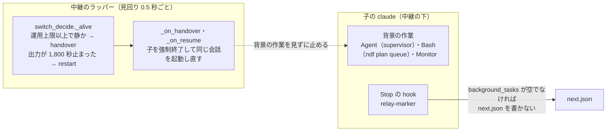
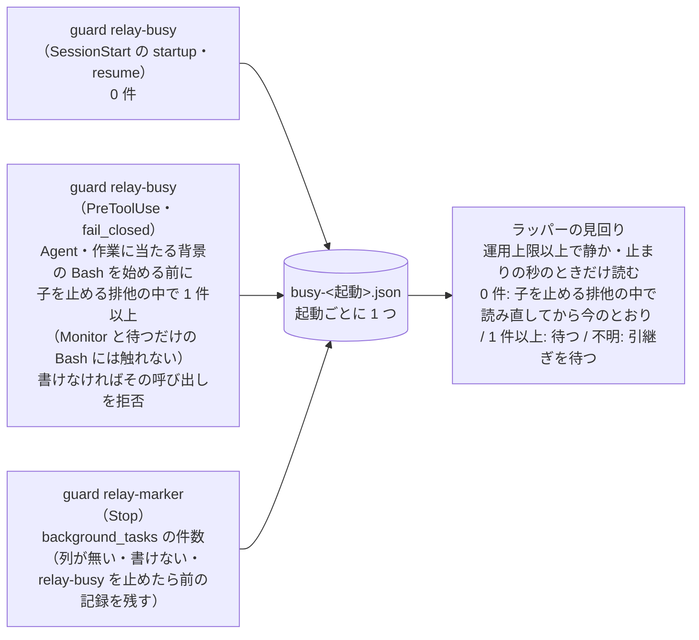
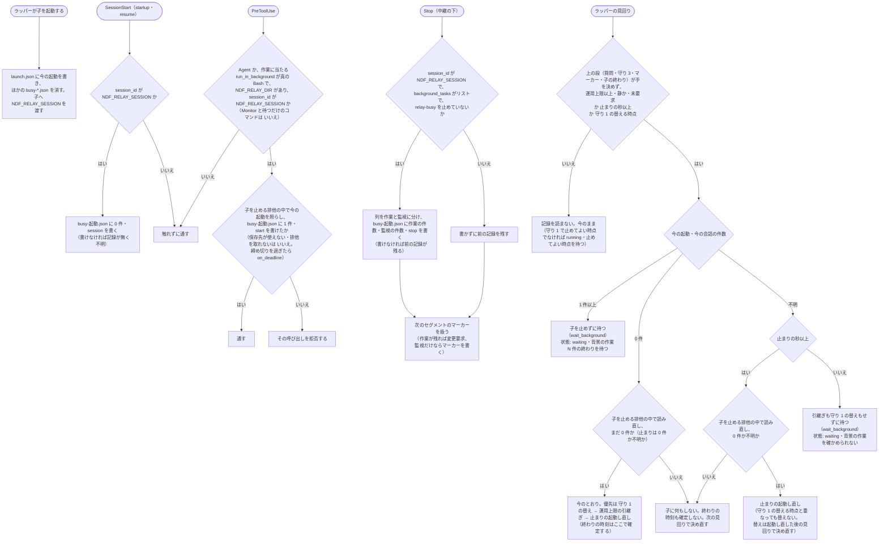

# 中継のラッパー: 背景に作業が残る子を引継ぎ・止まりの判定・守り 1 で止めず、終わるのを待つ（#4049）

中継のラッパーは、文脈の量が運用上限を超えた子と出力が 30 分止まった子を、背景で supervisor や `ndf plan queue` が動いていても強制終了し、そのフェーズの作業を失わせていた。子の起動ごとに背景の作業の記録を 1 つ置き、子の会話の起動（SessionStart）・背景の作業の開始・Stop（Claude Code の `background_tasks`）の 3 つの時点で件数を書く。数えるのは作業だけで、`ndf lanes wait` のような待つだけの監視は数えない（Stop の `background_tasks` の種類とコマンドで見分ける）。ラッパーは作業 0 件と確かめた子だけを引継ぎ・止まりの判定・守り 1（#3604・#3864 の利用上限の手前の替え）で止め、作業が 1 件以上の間は待つ。監視だけが残る子（オーガナイザーを含む）は待たない。記録は起動ごとの別のファイルで、書くのは子の会話の hook だけなので、止めた子と入れ子の claude は今の子の記録に届かない。開始の記録とラッパーが子を止める直前の読み直しだけは、今の子を止める排他（`question.json.lock`）で直列にする。#4041 の下書きの仕組みを採らなかった理由は「決定の記録」に、調べた製品は付録の「外部の調査」にある。

## 今の姿

何が起きたか・目的・受け入れ条件は要求仕様（[issue-4049-requirements.md](./issue-4049-requirements.md)、正は #4049 の本文）にある。この文書は「どう解くか」と「なぜその解き方か」だけを書く。パスは `plugins/ndf/` からの相対で書く。

設計に要る今の構造:

| 部品 | 今の振る舞い | 場所 |
| --- | --- | --- |
| 引継ぎの判定 | 文脈の量が上限以上（今は `relay.context` の 800,000、#3995 の後は `context.limit` の 500,000）で、子の出力か端末の入力が `relay.quiet`（5 秒）無く、このセグメントでまだ求めていなければ `handover`。止まりより先に判定する | `src/ndf/domains/relay/switch_decide.py` の `_alive` |
| 止まりの判定 | 子の出力か端末の入力が `relay.stall`（1,800 秒）無ければ `restart`、今日起動し直した回数が上限なら `stop`。止まりの `restart` は最初の入力を持たない（`_on_resume` が空の文で `--resume` だけを打つ） | 同上・`src/ndf/domains/relay/wrapper.py` の `_on_resume`・`_start` |
| 子を止める | 質問のロックを待たずに取り、質問のファイルが無ければ子を強制終了し、今の起動の記録（`launch.json`）を外す（子が終わらなかったときも外す） | `wrapper.py` の `_stop_if_clear` |
| 起動の ID | 子を起動するたびに ID を作り、`launch.json` に書いてから子へ `NDF_RELAY_DIR`・`NDF_RELAY_LAUNCH` で渡す（#3814） | `wrapper.py` の `_start`・`src/ndf/domains/relay/signals.py` の `launch_env` |
| 状態の表示 | 手の種類ごとの動き（`_ACTIONS`）が状態のファイルを書き、`ndf relay ls` が一覧に出す。`wait` は動きを持たず、状態のファイルを書かない | `wrapper.py` の `_act`・`_write_state` |
| 背景の作業の列 | Claude Code が Stop の入力に `background_tasks` を渡す。読むのは `relay-marker`（空でなければ次のセグメントのマーカーを書かない）と `unattended` だけで、ラッパーは読まない | `src/ndf/domains/hooks/guards/relay_mark.py`・`guards/unattended.py` |

## 文脈と制約

- **Claude Code の公式の文書は、Stop の入力の `background_tasks` を「会話が終わったのか、背景の作業に起こされるのを待っているのか」を見分けるための列と書く**（外部の調査の PRD1）。種類は `shell`・`subagent`・`monitor`・`workflow` などで、タスクの登録簿に届かないときは項目そのものが無い。2026-11-22 に Claude Code 2.1.330 で、背景の Agent と背景の Bash を起動して応答を終えた会話の Stop の入力を採った。`subagent` と `shell` の 2 件が載り、Agent が終わった後の Stop では Agent の行が消えた。サブエージェントの中の hook も親と同じ `session_id` を持ち、`agent_id` だけが違った
- **Stop は利用者の中断（Esc）では発火しない**（PRD1）。背景の作業を始めた応答を Esc で止めると、その応答の Stop の列は届かない
- **Stop の後にも会話の記録へ行が足される。** 2026-11-22 の実測で、Stop の hook の時点の記録は 27 行、4 秒後は 36 行（`stop_hook_summary`・`last-prompt` など）だった。会話の記録の更新の時刻では、Stop の記録がその後の動きより新しいかを判定できない
- **子のシェルから起動した claude は、中継の環境変数を引き継ぐ。** `NDF_RELAY_DIR`・`NDF_RELAY_LAUNCH` を外すのはアカウントの登録だけで（`relay/account_login.py` の `AUTH_ENV`）、`ndf plan queue` の worker や `claude -p` の hook も同じ起動の ID で動く。見分けられるのは入力の `session_id` である
- ラッパーが子を止めて起動し直すと、背景の作業は子と一緒に終わり、新しい子の Claude Code の列には残らない（要求の前提 2）。止めた子の hook のプロセスは、子の終わりの後にも残りうる
- 子が応答の途中にある間は、Claude Code の画面が動き続け、子の出力は 5 秒止まらない。今の引継ぎの判定も、この前提で応答の途中の子を止めない（要求の前提 1）
- hook の経路は `ndf.contracts` を import せず、シグナルファイルは標準ライブラリだけで書く（`signals.py` の冒頭・決定 111）。hook は予算（PreToolUse は 1 秒、Stop は 3.5 秒の締め切り）の中で走り、`fail_closed` でない guard の失敗と締め切りは通す側へ倒れる。`fail_closed` の guard は予算を使い切っても呼ばれ、締め切りでは `on_deadline` が拒否を返せる（`hooks/main.py` の `_deadline_out`。`ask-forward` が使う型）
- この課題は #3995 の運用上限（`context.limit`。`context_thresholds.thresholds` が返す値）をそのまま使い、閾値の値と置き場を変えない。#3995 の止める文の「supervisor・`ndf plan queue` は止めずに報告を待つ」と `HANDOVER_PROMPT` の「背景の作業は終わった」は、この課題の後に、ラッパーの振る舞いと合う
- NDF は普及のフェーズの前で、シグナルファイル・hook の表・環境変数の形を変えても互換の経路を持たない（MVV Value 4）

## 解き方の全体像

- 背景の作業を、待つべき作業と止めてよい監視に分ける。監視は Monitor（種類 `monitor`）と、コマンドが待つだけの NDF のコマンド（`ndf lanes wait`・`ndf plan wait`・`ndf ci watch`）だけでできた背景の Bash で、ほかはすべて作業とする（決定 7）。記録の件数は作業の件数である
- 子の起動ごとに、中継の保存先に背景の作業の記録 `busy-<起動の ID>.json` を 1 つ置く。書くのは子の会話（`session_id` が子のもの）の hook だけで、ラッパーは起動の前にほかの起動の記録を消すだけで書かない。guard `relay-busy` は子の会話の SessionStart（`startup`・`resume`）で 0 件を書き、作業を始める呼び出し（Agent と、作業に当たる背景の Bash）の PreToolUse で「1 件以上」を書く。書けなければその呼び出しを拒否し、監視を始める呼び出しには触れない。`relay-marker` は Stop で `background_tasks` の作業の件数を書き、列が無い・書けない・`relay-busy` を止めた環境では書かない
- このため、記録があれば、それを書いた子の会話では開始の記録の guard が働いている。記録が 0 件なら、その記録の後に背景の作業は始まっていない（hook から見える開始の呼び出しに限る。要求の前提 5）。旧い hook・`relay-busy` を止めた子は記録を持たず、不明になる。止めた子の hook と入れ子の claude は、今の子の記録に届かない
- ラッパーは、文脈の量が運用上限以上で子が静かなときと、止まりの秒に達したときと、守り 1 の替える時点（lracct の `_guard` が替え先を持ち、止めてよい時点）だけ記録を読む。0 件なら、子を止める直前に子を止める排他の中で読み直し、まだ 0 件（止まりは 0 件か不明）のときだけ今のとおり引継ぎ・起動し直しへ進む。開始の記録も同じ排他の中で書くので、読んでから止めるまでに子が背景の作業を始めることは無い。1 件以上なら子を止めずに待ち、`ndf relay ls` の状態の理由に件数と記録の時刻を出す。止まりの判定は、作業が 0 件でも監視が 1 件以上なら待つ（決定 9）。記録が無い・読めないときは引継ぎと守り 1 を待ち、止まりの判定は今のとおり行う（守り 1 の替える時点と止まりが重なれば、止まりの起動し直しを選ぶ）。上限に達した後の替え（守り 3）は記録を読まず、今のとおり替える（決定 8）
- `relay-marker` が次のセグメントのマーカーを書かずに変更要求するのも、作業が残るときだけにする。監視だけが残る Stop は今のとおりマーカーを書き、ラッパーが次のセグメントへ切り替える（監視は子と一緒に終わる）
- 背景の作業が終わると Claude Code が知らせで子を起こし、その応答の Stop が件数を書き直す。運用上限以上の子は #3995 の guard に引継ぎへ進まされ、0 件になった後の静かな見回りでラッパーも引継ぎを求められる

## データ構造

背景の作業の記録（`<中継の保存先>/busy-<起動の ID>.json`。実行の間だけ。コミットしない）。一時の名前で書いて名前を変える（`signals.replace_json`）。

| 項目 | 型 | 意味 |
| --- | --- | --- |
| `launch` | 文字列 | 書いた起動の ID。ファイルの名前と同じ |
| `session_id` | 文字列 | 書いた会話の ID（子の会話） |
| `count` | 0 以上の整数 | 作業の件数（監視を除く）。`source` が `start` なら「少なくとも 1 件」 |
| `monitors` | 0 以上の整数 | 監視の件数。`source` が `stop` のときだけ書き、状態の理由に出す。判定には使わない |
| `source` | `session` / `start` / `stop` | 書いた時点（子の会話の SessionStart・背景の作業を始める前・Stop） |
| `at` | ISO 8601 の時刻 | 書いた時刻。状態の理由に出す |

例: `{"launch": "9f2c…", "session_id": "e1ed…", "count": 1, "monitors": 1, "source": "stop", "at": "2026-11-22T03:19:34+00:00"}`（supervisor 1 件と `ndf plan wait` 1 件）。オーガナイザーが背景に `ndf lanes wait` だけを張った Stop は `count` 0・`monitors` 1 になる

ラッパーが読む値は 3 つに分かれる。

| 読んだ記録 | ラッパーが読む値 | 引継ぎ | 止まりの判定 | 守り 1 |
| --- | --- | --- | --- | --- |
| 今の起動・今の会話で `count` が 0（監視だけを含む） | 0 件 | 今のとおり | `monitors` も 0 なら今のとおり、監視が 1 件以上なら待つ（決定 9） | 今のとおり替える |
| 今の起動・今の会話で `count` が 1 以上 | 1 件以上 | 待つ | 待つ | 待つ |
| ファイルが無い（子の SessionStart の前・旧い hook・`relay-busy` を止めた）・読めない・形が違う（中身の `launch` がファイルの名前と違う・`at` が ISO 8601 の時刻でないを含む）・会話が違う | 不明 | 待つ | 今のとおり | 待つ |

ラッパーは子を起動するたびに、今の起動のもの以外の `busy-*.json` を消す（止めた子の遅れた hook が後から書いたものも、次の起動で消える）。

## 処理の流れ

背景の supervisor を待つレーンの conductor の例を時間の順に追う。

1. conductor が supervisor を背景の Agent で起動する。その PreToolUse で記録が「1 件以上」になる。応答を終えた Stop の `background_tasks` は `subagent` の 1 件で、件数 1 に置き換わる
2. 文脈の量が運用上限を超え、子が 5 秒静かになる。ラッパーは記録を読んで 1 件と知り、子を止めずに待つ。`ndf relay ls` は `waiting` と「背景の作業 1 件の終わりを待つ（記録 <時刻>）」を出す。30 分を超えて知らせが来なくても起動し直さない
3. supervisor が報告を返すと、Claude Code が知らせで conductor を起こす。#3995 の guard が引継ぎに要る呼び出しだけを通すので、conductor は監視（`ndf plan wait`）を TaskStop で止め、引継ぎ文書と `ndf-next` のブロックを書いて応答を終える
4. その Stop の作業の件数は 0 になる（`ndf plan wait` を止め忘れても、監視なので数えない）。`relay-marker` は作業が残るときだけ変更要求するので、監視が残っていても次のセグメントのマーカーを書き、ラッパーは子を止めて（監視も一緒に終わる）新しいセッションで次のセグメントを起動する。マーカーを書かずに応答を終えたときは、次の静かな見回りで 0 件を読んで今のとおり引継ぎを求める

オーガナイザーの例: 背景に `ndf lanes wait` だけを張って応答を終えた Stop は、作業 0 件・監視 1 件を書く。文脈の量が運用上限を超えて静かになると、ラッパーは待たずに子を止めて引継ぎを求める。起動し直した会話は、#3995 の `HANDOVER_PROMPT` と引継ぎ文書の「現在地」に残した `wait` の行から、同じ `--after` で `ndf lanes wait` を打ち直す

## 決定の記録

### 決定 1: 子の背景の作業を Claude Code の数え方で知るため、Stop の `background_tasks` の件数を hook がシグナルファイルへ書き、ラッパーが読む

- **質問**: ラッパーは、子が背景の作業を抱えているかを何で知るか
- **選んだ案**: Claude Code が Stop の入力に渡す `background_tasks` の件数を、中継の下の Stop の hook が中継の保存先の記録へ書き、ラッパーが読む。列は Claude Code が「背景の作業に起こされるのを待っている」ことを見分けるために渡すもので、背景の Agent・背景の Bash・Monitor・ワークフローを同じ形で含む（PRD1。Agent と Bash は 2026-11-22 に実測）。列の種類とコマンドで作業と監視を分ける規則は決定 7 にある
- 採らなかった案: ラッパーが子のプロセスの木から背景の作業を知る（背景の Agent は子の claude のプロセスの中で動き、プロセスの木に現れない）
- 採らなかった案: ラッパーが会話の記録から背景の作業の起動と完了の知らせを数える（記録の行の形は公式の文書に無く、Stop の後にも行が足されるので、記録の読み方が Claude Code の版で変わりうる）
- 採らなかった案: サブエージェントの会話の記録の置き場（`<セッション>/subagents/`）の有無で背景の Agent を知る（背景の Bash と Monitor を覆えず、終わった Agent の記録も残る）
- **代償**: `background_tasks` の形を Claude Code が変えると、件数を書けずに前の記録が残る
- 作り方: 自前で作る・標準に倣う（Claude Code の hook の入力の項目を読み、今のシグナルファイルの書き方で書く）
- 比べた候補: PRD1
- 根拠: Value 3「版上げ・再起動・セッションの入れ替えをまたいでも、進行中の作業と人の回答は失われず、止まった所から続く」・Value 12「実行の基盤（Claude Code・Codex）の機能（hook・`/goal`・サブエージェントなど）で足りるものは、NDF が自分で作らない」（MVV バージョン 1）

### 決定 2: 記録の 0 件を「その後に背景の作業が始まっていない」と読めるよう、開始の記録を書けない呼び出しを拒否し、Stop は列が無ければ書かない

- **質問**: Stop が届かない（Esc の中断）・書けない・列が無い場面で、ラッパーが古い 0 件を読んで背景の作業を抱えた子を止めないには、だれがいつ何を書き、書けないときにどう扱うか
- **選んだ案**: 書き手を子の会話の hook の 3 つにし、どれも前の中身を読まない置き換えにする。(1) 新しい guard `relay-busy` が、子の会話の SessionStart（`startup`・`resume`）で 0 件（起動したばかりの子は背景の作業を持たない。`compact`・`clear` では書かない）。ラッパー自身は書かない。ラッパーが書く 0 件は子の開始の記録の guard が働いている証拠にならず、旧い hook との混在や `NDF_HOOK_OFF=relay-busy` の子でも 0 件に見えるが、子の hook が書いた 0 件はその子で `relay-busy` が働いていることを示す。(2) `relay-busy`（PreToolUse・`fail_closed`）が、作業を始める呼び出し（Agent と、決定 7 の規則で作業に当たる `run_in_background` が真の Bash）の前に「1 件以上」（件数 1・`source: start`）。書けないとき・子の保存先が使えないとき・締め切りを過ぎたとき（`on_deadline`）は、その呼び出しだけを拒否する。先の guard が拒否した呼び出しにも書く（多めに倒す。拒否された呼び出しを含む応答は、その応答の Stop で件数が書き直される）。(3) `relay-marker`（Stop）が、入力の `background_tasks` がリストで `relay-busy` を止めていないときだけ作業の件数を書き、項目が無い・リストでないとき（タスクの登録簿に届かなかった）と書けないときは前の記録を残す。こうすると、記録が 0 件なら、その記録の後に hook から見える背景の作業の開始は無い。判定に使うのは 0 件か 1 件以上かだけで、正確な件数は次の Stop が書き直す。ラッパーが 0 件を読んでから子を止めるまでの間の開始（端末の入力・背景の作業の知らせ・予定の起床で子が動いた応答）は、(2) を今の子を止める排他（`question.json.lock`）の中で今の起動を照らして書き、ラッパーが子を止める直前に同じ排他の中で読み直すことで防ぐ。排他はすでにラッパーが子を止める間に取り、質問の転送の hook と共有しているもので、新しい排他を足さない
- 採らなかった案: 開始の記録を書けなくても呼び出しを通す（開始の記録の失敗が 1 回でも、その応答を Esc で止めると Stop が来ず、前の 0 件で子を止める）
- 採らなかった案: ラッパーが子を起動する前に 0 件を書く（子の hook が記録を書く経路を確かめずに 0 件になる。旧い hook と `NDF_HOOK_OFF=relay-busy` の子は開始を記録しないので、背景の作業を始めた応答を Esc で止めると初期値の 0 件で子ごと止める）
- 採らなかった案: 読み直しをせず、0 件を読んでから止めるまでの起床を受け入れる（起床は予定の起床に限らず、端末の入力と背景の作業の知らせでも起き、記録に成功した supervisor やキューを失う）
- 採らなかった案: #4041 の下書きの形（PreToolUse で前の件数に 1 を足す読み書きを新しい排他 `busy.json.lock` の中で行い、ラッパーは子を止める直前に同じ排他を持って 0 件を確かめ直す。1 を足す読み書きのために排他を 1 つ増やし、その排他が hook の締め切り・質問のロック・子の強制終了の順序と絡み、cross-review のラウンド 2〜5 の指摘 20 件がこの細部に集まった。判定に要るのは 0 件か 1 件以上かだけで、正確な件数は Stop が書き直すので、読み書きは要らない。直列に要る排他は、子を止める今の排他 1 つで足りる）
- 採らなかった案: Stop の項目が無いときに件数を不明（`null`）で書く（開始が書いた 1 件以上を不明へ弱め、止まりの判定で起動し直させる）
- 採らなかった案: 列の件数を Stop の文脈の `ctx.background_tasks` で数える（項目が無い・リストでない入力を空のリストに畳むので、不明が 0 件になる。入力の `background_tasks` を直に見る）
- 採らなかった案: `relay-marker` に PreToolUse を足して開始も書かせる（`relay-marker` は `fail_closed` でなく、`fail_closed` にすると Stop の例外が変更要求（応答を続けさせる）に変わる。開始と Stop で失敗の倒し方が逆なので、行を分ける）
- 採らなかった案: 排他にライブラリ（`filelock`）を使う（使う排他は今の `signals.held` の `flock` で取る子を止める排他で、hook の経路に依存も増える）
- 採らなかった案: `dispatch.run` が先の guard の確定した拒否を後の guard と締め切りの出力へ渡し、拒否された呼び出しでは開始を書かない（dispatch と hook の入口の契約を変え、#3995 の決定 6 が変えないとした「締め切りの出力が dispatch の結果を引き継がない」今の振る舞いまで直すことになり、この課題の範囲を越える。多めの記録は、拒否された応答の Stop で書き直される）
- **代償**: 中継の下で背景の作業を始める呼び出しは、記録を書けない（中継の保存先のディスクの失敗・保存先が消えた・hook の締め切り・ラッパーが子を止める最中で排他を `hook.counter-lock` の 0.2 秒で取れない）と拒否され、モデルが呼び直す。旧い hook の子と `relay-busy` を止めた子は記録を持たないので、運用上限以上でも引継ぎを待ち（止まりは今のとおり）、`relay-marker` が次のセグメントのマーカーを書けば今のとおり切り替わる。記録が 1 件以上になった呼び出しが先の guard に拒否されるか、利用者が許可の確認で断るか、その後に Esc で中断すると、次の Stop まで背景の作業の無い子を待つ（その子は入力を待つだけで、人が入力すれば Stop が書き直す）。hook から見えない開始（利用者の Ctrl+B・Claude Code の自動の切り替えで背景へ回った Bash、ワークフローなど）の後に Esc で中断した応答は、前の 0 件で止め得る（今と同じ振る舞い）。Stop の 0 件の書き込みだけが失敗すると、前の 1 件以上が残り、次の Stop まで待つ。SessionStart は子の起動ごとに 1 回、PreToolUse は背景の作業を始める呼び出しごとに 1 回（子を止める排他を取る）、Stop は応答ごとに 1 回、小さなファイルを書く（中継の下だけ）
- 作り方: 自前で作る（今のシグナルファイルの書き方 `replace_json` と `fail_closed` の guard の `on_deadline`）
- 比べた候補: PRD1 / LIB1
- 根拠: Value 3「同じ手順は毎回同じ結果になる」・Value 3「進行中の作業と人の回答は失われず」・Value 9「まだ要らない仕組みは先回りして作らず」（MVV バージョン 1）

### 決定 3: 止めた子と入れ子の claude に今の子の記録を書き換えさせないため、記録を起動ごとのファイルにし、子の会話の hook だけが書く

- **質問**: 止めた子の遅れた hook と、子のシェルから起動した claude（同じ `NDF_RELAY_DIR`・`NDF_RELAY_LAUNCH` を引き継ぐ）の hook が、今の子の記録を書き換えないには、何で見分けるか
- **選んだ案**: 記録を起動ごとのファイル `busy-<起動の ID>.json` にする（起動の ID は `[0-9a-f]{32}` の形だけを受け、ほかの値ではファイルの名前を作らずに書かない）。ラッパーは子を起動するときに、子の会話の ID を新しい環境変数 `NDF_RELAY_SESSION` で渡し、hook は入力の `session_id` がそれと同じときだけ書く。入れ子の claude は別の `session_id` を持つので書かず、サブエージェントの中の hook は親と同じ `session_id` を持つので書く（2026-11-22 に実測）。止めた子の hook は自分の起動のファイルにしか書けない。ラッパーは今の起動のファイルだけを読み、中身の起動の ID と会話の ID も照らす。子を起動するたびに、ほかの起動のファイルを消す。中継の対象かは `NDF_RELAY_DIR` と `NDF_RELAY_SESSION` と入力の `session_id` で決め、保存先がディレクトリとして見えるかでは決めない（保存先が消えた子を中継の外と取り違えて、記録の無い開始を通さない）
- 採らなかった案: 1 つのファイル `busy.json` に起動の ID を書き、書き手が書く前に `launch.json` と照らす（照らした後に止まった遅れた hook が、新しい起動の記録を旧い起動の記録で置き換え、今の子の記録が不明になる。不明の子は止まりの判定で起動し直され、背景の作業を失う）
- 採らなかった案: すべての書き手が排他の中で `launch.json` と照らしてから書く（下書きの形。排他の待ちが hook の締め切りに入り、決定 2 の拒否が増える。起動ごとのファイルなら照らさなくても今の子の記録に届かない。照らすのは、ラッパーが子を止める判断と直列にしたい開始の記録だけにする（決定 2））
- 採らなかった案: 入れ子の claude を起動する側（`ndf plan queue`・`external-ai` など）が中継の環境変数を外す（起動する経路がコマンドごとに散らばり、1 つでも外し忘れると今の子の記録を書き換える。書き手の側で 1 か所で見分けるほうが漏れない）
- 採らなかった案: 次のセグメントのマーカー（`next.json`）にも起動の ID を書いて照らす（下書きの形。止めた子の Stop の hook が子を止めた直後に遅れて書く場面は、背景の作業に依らない今の切り替えの話である。ラッパーが子を止めるのは子が 5 秒以上静かな後で、この課題の範囲の外）
- **代償**: 中継の環境変数が 1 つ増える（`NDF_RELAY_SESSION`）。起動ごとのファイルは次の起動まで残り、ラッパーの実行が終わると中継の保存先と一緒に片付く
- 根拠: Value 3「同じ手順は毎回同じ結果になる」・Value 8「同じ事実を 2 か所に持たない」（MVV バージョン 1）

### 決定 4: 確かめられない子と背景の作業を待つ子を区別するため、不明なら引継ぎだけを待ち、1 件以上なら止まりの判定でも起動し直さない

- **質問**: 記録が不明なときと 1 件以上のときに、引継ぎと止まりの判定をどう扱うか。止まりの判定は背景の作業が残る子に何で止まりを見るか
- **選んだ案**: 判定の順は今のとおり引継ぎを止まりより先に見る。0 件なら今のとおり（運用上限・静か・未要求なら引継ぎ、止まりなら起動し直しか上限の `stop`。止まりは監視が 1 件以上なら待つ。決定 9）。1 件以上なら、どちらの条件でも子を止めずに待つ（新しい手 `wait_background`）。子は応答を終えて知らせを待っているだけで、止まってはいない。止まりで起動し直すと背景の作業は子と一緒に終わり、起動し直した会話は最初の入力も知らせも受け取らない（止まりの `restart` は空の文で `--resume` だけを打つ）ので、入力を待つだけで進まない。不明なら引継ぎを待ち、止まりの判定は今のとおり行う（応答の途中で固まった子を救う今の手を残す）
- 採らなかった案: 背景の作業が残る間は、子の出力と会話の記録（本体とサブエージェントの記録）の新しいほうの更新で止まりを見る（下書きの形。背景の Bash（`ndf plan queue`）は会話の記録を書かないので、30 分を超えるキューは今のとおり止められる。サブエージェントの記録の置き場は公式の文書に無い。起動し直しても止まった作業は進まない）
- 採らなかった案: 背景の作業が残る間の止まりの秒を別の上限で長くする（どの値でも、超えた後の起動し直しが作業を失わせる時点を遅らせるだけで、上限の設定が 1 つ増える）
- 採らなかった案: 不明を 0 件として扱う（壊れた記録で背景の作業を抱えた子を止める）
- 採らなかった案: 不明でも止まりの判定で起動し直さない（記録の無い起動で応答の途中に固まった子が救われない）
- **代償**: 背景の作業そのものが止まった（supervisor が戻らない）子は、ラッパーが待ち続ける。止まりは人かオーガナイザーが `ndf relay ls` の理由（背景の作業 N 件の終わりを待つ・記録の時刻）で見て、`ndf relay restart` で起動し直す。待つ間は止まりの起動し直しを数えないので、今日起動し直した回数の上限（`relay.max-starts`）に近づかない
- 根拠: Value 3「進行中の作業と人の回答は失われず、止まった所から続く」・Value 2「役に立たない繰り返しに費用を使わない」（MVV バージョン 1）

### 決定 5: 待ちを人とオーガナイザーから見えるようにするため、待つ間は状態を `waiting` と理由で書き、待ちが解けたら `running` へ戻す

- **質問**: 背景の作業を待つ子を、`ndf relay ls` でどう見せ、待ちが解けた後に古い理由を残さないにはどうするか
- **選んだ案**: 待つ手 `wait_background` は、今の `forward`・`wait_reset` と同じく状態のファイルを `waiting` と理由で書く。理由は件数（`source` が `start` なら「1 件以上」、`stop` なら「N 件」）と記録の時刻、不明なら「確かめられない」を示す。`_alive` が「子が動いている」で返していた手を新しい手 `active` にし、状態を `running` と「子が動いている」で書く（同じ状態と理由は書き直さない今の `_write_state` のまま）。これで、待ちが解けて子が動き出した見回りで `running` へ戻る
- 採らなかった案: 待つ手を今の `wait` のまま理由だけを変える（`wait` は状態のファイルを書かないので、`ndf relay ls` に届かない）
- 採らなかった案: 待ちの理由をラッパーの記録（`log.jsonl`）だけに書く（`ndf relay ls` で見えず、止まった背景の作業を人が見つけられない）
- **代償**: 中継の記録（`log.jsonl`）の行の種類に `wait_background` と `active` が増え、「子が動いている」の行は `wait` から `active` へ変わる。回答待ちの質問（`QUESTION_PENDING`）と次のセグメントの静かな時間の待ちは `wait` のまま、状態を書かない
- 根拠: Value 1「AI が決められないことは、理由と根拠を添えて人へ戻ってくる」（MVV バージョン 1）

### 決定 6: 引継ぎを確かに終えさせる仕組みを 1 つにするため、Stop での変更要求を足さず、背景の作業の知らせと #3995 の guard に任せる

- **質問**: 運用上限以上で背景の作業が残ったまま応答を終える子に、ラッパーが待つ間、監視の停止と引継ぎを促す文を Stop で返すか
- **選んだ案**: 返さない。背景の作業が終わると Claude Code が知らせで子を起こす（PRD1。背景のサブエージェントの報告は UserPromptSubmit を発火させる）。その応答が Tool を呼べば #3995 の guard が引継ぎに要るものに絞り、止める文が監視の停止と引継ぎ文書の書き方を示す。Tool を呼ばずに応答を終えれば、その Stop が件数を書き直し、0 件なら次の静かな見回りでラッパーが引継ぎを求める。次のセグメントのマーカーは `relay-marker` が作業の終わりの後に書く（監視の終わりは待たない。決定 7）
- 採らなかった案: guard `context-limit` を Stop にも置き、背景の作業が残る応答の終わりに止める文と同じ変更要求を利用者の入力ごとに 1 度返す（下書きの形。引継ぎを早めるだけで作業は守らず、待つ間の子は token を使わない。Stop の変更要求は `relay-marker`・`stop-wait` と同じ共通の枠を使うので、枠の数え方の取り決めも増える）
- **代償**: 引継ぎを促す文が無いので、作業が終わった後の応答が引継ぎへ進まずに入力を待てば、次の静かな見回りでラッパーが引継ぎを求めるまで、子は運用上限を超えたまま残る
- 根拠: Value 3「手順は使うほど増えるのではなく、減っていく」・Value 12「実行の基盤の機能で足りるものは、NDF が自分で作らない」（MVV バージョン 1）

### 決定 7: 監視だけの子を待たせず作業は失わないため、Stop の列の種類とコマンドで作業と監視を見分け、見分けられないものは作業とする

- **質問**: 利用者は「`ndf lanes wait` のような、待っているだけのプロセスは終了してよい」と決めた（2026-11-22）。オーガナイザーは背景に `ndf lanes wait` を張り続けるので、監視の終わりを待つとオーガナイザーは引継ぎへ一度も進めない。背景の作業のうち、どれを待ち、どれを止めてよいとするか。見分けられないものをどちらに倒すか
- **選んだ案**: Stop の入力の `background_tasks` の各行を、`type` と `command` で次のように分ける。監視は (1) `type` が `monitor`（Monitor の Tool）と、(2) `type` が `shell` で、`command` の構文木（hook のシェルの構文解析と同じ tree-sitter-bash）の全体が待つだけの文の形でできているもの。待つだけの文の形は、単純なコマンドを `;`・`&&`・`||` でつないだ列と、そのコマンドに付いたリダイレクト（`> log 2>&1`）だけで、どの単純なコマンドも guard の表の `relay-busy` の `params.wait_commands`（`["ndf lanes wait", "ndf plan wait", "ndf ci watch"]`。語の並びの頭で照らし、`timeout` などの頭のラッパーは外して照らす）に当たる。`bash -c`・`sh -c`・`eval` は外側のコマンド自体を照らさず、中身の文に同じ確かめを当て直す（入れ子の深さは今の構文解析の上限まで）。パイプ・ループ（`for`・`while`・`until`）・サブシェル・コマンドの置き換え（`$(…)`）・背景（`&`）・本体の無いリダイレクト（`ndf lanes wait p; > output` の `> output`）・構文の誤りのどれかがあれば作業とする。今の `parse_shell().waits`（単純なコマンドの列）では、外側の `bash -c` 自体が列に入り、`for` の中のコマンドにループの印が付かず、本体の無いリダイレクトが列に現れないので、列だけでは文の全体が待つだけかを確かめられない（2026-11-22 に構文木を出して確かめた）。ほかは作業とする。`subagent`・`workflow`・`teammate`・`cloud session`・`MCP task`・知らない種類は作業。`command` が無い・読めない・1,000 字で切られた（`… [+N chars]` の印がある）・待つコマンドとほかのコマンドが混ざる `shell` も作業とする。開始の PreToolUse も同じ関数で分ける（Agent は `subagent`、Monitor は `monitor`、背景の Bash は `shell` と `tool_input.command` で照らす。締め切りの経路も guard の表の同じ宣言を読む）ので、監視を始める呼び出しは記録に触れず、記録の失敗で拒否されることも無い。Stop の `relay-marker` が次のセグメントのマーカーを書かずに変更要求するのも、作業が残るときだけにする（監視だけが残る子は、TaskStop を忘れても次のセグメントへ進む）
- 採らなかった案: 監視と作業を見分けず、背景の作業をすべて待つ（前の版の形。待つ間の子は token を使わないが、`ndf lanes wait` を張り続けるオーガナイザーは引継ぎへ一度も進めず、その間なにもできなくなる。利用者が避けたいと決めた形である）
- 採らなかった案: 背景の作業をすべて止めてよいとする（今の形。supervisor と `ndf plan queue` の作業を失う。この課題の目的に反する）
- 採らなかった案: 開始の PreToolUse で背景の作業ごとに種類を記録し、Stop の列と突き合わせる（PreToolUse の時点では Claude Code のタスクの ID が分からず、Stop の行と対応を取れない。Ctrl+B や自動の切り替えで背景へ回った Bash は PreToolUse に現れない。種類は Stop の列が毎回すべて持っているので、Stop で分ければ足りる）
- 採らなかった案: 待つだけのコマンドを利用者の設定（`.ndf/` の新しい項目）で増やせるようにする（設定が 1 つ増え、待つコマンドを取り違えて登録すると作業を失う。待つコマンドは NDF の手順書が待ち方として決めた NDF のコマンドで足り、足すときは guard の表の `params` を直す）
- 採らなかった案: `until <条件>; do sleep N; done` の形の待ちのループも監視とする（`waiting.md` が勧める形だが、条件には何でも書け、条件の側で作業が動くことがある。見分けを誤ると作業を失うので、ループは作業として扱う）
- 採らなかった案: Monitor も `command` で分ける（Monitor は手順書が出来事を受けるための監視として使う Tool で、利用者が監視の例に挙げた。作業を Monitor の中で直に動かす使い方は手順書に無い）
- 採らなかった案: 見分けられない背景の作業を監視とする（誤ったときに失うものは作業の成果で、止めてよい監視を待つ費用（引継ぎが遅れる・子は token を使わない）より高い）
- **代償**: 作業を Monitor の中で直に動かした（例: `python train.py | grep` を Monitor で起動した）子は、Monitor が監視として数えられないので、その作業を止め得る。待つコマンドを `for` で回す・`| tail` に流すなど、許す形の外で書いた待ちは作業として数える。待つだけでも、手順書の 3 つのコマンド以外（自作の `until` ループ・`tail -f` の背景の Bash など）は作業として数え、それだけが残る子は引継ぎを待つ。Stop の hook が背景の Bash の行ごとにシェルの構文解析を 1 回打つ（中継の下の子の会話だけ）
- 作り方: 自前で作る・標準に倣う（Claude Code の `background_tasks` の `type`・`command` を読み、hook の既存のシェルの構文解析で照らす）
- 比べた候補: PRD1
- 根拠: Value 1「ワークフロー上の課題（再起動・告知・確認）で、利用者に操作を求めない」・Value 3「進行中の作業と人の回答は失われず、止まった所から続く」・Value 5「人の承認を待つ間も、承認の要らない作業は止まらずに進む」（MVV バージョン 1）

### 決定 8: 利用上限の手前の替えで作業を捨てないため、lracct の守り 1 は作業が残る間は替えずに待ち、上限に達した後の守り 3 は今のとおり待たない

- **質問**: lracct（#3604・#3864）の守り 1 は、使用率が閾値 A・C を越えたとき、止めてよい時点で子を止めて同じ会話を別のアカウントで続ける（`issues/issue-3604-3864-design.md` の決定 11）。止めてよい時点は背景の作業を見ないので、背景の supervisor の作業を捨てる。守り 1 と、上限に達した後の守り 3 で、背景の作業をどう扱うか
- **選んだ案**: lracct の実装の後の `switch_decide._guard`（`guard_pick` が `switch` で `safe` なら `account`、`safe` でなければ `wait`）に、記録の判定を足す。`guard_pick` が `switch` で `safe` のとき、記録が作業 0 件なら今のとおり `account`、作業が 1 件以上なら `wait_background`（子を止めない）。不明なら、止まりの秒の手前は `wait_background`、止まりの秒に達していれば `_guard` は手を決めず、止まりの判定の起動し直しへ進める（応答の途中で固まった子を救う今の手を守り 1 が塞がない。替えは起動し直した後の見回りで決め直す）。`safe` が偽のときは `wait` の代わりに状態を `running` で書く手（`active`）を返し、前の見回りの背景の作業の待ちの理由を残さない。記録を読むのは、実際に選ばれる判定（`_guard` の `safe` の行と `_alive`）が件数を要る見回りだけで、上の段（守り 3 など）が手を決める見回りでは読まない。子を止める直前の読み直しも引継ぎと同じ形で通す。読み直しで止めなかった見回りはセグメントの終わりの時刻（lracct の `Section.ended_at`）を確定せず、読み直しを通って子を止める時に確定する（待った時間を含めて短いセグメントの判定と保持の解除をする）。守り 3（`_limit_or_auth` の上限の替え・認証の失敗の替え）は記録を読まず、今のとおり替える。lracct の設計とコードは変えず、#4049 の実装（#3995 と lracct の実装の後）で `switch_decide.py` と `wrapper.py` に足す
- 採らなかった案: 守り 1 は今のとおり背景の作業を見ずに替える（lracct の決定 11 の代償「止めた時点でバックグラウンドで動いていた処理は子とともに終わる」のまま。上限の手前の替えは急がなくてよく、待っても守り 3 が上限で拾う）
- 採らなかった案: 守り 1 で記録が不明なら今のとおり替える（不明は記録が壊れたか旧い hook の子で、作業を抱えているかもしれない。待っても上限に達すれば守り 3 が替えるので、不明を作業ありに倒しても子は止まったままにならない）
- 採らなかった案: 守り 3 も作業が残る間は待つ（上限に達した子はモデルを呼べず、背景の supervisor も同じアカウントで止まっている。待っても作業は進まず、替えなければ子が止まったままになる。lracct の設計も守り 3 を待たずに替える形で決めている）
- **代償**: 背景に作業が残る間は、閾値 A・C を越えても替えないので、作業が終わる前に上限に達すれば守り 3 が替え、そのときは背景の作業を失う（#4063 に残る分）。替えが遅れる分、今のアカウントの使用率が上限に近づく
- 根拠: Value 3「進行中の作業と人の回答は失われず、止まった所から続く」・Value 2「利用者が払う費用が小さい」（MVV バージョン 1）

### 決定 9: 利用者の全体の設計方針（#4069）に合わせるため、止まりの判定では監視だけの子も起動し直さず、キャッシュと待ちの知らせは #4068・#4070 に分ける

- **質問**: 利用者の全体の設計方針（#4069。2026-11-22「コンテキストの最適化を目指す。…再利用可能な文脈を持つ supervisor やコンダクターは再利用に備えて待機しておく。ただしキャッシュを意識し、必要ならキャッシュを起こす処理なども入れる。…処理待ちをできるだけ作らない。処理待ちしている間は別のことをやるか、待っていることをオーガナイザーやコンダクターに伝えて別のレーンや supervisor を起動する」）に、「作業が残る子を待つ規則」と「監視だけの子は止めてよい規則」は合うか。合わない部分をどう直すか
- **選んだ案**: 3 つの観点で照らし、合わない 1 点を直し、#4049 の範囲を越える 2 点を分ける
  - **待つ子とキャッシュ**: 作業が残る子は、プロンプトのキャッシュの寿命（1 時間）を過ぎても待ち続け、寿命で引継ぎへ切り替えない。切り替えると作業を失い、失う作業の費用は、起きたときに会話の文脈をキャッシュ無しで 1 回読み直す費用より高い。運用上限以上で待つ子は、起きた応答で引継ぎだけを行う（#3995 の guard）ので、読み直しは 1 回で終わる。キャッシュを起こすか（起こす間隔の値は `limits.json` に置く）、待ちの長さで引継ぎを早めるかは、待ちの長さと費用を測ってから決めるので #4068 に分ける。#4049 の規則は「作業が残る間はキャッシュの寿命で切り替えない」で、値を持たない
  - **処理待ちを作らない**: 待ちは `ndf relay ls` の `waiting` と理由（作業 N 件・監視 M 件・記録の時刻）で人とオーガナイザーが見られる（決定 5）。これだけでは、オーガナイザーは自分で `ndf relay ls` を見ない限り待ちを知らない。待ちを計画の知らせ（`ndf lanes wait` が返す出来事）に載せ、空いた資源で別のレーンや supervisor を起動するのはオーガナイザーの役目で、知らせの形と手順を #4070 に分ける（待つ間に設計を先に進める割り当ては #4050）。supervisor を待つ conductor は、作業の知らせが来るまで応答を終えて入力を待つ（token を使わない）
  - **再利用に備えた待機**: 監視だけの子を止めてよいのは、運用上限の引継ぎ（文脈が大きすぎ、方針の「大きすぎる文脈は token 消費につながる」に当たる）と、守り 1 の替え（同じ会話を `--resume` で続け、送る 1 行が「中断したところから続ける」なので、子は監視を張り直せる）の 2 つである。どちらも文脈の再利用を捨てない。止まりの判定（出力が 1,800 秒止まった）で監視だけの子を起動し直すのは方針に合わない。止まりの起動し直しは最初の入力を持たないので、`ndf lanes wait` を張って待つオーガナイザーは監視を失ったまま入力を待ち、文脈は残っても再利用されず、待ちの知らせも二度と来ない。そこで、止まりの判定では作業か監視が 1 件以上あれば起動し直さない（`wait_background`）。監視だけで待つときの理由は「監視 M 件の終わりを待つ」とする
- 採らなかった案: 止まりの判定でも監視だけの子を今のとおり起動し直す（利用者の決定「待っているだけのプロセスは終了してよい」の字面には合うが、起動し直した会話が監視を張り直さず、方針の「処理待ちを作らない」と「再利用に備えて待機」の両方に反する）
- 採らなかった案: 作業が残る子もキャッシュの寿命で引継ぎへ切り替える（作業を失う。方針の「再利用に備えて待機」にも反する）
- 採らなかった案: #4049 でキャッシュを起こす仕組みと待ちの知らせを作る（起こす間隔と知らせの形は、中継の下に限らない conductor と supervisor の待ち全体の取り決めで、#4049 の範囲（ラッパーが子を止めるか）を越える）
- **代償**: 監視だけの子が止まりの判定で起動し直されなくなるので、監視が戻らないまま（`ndf lanes wait` が何時間も知らせを返さない）の子は待ち続ける。その間の子は入力を待つだけで token を使わず、監視が戻れば応答する。応答の途中で固まった子は、記録が監視だけを示していても起動し直されない（監視の開始は記録しないので、監視を始めた応答が固まるまでの間は前の記録のまま）。キャッシュの寿命を過ぎた待ちの読み直しは、#4068 が決めるまで引き受ける
- 根拠: Value 2「利用者が払う費用（LLM の token）が小さい」・Value 3「進行中の作業と人の回答は失われず、止まった所から続く」・Value 5「人の承認を待つ間も、承認の要らない作業は止まらずに進む」（MVV バージョン 1）。#4069

## 影響と危険

- **働く範囲**: 利用先のリポジトリでも働く（中継のラッパーと NDF のプラグインの hook）。中継の下（`NDF_RELAY_DIR` がある）の Claude Code の会話だけで、中継の外と Codex では guard は何もしない
- **プロジェクトごとに違うもの**: 無い。設定も引数も足さない
- **当たるモード**: すべてのモード（中継の下で背景の作業を使う会話）
- **壊れうる箇所**:
  - 背景に作業が残る子は、引継ぎ・止まりの判定・守り 1 で止められなくなる。作業が戻らない子は待ち続ける（決定 4 の代償）。監視だけが残る子は今のとおり止まる（決定 7）
  - 中継の下で作業を始める呼び出しは、記録を書けなければ拒否される（決定 2 の代償）。監視を始める呼び出しは拒否されない。入れ子の claude と中継の外の会話は拒否されない。ラッパーが子を止める最中の開始も拒否されるが、その子は止められる
  - `relay-busy` は `tools` を空にした `fail_closed` の行で、すべての PreToolUse で呼ばれる。背景の作業の開始でない・中継の対象でない呼び出しは環境変数と入力の比べだけで返し、例外の経路に入らない。`order` は PreToolUse の通常の行の後（65）で、#3995 の `context-limit` が先頭であることを変えない
  - 先の guard が拒否した背景の作業の開始でも、`relay-busy` は「1 件以上」を書く（多めに倒し、その応答の Stop で書き直される）。締め切りの出力が `fail_closed` でない guard の拒否を引き継がないのは今の振る舞いで（#3995 の決定 6）、この課題は変えない
  - 中継の下の SessionStart・PreToolUse（背景の作業を始める呼び出しだけ）・Stop に、小さなファイルの書き込みが 1 回ずつ増える。見回りの読み取りは、運用上限の条件か止まりの条件がそろった見回りと、子を止める直前の読み直しだけで増える
  - ラッパーと hook の版が食い違う間（ラッパー自身のコードは `/exit` で打ち直した後から、hook はプラグインの更新の後の次のセグメントから効く。`relay.md` の「変更が効く時点」）: 旧いラッパーの下の新しい hook は `NDF_RELAY_SESSION` が無いので何も書かず、何も拒否しない。新しいラッパーの下の旧い hook は何も書かないので、記録は無いまま（不明）で、ラッパーは引継ぎを待ち、止まりは今のとおり判定する。`NDF_HOOK_OFF` で `relay-busy` を止めた子も同じく不明になる
  - 中継の記録の行の種類が変わる（決定 5）。`log.jsonl` を読む外の道具があれば `wait` の「子が動いている」の行が `active` になる。リポジトリの中の読み手は無い（`log.jsonl` を引くのは `relay/registry.py`・`wrapper.py`・`hub.py` と手順書だけで、行の種類を読むのは書き手の `wrapper.py` だけ。`grep -rn '"wait"' plugins/ndf/src` は `switch_decide.py` と、別の意味の `crossrefactor/final_gate.py` だけ。2026-11-22 に確かめた）。`tests/domains/relay/test_relay_decide.py` の「子が動いている」の手を `wait` と照らす行は `active` へ直す
  - 同じファイルを触る別の変更: #3995 は `switch_decide.py`（比べる値）・`wrapper.py`（引継ぎの文）・`guards.json`（`context-limit` の行）・`relay.md`・`env.json` を触る。#4049 は #3995 の実装の後に、その上で実装する。中継のアカウントの切り替え（lracct。#3604 #3864）は `switch_decide.py`・`wrapper.py` を大きく作り直す（`_guard`・`safe`・`_restart_or_stop` が `stop` の代わりに `spin` を返す形など）。#4049 は lracct の実装の後に、lracct の設計書の形の上で実装する。実装の前に `gh pr list` の触るファイルで打ち直す
  - 範囲の外: 上限に達した後と認証の失敗でアカウントを替える起動し直し（守り 3）は、背景の作業が残る子も止める（決定 8。#4063 に残る）

### 代表のリポジトリでの振る舞い

| 代表のリポジトリ | 設定の要点 | 直した後に起きること | この種類で扱えなくなること |
| --- | --- | --- | --- |
| Web サービス（nd-factory） | 中継の下でレーンの conductor が supervisor とプランのキューを背景で回し、オーガナイザーが `ndf lanes wait` を背景で張る | 背景に作業が残る間、文脈の量が運用上限を超えても・30 分を超えて知らせが無くても・閾値 A・C を越えても子は止まらず、作業が終わった後に引継ぎか替えへ進む。監視だけのオーガナイザーは待たずに引継ぎへ進む | 無し |
| モバイルアプリ | 同上 | 同上 | 無し |
| 業務文書だけ | 同上（背景の作業は少ない） | 同上。背景の作業が無い子は今と同じ | 無し |

### ai-plugins だけの事情

- 無し（ラッパーと hook の既定の振る舞いを変えるだけで、このリポジトリだけが置く設定は無い）

## 用語

| 用語 | 意味 | 用語集への反映 |
| --- | --- | --- |
| 背景の作業 | Claude Code が会話の外で動かし、終わると会話へ知らせる作業（背景の Agent・`run_in_background` の Bash・Monitor など）。Stop の hook の入力の `background_tasks` に載る。監視と作業に分かれる | 追加 |
| 監視 | 背景の作業のうち、待つだけで止めてよいもの（Monitor と、`ndf lanes wait`・`ndf plan wait`・`ndf ci watch` だけでできた背景の Bash）。決定 7 | 追加 |
| 作業 | 背景の作業のうち監視でないもの。止めると成果が失われる。見分けられないものも作業とする | 追加 |
| 背景の作業の記録 | 子の起動ごとに、作業の件数を子の会話の hook（会話の起動・背景の作業を始める前・Stop）が書き、ラッパーが読むシグナルファイル（`busy-<起動の ID>.json`） | 追加 |
| シグナルファイル | ラッパーへ知らせるファイル（`next.json`・`stop`・背景の作業の記録） | 意味の変更 |

用語集（`docs/glossary/glossary.json`）への反映と `ndf records glossary render` は、この設計 Pull Request の範囲（`issues/issue-4049-*`）の外なので実装の Pull Request で行う。

## テスト設計

| 受け入れ条件 | どの振る舞いで縛るか | どう壊したら落ちるべきか |
| --- | --- | --- |
| 1 | 運用上限で静かな見回りで、今の起動の記録が作業 1 件なら `wait_background`、作業 0 件（監視だけを含む）なら `handover`。運用上限 − 1 では件数に依らず `handover` を返さない。子の環境の Stop の入力（見本の形）を hook の入口から流して書いた記録で、ラッパーの見回りまで通す | 件数を見ない・1 件以上で止めると落ちる |
| 2 | 止まりの秒の見回りで、作業 1 件か監視 1 件（`ndf lanes wait` の `shell` だけを含む）なら `wait_background`、作業も監視も 0 件なら `restart`（lracct の後は `_restart_or_stop` の今の形。再起動ループの検出に当たれば `spin`）。運用上限・静か・未要求と止まりが同時にそろったとき、0 件は `handover`、不明は `restart`、1 件以上は `wait_background` | 止まりの判定が件数を見ない・順を変えると落ちる |
| 3 | 中継の下の Agent と作業に当たる `run_in_background` が真の Bash（`ndf plan queue …`）の PreToolUse で記録が「1 件以上」になり、Monitor・`ndf lanes wait` の背景の Bash・`run_in_background` の無い Bash・Read・中継の外では触れない。Stop で 0 件を書いた後に Agent の PreToolUse を流すと、Stop を流さずに運用上限で静かになっても、止まりの秒に達しても子を止めない。先の guard が拒否した背景の Bash（500,000 の `context-limit` の拒否）でも記録は 1 件以上になり、同じ応答の Stop で件数に置き換わる | 開始を書かない・Stop だけで判定すると落ちる |
| 4 | ラッパーが子を起動すると、子を起こす前にほかの起動の記録が消え、子の環境の SessionStart（`startup`・`resume`）を hook の入口から流すと記録が新しい起動の 0 件になる。Stop を 1 度も流さない起動でも、運用上限で静かなら `handover`。SessionStart を流さず今の版の Stop（0 件）を流した起動は、Stop が最初の記録を書くので `handover`（今の版の Stop は `relay-busy` が働く環境でだけ書く）。旧い hook の代わりに SessionStart も Stop も流さない起動と、`NDF_HOOK_OFF=relay-busy` の子（SessionStart と Stop の 0 件を流す）では `handover` を返さない | 子の SessionStart で書かない・ラッパーが確かめずに 0 件を書く・最初の Stop の前を不明にする・`relay-busy` を止めた子の Stop で書くと落ちる |
| 5 | 起動 A を止めて B を起動した後、A の環境の Stop（0 件）と PreToolUse を流しても B の記録は変わらない（A が照らした後に止まって B の記録の後に書く順でも変わらない）。B の環境で別の `session_id` の Stop（入れ子の claude）を流しても B の記録は変わらない。B の記録が壊れた JSON・`count` が文字列か負か真偽値・別の会話・中身の `launch` が別の起動か無い・`at` が無いか ISO 8601 の時刻でない・ファイルが無い・読めない（権限・不正な UTF-8）ときは、運用上限で静かでも `handover` を返さず、止まりの秒なら `restart` | 別の起動の記録を読む・会話と中身の起動を照らさない・時刻を確かめない・不明を 0 件とする・読みの失敗で見回りが落ちると落ちる |
| 6 | 1 件で待った後、Stop が 0 件を書いた次の静かな見回りで `handover` を返し、同じセグメントで 2 度目は返さない | 0 件に戻っても待ち続けると落ちる |
| 7 | 中継の下の背景の作業を始める PreToolUse で書き込みを失敗させると拒否（理由の文つき）。`NDF_RELAY_DIR` が消えたディレクトリを指す子の会話でも、背景の作業の開始だけを拒否し、背景でない Bash と Read は通す。hook の予算を使い切った後（前の guard が使い切った場合を含む）と締め切りを過ぎたときも同じく拒否し、背景でない Bash と Read は空の出力で通す。書き終えた後の締め切りでは通す。監視を始める呼び出し（Monitor・`ndf lanes wait` の背景の Bash）は書き込みを失敗させても通す。PreToolUse の Bash・Read で `context-limit` が先頭のまま。Stop で書き込みを失敗させても変更要求を返さない | 開始の記録の失敗で通す・保存先が消えた子を中継の外とする・監視やほかの呼び出しまで止める・`context-limit` より前に置くと落ちる |
| 3（読んでから止めるまで） | ラッパーが 0 件を読んで `handover`（止まりなら `restart`）を決めた後、子を止める前に子の環境の Agent の PreToolUse を流すと、ラッパーは子を止めず次の見回りで `wait_background`。ラッパーが子を止める排他を持つ間の開始は拒否され、止めた後の同じ子の開始も拒否される | 読み直しをしない・開始の記録が子を止める排他を取らないと落ちる |
| 8 | 1 件以上の記録の後、`background_tasks` の項目が無い Stop・リストでない Stop・書き込みに失敗した Stop を流しても 1 件以上が残り、次の成功した Stop の 0 件で解ける | 項目が無いと 0 件か不明で書くと落ちる |
| 9 | 1 件で待つ見回りで状態のファイルが `waiting` と件数・記録の時刻を持ち、開始の記録なら「1 件以上」、不明なら確かめられないことを示す。待ちの後に子が動き出した見回りで `running` へ戻る | 状態を書かない・戻さないと落ちる |
| 10 | 運用上限 − 1 で静か・運用上限で静かでない・引継ぎを求め済み・止まりの秒の手前・`guard_pick` が無いか `safe` が偽の見回りでは、記録の読み取りが 0 回。運用上限以上で静かで止まりの秒に達していても、守り 3（上限の `switch`・`wait_reset`、認証の失敗の `switch`）・質問・次のセグメントのマーカーが手を決める見回りでは 0 回。条件がそろった見回りでは 1 回 | 見回りごとに読む・選ばれない判定のために読むと落ちる |
| 11 | Stop の入力の `background_tasks` を hook の入口から流し、運用上限で静かな見回りまで通す。監視だけ（`monitor` 1 件と `ndf plan wait` の `shell` 1 件）→ `handover`。作業 1 件（`subagent`）→ `wait_background`。監視と作業が混ざる（`ndf lanes wait` の `shell` と `ndf plan queue` の `shell`）→ `wait_background`。オーガナイザーの会話の形（背景に `ndf lanes wait <計画> --after 3` の `shell` だけ）→ `handover`。止まりの秒では 4 つとも `wait_background`（監視だけの 2 つは理由が監視の待ち）で、`restart` は 0 回。運用上限以上の子が引継ぎ文書と `ndf-next` のブロックを書き、`ndf plan wait` の `shell` 1 件を止め忘れた Stop を hook の入口から流すと、変更要求を返さずに `next.json` を書き、ラッパーの次の見回りが次のセグメントへ切り替えて起動する（引継ぎを求め済みでも止まらない）。同じ Stop に `subagent` 1 件が残れば、変更要求でマーカーを書かない | 監視を作業として数える・作業を監視として数える・混ざったときに待たない・監視だけでマーカーを止めると落ちる |
| 12 | lracct の `guard_pick` が `switch` で `safe` の見回りで、作業 0 件（監視だけを含む）なら `account`、作業 1 件なら `wait_background`、不明なら `wait_background`。`safe` が偽なら `active`（状態は `running`）で、作業 1 件で待った次の見回りで子の出力が戻ると状態の理由から背景の作業の待ちが消える。同じ見回りで止まりの秒にも達したとき、0 件は `account`、不明は `restart`（読み直しも不明なら止める）、1 件は `wait_background`。作業 1 件で 600 秒待った後に 0 件で替えると、セグメントの長さは待った時間を含み、短いセグメントに数えない。上限に当たった `limit_pick` が `switch` なら、作業 1 件でも今のとおり `account`（守り 3） | 守り 1 で作業を見ない・守り 3 まで待たせる・不明の止まりを塞ぐ・古い待ちの理由を残す・待つ前の時刻で終わりを確定すると落ちる |
| 13 | 分ける関数に、`type` が `workflow`・`teammate`・知らない値、`command` が無い・切られた印つき・`ndf lanes wait 1 && rm x`・`until test -f x; do sleep 5; done`・`for i in 1; do ndf lanes wait p; done`・`ndf lanes wait p; > output`・`timeout 590 ndf plan wait p.json`・`bash -c "ndf lanes wait p"`・`ndf lanes wait p > log 2>&1`・`ndf plan queue p.json` の行を渡し、`timeout` つきの `ndf plan wait` と `bash -c` の中の `ndf lanes wait` と付いたリダイレクトつきの `ndf lanes wait` だけが監視、ほかはすべて作業。構文解析は差し替えず実物の tree-sitter-bash に通す | 見分けられない行を監視へ倒す・頭のラッパーを外さない・外側の `bash -c` を照らす・`for` や本体の無いリダイレクトを見落とすと落ちる |
| 14 | 上の行のテストは文脈の量の境界の値と呼び出しの回数で判定し、時間で区切らない（時刻は差し替えた時計で進める） | — |

`guards.json` の新しい行が hook の登録と入口（`hooks/main.py`）から呼ばれることは、PreToolUse と Stop の入力を hook の入口から流すテストで確かめる。要求の「含む」の手順書の直し（`relay.md` の判定の表と hook の一覧）は文言を突き合わせるテストを書かず、ドキュメントレビューで見る。受け入れ条件 11 は `.md` の文言でなく、hook の入口とラッパーの判定の振る舞いで確かめる（上の 11 の行）。

## どこを変えるか

詳細設計は [issue-4049-design-detail.md](./issue-4049-design-detail.md) にある（新設する関数 19・シグネチャを変える関数 2 のため。新設は `context.only_commands`・`relay_busy.table_params`・`relay_busy.task_kind`・`relay_busy.work_count`・`signals.write_busy`・`signals.record_start`・`signals.read_busy`・`signals.drop_other_busy`・`signals.relay_session`・`relay_busy.check`・`relay_busy.on_deadline`・`relay_busy._target`・`relay_busy._starts_background`・`switch_decide.needs_background`・`switch_decide._over`・`switch_decide._stalled`・`wrapper._busy_zero`・`wrapper._busy_not_running`・`Wrapper._on_active`、シグネチャを変えるのは `signals.launch_env`・`Wrapper._stop_if_clear`）。

## 設計の結果

| 課題 | 扱い | 統合先 | 触るファイル |
| --- | --- | --- | --- |
| #4049 | 実装する | — | `plugins/ndf/src/ndf/domains/hooks/context.py`、`plugins/ndf/src/ndf/domains/hooks/guards/relay_busy.py`（新設）、`plugins/ndf/src/ndf/domains/hooks/guards/relay_mark.py`、`plugins/ndf/src/ndf/domains/relay/signals.py`、`plugins/ndf/src/ndf/domains/relay/switch_decide.py`、`plugins/ndf/src/ndf/domains/relay/wrapper.py`、`plugins/ndf/contracts/hooks/guards.json`、`plugins/ndf/contracts/hooks/runtimes.json`、`plugins/ndf/contracts/domains/ndf-files.json`、`plugins/ndf/contracts/domains/env.json`、`plugins/ndf/docs/contracts/hooks.md`（再生成）、`plugins/ndf/docs/contracts/files.md`（再生成）、`plugins/ndf/docs/contracts/env.md`（再生成）、`plugins/ndf/skills/development-workflow/references/relay.md`、`docs/glossary/glossary.json`、`docs/glossary.md`（再生成）、`plugins/ndf/tests/domains/hooks/test_guards.py`、`plugins/ndf/tests/domains/hooks/test_context.py`、`plugins/ndf/tests/domains/relay/test_relay_parts.py`、`plugins/ndf/tests/domains/relay/test_relay_decide.py`、`plugins/ndf/tests/domains/relay/test_relay_wrapper.py` |

## 未確認のまま残ること

| 項目 | 内容 |
| --- | --- |
| Monitor と背景の Bash の列の形 | 公式の文書は `background_tasks` の種類に `monitor` を挙げ、`command` を `shell` と命令を打つ `monitor` に付けると書くが、Monitor の呼び出しの後の Stop の入力は採っていない。背景の Bash の `command` が `tool_input.command` と同じ文かも確かめていない（2.1.330 の実測は `sleep 30` で同じだった）。種類の名前が違えば作業に倒れて待ち、文が違えば待つコマンドを作業として数えて待つ（作業は失わない）。実装の `tdd-cycle` で、Monitor を起動した会話の Stop の入力を見本（`tests/domains/hooks/samples/claude/`）として採って分かる |
| 応答の途中の画面 | 子が応答の途中にある間、子の出力が 5 秒止まらないこと（要求の前提 1）は、今の引継ぎの判定が前から立つ前提で、この課題では測っていない。崩れても、記録が 0 件ならその後に hook から見える開始は無い（決定 2）ので、背景の作業は失われない。失われうるのは今と同じく応答の途中の前景の作業で、リリースの後のラッパーの記録（`log.jsonl` の `handover` の行の直前の子の出力の時刻）で分かる |

## 外部の調査

| 種類 | 調べるか | 理由 |
| --- | --- | --- |
| 標準・仕様 | 調べない | 背景の作業の記録は、プラグインの中のラッパーと hook の取り決めだけで形が決まり、従う公開の仕様が無い |
| 主要な製品 | 調べる | 子の背景の作業を知る手段と Stop の発火の条件は Claude Code の hook の仕様で決まる |
| ライブラリとサービス | 調べる | プロセスの間の排他を既存のライブラリで済ませられるかを確かめる |

### 主要な製品

| # | 製品 | どう解いているか | 設計への反映 | 出典 |
| --- | --- | --- | --- | --- |
| PRD1 | Claude Code の hook（Stop・PreToolUse・UserPromptSubmit） | Stop の入力の `background_tasks` は「会話が終わったのか、背景の作業に起こされるのを待っているのか」を見分けるための列で、種類は `shell`・`subagent`・`monitor`・`workflow`・`teammate` など。タスクの登録簿に届くときだけ項目があり、何も動いていなければ空である。Stop は利用者の中断では発火しない。背景のサブエージェントの報告と会話の予定の起床は UserPromptSubmit を発火させ、会話を起こす。サブエージェントの中の PreToolUse には `agent_id` が付く | 件数を Stop の列から書く（決定 1）。中断に備えて開始の PreToolUse でも書き、項目が無ければ書かない（決定 2）。会話の ID で子の会話を見分ける（決定 3）。背景の作業の終わりは Claude Code の知らせに任せる（決定 6） | https://code.claude.com/docs/en/hooks（2026-11-22）。Claude Code 2.1.330 で背景の Agent と Bash を起動した会話の Stop・SubagentStop の入力の実測（2026-11-22） |

### ライブラリとサービス

| # | ライブラリ・サービス | 何ができるか | 設計への反映 | 出典 |
| --- | --- | --- | --- | --- |
| LIB1 | `filelock`（PyPI） | OS のロックを使うプロセスの間の排他。取得の取り消しができる | 採らない。決定 2 の直列は今の `signals.held`（`flock`）で取る子を止める排他で足り、hook の経路に依存を足さない | https://py-filelock.readthedocs.io/en/latest/（2026-11-22） |

調べた量: 候補 2 件・取得の試み 5 回。
