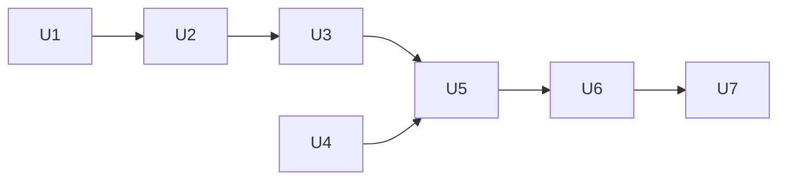

# #4049: 中継のラッパーが、バックグラウンドの作業が残る子を引継ぎ・止まりの判定・守り 1 で止めずに待つ

## 関連リンク

- 要求仕様: [issue-4049-requirements.md](./issue-4049-requirements.md)（正は #4049 の本文）。受け入れ条件は番号で指す
- 設計書: [issue-4049-design.md](./issue-4049-design.md)、詳細設計書: [issue-4049-design-detail.md](./issue-4049-design-detail.md)
- 読み替え: [issue-4126-design.md](./issue-4126-design.md) の決定 4 の表の 1 行目と決定 5 の表、[issue-4126-design-detail.md](./issue-4126-design-detail.md)。#4126 は実装の PR を持たず、この計画の U2 がその分を入れる。**#4126 の課題はこの計画ではクローズしない**（#4061・#4062 の実装の PR の後にクローズする）
- モード: `standard`（シグナルファイル・hook の表・環境変数が増え、公開インタフェースが変わる）

設計書の「背景の作業」を、この計画と新しく書く文では「バックグラウンドの作業」と書く（指すものは同じ）。「作業」「監視」「守り 1」の意味は設計書の「用語」のとおりである。

## 設計の後に変わったコードと読み替え

設計は 2026-11-22 に書かれ、前提の #3995 と lracct（#3604・#3864）は main に入った。`c870db5f6` のコードを読むと、設計の書き方と次の 7 か所が違う。**決定と受け入れ条件は変えず、書く場所と書き方だけを読み替える。**

| # | 設計の記述 | 今のコード | この計画の扱い |
| --- | --- | --- | --- |
| 1 | `Wrapper._stop_if_clear`・`QUESTION_LOCK` は `wrapper.py` | `wrapper_stop.py` の `StopSteps` にある | `wrapper_stop.py` を変える |
| 2 | `_start` で `launch_env(self.dir, launch, req.session_id)` を組む | 呼び出し元は `Wrapper._env_for(account, launch)` で、`_start` の `cli_floor.require`・`LaunchSteps._fallback`・`LaunchSteps._try` の 3 か所が使う | `_env_for` に引数 `session_id` を足し、3 か所とも `req.session_id` を渡す（シグネチャを変える関数が 1 つ増える。#4126 の設計の「未確認のまま残ること」が実装に任せた形） |
| 3 | `_guard` は `safe` が偽なら `active`（`GUARD_POINT`）を返す | `_guard` は `wait` を返し、`decide` は子の生死と `_alive` の判定の後に回す（cross-review の r1-8。待つ間も引継ぎと止まりの再起動を先に行う。`test_relay_decide.py` の `test_r1_8_…` が縛る） | r1-8 の順を保つ。`_guard` は `active` を返し、`decide` は `_guard` の `active` を後に回して、`_alive` の手が `active` のときだけ `GUARD_POINT` を返す。`_alive` が `handover`・`restart`・`wait_background` ならそちらを返す |
| 4 | `_act` は `step.busy` のある手で `ended_at` を書かず、`_stop_if_clear` が止める直前に書く | `_not_stopped` が `"held"` のとき `ended_at` を None に戻す | `_act` と `ended_at` の書き方は変えない。設計の事後条件（止めなかった見回りの後は `ended_at` が None・待った時間をセグメントの長さに含む）は今の形で成り立つので、テストで縛る |
| 5 | Stop の件数は `relay_mark.check` の頭で書く | 頭で `activity.json` を書く（#4036。入れ子の claude も書き、監視と作業を分けない） | `activity.json` の書き込みは変えず、その後に `busy-<起動>.json` を書く。`tasks` は今ある変数を使う。2 つのファイルは読み手も判定も違うので統合しない |
| 6 | `_alive` の `restart` は `stop` になり得る | `_restart_or_stop` は `restart` か `spin` を返す | `_spin_or` が `Step` を作り直すので、止まりから来た `spin` にも `busy` を引き継ぐ |
| 7 | 定数 `SESSION_ENV` を `signals` に置く | 検査 `const-fact` が落とす | #4126 の読み替えどおり置かず、`identity.env_name("relay-session")` で引く |

## 修正対象

#4049 の詳細設計書の「地図」と、#4126 の詳細設計書の「地図」の #4049 の分からコピーした。次の 2 点は保存先を変えた。

- `wrapper.py` は 993 行で、`ndf check` の構造の規則（`checks/rules.json` の `structure.max_lines` 1,000 行）まで 7 行しか無い。`_queue_fetch`・`_drain_fetch` を既存の `wrapper_fetch.py` へ先に移し、新しい関数は新設の `wrapper_busy.py` に置く
- 同じ規則がテストにも当たるので、`test_guards.py`（857 行）・`test_relay_wrapper.py`（907 行）・`test_relay_parts.py`（781 行）には足さず、新しいテストのファイルに置く

パスは `plugins/ndf/` からの相対（`docs/glossary/` だけはリポジトリの根から）。

| ファイル | 変える中身 | 単位 |
| --- | --- | --- |
| `src/ndf/domains/relay/wrapper_fetch.py` | `wrapper.py` から `_queue_fetch`・`_drain_fetch` を基底クラス `FetchSteps` として移す | U1 |
| `src/ndf/domains/relay/wrapper.py` | 移した分を除く（U1）。`_env_for` に `session_id`（U2）。`_start` が `drop_other_busy`、`_state` が記録の読み取り、`_on_handover`・`_on_resume` が `allow` を渡す、`_ACTIONS` に `wait_background`・`active`（U6） | U1・U2・U6 |
| `contracts/domains/env.json` | 列 `key`。`NDF_RELAY_DIR` に `relay-dir`。`NDF_RELAY_SESSION` の行（`relay-session`） | U2 |
| `src/ndf/identity.py` | `env_name`・`_env_keys`・`EnvNameError`（新設） | U2 |
| `src/ndf/checks/facts.py`・`src/ndf/checks/README.md` | 規則 `env-key`（`env_key_findings` を新設）と規則の表の行 | U2 |
| `src/ndf/adapters/claude.py` | `_inherited` がキーで名前を引く | U2 |
| `src/ndf/domains/relay/account_login.py` | 最上位の `AUTH_ENV` をなくし、`auth_env` の中で名前を引く | U2 |
| `src/ndf/domains/relay/cli.py` | `_run` が子を起動する前に 2 つのキーを解き、解けなければ `config_broken` | U2 |
| `src/ndf/domains/hooks/guards/ask.py`・`context_limit.py` | `EnvNameError` を受け、書かずに通す・中継の外の案内で拒否する | U2 |
| `src/ndf/domains/relay/wrapper_launch.py` | `_env_for` の呼び出しと型の注釈 | U2 |
| `src/ndf/domains/relay/signals.py` | `relay_dir`・`launch_env` をキーで引く、`relay_session`（新設）（U2）。`write_busy`・`record_start`・`read_busy`・`drop_other_busy`・定数・冒頭のファイルの表（U3） | U2・U3 |
| `src/ndf/domains/relay/wrapper_stop.py` | `QUESTION_LOCK` を `signals.STOP_LOCK` に置き換える（U3）。`_stop_if_clear` に `allow`（U6） | U3・U6 |
| `contracts/domains/ndf-files.json` | `relay-busy` の行 | U3 |
| `src/ndf/domains/hooks/context.py` | `only_commands`（新設） | U4 |
| `src/ndf/domains/hooks/guards/relay_busy.py`（新設） | `task_kind`・`work_count`（U4）。`check`・`on_deadline`・`table_params`・`_target`・`_starts_background`（U5） | U4・U5 |
| `src/ndf/domains/hooks/guards/relay_mark.py` | Stop の件数の記録と、作業が残るときだけの変更要求 | U5 |
| `contracts/hooks/guards.json`・`contracts/hooks/runtimes.json` | `relay-busy` の行・`relay-marker` の `summary`・Codex の `skipped` | U5 |
| `src/ndf/domains/relay/switch_decide.py` | `Background`・`Step.busy`・`SectionState.background`・`needs_background`・`_over`・`_stalled`・`_alive`・`_guard`・`_spin_or`・`decide`・定数 | U6 |
| `src/ndf/domains/relay/wrapper_busy.py`（新設） | `_busy_zero`・`_busy_not_running`・`_BUSY_ALLOW` と、基底クラス `BusySteps`（`_on_active`・記録を読んで状態へ足す手） | U6 |
| `skills/development-workflow/references/relay.md` | 判定の表（守り 1・順 5・順 6）、hook の一覧、記録の行の種類の表 | U7 |
| `docs/glossary/glossary.json`・`docs/glossary.md`（再生成） | 設計の「用語」の語と「環境変数のキー」 | U7 |
| `docs/contracts/env.md`・`files.md`・`hooks.md`（再生成） | `ndf check --write-spec` で作り直す | U2・U3・U5 |

テストのファイルは各タスクの対象ファイルに挙げる。

## タスク分解

### Task 1: 変えない振る舞いの退行テストの不足を足す

- **対象ファイル:** `tests/domains/relay/test_relay_wrapper_guard.py`、`tests/domains/relay/test_relay_decide.py`
- **変更内容:** 使用率の取得の手（`_queue_fetch`・`_drain_fetch`）と、引継ぎ・止まり・守り 1・守り 3・マーカーの判定のうち、今のテストが縛っていない振る舞いだけを足す。運用上限 − 1 と運用上限、止まりの秒の手前と到達、守り 3 の `account` の最初の入力を確かめる。既にあるもの（`test_r1_8_…`・`test_i13_…` など）は足さない
- **満たす受け入れ条件:** 15 の一部
- **進め方:** 今のコードで通るテストを書く

### Task 2: 使用率の取得の手を `wrapper_fetch.py` へ移す（準備のリファクタリング）

- **対象ファイル:** `src/ndf/domains/relay/wrapper.py`、`src/ndf/domains/relay/wrapper_fetch.py`
- **変更内容:** `_queue_fetch`・`_drain_fetch`（約 45 行）を中身を変えずに基底クラス `FetchSteps` へ移し、`Wrapper` が継承する。使う属性は `LaunchSteps` と同じ形の型の注釈で示す。`wrapper.py` は約 950 行になり、U2 と U6 で足す約 20 行が規則に収まる
- **満たす受け入れ条件:** 15 の一部（振る舞いを変えない）
- **進め方:** Task 1 と既存のテストが移動の前後で同じに通ることで確かめる

### Task 3: 環境変数の名前を契約のキーから引く読み手と、CI の規則

- **対象ファイル:** `contracts/domains/env.json`、`src/ndf/identity.py`、`src/ndf/checks/facts.py`、`src/ndf/checks/README.md`、`tests/identity/test_env_name.py`（新設）、`tests/checks/test_facts.py`
- **変更内容:** #4126 の詳細設計の「契約のキーの列」「キーの読み手」「規則 `env-key`」のとおり。`NDF_RELAY_LAUNCH` の行は足さない（#4061・#4062 が足す）
- **満たす受け入れ条件:** 5 の前提（#4126 の受け入れ条件 4・5）
- **進め方:** 失敗するテスト（型の約束・キー 0 行・2 行・空の `key`）→ 通す最小実装 → 整理

### Task 4: 中継の名前をキーで引き、子の会話の ID を渡す

- **対象ファイル:** `src/ndf/domains/relay/signals.py`・`wrapper.py`・`wrapper_launch.py`・`account_login.py`・`cli.py`、`src/ndf/adapters/claude.py`、`src/ndf/domains/hooks/guards/ask.py`・`context_limit.py`、`tests/domains/relay/test_relay_parts.py`（`launch_env` の 2 件を新しいシグネチャへ）、`tests/domains/relay/test_relay_env_key.py`（新設）、`tests/domains/hooks/test_env_key_guards.py`（新設）
- **変更内容:** #4126 の詳細設計の「名前を使う所」の #4049 の行のとおり。`_env_for(account, launch, session_id)` が `launch_env` の 3 つの変数を組み、起動の 3 か所（`cli_floor`・既定のログイン・名前つきの起動先）のどれでも子に `NDF_RELAY_SESSION` が渡る。`ask` と `context_limit` は副作用の前に `relay-dir` と `relay-session` の両方を解き、`EnvNameError` を受ける。`cli._run` は `launch.json` を書く前に 2 つを解く
- **満たす受け入れ条件:** 5 の一部（会話を見分ける前提。#4126 の受け入れ条件 1・4・5・6）
- **進め方:** 失敗するテスト → 通す最小実装 → 整理。`relay-dir` を欠く・`relay-session` を欠く契約のそれぞれで、AskUserQuestion・`Read`・上限を超えた `Read` を hook の入口から流す。hook の起動の時間は変更の前後を交互に打って比べ、値を PR の本文に書く（#4126 の受け入れ条件 6）。時間をテストにしない

### Task 5: 起動ごとの記録の読み書き

- **対象ファイル:** `src/ndf/domains/relay/signals.py`、`src/ndf/domains/relay/wrapper_stop.py`、`contracts/domains/ndf-files.json`、`tests/domains/relay/test_relay_signals_busy.py`（新設）
- **変更内容:** 詳細設計の「背景の作業の記録（`signals`）」のとおり。`SESSION_ENV` は置かない。`STOP_LOCK` を `signals` に置き、`wrapper_stop.py` の `QUESTION_LOCK` の 3 か所を置き換える
- **満たす受け入れ条件:** 5・8 の一部
- **進め方:** 失敗するテスト（書いた件数を読み返す・壊れた記録は None・別の起動に届かない）→ 通す最小実装 → 整理。排他はイベントで順を決め、待ちの秒に依らない

### Task 6: 待つだけのコマンドかの見分け

- **対象ファイル:** `src/ndf/domains/hooks/context.py`、`src/ndf/domains/hooks/guards/relay_busy.py`（新設。純粋な関数だけ）、`tests/domains/hooks/test_context.py`、`tests/domains/hooks/test_relay_busy_kind.py`（新設）
- **変更内容:** 詳細設計の `only_commands`・`task_kind`・`work_count` のとおり。待つコマンドは引数の `params` で受ける。`guard` の表の行は Task 7 で足す
- **満たす受け入れ条件:** 13
- **進め方:** 詳細設計の「確かめた例」と単体テストの観点を失敗するテストにする → 通す最小実装 → 整理。構文解析は差し替えない

### Task 7: guard `relay-busy` が会話の起動と作業の開始を記録する

- **対象ファイル:** `src/ndf/domains/hooks/guards/relay_busy.py`、`contracts/hooks/guards.json`、`contracts/hooks/runtimes.json`、`tests/domains/hooks/test_relay_busy.py`（新設）
- **変更内容:** 詳細設計の「guard `relay-busy`」のとおり。`_target` は #4126 の読み替え（`EnvNameError` なら偽）で書く。`order` は 65（PreToolUse の今の最後の `ask-forward` の 60 の後）
- **満たす受け入れ条件:** 3・4・5・7
- **進め方:** 失敗するテスト（hook の入口から流す。対象外の会話で表の読み込みと構文解析を例外に差し替えても通る・書けない開始だけを拒否する・締め切りの経路）→ 通す最小実装 → 整理

### Task 8: Stop で件数を書き、作業が残るときだけ変更要求する

- **対象ファイル:** `src/ndf/domains/hooks/guards/relay_mark.py`、`contracts/hooks/guards.json`（`summary`）、`tests/domains/hooks/test_relay_mark_busy.py`（新設）、`tests/domains/hooks/samples/claude/<版>/`
- **変更内容:** 詳細設計の「中継のマーカーの guard」のとおり（読み替え 5）。あわせて Monitor とバックグラウンドの Bash を起動した会話の Stop の入力を採り、見本に置く（設計の「未確認のまま残ること」）。採った形が想定と違えば、作業に倒れて待つことをテストで確かめ、違いを PR の本文に書く。実装の環境で Monitor を起動できなければ採れなかったと書き、リリース後の手動確認に残す
- **満たす受け入れ条件:** 5・8・13 の一部
- **進め方:** 失敗するテスト → 通す最小実装 → 整理

### Task 9: 判定が作業の件数で待つ

- **対象ファイル:** `src/ndf/domains/relay/switch_decide.py`、`tests/domains/relay/test_relay_decide.py`
- **変更内容:** 詳細設計の `_alive` の判定表と `_guard` の判定表のとおり（読み替え 3・6）。「子が動いている」の手を見る既存の行は `wait` から `active` へ直す。回答待ちの質問・マーカーの静かな時間・キーの子の停止待ちは `wait` のままにする。守り 1 の `account` の最初の入力に `MONITOR_RESUME` を足し、守り 3 の文は変えない
- **満たす受け入れ条件:** 1・2・6・10・12
- **進め方:** 失敗するテスト（境界の値と件数の組）→ 通す最小実装 → 整理。`test_r1_8_…` の 2 行は、`background` に 0 件を渡した形で通ることも確かめる

### Task 10: ラッパーが記録を読み、止める直前に読み直し、待ちを状態に書く

- **対象ファイル:** `src/ndf/domains/relay/wrapper_busy.py`（新設）、`src/ndf/domains/relay/wrapper.py`、`src/ndf/domains/relay/wrapper_stop.py`、`tests/domains/relay/test_relay_wrapper_busy.py`（新設）、`tests/domains/relay/test_relay_wrapper.py`・`test_relay_wrapper_guard.py`（記録の無い子の引継ぎを見る行を、0 件の記録を置く形へ直す）
- **変更内容:** 詳細設計の「ラッパーの起動と見回り」のとおり（読み替え 1・4）。`_stop_if_clear` は `allow` があるとき、質問が無いと確かめた後に同じ排他の中で記録を読み直す。`_on_switch`・`_halt_broken`・守り 3・キーの子の停止は `allow` を渡さない
- **満たす受け入れ条件:** 1・2・4・6・9・10・12
- **進め方:** 失敗するテスト → 通す最小実装 → 整理。時計を差し替え、見回りの回数で確かめる

### Task 11: hook の入口からラッパーの見回りまでを通す

- **対象ファイル:** `tests/domains/relay/test_relay_busy_flow.py`（新設）
- **変更内容:** 設計の「テスト設計」の 3・4・5・11・12 の行のうち、hook の入口とラッパーの見回りの両方を通すもの。監視だけ → 引継ぎ、作業 1 件 → 待つ、監視と作業が混ざる → 待つ、バックグラウンドに `ndf lanes wait` だけがあるオーガナイザーの形 → 引継ぎ、止まりの秒ではどれも待つ、守り 1 の替えの最初の入力、読んでから止めるまでの開始、前の起動と入れ子の claude の遅れた書き込み
- **満たす受け入れ条件:** 3・4・5・7・8・11・12・15
- **進め方:** Task 10 までの実装の上で書く。落ちたら原因のタスクの実装を直す

### Task 12: 手順書と用語集

- **対象ファイル:** `skills/development-workflow/references/relay.md`、`docs/glossary/glossary.json`、`docs/glossary.md`（再生成）
- **変更内容:** 判定の表の順 5・6 と守り 1、hook の一覧（`relay-busy`・`relay-marker`）、記録の行の種類の表に `wait_background`・`active`、記録を書けない開始が拒否されること、待ち続ける子の見つけ方（`ndf relay ls` の理由）と起動し直し（`ndf relay restart`）。用語集は設計の「用語」の 3 語とシグナルファイルの意味、「環境変数のキー」
- **満たす受け入れ条件:** 9 の一部（状態の見方の説明）
- **進め方:** テスト駆動を適用しない（`.md` の文言を照合するテストは書かない）。参照の検査と `ndf records glossary render` の差分が無いことで確かめる

## レビューの単位

| 単位 | 含むタスク | 満たす受け入れ条件 | 見込みの差分の行数 | 実際の行数 |
| --- | --- | --- | --- | --- |
| U1 準備のリファクタリング | Task 1・2 | 15 の一部 | 約 180（移動の追加と削除の和を含む） | （実装の後に書き足す） |
| U2 環境変数のキーと会話の ID | Task 3・4 | 5 の一部 | 約 750 | |
| U3 起動ごとの記録 | Task 5 | 5・8 の一部 | 約 320 | |
| U4 待つだけのコマンドの見分け | Task 6 | 13 | 約 400 | |
| U5 hook の記録 | Task 7・8 | 3・7・8 と、4・5 の hook の側 | 約 700 | |
| U6 ラッパーの判定と待ち | Task 9・10・11 | 1・2・4・5・6・9・10・11・12・15 | 約 950 | |
| U7 手順書と用語集 | Task 12 | 9 の説明 | 約 130 | |

- 行数は追加と削除の和で、`git diff --shortstat <ベース>...HEAD -- . ':(exclude)docs/glossary.md' ':(exclude)plugins/ndf/docs/contracts'` で数える（どちらも再生成で作るので数えない）
- **1 課題 1 単位にしない理由:** 見込みは合わせて約 3,400 行で 1,000 行を超えるので、タスクの依存の向きで分けた。受け入れ条件 14 は設計文書がマージ済みで、どの単位も変えない（スプリントの完了判定で確かめる）
- **400 行を超える単位の理由:** U2 は、名前を引く読み手と使う側を分けると、使われない読み手か、`const-fact` に落ちる定数が残る。U5 は、会話の起動・開始・Stop の 3 つの書き込みのどれかが欠けると「記録が 0 件ならその後に作業は始まっていない」が崩れる。U6 は、判定だけを先に入れると記録を読まないラッパーの引継ぎがすべて「確かめられない」で待つ。U6 が 1,000 行に届きそうなら Task 11 を別の単位に分ける（Task 10 までで単独で動く）
- **どの単位でも終えた後に動く:** U3・U4 は関数が足されるだけである。U5 の後は hook が記録を書き、監視だけが残る Stop がマーカーを書くが、ラッパーの引継ぎは今のままである。U6 で待ちが効く
- **実行の順:** U1 → U2 → U3、U4 はどれとも並列でよい。U5 は U3 と U4 の後、U6 は U1 と U5 の後、U7 は U6 の後

## リファクタリングの時機

| 時機 | 対象 | 理由 |
| --- | --- | --- |
| 実装の前（準備のリファクタリング） | `wrapper.py` の `_queue_fetch`・`_drain_fetch` を `wrapper_fetch.py` へ移す（Task 2。U1） | `wrapper.py` は 993 行で、構造の規則の 1,000 行を足すだけで超える。12 タスクのうち 3 つ（Task 2・4・10）が触る。2 つの関数は使用率の取得の責務で、`wrapper_fetch.py` の `Fetcher` と同じである。覆うテストは `test_relay_wrapper_guard.py` が両方を呼ぶ。ほかの触るファイルは `context.py` 873 行・`signals.py` 350 行・`switch_decide.py` 256 行で、足しても規則に収まる |
| 実装の中 | 各タスクで行う | `tdd-cycle` のリファクタリングのステップ |
| スプリントの終わり（cross-refactoring） | `relay_mark.py` の `activity.json` と `busy-<起動>.json` の書き込み（U5）。`ask.py`・`context_limit.py`・`relay_busy.py` の `EnvNameError` の受け方（U2・U5） | 同じ Stop で 2 つのファイルを書き、同じ受け方が 3 つの guard に現れる。後者は #4061 の `relay_role` がまとめる予定なので、そこで残るものだけを見る |

## リスクと対処

| リスク | 対処 |
| --- | --- |
| 記録の無い子は引継ぎを待つ（設計の決定 4）。U6 が入ると、記録を置かずに引継ぎを見る既存のテストが落ちる | Task 10 で、0 件の記録を置く手をテストの共通の部品に 1 つ作り、該当する行だけを直す。記録の無い子が待つことは別のテストで縛る |
| 起動の直後の状態の理由「セグメント N を始めた」が、最初の見回りで「子が動いている」へ変わる（設計の決定 5 で `active` が状態を書くため） | 意図した変化である。状態は `running` のまま。理由の文を見る既存のテストがあれば Task 10 で直す |
| 計画 p9 のほかのスプリント（https://github.com/devbasex/ai-plugins/pull/4367 ・ https://github.com/devbasex/ai-plugins/pull/4359 ）が、`checks/facts.py`・`checks/README.md`・`adapters/claude.py`・`domains/hooks/tables.py`・`env.json`・`ndf-files.json`・`guards.json`・`runtimes.json`・`imports.json`・`relay.md`・`glossary.json`・`test_relay_decide.py` を触る（2026-11-24 にスプリントブランチの差分で確かめた。`signals.py`・`switch_decide.py`・`wrapper*.py`・`relay_mark.py`・`hooks/context.py`・`identity.py` は触らない） | 各単位の始めに main を取り込む。表は行を足すだけで並べ替えない。生成物（`docs/contracts/`・`docs/glossary.md`）は手で直さず作り直す |
| #4359 がフックの時間や表の形の規則を変え、`relay-busy` の行が新しい規則に外れる | U5 の始めに取り込み、`ndf check` で確かめる |
| 同じ領域の後続（#4061・#4062・#4064・#4063・#4068・#4102・#4101）が `signals.py`・`switch_decide.py` を触る | この計画が先に入る（#4126 の決定 4 の順）。`relay_session`・`launch_env`・`STOP_LOCK` の名前とシグネチャは設計のとおりに保つ |
| 新しく書く文（hook の拒否の理由・状態の理由・`summary`・手順書・用語集）に「背景」「照らす」などの直訳の語が残り、リリース承認で差し戻される | 文の意味は変えずに「バックグラウンドの作業」「突き合わせる」と書く。`document-style` の語の検査を各単位の差分に掛ける |
| 運用上限以上の子で、作業が終わらない supervisor を待ち続ける（設計の決定 4 の代償） | 受け入れる。`ndf relay ls` の理由で見つけ、`ndf relay restart` で起動し直す。手順を Task 12 に書く |

## 切り戻し手順

- データの移行は無い。`busy-<起動>.json` は実行の間だけのファイルで、消えても不明として扱う
- 単位ごとの PR を revert すれば戻る。待ちだけを止めるなら U7・U6 を戻す（hook は記録を書き続けるが、ラッパーは読まない）。U5 を戻すときは U6 を先に戻す（記録が無いと引継ぎがすべて待つ）。U2 は #4061・#4062 の実装が入った後は戻さない
- 動いている環境で開始の拒否が問題になったときは、`NDF_HOOK_OFF=relay-busy` で止める（その子は記録を持たず、引継ぎを待ち、止まりは今のとおり）

## 完了の定義

- [ ] 受け入れ条件 1〜13・15 をすべて満たし、条件ごとにテストと結果が対応している。14 は設計書の決定 9 で確かめる
- [ ] #4126 の受け入れ条件 1・4・5・6 のうち #4049 の分を満たす（`ndf check` の違反 0 件を含む）。#4126 はクローズしない
- [ ] 「設計の後に変わったコードと読み替え」の 7 行のとおりに実装され、設計の決定と食い違わない
- [ ] 各単位の PR の CI が通り、`cross-review` が収束している（`.ndf/project.json` の `test.ci.only` が真なので手元で全体テストを打たない）
- [ ] リリースの後、要求仕様の「検証手段」の手動確認を利用者の環境で行う
