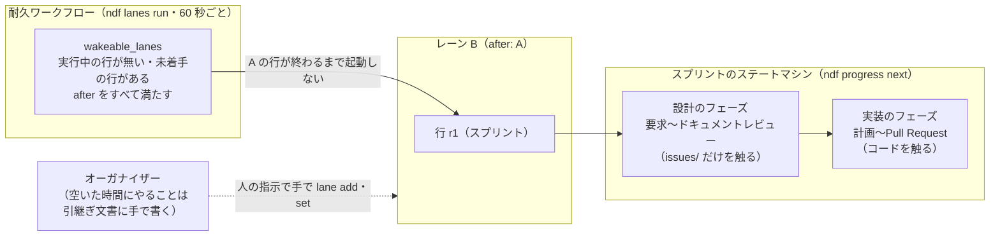
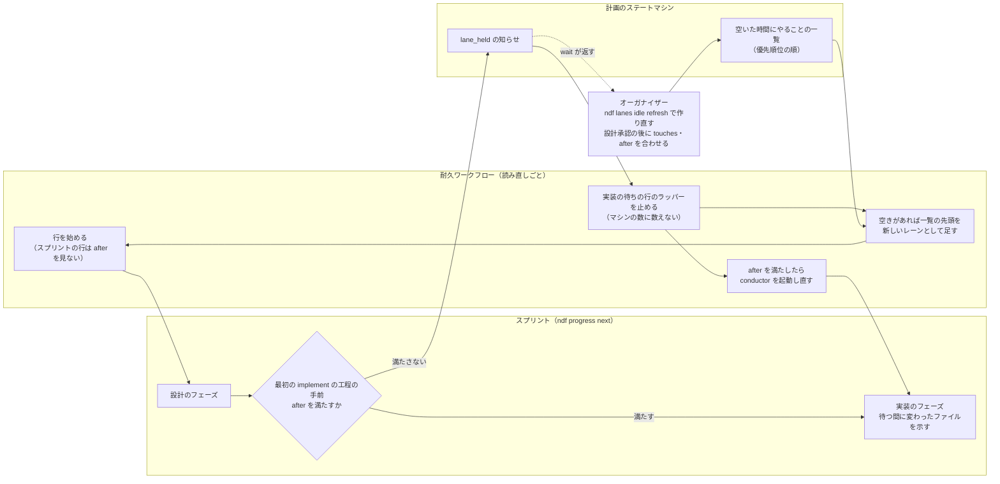
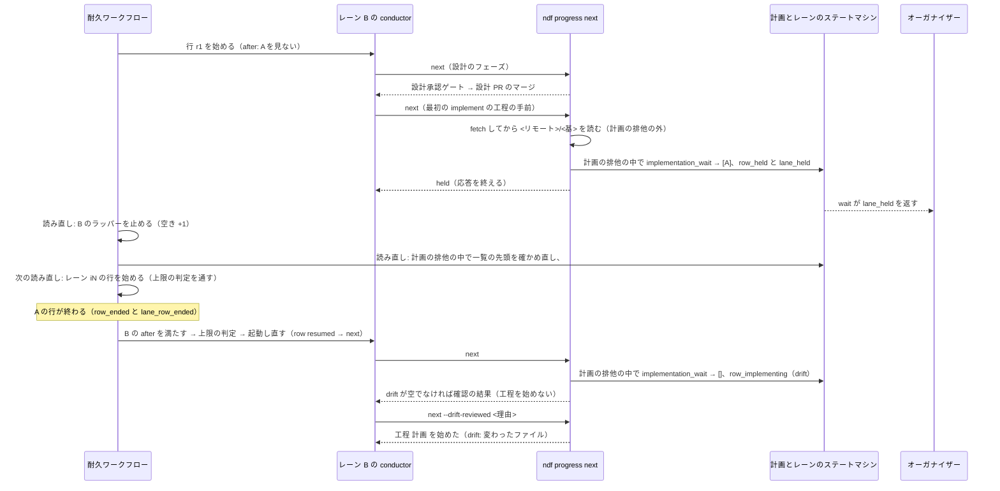

# 並列の計画: 実装が重なるレーンも設計を先に通し、待つ間の枠へ一覧の上から別の設計を流す（#4050）

並列の計画のレーンは、実装が他のレーンと重なるだけで `after` に止められ、`issues/` しか触らない設計まで始められず、待つ間もマシンの枠を使い続けた。スプリントの行の `after` を、工程の定義が既に持つフェーズの区切り（`metadata.ndf.phase` の `design` → `implement`）で照らし、行は待たずに設計を通して、実装のフェーズの最初の工程の手前でだけ待たせる。待つ行はラッパーを止めて枠を空けてオーガナイザーへ知らせ、耐久ワークフローは、計画のステートマシンが持つ「空いた時間にやることの一覧」の先頭を新しいレーンとして足して設計を流す。方針の出典は利用者の全体の設計方針（#4069）で、照らし合わせと、範囲の外へ分けた文脈の待機（#4071）・工程ごとに分ける案を採らなかった理由は「決定の記録」に、比べた製品は付録の「外部の調査」にある。

## 今の姿

何が起きたか・目的・受け入れ条件は要求仕様（[issue-4050-requirements.md](./issue-4050-requirements.md)、正は #4050 の本文）にある。この文書は「どう解くか」と「なぜその解き方か」だけを書く。パスは `plugins/ndf/` からの相対で書く。



設計に要る今の構造:

| 部品 | 今の振る舞い | 場所 |
| --- | --- | --- |
| 行を始める判定 | 実行中の行が無く、未着手の行があり、レーンの `after` をすべて満たすレーンの最初の未着手の行を始める。スプリントの工程は見ない | `src/ndf/progress/lane/rules.py` の `next_row`・`wakeable_lanes`（219-237 行） |
| `after` を満たす | 指した行が完了か中止、またはレーンを指せばその全行が完了か中止 | `rules.py` の `after_met`（32-36 行） |
| 触る場所の検査（I13） | 前後の鎖（行の並びと `after`）の無い別のレーンの行どうしで `touches` が重なれば、レーンのステートマシンへの書き込みを断る。起動の判定には使わない | `rules.py` の `_touch_errors`・`src/ndf/progress/lane/__init__.py` の `checked_write` |
| 工程のフェーズ | 工程の定義が `metadata.ndf.phase` を持つ（`design`・`implement`・`release`・`close`）。`standard` は「要求と受け入れ条件」〜「ドキュメントレビュー」が `design`、「計画」〜「Pull Request」が `implement` | `contracts/workflow/stages/*.json`・`src/ndf/progress/definition.py:318` |
| 工程を始める口 | `ndf progress next` が未着手の工程を始める。レーンの行のスプリントは `Env` の口（`lane_env`）で行の終わりをレーンへ写す | `src/ndf/progress/run.py` の `_start`・`Env`、`src/ndf/progress/gate/answering.py` の `lane_env` |
| 行の状態と記録 | 行の状態は `pending`・`running`・`completed`・`cancelled` の 4 つ。承認ゲートを待つ行も `running` で、回答の後の next 待ちは事象の番号の比べ（`answered_seq > resumed_seq`）で表す | `src/ndf/progress/lane/types.py` の `LaneRow` |
| マシン全体の数 | 実行中の行を持つレーン（承認ゲートの待ちを含む）と動いているラッパーを 1 本ずつ数える | `src/ndf/progress/lane/machine.py` の `count` |
| 起動の手 | 読み直しのたびに、終わったレーンのラッパーを止める手・行を始める手・回答の後の next を打たせる手・`/goal` の入れ直し・中止を、この順で 1 つずつ打つ | `src/ndf/progress/plan/run_decide.py` の `_launches` |
| オーガナイザーへの知らせ | `ndf lanes wait` は計画のステートマシンの `request_opened`・`plan_completed` と止まりだけを返す。レーンの事象（行の始まり・終わり）は返さない | `src/ndf/progress/plan/wait_decide.py` の `NOTICE_KINDS` |
| 計画へレーンを足す | `lane_added` の書き手はオーガナイザーだけ | `contracts/workflow/progress.json` の `events` |
| 状態の表示 | `ndf lanes status` はレーンの `after` と行・生死の判定を出し、`touches` を出さない | `src/ndf/progress/plan/__init__.py` の `_lane_items` |

## 文脈と制約

- **利用者の全体の設計方針（#4069）が、この設計の判断の基準になる。** 決められた範囲の資源はできるだけ使い、処理待ちを作らない。待つ間は別のことをするか、待ちをオーガナイザー・conductor へ伝えて別のレーンか supervisor を起動する。そのために空いた時間にやることを常に整理し、優先順位を決めておく。#4069 の「目指す姿」は、一覧と優先順位を NDF の記録に持ち、待ちが出たら機械で上から割り当て、オーガナイザーの手書きに頼らないことを求める
- **計画はスプリントの工程を見られない。** レーンのステートマシンへ写るのは行の始まり・終わり・回答・再開のマーカーの 4 つだけで、耐久ワークフローの読み直しはスプリントのステートマシンの工程を読まない。工程の区切りで何かをさせるなら、工程を流す側（`ndf progress next`）から計画へ書くしかない
- **工程の定義のフェーズは、モードごとに並びが違っても同じ値を持つ。** `light` は設計のフェーズの工程を持たず、最初の `implement` の工程が行の頭に来る。区切りを工程の名前（「計画」）で決めると、モードごとに違う名前を持つことになる
- **I19 が同じ課題を 2 つの終わっていないレーンに置くことを断る。** 設計のフェーズが触る `issues/issue-<番号>-*` と設計 Pull Request は課題ごとなので、別のレーンの設計のフェーズどうしも、設計のフェーズと別のレーンの実装も重ならない
- **レーンは 1 行ずつ動く。** 実行中の行がある間、同じレーンの次の行は始まらない。待ちの間に別の Issue の設計を流すには、別のレーンが要る
- **マシン全体の上限（`relay.max-named`、既定 6）は動いているセッションの数を絞る。** 承認ゲートを待つ行も、conductor のセッションが開いたまま枠を使う。p12 では 2026-11-22 14:01 JST に稼働中 6・上限 6 で、空きが無かった
- **耐久ワークフローは GitHub を読まない。** 読み直しは 60 秒ごとで、GitHub の読み取りを足すと二次レート制限（#4016）に近づく。GitHub を読む作業は、オーガナイザーが決まった時点で打つコマンドに置く
- **開いたマイルストーンの名前は `<2 桁の連番> <主題>` で、連番が着手の順序を表す**（`AGENTS.md` の「版とリリースの方針」）。連番を持たない名前のリポジトリもある

## 解き方の全体像



- スプリントの行は `after` を待たずに始まり、設計のフェーズ（設計承認ゲートと設計 Pull Request のマージまで）を通す。`after` は、`ndf progress next` が最初の `implement` の工程を始める手前でだけ照らす
- 満たしていなければ、実装の待ちを記録して工程を始めない。記録は計画のステートマシンにも知らせとして載り、オーガナイザーの `ndf lanes wait` が返す。耐久ワークフローはそのレーンのラッパーを止めてマシンの数から外し、`after` を満たした後に conductor を起動し直す。起動し直した `next` は、待つ間に基のブランチで変わったファイルを示してから実装の工程を始める
- 計画のステートマシンが、空いた時間にやることの一覧を持つ。オーガナイザーが決まった時点で `ndf lanes idle refresh` を打つと、計画のマイルストーンの設計の無い Issue が決まった優先順位で並ぶ。耐久ワークフローは、計画の行で始められるものが無く空きがある読み直しで、一覧の先頭を新しいレーンとして足す
- 足したレーンは実装のフェーズで同じリポジトリの先のレーンをすべて待つ形で始まり、設計承認の後にオーガナイザーが `touches`・`after` を設計の結果に合わせる。合わせるまでは `touches` が未確定として実装を始めない（機械で検査する）。前提が変わったと conductor が判断した行は、今の差し戻しと同じく行を中止して同じ課題の行を足し、設計承認ゲートを通し直す
- 実装を始めるかの判定と、始めたことの記録（`row_implementing`）は、計画の排他の中で 1 回で行う。待ちを解く印は起動し直しのマーカー（`row_resumed`）ではなくこの記録で、起動し直しの途中で落ちても待ちの行のまま残る
- 承認ゲートの回答を待つ行も、ラッパーを止めて枠を空ける（決定 11）。回答の後の起動し直しは今も新しいラッパーを起動する形なので、止めても失う文脈は増えない。承認が何時間も出ない間も、空いた枠へ一覧の設計が流れ続ける
- 開発ループの行と計画の外のスプリントは今のとおり動く

## ドメインモデル

### コンテキスト

| コンテキスト | 何の語が 1 つの意味に決まるか |
| --- | --- |
| 並列の計画（`ndf lanes`） | レーン・行・`touches`・`after`・実装の待ち・空いた時間にやることの一覧・割り当て |
| スプリントの進行（`ndf progress`） | 工程・フェーズ・承認ゲート |

関係: スプリントの進行が上流、並列の計画が下流（顧客と供給者）。スプリントの進行は工程の区切りを `Env` の口で知らせるだけで計画の語を持たず、並列の計画がその知らせを自分の語（実装の待ち）へ訳す。

### 集約

| 集約 | オーナー（書き換えてよいもの） | 根 | エンティティ | 値オブジェクト |
| --- | --- | --- | --- | --- |
| 計画 | オーガナイザー（レーンの追加・`touches`・`after`・一覧の作り直しと調整）・耐久ワークフロー（一覧からのレーンの追加・完了・知らせ）・レーンの conductor（実装の待ちの知らせ） | 計画のステートマシン | レーンの定義・一覧の項目 | `touches`・`after`・リクエスト・優先順位 |
| レーン | レーンの conductor（行・始まり・待ち・再開のマーカー）・耐久ワークフロー（終わり）・オーガナイザー（回答） | レーンのステートマシン | 行 | 実装の待ち（待つ先・待ち始めた基のコミット・時刻） |

### 不変条件

| # | 集約 | 条件 | 破れたときの扱い |
| --- | --- | --- | --- |
| I1 | レーン | 実装の待ちの行は、`after` をすべて満たし、`touches` が確定する（一覧から割り当てたレーンは空でない）まで実装のフェーズの工程を始めない | `next` が工程を始めずに待ちを返す |
| I2 | レーン | 1 つの行の 1 回の待ち（実装の開始の記録 `row_implementing` が無い間の `row_held`）は高々 1 件である | 2 件目を書かずに今の待ちを返す |
| I3 | 計画 | 実装の待ちの行（`row_held` を持ち `row_implementing` を持たない実行中の行）と、ラッパーを止めた承認の待ちの行（I8）はマシン全体の稼働中の数に数えない | 数えないことをテストで縛る |
| I4 | 計画 | 開発ループの行と、`after` を持たないレーンの行は、実装の手前で待たない | 今の振る舞いをテストで縛る |
| I5 | 計画 | 触る場所の検査（I13）と課題の重なり（I19）の規則は変えない。`after` の鎖は行の並びと同じく前後を付ける。スプリントの行では、レーン全体を指す `after` の辺を「行の開始」でなく「実装の開始（`row_implementing`）」の前後で引く | 書き込みを断る（今のとおり） |
| I6 | 計画 | 一覧の項目は、計画のどの行（終わった行を含む）にも無い課題だけである。割り当てたレーンの追加と一覧から外すことは同じトランザクションで行う | 読むときに計画の行の課題を除く。割り当ての書き込みは片方だけでは成り立たない |
| I7 | 計画 | 1 回の読み直しで割り当てるのは高々 1 本で、計画の行で始められるもの（始める行・起動し直し）があればそちらを先にする。一覧が空でないうちは計画を完了にしない | 割り当てを打たない・完了を打たない |
| I8 | 計画 | 承認ゲートの回答を待つ行（生死の判定が `waiting_answer` で、スプリントの待ちが承認ゲート（`gate`）の実行中の行。回答が載った後の `resuming` は含まない）は、ラッパーを止めて稼働中の数に数えない。回答の後の起動し直しはマシン全体の上限の判定を通す | 数えないことと、起動し直しが上限で待つことをテストで縛る |
| I9 | レーン | 実装の開始の記録（`row_implementing`）は 1 行に高々 1 件で、`after` と `touches` の検査と同じ計画の排他の中で書く。記録の後に実装の工程を始める | 検査を通らなければ書かず、待ちを書く |

### ドメインイベント

| # | イベント | 発生元 | 受け手 |
| --- | --- | --- | --- |
| E1 | スプリントの行を始めた（`after` を見ない） | 耐久ワークフロー | レーン |
| E2 | 設計のフェーズを終えた | スプリントの進行 | （計画へは写らない） |
| E3 | 実装の待ちに入った（レーンの `row_held`・計画の `lane_held`） | スプリントの進行（`Env.hold` → 計画とレーン） | 耐久ワークフロー・オーガナイザー（`wait`）・`ndf lanes status` |
| E4 | ラッパーを止めた | 耐久ワークフロー | 中継 |
| E5 | `after` の先の行が終わった（レーンの `row_ended` と、同じトランザクションの計画の `lane_row_ended`） | 耐久ワークフロー・conductor | 耐久ワークフロー・オーガナイザー（`wait`） |
| E6 | conductor を起動し直した（`row_resumed`。起動の試行で、待ちは解かない） | 耐久ワークフロー・conductor | レーン |
| E7 | 実装の開始を確定した（`row_implementing`。変わったファイルを持つ） | スプリントの進行（`Env.hold` → レーン） | レーン・耐久ワークフロー |
| E7a | 変わったファイルを conductor が読んで続けると判断した（`row_drift_reviewed`） | conductor（`ndf progress next --drift-reviewed`） | レーン |
| E7b | 実装の工程を始めた | スプリントの進行 | conductor |
| E7c | 承認ゲートの回答を待つ行のラッパーを止めた | 耐久ワークフロー | 中継 |
| E8 | 行を中止し同じ課題の行を足した（設計の直し） | conductor | レーン |
| E9 | オーガナイザーが待ちの知らせを受けた | `ndf lanes wait` | オーガナイザー |
| E10 | 一覧を作り直した（`idle_listed`）・調整した（`idle_adjusted`） | オーガナイザー（`ndf lanes idle`） | 耐久ワークフロー |
| E11 | 一覧の先頭を新しいレーンとして足した（`lane_added`、書き手 `workflow`） | 耐久ワークフロー | 計画・レーン |
| E12 | 設計承認の後にレーンの `touches`・`after` を設計に合わせた（`lane_changed`） | オーガナイザー | 計画 |

## 構成要素

| 要素 | 責務 |
| --- | --- |
| 行を始める判定（`rules.next_row`・`wakeable_lanes`） | スプリントの行は `after` を見ずに始める。開発ループの行は今のとおり `after` を見る |
| 実装の待ちの判定（`rules.implementation_wait`、新設） | 行のレーンの `after` のうち満たしていない値と、一覧から割り当てたレーンの未確定の `touches` の印を返す |
| 順序のグラフ（`rules._order_graph`） | スプリントの行のレーン全体を指す `after` の辺を、行の開始でなく実装の開始の記録で切り替える |
| 実装の開始の判定と記録（`lane.begin_implementation`、新設） | 計画の排他の中で最新の依存を確かめ、待ちならレーンの `row_held` と計画の `lane_held` を同じトランザクションで 1 回だけ書き、待たなければ `row_implementing` を書く |
| 行の終わりの知らせ（`lane.end_row`） | `row_ended` と同じトランザクションで計画に `lane_row_ended` を書く |
| 工程を始める口（`run._start`・`Env.hold`・`run.wait` の手の組み立て） | 最初の `implement` の工程を始める手前で `Env.hold` を呼び、待ちなら工程を始めずに待ちの結果を返す（`work` の続けての流しも止める）。`drift` が空でなく判断の記録が無ければ工程を始めずに確認の結果を返す。`wait`・`next` の手の組み立ても、待ちの行なら同じ結果を返す |
| レーンの口（`answering.lane_env`） | `Env.hold` に、取得とリモートの解決（`Git.remote()`）・実装の開始の判定と記録・変わったファイルの算出をつなぐ |
| マシン全体の数（`machine.count`） | 実装の待ちの行と、ラッパーを止めた承認の待ちの行のレーンを稼働中に数えない |
| 生死の判定（`liveness`） | 実装の待ちの行を `held` と判定し、止まりとして知らせない |
| 起動の手（`run_decide._launches`） | 実装の待ちの行と承認の待ちの行のラッパーを止める手と、`after` を満たした待ちの行の conductor を起動し直す手を足す。回答の後の起動し直しに上限の判定を通す |
| 割り当ての手（`run_decide`・`plan.run` の `assign_idle`、新設） | 計画の行で始められるものが無く空きがある読み直しで、計画の排他の中で確かめ直した一覧の先頭を新しいレーンとして足し、一覧から外す。失敗した課題を観測をまたいで覚えて飛ばす。一覧が残る間は計画を完了にしない |
| 一覧（`plan/idle.py`、新設。`ndf lanes idle refresh / set / show`） | 項目の出所と優先順位の規則で一覧を作り直し、調整（先頭へ出す・外す）を記録し、空きの数と一緒に読む。GitHub は作り直しでだけ、まとめて読む。呼び出し元の役割を中継の環境から決める |
| 設計文書と設計ブランチの番号（`model.design_issues`、新設） | 設計文書の名前と設計ブランチの head から課題の番号を取り出す唯一の関数 |
| 待ちの知らせ（`wait_decide.NOTICE_KINDS`） | `lane_held`・`lane_row_ended` を知らせに足す |
| 状態の表示（`plan._lane_items`） | レーンの `touches` と、行の実装の待ちを出す |
| オーガナイザーの手順（`references/parallel.md`） | 一覧を作り直す時点・調整の基準・待ちの知らせの読み方・設計承認の後に `touches`・`after` を合わせる手・設計を直す手 |

## データ構造

**事象を 7 つ足し、1 つの書き手を広げる。** 行の状態は増やさない（待つ行は `running` のまま）。どれも `contracts/workflow/progress.json` の `events` の行で定める。

| 事象 | ステートマシン | 書き手 | 中身 | 畳み込み |
| --- | --- | --- | --- | --- |
| `row_held`（新設） | レーン（`scope: row`・`from: [running]`、状態を変えない） | conductor | `waiting`（満たしていない `after` の値。`touches` が未確定なら `touches` の印を含む）・`base`（基のブランチ）・`ref`（読んだ追跡参照 `<リモート>/<基のブランチ>`）・`base_sha`（書く直前に取得した `ref` のコミット）・`stage`（始めなかった工程） | 行の `held_seq`・`held_at`・`held`。`held_seq > 0` で `implementing_seq == 0` の実行中の行を実装の待ちの行と読む |
| `row_implementing`（新設） | レーン（`scope: row`・`from: [running]`、状態を変えない） | conductor | `stage`（始める工程）・`drift`（待った行だけ。変わったファイルの並び。読めなければ null）・`base_sha`（待った行だけ） | 行の `implementing_seq`・`drift`。1 行に 1 件（I9）。I13 のグラフの「実装の開始」 |
| `row_drift_reviewed`（新設） | レーン（`scope: row`） | conductor | `reason`（続けると判断した理由） | 行の `drift_reviewed`。`drift` が空でない行は、これが無いと実装の工程を始めない |
| `lane_held`（新設） | 計画（`scope: row`。計画のステートマシンの行のキーはレーンの名前） | conductor | `lane`・`row`・`waiting`・`held_seq`（レーンの事象の番号） | 畳み込まない。`ndf lanes wait` の知らせ |
| `lane_row_ended`（新設） | 計画（`scope: row`） | `row_ended` と同じ（conductor・workflow） | `lane`・`row`・`outcome` | 畳み込まない。`ndf lanes wait` の知らせ（一覧を作り直す時点の 1 つ） |
| `idle_listed`（新設） | 計画（`scope: table`、状態を変えない） | organizer | `items`（`issue`・`title`・`milestone`・`milestone_order` の並び。優先順位の順）・`milestones`・`listed_at` | 最後の `idle_listed` が今の一覧の出所 |
| `idle_adjusted`（新設） | 計画（`scope: table`） | organizer | `pin`（先頭へ出す課題）か `exclude`（外す課題）か `clear`（その課題の調整を消す）と、理由 | 課題ごとの最後の調整。作り直しでも消えない |
| `lane_added`（書き手を広げる） | 計画 | organizer・**workflow** | 今の中身に `idle`（割り当てた一覧の課題の番号）を足す | 今のとおり。`idle` を持つレーンは一覧から割り当てたレーン |

**今の一覧は、最後の `idle_listed` の項目から、計画のどれかの行の課題と `exclude` の課題を除き、`pin` の課題を `pin` を書いた順で先頭へ出したものである**（I6）。割り当ては `lane_added` で項目の課題を計画の行に入れるので、一覧から外す事象を別に持たない。

**優先順位**（`idle_listed` を書くときの並び）: (1) マイルストーンの連番（名前の先頭の 2 桁）の昇順。連番の無いマイルストーンは後ろで、名前の昇順 (2) 課題の番号の昇順。`pin` は読むときに (1) より前へ出す。

## 入出力のコントラクト

**`ndf progress next` の結果**（実装の待ちのとき）:

```json
{"tool": "progress", "status": "ok", "summary": "工程 計画 の手前で実装の待ちに入った（after: lracct）。応答を終える（耐久ワークフローが起動し直す）",
 "metrics": {"machine_id": "sprint:…", "held": {"waiting": ["lracct"], "stage": "計画", "base_sha": "8a657025c…", "seq": 41}}}
```

- `next` を持たない（続けて打つコマンドが無い）。打ち直すと、待ちを書き足さずに同じ形を返す（I2）
- `ndf progress work`（工程をこのプロセスで続けて流す）が実装の境に着いたときも同じ形で止まる。`ndf progress wait` と `ndf progress next` の手の組み立ては、次の工程が実装の境で、行が実装の待ちの行なら、同じ形（`next` 無し）を返す。設計のフェーズで起動した worker が境まで進んでも、conductor は `wait` から待ちを読む
- 待ちが解けて `drift` が空でないとき（読めず null のときも）、`next` は工程を始めずに確認の結果を返す。工程は、conductor が判断を記録した後（`row_drift_reviewed`）にだけ始まる（判断の前に実装を始めない）

```json
{"tool": "progress", "status": "ok", "summary": "実装の待ちが解けた。待つ間に touches に当たるファイルが 2 件変わった。設計の前提を確かめてから続ける",
 "metrics": {"machine_id": "sprint:…", "drift": ["plugins/ndf/src/ndf/progress/lane/rules.py", "…"]},
 "next": {"command": "ndf progress next sprint:… --drift-reviewed <理由>"}}
```

- 続けないと判断したら、conductor は `next` を打たず、行を中止して同じ課題の行を `--carry` で足す（決定 6）
- 工程を始めたときは、今の結果（工程を起動した `wait`）の `metrics` に `drift`（レーンの `touches` に当たり、`base_sha` から今の `<リモート>/<基のブランチ>` までに変わったファイルの並び。無ければ空）を載せる。待たなかった行は `drift` を持たない

**`ndf lanes status` の結果**: レーンの項目に `touches` を足す。行の項目に、実装の待ちの行だけ `held`（`waiting`・`stage`・`since`）を足す。生死の判定に種類 `held` を足す。`metrics` に `idle`（今の一覧の件数と先頭の課題）を足す。

**`ndf lanes wait` の結果**: 知らせ（`items`）に `kind: lane_held`（中身は `lane`・`row`・`waiting`）と `kind: lane_row_ended`（中身は `lane`・`row`・`outcome`）を足す。どちらも計画のステートマシンの事象なので、今の `--after` の番号の系列のまま読める。

**`ndf lanes idle`**（新設）:

| サブコマンド | 引数 | すること | 書き手 |
| --- | --- | --- | --- |
| `refresh` | `<計画> [--milestone <番号>]...` | 計画の行の課題のマイルストーン（`--milestone` で足す）の開いた Issue のうち、計画の行に無く設計の無いものを優先順位で並べ、`idle_listed` を書く。GitHub を読むだけ | organizer（呼び出し元の役割で確かめる） |
| `set` | `<計画> (--pin <課題> \| --exclude <課題> \| --clear <課題>) --reason <理由>` | `idle_adjusted` を書く | organizer（同上） |
| `show` | `<計画>` | 今の一覧と空きを返す。GitHub を読まない | （読むだけ） |

```json
{"tool": "lanes", "status": "ok", "summary": "一覧 3 件（先頭 #4052）・空き 2",
 "items": [{"order": 1, "issue": 4052, "title": "…", "milestone": "63 並列の計画・開発ループ・中継の機能", "pinned": false}],
 "metrics": {"listed_at": "2026-11-22T05:30:00Z", "free": 2, "lanes": 4, "cap": 6, "excluded": [4061]}}
```

| 項目 | 決まり |
| --- | --- |
| 基のブランチの参照 | `<リモート>/<基のブランチ>`。リモートは `Git.remote()`（`.ndf/worktree.json` の `remote`、無ければ既定）、基のブランチはブランチ戦略の設定から読む。`origin` を決め打ちしない。読む直前に `git fetch <リモート> <基のブランチ>` を 1 回打ち、古い追跡参照を使わない（一覧の作り直しも待ちの記録も同じ） |
| 設計の有無 | 「無い」は、基のブランチの参照の `issues/` に、その課題の番号を持つ設計文書が無く、その課題の番号を持つ設計ブランチの開いた Pull Request も無いこと。どちらも番号の取り出しは 1 つの関数に置く（詳細設計の「設計文書と設計ブランチの番号」） |
| 設計文書の番号 | 名前が `issue-` で始まり `-design.md` で終わる文書の、間を `-` で区切った語のうち数字だけの語のすべて。`issue-4049-4050-design.md` は #4049 と #4050 の設計である。`-design-detail.md` などほかの名前は数えない |
| 設計ブランチの番号 | head が設計ブランチの接頭辞（`contracts/workflow/progress.json` の `branch_prefixes.design`。今は `design/`）で始まり、残りから `issue-` を 1 つ外した後の、先頭から `-` で区切って続く数字だけの語のすべて（最初の数字でない語で止まる）。今ある名前の `design/issue-2489`（#2489）・`design/4050-parallel-design-ahead`（#4050）・`design/4049-4050-x`（#4049・#4050）のどれも当たる |
| Issue の一覧 | マイルストーンの Issue の一覧が Pull Request を含んで返っても（REST の `pull_request` を持つ項目）、項目に入れない |
| `free` | マシン全体の上限 − 稼働中の数（`machine.count` と同じ数え方。0 未満は 0） |
| 書き手の確かめ | `refresh`・`set` は呼び出し元の役割を、中継が計画のレーンの子へだけ渡す環境 `NDF_RELAY_PLAN` の有無から決める。レーンの中継の子（`NDF_RELAY_PLAN` がある）は conductor として書くので、事象の `actors` で断られる。CLI が書き手を `organizer` に決め打ちしない |
| 失敗 | `refresh` が GitHub を読めなければ `stopped`・`work_stopped` で、前の一覧を残す（`idle_listed` を書かない）。取得（`fetch`）に失敗しても同じ。上限を読めなければ `free` を null にして `warnings` に理由 |

**割り当てで足すレーン**: 名前は `i<課題の番号>`（同じ名前があれば `i<番号>-<n>`）、`input` は `{"kind": "sprint", "issues": [<番号>]}`、`touches` は空、`after` は同じリポジトリの終わっていないレーンのすべて、`repo` は計画のリポジトリ、`idle` は課題の番号。`after` と名前は、割り当ての書き込みが取った計画の排他の中で読んだ最新の計画から組む（観測した写しからは組まない）。`idle` を持ち `touches` が空のレーンは、`touches` が未確定として実装を始めない（I1）。

## 処理の流れ



1. 行を始める判定は、スプリントの行なら `after` を見ない。`row start` の書き込みの検査（I13）は通すが、スプリントの行のレーン全体を指す `after` の辺は、行の開始でなく実装の開始（`row_implementing`）で切り替える（I5）。今のグラフは後続の行が `running` になると、起点のレーンの未着手の行からの辺を外す。A と B が同じファイルを触り `B.after=[A]` で両方が未着手のとき、B を先に設計へ起動すると A→B の辺が消えて I13 が起動を断る。新しい規則では、B が実装を始めるまで、A の末尾（未着手の行を含む）から B の行への辺が残り、B の設計の起動は通る。B が実装を始めた後は、今と同じく始めた時点で終わっていた A の行からだけ辺を引く
2. `next`（`ndf progress work` の続けての流しも同じ口）は未着手の工程を始める前に、その工程のフェーズが `implement` で、この行がまだ実装の開始を記録していなければ、`Env.hold` を呼ぶ
3. `Env.hold` は、行のレーンの `after` が空でないか、`touches` が未確定か、今の待ちがあるときだけ、計画の排他の外で `git fetch <リモート> <基のブランチ>` と `rev-parse` を打つ（待つ必要の無い行では Git を読まない）。その後、計画の排他の中で最新の計画とレーンを読み直し、満たしていない `after` か未確定の `touches` があれば `row_held`・`lane_held` を書いて（今の待ちがあれば書かずに）待ちを返す。無ければ同じ排他の中で `row_implementing`（待った行は変わったファイルを持つ）を書く。排他の中で Git を読まない。排他の外で読まなかった行が、排他の中で待ちになった（その間に `lanes set` が `after` を足した）ときは、書かずに排他を抜けて 1 回だけ初めからやり直す
4. 耐久ワークフローの読み直しの手の順は、終わったレーン・実装の待ちの行・承認ゲートの回答を待つ行（I8）のラッパーを止める手 → 行を始める手 → 回答の後の next と待ちの起動し直し → `/goal` の入れ直し → 中止 → 割り当て → 計画の完了、である。割り当ては、それより前の手が 1 つも無く、空き（上限 − 稼働中の数）が 1 以上で、計画が `running` のときだけ打つ（I7）。全行が終わっていても一覧が空でなければ計画を完了にせず、割り当てへ進む（空きが 0 なら読み直しを待つ）。一覧が空のときだけ今のとおり完了にする
5. 割り当ては、計画の排他を取った後に最新の計画を読み、計画が `running` で、一覧の先頭が観測した課題と同じことを確かめてから、その状態から `after` を組んで 1 つの `lane_added` で書く。違えば書かずに「観測が古い」と返し、耐久ワークフローは失敗として数えずに読み直しへ戻る。計画の決まりで断られたら項目を残し、その課題をこの実行の割り当ての失敗として観測をまたいで覚え、次の読み直しからはその課題を飛ばして一覧の次の項目へ進む。知らせは同じ課題で 1 回だけ `launch_failed` と同じ形のリクエストで出す。一覧が作り直されるか、その課題の調整が書かれたら、飛ばすのをやめる
6. 起動し直した conductor の `next` は 3 の「無い」ほうへ進み、`row_implementing` を書く。`drift` が空なら `drift: []` を載せて工程を始める。空でなければ工程を始めずに確認の結果を返す。conductor（実装のフェーズの supervisor）は `drift` を実装計画の前提として読み、続けるなら `next --drift-reviewed <理由>` で判断を記録してから工程を始め、設計の前提が変わったと判断したら、行を中止して同じ課題の行を `--carry` で足す。起動し直しの `row resumed` は起動の試行の印で、待ちを解かない。`next` の前に落ちた conductor は、`row_implementing` が無いので次の読み直しでも起動し直しの候補に残る。オーガナイザーやラッパーが打った `next` が先に依存の解けを見ても、同じ 3 の口を通るので `drift` が届く
7. オーガナイザーは、計画を始めたとき・`lane_row_ended` を受けたとき・`lane_held` を受けたとき・`wait` が知らせ無しで待つ時間の上限で返ったときに `ndf lanes idle refresh` を打つ。行の終わりは、`row_ended` と同じトランザクションで計画に書く `lane_row_ended` を `wait` が返すので、ポーリングを足さない。設計承認の回答を届ける前に、そのレーンの `touches` を設計の結果の触るファイルに置き換え、`after` を重なるレーンだけに絞る（`ndf lanes set`）。届けた後に合わせても、合わせるまでは 3 が未確定の `touches` として待たせる

## 決定の記録

### 決定 1: 設計と実装の待ちの境を 1 か所に保つため、単位を工程の定義が持つ 2 つのフェーズにし、計画の設定の形を変えない

- **質問**: 並べる単位を、設計のフェーズと実装のフェーズの 2 つにするか、今の工程ごとにするか。2 つにするなら、計画の設定にフェーズごとの `touches`・`after` を持たせるか
- **選んだ案**: 2 つのフェーズ（起票者の案 A）にする。区切りは工程の定義の `metadata.ndf.phase`（`design` の後の最初の `implement`）で決め、計画の設定の形は変えない。レーンの `touches`・`after` は実装のフェーズに掛かるものと読む。設計のフェーズの触る場所は計画に書かせない
- 採らなかった案: 工程ごとに `touches`・`after` を持たせる（案 B。同じフェーズの工程は触る場所が同じで、分けても並べられる組が増えない。計画の設定と検査が工程の組み合わせごとに増える）
- 採らなかった案: 行かレーンに設計のフェーズの `touches`・`after`（例 `design.after`）を足す（設計のフェーズは課題ごとの `issues/` と設計 PR しか触らず、I19 が同じ課題を別のレーンに置かせないので、重なりが起きない。書かせる値が無いキーを足すと、空のまま置く設定が全計画に増える）
- **代償**: 設計のフェーズを待たせたい計画（例: 先のレーンの設計の結論を前提に後ろの設計を書きたい）は、設定では書けない。そのときは今のとおり行を後ろのレーンの順番表へ回すか、オーガナイザーが行を足す時期で調整する
- 根拠: Value 6（MVV バージョン 1）。PRD1

### 決定 2: 計画が工程を見られないまま区切りで止めるため、待ちの判定を `ndf progress next` の `Env` の口に置く

- **質問**: 実装の手前で止める判定を、どこに置くか
- **選んだ案**: `ndf progress next` が最初の `implement` の工程を始める手前で、`Env.hold` を呼ぶ。レーンの行のスプリントでは `lane_env` が実装の待ちの判定と記録をつなぎ、計画の外のスプリントでは何もしない（今の `Env.ended` と同じ口）
- 採らなかった案: 耐久ワークフローがスプリントの工程を読んで止める（計画の側は工程を読まず、読み直しの 60 秒の間に実装の工程が始まる。止めるには工程の開始を外から割り込む仕組みが要る）
- 採らなかった案: 工程の定義（DSL）に待ちのステップを足す（区切りの工程の名前がモードごとに違い、全モードの最初の `implement` の工程へ同じステップを足すことになる。計画の語が工程の定義へ漏れる）
- 採らなかった案: conductor への指示（起動の入力の文や画面への打ち込み）で止める（今の手作業の形。止まるかが conductor の記憶に掛かり、受け入れ条件 2 をテストで縛れない）
- **代償**: `ndf progress` が計画とレーンのステートマシンを読み書きする経路が 1 つ増える（今は行の終わりを書くだけ）。読み書きは同じトランザクションの中で行い、計画の決まり（`checked_write`）を通す
- 根拠: Value 4（MVV バージョン 1）

### 決定 3: 今の行の状態と検査を変えずに待ちを表すため、事象 `row_held` を足し、待ちの解けは実装の開始の記録で読む

- **質問**: 実装の待ちを、行の新しい状態にするか、事象で表すか。待ちが解けたことを何で読むか
- **選んだ案**: 行の状態は `running` のままにし、事象 `row_held` を足す。`row_held` を持ち `row_implementing` を持たない実行中の行を実装の待ちと読む。待ちを解くのは、計画の排他の中で依存を確かめて書く `row_implementing` だけで、起動し直しの入力が打つ `row_resumed` は起動の試行の印にとどめる。オーガナイザーへの知らせは、同じトランザクションで計画に `lane_held` を書いて `ndf lanes wait` に載せる
- 採らなかった案: 今の再開のマーカー（`row_resumed`）で待ちを解く（マーカーを書いた後 `next` の前に conductor が落ちると、待ちの行でなくなり起動し直しの候補から外れる。依存の確かめと実装の開始の確定が別の時点になり、間に `lanes set` が入ると満たしていない依存のまま実装を始める）
- 採らなかった案: 行の状態に `held` を足す（I13・I19・`after_met`・行の終わり・中止の判定が「実行中」を前提に書かれていて、状態を増やすとそのすべてに分岐が入る。回答の後の next 待ちを事象の番号で表す今の形と食い違う）
- 採らなかった案: `ndf lanes wait` がレーンのステートマシンも読む（`wait` は計画の事象の番号で続きを読む形で、レーンの事象は番号の系列が別になる。`--after` の番号が 2 つの系列にまたがる）
- **代償**: 待ちかどうかを状態の値だけでは読めず、番号の比べが要る。比べは `LaneRow` の 1 か所に置き、表示と判定はそこを読む。知らせの事象が計画とレーンに 1 件ずつ増える
- 根拠: Value 6（MVV バージョン 1）

### 決定 4: 待つ間に別の設計へ枠を回すため、実装の待ちの行はラッパーを止めて数えず、起動し直しは上限の判定を通す

- **質問**: 実装の待ちの行のセッションを開いたままにするか。マシン全体の稼働中の数に数えるか
- **選んだ案**: 耐久ワークフローがラッパーを止め、稼働中の数に数えない。待ちが解けたら、行を始めるときと同じく上限の判定を通して起動し直す
- 採らなかった案: 開いたまま数える（承認ゲートの待ちと同じ扱い。p12 のように枠が待つレーンで埋まると、設計を流す空きが出ない）
- 採らなかった案: 開いたまま数えない（上限は動いているセッションの数でメモリを守る値で、開いたセッションを数えないと上限が意味を失う）
- **代償**: 止めた conductor の会話の文脈は失われ、起動し直した conductor はステートマシンから続ける。区切りはカットポイント 1（設計 Pull Request のマージの後で、会話を切って新しいセッションで続けてよいと決めた点）と同じ位置なので、文脈を切る位置として既にある。止める時点で conductor が応答の途中だと、その応答は失われる（状態はステートマシンにあるので、作業は失われない）
- 根拠: Value 2（MVV バージョン 1）。#4069 の「リソースを使い切る」

### 決定 5: 先のレーンの直しを取り込める順を保つため、待ちを解く条件は今の `after` のまま（先の行の終わり）にする

- **質問**: 実装の待ちを、先のレーンの行の終わりで解くか、先のレーンの実装が基のブランチへ入った時点（スプリントの Pull Request のマージ）で解くか
- **選んだ案**: 今の `after_met` のまま、先の行の完了か中止で解く
- 採らなかった案: 先のレーンのスプリントの Pull Request のマージで解く（計画はスプリントの工程を見られず、新しい事象が要る。リリース承認ゲートで差し戻されると、先のレーンが同じファイルを直し直す。リリースの待ちの間の時間は、待つ行がラッパーを止めて枠を空け、その枠で別の設計を流すことで取り戻す）
- **代償**: 先のレーンのリリースの承認が遅れると、後ろの実装もその分遅れる（p12 の llimit の 12 時間のような待ち）。その間の枠は決定 4 と決定 8 で設計へ回す
- 根拠: Value 1（MVV バージョン 1）

### 決定 6: 先に流した設計の前提の変化を見落とさないため、待つ間に変わったファイルを示し、直しは今の差し戻しと同じ行の中止と足し直しで行う

- **質問**: 待つ間に先のレーンの実装が入り、設計の前提が変わったとき、何を自動で行い、何を conductor に判断させるか
- **選んだ案**: `row_held` に待ち始めた基のコミット（書く直前に取得したもの）を持たせ、待ちが解けた `next` が、レーンの `touches` に当たり待つ間に変わったファイルを `drift` に出す。`drift` が空でなければ工程を始めずに返し、conductor が続けると判断して理由を記録した（`next --drift-reviewed`）後にだけ工程を始める。設計の前提が変わったかは conductor が判断し、変わったなら行を中止して同じ課題の行を `--carry` で足す。足した行は設計のフェーズから流れ、設計承認ゲートを通し直す（ゲートの数は変わらない）
- 採らなかった案: 工程を始めた結果に `drift` を載せるだけにする（最初の `implement` の工程が実装そのもののモード（`light` など）では、conductor が差分を読む前に変更が始まる）
- 採らなかった案: `drift` が 1 件でもあれば自動で設計をやり直す（`touches` はディレクトリの単位で広く、設計に関わらない変更でも当たる。やり直すたびに人の承認が 1 回増える）
- 採らなかった案: スプリントのステートマシンに、終えた設計の工程を戻す事象を足す（今の `retry` は失敗した工程からしか戻せず、終えた工程を戻すと、マージ済みの設計 PR と工程の記録が食い違う。行の中止と足し直しは p12 の lracct の差し戻しで使われている形である）
- **代償**: 前提が変わったかの判断は conductor の読みに掛かる。`drift` が空でないのに直さなかったときは、実装計画の前提にその判断を書かせ、コードレビューと承認で人が見る
- 根拠: Value 7（MVV バージョン 1）

### 決定 7: 空いた時間にやることを常に整理しておくため、一覧を計画のステートマシンに持ち、作り直しはコマンドが決まった規則で並べ、調整だけをオーガナイザーが書く

- **質問**: 空いた時間にやることの一覧をどこに持ち、優先順位をどう決め、誰がいつ更新するか
- **選んだ案**: 置き場は計画のステートマシン（`idle_listed`・`idle_adjusted`）。項目は計画の行の課題のマイルストーンにある開いた Issue のうち、計画の行に無く設計の無いもの。並びはマイルストーンの連番の昇順 → 課題の番号の昇順で、オーガナイザーの `pin` を先頭へ出し、`exclude` を外す。作り直すのは `ndf lanes idle refresh` で、オーガナイザーが決まった 4 つの時点（計画の始まり・行の終わり・`lane_held` の知らせ・`wait` が知らせ無しで返ったとき）に打つ。調整はオーガナイザーだけが `ndf lanes idle set` で書く
- 採らなかった案: オーガナイザーの引継ぎ文書に手で書く（今の形。一覧が機械から読めず、#4069 の「オーガナイザーの手書きに頼らない」に反する）
- 採らなかった案: 一覧をファイル（`.ndf/` の下）に持つ（計画の状態の SSOT はステートマシンで、ファイルは割り当ての書き込みと同じトランザクションに入れられない。I6 が成り立たない）
- 採らなかった案: 耐久ワークフローが読み直しのたびに GitHub から作り直す（60 秒ごとに GitHub を読むと二次レート制限（#4016）に近づく。一覧は時点の決まった作り直しで足りる）
- 採らなかった案: 候補をリポジトリのすべての開いた Issue にする（計画を組んだテーマの外の Issue が混ざり、計画の終わりが見えなくなる。広げたいときは `--milestone` で渡す）
- 採らなかった案: 優先順位を棚卸しの順位や LLM の判定で付ける（並びが作り直しのたびに揺れ、同じ一覧を 2 回作って同じ順にならない。着手の順序は既にマイルストーンの連番が持つ）
- **代償**: マイルストーンの中の順は課題の番号だけで決まり、中身の重さや依存を見ない。外したい・先にしたい課題はオーガナイザーが `set` で書く。連番を持たないマイルストーンの順は名前の昇順になる
- 作り方: 自前で作る（今の計画のステートマシンと GitHub のアダプタの上の事象とコマンド）
- 比べた候補: LIB1 / PRD1 / PRD2
- 根拠: Value 4（MVV バージョン 1）。#4069 の「空いた時間にやること」

### 決定 8: 待ちが出たら機械で上から割り当てるため、空きのある読み直しで耐久ワークフローが一覧の先頭をレーンとして足し、実装の重なりは保守的な `after` で守る

- **質問**: 一覧の項目を、誰がいつ流すか。流した項目の実装の重なりをどう守るか
- **選んだ案**: 耐久ワークフローが、計画の行で始められるもの（始める行・起動し直し）が無く空きが 1 以上の読み直しで、一覧の先頭の項目を新しいレーン（スプリントの行 1 つ・`touches` は空・`after` は同じリポジトリの終わっていないレーンのすべて）として足す。足したレーンの設計はすぐ流れ、実装のフェーズは先のレーンがすべて終わるまで待つ。設計承認の回答を届けた後に、オーガナイザーが `touches` を設計の結果の触るファイルに置き換え、`after` を重なるレーンだけに絞る
- 採らなかった案: オーガナイザーが一覧を読んで手で `lane add` を打つ（待ちの知らせからレーンの追加までがオーガナイザーの見回りの間隔に掛かり、オーガナイザーが質問に答えている間は枠が遊ぶ。#4069 は機械での割り当てを求める）
- 採らなかった案: 足すときに `touches` を課題の本文から見込む（見込みは本文を読む判断で、耐久ワークフローは LLM を呼ばない。外れた見込みは I13 をすり抜けて実装が重なる。設計の結果の触るファイルが出るまで、全レーンを待つ形で守る）
- 採らなかった案: 計画の行で始められるものより割り当てを先にする（計画に組んだ行は、組んだ時点で着手が決まった作業で、一覧の項目より先に流す）
- **代償**: オーガナイザーが `touches` を合わせるまで、足したレーンは実装を始めない（`touches` が空のまま実装を始めると、後から別のレーンを足すときに I13 が重なりを見つけられないため、未確定の `touches` を待ちとして扱う）。合わせ忘れると実装が遅れる（壊れはしない）。合わせ忘れは、`ndf lanes status` で待つ先に `touches` の印がある行で分かる。設計承認の質問が人へ並ぶ数が増える
- 作り方: 自前で作る（今の耐久ワークフローの手の並びに 1 つ足す）
- 比べた候補: LIB1 / PRD1
- 根拠: Value 4（MVV バージョン 1）。Value 2（MVV バージョン 1）。#4069 の「処理待ちを作らない」

### 決定 9: 全体の設計方針（#4069）に照らし、資源と待ちの方針はこの課題で当て、文脈の待機とキャッシュを起こす処理は範囲の外（#4071）へ分ける

- **質問**: #4069 の原文 1（資源を使い切る・処理待ちを作らない・空いた時間にやることを整理する）と原文 2（文脈を再利用し、再利用できる supervisor・conductor を待機させ、キャッシュを起こす）を、この課題のどこで当てるか
- **選んだ案**: 原文 1 はこの課題で当てる。待ちは実装の待ちとして記録して `wait` でオーガナイザーへ伝え（決定 3）、待つ行は枠を空け（決定 4）、空いた枠へ一覧の上から機械で割り当てる（決定 7・決定 8）。原文 2 は範囲の外へ分け、#4071 として起票した。実装の待ちの行は、待機させずにラッパーを止める
- 採らなかった案: 実装の待ちの行の conductor を待機させ、キャッシュを起こしながら実装の始まりまで残す（実装の待ちは先のレーンの行の終わりまでで、p12 では 12 時間を超えた。キャッシュの寿命（最大 1 時間）を必ず越え、起こし続ける費用と待機が使う枠が、残せる文脈（設計のフェーズの会話。実装は設計文書と実装計画から読み直す）に見合わない）
- 採らなかった案: 原文 2 の規則（待機・キャッシュを起こす・待機を終える）をこの課題で作る（規則が当たるのは承認ゲート・背景の supervisor・中継の引継ぎの待ちで、レーンの実装の待ちとは別の場所（中継と conductor の待ち方）で決まる。1 本の設計文書に 2 つの問題を入れない）
- **代償**: 承認ゲートを待つ行も、待機させずにラッパーを止める（決定 11）。待機させて文脈を残す規則は #4071 で決め、入れば決定 11 の止める条件に例外として足す。実装の待ちの行は、待つ前の会話の文脈を捨てる（決定 4 の代償）
- 根拠: Value 6（MVV バージョン 1）。#4069

### 決定 11: 承認が長く出ない間も別の設計を流し続けるため、承認ゲートの回答を待つ行もラッパーを止めて数えない

- **質問**: 承認ゲートの回答を待つ行が全枠を埋めたとき、別の設計を始める枠をどう作るか。この課題に含めるか、#4071 へ移すか
- **選んだ案**: この課題に含める。耐久ワークフローは、生死の判定が承認ゲートの回答を待つ（`waiting_answer` で、スプリントの待ちが `gate`）と読んだ実行中の行のラッパーを止め、稼働中の数に数えない（I8）。回答が載った後は、今の「回答の後の next」の起動し直し（`row resumed` → `progress next`）で続け、その起動はマシン全体の上限の判定を通す
- 採らなかった案: 承認待ちは今のとおり枠を使い、達成を #4071 へ移す（要求の題「承認が長く出ないときは設計するものが無くなるまで別の Issue の設計を流す」と、利用者の原文「長いこと承認が出ない場合はもう設計するところがないぐらいまで」の場面そのものを外す。割り当ては空き 1 以上を求めるので、承認待ちだけで全枠が埋まると、どれだけ承認が遅れても設計が始まらない）
- 採らなかった案: 承認ゲートでない質問（AskUserQuestion）の待ちも止める（回答の後の起動し直しは承認ゲートの続きを `progress next` で流す形で、ゲートでない質問の回答を届ける口が無い。止めるのは承認ゲートだけにする）
- 採らなかった案: 承認待ちの時間が決まった長さを超えたら止める（回答の後の起動し直しは今も同じ名前のラッパーを止めてから新しく起動するので、待つ間ラッパーを残しても回答の後に文脈は残らない。待つ長さを足しても失うものは減らず、枠だけが遊ぶ）
- **代償**: 止める時点で conductor が応答の途中だと、その応答は失われる（決定 4 と同じ。状態はステートマシンにある）。回答の後の起動し直しが上限の判定を通るので、枠が埋まっていると回答から再開までが延びる。受け入れ条件に無い振る舞いなので、#4050 の本文の受け入れ条件へ 16 として足す（案: 「承認ゲートの回答を待つ行は、マシン全体の稼働中の数に数えず、耐久ワークフローがそのレーンのラッパーを止める。回答の後の起動し直しは上限の判定を通す（テスト）」。設計承認で確かめる）
- 根拠: Value 2（MVV バージョン 1）。#4069 の「リソースを使い切る」

### 決定 10: 動きながら流すスプリントを選ぶ開発ループの行を壊さないため、開発ループの行の `after` は行を始める条件のままにする

- **質問**: 開発ループの行にも、実装の手前での待ちを当てるか
- **選んだ案**: 当てない。開発ループの行は今のとおり `after` を満たすまで始めない
- 採らなかった案: ループの中のスプリントごとに当てる（ループは棚卸しで次のスプリントを選ぶので、どの課題の設計を流すかが行を始める時点で決まらない。行のステートマシン（`ndf progress new --loop`）は工程を持たず、区切りの口を通るのはループが動きながら作るスプリントだけで、計画からはそのスプリントの課題と `after` の対応を引けない）
- **代償**: 開発ループで組んだ計画は、この変更の効果を受けない。効果が要るなら、スプリントの行で組む
- 根拠: Value 1（MVV バージョン 1）

## 影響と危険

- **働く範囲**: NDF を導入したすべてのリポジトリの並列の計画（`--parallel`）。計画の外のスプリントと、`after` を持たず一覧を作らない計画は変わらない
- **プロジェクトごとに違うもの**: 基のブランチはブランチ戦略の設定（`.ndf/project.json` の `branch_strategy`）から、リモートは `.ndf/worktree.json` の `remote`（`Git.remote()`）から読む。マイルストーンの連番が無いリポジトリは名前の昇順で並ぶ。設計文書の置き場（`issues/issue-<番号>-design.md`）は NDF の規約で、どのリポジトリでも同じ
- **当たるモード**: 設計のフェーズを持つ `standard`・`documentation`・`legacy-refactor` と、持たない `light`・`operation`（行の頭が実装のフェーズなので、始まりで待つのと同じ順になる）。割り当てで足すレーンは `standard` で流す（一覧の課題は設計の無い課題なので、設計のフェーズを持つモードで流す）
- **同じファイルを触る別の変更**: `src/ndf/progress/lane/machine.py`・`liveness.py` は #4036（生死の判定）が触りうる。手順書 `parallel.md` は #3995（レーン lctx）が触る。実装の PR の時点で rebase し、`parallel.md` は節を分けて足す
- **壊れうる箇所**: 実装の待ちと承認の待ちの行のラッパーを止める手が、応答の途中の conductor を止める（決定 4・決定 11 の代償）。割り当てで足したレーンは、オーガナイザーが設計承認の後に `touches`・`after` を合わせるまで、実装を保守的に待つ（決定 8 の代償）。一覧の作り直しは GitHub の読み取りを使う

### 代表のリポジトリでの振る舞い

| 代表のリポジトリ | 設定の要点 | 直した後に起きること | この種類で扱えなくなること |
| --- | --- | --- | --- |
| Web サービス | 並列の計画でフロントとバックエンドのレーンを組む | 実装が重なる後ろのレーンも設計を先に通し、実装の手前で待つ。待つ間の枠へ、計画のマイルストーンの設計の無い Issue が流れる。設計・設計の検査・cross-review・MVV 判定の振る舞いは変わらない | 無し |
| モバイルアプリ | 同上（アプリとサーバーのレーン） | 同上 | 無し |
| 業務文書だけ | `documentation` のスプリントの行 | 素材の収集を含む設計のフェーズを先に通し、執筆（`implement`）の手前で待つ | 無し |

### このリポジトリだけの事情

- 無し（ai-plugins の運用の値は使わない。基のブランチは各リポジトリのブランチ戦略の設定から、マイルストーンの順は名前から読む）

## 用語

| 用語 | 意味 | 用語集への反映 |
| --- | --- | --- |
| 設計のフェーズ | 工程の定義の `metadata.ndf.phase` が `design` の工程の並び（要求と受け入れ条件〜ドキュメントレビュー）。設計承認ゲートと設計 Pull Request のマージを含む | 追加（実装の PR で用語集へ足す） |
| 実装のフェーズ | 工程の定義の `metadata.ndf.phase` が `implement` の工程の並び（計画〜Pull Request） | 追加（同上） |
| 実装の待ち | スプリントの行が実装のフェーズの最初の工程の手前で、レーンの `after` を満たすまで止まっている状態。レーンのステートマシンの `row_held` で表す | 追加（同上） |
| 空いた時間にやることの一覧 | 計画のステートマシンが持つ、マシンの枠が空いたときに耐久ワークフローが新しいレーンとして流す課題の並び。優先順位の順に並ぶ | 追加（同上） |
| 割り当て | 耐久ワークフローが、空きのある読み直しで一覧の先頭の課題を新しいレーンとして計画へ足すこと | 追加（同上） |

## テスト設計

| 受け入れ条件・不変条件 | どの振る舞いで縛るか | どう壊したら落ちるべきか |
| --- | --- | --- |
| 1 | `after: [A]` の B のスプリントの行が、A の行が実行中でも `wakeable_lanes` に入り、耐久ワークフローが始める。A と B が同じファイルを触り、両方が未着手のときに B を先に始めても `row start` が I13 で断られず、その後に A を始めても断られない。B が実装を始めた後に A の未着手の行を足すと、今のとおり始めた時点の前後で検査される | スプリントの行でも `after` を見るように戻すと落ちる。グラフの切り替えを行の開始のままにすると、B を先に始める順で落ちる |
| 2・I1・I2 | B の行のスプリントで、`next` が最初の `implement` の工程を始めず `held` を返し、`row_held` が 1 件。2 回目の `next` でも 1 件のまま。`light` のスプリントでは最初の工程の手前で同じ。設計の工程で起動した worker（`ndf progress work`）が境まで進むと止まり、`ndf progress wait` が `held` を `next` 無しで返す。一覧から割り当てたレーンは、`after` を満たしても `touches` が空なら待つ | フェーズを見ずに工程の名前で区切ると `light` で落ちる。打ち直しのたびに書くと 2 件目で落ちる。`wait` がスプリントの状態から通常の次手を作ると落ちる。未確定の `touches` を見ないと落ちる |
| 3・I3 | 実装の待ちの行のレーンが `machine.count` に入らない。耐久ワークフローが止める手を打ち、`lane_stalled` を書かない | 待ちの行を数えると落ちる。生死の判定が `stalled` を返すと落ちる |
| 4・I9 | `after` を満たした読み直しで起動し直しの手が 1 回だけ打たれ、上限なら待ちに置かれる。満たす前は打たれない。`row resumed` を書いた後 `next` の前に止めると、次の実行でも起動し直しの候補に残る。依存を確かめた後、`row_implementing` を書く前に `lanes set` で満たしていない `after` を足すと（排他の待ち合わせをテストで作る）、実装を始めず待ちになる | 起動し直しが上限の判定を通らないと上限のテストで落ちる。同じ待ちで 2 回打つと落ちる。`row_resumed` で待ちを解くと中断のテストで落ちる。確かめと記録を別のトランザクションにすると割り込みのテストで落ちる |
| 5 | 待ちの間に `touches` に当たるファイルを基のブランチへ足した後の `next` の `drift` にそのファイルが載り、当たらないファイルは載らない。待たなかった行は `drift` を持たない。`drift` が空でないとき最初の `next` は工程を始めず、`--drift-reviewed` の後にだけ始める。起動し直しの経路でも、ラッパーから打った `next` が先に依存の解けを見た経路でも `drift` が届く。待ち始める前に追跡参照が古くても、待ち始める前に入った変更は `drift` に載らない。リモート名が `origin` でない作業場所でも同じ | `base_sha` を見ずに全差分を出すと落ちる。取得せずに `rev-parse` すると古い参照のテストで落ちる。`origin` を決め打ちすると別名のリモートで落ちる |
| 6・I4 | `after` の無いレーン・満たしたレーン・計画の外のスプリントで、工程の順と `next` の結果が今と同じ | 待ちの判定が `after` の有無に依らず書くと落ちる |
| 7・I4 | 開発ループの行は `after` を満たすまで `wakeable_lanes` に入らない | 開発ループの行も始めると落ちる |
| 8 | `ndf lanes status` のレーンに `touches`、待ちの行に `held`（待つ先・工程・時刻）が載る | 表示で番号の比べを使わず `row_held` の有無だけで決めると、起動し直した後の行で落ちる |
| 9 | 差し替えた GitHub で、`refresh` が計画の行に無く設計の無い開いた Issue だけを、連番 → 番号の順で並べ、`exclude` を作り直しでも外したまま。まとめた設計文書（`issue-4049-4050-design.md`）の課題、`design/issue-<番号>`・`design/<番号>-…`・複数の番号の head の開いた PR の課題、一覧に混じった PR を除く。書き込みの呼び出しが 0 回。読み取りの回数が、計画の行の課題（重複を除く）の所属をまとめて引く回数 + マイルストーンごとのページ数 + PR の一覧のページ数に収まる（ページ送りを含めて数える）。読めなければ前の一覧が残る | 計画の行の課題を除かないと落ちる。設計 PR の開いた課題を残すと落ちる。`design/issue-2489` を見落とすと落ちる。並びを番号だけにすると連番の違う 2 件で落ちる。行ごとに GitHub を読むと回数で落ちる |
| 10・I6 | `show` が `pin` を先頭に出し、割り当てで計画に入った課題を除き、`free` が上限 − 稼働中の数。conductor・workflow の書き手で `idle_listed`・`idle_adjusted` を書くと断られる。レーンの中継の子の環境（`NDF_RELAY_PLAN` あり）で `ndf lanes idle set`・`refresh` を CLI から打つと断られる | 書き手を見ないと落ちる。CLI が書き手を `organizer` に決め打ちすると CLI の経路のテストで落ちる |
| 11 | 実装の待ちに入ると `wait` が `lane_held` を 1 回返し、同じ番号の後の `wait` では返さない。行が終わると `wait` が `lane_row_ended` を返す | `NOTICE_KINDS` に足さないと落ちる。行の終わりで計画へ書かないと落ちる |
| 12・I7 | 空き 1 以上・一覧が空でない・始める行が無い読み直しで、先頭の課題のレーンが 1 本足され（`touches` 空・`after` は同じリポジトリの終わっていないレーンのすべて）、一覧から外れる。空き 0・一覧が空・`paused`・始める行がある読み直しでは足さない。足したレーンは次の読み直しで行を始める。最後の既存の行が終わって空きができた読み直しで、一覧が残っていれば計画を完了にせずに割り当てる。観測の後に `idle set --pin` か `plan pause` が入ると、割り当ては書かずに読み直しへ戻る。断られた課題は複数回の観測を通して知らせが 1 回・打ち直しが 0 回で、次の読み直しで一覧の次の項目が割り当てられる | 割り当てを始める行より先にすると落ちる。1 回で 2 本足すと落ちる。`after` を空にすると I13 の検査で落ちる。完了を割り当てより先にすると最後の行のテストで落ちる。観測の写しから足すと割り込みのテストで落ちる。失敗を観測ごとに忘れると複数回の観測で落ちる |
| I8 | 生死の判定が承認ゲートの回答の待ちと読んだ行のラッパーを耐久ワークフローが止め、`machine.count` に入らない。回答の後の起動し直しは上限なら待ちに置かれる。承認待ちだけで全枠が埋まった計画でも、一覧の先頭が割り当てられる | 承認待ちを数えると全枠のテストで落ちる。回答の後の起動し直しが上限の判定を通らないと落ちる |
| 13・14 | 手順書の文言はテストで縛らない（AGENTS.md の DON'T）。ドキュメントレビューで見る | — |
| 15 | 入れた後の計画の記録から数え、課題へ書く（リリース後の手動確認） | — |
| I5 | 今の I13・I19 のテスト（`tests/progress/test_lane.py`）が変えずに通る | 規則を変えると落ちる |

## どこを変えるか

詳細設計は別ファイル（[issue-4050-design-detail.md](./issue-4050-design-detail.md)）にした。新設する関数が 2 つ以上（`implementation_wait`・`begin_implementation`・`idle.refresh`・`assign_idle` ほか）あるためである。

## 設計の結果

| 課題 | 扱い | 統合先 | 触るファイル |
| --- | --- | --- | --- |
| #4050 | 実装する | — | `plugins/ndf/src/ndf/progress/lane/rules.py`、`plugins/ndf/src/ndf/progress/lane/types.py`、`plugins/ndf/src/ndf/progress/lane/fold.py`、`plugins/ndf/src/ndf/progress/lane/__init__.py`、`plugins/ndf/src/ndf/progress/lane/machine.py`、`plugins/ndf/src/ndf/progress/lane/liveness.py`、`plugins/ndf/src/ndf/progress/lane/launch.py`、`plugins/ndf/src/ndf/progress/run.py`、`plugins/ndf/src/ndf/progress/gate/answering.py`、`plugins/ndf/src/ndf/progress/plan/__init__.py`、`plugins/ndf/src/ndf/progress/plan/run.py`、`plugins/ndf/src/ndf/progress/plan/run_decide.py`、`plugins/ndf/src/ndf/progress/plan/wait_decide.py`、`plugins/ndf/src/ndf/progress/plan/idle.py`（新設）、`plugins/ndf/src/ndf/progress/plan/cli.py`、`plugins/ndf/src/ndf/progress/model.py`、`plugins/ndf/contracts/workflow/progress.json`、`plugins/ndf/contracts/schemas/io/lanes.args.schema.json`、`plugins/ndf/docs/contracts/commands.md`、`plugins/ndf/skills/development-workflow/references/parallel.md`、`plugins/ndf/skills/development-workflow/references/parallel-checks.md`、`plugins/ndf/skills/issue-plan-strategy/references/parallel-plan.md`、`docs/glossary/glossary.json`、`docs/glossary.md`、`plugins/ndf/tests/progress/test_lane.py`、`plugins/ndf/tests/progress/test_lane_machine.py`、`plugins/ndf/tests/progress/test_plan.py`、`plugins/ndf/tests/progress/test_plan_run.py`、`plugins/ndf/tests/progress/test_plan_wait.py`、`plugins/ndf/tests/progress/test_run_hold.py`（新設）、`plugins/ndf/tests/progress/test_plan_idle.py`（新設） |

## 未確認のまま残ること

| 項目 | 内容 |
| --- | --- |
| 待ちの行のラッパーを止める時点 | 承認ゲートの質問を出した後と、`next` が `held` を返した後、`/goal` の下の conductor が応答を終えるまでの間に止める手が来ると、その応答が途中で失われる。どのくらいの頻度で当たるかは、入れた後の計画の記録（`run.log` とラッパーの記録）で分かる |
| 待った時間の短縮の量 | 受け入れ条件 15。入れた後の 1 つ以上の計画の記録で数える |
| 一覧の作り直しの読み取りの回数 | 二次レート制限（#4016）に当たらないかは、実装で差し替えた GitHub の呼び出しの回数を数え、入れた後の計画で `gh api rate_limit` を見て確かめる |

## 外部の調査

| 種類 | 調べるか | 理由 |
| --- | --- | --- |
| 標準・仕様 | 調べない | エージェントの作業の流れの並べ方に公開の標準は無い。依存の図（DAG）の考え方は主要な製品の解き方で比べる |
| 主要な製品 | 調べる | CI の主要な製品が、段（stage）の前後とジョブの依存、共有の資源の排他をどう分けているかを比べる |
| ライブラリとサービス | 調べる | 計画の耐久ワークフローが使う DBOS のキューで、条件を待つ起動と同時実行の制御が足りるかを確かめる |

### 主要な製品

| # | 製品 | どう解いているか | 設計への反映 | 出典 |
| --- | --- | --- | --- | --- |
| PRD1 | GitLab CI の `needs` | ジョブが依存するジョブだけを名指し、前の段（stage）のすべてのジョブを待たずに始まる（「Jobs start as soon as their dependencies finish without waiting for pipeline stages to complete」）。段の並びと依存の図を分ける | 決定 1・決定 7・決定 8。待つ範囲を、行全体（段）ではなく依存する部分（実装のフェーズ）だけにする | https://docs.gitlab.com/ci/yaml/needs/ （2026-11-22） |
| PRD2 | GitHub Actions の `concurrency` | 同じグループのジョブかワークフローは同時に 1 つだけ動き、後から来たものは保留で待つ（「there can be at most one running job or workflow in a concurrency group at any time」） | 決定 7 の比べた候補。リリース（版上げの PR）は今の「まとめたリリース」で 1 本ずつ流す共有の資源のままにする | https://docs.github.com/en/actions/how-tos/write-workflows/choose-when-workflows-run/control-workflow-concurrency （2026-11-22） |

### ライブラリとサービス

| # | 候補 | バージョン | ライセンス | 最後のリリースの日付 | 終了のアナウンス | 要件を満たすか | 出典 |
| --- | --- | --- | --- | --- | --- | --- | --- |
| LIB1 | DBOS Transact（Python）のキュー | 3.4.0（`plugins/ndf/pyproject.toml`） | MIT | 確かめられなかった | 無し | 一部。キューは同時実行の数（プロセスごと・全体）と起動の速さを絞れるが、任意の条件（`after` を満たす・空きがある）を待つ起動と、優先順位の付いた一覧は持たない。待ちと割り当ては今の耐久ワークフローの読み直しで判定し、DBOS は今のまま読み直しの耐久性だけに使う | https://docs.dbos.dev/python/tutorials/queue-tutorial （2026-11-22） |

### 確かめられなかったこと

| 対象 | 試した手段 | 結果と理由 |
| --- | --- | --- |
| DBOS の最後のリリースの日付 | 試していない | 依存の版は既に固定しており、この設計は DBOS の使い方を変えないため、取得を省いた |

調べた量: 候補 3 件・取得の試み 3 回。
