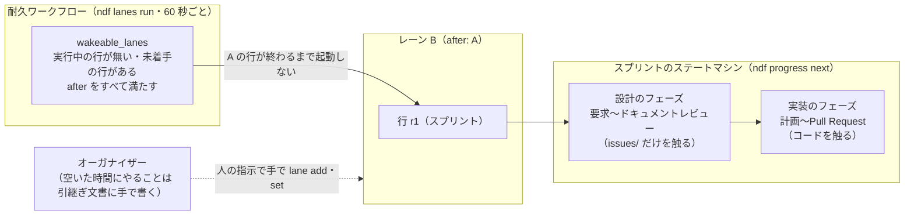
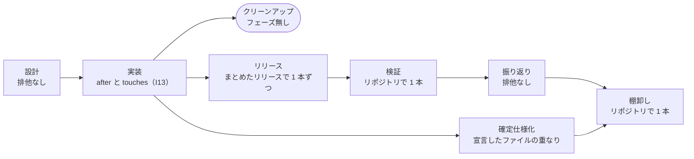
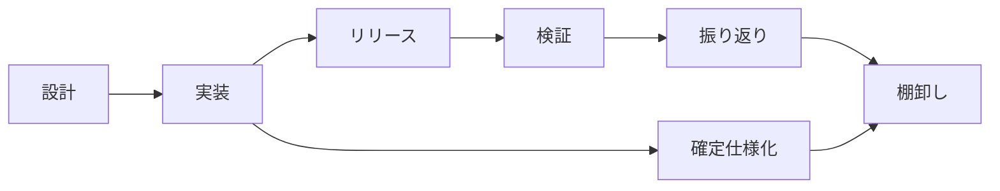
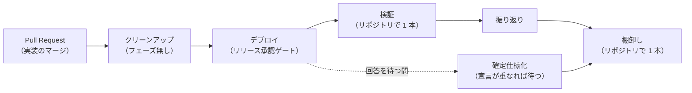
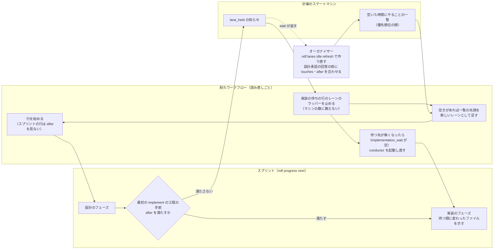
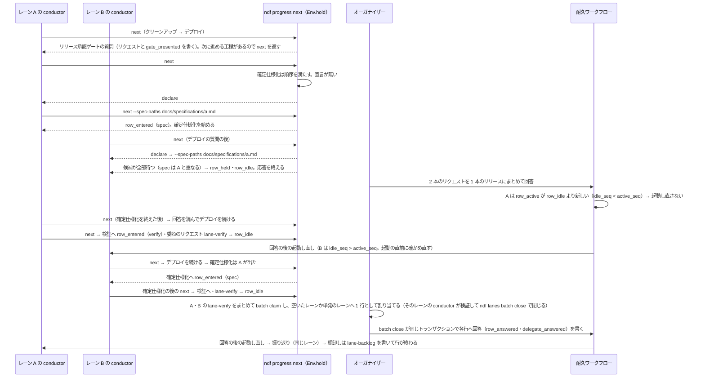
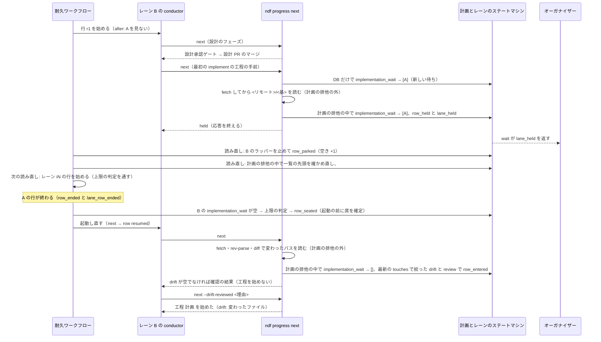

# 並列の計画: スプリントの行を 7 つのフェーズに分け、触る共有のものでフェーズごとに排他を掛ける（#4050）

並列の計画はスプリントの行を要求からリリースの後の棚卸しまで 1 かたまりで扱い、実装が重なるだけで `issues/` しか触らない設計まで後ろへ回り、`close` にまとまった確定仕様化・検証・振り返り・棚卸しは触るものが違うのにレーンの最後に 1 本で回る（要求は [issue-4050-requirements.md](./issue-4050-requirements.md)、正は #4050 の本文）。工程の定義のフェーズを 7 つ（設計・実装・リリース・確定仕様化・検証・振り返り・棚卸し）へ分け直し、フェーズごとに「ほかのレーンとの排他」と「同じ行の中の順序」を別の規則でフェーズの表に持たせる。`ndf progress next` がフェーズの境でその 2 つを照らして進めるか待つかを決め、待つ行の枠には空いた時間にやることの一覧から別の Issue の設計を流す。方針の出典（#4069 と 2026-11-23 の利用者の決定）との照らし合わせ、範囲の外へ分けたもの（#4071・#4070・#4091 と #4171）との境界、採らなかった案は「決定の記録」に、比べた製品は付録の「外部の調査」にある。

## 今の姿

何が起きたか・目的・受け入れ条件は要求仕様（[issue-4050-requirements.md](./issue-4050-requirements.md)、正は #4050 の本文）にある。この文書は「どう解くか」と「なぜその解き方か」だけを書く。パスは `plugins/ndf/` からの相対で書く。



設計に要る今の構造:

| 部品 | 今の振る舞い | 場所 |
| --- | --- | --- |
| 行を始める判定 | 実行中の行が無く、未着手の行があり、レーンの `after` をすべて満たすレーンの最初の未着手の行を始める。スプリントの工程は見ない | `src/ndf/progress/lane/rules.py` の `next_row`・`wakeable_lanes`（219-237 行） |
| `after` を満たす | 指した行が完了か中止、またはレーンを指せばその全行が完了か中止 | `rules.py` の `after_met`（32-36 行） |
| 触る場所の検査（I13） | 前後の鎖（行の並びと `after`）の無い別のレーンの行どうしで `touches` が重なれば、レーンのステートマシンへの書き込みを断る。起動の判定には使わない | `rules.py` の `_touch_errors`・`src/ndf/progress/lane/__init__.py` の `checked_write` |
| 工程のフェーズ | 工程の定義が `metadata.ndf.phase` を持つ（`design`・`implement`・`release`・`close` の 4 つ）。`standard` は「要求と受け入れ条件」〜「ドキュメントレビュー」が `design`、「計画」〜「Pull Request」が `implement`、クリーンアップ・デプロイが `release`、確定仕様化・リリース後テスト・振り返り・棚卸しが `close`。読むのは `ndf progress show` の表示だけで、計画の排他には使われない | `contracts/workflow/stages/*.json`・`contracts/workflow/ndf.schema.json`・`src/ndf/progress/definition.py:318`・`src/ndf/progress/command.py:428` |
| 工程を選ぶ判定 | `decide` が工程の定義の並びで最初の終わっていない工程を返す。未着手の工程より後ろの工程は、前が終わるまで始まらない | `src/ndf/progress/run.py` の `decide`（281-298 行） |
| 工程を始める口 | `ndf progress next` が未着手の工程を始める。レーンの行のスプリントは `Env` の口（`lane_env`）で行の終わりをレーンへ写す | `src/ndf/progress/run.py` の `_start`・`Env`、`src/ndf/progress/gate/answering.py` の `lane_env` |
| 行の状態と記録 | 行の状態は `pending`・`running`・`completed`・`cancelled` の 4 つ。承認ゲートを待つ行も `running` で、回答の後の next 待ちは事象の番号の比べ（`answered_seq > resumed_seq`）で表す | `src/ndf/progress/lane/types.py` の `LaneRow` |
| マシン全体の数 | 実行中の行を持つレーン（承認ゲートの待ちを含む）と動いているラッパーを 1 本ずつ数える | `src/ndf/progress/lane/machine.py` の `count` |
| 起動の手 | 読み直しのたびに、終わったレーンのラッパーを止める手・行を始める手・回答の後の next を打たせる手・`/goal` の入れ直し・中止を、この順で 1 つずつ打つ | `src/ndf/progress/plan/run_decide.py` の `_launches` |
| オーガナイザーへの知らせ | `ndf lanes wait` は計画のステートマシンの `request_opened`・`plan_completed` と止まりだけを返す。レーンの事象（行の始まり・終わり）は返さない | `src/ndf/progress/plan/wait_decide.py` の `NOTICE_KINDS` |
| 計画へレーンを足す | `lane_added` の書き手はオーガナイザーだけ | `contracts/workflow/progress.json` の `events` |
| 状態の表示 | `ndf lanes status` はレーンの `after` と行・生死の判定を出し、`touches` を出さない | `src/ndf/progress/plan/__init__.py` の `_lane_items` |

## 文脈と制約

- **利用者の全体の設計方針（#4069）が、この設計の判断の基準になる。** 決められた範囲の資源はできるだけ使い、処理待ちを作らない。待つ間は別のことをするか、待ちをオーガナイザー・conductor へ伝えて別のレーンか supervisor を起動する。そのために空いた時間にやることを常に整理し、優先順位を決めておく。#4069 の「目指す姿」は、一覧と優先順位を NDF の記録に持ち、待ちが出たら機械で上から割り当て、オーガナイザーの手書きに頼らないことを求める
- **計画はスプリントの工程を見られない。** レーンのステートマシンへ写るのは行の始まり・終わり・回答・再開のマーカーの 4 つだけで、耐久ワークフローの読み直しはスプリントのステートマシンの工程を読まない。工程の区切りで何かをさせるなら、工程を流す側（`ndf progress next`）から計画へ書くしかない
- **工程の定義のフェーズは、モードごとに並びが違っても同じ値を持つ。** どのモードも設計のフェーズの工程を持つ（`light`・`operation` は要求と受け入れ条件・作業場所の用意・設計、`legacy-refactor` は作業場所の用意〜ドキュメントレビュー。`light`・`operation` の設計は設計承認ゲートを持たない）。区切りを工程の名前（「計画」）で決めると、モードごとに違う名前を持つことになる
- **今のフェーズは計画の排他に使われていない。** `metadata.ndf.phase` を読むのは `ndf progress show` の表示（`src/ndf/progress/command.py` の `_row`）だけで、値は `design`・`implement`・`release`・`close` の 4 つ（`contracts/workflow/ndf.schema.json`）。`close` に確定仕様化・体裁レビュー・リリース後テスト・振り返り・棚卸しが混ざり、クリーンアップは `release` にある
- **リリースは今もリポジトリで 1 本ずつ出る。** 計画の行はリリース承認ゲートでリリースのリクエスト（`lane-release`）を計画へ書き、オーガナイザーが届いたものを 1 本のリリースにまとめて出す（`references/parallel.md` の「まとめたリリース」）
- **I19 が同じ課題を 2 つの終わっていないレーンに置くことを断る。** 設計のフェーズが触る `issues/issue-<番号>-*` と設計 Pull Request は課題ごとなので、別のレーンの設計のフェーズどうしも、設計のフェーズと別のレーンの実装も重ならない
- **レーンは 1 行ずつ動く。** 実行中の行がある間、同じレーンの次の行は始まらない。待ちの間に別の Issue の設計を流すには、別のレーンが要る
- **マシン全体の上限（`relay.max-named`、既定 6）は動いているセッションの数を絞る。** 承認ゲートを待つ行も、conductor のセッションが開いたまま枠を使う。p12 では 2026-11-22 14:01 JST に稼働中 6・上限 6 で、空きが無かった
- **耐久ワークフローは GitHub を読まない。** 読み直しは 60 秒ごとで、GitHub の読み取りを足すと二次レート制限（#4016）に近づく。GitHub を読む作業は、オーガナイザーが決まった時点で打つコマンドに置く
- **開いたマイルストーンの名前は `<2 桁の連番> <主題>` で、連番が着手の順序を表す**（`AGENTS.md` の「版とリリースの方針」）。連番を持たない名前のリポジトリもある

## 解き方の全体像



- 工程の定義の `phase` を 7 つのフェーズに分け直し、フェーズの表（`contracts/workflow/phases.json`）が、フェーズごとの排他の規則（ほかのレーンとの関係。図の各箱の下の行）・順序（同じ行の中の前提。図の矢印）・文脈の依存と担い手を別の欄で持つ
- `ndf progress next` は、順序を満たした工程を選び、新しいフェーズに入る手前で排他を計画の排他の中で照らして、入る（`row_entered`）か待つ（`row_held`）かを 1 回で書く。待つ行はオーガナイザーへ知らされ、待つ先が空いた後に耐久ワークフローが起動し直す
- 前のフェーズが待つ間は、順序の上でその後ろに無いフェーズを進める（リリースの承認を待つ間の確定仕様化）。クリーンアップは実装のマージの直後に置く
- 文脈への依存が強いフェーズ（設計 → 実装、実装 → 振り返り）は同じ conductor が続け、依存の薄いリリース・検証・棚卸しは行のレーンから切り離してオーガナイザーがまとめ、検証と棚卸しは空いたレーンか単発のレーンへ割り当てる
- `after` は実装のフェーズの手前でだけ照らし、設計は計画のどの行でもすぐに始まる。待つ間の枠には、計画が持つ「空いた時間にやることの一覧」の先頭から別の Issue の設計が流れる

**#4210・#4211 へ分けたもの（決定 21）。** 同じ行の中で回答の待ちを越えて工程を流す仕組み（決定 17 の後半。`row_idle`・`row_active`・`claim_relaunch`・回答の探し方）は #4210 へ、検証と棚卸しをオーガナイザーへ委ねてまとめ、空いたレーンか単発のレーンへ割り当てる仕組み（決定 20 の渡し方。委ねのリクエスト・`ndf lanes batch`・検証の環境と版の排他）は #4211 へ分けた。この文書のその記述は両課題の設計の材料として残し、#4050 では作らない。#4050 での形は次のとおりである。

| 部品 | #4050 での形 |
| --- | --- |
| 同じ行の中の順序 | `decide` は `requires` を満たした未着手の工程を定義の並びの順に候補にし、排他が許す最初の工程を始める。承認ゲートの回答待ちは今のとおり行の待ちで、回答を待つ間に別の工程を始めない（`row_idle`・`row_active` を書かない。回答の後の起動し直しは今のとおり） |
| 検証・棚卸し | レーンの conductor が今のとおり流す（委ねない）。排他は掛けない（`exclusion` は表に `organizer_batch` と書き、#4211 が入るまで判定は「入る」を返す）。`context`・`carrier` はフェーズの表に値だけを持つ |
| リリース | 今のまとめたリリースのまま |
| 確定仕様化の待ち | 宣言の重なりで待つ行は応答を終え、待つ先が空いた後に今の続きの起動で起動し直す（実装の待ちと同じ） |

**この章の読み方。** 次の 3 節（7 つのフェーズと排他・フェーズの順序・文脈の依存と担い手）が主題で、各フェーズの排他を、どの記録で数え、どこで断り、いつ解くかを 1 つの表にまとめた。その後の「フェーズの境の判定」が両者をつなぐ仕組み、「実装のフェーズの排他と、待つ間の枠」が実装の行と一覧・割り当てを細かくしたものである。

### 7 つのフェーズと排他

**フェーズは 7 つで、どれも「触る共有のもの」と「ほかのレーンとの排他の規則」を持つ。** 同じ行の中の順序は次の節「フェーズの順序」の別の表が持つ。排他の規則は 5 種類に絞り、フェーズの表（新設の `contracts/workflow/phases.json`）にデータで持つ。`ndf progress next` は、行が新しいフェーズの最初の工程を始める手前で、表の規則に照らして「入る」か「待つ」かを決める（決定 16）。

| フェーズ（`phase`） | 工程（`stage`） | 触る共有のもの | 排他の規則（`exclusion`） | 数える記録 | 断る（待たせる）場所 | 待ちが解ける時点 |
| --- | --- | --- | --- | --- | --- | --- |
| 設計（`design`） | 要求と受け入れ条件・作業場所の用意・設計・詳細設計・素材の収集と出典の確定・計画（実装計画。#3702 が `standard`・`legacy-refactor` で新しい定義 `plan-pr` にして詳細設計の直後へ移す）・ドキュメント再構成・ドキュメントレビュー（設計承認ゲート） | その課題の独立した文書（`issues/issue-<番号>-*`。実装計画を含む）と設計 Pull Request だけ | `none`（`touches` と I13 の外。同じ課題を 2 つのレーンに置くことは今の I19 が断る） | 無し | 無し（待たない） | — |
| 実装（`implement`） | 実装・リファクタリング・コードレビュー・完了判定・Pull Request（マージを含む）。工程「計画」は、#3702 が入るまでどのモードでも、入った後も `operation`・`documentation` では、工程の定義の上ではこのフェーズにある（決定 22） | コード（レーンの `touches`）・テストのスロット | `after_touches`（レーンの `after` を満たし、`touches` が確定している。`touches` の重なりは I13 が `after` の鎖で前後を付けさせる） | レーンの `after` の先の行の状態（`after_met`）と、一覧から割り当てたレーンの `touches` | `ndf progress next` の実装の最初の工程の手前（`row_held`） | `after` をすべて満たし `touches` が確定した後の読み直し（節「実装のフェーズの排他と、待つ間の枠」） |
| リリース（`release`） | デプロイ（版上げの Pull Request・CHANGELOG・版数・タグ。リリース承認ゲート） | リポジトリの版 | `organizer_batch`（リポジトリで 1 本ずつ。担い手のオーガナイザーが届いた行を 1 本のリリースにまとめる。今の「まとめたリリース」） | 計画のステートマシンの開いたリリースのリクエスト（`request_opened` の `lane-release`） | 行は待たせない。オーガナイザーが届いたリクエストを 1 本のリリースにまとめ（`ndf lanes release` が同じトランザクションで閉じる）、版上げの Pull Request は基のブランチのマージキューが 1 本ずつ入れる | オーガナイザーの回答（今のとおり） |
| 確定仕様化（`spec`） | 確定仕様化 | `docs/specifications/` の該当ファイル | `declared_paths`（入る前に書くファイルを宣言し、同じリポジトリで確定仕様化のフェーズにいるほかの行の宣言と重なれば待つ。重ならなければ並行で進める） | 行の `row_entered`（`spec`）の `paths` | `ndf progress next` の確定仕様化の手前（宣言の無い行には `declare` を返し、重なる行には `row_held`） | 重なる行が確定仕様化のフェーズを出た（次のフェーズに入ったか行が終わった）後の読み直し |
| 検証（`verify`） | 体裁レビュー・リリース後テスト | 利用者の環境に入った版・本物のアカウント | `organizer_batch`（環境ごとに 1 本。環境はプロジェクトの宣言 `verify.environment`（無ければリポジトリの名前）。担い手のオーガナイザーが、同じ環境の行をリポジトリごとに 1 つの版でまとめて 1 本の検証にする） | 計画の開いた委ねのリクエスト（`lane-verify`） | 行は待たせない。行は委ねのリクエストを書いて回答を待ち、オーガナイザーがリポジトリごとに 1 本ずつまとめて検証する（`ndf lanes batch claim` が同じ環境の取りかかりを断り、`batch close` で閉じる） | オーガナイザーの `ndf lanes batch close`（各行への回答を同じトランザクションで書く。検証の結果は文脈の `verification` へ写る） |
| 振り返り（`retrospective`） | 振り返り | Issue・Pull Request のコメントと新しい起票 | `none` | 無し | 無し（順序の上で前提が整えば待たない） | — |
| 棚卸し（`backlog`） | 棚卸し | Issue の本文・マイルストーン・着手の順位 | `organizer_batch`（リポジトリで 1 本ずつ。担い手のオーガナイザーが複数の行の棚卸しをまとめる） | 計画の開いた委ねのリクエスト（`lane-backlog`） | 行は待たせない。行は委ねのリクエストを書いた時点で棚卸しの工程を終え、オーガナイザーがリポジトリごとに 1 本ずつまとめて棚卸しする | 待たない（開いたリクエストが残る間は計画を完了しない。今の決まり） |

- **クリーンアップはフェーズを立てない。** そのレーン自身のブランチと worktree しか触らないので排他を持たない。工程の定義から `phase` を外し（`phase` の無い工程はフェーズの境にならない）、どのモードでも Pull Request（実装のマージ）の直後に置く（決定 19）
- **`after` が効くのは実装のフェーズだけである。** ほかのフェーズは表の排他の規則だけで待つ。開発ループの行（`kind: loop`）は今のとおり行を始める条件として `after` を使い、フェーズの排他の外に置く（決定 10）
- **計画の外のスプリント（`--parent` 無し）は排他を持たない。** `Env.hold` の口が何もしないので、どのフェーズにも待たずに入る。変わるのは工程の並び（決定 19）だけである
- **フェーズにいる行（占有）は、最後の `row_entered` のフェーズにいる実行中の行である。** 待ちに入った行（最後の `row_held` が最後の `row_entered` より新しい行）はどのフェーズにもいないと読む。待つ行が前のフェーズを占めたまま別の行を待つことが無いので、待ちの輪は起きない（I14）
- **リリース・検証・棚卸しの「1 本ずつ」は、担い手のオーガナイザーがまとめて処理することで守る。** 守るのは版・環境・Issue の一覧で、そのフェーズに着く行の数ではない。行ごとに待たせると、1 本にまとめるはずの行が 1 本ずつに割れる。リリースは今のまとめたリリースをそのまま使い、検証と棚卸しは同じ形の委ねのリクエストを足す（決定 16・決定 20）

### フェーズの順序

**順序は排他と別の表・別の規則で持つ。** 排他は「ほかのレーンの行と同時に入ってよいか」、順序は「同じ行の中で、どのフェーズが終わった後に始めてよいか」を決める。順序はフェーズの表の `requires`（先に終わっている必要があるフェーズの並び）にデータで持ち、同じスプリントの中の前のフェーズの出力を前提にするときだけ順に並べる（決定 17）。



| フェーズ | `requires`（先に終わっている必要があるフェーズ） | 並行してよいフェーズ |
| --- | --- | --- |
| 設計（計画を含む） | なし | — |
| 実装 | 設計 | — |
| リリース | 実装 | 確定仕様化 |
| 確定仕様化 | 実装 | リリース・検証・振り返り |
| 検証 | リリース | 確定仕様化 |
| 振り返り | 検証 | 確定仕様化 |
| 棚卸し | 振り返り・確定仕様化 | — |

- **「フェーズが終わった」は、そのフェーズの工程がすべて終わった（完了か無効）ことである。** モードが持たないフェーズ（`legacy-refactor`・`light` の確定仕様化、`light` の検証と振り返り）は終わったとみなす
- **行の中で同時に動く工程は 1 つである。** 並行は「前のフェーズが待つ間に、順序の上でその後ろに無いフェーズを進める」ことで実現する。例: リリース承認ゲートの回答を待つ間に確定仕様化を流す。検証が排他で待つ間に確定仕様化を流す。1 つの行の中で 2 つの工程を同時に動かす（レーンの中で別の supervisor を起動する）ことは本文の「含まない」にあり、しない
- **`decide` の選び方**（決定 17）: (1) 失敗した工程か、動いている工程（質問を届けた承認ゲートと委ねた工程の待ちを除く）があればそれ。(2) 無ければ、質問を届けた承認ゲートか委ねた工程のうち回答が載ったものを消費する。(3) 無ければ、`requires` を満たした未着手の工程を工程の定義の並びの順に候補とし、フェーズの最初の工程なら `Env.hold` に照らして入るを返した最初の工程を始める。(4) 候補が無いか全部が待つなら、全部が待つときは待ちを書いたうえで、回答待ちの承認ゲートか委ねがあればその待ち、無ければフェーズの待ち（`row_held`）を返す。承認ゲートの質問は、着いた最初の 1 回は今のとおり待ちとして返して質問（とリリースのリクエスト）を届け、届けた記録（`gate_presented`）を書く。ほかに進める工程があれば結果に `next` を載せ、その後の `next` から (3) を先に見る
- **承認ゲートの待ちの間に別の工程を流す行は、回答の後の起動し直しで置き換えない。** 今の耐久ワークフローは、回答が載った行のレーンの conductor を `ndf progress next` の入力で起動し直し、動いているラッパーを置き換える（`plan/run.py` の `launch_lane`）。待ちの間に確定仕様化を流している conductor を置き換えないよう、`next` が「応答を終える」ときに印 `row_idle` を書き、conductor が仕事を再び始める結果（工程の開始・回答の消費・`declare`・`review`）を返すときに印 `row_active` を書く。回答の後の起動し直しと待ちの起動し直しの手は、応答を終えたままの行（最後の `row_idle` の番号が最後の `row_active` の番号より大きい行。`idle_seq > active_seq`）にだけ打つ。クリーンアップや同じフェーズの次の工程のように `row_entered` を書かない開始も `row_active` で拾う（`row_idle` を持たない更新の前の行は今のとおり打つ）。耐久ワークフローは起動の直前に、計画の排他の中でこの条件と観測した `row_idle` の番号を確かめ直して起動の取りかかりを記録し、conductor の `row_active` とどちらか先に書いたほうだけを通す（決定 17）。流している conductor は、工程を終えた後の `next` で回答を読んで続ける

**工程の並び（工程の定義の並び）も順序に合わせて直す。** 定義の並びは (2) の候補の順である。`decide` の選び方は計画の外のスプリントにも同じに効く（承認の回答を待つ間に確定仕様化を流す）。計画の外では排他も `row_idle` も無く、回答の後に起動し直す耐久ワークフローも無い。2026-11-22 の main の `ed8ff771b` の `contracts/workflow/modes/*.json` と比べる。

| モード | 今の並び（Pull Request より後） | 直した後の並び（Pull Request より後） |
| --- | --- | --- |
| `standard` | 確定仕様化 → クリーンアップ → デプロイ → リリース後テスト → 振り返り → 棚卸し | クリーンアップ → デプロイ → 確定仕様化 → リリース後テスト → 振り返り → 棚卸し |
| `documentation` | 確定仕様化 → クリーンアップ → デプロイ → 体裁レビュー → リリース後テスト → 振り返り → 棚卸し | クリーンアップ → デプロイ → 確定仕様化 → 体裁レビュー → リリース後テスト → 振り返り → 棚卸し |
| `operation` | 確定仕様化 → クリーンアップ → デプロイ → リリース後テスト → 振り返り → 棚卸し | クリーンアップ → デプロイ → 確定仕様化 → リリース後テスト → 振り返り → 棚卸し |
| `legacy-refactor` | クリーンアップ → デプロイ → リリース後テスト → 振り返り → 棚卸し | 同じ |
| `light` | クリーンアップ → デプロイ → 棚卸し | 同じ |

- 確定仕様化をデプロイの後ろへ置くのは、デプロイがリリース承認ゲートに着いて質問を出した後の待ちの間に、確定仕様化を流すためである（デプロイより前に置くと、確定仕様化の分だけリリースの承認を求めるのが遅れる）。順序の上ではリリースと並行で、デプロイの完了を待たない
- 確定仕様化は今、実装の worktree とブランチを入力に取る。クリーンアップが先に消すので、自分の worktree を基のブランチから作る形へ変える（入力から `worktree`・`branch` を外す。決定 19）
- Pull Request より前（設計のフェーズと実装のフェーズ）の並びは変えない。どのモードも設計のフェーズの工程を持つ（`light`・`operation` は要求と受け入れ条件・作業場所の用意・設計、`legacy-refactor` は作業場所の用意〜ドキュメントレビュー）



### 文脈の依存と担い手

**排他・順序とは別に、フェーズごとに「前のフェーズの文脈への依存」と「担い手」を持つ。** フェーズの表の `context` と `carrier` に置く（決定 20）。依存の強いフェーズは前のフェーズと同じレーンの conductor が続け、依存の薄いフェーズは行のレーンから切り離し、オーガナイザーがまとめて空いたレーンか単発のレーンへ割り当てる。

| フェーズ | 前のフェーズの文脈への依存（`context`） | 担い手（`carrier`） | 切り離し方 |
| --- | --- | --- | --- |
| 設計（計画（実装計画）を含む。決定 22） | なし（課題の本文から始める） | `lane`（どのレーンでもよい。待つ間の別の Issue の設計は、待つレーンの会話へ混ぜず、割り当てで足す別のレーンで流す） | — |
| 実装 | 強い（設計） | `lane`（設計と同じレーン・同じ conductor） | — |
| リリース | 薄い | `organizer` | 今のまとめたリリース（行はリリースのリクエストを書いて回答を待つ） |
| 確定仕様化 | 中程度（設計・実装） | `lane`（実装と同じレーン。文脈が残っていなければ設計文書と差分から書く） | — |
| 検証 | 薄い | `organizer` | 行は委ねのリクエスト（`lane-verify`）を書いて回答を待つ。オーガナイザーは同じ環境（`verify.environment`）の行を、リポジトリごとに 1 つの版でまとめ、そのまとめを 1 行（種類 `batch`）として空いたレーン（同じリポジトリで行がすべて終わったレーン）か単発のレーン（まとめ 1 つのために足すレーン）へ割り当てる。割り当てたレーンの conductor が 1 本の検証を流し、`ndf lanes batch close` が結果を各行へ回答する |
| 振り返り | 強い（スプリント全体） | `lane`（実装・確定仕様化と同じ conductor。検証の結果は文脈の `verification` で受け取る） | — |
| 棚卸し | 薄い | `organizer` | 行は委ねのリクエスト（`lane-backlog`）を書いた時点で棚卸しの工程を終える。オーガナイザーは同じリポジトリの複数の行の棚卸しをまとめ、検証と同じく空いたレーンか単発のレーンへ 1 行として割り当てる |

- クリーンアップは文脈に依存せず、マージの直後にその時点の担い手（レーンの conductor）が行う
- 計画の外のスプリントは担い手を切り離さない（オーガナイザーもレーンも無いので、スプリントの conductor が今のとおり流す）
- **会話の続け方は #4171 との境界に置く。** 同じ conductor で続けるフェーズの間で文脈を捨てないため、本文は実装の待ちの後の再開を同じ会話の続き（中継の `--resume`）で行うことを求める。今の続きの起動（`plan/run.py` の `launch_lane` → `launch.replace`）は、同じ名前のラッパーを置き換えて新しい会話で始める。起動を同じ会話の続きへ変えるのは、待つ行の席を返した後の取り直しの起動の形（#4103）と同じ問題で、#4171 へ回した。#4050 は、待つ行のレーンの conductor が応答を終える前に引継ぎ（決めたことの理由・捨てた案）を設計文書と決定の記録に残してあることを前提に、今の続きの起動のまま動く（決定 20 の代償）
- 文脈の上限に近づいたときの引継ぎ文書の書き方（依存の強い境目で理由と捨てた案を必ず残す）は手順書（`references/parallel.md`）に書く

### フェーズの境の判定

**フェーズの境を、工程を流す側（`ndf progress next`）の 1 か所で照らす。** 順序（`requires`）は `decide` が候補を選ぶときに照らし、排他は行が新しいフェーズの最初の工程を始める手前で照らす。排他の側では、`run.py` が `Env.hold` を呼ぶ。計画の行のスプリントでは `answering.lane_env` が、計画の排他の中でフェーズの表の規則（`exclusion`）を引き、次のどれかを 1 回で決めて書く（決定 16）。

| 規則 | 入る（`row_entered` を書いて工程を始める） | 待つ（`row_held` を書いて工程を始めない） |
| --- | --- | --- |
| `none` | いつも | — |
| `after_touches` | `after` をすべて満たし、`touches` が確定している | 満たしていない `after` か未確定の `touches` がある（節「実装のフェーズの排他と、待つ間の枠」） |
| `organizer_batch` | いつも。計画の行は、リリースは今のリリースのリクエスト、検証と棚卸しは委ねのリクエスト（`Env.delegate`）を書く | — |
| `declared_paths` | 宣言したパスが、同じリポジトリで確定仕様化にいるほかの行の宣言と重ならない | 重なる。宣言が無ければ書かずに `declare` を返す |

- 待つ行は、`ndf lanes wait` が知らせ（`lane_held`）として返し、待つ先が空いた後の読み直しで耐久ワークフローが conductor を起動し直す。起動し直しの形はフェーズに依らず 1 つで、実装の待ちのために作る今の続きの起動（決定 15 の #4050 での形）をそのまま使う。待つ行のレーンのラッパーを止めて席を返す仕組みは #4091（中継の分離 #4171 へ回して保留）が持ち、#4050 は設計しない
- 同じ行の中では、`decide` がフェーズの順序（`requires`）を満たした未着手の工程を候補として並べ、`Env.hold` が入るを返した最初の工程を始める。承認ゲートの回答を待つ間も、順序の上でその後ろに無いフェーズ（リリースの回答待ちの間の確定仕様化）を進める。進めるものが無いときだけ待ちを返し、応答を終える印 `row_idle` を書く（決定 17）
- 確定仕様化に入る行は、書く確定仕様のパスを `ndf progress next --spec-paths` で宣言する。宣言は `row_entered`（`spec`）か `row_held` の `paths` に残り、重なりは `touches` と同じ関数（`rules.touch_hit`）で判定する（決定 18）
- 設計・振り返り・リリース・検証・棚卸しのフェーズは排他で待たない（検証は委ねた回答を待つ）。設計のフェーズが `touches` と I13 の外にあることは、I13 が実装のフェーズどうしの前後だけを見る形（決定 14 の辺の引き方）で守る

### 実装のフェーズの排他と、待つ間の枠



- スプリントの行は `after` を待たずに始まり、設計のフェーズ（設計承認ゲートと設計 Pull Request のマージまで）を通す。`after` は、`ndf progress next` が最初の `implement` の工程を始める手前でだけ照らす
- 満たしていなければ、実装の待ちを記録して工程を始めない。記録は計画のステートマシンにも知らせとして載り、オーガナイザーの `ndf lanes wait` が返す。耐久ワークフローはそのレーンのラッパーを止め（範囲外（#4091）。#4050 ではラッパーは動いたまま枠を使い、待つ先が無くなったら今の続きの起動で起動し直す。決定 15）、席を返したことを記録してマシンの数から外す（`row_parked`）。待つ先（満たしていない `after` と未確定の `touches`）が無くなった後に、上限の判定を通して conductor を起動し直し、席を取り直したことを記録する（`row_seated`）。起動し直した `next` は、待つ間に基のブランチで変わったファイルを示してから実装の工程を始める
- 計画のステートマシンが、空いた時間にやることの一覧を持つ。オーガナイザーが決まった時点で `ndf lanes idle refresh` を打つと、計画のマイルストーンの設計の無い Issue が決まった優先順位で並ぶ。耐久ワークフローは、計画の行で始められるものが無く空きがある読み直しで、一覧の先頭を新しいレーンとして足す
- 足したレーンは実装のフェーズで同じリポジトリの先のレーンをすべて待つ形で始まり、設計承認の回答を届ける前に、オーガナイザーが `touches`・`after` を設計の結果に合わせる（決定 8）。合わせるまでは `touches` が未確定として実装を始めない（機械で検査する）。前提が変わったと conductor が判断した行は、今の差し戻しと同じく行を中止して同じ課題の行を足し、設計承認ゲートを通し直す
- 実装を始めるかの判定と、始めたことの記録（`row_entered`（`implement`））は、計画の排他の中で 1 回で行う。待ちを解く印は起動し直しのマーカー（`row_resumed`）ではなくこの記録で、起動し直しの途中で落ちても待ちの行のまま残る
- （範囲外（#4091）。決定 15）承認ゲートの回答を待つ行も、ゲートの質問が計画のリクエストとしてオーガナイザーから読めるようになってから、ラッパーを止めて枠を空ける（決定 11）。回答の後の起動し直しは今も新しいラッパーを起動する形なので、止めても失う文脈は増えない。承認が何時間も出ない間も、空いた枠へ一覧の設計が流れ続ける
- （範囲外（#4091）。決定 15）席を返したかは、レーンのステートマシンの記録（`row_parked` と `row_seated`・`row_unparked`）だけで読む。ラッパーを止められなかったときは、着席を新しくしない取り消し（`row_unparked`）で戻し、同じ待ちの席を返す手を次の読み直しで打ち直す。続きの手の打ち直しの回数は、席の世代に依らない失敗のキーで数えて打ち切る（決定 13）。マシン全体の数・生死の判定・止める手・起動し直しと中止の上限の判定は、どれもこの記録を使い、数えるたびにスプリントを読む CLI を増やさない
- 開発ループの行と計画の外のスプリントは今のとおり動く。例外は、開発ループの始まった行へ後から足した `after` の起点がまだ終わっていないときで、I13 がこの組を同時に動き得るとして断る（決定 14）

## ドメインモデル

### コンテキスト

| コンテキスト | 何の語が 1 つの意味に決まるか |
| --- | --- |
| 並列の計画（`ndf lanes`） | レーン・行・`touches`・`after`・実装の待ち・空いた時間にやることの一覧・割り当て |
| スプリントの進行（`ndf progress`） | 工程・フェーズ・承認ゲート |

関係: スプリントの進行が上流、並列の計画が下流（顧客と供給者）。スプリントの進行は工程の区切りを `Env` の口で知らせるだけで計画の語を持たず、並列の計画がその知らせを自分の語（実装の待ち）へ訳す。

### 集約

| 集約 | オーナー（書き換えてよいもの） | 根 | エンティティ | 値オブジェクト |
| --- | --- | --- | --- | --- |
| 計画 | オーガナイザー（レーンの追加・`touches`・`after`・一覧の作り直しと調整）・耐久ワークフロー（一覧からのレーンの追加・完了・知らせ）・レーンの conductor（実装の待ちの知らせ） | 計画のステートマシン | レーンの定義・一覧の項目 | `touches`・`after`・リクエスト・優先順位 |
| レーン | レーンの conductor（行・始まり・待ち・再開のマーカー）・耐久ワークフロー（終わり）・オーガナイザー（回答） | レーンのステートマシン | 行 | 実装の待ち（待つ先・待ち始めた基のコミット・時刻） |

### 不変条件

| # | 集約 | 条件 | 破れたときの扱い |
| --- | --- | --- | --- |
| I1 | レーン | 実装の待ちの行は、`after` をすべて満たし、`touches` が確定する（一覧から割り当てたレーンは空でない）まで実装のフェーズの工程を始めない | `next` が工程を始めずに待ちを返す |
| I2 | レーン | 1 つの行の 1 回の着席（行の開始か最後の `row_seated` の後）の間に、同じフェーズ（候補の全部が待つときは同じフェーズの並び）を同じ宣言（確定仕様化の `paths`）で待つ `row_held` は高々 1 件である。待つ間に `--spec-paths` で宣言を直したときだけ、新しい宣言の待ちとして 1 件書く。起動し直した conductor がまだ待つ先を見たときだけ、新しい着席の待ちとして 1 件書く。別のフェーズの待ち（実装の待ちの後の確定仕様化の待ち）は別に数える。待ちを書くのは実装と確定仕様化だけで、検証・棚卸しは委ねるので待ちを書かない | 2 件目を書かずに今の待ちを返す |
| I3 | 計画（範囲外（#4091）。決定 15） | 今の着席の間に実装の待ちを記録した行（最後の `row_held` が今の着席より新しく `row_entered`（`implement`） を持たない実行中の行）と、席を返した行（最後の `row_parked` が最後の `row_seated`・`row_unparked` より新しい実行中の行。I8 の承認の待ちを含む）は、レーンのステートマシンの記録だけで、マシン全体の稼働中の数に数えない。動いているラッパーは今のとおり数える。席を取り直した行は、`row_entered`（`implement`） の前でラッパーがまだ一覧に現れなくても記録だけで数える（予約）。同じ計画と他の計画の数え方は同じ | 数えないことと、数えるときにスプリントを読む CLI を打たないことをテストで縛る |
| I4 | 計画 | 開発ループの行と、`after` を持たないレーンの行は、実装の手前で待たない | 今の振る舞いをテストで縛る |
| I5 | 計画 | 触る場所の検査（I13）と課題の重なり（I19）の規則は変えない。`after` の鎖は行の並びと同じく前後を付ける。スプリントの行では、レーン全体を指す `after` の辺を「行の開始」でなく「実装の開始（`row_entered`（`implement`））」の前後で引く。起点の末尾（実行中の行を含む）から辺を引くのは設計中の行（未着手の行と、`row_started` に `gated` を持ちまだ実装の開始を記録していない実行中の行）だけで、ほかの行（実装を始めた行・終わった行・`gated` を持たない更新の前の実行中の行。開発ループでは始まった行と終わった行）へは、起点の終わった（完了か中止の）行からだけ辺を引く（決定 14） | 書き込みを断る（今のとおり） |
| I6 | 計画 | 一覧の項目は、計画のどの行（終わった行を含む）にも無い課題だけである。割り当てたレーンの追加と一覧から外すことは同じトランザクションで行う | 読むときに計画の行の課題を除く。割り当ての書き込みは片方だけでは成り立たない |
| I7 | 計画 | 1 回の読み直しで割り当てるのは高々 1 本で、計画の行で始められるもの（始める行・起動し直し）があればそちらを先にする。一覧が空でないうちは計画を完了にしない。一覧を使う計画は、最後の行の終わりの後に取得を始めた作り直し（`idle_listed` の `ended_seq` が最後の `lane_row_ended` 以上）が済むまで完了にせず、待つ間は読み直しの間隔を置いて待つ。済まないまま決まった時間を越えたら知らせ `relist_pending` を 1 回出し、オーガナイザーが作り直さずに閉じれば待たない。割り当てに失敗した課題の除外は、失敗を記録した項目の世代で決め、完了の書き込みも排他の中の最新の世代で確かめる。完了の書き込みと一覧の作り直しは同じ計画の排他で確かめる。作り直しは取得の世代（取得を始めたときに読んだ計画の最後の事象の番号と取得の開始の時刻）を記録し、排他の中で最後の `idle_listed` より古い世代の取得結果は書かない（遅れて終わった古い取得が新しい一覧を置き換えない） | 割り当てを打たない・完了を打たない |
| I8 | 計画（範囲外（#4091）。決定 15） | 承認ゲートの回答を待つ行（スプリントの待ちが承認ゲートのステップ（工程の定義のステップが `gate` を持つ）で、今のゲートの質問の id と行のスプリントに対応する開いたリクエスト（`metadata` の `gate`・`sprint` が合う質問 `lane_question` か、`lane-release-<質問の id>` のリリースのリクエスト）が計画にある実行中の行）は、ラッパーを止めて `row_parked` を書き、稼働中の数に数えない。席を返した行は、回答が載った後（`resuming`）も `row_seated` まで数えない。生死の判定は席を返した行を記録から `waiting_answer` と読み、止まりとして知らせず、止める手を打ち直さない。回答の後の起動し直しはマシン全体の上限の判定を通す | 数えないこと・起動し直しが上限で待つこと・複数の回答で互いを数えないことをテストで縛る |
| I9 | レーン | 実装の開始の記録（`row_entered`（`implement`））は 1 行に高々 1 件で、`after` と `touches` の検査と同じ計画の排他の中で書く。記録の後に実装の工程を始める | 検査を通らなければ書かず、待ちを書く |
| I10 | 計画 | 1 回の読み直しで 1 行に打つ続きの手（回答の後の next・待ちの起動し直し・中止）は高々 1 つで、席を返した行の続きの手はどれも上限の判定を通す。回答の後の next と待ちの起動し直しが同じ行で両方当たれば回答の後の next だけを打つ（その `next` も実装の境では同じ `Env.hold` を通る） | 手を 1 つに絞る。席を返した行の手を `seated` で起動しない |
| I11 | 計画（範囲外（#4091）。決定 15） | 席を返した行の続きの手の打ち直しの回数は、席を返すたびに進む番号（`parked_seq`。起動のキーが持つ）に依らない失敗のキー（手が応える回答か待ちの記録の番号）で数え、席を返す手の回数は着席の番号（止められずに取り消しても変わらない）で数える。どちらも決まった回数（`policy.attempts`）で打ち切ってオーガナイザーへ 1 回知らせる。席を返す理由は、観測と書く前の再検証が同じ関数（`park_reason`）で決める | 打ち切った手を作らない。続きの手は知らせのリクエストが閉じたら数え直し、席を返す手は止める手と同じく打ち切ったまま |
| I14 | 計画 | 行がフェーズにいる（占有する）のは、最後の `row_entered` のフェーズで、その後に `row_held` もそのフェーズの `row_left` も持たない実行中の行だけである。待ちに入った行はどのフェーズも占めない。占有を数えるのは `declared_paths`（確定仕様化）の重なりだけである | `Env.hold` が計画の排他の中で占有を数え、重なれば `row_held` を書いて工程を始めない |
| I15 | 計画 | `declared_paths` のフェーズ（確定仕様化）にいる同じリポジトリの 2 本の行の宣言（`paths`）は、`rules.touch_hit` で重ならない。宣言の無い行はそのフェーズに入らない | 重なれば `row_held`、宣言が無ければ `declare` を返して工程を始めない |
| I16 | レーン | 行は、フェーズの最初の工程を始める前に、そのフェーズの `row_entered` を 1 件だけ書く。フェーズを持たない工程（クリーンアップ）は書かない。フェーズの表に無い値の工程の定義は読み込みで断る | `definition.py` の読み込みの検査と `Env.hold` の書き込みで断る |
| I17 | レーン | 行の中で動く工程（承認ゲートの回答待ちでない実行中の工程）は高々 1 つである。工程はフェーズの順序（`requires`）を満たすまで始めない。回答の後の起動し直しと待ちの起動し直しは、応答を終えたままの行（`idle_seq > active_seq`）にだけ打つ。最後の `row_idle` の後に `row_active` を書いた行（承認ゲートの待ちの後に別の工程・クリーンアップ・同じフェーズの次の工程を始めた行）には打たない | `decide` が動いている工程を先に返し、`requires` を満たさない工程を候補にしない。耐久ワークフローの続きの手が `idle_seq > active_seq` を観測と起動の直前の両方で照らす |

### ドメインイベント

| # | イベント | 発生元 | 受け手 |
| --- | --- | --- | --- |
| E1 | スプリントの行を始めた（`after` を見ない） | 耐久ワークフロー | レーン |
| E2 | 設計のフェーズを終えた | スプリントの進行 | （計画へは写らない） |
| E3 | 実装の待ちに入った（レーンの `row_held`・計画の `lane_held`） | スプリントの進行（`Env.hold` → 計画とレーン） | 耐久ワークフロー・オーガナイザー（`wait`）・`ndf lanes status` |
| E4 | ラッパーを止めた | 耐久ワークフロー | 中継 |
| E5 | `after` の先の行が終わった（レーンの `row_ended` と、同じトランザクションの計画の `lane_row_ended`） | 耐久ワークフロー・conductor | 耐久ワークフロー・オーガナイザー（`wait`） |
| E6 | conductor を起動し直した（`row_resumed`。待ちの起動し直しでは起動の試行の印で、待ちは解かない。回答の後の next では、渡した回答をスプリントが消費したと確かめたときだけ書く） | 耐久ワークフロー・conductor | レーン |
| E7 | 実装の開始を確定した（`row_entered`（`implement`）。変わったファイルを持つ） | スプリントの進行（`Env.hold` → レーン） | レーン・耐久ワークフロー |
| E7a | 変わったファイルを conductor が読んで続けると判断した（`row_drift_reviewed`） | conductor（`ndf progress next --drift-reviewed`） | レーン |
| E7b | 実装の工程を始めた | スプリントの進行 | conductor |
| E7c（範囲外（#4091）。決定 15） | 承認ゲートの回答を待つ行のレーンのラッパーを止めた | 耐久ワークフロー | 中継 |
| E7d（範囲外（#4091）。決定 15） | 席を返した（`row_parked`）・取り直した（`row_seated`）・止められずに返したことを取り消した（`row_unparked`） | 耐久ワークフロー | レーン・マシン全体の数 |
| E8 | 行を中止し同じ課題の行を足した（設計の直し） | conductor | レーン |
| E9 | オーガナイザーが待ちの知らせを受けた | `ndf lanes wait` | オーガナイザー |
| E10 | 一覧を作り直した（`idle_listed`）・調整した（`idle_adjusted`） | オーガナイザー（`ndf lanes idle`） | 耐久ワークフロー |
| E11 | 一覧の先頭を新しいレーンとして足した（`lane_added`、書き手 `workflow`） | 耐久ワークフロー | 計画・レーン |
| E12 | 設計承認の回答を届ける前にレーンの `touches`・`after` を設計に合わせた（`lane_changed`） | オーガナイザー | 計画 |
| E13 | フェーズに入った（`row_entered`。`phase` と、確定仕様化なら `paths`、実装なら変わったファイルを持つ） | スプリントの進行（`Env.hold` → レーン） | レーン・耐久ワークフロー・`ndf lanes status` |
| E14 | 確定仕様化の宣言を求めた（`next` の結果 `declare`。記録は書かない） | スプリントの進行 | conductor |
| E15 | 確定仕様化の待ちに入った（`row_held` の `phase` が `spec` か、`spec` を含む並び。待ちを書くのは候補の全部が待つときだけ） | スプリントの進行（`Env.hold_all` → レーン） | 耐久ワークフロー・オーガナイザー（`wait`） |

## 構成要素

| 要素 | 責務 |
| --- | --- |
| フェーズの表（`contracts/workflow/phases.json`、新設）と読み込み（`definition.py`・`stages.py`） | 7 つのフェーズの排他の規則（`exclusion`）と順序（`requires`）を持ち、工程の定義の `phase` を照らす。`StageDef.phase` は `Optional`（クリーンアップは無い） |
| 工程を選ぶ判定（`run.decide`） | 動いている工程 → 回答が載った待機中の工程（質問を届けた承認ゲート・委ねた工程）の消費 → 順序を満たした未着手の工程（排他が許す最初のもの）→ 承認ゲート・委ねの回答待ち → フェーズの待ち、の順に 1 手を決める（決定 17） |
| フェーズの排他の判定（`rules.phase_wait`、新設） | 規則 → 判定の関数の表を引き、行がそのフェーズに入れないときの待つ先（`after_touches` は `implementation_wait`、`declared_paths` は宣言の重なる行。ほかの規則は空）を返す（決定 16） |
| フェーズに入る記録（`lane.enter_phase`・`lane.hold_phases`、新設） | 計画の排他の中で `phase_wait` を確かめ、空なら `row_entered` を書き、そうでなければ書かずに待ちの候補を返す。候補の全部が待つときだけ `hold_phases` が排他の中で確かめ直して `row_held` と `lane_held` を 1 回で書く。実装のフェーズは今の `begin_implementation` の手順（変わったファイル・確認）をこの関数の 1 つの枝として持つ |
| 行を始める判定（`rules.next_row`・`wakeable_lanes`） | スプリントの行は `after` を見ずに始める。開発ループの行は今のとおり `after` を見る |
| 実装の待ちの判定（`rules.implementation_wait`、新設） | 行のレーンの `after` のうち満たしていない値と、一覧から割り当てたレーンの未確定の `touches` の印を返す |
| 順序のグラフ（`rules._order_graph`） | スプリントの行のレーン全体を指す `after` の辺を、行ごとに、行の開始でなくその行の実装の開始の記録で切り替える（先頭の行だけで決めない） |
| 実装の開始の判定と記録（`lane.begin_implementation`、新設） | `lane.enter_phase` の実装の枝。計画の排他の中で最新の依存を確かめ、待たなければ `row_entered`（`implement`）を書く。待つときは書かずに待ちの候補（`HoldItem`）を返し、候補の全部が待つと決まったときだけ `lane.hold_phases` がレーンの `row_held` と計画の `lane_held` を同じトランザクションで 1 回だけ書く |
| 行の終わりの知らせ（`lane.end_row`） | `row_ended` と同じトランザクションで計画に `lane_row_ended` を書く |
| 工程を始める口（`run._start`・`Env.hold`・`Env.hold_all`・`Env.delegate`・`Env.idle`・`Env.busy`・`Env.leave`・`Env.peek`・`run.wait` の手の組み立て） | 行がまだ入っていないフェーズの工程を始める手前で `Env.hold` を呼ぶ（実装も確定仕様化も同じ口）。候補の全部が待つときだけ `Env.hold_all` で待ちを書き、待ちの結果を返す（`work` の続けての流しも止める）。担い手がオーガナイザーのフェーズでは `Env.delegate` で委ねる。確認が要る記録（`row_entered`（`implement`）の `review`）があり判断の記録が無ければ工程を始めずに確認の結果を返す。応答を終える待ちを返す直前に `Env.idle`、conductor に続けさせる結果を返す直前に `Env.busy`、フェーズの工程がすべて終わった `next` で `Env.leave` を呼ぶ。`wait`・`next` の手の組み立ても同じ結果を返す。CLI の `ndf progress wait` も `Env` を受け取り、`Env.peek` に届く |
| レーンの口（`answering.lane_env`） | `Env.hold` に `lane.enter_phase`（実装の枝は変わったファイルの算出を含み、取得とリモートの解決（`Git.remote()`）は Git が要ると決まったときだけ呼ぶ）、`hold_all` に `lane.hold_phases`、`delegate` に `lane.delegate`、`idle`・`busy`・`leave` に `lane.mark_idle`・`mark_active`・`leave_phase` をつなぐ。`Env.peek` に、行を DB だけで読む関数をつなぐ |
| マシン全体の数（`machine.count`・`machine.lanes_of`・`held_seats`） | 今の着席の間に実装の待ちを記録した行と、席を返した行のレーンを、レーンのステートマシンの記録だけで稼働中に数えない（同じ計画も他の計画も `lanes_of` の同じ規則） |
| 生死の判定（`liveness`） | 実装の待ちの行を `held`、承認ゲートで席を返した行を `waiting_answer` と、記録だけで判定し（スプリントもラッパーも読まない）、止まりとして知らせない |
| 起動の手（`run_decide._launches`） | 実装の待ちの行と承認の待ちの行のレーンのラッパーを止めて席を返す手と、待つ先が無くなった（`implementation_wait` が空の）待ちの行のレーンの conductor を起動し直す手を足す。1 行に続きの手を 1 つに絞り（I10）、席を返した行の続きの手（回答の後の next・起動し直し・中止）に上限の判定を通す |
| 割り当ての手（`run_decide`・`plan.run` の `assign_idle`、新設） | 計画の行で始められるものが無く空きがある読み直しで、計画の排他の中で確かめ直した一覧の先頭を新しいレーンとして足し、一覧から外す。失敗した課題を観測をまたいで覚えて飛ばす。一覧が残る間は計画を完了にしない |
| 一覧（`plan/idle.py`、新設。`ndf lanes idle refresh / set / show`） | 項目の出所と優先順位の規則で一覧を作り直し、調整（先頭へ出す・外す）を記録し、空きの数と一緒に読む。GitHub は作り直しでだけ、まとめて読む。呼び出し元の役割を中継の環境から決める |
| 設計文書と設計ブランチの番号（`model.design_issues`、新設） | 設計文書の名前と設計ブランチの head から課題の番号を取り出す唯一の関数 |
| 待ちの知らせ（`wait_decide.NOTICE_KINDS`） | `lane_held`・`lane_row_ended` を知らせに足す |
| 状態の表示（`plan._lane_items`） | レーンの `touches` と、行の実装の待ちを出す |
| オーガナイザーの手順（`references/parallel.md`） | 一覧を作り直す時点・調整の基準・待ちの知らせの読み方・設計承認の回答を届ける前に `touches`・`after` を合わせる手・設計を直す手 |

## データ構造

**フェーズの表を 1 つ新設し、#4050 で事象を 14 足し（レーンの `row_held`・`row_entered`・`row_idle`・`row_active`・`row_left`・`row_drift_reviewed`、計画の `lane_held`・`lane_row_ended`・`idle_listed`・`idle_adjusted`・`batch_claimed`・`batch_closed`、スプリントの `delegate_answered`・`gate_presented`）、2 つの書き手を広げ（`lane_added` と `row_active` に `workflow`）、2 つの中身を足す（`row_started` の `gated`、`request_opened` の種類 `lane-verify`・`lane-backlog`）。表の `row_parked`・`row_seated`・`row_unparked`・`row_stopped` の 4 つは #4091 へ分けた（決定 15）。** 行の状態は増やさない（待つ行は `running` のまま）。どれも `contracts/workflow/progress.json` の `events` の行で定める。

| 事象 | ステートマシン | 書き手 | 中身 | 畳み込み |
| --- | --- | --- | --- | --- |
| `row_held`（新設） | レーン（`scope: row`・`from: [running]`、状態を変えない） | conductor | `phase`（待つフェーズ。候補の全部が待つときは待つフェーズの並び）・`waiting`（実装なら満たしていない `after` の値。`touches` が未確定なら `touches` の印を含む）・`base`（基のブランチ）・`ref`（読んだ追跡参照 `<リモート>/<基のブランチ>`）・`base_sha`（行の最初の待ちは書く直前に取得した `ref` のコミット。再着席の後の待ちは最初の待ちの値を写す）・`stage`（始めなかった工程）・`paths`（確定仕様化の宣言。`spec` を待つときだけ）。`base`・`ref`・`base_sha` は実装の待ちだけが持つ | 行の `held_seq`・`held_at`・`held`（最後の `row_held`）と `hold_base`（最初の `row_held` の `ref`・`base_sha`。上書きしない）。`hold_base` は `phase` が `implement` の最初の `row_held` だけから採る。最後の `row_held` が最後の `row_entered` より新しい実行中の行を待ちの行（`holding`）と読み、`phase` が `implement` なら実装の待ちの行と読む。表示と知らせの待つ先は、読むときの最新の計画で `rules.phase_wait` を求め直す（`waiting` は書いた時点の値） |
| `row_entered`（新設） | レーン（`scope: row`・`from: [running]`、状態を変えない） | conductor | `phase`（入ったフェーズ）・`stage`（始める工程）。`implement` だけが `drift`（待った行だけ。変わったファイルの並び。読めなければ null）・`base_sha`（待った行だけ）・`review`（確認が要るか。待った行で `drift` が空でないか null なら真）を、`spec` だけが `paths`（宣言した確定仕様のパス）を持つ | 行の `phase`（最後の `row_entered` のフェーズ）・`entered`（フェーズ → 番号）・`implementing_seq`（`implement` の番号）・`drift`・`review`・`spec_paths`。1 行の 1 フェーズに 1 件（I9・I16）。`implement` の記録が I13 のグラフの「実装の開始」 |
| `row_idle`（新設） | レーン（`scope: row`・`from: [running]`、状態を変えない） | conductor | `reason`（`gate`（承認ゲートの回答待ち）・`delegated`（委ねた回答待ち）・`held`（フェーズの待ち））・`stage` | 行の `idle_seq`。`ndf progress next` が応答を終える待ちを返すとき（`Env.idle`）にだけ書き、同じ待ちの打ち直しでは書き足さない |
| `row_active`（新設） | レーン（`scope: row`・`from: [running]`、状態を変えない） | conductor・workflow | `reason`（conductor は `stage`・`consume`・`declare`・`review`、workflow は `relaunch`）・`stage`・`launch`（`relaunch` だけ。起動の手のキー） | 行の `active_seq`・`relaunch`（最後の `row_active` が `relaunch` ならその `launch`）。最後の `row_idle` の後に conductor が仕事を再び始めたとき（工程の開始・回答の消費・`declare`・`review` を返すとき。`Env.busy`）に 1 件だけ書く。耐久ワークフローは続きの手を起動する直前に、計画の排他の中で応答を終えたままかを確かめ直して `relaunch` を書く（起動の取りかかり。詳細設計の `claim_relaunch`）。`idle_seq > active_seq` の行（応答を終えたままの行）にだけ、回答の後の起動し直しと待ちの起動し直しを打つ（I17） |
| `row_left`（新設） | レーン（`scope: row`・`from: [running]`、状態を変えない） | conductor | `phase` | 行の `left`。そのフェーズの工程がすべて終わった `next` で 1 件書く（`Env.leave`）。確定仕様化を終えた行は、次のフェーズに入る前や承認の回答を待つ間も確定仕様化を占めない（I14） |
| `row_drift_reviewed`（新設） | レーン（`scope: row`） | conductor | `reason`（続けると判断した理由） | 行の `drift_reviewed`。`review` が真の行は、これが無いと実装の工程を始めない（`drift` が null の行も同じ） |
| `row_parked`（新設）（範囲外（#4091）。決定 15） | レーン（`scope: row`・`from: [running]`、状態を変えない） | workflow | `reason`（`held`・`gate`・`vacant`（ラッパーの動いていない待ちの行）・`launch_failed`（席を取り直した後にラッパーを起動できなかった））・`seat`（席を返した着席の番号。同じ着席の停止を再開する手が照らす）・`stopped`（停止の予定。`row_parked` を書いた後にラッパーを止めるなら真、動いていないと読んで止めないなら偽。止めた実績ではなく、実績は `row_stopped`）・`request`（`gate` なら質問かリリースのリクエストのキー）・`gate`（`gate` なら観測した質問の id） | 行の `parked_seq`・`park_seat`・`park_stop`・`park_reason`。最後の `row_parked` が最後の `row_seated`・`row_unparked` より新しい実行中の行を「席を返した行」と読む。`stopped` が真で、その `row_parked` の後に `row_stopped` が無い行は停止を確かめていない行（`stop_pending`）で、ラッパーの一覧を読む理由になり、停止の続きの手を受ける。そのうちラッパーがまだ一覧に動いて載る行は、続きの手の候補に入らない |
| `row_seated`（新設）（範囲外（#4091）。決定 15） | レーン（`scope: row`・`from: [running]`、状態を変えない） | workflow | `launch`（起動の手のキー）・`fail`（その手の失敗のキー。席の世代に依らない） | 行の `seated_seq`・`seat_launch`・`seat_fail`。席を返した行の続きの手が上限の判定を通った後、ラッパーを起動する前に書く（起動の入力の `next` は新しい着席の後にだけ走る）。起動に失敗したら `row_parked` で席を返す |
| `row_unparked`（新設）（範囲外（#4091）。決定 15） | レーン（`scope: row`・`from: [running]`、状態を変えない） | workflow | `reason`（`stop_failed`（ラッパーを止められなかった）・`gate_changed`（止める直前に質問の id が変わった）） | 行の `unparked_seq`。席を返したことを取り消し、`row_seated` と違って今の着席を新しくしない（`seated_at_seq` を進めない）。次の読み直しで同じ待ちの席を返す手になる |
| `row_stopped`（新設）（範囲外（#4091）。決定 15） | レーン（`scope: row`・`from: [running]`、状態を変えない） | workflow | `seat`（止めた席を返した着席の番号） | 行の `stopped_seq`。席を返した行のレーンのラッパーの停止を確かめた印（停止の実績。`row_parked` の `stopped` は予定で、停止を呼ぶ前に書く）。これを持つ行は、承認の回答を待つ間もラッパーの一覧を読む理由にならない（観測あたりの一覧の読み取りを今以下に保つ。決定 13） |
| `lane_held`（新設） | 計画（`scope: row`。計画のステートマシンの行のキーはレーンの名前） | conductor | `lane`・`row`・`phase`・`waiting`・`held_seq`（レーンの事象の番号） | 畳み込まない。`ndf lanes wait` の知らせ |
| `lane_row_ended`（新設） | 計画（`scope: row`） | `row_ended` と同じ（conductor・workflow） | `lane`・`row`・`outcome` | 畳み込まない。`ndf lanes wait` の知らせ（一覧を作り直す時点の 1 つ） |
| `idle_listed`（新設） | 計画（`scope: table`、状態を変えない） | organizer | `items`（`issue`・`title`・`milestone`・`milestone_order` の並び。優先順位の順）・`milestones`・`listed_at`・`ended_seq`（取得を始める前に読んだ計画の最後の `lane_row_ended` の番号）・`fetch_seq`（同じときに読んだ計画の最後の事象の番号）・`fetched_at`（取得を始めた時刻） | 最後の `idle_listed` が今の一覧の出所。項目が前回と同じでも作り直すたびに書く。（`fetch_seq`, `fetched_at`）が最後の `idle_listed` の値より古い作り直しは書かない（取得の世代。古い取得結果で新しい一覧を置き換えない）。最後の `lane_row_ended` の番号が最後の `idle_listed` の `ended_seq` より大きい間は、作り直しの待ち（I7） |
| `idle_adjusted`（新設） | 計画（`scope: table`） | organizer | `pin`（先頭へ出す課題）か `exclude`（外す課題）か `clear`（その課題の調整を消す）と、理由 | 課題ごとの最後の調整。作り直しでも消えない |
| `lane_added`（書き手を広げる） | 計画 | organizer・**workflow** | 今の中身に `idle`（割り当てた一覧の課題の番号）を足す | 今のとおり。`idle` を持つレーンは一覧から割り当てたレーン |
| `request_opened`（種類を足す） | 計画 | conductor（今のとおり） | 種類 `lane-verify`・`lane-backlog`（中身はレーン・行・スプリント・課題・委ねる工程の並び・版。検証は環境 `environment`）。同じ行の同じフェーズの開いたものには 1 回だけ書く | 今のリクエストと同じ。`ndf lanes batch close` で閉じ（棚卸しの `failed` は閉じない）、結果（`result`・`report`・`batch`）を持つ |
| `batch_claimed`・`batch_closed`（新設） | 計画（`scope: table`） | organizer | まとめの id・リクエストのキー・フェーズ・環境・版・結果・リポート・検証で読んだ版 | 取りかかり中のまとめ（`batch_claimed` があり `batch_closed` が無い）。同じ環境の取りかかりが 1 つであることは計画の記録でなく、マシン全体の取りかかりの記録（`<状態の保存先>/parallel/batches/`。詳細設計の「まとめた検証と棚卸し」）で確かめる |
| `delegate_answered`（新設） | スプリント | organizer（`ndf lanes batch close` が、リクエストを閉じるのと同じトランザクションで書く） | リクエストのキー・結果・リポートのパス・検証した版 | 委ねた工程の回答。`decide` が消費の手を返す |
| `gate_presented`（新設） | スプリント | conductor（`gate/entry.py` の `present`） | 質問の id・ゲート・工程 | 承認ゲートの質問を届けた記録（計画の内外で同じ）。今の質問の id の `gate_presented` がある承認ゲートだけを、回答を待ちながら越えてよい待ちと読む（決定 17）。同じ質問の id には 1 件 |
| `row_started`（中身を足す） | レーン | conductor（今のとおり） | 今の中身に `gated: true`（実装の待ちを持つ版で始めた行）を足す | 行の `gated`。無い実行中の行は更新の前に始めた行で、実装を始めたかを記録から読めないので、I13 のグラフでは実装を始めた行と同じく扱う（安全側。決定 14） |
| フェーズの表（新設。`contracts/workflow/phases.json`。事象ではない） | 契約 | — | フェーズごとに `id`（`design`・`implement`・`release`・`spec`・`verify`・`retrospective`・`backlog`）・`name`（表示名）・`shared`（触る共有のものの 1 文）・`exclusion`（`none`・`after_touches`・`declared_paths`・`organizer_batch`）・`context`（前のフェーズの文脈への依存。`none`・`weak`・`medium`・`strong`）・`carrier`（担い手。`lane`（レーンの conductor）か `organizer`（行のレーンから切り離してオーガナイザーがまとめ、空いたレーンか単発のレーンへ割り当てる））・`requires`（同じ行の中で先に終わっている必要があるフェーズの並び。順序の図の辺）。並びが表示の順。`requires` が輪を作る表は読み込みで断る | `definition.py` が読み込み、工程の定義の `phase` がこの `id` のどれかか、無い（クリーンアップ）ことを確かめる。`ndf.schema.json` の `phase` の `enum` はこの表の `id` に合わせ、`required` から外す |

**今の一覧は、最後の `idle_listed` の項目から、計画のどれかの行の課題と `exclude` の課題を除き、`pin` の課題を `pin` を書いた順で先頭へ出したものである**（I6）。割り当ては `lane_added` で項目の課題を計画の行に入れるので、一覧から外す事象を別に持たない。

**優先順位**（`idle_listed` を書くときの並び）: (1) マイルストーンの連番（名前の先頭の 2 桁）の昇順。連番の無いマイルストーンは後ろで、名前の昇順 (2) 課題の番号の昇順。`pin` は読むときに (1) より前へ出す。

## 入出力のコントラクト

**`ndf progress next` の結果**（実装の待ちのとき）:

```json
{"tool": "progress", "status": "ok", "summary": "工程 計画 の手前で実装の待ちに入った（after: lracct）。応答を終える（耐久ワークフローが起動し直す）",
 "metrics": {"machine_id": "sprint:…", "held": {"waiting": ["lracct"], "stage": "計画", "base_sha": "8a657025c…", "seq": 41}}}
```

- 例の工程「計画」は、#3702 が入る前の `standard` の最初の `implement` の工程である。#3702 が工程「計画」を設計のフェーズへ移した後は「実装」になる（決定 22。境は工程の名前でなく `phase` で決まるので、コードは変わらない）

- `next` を持たない（続けて打つコマンドが無い）。打ち直すと、待ちを書き足さずに同じ形を返す（I2）
- `ndf progress work`（工程をこのプロセスで続けて流す）が実装の境に着いたときも同じ形で止まる。`ndf progress wait` と `ndf progress next` の手の組み立ては、次の工程が実装の境で、行が実装の待ちの行なら、同じ形（`next` 無し）を返す。設計のフェーズで起動した worker が境まで進んでも、conductor は `wait` から待ちを読む
- 待ちが解けて `drift` が空でないとき（読めず null のときも）、`next` は `row_entered`（`implement`） に `review: true` を書いて工程を始めずに確認の結果を返す。打ち直しても、conductor が起動し直されても、記録の `review` から同じ確認の結果を返す。工程は、conductor が判断を記録した後（`row_drift_reviewed`）にだけ始まる（判断の前に実装を始めない）

```json
{"tool": "progress", "status": "ok", "summary": "実装の待ちが解けた。待つ間に touches に当たるファイルが 2 件変わった。設計の前提を確かめてから続ける",
 "metrics": {"machine_id": "sprint:…", "drift": ["plugins/ndf/src/ndf/progress/lane/rules.py", "…"]},
 "next": {"command": "ndf progress next sprint:… --drift-reviewed <理由>"}}
```

- 続けないと判断したら、conductor は `next` を打たず、行を中止して同じ課題の行を `--carry` で足す（決定 6）
- 工程を始めたときは、今の結果（工程を起動した `wait`）の `metrics` に `drift`（レーンの `touches` に当たり、`base_sha` から今の `<リモート>/<基のブランチ>` までに変わったファイルの並び。無ければ空）を載せる。待たなかった行は `drift` を持たない

**`ndf progress next` の結果**（確定仕様化の待ち・宣言。検証と棚卸しは委ねるので待ちを返さない）:

```json
{"tool": "progress", "status": "ok", "summary": "工程 確定仕様化 の手前で確定仕様化の待ちに入った（宣言の重なる行: lctx/r1）。応答を終える（耐久ワークフローが起動し直す）",
 "metrics": {"machine_id": "sprint:…", "held": {"phase": ["spec"], "waiting": {"spec": ["lctx/r1"]}, "stage": ["確定仕様化"], "paths": ["docs/specifications/a.md"], "seq": 57}}}
```

```json
{"tool": "progress", "status": "ok", "summary": "工程 確定仕様化 の前に、書く確定仕様のパスを宣言する",
 "metrics": {"machine_id": "sprint:…", "declare": {"phase": "spec", "stage": "確定仕様化"}},
 "next": {"command": "ndf progress next sprint:… --spec-paths <パス>...", "ask": ["spec-paths"]}}
```

- 待ちの形は実装の待ちと同じで、`held.phase` が増える。候補の全部が待つときは `phase` がフェーズの並び、`waiting` がフェーズごとの待つ先になる
- `--spec-paths`（新設。`ndf progress next` の引数）は、確定仕様化に入る行が書く確定仕様のパスか glob を 1 つ以上受ける。確定仕様にすることが無い行は `--spec-paths none` で空の宣言にし、重なりを見ずに入る。宣言は書いた `row_entered` か `row_held` に残り、打ち直しや起動し直しの後も宣言し直さない
- 計画の外のスプリントでは `declare` を返さない（`Env.hold` が何もしないので、宣言を求める理由が無い）

**`ndf lanes batch`**（新設。`claim`・`assign`・`abort` はオーガナイザーだけ、`close` は割り当てたレーンの conductor かオーガナイザーが打てる。`caller_actor` で断る）: 手を持つ（詳細設計の「まとめた検証と棚卸し」）。`ndf lanes batch claim <計画> <リクエスト>... --phase <verify か backlog>` は、挙げたリクエストが同じ環境（検証。リポジトリごとに版は 1 つ）か同じリポジトリ（棚卸し）の開いた委ねのリクエストで、同じ環境に取りかかり中のまとめが無いことを確かめて `batch_claimed` を書き、まとめの id を返す。`ndf lanes batch assign <計画> <id> [--lane <空いたレーン>]` は、まとめを 1 行（種類 `batch`）として、名指した空いたレーン（同じリポジトリで行がすべて終わったレーン）へ足すか、名指さなければ単発のレーン（名前 `b<id>`・`touches` と `after` は空）を足してその行を置く。`ndf lanes batch close <計画> <id> --result <done か failed> --report <ファイル> --observed-version <リポジトリ>=<版>... --reason <理由>` は結果を書いて取りかかりを外す。検証は `done`・`failed` のどちらでもリクエストを閉じ、同じトランザクションで各行へ回答（レーンの `row_answered` とスプリントの `delegate_answered`）を書く。オーガナイザーが行ごとに `answered` を打つ手は無い（途中で落ちても、閉じたリクエストと回答が片方だけ残らない）。`done` は、検証で環境から読んだ版（`--observed-version`）がリクエストの版と同じときだけ受け、違えば断る（`failed` でだけ閉じられる）（スプリントに `delegate_answered` が載り、`done` なら委ねた工程の並びが完了してリポートが文脈の `verification` へ写り、`failed` なら先頭の工程が失敗になる。再実行は `ndf progress retry`）。棚卸しの `failed` はリクエストを開いたまま残す（計画は完了しない）。

**`ndf lanes status` の結果**: レーンの項目に `touches` を足す。行の項目に、今のフェーズ（`phase`）と、待ちの行だけ `held`（`phase`・`waiting`・`stage`・`since`）を足す。生死の判定に種類 `held` を足す。`metrics` に `idle`（今の一覧の件数と先頭の課題）を足す。

**`ndf lanes wait` の結果**: 知らせ（`items`）に `kind: lane_held`（中身は `lane`・`row`・`phase`・`waiting`）と `kind: lane_row_ended`（中身は `lane`・`row`・`outcome`）を足す。どちらも計画のステートマシンの事象なので、今の `--after` の番号の系列のまま読める。

**`ndf lanes idle`**（新設）:

| サブコマンド | 引数 | すること | 書き手 |
| --- | --- | --- | --- |
| `refresh` | `<計画> [--milestone <番号>]...` | 計画の行の課題のマイルストーン（`--milestone` で足す）の開いた Issue のうち、計画の行に無く設計の無いものを優先順位で並べ、`idle_listed` を書く。GitHub を読むだけ | organizer（呼び出し元の役割で確かめる） |
| `set` | `<計画> (--pin <課題> \| --exclude <課題> \| --clear <課題>) --reason <理由>` | `idle_adjusted` を書く | organizer（同上） |
| `show` | `<計画>` | 今の一覧と空きを返す。GitHub を読まない | （読むだけ） |

```json
{"tool": "lanes", "status": "ok", "summary": "一覧 3 件（先頭 #4052）・空き 2",
 "items": [{"order": 1, "issue": 4052, "title": "…", "milestone": "63 並列の計画・開発ループ・中継の機能", "pinned": false}],
 "metrics": {"listed_at": "2026-11-22T05:30:00Z", "free": 2, "lanes": 4, "cap": 6, "excluded": [4061]}}
```

| 項目 | 決まり |
| --- | --- |
| 基のブランチの参照 | `<リモート>/<基のブランチ>`。リモートは `Git.remote()`（`.ndf/worktree.json` の `remote`、無ければ既定）、基のブランチはブランチ戦略の設定から読む。`origin` を決め打ちしない。読む直前に `Git.fetch_branch`（宛先を明示した refspec `+refs/heads/<基のブランチ>:refs/remotes/<リモート>/<基のブランチ>`）で 1 回取得し、古い追跡参照を使わない（一覧の作り直しも待ちの記録も同じ） |
| 設計の有無 | 「無い」は、基のブランチの参照の `issues/` に、その課題の番号を持つ設計文書が無く、その課題の番号を持つ設計ブランチの開いた Pull Request も無いこと。どちらも番号の取り出しは 1 つの関数に置く（詳細設計の「設計文書と設計ブランチの番号」） |
| 設計文書の番号 | 名前が `issue-` で始まり `-design.md` で終わる文書の、間を `-` で区切った語のうち数字だけの語のすべて。`issue-4049-4050-design.md` は #4049 と #4050 の設計である。`-design-detail.md` などほかの名前は数えない |
| 設計ブランチの番号 | head が設計ブランチの接頭辞（`contracts/workflow/progress.json` の `branch_prefixes.design`。今は `design/`）で始まり、残りから `issue-` を 1 つ外した後の、先頭から `-` で区切って続く数字だけの語のすべて（最初の数字でない語で止まる）。今ある名前の `design/issue-2489`（#2489）・`design/4050-parallel-design-ahead`（#4050）・`design/4049-4050-x`（#4049・#4050）のどれも当たる |
| Issue の一覧 | マイルストーンの Issue の一覧が Pull Request を含んで返っても（REST の `pull_request` を持つ項目）、項目に入れない |
| `free` | マシン全体の上限 − 稼働中の数（`machine.count` と同じ数え方。0 未満は 0） |
| 書き手の確かめ | `refresh`・`set` は呼び出し元の役割を、中継が計画のレーンの子へだけ渡す環境 `NDF_RELAY_PLAN` の有無から決める。レーンの中継の子（`NDF_RELAY_PLAN` がある）は conductor として書くので、事象の `actors` で断られる。CLI が書き手を `organizer` に決め打ちしない |
| 失敗 | `refresh` が GitHub を読めなければ `stopped`・`work_stopped` で、前の一覧を残す（`idle_listed` を書かない）。取得（`fetch`）に失敗しても同じ。読むマイルストーン（計画の行の課題から得たものと `--milestone` の和）が 1 つも無ければ `stopped`・`precondition` で、`--milestone` を付ければ計画の課題がマイルストーンを持たなくても作れる。上限を読めなければ `free` を null にして `warnings` に理由 |

**割り当てで足すレーン**: 名前は `i<課題の番号>`（同じ名前があれば `i<番号>-<n>`）、`input` は `{"kind": "sprint", "issues": [<番号>]}`、`touches` は空、`after` は同じリポジトリの終わっていないレーンのすべて、`repo` は計画のリポジトリ、`idle` は課題の番号。`after` と名前は、割り当ての書き込みが取った計画の排他の中で読んだ最新の計画から組む（観測した写しからは組まない）。`idle` を持ち `touches` が空のレーンは、`touches` が未確定として実装を始めない（I1）。

## 処理の流れ

### リリースの後（順序と排他）

同じリポジトリの 2 本のレーン A・B が、同じ時期に実装をマージした例。



- B はリリースの回答を待つ間と、確定仕様化が A と重なる間に、順序の上でその後ろに無いフェーズを止めない。検証は行を待たせず、オーガナイザーが同じ版の行をまとめて 1 本で確かめる。棚卸しは振り返りと確定仕様化の両方を終えた後にだけ候補に入る

### 実装の手前の待ちと、待つ間の枠



1. 行を始める判定は、スプリントの行なら `after` を見ない。`row start` の書き込みの検査（I13）は通すが、スプリントの行のレーン全体を指す `after` の辺は、行ごとに、行の開始でなくその行の実装の開始（`row_entered`（`implement`））で切り替える（I5）。今のグラフは後続の行が `running` になると、起点のレーンの未着手の行からの辺を外す。A と B が同じファイルを触り `B.after=[A]` で両方が未着手のとき、B を先に設計へ起動すると A→B の辺が消えて I13 が起動を断る。新しい規則では、B が実装を始めるまで、A の末尾（未着手の行を含む）から B の行への辺が残り、B の設計の起動は通る。B の行が実装を始めた後は、その行へは今と同じく始めた時点で終わっていた A の行からだけ辺を引く。B の先頭の行が実装を始めた後に A へ未着手の行を足し、B の 2 行目を設計へ起動しても、2 行目はまだ実装を始めていないので A の末尾から 2 行目への辺が残り、起動は通る
2. `next`（`ndf progress work` の続けての流しも同じ口）は未着手の工程を始める前に、その工程のフェーズが `implement` で、この行がまだ実装の開始を記録していなければ、`Env.hold` を呼ぶ
3. `Env.hold` は、まず DB だけで `implementation_wait` を求め、Git を読むかを決める。今の着席の待ちがあり待つ先が残る行は、Git を読まずに今の待ちを返す。待ったことが無く待つ先も無い行は、Git を読まずに計画の排他の中で確かめ直して `row_entered`（`implement`） を書く。Git を読むのは、新しい待ちを書く行（`base_sha` が要る）と、待ちが解けた行（変わったファイルが要る）だけで（再着席の後に待ち直す行は、最初の待ちの `base_sha` を写すので読まない）、計画の排他の外で `Git.fetch_branch`（宛先を明示した取得）・`rev-parse` と、待ちが解けた行は `git diff --name-only` を打つ。リモートの解決（`Git.remote()`）もこのときだけ打つ。その後、計画の排他の中で最新の計画とレーンを読み直し、満たしていない `after` か未確定の `touches` があれば `row_held`・`lane_held` を書いて（今の着席の待ちがあれば書かずに）待ちを返す。無ければ同じ排他の中で `row_entered`（`implement`）（待った行は、排他の外で読んだ変わったパスを最新の `touches` で絞った `drift` と `review` を持つ）を書く。排他の中で Git を読まない。排他の中の判定が排他の外の判定と違い、要る Git を読んでいなかったときは、書かずに排他を抜けて 1 回だけ初めからやり直す
4. 耐久ワークフローの読み直しの手の順は、終わったレーンのラッパーを止める手と、実装の待ちの行・承認ゲートの回答を待つ行（I8）の席を返す手 → 行を始める手 → 回答の後の next と待ちの起動し直し（1 行に 1 つ。I10） → `/goal` の入れ直し → 中止 → 割り当て → 計画の完了、である。席を返す手は、計画の排他の中で行を読み直して条件を確かめ直し（実装の待ち（`held`）の行は観測の後に実装を始めたら外し、承認の待ちの行は回答が載ったら外し、どの行も席を取り直したら外す）、先に `row_parked` を書いてから、ラッパーが動いていれば止める。`row_parked` の後に止める前のラッパーが打った `next` は実装を始めない（どちらも同じ排他の中で行を読み直すので、先に書いたほうだけが通る）。再検証は観測と同じ関数（`park_reason`）で理由を決め、承認の待ちの行は実装を始めたかで外さず、今の質問の id・リクエスト・回答を照らす（リリース承認の待ちは実装を始めた後にある）。止める直前にも質問の id を照らし、変わっていれば止めずに取り消す（`row_unparked`）。止められなければ、着席を新しくしない取り消し（`row_unparked`）で戻し、次の読み直しで同じ手を打ち直し、決まった回数続けて止められなければ `halt_failed` で知らせる。席を返す先は、まだ席を返していない行のうち、今の着席の間に実装の待ちを記録した行（`row_held` が最後の `row_seated` より新しい）、承認ゲートの待ちで質問が計画に開いた行（I8）、待ちの行（実装の待ちか回答の後の next 待ち）でラッパーが動いていない行である。起動し直した conductor のラッパーは、`next` を打つ前でも今の着席の間に待ちを記録していないので止めない。待ちの起動し直しの条件は `implementation_wait` が空であること（`after` を満たし、`touches` も確定した）で、読み直しのたびに最新の計画から求めるので、`lanes set` で `touches` だけを合わせたときも次の読み直しで起動し直す。割り当ては、それより前の手が 1 つも無く、空き（上限 − 稼働中の数）が 1 以上で、計画が `running` のときだけ打つ（I7）。全行が終わっていても一覧が空でなければ計画を完了にせず、割り当てへ進む（空きが 0 なら読み直しを待つ）。一覧が空で、最後の行の終わりの後に取得を始めた作り直しが済んでいるときだけ今のとおり完了にし、作り直しを待つ間は読み直しの間隔を置いて待つ（I7）
5. 割り当ては、計画の排他を取った後に最新の計画を読み、計画が `running` で、一覧の先頭が観測した課題と同じことを確かめてから、その状態から `after` を組んで 1 つの `lane_added` で書く。違えば書かずに「観測が古い」と返し、耐久ワークフローは失敗として数えずに読み直しへ戻る。計画の決まりで断られたら項目を残し、その課題をこの実行の割り当ての失敗として観測をまたいで覚え、次の読み直しからはその課題を飛ばして一覧の次の項目へ進む。知らせは同じ課題で 1 回だけ `launch_failed` と同じ形のリクエストで出す。一覧が作り直されるか、その課題の調整が書かれたら、飛ばすのをやめる
6. 起動し直した conductor の `next` は 3 の「無い」ほうへ進み、`row_entered`（`implement`） を書く。`drift` が空なら `drift: []` を載せて工程を始める。空でなければ工程を始めずに確認の結果を返す。conductor（実装のフェーズの supervisor）は `drift` を実装計画の前提として読み、続けるなら `next --drift-reviewed <理由>` で判断を記録してから工程を始め、設計の前提が変わったと判断したら、行を中止して同じ課題の行を `--carry` で足す。起動し直しの `row resumed` は起動の試行の印で、待ちを解かない。`next` の前に落ちた conductor は、`row_entered`（`implement`） が無くラッパーも動いていないので、次の読み直しで席を返す手（止めずに `row_parked`）を受け、その次の読み直しで新しい起動のキーの起動し直しの候補になる。回答の後の next も、入力を `ndf progress next` → `ndf lanes row resumed --answered <回答の番号>` の順にし、`row resumed` はその回答をスプリントが消費したと確かめられたときだけ `row_resumed` を書く（`next` が回答を消費せずに戻ったときは書かず、回答の後の next の候補に残す）。オーガナイザーやラッパーが打った `next` が先に依存の解けを見ても、同じ 3 の口を通るので `drift` が届く
7. オーガナイザーは、計画を始めたとき・`lane_row_ended` を受けたとき・`lane_held` を受けたとき・`wait` が知らせ無しで待つ時間の上限で返ったときに `ndf lanes idle refresh` を打つ。行の終わりは、`row_ended` と同じトランザクションで計画に書く `lane_row_ended` を `wait` が返すので、ポーリングを足さない。設計承認の回答を届ける前に、そのレーンの `touches` を設計の結果の触るファイルに置き換え、`after` を重なるレーンだけに絞る（`ndf lanes set <計画> <レーン> --touches <場所>... --after <重なるレーン>... --reason <理由>`。重なるレーンが無ければ `--after` を値無しで渡して空にする）。合わせ忘れて回答を届けても壊れず、合わせるまでは 3 が未確定の `touches` として待たせる（決定 8）

## 決定の記録

### 決定 1: 触る共有のものが違う工程を互いに待たせないため、単位を 7 つのフェーズにし、計画の設定の形を変えない

- **質問**: 並べる単位を、設計と実装の 2 つにするか、触る共有のもので分けた 7 つにするか、今の工程ごとにするか。計画の設定にフェーズごとの `touches`・`after` を持たせるか
- **選んだ案**: 7 つのフェーズ（設計・実装・リリース・確定仕様化・検証・振り返り・棚卸し）にする（2026-11-23 の利用者の決定）。区切りは工程の定義の `metadata.ndf.phase` で決め、フェーズごとの排他の規則はフェーズの表（`contracts/workflow/phases.json`）に置く。計画の設定の形は変えず、レーンの `touches`・`after` は実装のフェーズに掛かるものと読む。設計のフェーズの触る場所は計画に書かせない
- 採らなかった案: 設計と実装の 2 つ（起票者の案 A。初めの設計で選んだ案）。`close` に確定仕様化・リリース後テスト・振り返り・棚卸しが混ざったまま 1 本の流れで回り、触るものが違うのに互いを待つ
- 採らなかった案: 工程ごとに `touches`・`after` を持たせる（案 B。同じフェーズの工程は触るものが同じで、分けても並べられる組が増えない。計画の設定と検査が工程の組み合わせごとに増える）
- 採らなかった案: 行かレーンにフェーズごとの `touches`・`after`（例 `design.after`）を足す（設計のフェーズは課題ごとの `issues/` と設計 PR しか触らず、I19 が同じ課題を別のレーンに置かせないので、重なりが起きない。リリースの後のフェーズの排他は計画の書き手が決める値でなく、フェーズの性質で決まる。書かせる値が無いキーを足すと、空のまま置く設定が全計画に増える）
- **代償**: 設計のフェーズを待たせたい計画（例: 先のレーンの設計の結論を前提に後ろの設計を書きたい）は、設定では書けない。そのときは今のとおり行を後ろのレーンの順番表へ回すか、オーガナイザーが行を足す時期で調整する。フェーズの排他の規則を計画ごとに変えることもできない
- 根拠: Value 5「速く届く」・Value 8「正しいデータ構造で作られる」・Value 12「調べて分析した、実績のある最新のやり方で作られる」（MVV 版 11）。PRD1・PRD2

### 決定 2: 計画が工程を見られないまま区切りで止めるため、待ちの判定を `ndf progress next` の `Env` の口に置く

- **質問**: 実装の手前で止める判定を、どこに置くか
- **選んだ案**: `ndf progress next` が最初の `implement` の工程を始める手前で、`Env.hold` を呼ぶ。レーンの行のスプリントでは `lane_env` が実装の待ちの判定と記録をつなぎ、計画の外のスプリントでは何もしない（今の `Env.ended` と同じ口）
- 採らなかった案: 耐久ワークフローがスプリントの工程を読んで止める（計画の側は工程を読まず、読み直しの 60 秒の間に実装の工程が始まる。止めるには工程の開始を外から割り込む仕組みが要る）
- 採らなかった案: 工程の定義（DSL）に待ちのステップを足す（区切りの工程の名前がモードごとに違い、全モードの最初の `implement` の工程へ同じステップを足すことになる。計画の語が工程の定義へ漏れる）
- 採らなかった案: conductor への指示（起動の入力の文や画面への打ち込み）で止める（今の手作業の形。止まるかが conductor の記憶に掛かり、受け入れ条件 2 をテストで縛れない）
- **代償**: `ndf progress` が計画とレーンのステートマシンを読み書きする経路が 1 つ増える（今は行の終わりを書くだけ）。読み書きは同じトランザクションの中で行い、計画の決まり（`checked_write`）を通す
- 根拠: Value 3「同じ手順は毎回同じ結果になる」・Value 9「責務の分かれた設計で作られる」（MVV バージョン 11）

### 決定 3: 今の行の状態と検査を変えずに待ちを表すため、事象 `row_held` を足し、待ちの解けは実装の開始の記録で読む

- **質問**: 実装の待ちを、行の新しい状態にするか、事象で表すか。待ちが解けたことを何で読むか
- **選んだ案**: 行の状態は `running` のままにし、事象 `row_held` を足す。`row_held` を持ち `row_entered`（`implement`） を持たない実行中の行を実装の待ちと読む。待ちを解くのは、計画の排他の中で依存を確かめて書く `row_entered`（`implement`） だけで、起動し直しの入力が打つ `row_resumed` は起動の試行の印にとどめる。オーガナイザーへの知らせは、同じトランザクションで計画に `lane_held` を書いて `ndf lanes wait` に載せる。耐久ワークフローが conductor を起動し直す条件は「`implementation_wait` が空になったこと」（`after` を満たし、一覧から割り当てたレーンなら `touches` も確定した）で、`after` だけでは決めない。条件は読み直しのたびに最新の計画から求めるので、`lanes set` で `touches` だけを合わせたときも次の読み直しで起動し直す。表示と知らせの待つ先も読むときに求め直し、起動し直した conductor がまだ待つ先を見たときは、新しい着席の待ちとして `row_held` を 1 件書く（I2）
- 採らなかった案: `after` を満たしたら起動し直す（一覧から割り当てたレーンは `touches` が未確定のまま待ちが続き、読み直しのたびに起動し直し・`next`・待ちの返却・止める手を繰り返す。逆に `touches` だけを合わせたときの契機が無い）
- 採らなかった案: 今の再開のマーカー（`row_resumed`）で待ちを解く（マーカーを書いた後 `next` の前に conductor が落ちると、待ちの行でなくなり起動し直しの候補から外れる。依存の確かめと実装の開始の確定が別の時点になり、間に `lanes set` が入ると満たしていない依存のまま実装を始める）
- 採らなかった案: 行の状態に `held` を足す（I13・I19・`after_met`・行の終わり・中止の判定が「実行中」を前提に書かれていて、状態を増やすとそのすべてに分岐が入る。回答の後の next 待ちを事象の番号で表す今の形と食い違う）
- 採らなかった案: `ndf lanes wait` がレーンのステートマシンも読む（`wait` は計画の事象の番号で続きを読む形で、レーンの事象は番号の系列が別になる。`--after` の番号が 2 つの系列にまたがる）
- **代償**: 待ちかどうかを状態の値だけでは読めず、番号の比べが要る。比べは `LaneRow` の 1 か所に置き、表示と判定はそこを読む。知らせの事象が計画とレーンに 1 件ずつ増える
- 根拠: Value 8「正しいデータ構造で作られる」（履歴は追記で持つ）・Value 11「重複と冗長が無い」（MVV バージョン 11）

### 決定 4: 待つ間に別の設計へ枠を回すため、実装の待ちの行はラッパーを止めて数えず、起動し直しは上限の判定を通す（範囲外（#4091）。決定 15）

- **質問**: 実装の待ちの行のセッションを開いたままにするか。マシン全体の稼働中の数に数えるか
- **選んだ案**: 耐久ワークフローがラッパーを止め、稼働中の数に数えない。待ちが解けたら、行を始めるときと同じく上限の判定を通して起動し直す
- 採らなかった案: 開いたまま数える（承認ゲートの待ちと同じ扱い。p12 のように枠が待つレーンで埋まると、設計を流す空きが出ない）
- 採らなかった案: 開いたまま数えない（上限は動いているセッションの数でメモリを守る値で、開いたセッションを数えないと上限が意味を失う）
- **代償**: 止めた conductor の会話の文脈は失われ、起動し直した conductor はステートマシンから続ける。区切りはカットポイント 1（設計 Pull Request のマージの後で、会話を切って新しいセッションで続けてよいと決めた点）と同じ位置なので、文脈を切る位置として既にある。止める時点で conductor が応答の途中だと、その応答は失われる（状態はステートマシンにあるので、作業は失われない）
- 根拠: Value 5「速く届く」（決められた範囲の資源はできるだけ使う）・Value 2「安く使える」（起こす費用が見合わない待機は終える）（MVV バージョン 11）。#4069

### 決定 5: 先のレーンの直しを取り込める順を保つため、待ちを解く条件は今の `after` のまま（先の行の終わり）にする

- **質問**: 実装の待ちを、先のレーンの行の終わりで解くか、先のレーンの実装が基のブランチへ入った時点（スプリントの Pull Request のマージ）で解くか
- **選んだ案**: 今の `after_met` のまま、先の行の完了か中止で解く
- 採らなかった案: 先のレーンのスプリントの Pull Request のマージで解く（計画はスプリントの工程を見られず、新しい事象が要る。リリース承認ゲートで差し戻されると、先のレーンが同じファイルを直し直す。リリースの待ちの間の時間は、待つ行のレーンがラッパーを止めて枠を空け、その枠で別の設計を流すことで取り戻す）
- **代償**: 先のレーンのリリースの承認が遅れると、後ろの実装もその分遅れる（p12 の llimit の 12 時間のような待ち）。その間の枠は決定 4 と決定 8 で設計へ回す
- 根拠: Value 2「安く使える」（役に立たない繰り返しに費用を使わない）（MVV バージョン 11）

### 決定 6: 先に流した設計の前提の変化を見落とさないため、待つ間に変わったファイルを示し、直しは今の差し戻しと同じ行の中止と足し直しで行う

- **質問**: 待つ間に先のレーンの実装が入り、設計の前提が変わったとき、何を自動で行い、何を conductor に判断させるか
- **選んだ案**: `row_held` に待ち始めた基のコミット（書く直前に取得したもの）を持たせ、待ちが解けた `next` が、レーンの `touches` に当たり待つ間に変わったファイルを `drift` に出す。基準のコミットは行の最初の待ちのもので、再着席の後に待ち直しても変えない（最初の待ちから再着席までの変更も確認に載る）。`drift` が空でなければ工程を始めずに返し、conductor が続けると判断して理由を記録した（`next --drift-reviewed`）後にだけ工程を始める。設計の前提が変わったかは conductor が判断し、変わったなら行を中止して同じ課題の行を `--carry` で足す。足した行は設計のフェーズから流れ、設計承認ゲートを通し直す（ゲートの数は変わらない）
- 採らなかった案: 工程を始めた結果に `drift` を載せるだけにする（最初の `implement` の工程が実装そのもののモード（`light` など）では、conductor が差分を読む前に変更が始まる）
- 採らなかった案: `drift` が 1 件でもあれば自動で設計をやり直す（`touches` はディレクトリの単位で広く、設計に関わらない変更でも当たる。やり直すたびに人の承認が 1 回増える）
- 採らなかった案: スプリントのステートマシンに、終えた設計の工程を戻す事象を足す（今の `retry` は失敗した工程からしか戻せず、終えた工程を戻すと、マージ済みの設計 PR と工程の記録が食い違う。行の中止と足し直しは p12 の lracct の差し戻しで使われている形である）
- **代償**: 前提が変わったかの判断は conductor の読みに掛かる。`drift` が空でないのに直さなかったときは、実装計画の前提にその判断を書かせ、コードレビューと承認で人が見る
- 根拠: Value 1「人の判断を、読み切れる量の大事な所だけにする」・Value 14「判断の理由が残り、語がそろっている」（MVV バージョン 11）

### 決定 7: 空いた時間にやることを常に整理しておくため、一覧を計画のステートマシンに持ち、作り直しはコマンドが決まった規則で並べ、調整だけをオーガナイザーが書く

- **質問**: 空いた時間にやることの一覧をどこに持ち、優先順位をどう決め、誰がいつ更新するか
- **選んだ案**: 置き場は計画のステートマシン（`idle_listed`・`idle_adjusted`）。項目は計画の行の課題のマイルストーンにある開いた Issue のうち、計画の行に無く設計の無いもの。並びはマイルストーンの連番の昇順 → 課題の番号の昇順で、オーガナイザーの `pin` を先頭へ出し、`exclude` を外す。作り直すのは `ndf lanes idle refresh` で、オーガナイザーが決まった 4 つの時点（計画の始まり・行の終わり・`lane_held` の知らせ・`wait` が知らせ無しで返ったとき）に打つ。調整はオーガナイザーだけが `ndf lanes idle set` で書く
- 採らなかった案: オーガナイザーの引継ぎ文書に手で書く（今の形。一覧が機械から読めず、#4069 の「オーガナイザーの手書きに頼らない」に反する）
- 採らなかった案: 一覧をファイル（`.ndf/` の下）に持つ（計画の状態の SSOT はステートマシンで、ファイルは割り当ての書き込みと同じトランザクションに入れられない。I6 が成り立たない）
- 採らなかった案: 耐久ワークフローが読み直しのたびに GitHub から作り直す（60 秒ごとに GitHub を読むと二次レート制限（#4016）に近づく。一覧は時点の決まった作り直しで足りる）
- 採らなかった案: 候補をリポジトリのすべての開いた Issue にする（計画を組んだテーマの外の Issue が混ざり、計画の終わりが見えなくなる。広げたいときは `--milestone` で渡す）
- 採らなかった案: 優先順位を棚卸しの順位や LLM の判定で付ける（並びが作り直しのたびに揺れ、同じ一覧を 2 回作って同じ順にならない。着手の順序は既にマイルストーンの連番が持つ）
- **代償**: マイルストーンの中の順は課題の番号だけで決まり、中身の重さや依存を見ない。外したい・先にしたい課題はオーガナイザーが `set` で書く。連番を持たないマイルストーンの順は名前の昇順になる
- 作り方: 自前で作る（今の計画のステートマシンと GitHub のアダプタの上の事象とコマンド）
- 比べた候補: LIB1 / PRD1 / PRD2
- 根拠: Value 5「速く届く」（空いた時間にやることは常に整理され、優先順位が決まっている）・Value 3「同じ手順は毎回同じ結果になる」・Value 8「正しいデータ構造で作られる」（MVV バージョン 11）。#4069

### 決定 8: 待ちが出たら機械で上から割り当てるため、空きのある読み直しで耐久ワークフローが一覧の先頭をレーンとして足し、実装の重なりは保守的な `after` で守る

- **質問**: 一覧の項目を、誰がいつ流すか。流した項目の実装の重なりをどう守るか
- **選んだ案**: 耐久ワークフローが、計画の行で始められるもの（始める行・起動し直し）が無く空きが 1 以上の読み直しで、一覧の先頭の項目を新しいレーン（スプリントの行 1 つ・`touches` は空・`after` は同じリポジトリの終わっていないレーンのすべて）として足す。足したレーンの設計はすぐ流れ、実装のフェーズは先のレーンがすべて終わるまで待つ。設計承認の回答を届ける前に、オーガナイザーが `touches` を設計の結果の触るファイルに置き換え、`after` を重なるレーンだけに絞る（重なるレーンが無ければ空にする）。設計の結果の触るファイルは、承認を求める時点の設計文書の「設計の結果」の表に既にある
- 採らなかった案: オーガナイザーが一覧を読んで手で `lane add` を打つ（待ちの知らせからレーンの追加までがオーガナイザーの見回りの間隔に掛かり、オーガナイザーが質問に答えている間は枠が遊ぶ。#4069 は機械での割り当てを求める）
- 採らなかった案: 足すときに `touches` を課題の本文から見込む（見込みは本文を読む判断で、耐久ワークフローは LLM を呼ばない。外れた見込みは I13 をすり抜けて実装が重なる。設計の結果の触るファイルが出るまで、全レーンを待つ形で守る）
- 採らなかった案: 計画の行で始められるものより割り当てを先にする（計画に組んだ行は、組んだ時点で着手が決まった作業で、一覧の項目より先に流す）
- 採らなかった案: `touches`・`after` を設計承認の回答を届けた後に合わせる（回答で起動し直した行は、合わせる前に設計 PR のマージから実装の境へ進み、`touches` の待ちで止まってラッパーを止められ、合わせた後にもう 1 回起動し直す。起動 1 回分の費用と、文脈を捨てる区切りが 1 つ増える）
- **代償**: オーガナイザーが `touches` を合わせるまで、足したレーンは実装を始めない（`touches` が空のまま実装を始めると、後から別のレーンを足すときに I13 が重なりを見つけられないため、未確定の `touches` を待ちとして扱う）。合わせ忘れて回答を届けると実装が遅れ、起動し直しが 1 回増える（壊れはしない）。合わせ忘れは、`ndf lanes status` で待つ先に `touches` の印がある行で分かる。設計承認の質問が人へ並ぶ数が増える
- 作り方: 自前で作る（今の耐久ワークフローの手の並びに 1 つ足す）
- 比べた候補: LIB1 / PRD1
- 根拠: Value 5「速く届く」（待つ間は別の作業を進める）・Value 3「同じ手順は毎回同じ結果になる」（MVV バージョン 11）。#4069

### 決定 9: 全体の設計方針（#4069）に照らし、資源と待ちの方針はこの課題で当て、文脈の待機とキャッシュを起こす処理は範囲の外（#4071）へ分ける

- **質問**: #4069 の原文 1（資源を使い切る・処理待ちを作らない・空いた時間にやることを整理する）と原文 2（文脈を再利用し、再利用できる supervisor・conductor を待機させ、キャッシュを起こす）を、この課題のどこで当てるか
- **選んだ案**: 原文 1 はこの課題で当てる。待ちは実装の待ちとして記録して `wait` でオーガナイザーへ伝え（決定 3）、待つ行は枠を空け（決定 4）、空いた枠へ一覧の上から機械で割り当てる（決定 7・決定 8）。原文 2 は範囲の外へ分け、#4071 として起票した。実装の待ちの行は、待機させずにラッパーを止める
- 採らなかった案: 実装の待ちの行のレーンの conductor を待機させ、キャッシュを起こしながら実装の始まりまで残す（実装の待ちは先のレーンの行の終わりまでで、p12 では 12 時間を超えた。キャッシュの寿命（最大 1 時間）を必ず越え、起こし続ける費用と待機が使う枠が、残せる文脈（設計のフェーズの会話。実装は設計文書と実装計画から読み直す）に見合わない）
- 採らなかった案: 原文 2 の規則（待機・キャッシュを起こす・待機を終える）をこの課題で作る（規則が当たるのは承認ゲート・背景の supervisor・中継の引継ぎの待ちで、レーンの実装の待ちとは別の場所（中継と conductor の待ち方）で決まる。1 本の設計文書に 2 つの問題を入れない）
- **代償**: 承認ゲートを待つ行も、待機させずにラッパーを止める（決定 11）。待機させて文脈を残す規則は #4071 で決め、入れば決定 11 の止める条件に例外として足す。実装の待ちの行は、待つ前の会話の文脈を捨てる（決定 4 の代償）
- 根拠: Value 5「速く届く」・Value 2「安く使える」（MVV バージョン 11）。#4069

### 決定 10: 動きながら流すスプリントを選ぶ開発ループの行を壊さないため、開発ループの行のレーンの `after` は行を始める条件のままにする

- **質問**: 開発ループの行にも、実装の手前での待ちを当てるか
- **選んだ案**: 当てない。開発ループの行は今のとおり `after` を満たすまで始めない
- 採らなかった案: ループの中のスプリントごとに当てる（ループは棚卸しで次のスプリントを選ぶので、どの課題の設計を流すかが行を始める時点で決まらない。行のステートマシン（`ndf progress new --loop`）は工程を持たず、区切りの口を通るのはループが動きながら作るスプリントだけで、計画からはそのスプリントの課題と `after` の対応を引けない）
- **代償**: 開発ループで組んだ計画は、この変更の効果を受けない。効果が要るなら、スプリントの行で組む
- 根拠: Value 5「速く届く」（小さく「たぶん動く」ものが早く届く）（MVV バージョン 11）

### 決定 11: 承認が長く出ない間も別の設計を流し続けるため、承認ゲートの回答を待つ行もラッパーを止めて数えない（範囲外（#4091）。決定 15）

- **質問**: 承認ゲートの回答を待つ行が全枠を埋めたとき、別の設計を始める枠をどう作るか。この課題に含めるか、#4071 へ移すか
- **選んだ案**: この課題に含める。耐久ワークフローは、スプリントの待ちが承認ゲートのステップ（`progress wait` の `status: gate` のうち、`metrics` の工程とステップの定義が `gate` を持つもの）で、今のゲートの質問の id（`metrics.gate.id`）と行のスプリントに対応するリクエストが計画に開いている行だけ（設計承認は `metadata` の `source: ndf-gate:1`・`gate`・`sprint` が合う質問 `lane_question`、リリース承認は `lane-release-<質問の id>` で `sprint_state` が合うリクエスト。工程名やレーンだけでは照らさない）、ラッパーを止めて `row_parked` を書き、稼働中の数に数えない（I8）。リクエストが計画に載る前に止めると、オーガナイザーが質問を読めず回答できないためである。止めた後、オーガナイザーはラッパーへの打ち込みを使わず、承認の種類ごとに今の手順書（`references/parallel.md` の「質問に回答する」「まとめたリリース」）の経路で答える。設計承認ゲート（質問 `lane_question`）は、スプリントへの回答（`ndf answer <スプリント> --gate <質問の id> …`）→ レーンへの再開の通知（`ndf lanes answered <スプリント> --answer <回答> --gate <質問の id>`。`row_answered` を書き、これが起動し直しの契機）→ リクエストを閉じる（`ndf lanes request close`）の順で、起動し直した conductor の `progress next` が回答を消費する。リリース承認ゲート（`lane-release`）は、まとめたリリースの結果の記録（`ndf lanes release <計画> <リクエスト>... --result … --version … --release …`。リクエストは同じトランザクションで閉じる）→ リクエストごとの再開の通知（`ndf lanes answered <sprint_state> --answer <released か rejected> --gate <質問の id>`）の順で、起動し直した conductor の `progress next` が入口（`gate/entry.py` の `_took` → `release.take_reply`）で記録を承認ゲートの回答として書き、版とリリース記録の PR をスプリントの文脈（`version`・`release_pr`）へ写してから続ける。`ndf answer` だけでは `row_answered` が書かれず、起動し直しが起きない。止めた後の行は、生死の判定・マシン全体の数・止める手のどれも `row_parked` の記録だけで読み、ラッパーが無くても `waiting_answer` のまま（止まりにせず、`/goal` の入れ直しの対象にもしない）。回答が載った後は、今の「回答の後の next」の起動し直しで続け、その起動はマシン全体の上限の判定を通して席を取り直し（`row_seated`）、それまでは数えない。入力の順は `progress next` → `row resumed --answered <回答の番号>` にし、`row_resumed` は回答の消費を確かめたときだけ書くので、`next` の前に落ちても、`next` が回答を消費せずに戻っても回答の後の next の候補に残す。席を返した行の中止も、上限の判定を通して起動する
- 採らなかった案: 承認待ちは今のとおり枠を使い、達成を #4071 へ移す（要求の題「承認が長く出ないときは設計するものが無くなるまで別の Issue の設計を流す」と、利用者の原文「長いこと承認が出ない場合はもう設計するところがないぐらいまで」の場面そのものを外す。割り当ては空き 1 以上を求めるので、承認待ちだけで全枠が埋まると、どれだけ承認が遅れても設計が始まらない）
- 採らなかった案: 承認ゲートでない質問（AskUserQuestion）の待ちも止める（回答の後の起動し直しは承認ゲートの続きを `progress next` で流す形で、ゲートでない質問の回答を届ける口が無い。止めるのは承認ゲートだけにする）
- 採らなかった案: 承認待ちを、数えるたびに生死の判定（`progress wait --timeout 0`）で読む（ほかの計画の上限の集計でも行ごとに CLI を打つことになる。止めた後は止まりと区別できず、止める手も毎回打ち直す）
- 採らなかった案: 承認待ちの時間が決まった長さを超えたら止める（回答の後の起動し直しは今も同じ名前のラッパーを止めてから新しく起動するので、待つ間ラッパーを残しても回答の後に文脈は残らない。待つ長さを足しても失うものは減らず、枠だけが遊ぶ）
- **代償**: 止める時点で conductor が応答の途中だと、その応答は失われる（決定 4 と同じ。状態はステートマシンにある）。回答の後の起動し直しが上限の判定を通るので、枠が埋まっていると回答から再開までが延びる。この振る舞いは #4050 の本文の受け入れ条件 16 に足した
- 根拠: Value 5「速く届く」（人の承認を待つ間も止まらない）・Value 1「人の判断を、読み切れる量の大事な所だけにする」（承認は省かない）（MVV バージョン 11）。#4069

### 決定 12: 待ちの出所ごとに知らせの持ち主を 1 つにするため、#4070（背景の作業の待ちの知らせ）は分けたままにし、この課題は実装の待ちと一覧と割り当てを持つ

- **質問**: #4070（中継のラッパーが背景の作業を待つレーンをオーガナイザーへ知らせ、空いた資源で別のレーンや supervisor を起動する）を、この課題に含めるか
- **選んだ案**: 分けたままにする。境界は次の表のとおりで、#4070 はこの課題の知らせの形（計画の事象を `ndf lanes wait` の知らせにする）と一覧と割り当てを使い、背景の作業の待ちの知らせだけを足す
- 採らなかった案: #4070 をこの課題へまとめる（待ちの出所が違う。実装の待ちは `ndf progress next` が工程の区切りで書き、行のレーンのラッパーを止めて枠を空ける。背景の作業の待ちは中継のラッパー（#4049）が子の背景の作業から判定し、conductor のセッションは背景の作業の知らせを受けるために開いたまま枠を持つ。知らせの書き手・枠の扱い・解ける条件がすべて違い、1 本の設計文書に 2 つの問題が入る）
- **代償**: 待ちの知らせの種類が 2 つの課題に分かれて足される。知らせの形（計画の事象・`wait` の `NOTICE_KINDS`）はこの課題が先に決め、#4070 は同じ形で 1 種類を足す
- 根拠: Value 9「責務の分かれた設計で作られる」・Value 11「重複と冗長が無い」（MVV バージョン 11）。#4069

| 持つもの | #4050（この課題） | #4070 |
| --- | --- | --- |
| 待ちの出所 | スプリントの行が実装のフェーズの手前で `after` を満たさない（`ndf progress next`） | 中継の下のレーンの子が背景の作業を待つ（#4049 のラッパーの `waiting`） |
| 待つ間のセッションと枠 | ラッパーを止め、マシン全体の数に数えない | 背景の作業の知らせを受けるため開いたまま。枠を持ち続ける |
| 知らせ | `lane_held`（計画の事象）を `ndf lanes wait` が返す | 背景の作業の待ちの事象を、同じ形で `ndf lanes wait` の知らせに足す |
| 空いた資源の使い方 | 空いた枠へ、耐久ワークフローが一覧の先頭を割り当てる | 知らせを受けたオーガナイザーの手と、conductor が supervisor を待つ間に別の承認の要らない作業を進める手順。枠が空けば、この課題の割り当てがそのまま働く |

### 決定 13: 席を返す手と起動し直しを、観測と同じ規則で確かめ直し、席の世代と失敗の数え方を分ける（範囲外（#4091）。決定 15）

- **質問**: 席を返す手の書く前の再検証・止められなかったときの戻し方・席を返した行の続きの手の打ち直しの数え方を、どう決めるか（#4081 の 1〜4・9）
- **選んだ案**: 席を返す理由は 1 つの関数（`park_reason`）で決め、耐久ワークフローの観測と書く前の再検証が同じ関数を読む。承認の待ち（`gate`）の再検証は実装を始めたかで外さず、今の質問の id・リクエスト・回答を照らし、止める直前にも質問の id を照らす。止められなかったとき・止める直前に質問の id が変わったときは、着席を新しくしない取り消し（`row_unparked`）で戻す。続きの手は起動のキー（席の世代 `parked_seq` を持ち、同じ着席の 2 回の起動を防ぐ）と失敗のキー（手が応える回答か待ちの記録の番号を持ち、席を返し直しても変わらない）を分け、打ち直しの回数は失敗のキーで数えて決まった回数で打ち切る。回答の後の next は、起動のキーの番号と回答の番号（`--answered` に渡す）を別々に運ぶ。起動のキーの番号は、席を返したかによらず「回答の後に最後に席を返した番号（無ければ回答の番号）」にし、席を取り直した直後に同じ回答の手が新しいキーで出ないようにする。席を取り直した後にラッパーを起動できなかったときは、理由 `launch_failed` で席を返す（起動の前に書いた着席で `held`・`gate` の条件を確かめ直すと必ず外れるため、共通の条件だけを見る）。`vacant` の再検証は、着席の番号が手と同じこと・今の待ち（`holding` か `awaiting_next`、今の着席の待ちも承認の待ちも無い）・ラッパーが無いこと（マシンの起動の排他の中で、そのレーンのラッパーの有無を 1 回読み直した値。席を取り直した直後・ラッパーの起動の戻りの前の着席を、起動途上のまま席を返さない）で通す。止める停止が済んだら `row_stopped` を書き、停止を確かめていない行だけをラッパーの一覧を読む理由にする（承認の回答を待つ行だけの計画で一覧を読まない）。`row_parked` の後に停止が中断されても、同じ着席の `row_parked`（中身の `seat`）を読んで停止を再開し、ラッパーが一覧から消えるまで続きの手の候補に入れない。止める前に回答が載ったときは、止める直前の読み直しで `row_unparked` で戻し、元のラッパーを今の回答の後の next の経路で置き換える。席を取り直した行では、今の着席を開いた手と同じキーの続きの手を作らず、既存の期限切れ（`_expire_launched`）に数えさせない。その着席が何も進めずに終わったことは、ラッパーの消失を見た `vacant` の `charge` で 1 回だけ数える。席を取り直した行は、ラッパーが一覧に現れる前から記録だけでマシン全体の予約に数える
- 用語: 起動のキーは同じ着席の 2 回の起動を防ぐキー（`Launch.key`）、失敗のキーは打ち直しの回数を数えるキー（`Launch.fail_key`）、`charge` は起動し直した conductor が何も進めずに終わった着席を、その着席を開いた手の失敗として数えるための失敗のキーである
- 採らなかった案: 再検証で `implementing` の行を理由によらず外す（リリース承認を待つ行は実装を始めた後にあるので、毎回 `stale` になり、観測は同じ行を候補に残し続ける。リリースの待ちで全枠が埋まると別の設計を流せない）
- 採らなかった案: 止められなかったときに `row_seated` で席を戻す（着席が新しくなって `held_seq > seated_at_seq` が崩れ、ラッパーが動いたままなので `vacant` にも当たらない。待つレーンが枠を占め続ける）
- 採らなかった案: 止められなかったときに何も書かず `parked` のまま残す（動いたままのラッパーを、席を返した行として稼働中の数から外したままになり、止め直す手も出ない）
- 採らなかった案: 起動のキーだけで回数を数える（席を返すたびにキーが変わるので、同じ待ちの起動の失敗が上限に届かず、CLI の起動を繰り返す）
- 採らなかった案: `vacant` の再検証に `alive=None` を渡す（`park_reason` が `vacant` を返さず、起動し直した conductor が `next` の前に落ちた行が毎回 `stale` になって起動し直せない）
- 採らなかった案: 停止の再開を記録せず「既に `parked`」で外す（`row_parked` の後に耐久ステップが中断されると、元のラッパーが動いたまま枠を占め、止め直す手が出ない）
- 採らなかった案: 席を取り直した後の回答の後の next を既存の期限切れに任せる（conductor が動いていて `next` が遅いだけでも、期限の後に失敗を数えて同じ回答で置き換える）
- 採らなかった案: 起動のキーから席の世代を外す（起動し直した conductor が落ちて席を返し直した後、同じキーが `RunState.launched` に残り、期限切れまで起動し直せない）
- **代償**: 事象が 2 つ（`row_unparked`・`row_stopped`）、`vacant` の手のときだけラッパーの一覧の読み取りが 1 回、手の中身と行の欄が増える。起動し直した conductor が何も書かずに終わることが続くと打ち切って知らせるので、続けるにはオーガナイザーが知らせのリクエストを閉じる
- 根拠: Value 3「判断の要らない手順は仕組みが進めるので、結果が実行ごとにばらつかない」・Value 2「役に立たない繰り返しに費用を使わない」（MVV バージョン 11）。#4081

### 決定 14: 実装を始めた行への `after` の辺は、起点の終わった行からだけ引く

- **質問**: 実装を始めた行（開発ループでは始まった行）へ、レーン全体を指す `after` の辺をどの起点の行から引くか（#4081 の 5）
- **選んだ案**: 起点のうち終わった（完了か中止の）行からだけ引く。行を指す `after` も、その行が終わっていなければ辺を引かない。実装の開始は `after` を満たしたときにだけ書く（I9）ので、始めた時点の起点はすべて終わっていて、その後に終わった行は I13 の検査（終わっていない行どうし）に入らない。だから「今終わっている行」で選べば「始めた時点に成り立っていた依存」と I13 の結果が同じになり、始めた時点を記録に足さずに済む。開発ループの始まった行も同じ規則にする（今の `started` が採る実行中の行は、始めた後に足した起点の行で、同じ穴を持つ）。終わった行へも起点の終わった行からだけ引く。実装の前に中止した C は `implementing` が偽でも設計中ではなく、実行中の A を C の `after` に足しても A→C を引かないので、実装中の B の `after` に C を足しても A→C→B の経路ができず、A と B の重なりを I13 が断る。起点の末尾から引くのは設計中の行（未着手の行と、`row_started` に `gated` を持ちまだ実装の開始を記録していない実行中の行）だけで、`gated` を持たない実行中の行（更新の前の版で始めた行。最初の実装の工程を通り直さないので `row_entered`（`implement`） が書かれない）は実装を始めた行として扱う
- 採らなかった案: 今のとおり未着手でない行を起点にする（実行中の行も起点に採るので、別の場所を触る A・B が両方とも実装を始めた後に、B の `touches` を A と重なる値にして `after: [A]` を足すと、並行する 2 行に前後の辺ができ、I13 が重なりを見逃す）
- 採らなかった案: `row_entered`（`implement`） に始めた時点の起点の行を記録する（結果は上の規則と同じで、記録と畳み込みが増える）
- 採らなかった案: `row_entered`（`implement`） の有無だけで設計中かを決める（実装の前に中止した行を経由して実行中の 2 行に前後ができ、更新の前に実装を始めた実行中の行を設計中と読んで、後から足した `after` の辺で I13 が重なりを見逃す）
- **代償**: 開発ループの行の I13 の結果が、始めた後に `after` を足した場合だけ今と変わる（今は通り、直した後は断る）。更新の前に始めた設計中のスプリントの行は、行が終わるまで I13 が保守的に断る側へ倒れる。`row_started` の中身が 1 つ増える。今のテストの前提（始めた時点で終わっていた行からだけ辺を引く）は変わらない
- 根拠: Value 3「同じ手順は毎回同じ結果になる」・Value 8「正しいデータ構造で作られる」（MVV バージョン 11）。#4081

### 決定 15: 収束しない席を返す仕組みを #4091 へ分け、#4050 は待ちの記録・一覧・割り当てを先に届ける

- **その後の扱い（2026-11-23）**: #4091 と、それに続く取り直しの起動の確定（#4103）・#4110・起動の許可の数え（#4113・#4180・#4181）は、利用者の決定で中継の分離（#4171）へ回して保留した。この文書はその領域を設計しない。「範囲外（#4091）」の印の記述は今の記述を保ったまま #4171 の材料として残し、7 つのフェーズの待ちもラッパーを止めない #4050 での形（決定 15 の表）で動く
- **質問**: 待つ行のレーンのラッパーを止めて席を返し、席を取り直す仕組み（決定 4・決定 11・決定 13）を #4050 に残すか
- **選んだ案**: #4091 へ分ける（利用者が、PR #4082 の cross-review に 1 ラウンド足して重い指摘がまた出たら分けると決めた）。#4050 は、実装の待ちの判定と記録・待ちが解けたときの起動し直し・回答の後の next の再開の記録・空いた時間にやることの一覧・割り当て・`after` の辺の規則を持つ。待つ行のレーンのラッパーは止めず、今の承認待ちと同じく枠を使ったまま動き、待つ先が無くなったら今の回答の後の next と同じ続きの起動（動いているラッパーを置き換える）で起動し直す。詳細設計の「#4091 へ分けたもの」に、#4050 で作る形を表で置いた。受け入れ条件 3・16 と、受け入れ条件 4 の上限の判定と席を返し直す場合は #4091 へ移した
- 採らなかった案: #4050 に残して直し続ける（#4072 の後、PR #4082 の 4 ラウンドと別の設計 PR のレビュー（#4085・#4088）で、この仕組みにだけ毎ラウンド新しい重い穴が出た（再検証の条件・止められなかったときの戻し方・起動と失敗のキー・停止の中断と再開・起動途上の着席の数え方・回答の後のキー）。直すたびに事象と欄が増え、収束の見込みが立たないまま #4050 の実装に入れない）
- 採らなかった案: #4050 全体を止めて待つ（実装の待ち・一覧・割り当ては、席を返さなくても設計を先に流せ、空いた枠に一覧の設計を流せる。収束しない部分のために残りを止めない）
- **代償**: #4091 が入るまで、待つ行は枠を使い続ける。p12 のように承認待ちと実装の待ちで全枠が埋まると、一覧の設計は流れない（割り当ては空きを待つ）。#4085 の 3 点と #4088 の 1・2 点は #4091 で解く（#4088 の 3〜5 点は #4050 に残る部分で、4 ラウンド目までの直しが当たるかは #4088 で確かめる）
- 根拠: Value 5「速く届く」（小さく「たぶん動く」ものが早く届く）・Value 3「判断の要らない手順は仕組みが進めるので、結果が実行ごとにばらつかない」（MVV バージョン 11）。#4091

### 決定 16: フェーズごとの排他を 1 か所で判定するため、規則をフェーズの表にデータで持ち、`Env.hold` をすべてのフェーズの境で呼ぶ

- **質問**: 7 つのフェーズの排他を、どの記録で数え、どこで断るか（本文の「表の排他の規則の実装は設計で決める」）
- **選んだ案**: 規則を 4 種類（`none`・`after_touches`・`declared_paths`・`organizer_batch`）に絞り、フェーズの表に持つ。`run.py` は、行がまだ `row_entered` を書いていないフェーズの工程（フェーズの最初の工程）を始める手前で `Env.hold` を呼び、`lane_env` が計画の排他（`lock_plan`）の中で規則ごとの判定（`rules.phase_wait`。規則 → 判定の関数の表）を引いて、入る（`row_entered`）か待つ（`row_held`）かを 1 回で書く。数える記録はレーンのステートマシンの `row_entered`・`row_held` と、リリースだけは計画のリリースのリクエスト。待ちが解けた後の起動し直しは、実装の待ちと同じ続きの起動を、待つ先（`phase_wait`）が空いた読み直しで打つ
- 採らなかった案: リリース・検証・棚卸しを行ごとの占有（リポジトリで 1 本の行だけがそのフェーズに入れる）で待たせる（初めの直しの案。「リポジトリで 1 本ずつ」が守るのは版・環境・Issue の一覧で、行の数ではない。待たせると、まとめたリリースが 1 本にまとめる行が 1 本ずつに割れ、リリースの回数と承認の回数が増える）
- 採らなかった案: 確定仕様化をリポジトリで 1 本ずつにする（本文は「確定仕様のファイルが重ならなければ並行で進める」と決めた。決定 18）
- 採らなかった案: フェーズごとに別の事象（`row_implementing`・`row_verifying` など）を足す（入る・待つの形はどのフェーズも同じで、事象を分けると占有の数え方と表示がフェーズの数だけ増える。初めの設計の `row_implementing` は `row_entered` の `implement` に置き換えた）
- 採らなかった案: 耐久ワークフローが読み直しごとにスプリントの工程を読んで止める（決定 2 と同じ理由。計画は工程を読まない）
- **代償**: 検証の環境は、プロジェクトの宣言 `verify.environment` が無いリポジトリではリポジトリの名前と読む。同じ利用者の環境へ 2 つのリポジトリの版を入れる計画（例: 2 つのプラグインのリポジトリ）は、両方で同じ名前を宣言して 1 本ずつにする（決定 20）。環境を計画の設定で名指す形は、その種類の計画が現れたときに別の課題にする。開発ループの行は排他の外に置く（決定 10 と同じく、ループは流すスプリントを動きながら選ぶ）。更新の前に始めた実行中の行は `row_entered` を持たず、確定仕様化を占めないと読む（安全側に倒すと、その行が終わるまで確定仕様化が止まり得る）
- 根拠: Value 3「同じ手順は毎回同じ結果になる」・Value 8「正しいデータ構造で作られる」・Value 11「重複と冗長が無い」（MVV 版 11）。PRD2

### 決定 17: 前のフェーズが待つ間も後ろに無いフェーズを進めるため、順序をフェーズの表の `requires` に排他と別に持ち、待ちの間は順序の許す工程を流す

- **質問**: 同じ行の中のフェーズの順序を、今の工程の定義の 1 本の並びのままにするか、前提にするフェーズだけを順に並べる形にするか。並行してよいフェーズを、1 つの conductor の行の中でどう進めるか
- **選んだ案**: 本文の「フェーズの順序」の図を、フェーズの表の `requires` にデータで持つ（排他の `exclusion` と別の欄・別の判定）。`decide` は、動いている工程があればそれを返し、無ければ `requires` を満たした未着手の工程を定義の並びの順に候補にして、排他が許す最初の工程を始める。承認ゲートの回答待ちとフェーズの待ちは、候補が無いときだけ返す。行の中で同時に動く工程は 1 つのままにし、並行は「待つ間に後ろに無いフェーズを進める」ことで実現する。待ちの間に別の工程を流している conductor を回答の後の起動し直しで置き換えないよう、`next` が待ちを返すときに `row_idle`、仕事を再び始める結果を返すときに `row_active` を書き、回答の後の手と待ちの起動し直しは応答を終えたままの行（`idle_seq > active_seq`）にだけ打つ（起動の直前に計画の排他の中で確かめ直す）。承認ゲートが待ちとして越えられるのは、質問を届けた記録（スプリントの `gate_presented`）の後だけで、その記録は計画の内外で同じ
- 採らなかった案: 工程の定義の並びのまま 1 本で流す（リリースの承認を待つ間、確定仕様化が止まる。本文の「前のフェーズが待ちに入っても、順序の上で後ろに無いフェーズは止めない」に反する）
- 採らなかった案: リリースの後の 4 つを順の無い組にする（初めの直しの案。本文が 2026-11-23 に順序（振り返りは検証の後、棚卸しは振り返りと確定仕様化の後）を決めたので取り消した。振り返りに検証の結果が入らない）
- 採らなかった案: 1 つの行の中で 2 つの工程を同時に動かす（レーンの中で別の supervisor を起動することは本文の「含まない」にある。ステートマシンの 1 行 1 工程の前提も崩れる）
- 採らなかった案: 回答の後の起動し直しを、ラッパーが動いているかで止める（ラッパーの生死を読む手を足すことになり、席と起動の許可の領域（#4171 へ回した #4091・#4113 ほか）に触る。`row_idle` はレーンの記録だけで決まり、起動の形も許可の数えも変えない）
- **代償**: 確定仕様化を流している間に回答が届くと、続きは確定仕様化を終えた後の `next` まで遅れる（確定仕様化は短い工程で、置き換えて途中の仕事を失うより遅れの方が小さい）。conductor が確定仕様化の途中で落ちると、回答が載っていても起動し直されず、止まりの判定（今の `lane_stalled`）で知らせる
- 根拠: Value 5「速く届く」・Value 8「正しいデータ構造で作られる」・Value 9「責務の分かれた設計で作られる」（MVV 版 11）。PRD1

### 決定 18: 確定仕様のファイルが重ならない行を並行で進めるため、確定仕様化に入る前に書くパスを宣言させる

- **質問**: 確定仕様化の「同じ確定仕様のファイルの重なり」を、書くファイルが工程の中で決まるのに、どう工程の前に判定するか
- **選んだ案**: 確定仕様化に入る手前の `next` が、宣言の無い行には記録を書かずに `declare` を返し、conductor が設計文書から書く確定仕様のパスを決めて `ndf progress next --spec-paths <パス>...` で宣言する（決めるのは読むだけの作業で、`plan-to-spec` の手順が今も最初に行う）。重なりは同じリポジトリで確定仕様化にいる行の宣言と `rules.touch_hit` で比べ、重なれば `row_held`、重ならなければ `row_entered`（`paths` を持つ）を書く
- 採らなかった案: リポジトリで 1 本ずつにする（本文の「重ならなければ並行」に反する）
- 採らなかった案: 重なりを確定仕様化の Pull Request のマージの衝突で見る（排他でなく後からの検出で、衝突した行は書き直しになる。記録が残らず、待ちとして知らせられない）
- **代償**: 宣言の外のファイルを書いても機械では断らない（書いた後の Pull Request の差分と宣言を比べる検査は、実装の PR のテストの観点に入れず、ドキュメントレビューと確定仕様化の手順書で縛る）。宣言の外の重なりは基のブランチのマージキューで衝突として現れる
- 根拠: Value 5「速く届く」・Value 13「確かめたことだけが済んだとされる」（MVV 版 11）

### 決定 19: クリーンアップをマージの直後に置くため、クリーンアップからフェーズを外して Pull Request の直後へ移し、確定仕様化をデプロイの後ろへ移す

- **質問**: 本文の「クリーンアップはフェーズを立てずにマージの直後に置く」と「リリースの後のフェーズ（確定仕様化を含む）」を、今の工程の並び（確定仕様化 → クリーンアップ → デプロイ）とどう合わせるか
- **選んだ案**: クリーンアップの工程の定義から `phase` を外し（`ndf.schema.json` の `required` から `phase` を外す）、全モードで Pull Request（実装のマージ）の直後に置く。確定仕様化はデプロイの後ろへ移し（順序の上ではリリースと並行。決定 17）、実装の worktree とブランチを入力に取らず、自分の worktree を基のブランチから作る（`plan-to-spec` のプランが今の確定仕様化の PR と同じく出す）
- 採らなかった案: クリーンアップを確定仕様化の後（今の位置）に残す（確定仕様化がデプロイの後へ移ると、実装の worktree がリリースの承認の待ちの間も残る。本文の「後片付けを先送りにしない」に反する）
- 採らなかった案: 確定仕様化をデプロイの前に残す（本文が確定仕様化をリリースの後のフェーズと決めた。デプロイの前に置くと、確定仕様化の待ち（宣言の重なり）がリリースを後ろへずらす）
- 採らなかった案: クリーンアップに `phase` の値（例 `cleanup`）を足す（排他を持たないフェーズを 8 つ目として足すことになり、本文の「フェーズを立てず」に反する）
- **代償**: 確定仕様はリリースした版に入らず、その後の確定仕様化の Pull Request で基のブランチへ入る（確定仕様はリポジトリの知識で、配る中身に入らない）。工程の並びの変更は計画の外のスプリントにも当たる
- 根拠: Value 6「使うほど散らからない」・Value 5「速く届く」（MVV 版 11）

### 決定 20: 文脈の依存が薄いフェーズを速くまとめるため、リリース・検証・棚卸しをオーガナイザーがまとめ、検証と棚卸しは委ねのリクエストで受けて空いたレーンか単発のレーンへ割り当てる

- **質問**: 本文が「設計で決める」とした、レーンから切り離すフェーズ（リリース・検証・棚卸し）の担い手を、オーガナイザー・専用のレーン・単発のセッションのどれにするか。担い手へどう渡すか
- **選んだ案**: まとめるのはオーガナイザーにし、まとめた検証・棚卸しの実際の作業は、空いたレーン（同じリポジトリで行がすべて終わったレーン）か単発のレーン（まとめ 1 つのために足し、`touches`・`after` を空にしたレーン）へ 1 行（種類 `batch`）として割り当てる（2026-11-23 の利用者の決定）。割り当てた行は耐久ワークフローが今の行の起動（マシン全体の上限の判定を含む）で始め、そのレーンの conductor が流して `ndf lanes batch close` を打つ。渡し方は今のリリースのリクエストと同じ形で、フェーズの表の `carrier: organizer` のフェーズに計画の行が入ると、`run.py` が `Env.delegate` を呼び、`lane_env` が計画へ委ねのリクエスト（`lane-verify`・`lane-backlog`。中身はレーン・行・スプリント・課題・版・工程）を 1 回だけ書く。検証は回答を待ち（`row_idle` を書いて応答を終える。待つ間も順序の許す確定仕様化を流す）、棚卸しは書いた時点で工程を終える。オーガナイザーは同じ環境（棚卸しは同じリポジトリ）のリクエストをまとめ、`ndf lanes batch claim` で取りかかり（同じ環境の取りかかりはマシン全体で 1 つ）、`ndf lanes batch assign` でレーンへ割り当て、割り当てたレーンの conductor が `ndf lanes batch close` で結果を書いて閉じる。検証は `batch close` が同じトランザクションで各行へ回答を書く（リクエストの閉じと回答が片方だけ残らない）。排他（環境ごとに 1 本）は、`batch claim` が同じ環境の取りかかり中のまとめを断ることで守り、行を待たせない。環境はプロジェクトの宣言（`verify.environment`。無ければリポジトリの名前）で名指す
- 採らなかった案: オーガナイザーが単発の担い手（`ndf:supervisor`）へ任せる（初めの直しの案。オーガナイザーの会話から起動する担い手は計画の記録とマシン全体の枠の外で動き、枠と状態が計画から見えない。利用者がレーンへ任せる形を選んだ）
- 採らなかった案: 検証・棚卸しのための常設のレーンを計画に置く（まとめが無い間も枠を使う。空いたレーンが無いときだけ単発のレーンを足せば足りる）
- 採らなかった案: レーンの conductor が今のとおり流し、行ごとの占有で 1 本ずつ待たせる（初めの直しの案。依存の薄いフェーズにレーンの conductor の会話を使い続け、同じ版の検証を行の数だけ繰り返す）
- 採らなかった案: オーガナイザーが自分の会話で検証・棚卸しを行う（オーガナイザーの会話は承認を集める場所で、作業の文脈で膨らむと承認の判断の材料が埋もれる。レーンへ割り当てて結果だけを読む）
- **代償**: 検証の回答が来るまで、その行の振り返りは始まらない（順序の決まり）。オーガナイザーの手順が 2 種類増える。単発のレーンは今の行の起動の上限の判定を通るので、枠が埋まっている間はまとめた検証も待つ（本数の数え方は変えない）。実装の待ちの後の起動し直しは今の続きの起動のまま新しい会話で始まり、同じ会話の続き（`--resume`）にするのは #4171 へ回した取り直しの起動の形（#4103）の問題として残る（本文の「再開は同じ会話の続き」は #4050 では満たさない。承認資料で判断を求める）
- 根拠: Value 1「人の判断を、読み切れる量の大事な所だけにする」・Value 2「安く使える」・Value 5「速く届く」（MVV 版 11）

### 決定 21: 3 ラウンドで同じ仕組みの穴が続いたため、回答の待ちを越える流し方を #4210、検証と棚卸しの委ねを #4211 へ分け、#4050 はフェーズの表・順序・確定仕様化の排他を先に届ける

- **質問**: 設計 PR の cross-review の 3 ラウンド（本文が変わった後）で、同じ 2 つの仕組みにだけ毎ラウンド新しい重い穴が出た（回答の待ちを越える流し方: r1-1・r1-4〜r1-8・r3-1〜r3-4・r3-7。委ねとまとめ: r1-2・r1-10〜r1-13・r3-5・r3-6・r3-9）。#4050 に残して直し続けるか、分けるか
- **選んだ案**: 分ける（#4210・#4211）。#4050 は 7 つのフェーズの表（排他・順序・文脈の依存と担い手の値）・`after` を実装の手前で照らすこと・確定仕様化の宣言と排他・クリーンアップと確定仕様化の位置・空いた時間にやることの一覧と割り当てを届ける。分けた部分の記述は材料として残す（決定 15 の #4091 と同じ扱い）
- 採らなかった案: #4050 に残して直し続ける（#4076・#4091 の前例と同じく、1 つの仕組みの穴を毎ラウンド直すと、ほかの部分の承認と実装が止まる）
- **代償**: #4050 だけでは、本文の「リリースの承認を待つ間も確定仕様化は進める」と「検証・棚卸しをレーンから切り離してまとめる」は成り立たない。#4210・#4211 が入るまで、検証と棚卸しは今のとおりレーンの conductor が排他なしで流す
- 根拠: Value 5「速く届く」・Value 13「確かめたことだけが済んだとされる」（MVV 版 11）。#4210・#4211

### 決定 22: 実装計画を設計承認の前に見られるようにするため、工程「計画」を設計のフェーズに数え、工程の定義と並びの変更は #3702 に任せる

- **質問**: 7 つのフェーズの表で、工程「計画」（実装計画）を実装のフェーズに置くか、設計のフェーズに置くか。置くなら、工程の定義と工程の並びを #4050 で変えるか
- **選んだ案**: 表では設計のフェーズに置く（2026-11-23 の利用者の決定）。実装計画が触るのは課題の文書（`issues/issue-<番号>-*`）だけで、設計のフェーズの「触る共有のもの」と同じである。工程の定義と並びの変更は #3702（PR #3951。同じレーンが並行して設計する）の決定 1 に任せ、#4050 の実装では行わない。#3702 の決定 1 は次の形である
  - `standard`・`legacy-refactor` の工程「計画」を新しい定義 `plan-pr`（`phase: design`）にし、詳細設計の直後（再構成の前）へ移す。設計承認ゲートとマージは工程「ドキュメントレビュー」の終わり（新しい定義 `design-approval`）へ移す。新しい定義はほかに `design-draft`・`design-detail-pr`・`document-rebuild-pr`（どれも `phase: design`）・`implement-units`（`phase: implement`）
  - 共有の `plan.json` は `implement` のまま残り、`operation`・`documentation` はそれを指したままである（`light` は工程「計画」を持たない）
- **#4050 と #3702 のどちらが先に入っても成り立つ。** 実装のフェーズの境（`after` を照らし、`touches` が掛かり始め、`row_entered`（`implement`）を書く所）は、工程の名前でなく「行がまだ入っていない `implement` の工程のうち最初のもの」で決まる（決定 2・決定 16）。そのため境は、各モードが指す工程の定義の `phase` に付いて動く

| 入る順 | その間の境 | 成り立つか |
| --- | --- | --- |
| #4050 が先 | どのモードも設計のフェーズの終わりは今の並びのまま。`standard`・`legacy-refactor`・`operation`・`documentation` は工程「計画」の手前から `after` と `touches` が掛かる | 成り立つ（今の工程の並びのまま）。代償は、`issues/` しか触らない計画まで `after` で待つこと |
| #3702 が先 | #4050 の前は今の振る舞いのまま（`phase` は表示にしか使わない）。#4050 の後は、`standard`・`legacy-refactor` の境が工程「実装」（`implement-units`）の手前になり、計画は設計のフェーズの中で `after` を待たずに流れる。`operation`・`documentation` の境は工程「計画」の手前のまま | 成り立つ。#3702 の新しい定義の `phase`（`design`・`implement`）は #4050 の 7 つの値に含まれる |
| 同時に開発する | 工程「計画」の定義は #3702 だけが足し、`plan.json` はどちらも変えない | 成り立つ。`contracts/workflow/modes/standard.json`・`legacy-refactor.json` は両方が並びを変える（#4050 はクリーンアップと確定仕様化、#3702 は計画・設計承認ゲートの位置と定義の名前）。後から入る方が rebase で並びを合わせ、#4050 が後なら #3702 の新しい定義にも 7 つの値の `phase` があることを読み込みの検査（I16）で確かめる |

- 採らなかった案: #4050 で `plan.json` の `phase` を `design` へ変える（工程の並びは計画が設計承認ゲートの後のままなので、設計承認の前に見られるようにはならない。共有の定義を指す `operation`・`documentation` の計画まで設計のフェーズに入り、設計承認の後に `after` を待たずに流れる。#3702 の決定 1 は共有の定義を変えない）
- **代償**: #3702 が入るまで、7 つのフェーズの表（工程「計画」は設計）と工程の定義（`implement`）が食い違う。#3702 が入った後も、`operation`・`documentation` の工程「計画」は共有の `plan.json` を指すので実装のフェーズに残る（承認資料で判断を求める）
- 根拠: Value 1「人の判断を、読み切れる量の大事な所だけにする」・Value 9「責務の分かれた設計で作られる」・Value 11「重複と冗長が無い」（MVV 版 11）。#3702

## 影響と危険

- **働く範囲**: NDF を導入したすべてのリポジトリの並列の計画（`--parallel`）。計画の外のスプリントと、`after` を持たず一覧を作らない計画は変わらない
- **プロジェクトごとに違うもの**: 基のブランチはブランチ戦略の設定（`.ndf/project.json` の `branch_strategy`）から、リモートは `.ndf/worktree.json` の `remote`（`Git.remote()`）から読む。マイルストーンの連番が無いリポジトリは名前の昇順で並ぶ。設計文書の置き場（`issues/issue-<番号>-design.md`）は NDF の規約で、どのリポジトリでも同じ
- **当たるモード**: 5 つのモードのすべて。どのモードも設計のフェーズの工程を持ち、実装の手前で待つ。リリースの後は、`standard`・`documentation`・`operation` が確定仕様化・検証・振り返り・棚卸しを（`documentation` の検証は体裁レビューを含む）、`legacy-refactor` が検証・振り返り・棚卸しを、`light` が棚卸しだけを持ち、持たないフェーズは順序の上で終わったとみなす。割り当てで足すレーンは `standard` で流す（一覧の課題は設計の無い課題なので、設計承認ゲートを持つモードで流す）
- **工程の並びの変更は計画の外にも当たる**: クリーンアップを Pull Request の直後へ、確定仕様化をデプロイの後へ移すのは工程の定義（`contracts/workflow/modes/*.json`）の変更で、計画の外のスプリントも新しい並びで流れる（決定 19）。`pace: fast` で確定仕様化・振り返り・棚卸しをスプリントの終わりのプランへ移す今の扱い（`references/pace.md`）は変えない
- **同じファイルを触る別の変更**: `src/ndf/progress/lane/machine.py`・`liveness.py` は #4036（生死の判定）が触りうる。手順書 `parallel.md` は #3995（レーン lctx）が触る。中継の `src/ndf/domains/relay/signals.py`（質問のファイルへ `metadata` を写す。決定 11）は #4049（レーン lctx）が触る。実装の PR の時点で rebase し、`parallel.md` は節を分けて足し、`signals.py` は #4049 のマージの後にその上で直す 工程の定義（`contracts/workflow/stages/*.json`・`modes/*.json`・`ndf.schema.json`）と、工程の並びを書いた手順書（`development-workflow` の `SKILL.md` の流れ・`references/agent-layers.md` の工程の表・`references/context-window.md`）は、2026-11-22 に開いている Pull Request の変更ファイルで確かめた範囲では、`src/ndf/progress/run.py` だけが PR #4193（レーン lcrfast の #4014・#4013）と重なる。#4193 のマージの後に rebase して `decide` を直す。実装の PR の時点で開いた PR の変更ファイルを確かめ直す
- **#3702 との順序と境界**: どちらが先に入っても成り立つ（決定 22 の表）。境界は、#4050 がフェーズの表・境の判定・`after` と `touches` の掛かり始めを持ち、#3702 が工程「計画」の新しい定義（`plan-pr`）・設計承認ゲートの位置・工程の並び・実装計画の中身を持つこと。#3702（PR #3951）は同じレーンが並行して設計し、設計承認ゲートは #4198 と 1 回でまとめて求める。`contracts/workflow/modes/standard.json`・`legacy-refactor.json` だけ両方が並びを変えるので、後から入る方が rebase で合わせる
- **実装の順番**: #4049（背景の作業の待ちの記録。lctx）→ #4050 → #4070（#4050 の知らせ・一覧・割り当てを使う）の順に入れる。#3995（lctx）の `parallel.md` の直しが先にマージされていれば、その上で「まとめたリリース」の節の後ろへ 7 つのフェーズの節を足す。#4036（生死の判定）が `liveness.py` を先に直していれば、`HELD` の判定を待ちの行（`holding`）一般に広げる形で載せる。#4171（中継の分離）が席を返す仕組みを入れるときは、7 つのフェーズの待ちの行も同じ席を返す対象になる（`holding` を見る形にしてあるので、フェーズごとの分岐は要らない）
- **壊れうる箇所**: 待つ行はラッパーを止めないので、#4091 が入るまで待つ行が枠を使い続け、全枠が待つ行で埋まると一覧の設計は流れない（決定 15 の代償。ラッパーを止める手が応答の途中の conductor を止める危険は #4091 へ移した）。割り当てで足したレーンは、オーガナイザーが `touches`・`after` を合わせるまで（設計承認の回答の前に合わせる）、実装を保守的に待つ（決定 8 の代償）。一覧の作り直しは GitHub の読み取りを使う

### 代表のリポジトリでの振る舞い

| 代表のリポジトリ | 設定の要点 | 直した後に起きること | この種類で扱えなくなること |
| --- | --- | --- | --- |
| Web サービス | 並列の計画でフロントとバックエンドのレーンを組む | 実装が重なる後ろのレーンも設計を先に通し、実装の手前で待つ。待つ間の枠へ、計画のマイルストーンの設計の無い Issue が流れる。リリースの承認を待つ間に確定仕様化が進み、リリースの後は、検証（本番環境のリリース後テスト）と棚卸しが同じリポジトリで 1 本ずつ回る。設計・設計の検査・cross-review・MVV 判定の振る舞いは変わらない | 無し |
| モバイルアプリ | 同上（アプリとサーバーのレーン） | 同上 | 無し |
| 業務文書だけ | `documentation` のスプリントの行 | 素材の収集を含む設計のフェーズを先に通し、執筆（`implement`）の手前で待つ。リリースの承認を待つ間に確定仕様化が宣言の重ならない範囲で進み、リリースの後は、体裁レビューとリリース後テスト（検証）が同じリポジトリで 1 本ずつ流れ、振り返り・棚卸しが続く | 無し |

### このリポジトリだけの事情

- 無し（ai-plugins の運用の値は使わない。基のブランチは各リポジトリのブランチ戦略の設定から、マイルストーンの順は名前から読む）

## 用語

| 用語 | 意味 | 用語集への反映 |
| --- | --- | --- |
| レーン | 並列の計画の中で、conductor・ラッパー・`touches`・`after` を 1 つずつ持ち、行を 1 つずつ順に流す単位（`ndf lanes`。計画のステートマシンの `lane_added`）。conductor はレーンに 1 つで、行には付かない | 既にある（定義に「conductor はレーンに 1 つ」を足す） |
| 行 | レーンが順に流す 1 スプリント（`ndf lanes row`。レーンのステートマシンの行）。工程・フェーズ・待ち（`row_held`）・入った記録（`row_entered`）は行に付き、`touches`・`after`・conductor・ラッパーは行の属するレーンのものを使う | 既にある（定義に同じ文を足す） |
| フェーズ | 工程の定義の `metadata.ndf.phase` が表す、触る共有のものが同じ工程のまとまり。設計・実装・リリース・確定仕様化・検証・振り返り・棚卸しの 7 つで、フェーズの表（`contracts/workflow/phases.json`）が排他の規則を持つ | 追加（実装の PR で用語集へ足す） |
| フェーズの排他 | ほかのレーンの行との間で、同じフェーズに入ってよいかを決める規則。`none`・`after_touches`・`declared_paths`・`organizer_batch` の 4 種類 | 追加（同上） |
| フェーズの順序 | 同じ行の中で、どのフェーズが終わった後に始めてよいか。フェーズの表の `requires` が持ち、排他とは別に判定する | 追加（同上） |
| フェーズの待ち | 行がフェーズの最初の工程の手前で、そのフェーズの排他が許すまで止まっている状態。`row_held` で表す。実装の待ちはその 1 つ | 追加（同上） |
| 担い手 | フェーズの工程を流す主体。その行を流すレーンの conductor（`lane`）か、オーガナイザーがまとめて空いたレーンか単発のレーンへ割り当てる形（`organizer`） | 追加（同上） |
| 委ねのリクエスト | 担い手がオーガナイザーのフェーズ（検証・棚卸し）に入った行が計画へ書くリクエスト（`lane-verify`・`lane-backlog`）。リリースのリクエストと同じ形 | 追加（同上） |
| 空いたレーン | 同じリポジトリで、行がすべて終わった（完了か中止の）レーン。まとめた検証・棚卸しの行（種類 `batch`）を足して流させてよい | 追加（同上） |
| 単発のレーン | まとめた検証・棚卸し 1 つのために足すレーン（名前 `b<まとめの id>`・`touches` と `after` は空）。その 1 行を流して終わる | 追加（同上） |
| 設計のフェーズ | 工程の定義の `metadata.ndf.phase` が `design` の工程の並び（要求と受け入れ条件〜ドキュメントレビュー）。設計承認ゲートと設計 Pull Request のマージを含む | 追加（実装の PR で用語集へ足す） |
| 実装のフェーズ | 工程の定義の `metadata.ndf.phase` が `implement` の工程の並び（実装〜Pull Request。#3702 が入るまでは工程「計画」を含む） | 追加（同上） |
| 実装の待ち | スプリントの行が実装のフェーズの最初の工程の手前で、レーンの `after` を満たすまで止まっている状態。レーンのステートマシンの `row_held` で表す | 追加（同上） |
| 空いた時間にやることの一覧 | 計画のステートマシンが持つ、マシンの枠が空いたときに耐久ワークフローが新しいレーンとして流す課題の並び。優先順位の順に並ぶ | 追加（同上） |
| 割り当て | 耐久ワークフローが、空きのある読み直しで一覧の先頭の課題を新しいレーンとして計画へ足すこと | 追加（同上） |

## テスト設計

| 受け入れ条件・不変条件 | どの振る舞いで縛るか | どう壊したら落ちるべきか |
| --- | --- | --- |
| 1 | `after: [A]` の B のスプリントの行が、A の行が実行中でも `wakeable_lanes` に入り、耐久ワークフローが始める。A と B が同じファイルを触り、両方が未着手のときに B を先に始めても `row start` が I13 で断られず、その後に A を始めても断られない。B が実装を始めた後に A の未着手の行を足すと、今のとおり始めた時点の前後で検査される。B の先頭の行が実装を始めた後に A へ未着手の行を足し、B の 2 行目を設計へ起動しても断られない | スプリントの行でも `after` を見るように戻すと落ちる。グラフの切り替えを行の開始のままにすると、B を先に始める順で落ちる。切り替えを先頭の行だけで決めると 2 行目のテストで落ちる |
| 2・I1・I2 | B の行のスプリントで、`next` が最初の `implement` の工程を始めず `held` を返し、`row_held` が 1 件。2 回目の `next` でも 1 件のまま。`light` のスプリントでは最初の `implement` の工程（実装）の手前で同じ。設計の工程で起動した worker（`ndf progress work`）が境まで進むと止まり、CLI の `ndf progress wait` が `held` を `next` 無しで返す。一覧から割り当てたレーンは、`after` を満たしても `touches` が空なら待つ | フェーズを見ずに工程の名前で区切ると `light` で落ちる。打ち直しのたびに書くと 2 件目で落ちる。`wait` がスプリントの状態から通常の次手を作ると落ちる。未確定の `touches` を見ないと落ちる |
| 3・I3（範囲外（#4091）。決定 15） | 実装の待ちの行のレーンが `machine.count` に入らない。耐久ワークフローが止める手を打ち、`lane_stalled` を書かない。上限 1 で、席を取り直した直後（ラッパーがまだ一覧に無い）の行があると、別の計画の起動が上限で待つ。席を取り直した待ちの行 1 本だけの計画でラッパーが落ちると、観測が一覧を 1 回読んで `vacant` を出す | 待ちの行を数えると落ちる。生死の判定が `stalled` を返すと落ちる。`holding` の行を一律に外すと別の計画が枠を取って落ちる。一覧を `judge_lanes` の対象だけで読むと `vacant` が出ずに落ちる |
| 4・I9 | 待つ先が無くなった（`implementation_wait` が空の）読み直しで起動し直しの手が 1 回だけ打たれ、上限なら待ちに置かれる。無くなる前は打たれない（`after` を満たしても `touches` が未確定なら打たれず、`lanes set` で `touches` を合わせた後の読み直しで打たれる）。起動し直した conductor が `next` の前に落ちると、席を返し直して次の実行でも起動し直しの候補に残る。依存を確かめた後、`row_entered`（`implement`） を書く前に `lanes set` で満たしていない `after` を足すと（排他の待ち合わせをテストで作る）、実装を始めず待ちになる | 起動し直しが上限の判定を通らないと上限のテストで落ちる。同じ待ちで 2 回打つと落ちる。`row_resumed` で待ちを解くと中断のテストで落ちる。確かめと記録を別のトランザクションにすると割り込みのテストで落ちる。起動し直した conductor のラッパーを `row_entered`（`implement`） の前に止めると、起動し直しの直後の読み直しのテストで落ちる。`touches` が未確定のまま起動し直すと割り当てたレーンのテストで落ちる |
| 5 | 待ちの間に `touches` に当たるファイルを基のブランチへ足した後の `next` の `drift` にそのファイルが載り、当たらないファイルは載らない。待たなかった行は `drift` を持たない。`drift` が空でないとき最初の `next` は工程を始めず、`--drift-reviewed` の後にだけ始める。起動し直しの経路でも、ラッパーから打った `next` が先に依存の解けを見た経路でも `drift` が届く。待ち始める前に追跡参照が古くても、待ち始める前に入った変更は `drift` に載らない。リモート名が `origin` でない作業場所でも同じ | `base_sha` を見ずに全差分を出すと落ちる。取得せずに `rev-parse` すると古い参照のテストで落ちる。`origin` を決め打ちすると別名のリモートで落ちる |
| 6・I4 | `after` の無いレーン・満たしたレーン・計画の外のスプリントで、工程の順と `next` の結果が今と同じ | 待ちの判定が `after` の有無に依らず書くと落ちる |
| 7・I4 | 開発ループの行は `after` を満たすまで `wakeable_lanes` に入らない | 開発ループの行も始めると落ちる |
| 8 | `ndf lanes status` のレーンに `touches`、待ちの行に `held`（待つ先・工程・時刻）が載る。`row_resumed` の後も `held` は残り、`row_entered`（`implement`） の後に消える | 表示で番号の比べを使わず `row_held` の有無だけで決めると、実装を始めた後の行で落ちる。`row_resumed` で消すと起動し直しの後に落ちた行で落ちる |
| 9 | 差し替えた GitHub で、`refresh` が計画の行に無く設計の無い開いた Issue だけを、連番 → 番号の順で並べ、`exclude` を作り直しでも外したまま。まとめた設計文書（`issue-4049-4050-design.md`）の課題、`design/issue-<番号>`・`design/<番号>-…`・複数の番号の head の開いた PR の課題、一覧に混じった PR を除く。書き込みの呼び出しが 0 回。読み取りの回数が、計画の行の課題（重複を除く）の所属をまとめて引く回数 + マイルストーンごとのページ数 + PR の一覧のページ数に収まる（ページ送りを含めて数える）。読めなければ前の一覧が残る | 計画の行の課題を除かないと落ちる。設計 PR の開いた課題を残すと落ちる。`design/issue-2489` を見落とすと落ちる。並びを番号だけにすると連番の違う 2 件で落ちる。行ごとに GitHub を読むと回数で落ちる |
| 10・I6 | `show` が `pin` を先頭に出し、割り当てで計画に入った課題を除き、`free` が上限 − 稼働中の数。conductor・workflow の書き手で `idle_listed`・`idle_adjusted` を書くと断られる。レーンの中継の子の環境（`NDF_RELAY_PLAN` あり）で `ndf lanes idle set`・`refresh` を CLI から打つと断られる | 書き手を見ないと落ちる。CLI が書き手を `organizer` に決め打ちすると CLI の経路のテストで落ちる |
| 11 | 実装の待ちに入ると `wait` が `lane_held` を 1 回返し、同じ番号の後の `wait` では返さない。行が終わると `wait` が `lane_row_ended` を返す | `NOTICE_KINDS` に足さないと落ちる。行の終わりで計画へ書かないと落ちる |
| 12・I7 | 空き 1 以上・一覧が空でない・始める行が無い読み直しで、先頭の課題のレーンが 1 本足され（`touches` 空・`after` は同じリポジトリの終わっていないレーンのすべて）、一覧から外れる。空き 0・一覧が空・`paused`・始める行がある読み直しでは足さない。足したレーンは次の読み直しで行を始める。最後の既存の行が終わって空きができた読み直しで、一覧が残っていれば計画を完了にせずに割り当てる。観測の後に `idle set --pin` か `plan pause` が入ると、割り当ては書かずに読み直しへ戻る。断られた課題は複数回の観測を通して知らせが 1 回・打ち直しが 0 回で、次の読み直しで一覧の次の項目が割り当てられる（耐久ステップが飛ばした課題を引数で受け取り、確かめ直しで `stale` にしない） | 割り当てを始める行より先にすると落ちる。1 回で 2 本足すと落ちる。`after` を空にすると I13 の検査で落ちる。完了を割り当てより先にすると最後の行のテストで落ちる。最後の行の終わりの後、作り直しの前の空の写しで閉じると落ちる。観測の写しから足すと割り込みのテストで落ちる。失敗を観測ごとに忘れると複数回の観測で落ちる |
| 16・I8・I10（範囲外（#4091）。決定 15） | 承認ゲートのステップの待ちで、そのレーンのリクエストが計画に開いた後にだけ、耐久ワークフローがラッパーを止めて `row_parked` を書き、`machine.count` に入らない。リクエストが載る前・承認ゲートでない質問の待ちでは止めない。止めた後の読み直しで止まりを知らせず、止める手を打ち直さない。回答が載った後も `row_seated` まで数えず、上限 1 で席を返した 2 レーンに回答すると 1 本が起動し、もう 1 本は上限で待つ。回答の後の起動し直しの入力が `next` の前に落ちても候補に残る。空いた枠に別の設計が入った後の計画の中止は上限の判定を通る。数えるときにスプリントを読む CLI の呼び出しが増えない。回答の後の next と待ちの起動し直しが同じ行で当たると手が 1 つ。承認待ちだけで全枠が埋まった計画でも、一覧の先頭が割り当てられる | 承認待ちを数えると全枠のテストで落ちる。`status: gate` だけで止めると、リクエストの前のテストで落ちる。回答で席を戻すと 2 レーンのテストで落ちる。中止を `seated` で起動すると上限のテストで落ちる |
| 4・I11（範囲外（#4091）。決定 15） | 待ちの起動し直しと回答の後の next の起動が続けて失敗すると、席を返すたびに起動のキーが変わっても失敗のキーで数えて `policy.attempts` 回で打ち切り、`launch_failed` を 1 回知らせる。起動し直した conductor が何も書かずに終わる `vacant` が続いても同じ。席を返した行の回答の後の next で、`parked_seq` と回答の番号が違っても `row_resumed` が書かれる | 起動のキーで数えると上限に届かず落ちる。`--answered` に起動のキーの番号を渡すと `row_resumed` が書かれず落ちる。起動し直した conductor が `next` の前に落ちた行の `vacant` が `stale` になると落ちる。席を取り直した後に `next` が遅いだけの conductor を期限で失敗に数えるか置き換えると落ちる。開発ループの行の回答の後の入力が `loop get` でないと落ちる |
| 16・I8・I11（範囲外（#4091）。決定 15） | 実装を始めた行のリリース承認の待ちが席を返し、リリース待ちだけで全枠が埋まっても一覧の先頭が割り当てられる。止められなければ `row_unparked` で戻り、次の観測で同じキーの手が出て、続けて止められなければ `halt_failed` を 1 回知らせる。観測の後か停止の前に質問の id が変わると止めない | `implementing` で再検証を外すと落ちる。`row_seated` で戻すと次の観測で落ちる。質問の id を照らさないと古いリクエストのテストで落ちる。`row_parked` の後に停止を中断して打ち直すと、止め直してから続きの手の候補になる（「既に `parked`」で外すと落ちる） |
| I5・I13 | 別の場所を触る A・B が両方とも実装を始めた後に、B の `touches` を A と重なる値にして `after: [A]` を足すと断られる。A の行が終わった後なら通る。実装の前に中止した C の `after` に実行中の A を、実装中の B の `after` に C を足して B と A の `touches` を重ねると断られる。`gated` を持たない `row_started` の実行中の B（更新の前に始めた行）へ実行中の A の `after` を足して重ねると断られる | 実行中の行を起点に採ると落ちる。終わった行へ起点の末尾から引くと C を経由する組で落ちる。`row_entered`（`implement`） の有無だけで設計中と読むと更新をまたぐ組で落ちる |
| 17（提案）・I16 | 工程の定義の `phase` が 7 つの値のどれかで、クリーンアップだけが `phase` を持たない。フェーズの表に無い値の工程の定義は読み込みで断られる。全モードでクリーンアップが Pull Request の直後、確定仕様化がデプロイの後にある | 値を表と照らさないと未知の値のテストで落ちる。クリーンアップに `phase` を残すと落ちる |
| 18（提案） | 計画の行が検証に入ると、`next` が委ねのリクエスト（`lane-verify`）を 1 回だけ書き、`row_idle` を書いて回答を待つ（打ち直しでリクエストが増えない）。同じリポジトリの 2 本の行のリクエストを `ndf lanes batch close` が 1 回で閉じ、同じトランザクションで書いた各行の回答の後の `next` で検証の工程が終わって文脈に `verification` が載る。棚卸しに入った行は `lane-backlog` を書いた時点で棚卸しの工程を終え、行が完了する。開いた `lane-backlog` が残る間は計画を完了しない。計画の外のスプリントは委ねずに今のとおり流す | 打ち直しのたびにリクエストを書くと落ちる。棚卸しで回答を待つと行が終わらずに落ちる。計画の外で委ねると落ちる |
| 19（提案）・I15 | 確定仕様化に着いた行の最初の `next` が記録を書かずに `declare` を返す。`--spec-paths docs/specifications/a.md` で入った A と、`--spec-paths docs/specifications/b.md` の B は同時に入る。`docs/specifications/a.md` を宣言した C は A が出るまで待つ。`--spec-paths none` は重なりを見ずに入る。計画の外のスプリントは `declare` を返さない | 宣言を見ずにリポジトリで 1 本にすると B のテストで落ちる。glob を比べないと `docs/specifications/*.md` の宣言で落ちる |
| 20（提案）・I17 | リリース承認ゲートで質問を書いた後の `next` が、確定仕様化を始める（`row_idle` を書かない）。確定仕様化の間に回答が載っても、耐久ワークフローは回答の後の起動し直しを打たない。確定仕様化を終えた後の `next` が回答を読んでデプロイを続ける。回答の無いまま確定仕様化を終えた `next` は承認の待ちを返して `row_idle` を書き、その後に載った回答で起動し直される。振り返りは検証の前に始まらず、棚卸しは振り返りと確定仕様化の両方の後にだけ始まる。`light` の棚卸しは確定仕様化を持たなくても始まる。計画の外のスプリントも承認の待ちの間に確定仕様化を始め、排他では待たない | 定義の並びで承認の待ちに止まると確定仕様化のテストで落ちる。`row_idle` を見ずに起動し直すと、確定仕様化の途中で置き換えて落ちる。持たないフェーズを未完と読むと `light` で落ちる |
| 21（提案） | リリース承認ゲートに同じリポジトリの 2 本の行が着くと、どちらも待たずにリリースのリクエストを書き、オーガナイザーの 1 回の `ndf lanes release` で両方が閉じる（今のまとめたリリースのテストが通る）。フェーズの表の `context`・`carrier` が本文の「コンテキストの依存と担い手」の表と同じ | リリースの手前で行を待たせると 2 本目のリクエストが書かれず落ちる |
| 13・14 | 手順書の文言はテストで縛らない（AGENTS.md の DON'T）。ドキュメントレビューで見る | — |
| 15 | 入れた後の計画の記録から数え、課題へ書く（リリース後の手動確認） | — |
| I5 | 今の I13・I19 のテスト（`tests/progress/test_lane.py`）が通る。現状固定のテスト（`test_row_order_chain_as_it_is_now`）のうち、後続のスプリントの行が `running` の組（「後続が始まった後で先行に足した行」）は、#4050 の後は設計のフェーズの行として起点の末尾から辺を引くので期待が変わる。この組は後続の行に `row_entered`（`implement`） を持たせた入力へ書き直し、今の期待（足した行と同時に動き得る）を保つ | 規則を変えると落ちる。書き直さずに残すと期待の食い違いで落ちる |

## どこを変えるか

詳細設計は別ファイル（[issue-4050-design-detail.md](./issue-4050-design-detail.md)）にした。新設する関数が 2 つ以上（`phase_wait`・`enter_phase`・`delegate`・`batch`・`implementation_wait`・`idle.refresh`・`assign_idle` ほか）あるためである。

## 設計の結果

| 課題 | 扱い | 統合先 | 触るファイル |
| --- | --- | --- | --- |
| #4050 | 実装する | — | `plugins/ndf/contracts/workflow/phases.json`（新設）、`plugins/ndf/contracts/workflow/ndf.schema.json`、`plugins/ndf/contracts/workflow/stages/*.json`（`phase` の値。クリーンアップは外す。確定仕様化の入力）、`plugins/ndf/contracts/workflow/modes/*.json`（工程の並び）、`plugins/ndf/contracts/templates/plan-to-spec.json`、`plugins/ndf/src/ndf/progress/definition.py`、`plugins/ndf/src/ndf/progress/stages.py`、`plugins/ndf/skills/development-workflow/SKILL.md`、`plugins/ndf/skills/development-workflow/references/agent-layers.md`、`plugins/ndf/skills/plan-to-spec/SKILL.md`、`plugins/ndf/src/ndf/progress/lane/rules.py`、`plugins/ndf/src/ndf/progress/lane/types.py`、`plugins/ndf/src/ndf/progress/lane/fold.py`、`plugins/ndf/src/ndf/progress/lane/__init__.py`、`plugins/ndf/src/ndf/progress/lane/machine.py`、`plugins/ndf/src/ndf/progress/lane/liveness.py`、`plugins/ndf/src/ndf/progress/lane/launch.py`、`plugins/ndf/src/ndf/progress/run.py`、`plugins/ndf/src/ndf/progress/gate/answering.py`、`plugins/ndf/src/ndf/progress/plan/__init__.py`、`plugins/ndf/src/ndf/progress/plan/run.py`、`plugins/ndf/src/ndf/progress/plan/run_decide.py`、`plugins/ndf/src/ndf/progress/plan/wait_decide.py`、`plugins/ndf/src/ndf/progress/plan/idle.py`（新設）、`plugins/ndf/src/ndf/progress/plan/cli.py`、`plugins/ndf/src/ndf/progress/model.py`、`plugins/ndf/src/ndf/domains/relay/signals.py`、`plugins/ndf/skills/development-workflow/references/asking.md`、`plugins/ndf/contracts/workflow/progress.json`、`plugins/ndf/contracts/schemas/io/lanes.args.schema.json`、`plugins/ndf/docs/contracts/commands.md`、`plugins/ndf/skills/development-workflow/references/parallel.md`、`plugins/ndf/skills/development-workflow/references/parallel-checks.md`、`plugins/ndf/skills/issue-plan-strategy/references/parallel-plan.md`、`docs/glossary/glossary.json`、`docs/glossary.md`、`plugins/ndf/tests/progress/test_lane.py`、`plugins/ndf/tests/progress/test_lane_machine.py`、`plugins/ndf/tests/progress/test_plan.py`、`plugins/ndf/tests/progress/test_plan_run.py`、`plugins/ndf/tests/progress/test_plan_wait.py`、`plugins/ndf/tests/progress/test_run_hold.py`（新設）、`plugins/ndf/tests/progress/test_plan_idle.py`（新設） |

## 未確認のまま残ること

| 項目 | 内容 |
| --- | --- |
| 待つ行が枠を埋める頻度 | #4091 が入るまで待つ行は枠を使い続ける（決定 15）。全枠が待つ行で埋まり一覧の設計が流れない時間がどのくらいあるかは、入れた後の計画の記録（`run.log` と `ndf lanes status`）で分かる。ラッパーを止める時点の頻度は #4091 で確かめる |
| 待った時間の短縮の量 | 受け入れ条件 15。入れた後の 1 つ以上の計画の記録で数える |
| 検証の「環境」の宣言 | 環境はプロジェクトの宣言 `verify.environment`（無ければリポジトリの名前）で名指す（決定 20）。同じ利用者の環境を使う別のリポジトリが同じ名前を宣言し忘れると、2 本が同時に動き得る。宣言の漏れの頻度は入れた後の計画で確かめる |
| 確定仕様化の宣言の外の書き込みの頻度 | 宣言の外のファイルを書いても機械では断らない（決定 18）。入れた後の計画で、確定仕様化の Pull Request の差分と宣言を比べて数える |
| 承認の待ちの間に流す確定仕様化の長さ | 回答が載ってから続きが始まるまでの遅れ（決定 17 の代償）は、入れた後の計画の記録（`row_answered` と次の `row_entered` の時刻）で数える |
| 一覧の作り直しの読み取りの回数 | 二次レート制限（#4016）に当たらないかは、実装で差し替えた GitHub の呼び出しの回数を数え、入れた後の計画で `gh api rate_limit` を見て確かめる |

## 外部の調査

| 種類 | 調べるか | 理由 |
| --- | --- | --- |
| 標準・仕様 | 調べない | エージェントの作業の流れの並べ方に公開の標準は無い。依存の図（DAG）の考え方は主要な製品の解き方で比べる |
| 主要な製品 | 調べる | CI の主要な製品が、段（stage）の前後とジョブの依存、共有の資源の排他をどう分けているかを比べる |
| ライブラリとサービス | 調べる | 計画の耐久ワークフローが使う DBOS のキューで、条件を待つ起動と同時実行の制御が足りるかを確かめる |

### 主要な製品

| # | 製品 | どう解いているか | 設計への反映 | 出典 |
| --- | --- | --- | --- | --- |
| PRD1 | GitLab CI の `needs` | ジョブが依存するジョブだけを名指し、前の段（stage）のすべてのジョブを待たずに始まる（「Jobs start as soon as their dependencies finish without waiting for pipeline stages to complete」）。段の並びと依存の図を分ける | 決定 1・決定 7・決定 8。待つ範囲を、行全体（段）ではなく依存する部分（実装のフェーズ）だけにする | https://docs.gitlab.com/ci/yaml/needs/ （2026-11-22） |
| PRD2 | GitHub Actions の `concurrency` | 同じグループのジョブかワークフローは同時に 1 つだけ動き、後から来たものは保留で待つ（「there can be at most one running job or workflow in a concurrency group at any time」） | 決定 7 の比べた候補。リリース（版上げの PR）は今の「まとめたリリース」で 1 本ずつ流す共有の資源のままにする | https://docs.github.com/en/actions/how-tos/write-workflows/choose-when-workflows-run/control-workflow-concurrency （2026-11-22） |

### ライブラリとサービス

| # | 候補 | バージョン | ライセンス | 最後のリリースの日付 | 終了のアナウンス | 要件を満たすか | 出典 |
| --- | --- | --- | --- | --- | --- | --- | --- |
| LIB1 | DBOS Transact（Python）のキュー | 3.4.0（`plugins/ndf/pyproject.toml`） | MIT | 確かめられなかった | 無し | 一部。キューは同時実行の数（プロセスごと・全体）と起動の速さを絞れるが、任意の条件（`after` を満たす・空きがある）を待つ起動と、優先順位の付いた一覧は持たない。待ちと割り当ては今の耐久ワークフローの読み直しで判定し、DBOS は今のまま読み直しの耐久性だけに使う | https://docs.dbos.dev/python/tutorials/queue-tutorial （2026-11-22） |

### 確かめられなかったこと

| 対象 | 試した手段 | 結果と理由 |
| --- | --- | --- |
| DBOS の最後のリリースの日付 | 試していない | 依存の版は既に固定しており、この設計は DBOS の使い方を変えないため、取得を省いた |

調べた量: 候補 3 件・取得の試み 3 回。
