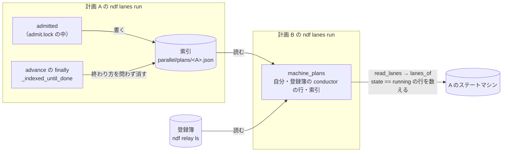
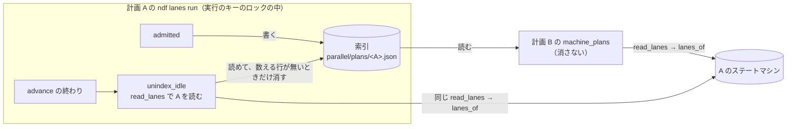

# 並列の計画の上限: 実行中の行を持つ計画を、耐久ワークフローがどう終わっても索引から数える（#4051）

計画の索引は耐久ワークフローが終わるときに終わり方を問わず消えるので、中止を起動できずに終わった計画や例外で落ちた計画の実行中の行を、ラッパーが止まった後に別の計画が数えられない。索引を消す条件を「耐久ワークフローが終わった」から「別の計画の起動の許可が読んでも数える行が無い」へ変え、確かめる読み手を起動の許可と同じ関数にし、消す担い手はその計画の耐久ワークフローだけにする。確定仕様の「残った索引は 0 本」は実装（ステートマシンを読んで数える）に合わせて直す。終わり方で分ける案・読む側が消す案などを採らなかった理由は「決定の記録」に、比べた形（etcd のリース・Kubernetes のファイナライザー）は付録の「外部の調査」にある。

## 今の姿

何が起きたか・目的・受け入れ条件は要求仕様（[issue-4051-requirements.md](./issue-4051-requirements.md)、正は #4051 の本文）にある。この文書は「どう解くか」と「なぜその解き方か」だけを書く。パスは `plugins/ndf/` からの相対で書く。

設計に要る今の構造:

| 部品 | 今の振る舞い | 場所 |
| --- | --- | --- |
| 索引を書く | 起動の許可が上限に収まったとき、起動の排他の中で書く（同じ中身なら書かない） | `src/ndf/progress/lane/machine.py` の `admitted`・`index_plan` |
| 索引を消す | `advance` を包む `_indexed_until_done` が `finally` で消す。区切り・中止・完了・`cancel_failed`・例外のどれでも消える | `src/ndf/progress/plan/run.py` の `_indexed_until_done`（377-382 行） |
| 索引を読む | 起動の許可と `ndf lanes status` の `machine_plans` が、索引の計画を `read_lanes` で読み、`lanes_of` が `state == running` の行を持つレーンを稼働中とする。読めなければ `readable` が偽 | `machine.py` の `machine_plans`・`read_lanes`・`lanes_of` |
| 耐久ワークフローの終わり | `paused`・`stopped` は写しの `running`（`LaneRow.active`: 実行中かつスプリントの ID を持つ）が空になってから終わる。`cancel_failed` は中止をすべて起動できなくなった時点で、例外は落ちた時点で、どちらも実行中の行を持ったまま終わる | `src/ndf/progress/plan/run_decide.py` の `_end_of`・`_cancels_given_up` |

**根本原因は、索引の寿命を「数える行があるか」ではなく「耐久ワークフローが生きているか」に結び付けたことである。** 区切りと中止の終わりは、終わりの判定（`active`）が実行中の行の無い時点に限っているので今は穴にならない。しかしその条件は数え方（`state == running`）と別の場所に別の式で書かれ、索引の寿命はどちらにも結び付いていない。`cancel_failed` と例外の終わりは実行中の行を持ったまま索引を消す。課題の題の「区切りの後」は、区切りの終わりそのものではなく、実行中の行を残して終わる経路のすべてに当たる。

同じ形の箇所は無い。状態の保存先の下で寿命を持つほかのファイル（起動の排他 `admit.lock`・ハブの錠）は、持ち主のプロセスの生死が寿命そのもので、守る対象（行）と寿命がずれない。

確定仕様の「異常終了で残ったファイルは、実行中の行が無い計画として 0 本と数える」は、実装がしていない振る舞いである。実装は残ったファイルの計画のステートマシンを読み、実行中の行があれば数える。仕様の「マシンの計画の索引」のファイルの形にも、実装が書く `plan_id` が無い。

## 文脈と制約

- 索引のファイル 1 本を書く担い手は、その計画の耐久ワークフロー（実行のキーのロックで 1 計画 1 本）だけである。起動の許可（`admitted`）は自分の計画の索引だけを書く（要求仕様の前提 1）
- 索引の読み手は、起動の許可（起動の排他の中）と `ndf lanes status`（排他の外）の 2 つで、どちらも `machine_plans` を通る
- 数える行の規則（`lanes_of`）は #4050 が変える（承認ゲートの回答を待つ行で席を返した行・実装の待ちの行を数えない）。この課題はその規則を変えない
- 異常終了（プロセスが殺された・マシンが落ちた）では `finally` が走らない。行はステートマシンに残り、`ndf lanes run` を打ち直すと耐久ワークフローが回復して続く（要求仕様の前提 2）
- 公開インタフェース（コマンド・引数・結果 JSON・索引のファイルの形）を変えない

## 解き方の全体像

- 計画の耐久ワークフローが終わるとき（終わり方を問わない）、その計画を別の計画の起動の許可と同じ読み手（`read_lanes`）で読み、数える行が 1 つも無いときだけ索引を消す。読めないとき・数える行があるときは残す
- `cancel_failed` と例外で終わった計画の実行中の行は、ラッパーと登録簿の行が消えた後も索引から数えられる。中止を打ち直すか回復した耐久ワークフローが行を終えてから終わると、索引が消える
- 読む側（起動の許可・`ndf lanes status`）は今のまま索引を読んで数えるだけで、消さない
- 確定仕様は、残った索引を「その計画のステートマシンを読み、数える行があれば数え、無ければ 0 本」と書き、仕様のファイルの形の記述に、実装が既に書いている `plan_id` を足す（ファイルの形は変えない）

## 決定の記録

### 決定 1: 数える行を残したまま索引が消えないよう、消す条件を「起動の許可が読んでも数える行が無い」にする

- **質問**: 索引を消してよい時点を何で決めるか
- **選んだ案**: 耐久ワークフローが終わるとき、その計画を `machine.read_lanes`（起動の許可が索引の計画を読む関数）で読み、`readable` が真で、計画の ID が索引の ID と一致し、`lanes` に数える行（`running_row` が真）が 1 つも無いときだけ消す。数える行の規則は `lanes_of` の 1 か所にあり、#4050 がそれを変えても索引の条件は自動で同じ規則に従う
- 採らなかった案: 終わり方（`outcome`）で分け、`paused`・`stopped`・`completed` は消し、`cancel_failed` と例外では残す（終わり方と「行が残るか」の対応は `_end_of` の `active` が守っていて、数え方の `state == running` とは別の式である。終わり方を足す・終わりの条件を変えるたびに索引の規則を直す必要があり、同じ穴が形を変えて戻る）
- 採らなかった案: 索引を消さない（ファイルが計画の数だけ増え続け、起動の許可のたびに終わった計画のステートマシンを開く。Value 6 に反する）
- 採らなかった案: 起動の許可が行を始めるたびではなく、毎周の読み直しで行の有無に合わせて書き消しする（終わりで 1 回確かめれば穴は塞がる。毎周のファイル操作と、読み直しの写しと読み手の読みの 2 つの読み方が要り、Value 9 の「まだ要らない仕組みは先回りして作らない」に反する）
- **代償**: `cancel_failed` で終わった計画は、中止を打ち直すまで実行中の行の数だけマシンの枠を使い続ける（今も登録簿の行がある間は同じに数えている）。終わるときにステートマシンを 1 回多く開く
- 作り方: 自前で作る・標準に倣う
- 比べた候補: PRD1・PRD2
- 根拠: Value 7「不具合は、現象が出た場所ではなく根本原因の場所で直され、形を変えて戻ってこない」・Value 11「同じ規則・定数・処理は 1 か所にまとまり、ほかはそこを参照する」・Value 6「NDF が作業で生んだもの（…状態の記録・一時ファイル）は役目を終えると自動で片付き」（MVV バージョン 11）

### 決定 2: 書き手と消し手の競合を作らないため、索引を消すのはその計画の耐久ワークフローだけにする

- **質問**: 実行中の行が無いのに残った索引（異常終了の残り）を、読む側が見つけたときに消すか
- **選んだ案**: 消さない。索引を消すのは、その計画の耐久ワークフローが実行のキーのロックの中で終わるときだけにする。読む側は今のとおり読んで数え、数える行が無ければ 0 本と数える。異常終了の残りは、その計画の `ndf lanes run` を打ち直して回復した耐久ワークフローが終わるときに消える。計画が `completed` を保存した後・索引を消す前に落ちた残りは、打ち直した `advance` が完了済みの早期 return の前に、索引があるときだけ実行のキーのロック（`durable.run_lock`。DBOS は起動しない）を取り、同じ条件で消す。ロックの持ち主には、その計画の耐久ワークフローのほかに、索引を片付けない掃除（`durable_sweep._retire_finished`）もいるので、取れなければ諦めずに放すまで待つ。計画は `completed` なので持ち主はどれもすぐ放す。索引が無ければ今のとおり即座に返す
- 採らなかった案: 起動の許可が起動の排他の中で、数える行の無い索引を消す（他の計画のファイルを消す担い手が 2 つになる。その計画の耐久ワークフローは排他の外で終わりの確かめをするので、確かめと消すの間に相手が行を始めると数え落とす。起動の許可にファイルの書き込みが増える）
- 採らなかった案: `ndf lanes status` も消す（排他の外で読むので、読んだ後に相手の起動の許可が同じ中身の索引を「書かずに」通ると、消した索引が戻らない）
- **代償**: 回復されない計画の残りのファイルは、起動の許可のたびにそのステートマシンを 1 回読ませる（数え方は正しい: 数える行が無ければ 0 本）
- 作り方: 自前で作る・標準に倣う
- 比べた候補: PRD1・PRD2
- 根拠: Value 9「1 つのモジュール・クラス・関数が 1 つの責務を持ち」・Value 3「同じ操作を打ち直しても、結果は 1 回打ったときと変わらない」（MVV バージョン 11）

### 決定 3: 数え落としを上限超えにしないため、終わるときに計画を読めなければ索引を残す

- **質問**: 終わるときにその計画のステートマシンを読めない（例外の終わりの原因が保存先の誤りのときなど）とき、索引を消すか
- **選んだ案**: 残す。読む側は今のとおり読めない計画を `unreadable` に載せ、そのラッパーは登録簿で動いていれば数える。読めるようになった後の起動の許可は行を数える
- 採らなかった案: 消す（実行中の行を持つ計画を数え落とし、上限を超えて起動する。この課題が直す事象そのもの）
- **代償**: 読めない状態が続く間は、残した索引からも行を数えられない（読む側も読めずに `unreadable` に載せ、ラッパーが動いていればそれだけを数える）。ラッパーも止まっていれば、その間は今と同じく数え落とす。残すのは、読めるようになった時点で数え直せるようにするためである。消えたチェックアウトの計画の索引は残り続け、`machine_wait` と `metrics.machine` の `unreadable` に載り続ける（片付ける手段はこの課題の範囲の外）
- 根拠: Value 7「不具合は、現象が出た場所ではなく根本原因の場所で直され、形を変えて戻ってこない」・Value 3「判断の要らない手順は仕組みが進めるので、結果が実行ごとにばらつかない」（MVV バージョン 11）

### 決定 4: 仕様を正にするため、確定仕様の「0 本」を実装の数え方に合わせて書き直す

- **質問**: 「異常終了で残った索引は 0 本と数える」という仕様と、「残った索引の計画のステートマシンを読み、実行中の行を数える」という実装の、どちらへそろえるか
- **選んだ案**: 仕様を実装へそろえる。「残った索引の計画は、ステートマシンを読み、数える行があれば数え、無ければ 0 本」と書き、索引の担い手・消す条件（決定 1〜3）とファイルの形（`plan_id` を含む）を書き足す
- 採らなかった案: 実装を仕様へそろえ、残った索引を 0 本と数える（残ったかどうかを見分ける印が無い。耐久ワークフローの生死を他の計画の DBOS から読むことになり、異常終了の後に回復を待つ実行中の行を数え落とす）
- **代償**: 無し（実装の振る舞いは変えない）
- 根拠: Value 14「判断の理由が残り、語がそろっている」・Value 11「文書も正本が 1 か所にあり、写さずに指す」（MVV バージョン 11）

### 決定 5: #4050 と持ち物を重ねないため、この課題は索引の寿命だけを持ち、数える行の規則に触らない

- **質問**: #4050（待つ行の席を返す）が `lanes_of`・`count`・`held_seats` を変える。この課題はどこまでを持つか
- **#4050 の決定の要点**（[issue-4050-design.md](./issue-4050-design.md) の決定 4・決定 11 と不変条件 I3・I8）: 実装を待つ行と、承認ゲートの回答を待つ行は、耐久ワークフローがラッパーを止めて「席を返した行」（事象 `row_parked`）とし、マシン全体の稼働中の数に数えない。ここで「席」は、行を始めた起動が上限の判定を通って得た、マシンの枠 1 本分の数え上げを指す。席を返した行の起動し直しは、行を始める起動と同じく上限の判定（`admitted`）を通る
- **選んだ案**: この課題は、索引を消す条件と担い手（`run.py` の終わりの手と、`machine.py` に足す 2 関数）と確定仕様の索引の記述だけを持つ。数える行の規則は #4050 が持つ。索引の条件は `read_lanes` → `lanes_of` を通すので、#4050 が席を返した行を数えなくすると、席を返した行だけの計画の索引は終わるときに消える。その行の起動し直しは #4050 の決定で上限の判定（`admitted`）を通るので、そのときに索引が書き直される
- 採らなかった案: この課題で「数える行」の判定を別に書く（2 つの規則が食い違い、#4050 の後に索引が残る・消えるの判定と数え方がずれる）
- **代償**: 実装の順によって、片方の PR がもう片方の上へ rebase する手間がある（「影響と危険」）
- 根拠: Value 11「同じ規則・定数・処理は 1 か所にまとまり、ほかはそこを参照する」・Value 9「1 つのモジュール・クラス・関数が 1 つの責務を持ち」（MVV バージョン 11）

## 影響と危険

- **働く範囲**: 利用先のリポジトリでも働く。並列の計画（`ndf lanes run`）を流すすべてのマシンの起動の許可に効く
- **プロジェクトごとに違うもの**: 無し（上限の値は今のとおりマシンの設定と環境変数で受ける）
- **当たるモード**: 並列の計画で流すすべてのモード（モードによらず、計画の耐久ワークフローの振る舞いである）
- **壊れうる箇所**: `cancel_failed` で終わった計画が中止を打ち直されないと、その実行中の行がマシンの枠を使い続ける。今も登録簿の行がある間は同じに数えていて、ラッパーが止まった後も続くようになる。打ち直しの手順（`ndf lanes run` で次の番号の ID が中止を試し直す）は今の手順書にある
- **同じファイルを触る別の変更と実装の順**:
  - #4050（レーン lanes。#4081 が設計を直している途中）は `src/ndf/progress/lane/machine.py`・`src/ndf/progress/plan/run.py`・`run_decide.py` と確定仕様を触る。この課題が触るのは `machine.py` の索引の関数の並び（足す 2 関数）と `run.py` の `_indexed_until_done` と `advance` の呼び方・完了済みの早期 return だけで、#4050 が触る `lanes_of`・`count`・`run_decide` の判断には触らない。先にマージした側の上へ後の側が rebase する。どちらが先でも振る舞いは決定 5 のとおり合う。確定仕様は節が分かれる（この課題は「稼働中の数の数え方」の索引の段落と「マシンの計画の索引」、#4050 は数える行の表）
  - #4044（リレーハブの通常の起動が席を数えない）は `src/ndf/domains/relay/` のほかに、`machine.py` の `PlanPlace`（省ける `store_root`・`db` を足す）・`index_plan`（索引の版を 2 にする）と `run.py` の起動の許可へ渡す `PlanPlace`、確定仕様の「マシンの計画の索引」の節を触るので、この課題と重なる（[issue-4044-design.md](./issue-4044-design.md) の「影響と危険」）。関数は重ならない。この課題は同じ節の消す時点と条件（索引の寿命）だけを直し、ファイルの形（版と項目）は #4044 が持つ。どちらが後に rebase しても、版 2 の形を版 1 へ戻さない。`unindex_idle` は版によらず `plan_id`・`cwd`・`plan` だけを読む。起動の許可が渡す `held_seats` は `machine_plans` が見つけた計画から作るので、この課題で見つかる計画が増えると、ハブへ渡る席も正しく増える
  - #4036（生死の判定）は `liveness.py` の側で重ならない。#4049・#4070（レーン lctx）は中継のラッパーと背景の作業の知らせで、この課題のファイルと重ならない

### 代表のリポジトリでの振る舞い

| 代表のリポジトリ | 設定の要点 | 直した後に起きること | この種類で扱えなくなること |
| --- | --- | --- | --- |
| Web サービス（nd-factory） | 並列の計画でスプリントのレーンを流す。上限はマシンの設定 | 中止を起動できなかった計画・耐久ワークフローが落ちた計画の実行中の行を、ラッパーが止まった後も数え、上限を超えて起動しない | 無し |
| モバイルアプリ | 同上 | 同上 | 無し |
| 業務文書だけ | 同上（文書のスプリントのレーン） | 同上 | 無し |

### このリポジトリだけの事情

- 無し（索引の寿命は NDF の製品の振る舞いで、ai-plugins の運用の値を持たない）

## テスト設計

| 受け入れ条件 | どの振る舞いで縛るか | どう壊したら落ちるべきか |
| --- | --- | --- |
| 1 | 区切りで止めた計画 A が実行中の行を持ったまま耐久ワークフローが例外で終わり、索引が残る。A の登録簿の行が無い状態で、上限 1 の計画 B の `admitted` が `machine-lanes` で待つ。`cancel_failed` で終わった計画でも同じ | 終わりで無条件に消すと落ちる。終わり方（`outcome`）だけで決めると例外の経路で落ちる |
| 2 | 索引だけが残った計画（耐久ワークフローの終わりを通らない）を、実行中の行を持てば `machine_plans`（`machine_count` が通る）が 1 本と数え、持たなければ 0 本と数える | 残った索引を一律 0 本にすると前者で、一律に数えると後者で落ちる |
| 3 | 確定仕様の 2 つの節を `machine.py`・`run.py` と読み合わせる（文言のテストは書かない） | — |
| 4 | 行がすべて終わって完了した計画・中止して行が無くなった計画・区切りで行が無くなった計画の `advance` の後、索引が無い。`completed` を保存済みで索引だけが残った状態から打ち直した `advance` の後も、索引が無い | 消す条件を「行の無い区切り」だけにすると完了・中止の経路で落ちる。完了済みの早期 return が後始末を通らないと打ち直しの経路で落ちる |
| 5 | 終わるときに `read_lanes` が読めない（`readable` が偽）と、索引が残る | 読めないときに消すと落ちる |

詳細設計は [issue-4051-design-detail.md](./issue-4051-design-detail.md) にある（新設する関数 2・シグネチャを変える関数 1 のため別ファイル）。

## 設計の結果

| 課題 | 扱い | 統合先 | 触るファイル |
| --- | --- | --- | --- |
| #4051 | 実装する | — | `plugins/ndf/src/ndf/progress/lane/machine.py`、`plugins/ndf/src/ndf/progress/plan/run.py`、`docs/specifications/ndf-parallel-machine-plan-limit.md`、`plugins/ndf/tests/progress/test_lane_machine.py`、`plugins/ndf/tests/progress/test_plan_run.py` |

## 外部の調査

| 種類 | 調べるか | 理由 |
| --- | --- | --- |
| 標準・仕様 | 調べない | 同じマシンの中のファイルの寿命で、公開の仕様が定める領域ではない |
| 主要な製品 | 調べる | 「持ち主が登録し、持ち物の寿命で消す」形を、分散の調整と資源の削除を持つ製品がどう決めているかを比べる |
| ライブラリとサービス | 調べない | 新しい依存を足さず、今の索引のファイルの消す時点だけを変える。#3989 の設計が索引の置き方を比べ済みである |

### 主要な製品

| # | 製品 | どう解いているか | 設計への反映 | 出典 |
| --- | --- | --- | --- | --- |
| PRD1 | etcd のリース | キーをリースに結び付け、持ち主が keepalive を送らなくなる（TTL が切れる）か revoke すると、結び付いたキーがすべて消える。寿命は持ち主の生死に結ぶ | 今の実装の形（耐久ワークフローの生死に結ぶ）に当たる。守る対象（実行中の行）がプロセスより長く生きる場面では数え落とすので採らない（決定 1） | https://etcd.io/docs/v3.5/learning/api/ （2026-11-22） |
| PRD2 | Kubernetes のファイナライザー | 削除を求められた物は、ファイナライザーが残る間は消えずに終了中として残る。ファイナライザーを外すのは、それを持つコントローラーが後始末（使用中の資源の解放）を終えた後だけで、手で外すと依存する資源が取り残されると注意している | 消す条件を「守る対象が残っていない」にし（決定 1）、外すのは持ち主だけにする（決定 2）。持ち主が確かめられないときは外さない（決定 3） | https://kubernetes.io/docs/concepts/overview/working-with-objects/finalizers/ （2026-11-22） |

調べた量: 候補 2 件・取得の試み 2 回。
