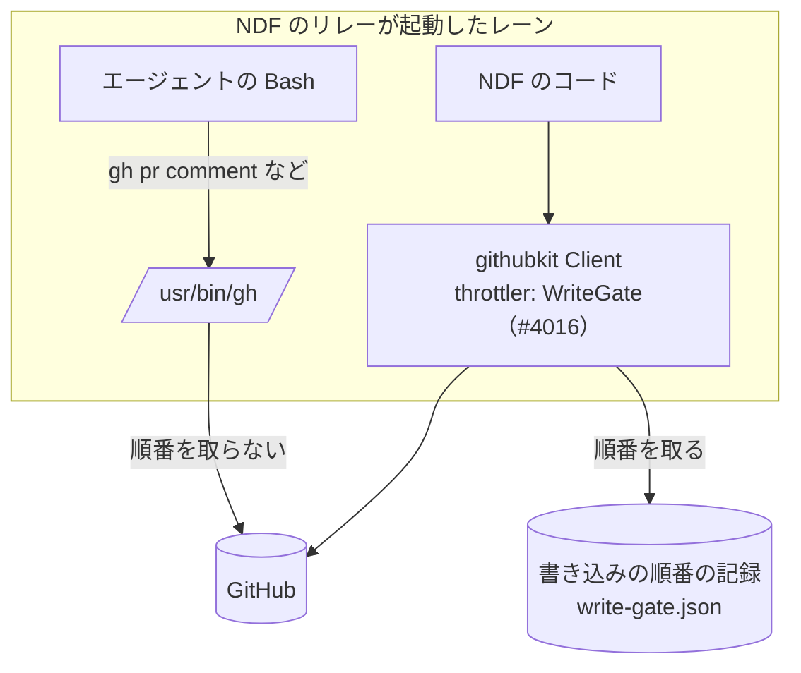
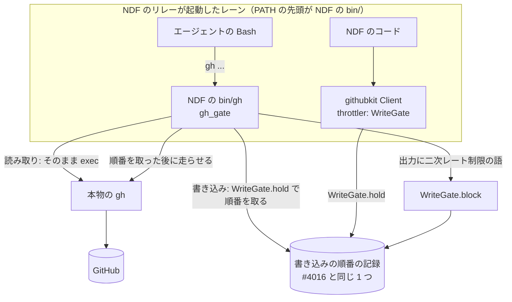
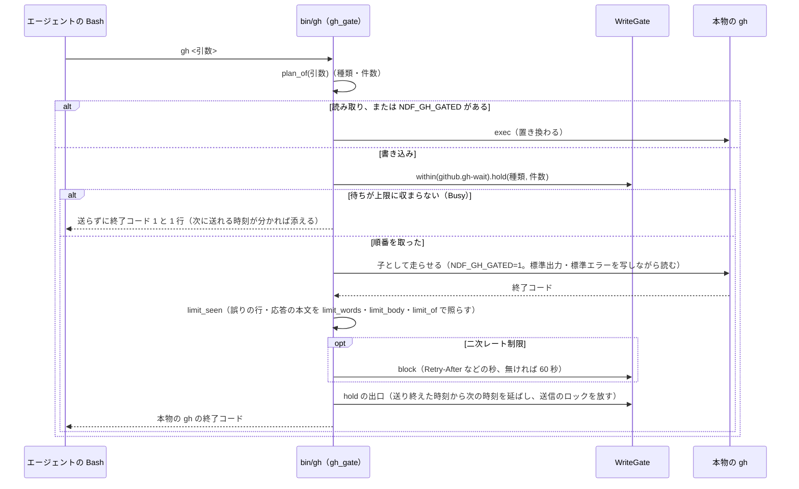

# gh の書き込み: エージェントが打つ gh も NDF と同じ順番の記録で間を空ける（#4059）

エージェントが Bash で打つ `gh` の書き込みは、#4016 の `WriteGate` が並べる NDF の書き込みの外で送られ、並列のレーンの合計と二次レート制限の後の待ちを守れない。NDF の `bin/` に同じ名前の `gh` を置き、NDF のリレーが `bin/` を `PATH` の先頭に置くことを使って、エージェントの `gh` を先に引かせる。その `gh` は引数で書き込みの種類と件数を決め、#4016 の書き込みの順番の記録で順番を取ってから本物の `gh` を走らせ、出力が二次レート制限を示せば待ちの終わりを記録へ書く。比べた案（PreToolUse の hook・hook によるコマンドの書き換え・HTTP の代理）は「決定の記録」に、`gh` と hook の実測は末尾の「外部の調査」にある。

## 今の姿

何が起きたか・目的・受け入れ条件は要求仕様（[issue-4059-requirements.md](./issue-4059-requirements.md)、正は #4059 の本文）にある。前提の設計は [issue-4016-design.md](./issue-4016-design.md) と [issue-4016-design-detail.md](./issue-4016-design-detail.md)（未実装）である。

- **エージェントの `gh` は `/usr/bin/gh` を直に引く。** NDF のコードは `gh` を書き込みに使わない（`adapters/github.py` は `gh auth token` で token を取るだけで、要求は githubkit で送る。`measure_ci.py` は `gh api --method GET` の読み取りだけ）
- **NDF のリレーが起動した claude は、起動先の NDF の `bin/` が `PATH` の先頭にある**（`relay/wrapper.py` の `_start` が `session_env.with_launched_ndf` を通す。#3909）。サブエージェントと、そのセッションが起動する子のプロセス（`codex exec` など）は同じ `PATH` を引き継ぐ。リレーを通らない claude では、Claude Code が `bin/` を `PATH` の末尾に足す（公式文書。システムのコマンドを上書きさせないため）
- **`gh` は二次レート制限に当たっても打ち直さず、終了コードは 1 だけである**（外部の調査の STD4）。失敗の種類は出力の本文でしか分からず、`gh api` の 422 は理由が標準出力の JSON にだけ出る
- **GitHub は二次レート制限を 422 でも返す。** PR #4096 の記録では、`was submitted too quickly`（`code: custom`）と `code: abuse` の 422 で 9 件の書き込みが断られた。#4016 の設計は 403・429 と GraphQL の誤りだけを二次レート制限とし、この 422 をスパムの判定として扱う（#4016 の決定 5・8）

## 文脈と制約

- **#4016 の書き込みの順番の記録と `WriteGate` を共有する**（要求の前提 3）。別の記録を持つと、NDF とエージェントの書き込みの合計を数えられない。#4016 の `WriteGate` は、マシンに 1 つの記録のファイルをロックの中で読み書きして次に書いてよい時刻を予約し、送る間は送信のロック（同時に 1 つの書き込みだけが送られるためのファイルのロック）を持つ
- **GitHub の上限と待ち方は #4016 の要求の前提 1 のとおり**（内容を作る書き込みは 1 時間 500 件、書き込みは順に送り 1 秒以上空ける）。間隔の値は #4016 の `github.write-spacing`（1 秒）・`github.content-spacing`（7.2 秒）をそのまま使う
- **`gh` の引数と出力の形を変えない。** エージェントと手順書は `gh` の出力を読んで動く
- **Bash の呼び出しには時間の上限がある**（Claude Code の Bash の既定は 120 秒）。上限を越えて待つと、待ちの途中で `gh` ごと切られる
- 決定の根拠の行の `Value <番号>` は、プロジェクト MVV（`.ndf/mvv.md`、MVV バージョン 11）の判断の基準の番号である
- **他のレーンと重なる箇所がある**（下の「影響と危険」）。この設計 PR の差分は `issues/issue-4059-*` だけにする

## 解き方の全体像

- NDF の `bin/gh`（新設）がエージェントの `gh` を受ける。リレーが `bin/` を `PATH` の先頭に置くので、レーンとサブエージェントが打つ `gh` はこれを引く
- 引数から読み取り・書き込み・内容を作る書き込みを見分け、書き込みなら 1 回の `gh` が出す書き込みの件数も決める。読み取りは本物の `gh` へ置き換わる（`exec`）だけで、待たない
- 書き込みは、NDF のコードと同じ `WriteGate.hold` で種類と件数の順番を取り、本物の `gh` が終わるまで送信のロックを持つ。待ちが Bash の時間の上限に収まらなければ送らずに終わる
- 本物の `gh` の出力が二次レート制限（403・429 の `secondary rate limit`、422 の `was submitted too quickly`・`code: abuse`）を示せば、`WriteGate.block` で待ちの終わりを記録へ書く。照らしの規則（`limit_words`・`limit_body`）は #4016 の `limit_of` と同じ 1 か所に置く。照らすのは `gh` が誤りを出す行と応答の本文の決めた欄だけで、端末につながる口の出力は照らさない

## ドメインモデル

### コンテキスト

| コンテキスト | 何の語が 1 つの意味に決まるか |
| --- | --- |
| NDF の実行の基盤 | 書き込みの順番・内容を作る書き込み・待ちの終わり・二次レート制限（#4016 と同じ） |

`gh_gate` は #4016 の実行の基盤のコンテキストに入る。順番の取り方は `WriteGate` だけが知り、`gh_gate` は `gh` の引数を書き込みの種類へ訳すだけである。

### 集約

| 集約 | オーナー（書き換えてよいもの） | 根 | エンティティ | 値オブジェクト |
| --- | --- | --- | --- | --- |
| 書き込みの順番の記録（#4016） | `WriteGate`（ロックの中でだけ書く）。`gh_gate` は `WriteGate` を通してだけ書く | 記録のファイル（マシンに 1 つ） | — | #4016 のとおり |

### 不変条件

#4016 の I1〜I6 をそのまま守る。この課題で足すのは次の 3 つである。

| # | 集約 | 条件 | 破れたときの扱い |
| --- | --- | --- | --- |
| G1 | 書き込みの順番の記録 | `gh` の書き込みも、NDF のコードの書き込みと同じ `WriteGate.hold` を通って順番を取る。`gh_gate` は記録を直に読み書きしない | 構造で守る（`gh_gate` は `WriteGate` の公開の関数だけを呼ぶ） |
| G2 | 書き込みの順番の記録 | `gh` の書き込みは、本物の `gh` が終わるまで送信のロックを持つ。1 回の `gh` が出す書き込みの件数（決定 7）の分だけ、次の書き込みとの間隔を空ける | 送信のロックを取れなければ #4016 の I5 |
| G3 | 書き込みの順番の記録 | `gh_gate` の中から呼ばれた `gh`（`gh` の拡張・別名が打つ `gh`）は順番を取らない（外の `gh` が送信のロックを持っているので、取りに行くと自分を待つ） | 子へ渡す環境変数 `NDF_GH_GATED` で見分ける |

### ドメインイベント

| # | イベント | 発生元 | 受け手 |
| --- | --- | --- | --- |
| E1 | エージェントが `gh` を打った | Bash | `gh_gate` |
| E2 | `gh` の書き込みが順番を取った | `gh_gate` → `WriteGate.hold` | 書き込みの順番の記録 |
| E3 | `gh` が書き込みを送り終えた | `WriteGate.hold` の出口 | 書き込みの順番の記録（次の時刻を延ばす） |
| E4 | `gh` の書き込みが二次レート制限で断られた | `gh_gate`（出力の見分け） | 書き込みの順番の記録（待ちの終わり） |

## 構成要素

| 要素 | 責務 |
| --- | --- |
| `bin/gh`（新設） | 名前 `gh` で引かれるエントリポイント。本物の `gh` を探し、NDF の仮想環境の python を隔離モード（`-I`）で起動して、起動先の版の `src` から `ndf.adapters.gh_gate` を読む。python が無い・読み込めないときは本物の `gh` へ置き換わる |
| `gh_gate`（新設。`adapters/gh_gate.py`） | `gh` の引数から書き込みの種類と件数を決め（`plan_of`）、書き込みなら `WriteGate.hold` の中で本物の `gh` を走らせて出力を見分ける（`limit_seen`） |
| `WriteGate.hold`（#4016 の `acquire` を分けて新設） | 種類と件数を受け、順番を取り、文脈の間送信のロックを持つ。`acquire(request)` は `hold(kind_of(request), 1)` になる。待ちが予算に収まらなければ、次に送れる時刻（分からなければ無し）を持つ `Busy` を出す |
| `write_rules`（新設。`adapters/write_rules.py`。githubkit を読まない） | #4016 の `kind_of`・`limit_of` から切り出した規則を置く。`limit_words` は 1 つの文に二次レート制限の語があるかを、`limit_body` は REST の応答（403・429・422）の本文の決めた欄（422 は `errors[]` の `message` と `code`）が二次レート制限を示すかを決める。`mutation_kind` は GraphQL の文書と `operationName` から実行される操作を graphql-core の構文の読みで決め、読み取り・書き込み・内容を作る書き込みに分ける。`kind_of`・`limit_of` と `gh_gate` が使い、読み取りの `gh` は githubkit を読まずに済む |
| `contracts/limits.json`（変更） | `github.gh-wait`（`gh` の書き込みが順番を待つ上限の秒）を足す |
| `pyproject.toml`・`uv.lock`（変更） | graphql-core（3.2 系）を依存に足す |

## 処理の流れ

## 決定の記録

### 決定 1: NDF のセッションのエージェントが打つ gh を漏れなく受けるため、NDF の bin/ に同じ名前の gh を置き、リレーの PATH の順で先に引かせる

- **質問**: エージェントの `gh` を、どの層で受けて順番を取らせるか（起票者の推定 S2）
- **選んだ案**: `plugins/ndf/bin/gh` を置く。NDF のリレーは起動先の `bin/` を `PATH` の先頭に置く（今の振る舞い）ので、リレーが起動した claude とそのサブエージェント・子のプロセスが名前で引く `gh` は、コマンドの書き方（パイプ・`&&`・スクリプトの中・`xargs`）に依らずこれになる。`bin/gh` は本物の `gh` を `PATH` から探し、自分の `bin/` と NDF のほかの版の `bin/`（`session_env.should_drop` と同じ判定）を飛ばす。python は隔離モード（`-I`）で起動し、起動先の版の `src` を自分で `sys.path` に入れる（作業ディレクトリ・`PYTHONPATH`・NDF の環境変数に頼らず、チェックアウトしたリポジトリのコードを読まない）
- 採らなかった案: PreToolUse の hook がコマンドの文字列から `gh` の書き込みを探して待つ（hook はコマンドの実行より前に終わるので、送信のロックを `gh` の間持てず、出力の二次レート制限も見えない。`cd x && gh ...`・スクリプトの中の `gh` を文字列から漏れなく探せない。NDF の PreToolUse の待ちの上限は 3 秒で、7.2 秒の間隔を待てない）
- 採らなかった案: PreToolUse の hook が `updatedInput` でコマンドの頭に `PATH=<包みのディレクトリ>:$PATH` を足す（Claude Code と Codex のどちらでも書き換えは動いた（外部の調査の STD5・STD6）。リレーを通らない claude にも効く。しかし `gh` を含むすべてのコマンドを書き換えて利用者の許可の規則（`Bash(gh pr view:*)` など）と照らす文字列が変わり、許可の振る舞いへの効きを確かめていない。NDF の hook の guard を持つほかのレーンの変更とも重なる。並列のレーンはリレーが起動するので、リレーの `PATH` で同じ範囲に効く）
- 採らなかった案: 読み取りかどうかを `bin/gh` の bash で決め、読み取りでは python を起こさない（引数の読みの規則を bash と python の 2 か所に持つことになる。書き込みの側へ倒す判定には `gh api` のフラグの結合形と値の消費、GraphQL の文書の構文の読みが要り、bash の側を python と同じに保てない。読み取りの `gh` で python を起こす分は約 0.04 秒で、Bash の呼び出しの往復に比べて小さい）
- 採らなかった案: HTTP の代理（`HTTPS_PROXY`）で `gh` の要求を受ける（TLS を終わらせる証明書を `gh` に信頼させる必要があり、利用者の環境を変える）
- 採らなかった案: `gh` の別名（`gh alias set`）・拡張で包む（`gh` は組み込みのコマンドを別名と拡張で上書きさせない）
- **代償**: リレーを通らない claude・利用者が端末で手で打つ `gh`・CI の `gh` は包まない（要求の「含まない」）。`gh` を打つたびに遅くなる。2026-11-22 にこのマシンで `python -I -c` を 10 回走らせた平均で、読み取りは python の起動と標準ライブラリの import で約 0.04 秒、`gh api graphql` は文書を読む graphql-core の約 0.11 秒が足され、書き込みは順番を取る `write_gate`・`github` が読む githubkit などの約 0.22〜0.25 秒が足される（待ちの秒は別）。読み取りが githubkit を読まないよう、規則を `write_rules` に分け、`write_gate`・`github` は書き込みと決めた後に読む（詳細設計の地図）。NDF の仮想環境がまだ無い・包みを読み込めないときは、順番を取らずに本物の `gh` が走る（NDF の不調で `gh` を止めない）
- 作り方: 自前で作る
- 比べた候補: STD4・STD5・STD6・PRD1
- 根拠: Value 12（MVV バージョン 11。実行の基盤の `PATH` の仕組みで足り、hook でコマンドを書き換える仕組みを作らない）・Value 15（MVV バージョン 11。エージェントは今のとおり `gh` を打てばよい）

### 決定 2: NDF とエージェントの書き込みの合計を 1 つの間隔に収めるため、gh の書き込みも WriteGate.hold で順番を取る

- **質問**: #4016 の書き込みの順番の記録を、`gh` の側からどう使うか
- **選んだ案**: #4016 の `WriteGate.acquire(request)` の中身を、種類と件数を受ける `WriteGate.hold(kind, count)` へ分ける。`acquire` は `hold(kind_of(request), 1)` だけになる。`gh_gate` は `machine_gate()` の `WriteGate` で `hold` を呼び、その文脈の中で本物の `gh` を走らせる。記録の形・ロック・予約・送信のロック・待ちの終わりは #4016 のまま
- 採らなかった案: `gh_gate` が記録のファイルを直に読み書きする（#4016 の I1〜I6 の守り方を 2 か所に持つ。Value 11）
- 採らなかった案: `gh` 用に別の記録を持つ（合計を数えられず、待ちの終わりも共有できない）
- **代償**: 1 つの `gh` が送る要求の間は空けられない（`gh` の中で続けて送られる）。件数の数え方は決定 7 にある。`gh` が走る間は送信のロックを持つので、ほかのレーンの書き込みは `gh` が終わるまで待つ
- 根拠: Value 11（MVV バージョン 11）

### 決定 3: gh の引数だけで書き込みを見分けるため、読み取りの一覧に無いものを書き込みとして数える

- **質問**: HTTP の要求を見られない `gh` で、読み取り・書き込み・内容を作る書き込みをどう分けるか
- **選んだ案**: 引数で決める（詳細設計の `plan_of`）。`gh api` は GitHub CLI と同じフラグの読み方（結合形・値として消費する語・`--`・最後の `--method` が効く）で読み、#4016 の `kind_of` と同じ規則を当てる（`-X`・`--method` が無く `-f`・`-F`・`--field`・`--raw-field`・`--input` があれば `gh` は POST で送る）。`graphql` は文書と `operationName` を `mutation_kind` で graphql-core の構文として読み、実行される mutation の最上位のフィールドの名前のどれかが `create`・`add` で始まれば内容を作る書き込み。表に無いフラグがあれば内容を作る書き込みとする。ほかのコマンドはグループとサブコマンドの組で決める。読み取りの組（`view`・`list`・`status`・`diff`・`checks`・`watch` などと、読み取りのグループ `auth`・`search`・`help` など）は読み取り、`create`・`comment`・`pr review`・`pr revert`・`repo fork`・`label clone`・`release upload` は内容を作る書き込み、それ以外は書き込み。ヘルプのフラグは、グループ・サブコマンドの後にそれだけがあるときに限って読み取りとする
- 採らなかった案: 書き込みのサブコマンドの一覧を持ち、ほかを読み取りとする（`gh` に新しい書き込みのコマンドが足されると、順番の外で送られる。読み取りを書き込みと誤っても 1 秒待つだけで済む）
- 採らなかった案: `GH_DEBUG=api` の出力から要求を読む（要求を送った後に分かるので、送る前の順番に使えない）
- **代償**: 一覧に無い読み取りのコマンド（`gh pr checkout` などは一覧に入れる）と、読めない引数の `gh api` は書き込みと同じに並ぶ。`gh api graphql` の文書を `-F query=@<パス>`・`--input <パス>` で渡すと、通常のファイルは先読みして一時ファイルへ写し（分類した内容と送る内容を同じにする）、写しを持つ `gh` は読み取りでも置き換わらずに子として走らせ、終わった後に写しを消す（約 0.04 秒の python の待ちが `gh` の間残る）。標準入力・ファイル記述子を指すパス（FIFO・プロセス置換・`/dev/fd/<n>`）は読まずに内容を作る書き込みとする。`--input` とフィールドの併用は、GitHub が本文と URL のどちらの文書を実行するか断定できないので内容を作る書き込みとする。待ちは最短 1 秒で、ほかのレーンの書き込みが並べばその分延び、二次レート制限の後は決定 6 のとおり失敗を返す
- 作り方: 標準に倣う
- 比べた候補: STD4・PRD1
- 根拠: Value 3（MVV バージョン 11）

### 決定 4: 1 つのレーンの gh が当たった二次レート制限でほかのレーンが打ち続けないよう、gh の出力を見分けて待ちの終わりを記録へ書く

- **質問**: 打ち直さず終了コード 1 だけを返す `gh` の二次レート制限を、どう見つけて共有するか
- **選んだ案**: `gh_gate` は本物の `gh` の標準出力と標準エラーを、利用者へ写しながら口ごとに頭と末尾の 64 KiB ずつ手元に持つ（詳細設計の `limit_seen`）。`gh` が 0 以外で終わったら次の順で照らし、当たれば `WriteGate.block(<秒>)` を呼ぶ
  - `gh api -i` の出力（応答の状態の行とヘッダーが頭にある）は、状態・ヘッダー・本文（HTTP 200 の GraphQL の誤りは `errors[].message`）を #4016 の `limit_of` に渡し、その待ちの秒（`Retry-After` → `x-ratelimit-reset` の順。#4016 の決定 8）を使う。GitHub が待ちの秒を示さなければ（#4016 の `hinted` が偽）次の既定値を使う
  - `-i` の無い `gh api` は、標準出力の JSON を `limit_body` で照らし（状態は標準エラーの `gh: … (HTTP <状態>)` の行から読む）、既定値を使う
  - 上の 2 つで状態と本文を構造として読めたら、その結果（偽も含む）で決め、次の自由文の照らしへ落とさない（githubkit を通る書き込みと同じ 422 の扱いにする）
  - ほか（状態と本文を構造として読めない。422 と分かるのに本文が無いときを含む）は、標準エラーの `gh` の誤りの行（`gh: `・`GraphQL: `・`HTTP <3 桁>: ` で始まる行）を `limit_words` で照らし、既定値を使う。本文の欄を分けられないので止める側へ倒す
  - 既定値は `cross-review.secondary-rate-limit` の `routing.backoff` の 1 回目（60 秒）。GitHub の文書は待ちの秒が示されないとき 1 分以上待つよう求め（STD1）、#4016 はその値を `cross-review.secondary-rate-limit` に置いた。名前は cross-review だが、NDF の書き込み全体の二次レート制限の方針として #4016 が使うので、`gh` 用に別の値を持たない
- **照らせる範囲**（受け入れ条件 3 の境界）: 親の側の口が端末なら、その口はパイプにせずにそのまま継ぎ、照らさない（`gh` の端末向けの表示を変えない。Claude Code の Bash は端末を割り当てないので、エージェントの `gh` は照らせる）。`gh api --silent` は、書き込みで、親の標準出力が端末でなく、`-i`・`--jq`・`--template`・`--verbose` と併用していないときだけ `--silent` を外して本物を走らせ、標準出力を親へ写さずに手元でだけ持つ（利用者に見える出力は `--silent` と同じで、422 の本文を照らせる）。ほかは `--silent` を残す（`gh` は `--silent` と `--jq`・`--template`・`--verbose` の併用を引数の誤りとして送らずに断るので、外すと本来送られない書き込みが送られる。`-i --silent` は状態の行とヘッダーを出すので、外すと出力の形が変わる）。残したときは本文を照らさず、`-i --silent` は状態とヘッダーだけで照らす
- 採らなかった案: 標準エラーだけを見る（`gh api` の 422 は理由が標準出力の JSON にだけ出る。STD4）
- 採らなかった案: 標準出力の文字列の全体に語を当てる（コメントの本文などを写した出力に語があると、別の失敗でマシン全体が止まる）
- 採らなかった案: `gh` を打ち直す（エージェントは結果を読んで打ち直しを決める。`gh` の振る舞いを変えない）
- **代償**: 端末につながる口だけに出た二次レート制限は記録へ書かない（利用者が端末を割り当てて打つ形は、要求の「含まない」の手で打つ `gh` と同じ扱いになる）。`-i` の無い `gh` は GitHub が示した待ちの秒を知れず、60 秒を書く。GitHub の示した秒がそれより長ければ、ほかのレーンは示された時刻より前に打ちうる
- 根拠: Value 6（MVV バージョン 11）

### 決定 5: 二次レート制限の 422 も待ちの終わりへ数えるため、見分けの語を 1 か所に置き、#4016 の見分けと 422 の扱いを置き換える

- **質問**: 422 の `was submitted too quickly`・`code: abuse` を二次レート制限とするか、#4016 の決定 5 のとおりスパムの判定として扱うか
- **選んだ案**: 二次レート制限とする。照らしを 2 つの関数に置き、#4016 の `limit_of` と `gh_gate` の両方が使う。`write_rules.limit_words(text)` は 1 つの文（GraphQL の誤りの `message`・`gh` の誤りの行）に `secondary rate limit`・`submitted too quickly`・`<型>.<欄> abuse`（`gh` が 422 の誤りを並べる形）があるかを見る。`write_rules.limit_body(status, body)` は REST の応答の本文の JSON を状態ごとに決めた欄だけで照らす（422 は `errors[]` の `message` に `limit_words` が当たるか `code` が `abuse`、403・429 は最上位の `message`、ほかの状態は偽）。GraphQL の HTTP 200 の誤りは本文でなく誤りの文なので、`limit_of` が `limit_words` で照らす（状態で入力の種類を分ける）。`documentation_url` などほかの欄は照らさないので、githubkit を通る NDF の書き込みと `gh` の書き込みで同じ 422 の扱いが分かれない。#4016 の設計を次の節で置き換える（下の「#4016 の設計を置き換える箇所」）
- 採らなかった案: #4016 のまま 422 をスパムの判定とする（PR #4096 で 9 件続けて断られた 422 は、書き込みの速さで断られたもので、同じ速さで打ち続けると同じアカウントのほかのレーンも断られる）
- 採らなかった案: `gh_gate` だけで 422 を見る（NDF のコードの書き込みが同じ 422 を受けても待ちの終わりを書かず、見分けの規則が 2 か所に分かれる。Value 11）
- **代償**: 本当にスパムと判定された 422 でもマシン全体の書き込みが待つ。#4016 の決定 5 の「行の位置で断られた組だけを 1 件ずつに落とす」は変わらない
- 根拠: Value 6・Value 11（MVV バージョン 11）。STD1・STD4

### 決定 6: Bash の時間の上限の中で終わるため、gh の書き込みの待ちに上限を置き、越えたら送らずに理由を返す

- **質問**: 二次レート制限の待ちの終わり（最大 600 秒）まで、`gh` の中で待つか
- **選んだ案**: `gh_gate` は `WriteGate.within(remaining)`（#4016 の決定 10）で、`contracts/limits.json` の `github.gh-wait` の `interval`（90 秒。Claude Code の Bash の既定の 120 秒から `gh` が走る時間を残す）を予算にする。収まらなければ `Busy` を受け、本物の `gh` を走らせずに、標準エラーへ 1 行を出して終了コード 1 で終わる。1 行は `Busy` が次に送れる時刻を持つかで 2 つに分ける
  - 時刻が分かる（待ちの終わり・ほかのレーンの予約の後ろ）: `ndf: GitHub への書き込みの順番を <予算> 秒の内に取れない。<時刻 JST> 以後に打ち直す`
  - 時刻が分からない（記録のロック・送信のロックを予算の内に取れない）: `ndf: GitHub への書き込みの順番を <予算> 秒の内に取れない（ほかの書き込みが送信中）。少し後で打ち直す`
  - 時刻を #4016 の `Busy.seconds` から作らない（ロックの時間切れでは待った秒、予算が先に尽きたときは 0 で、次に送れる時刻を表さない）。`Busy` に次に送れる時刻 `until` を足す（下の「#4016 の設計を置き換える箇所」）
  - 送信のロックの時間切れは、#4016 の `within` のとおり、待ちの上限がどちらだったかで分ける。送信のロックを取りに行く時点の残りの予算が `github.write-send-lock`（60 秒）を越えていれば、待ちの上限は 60 秒で、時間切れは #4016 の I5（ロックを持たずに送り、1 行を出す）。残りの予算が 60 秒以下なら、待ちの上限は残りの予算で、時間切れは `Busy`（時刻が分からない 1 行）で送らない
- 採らなかった案: 待ちの終わりまで待つ（Bash の時間の上限で `gh` ごと切られ、エージェントには理由が見えない）
- 採らなかった案: 待たずに送る（待ちの終わりを破る。要求の受け入れ条件 2）
- **代償**: 二次レート制限の後の数分、エージェントの `gh` の書き込みは失敗を返し、エージェントが時刻の後に打ち直す。時刻が分からない失敗では、エージェントは打ち直す時刻を自分で決める
- 根拠: Value 3（MVV バージョン 11）

### 決定 7: 1 回の gh が複数の書き込みを出しても 1 時間 500 件の間隔に収めるため、出す書き込みの件数を引数から数えて、その分の間隔を予約する

- **質問**: 1 回の `gh` が複数の書き込みを送るとき（`gh release create v1 a.zip b.zip` は下書きのリリースの作成・アセットのアップロード 2 件・公開の更新の 4 件、`gh label clone` は宛先のリポジトリにラベルを 1 つずつ作る）、#4016 の間隔と件数をどう当てるか。#4016 が間隔を当てる単位は HTTP の要求で、`gh` の中の要求は外から見えない
- **選んだ案**: `plan_of` が引数から書き込みの件数を数え、`WriteGate.hold(kind, count)` へ渡す。`reserve` は次の書き込みの時刻を `予約 + count × 間隔` にし（`CONTENT` なら `github.content-spacing`、どれも `github.write-spacing` の分も同じ倍）、`hold` の出口の `sent` は最短の送信時刻を「実際に送り始めた時刻 + count × 間隔」と「送り終えた時刻 + 間隔」の遅いほうまで延ばす（予約の後に先の書き込みが長引いても、件数の分の間隔を送る前に消化させない）。件数は送りうる書き込みの上限の見積もりにする（詳細設計の (e)）
  - `gh release create`: 1（作成）+ A（アセット）+ 1（アセットがあり下書きでないときの公開の更新）+ 1（`--generate-notes`）。A は `gh` と同じくパターンを glob で展開したファイルの数
  - `gh release upload`: A（`--clobber` なら既存のアセットを消してから上げるので 2 × A）
  - `gh label clone`: 元のリポジトリのラベルの総数（`clone` は全件を読むので、既定 30 件の `gh label list` でなく、GraphQL の `labels.totalCount` を `gh api graphql` で 1 回読む。ホストは元のリポジトリの引数から取る。0 なら 1、読めなければ 1 件と数え、標準エラーへ 1 行を出す）
  - ほか: 1 件（`gh pr create` が送るリポジトリの読み取りと mutation のように、書き込みが 1 件のもの）
- 採らなかった案: 1 回の `gh` を常に 1 件と数える（`gh label clone` で数十のラベルを作っても 7.2 秒しか空かず、1 時間 500 件を越えうる）
- 採らなかった案: `gh` の中の要求を 1 件ずつ並べる（HTTP の代理か `gh` の作り直しが要る。決定 1 で採らなかった）
- 採らなかった案: `GH_DEBUG=api` の出力から送った件数を数え、送った後に記録を延ばす（次の書き込みの間隔には効くが、`gh` の出力の形を変えずに標準エラーから取り出す規則が `gh` の版に依る）
- **代償**: 1 回の `gh` の中の要求どうしの間は空かない（GitHub の「書き込みは順に送り 1 秒以上空ける」を `gh` の中では守れない）。守れるのは、`gh` の前後のほかの書き込みとの間隔と、長い時間で平均した 1 時間あたりの件数（`count` 件の `gh` の後は `count` 件分の間隔が空く）である。`count` 件はまとめて送られるので、任意の 1 時間の窓で 500 件以下とは保証しない（窓ごとの件数は数えない。#4016 と同じく間隔で平均の上限に収める）。件数は上限の見積もりなので、送らなかった分（公開に失敗した・既存のアセットが無かった）も間隔を空ける。`gh label clone` は総数を読む読み取りを 1 回足す。件数の多い `gh`（ラベルの多い `gh label clone`）の後は、ほかのレーンの書き込みが件数 × 7.2 秒待ち、`github.gh-wait`（90 秒）を越えると決定 6 のとおり時刻を添えて失敗を返す
- 作り方: 自前で作る
- 比べた候補: STD4・PRD1
- 根拠: Value 3・Value 6（MVV バージョン 11）

## #4016 の設計を置き換える箇所

この設計 PR は #4016 の文書を変えない（conductor の指示で、触るファイルを `issues/issue-4059-*` に絞る）。#4016 の実装は、次の節をこの設計のとおりに読み替えて行う（実装は同じレーンが受け持つ）。**読み替えは、この設計 PR の設計承認ゲートで承認する。** #4016 の設計の承認の後に分かった事実（PR #4096 の 422）で #4016 の決定を変えるので、承認する人は下の表と決定 5 を #4016 の設計の変更として読む

| #4016 の文書の節 | 置き換える中身 | この設計の決定 |
| --- | --- | --- |
| 詳細設計「WriteGate（書き込みの順番）」の関数の仕様の `WriteGate.acquire` の行と手順 | 手順 (1)〜(5) を `WriteGate.hold(kind, count=1)`（新設、`@contextmanager`）へ移し、`acquire(request)` は読み取りならすぐ通し、書き込みなら `with self.hold(kind, 1):` だけにする。`within` の throttler も同じ形の `hold` を持つ | 決定 2・7 |
| 詳細設計の `WriteGate.reserve` の行と事後条件 | 引数に `count: int = 1` を足す。記録の `next` は `予約 + count × github.write-spacing の秒`、`CONTENT` なら `next_content` も `予約 + count × github.content-spacing の秒` | 決定 7 |
| 詳細設計の `WriteGate.sent` の行と事後条件 | `sent(kind, count=1, started=None)` にする。`started`（`hold` が送信を許した時刻）があれば、`sent_next` は `max(sent_next, 今 + github.write-spacing, started + count × github.write-spacing)`、`CONTENT` なら `sent_next_content` も同じ形で `github.content-spacing`。`next`・`next_content` も同じ値以上へ延ばす。`started` が None（`acquire` の経路）は #4016 のまま | 決定 7 |
| 詳細設計の `Busy` の行と、`within` の `acquire` の「予算による打ち切り」 | `Busy(seconds, until=None)` にする。`until` は次に送れる時刻で、記録のロックの中で予約までの秒が `remaining()` 以上と決めたときは予約の時刻、(4) で最短の送信時刻までの秒が `remaining()` 以上と決めたときは最短の送信時刻と `blocked_until` の大きいほう。上限を `remaining()` にしたロックの時間切れ・ロックを待つ前の予算の切れ・送る直前の予算の切れは None。上限が `LOCK_SECONDS`・`github.write-send-lock` の時間切れは #4016 のまま I5。`seconds` と `_translating` の写し方は #4016 のまま | 決定 6 |
| 詳細設計の `kind_of` の事後条件 | `/graphql` の POST は本文の JSON の `query` と `operationName` を `write_rules.mutation_kind(document, operation_name)`（新設。githubkit を読まないモジュール）に渡す。`mutation_kind` は graphql-core の `parse` で文書を構文として読み、`operationName`（無ければ文書に 1 つだけの操作）で実行される操作を決め、mutation の最上位のフィールドの名前（別名でない）のどれかが `create`・`add` で始まれば `CONTENT`、ほかの mutation は `WRITE`、query は None。決まらない・構文の誤りは `CONTENT`。先頭の語と最初のフィールドだけで決める規則を置き換える | 決定 3 |
| 設計「決定 8」の二次レート制限の見分け、詳細設計の `limit_of` | 本文の照らしを `write_rules.limit_body(status, body)`（新設）と `write_rules.limit_words(text)`（新設）に切り出す。`limit_of` は `status` が 200（GraphQL の HTTP 200 の誤り。`message` は誤りの文）なら `limit_words(message)`、ほかは `limit_body(status, message)`（`message` は REST の本文の全文）で照らす。`limit_body` は 403・429・422 だけを照らし、ほかの状態は偽。403・429 は JSON の最上位の `message` を `limit_words` で照らす。422 は `errors[]` の `message` に `limit_words` が当たるか `code` が `abuse` のものだけを二次レート制限とし、`documentation_url`・`errors[].field` などほかの欄は照らさない。待ちの秒と `hinted` の決め方は #4016 のまま | 決定 5 |
| 設計「決定 5」・詳細設計の `position_refused` の「スパムの判定の 422」 | `was submitted too quickly`・`abuse` の 422 はスパムの判定ではなく二次レート制限として扱い、`patient` が待ちを延ばして打ち直し、`block` を呼ぶ。スパムの判定として注意へ残すのは、行の位置でも二次レート制限でもない 422 だけ | 決定 5 |
| 設計「影響と危険」の働く範囲の「エージェントが NDF を通さずに打つ `gh` は数えない」 | NDF のリレーが起動したセッションの `gh` は数える | 決定 1 |
| 設計「用語」の「二次レート制限」 | 「403 か 429 と本文の `secondary rate limit`、または 422 と `was submitted too quickly`・`abuse` で返る」 | 決定 5 |
| 設計「テスト設計」の決定 5 の行の「スパムの判定の 422（`was submitted too quickly`）では `open_thread` が 0 回」 | `was submitted too quickly` の 422 は二次レート制限として打ち直し、`block` が呼ばれる。スパムの判定の例は語の分からない 422 だけにする | 決定 5 |

## 影響と危険

- **働く範囲**: NDF を導入したすべてのリポジトリで、NDF のリレーが起動した claude のセッションとそのサブエージェント・子のプロセスが打つ `gh`。リレーを通らない claude（`bin/` が `PATH` の末尾）・利用者の端末・CI（ワークフローは `plugins/ndf/bin/ndf` をパスで呼び、`bin/` を `PATH` に入れない）では、`/usr/bin/gh` がそのまま引かれる
- **プロジェクトごとに違うもの**: 無い。間隔と待ちの上限は `contracts/limits.json` の方針で、GitHub のアカウントの上限から決める
- **当たるモード**: すべてのモード
- **他のレーンと重なる箇所**（conductor の指示。2026-11-22）

  | ファイル | 重なるレーン・課題 | 扱い |
  | --- | --- | --- |
  | `plugins/ndf/src/ndf/adapters/write_gate.py`・`adapters/github.py` | #4016（同じレーンが実装する。lcrfast と lctx の後） | #4016 の実装の PR に入れるか、その直後の PR にする。`hold`・`reserve` と `sent` の件数・`Busy.until`・`write_rules`（`mutation_kind`・`limit_words`・`limit_body`）は #4016 の実装で作る |
  | `plugins/ndf/contracts/limits.json` | lctx（limits.json） | 足すのは `github.gh-wait` の 1 行だけ。#4016 の 4 行と同じく、lctx の行と重ならなければ rebase で合わせる |
  | hook（`plugins/ndf/hooks/`・`domains/hooks/`） | lctx の #3995 ほか、hook の guard を持つレーン | **触らない**（決定 1 で hook の案を採らなかった）。今の `strict` の guard（`gh pr merge` を見る）は Bash のコマンドの文字列を見るので、`gh` が `bin/gh` に解決されても振る舞いは変わらない |
  | `plugins/ndf/pyproject.toml`・`uv.lock`（graphql-core を足す） | 依存を足すほかのレーン | 足すのは graphql-core の 1 つだけ。重なれば `uv lock` で作り直す |
  | `plugins/ndf/bin/`（`gh` を足す） | 無い | `bin/` の中身を数える処理（`session_env.should_drop`・`identity.entrypoint`）は `ndf` の名前だけを見るので変わらない |

- **壊れうる箇所**
  - **入れ子の `gh`**: `gh` の拡張や別名が中で `gh` を打つと、外の `gh` が送信のロックを持ったまま内の `gh` が順番を取りに行き、自分を待つ。`NDF_GH_GATED=1` を子へ渡し、それを見た `bin/gh` は順番を取らずに本物へ置き換わる（G3）
  - **本物の `gh` が見つからない**: `PATH` に `bin/gh` しかないと、自分を呼び続ける。自分の `bin/` と NDF のほかの版の `bin/` を飛ばして探し、見つからなければ標準エラーへ 1 行を出して終了コード 127 で終わる（シェルの「コマンドが無い」と同じ）
  - **NDF の仮想環境が無い・壊れている**: `bin/gh` は python を起動できない・`gh_gate` を読み込めない（依存の欠けを含む）ときは本物の `gh` へそのまま置き換わる（hook の入口の IH4 と同じく、NDF の不調で `gh` を止めない）。読み込めないときだけ標準エラーへ 1 行を出す
  - **作業ディレクトリのコードが読まれる**: `python -m` や `PYTHONPATH` に頼ると、チェックアウトしたリポジトリの同じ名前のパッケージが、認証済みの `gh` を呼ぶ前に読まれる。`bin/gh` は python を `-I` で起動し、起動先の版の `src` だけを `sys.path` へ入れる
  - **写し先が先に閉じる**: `gh … | head -c 1` のように読み手が先に閉じると、写すスレッドは子のパイプを閉じ、子は `SIGPIPE` で終わる。`gh_gate` は子の終わりを待ってから送信のロックを放す（ロックを持ったまま止まらない）
  - **端末と `--silent`**: 端末につながる口と、`--silent` を外せない形（端末の標準出力・`-i`・`--jq`・`--template`・`--verbose` との併用）の `gh api --silent` の本文は照らさない（決定 4 の照らせる範囲）。Claude Code の Bash は端末を割り当てないので、エージェントの `gh` は照らせる
  - **長く走る書き込み**: `gh release upload` の大きいファイルのように長い書き込みの間、ほかのレーンの書き込みは送信のロックで待ち、`github.write-send-lock`（60 秒）を越えると #4016 の I5 でロックを持たずに送る。`gh` の書き込みは、取りに行く時点の残りの予算が 60 秒以下なら送らずに失敗を返す（決定 6）
  - **待ちの長さ**: 6 つのレーンが同時に内容を作れば、最後の `gh` は約 36 秒待つ（#4016 と同じ）。件数の多い `gh`（決定 7）の後と二次レート制限の後は、決定 6 のとおり失敗を返す

### 代表のリポジトリでの振る舞い

| 代表のリポジトリ | 設定の要点 | 直した後に起きること | この種類で扱えなくなること |
| --- | --- | --- | --- |
| Web サービス | NDF のリレーで並列のレーンを動かし、エージェントが `gh` で PR とコメントを書く | エージェントの `gh` の書き込みが NDF の書き込みと同じ順番で待つ。設計・cross-review・MVV 判定の振る舞いは変わらない | 無し |
| モバイルアプリ | 同上 | 同上 | 無し |
| 業務文書だけ | 同上（PR で文書をレビューする） | 同上 | 無し |

### このリポジトリだけの事情

- 無し（間隔と待ちの上限は GitHub のアカウントの上限と Claude Code の Bash の既定から決め、ai-plugins の運用の値を使わない）

## 用語

この設計 PR は `issues/issue-4059-*` だけを変える（conductor の指示）ため、用語集（`docs/glossary/glossary.json`）へは実装の PR で反映し、`pending_source` にこの文書を書く。

| 用語 | 意味 | 用語集への反映 |
| --- | --- | --- |
| 二次レート制限 | GitHub が一次の上限とは別に、短い間の書き込みの多さ・同時の要求の多さで断る上限。403 か 429 と本文の `secondary rate limit`、または 422 と `was submitted too quickly`・`abuse` で返る | 意味の変更（#4016 が足す語に 422 の形を加える） |
| gh の包み | NDF の `bin/gh`。リレーが起動したセッションでエージェントの `gh` を受け、書き込みなら書き込みの順番の記録で順番を取ってから本物の `gh` を走らせる | 追加（NDF の実行の基盤） |

## テスト設計

| 受け入れ条件・不変条件 | どの振る舞いで縛るか | どう壊したら落ちるべきか |
| --- | --- | --- |
| 受け入れ条件 1・G1 | 偽の本物の `gh`（呼ばれた時刻を書く）と偽の時計で、`gh_gate` を 2 回続けて書き込みで呼ぶと、2 つの走らせた時刻の差が `github.write-spacing` 以上。2 つとも `gh issue comment` なら `github.content-spacing` 以上。片方を NDF の `WriteGate.acquire` にしても同じ | `hold` を呼ばずに走らせる・別の記録を使う |
| 決定 7・G2 | `gh release create v1 a.zip b.zip` の後の `gh issue comment` は、走らせた時刻の差が `github.content-spacing` の 4 倍以上（`--draft` なら 3 倍）。`gh release upload --clobber v1 'dist/*.zip'` は展開したファイルの数の 2 倍。`gh label clone` は偽の本物の `gh` の `labels.totalCount`（30 を越える 45）を件数にし、0 なら 1、読めなければ件数 1 と 1 行。20 件の `hold` の予約の後に単件を予約し、両方の予約の時刻が過ぎてから 20 件が走る → 単件は 20 件が走り始めた時刻 + 20 × `github.content-spacing` 以後に走る | 件数を見ずに 1 件と数える・公開の更新とパターンの展開を数えない・既定 30 件の一覧で数える・件数の分の間隔を予約の時刻からだけ数える |
| 受け入れ条件 2・決定 6 | 記録に待ちの終わりを書いた後、待ちが `github.gh-wait` に収まれば待ちの終わりの後に走らせ、収まらなければ走らせずに終了コード 1 と、待ちの終わりの時刻（JST）を添えた 1 行を返す。ほかのプロセスが送信のロックを持ち続けるとき、取りに行く時点の残りの予算が 60 秒以下なら走らせずに時刻を添えない 1 行を返し、60 秒を越えていれば 60 秒で I5 の 1 行を出して走らせる | 待ちの終わりを見ない・上限を見ずに眠る・`Busy.seconds` から時刻を作る・送信のロックの上限の 2 つを取り違える |
| 受け入れ条件 3 | 偽の本物の `gh` が終了コード 1 で標準エラーに `secondary rate limit (HTTP 403)`、標準出力に 422 の JSON（`errors[].message` が `was submitted too quickly`・`errors[].code` が `abuse`）、標準エラーに `GraphQL: was submitted too quickly` を出す各場合に、記録の待ちの終わりが延び、`gh_gate` の終了コードと出力は偽の `gh` と同じ。`gh api -i` の出力に `Retry-After: 120` があれば待ちの終わりは 120 秒後。`gh api --silent` の 422 も延び、利用者の標準出力は空 | 標準エラーだけを見る・終了コードを書き換える・`Retry-After` を見ずに 60 秒にする |
| 受け入れ条件 3 の境界 | 422 の `documentation_url`・`errors[].field`・最上位の `message` だけに語がある → 標準エラーの `gh: …` の行に語が出ても延びない。404・500 の非 JSON の本文に語がある → 延びない。標準出力のコメントの本文に `secondary rate limit` がある → 延びない。親の標準出力が端末（偽の端末）のときは本文を照らさず、`gh` の端末向けの表示が変わらない。`--silent --jq .x` は元の引数のまま本物へ渡り、本物と同じく引数の誤りで終わる。`-i --silent` は状態の行とヘッダーがそのまま出る | ほかの欄や本文に当てる・構造で偽と決めた後に自由文へ落ちる・端末の口をパイプにする・`--silent` を外して出力や引数の誤りを変える |
| 受け入れ条件 4 | 読み取り（`gh pr view 1`・`gh api repos/x/y`・`gh api graphql -f query='query{...}'`・`gh pr comment --help`）は記録のロックを取らず、本物の `gh` へ置き換わる。引数・標準入力・終了コードはそのまま | 読み取りでも順番を取る |
| 受け入れ条件 5 | 記録が壊れた JSON・ロックを取れないときも本物の `gh` が走り、標準エラーへ 1 行が出る | 例外をそのまま出す |
| 決定 3（見分け） | `plan_of` の表（詳細設計）の各行の引数が、表の種類になる。`gh api -f x=1 repos/...`・`--method=POST`・`-fbody=x` は内容を作る書き込み、`gh api -X PATCH ...` は書き込み、`gh pr comment 123 --body '--help'` は内容を作る書き込み、`gh label clone`・`gh pr revert` は内容を作る書き込み、一覧に無いサブコマンドと表に無いフラグは書き込みの側。`fragment` が先にある mutation・`operationName` で選んだ mutation・別名の付いた `createIssue` は内容を作る書き込み。通常のファイルの文書は先読みした内容で分け、本物へ同じ内容を渡し、読み取りでも書き込みでも終わった後に写しが残らない。FIFO・プロセス置換・`/dev/fd/0` へ通常のファイルをつないだ文書は読まずに内容を作る書き込みとし、本物の `gh` が全部を読む。`--input` とフィールドの併用は内容を作る書き込み | 一覧に無いものを読み取りにする・`-f` から POST を推さない・値の中のフラグを読む・先頭の語と最初のフィールドだけで決める・先読みで入力を消費する・読み取りの写しを残す・URL の側の文書で本文の mutation を読み取りにする |
| G3 | `NDF_GH_GATED=1` のとき、書き込みでも順番を取らない。外の `gh_gate` が送信のロックを持っている間に内の `gh_gate` を呼ぶと待たずに走る | 入れ子でも順番を取りに行く |
| 本物の `gh` の探し方・`bin/gh` の起動 | `PATH` の先頭に `bin/gh`、ほかの版の NDF の `bin/gh`、本物の順に置くと本物が選ばれる。本物が無ければ終了コード 127。`PYTHONPATH` と NDF の環境変数を消した環境から `gh_gate` が動き、作業ディレクトリに置いた `ndf/` と `json.py` は読まれない。`gh_gate` を読み込めない・python が無いときは本物が走る | 自分を選ぶ・ほかの版の包みを選ぶ・作業ディレクトリのコードを読む・読み込めないと `gh` が止まる |
| 写し先の切断 | 偽の `gh` が 1 MiB を書く途中で写し先が 1 バイト読んで閉じると、子が終わり、`gh_gate` が 5 秒の内に戻り、送信のロックが放されている | 子のパイプを開いたまま待つ |
| 決定 5（#4016 の見分け） | #4016 の `limit_of` が 422 の `errors[].message` の `was submitted too quickly` と `errors[].code` の `abuse` を二次レート制限とし、`WriteGate.block` が呼ばれる。ほかの欄だけに語がある 422 は二次レート制限にしない（`gh_gate` と同じ結果）。404・500 の本文に語があっても二次レート制限にしない | 422 をスパムの判定のままにする・本文の全体に語を当てる・REST のほかの状態に語を当てる |
| 決定 1 の代償（読み取りの速さ） | 読み取りの `gh pr view 1` の後、`sys.modules` に `githubkit`・`ndf.adapters.write_gate`・`ndf.adapters.github` が無い | 読み取りで githubkit を読む |

## どこを変えるか

詳細設計は別のファイル [issue-4059-design-detail.md](./issue-4059-design-detail.md) にある（新設する関数が 2 つ以上あるため）。

## 設計の結果

| 課題 | 扱い | 統合先 | 触るファイル |
| --- | --- | --- | --- |
| #4059 | 実装する | — | `plugins/ndf/bin/gh`（新設）、`plugins/ndf/src/ndf/adapters/gh_gate.py`（新設）、`plugins/ndf/src/ndf/adapters/write_rules.py`（新設。`mutation_kind`・`limit_words`・`limit_body`）、`plugins/ndf/src/ndf/adapters/write_gate.py`（#4016 が新設。`hold` を足し、`reserve`・`sent`・`Busy`・`kind_of` を置き換える）、`plugins/ndf/src/ndf/adapters/github.py`（`limit_of`）、`plugins/ndf/contracts/limits.json`、`plugins/ndf/pyproject.toml`・`plugins/ndf/uv.lock`（graphql-core）、`plugins/ndf/tests/adapters/test_gh_gate.py`（新設）、`plugins/ndf/tests/adapters/test_bin_gh.py`（新設）、`plugins/ndf/tests/adapters/test_write_rules.py`（新設）、`plugins/ndf/tests/adapters/test_write_gate.py`、`plugins/ndf/tests/adapters/test_github.py`、`docs/glossary/glossary.json`、`docs/glossary.md` |

## 未確認のまま残ること

| 項目 | 内容 |
| --- | --- |
| GitHub の本物の二次レート制限の文面 | `gh` の出し方は偽の API サーバーで確かめた（STD4）。本物の 422 の本文は PR #4096 の記録にある形と照らした。403 の `secondary rate limit` の文は GitHub の文書の形で、本物の応答では確かめていない。リリースの後の最初の当たりで、`gh_gate` が待ちの終わりを書いたことを記録で確かめる |
| `gh pr merge` が送る要求 | 偽の API サーバーの応答が足りず、書き込みの要求まで進まなかった。`merge` は一覧に無いので書き込みとして数える（決定 3）ため、順番の外には出ない |
| 1 回の `gh` が送る書き込みの件数 | `gh release create`・`gh release upload`・`gh label clone` の件数（決定 7）は GitHub CLI v2.103.3 の実装（`release/create/create.go` の `draftWhileUploading`・`release/shared/upload.go` の `AssetsFromArgs`・`label/clone.go` の `listLabels(…, Limit: -1)`）から数え、偽の API サーバーで要求の数を数えていない。実装のテストで、偽の API サーバーへ向けた本物の `gh` の要求の数と `plan_of` の件数を照らす |
| エージェントの `gh` の書き込みの量 | 起票者の推定 S1。測っていない。仕組みは量に依らない |

## 外部の調査

| 種類 | 調べるか | 理由 |
| --- | --- | --- |
| 標準・仕様 | 調べる | `gh` の失敗の出し方と、Claude Code・Codex の `PATH` と hook の振る舞いが、包む層を決める |
| 主要な製品 | 調べる | `gh` の上で書き込みの間隔を取る既存の手段を比べる |
| ライブラリとサービス | 調べる | 書き込みの順番の記録は #4016 の外部の調査（githubkit・filelock・pyrate-limiter）で比べたものをそのまま使う。GraphQL の文書の構文の読みに使うライブラリを新しく選ぶ |

### 標準・仕様

| # | 標準・仕様 | 何を定めているか | 設計への反映 | 出典 |
| --- | --- | --- | --- | --- |
| STD1 | GitHub の REST API のベストプラクティスと上限 | #4016 の STD1・STD2 のとおり | 決定 5 | #4016 の設計の外部の調査 |
| STD4 | `gh` 2.103.3 の失敗の出し方 | 403・429 の二次レート制限と 422 の `was submitted too quickly`・`abuse` のどれでも、打ち直さず終了コード 1。`gh api` の 422 は標準エラーが `gh: Validation Failed (HTTP 422)` だけで、理由は標準出力の JSON。`gh pr comment`・`gh issue comment`・`gh issue create`・`gh pr review`・`gh pr create` は GraphQL の mutation（`addComment`・`addPullRequestReview`・`createPullRequest` など）で書き、GraphQL の誤りは標準エラーに `GraphQL: was submitted too quickly` と出る | 決定 1・3・4・5 | 手元の偽の API サーバー（`GH_HOST=github.localhost`・`HTTP_PROXY`）に `gh` を向けて実測（2026-11-22） |
| STD5 | Claude Code 2.1.330 のプラグインの `bin/` と hook | プラグインの `bin/` は Bash の `PATH` の末尾に足される（システムのコマンドを上書きさせない）。PreToolUse は `updatedInput` でコマンドを書き換えられ、timeout の既定は 600 秒。PostToolUse は終了コード 0 のときだけ `stdout`・`stderr` を持ち、0 以外は PostToolUseFailure になる | 決定 1 | https://code.claude.com/docs/en/plugins-reference ・ https://code.claude.com/docs/en/hooks と、`PATH` を絞った `claude -p` の子 1 回（2026-11-22） |
| STD6 | Codex CLI 0.167.0 の hook と `PATH` | シェルの呼び出しで PreToolUse が `tool_name: Bash`・`tool_input.command` で動き、`updatedInput` で書き換えられる。Codex は自分のディレクトリを `PATH` の先頭に足し、呼んだ側の `PATH` を引き継ぐ | 決定 1 | `codex exec` に一時の hook を付けて実測（2026-11-22）・https://developers.openai.com/codex/plugins/build |

### 主要な製品

| # | 製品 | どう解いているか | 設計への反映 | 出典 |
| --- | --- | --- | --- | --- |
| PRD1 | Octokit の `@octokit/plugin-throttling` | #4016 の PRD1 のとおり。要求の層（HTTP）で書き込みを 1 か所に並べる | 決定 1・3（`gh` は HTTP の層を外へ出さないので、引数の層で同じ分け方をする） | #4016 の設計の外部の調査 |

### ライブラリとサービス

| # | 候補 | 何ができるか | 設計への反映 | 出典 |
| --- | --- | --- | --- | --- |
| LIB1 | graphql-core 3.2.14（GraphQL の参照実装 graphql-js の Python 版） | `graphql.parse` が文書を構文木にし、操作ごとに種類（`query`・`mutation`・`subscription`）・名前・最上位の選択（別名と名前を分けて持つ）を返す。構文の誤りは `GraphQLSyntaxError`。MIT。Python 3.10 以上では依存が無い | 決定 3・7（`mutation_kind`） | `uv run --no-project --with graphql-core==3.2.*` で `fragment F on Query {…} mutation { a: createIssue … }`・`query A {…} mutation B {…}`・`{ viewer … }`・`mutation {` を読んで実測（2026-11-22）。https://spec.graphql.org/October2021/#sec-Language.Operations |

### 確かめられなかったこと

| 対象 | 試した手段 | 結果と理由 |
| --- | --- | --- |
| Codex のプラグインが `bin/` を `PATH` に足すか | 公式文書のプラグインの構造・`codex exec` | NDF の入った Codex がこのマシンに無い。文書の構造に `bin/` の項が無い。この設計はリレーの `PATH` を使うので、決定に効かない |
| `PreToolUse` の `updatedInput` が利用者の許可の規則とどう照らされるか | 公式文書 | 書き換えた後の文字列で照らすかの記載が見つからなかった。決定 1 で採らなかった理由の 1 つ |
| GitHub の本物の 403 の文面 | 偽の API サーバー | 書き込みを送らない制約のため（「未確認のまま残ること」） |

調べた量: 候補 5 件・取得の試み 約 17 回（公式文書 4・`claude -p` 1・`codex exec` 2・偽の API サーバー 5・graphql-core の実行 1・GitHub CLI v2.103.3 の実装の取得 1（リリースのアセットの展開と公開・`label clone` の全件の読み・`label list` の既定 30 件）・python の import の時間の実測 3（標準ライブラリ・githubkit・graphql-core））。
