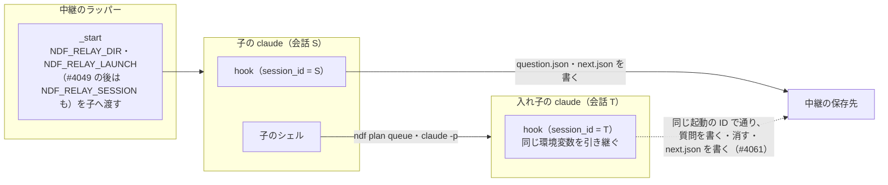
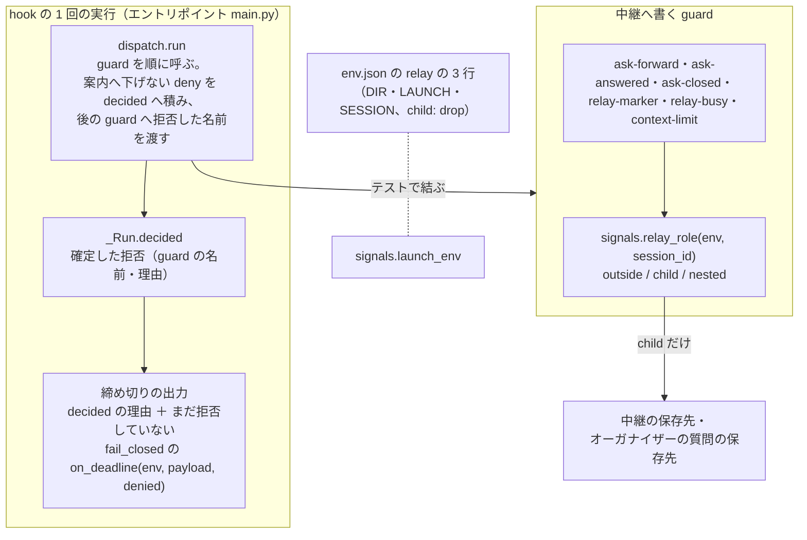
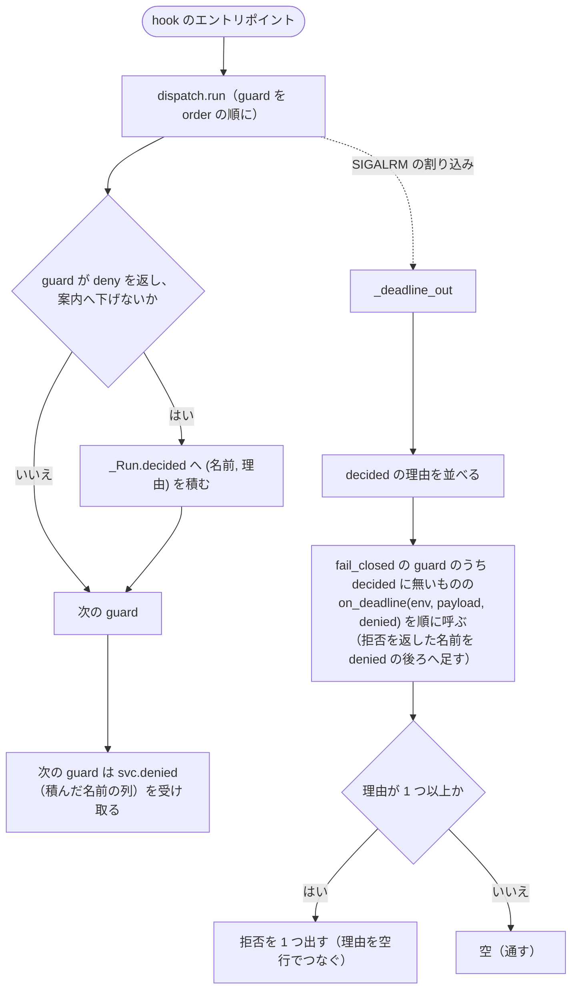
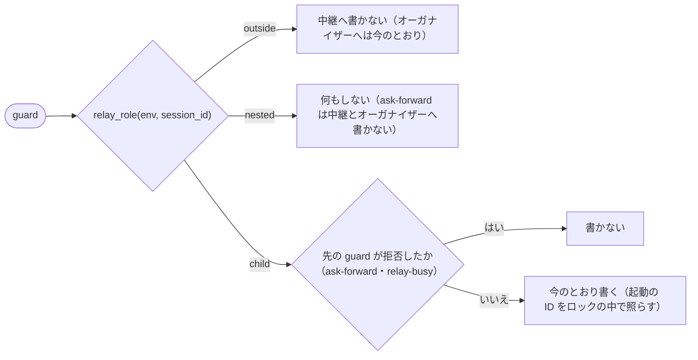

# 中継の hook: 子の会話だけが中継へ書き、中継の変数が契約にそろい、締め切りでも確定した拒否が残る（#4061 #4062 #4064）

中継の子のシェルから起動した別の claude（入れ子の claude）の hook が親のラッパーの質問を書き・消し、中継の変数が環境変数の契約に載らず、hook が締め切りで打ち切られると先に確定した拒否が失われていた。hook が子の会話かを #4049 の会話の ID の照らしで 1 つの関数に決めさせ、中継の 3 つの変数を契約に載せて子へ渡す名前とテストで結び、dispatch が確定した拒否をエントリポイントの記録へ積んで締め切りの出力と後の guard へ渡す。採らなかった案は「決定の記録」に、#4049・#3995 との境界は決定 7、実装の置き場は決定 8 にある。

## 今の姿

何が起きたか・受け入れ条件は要求仕様（[issue-4061-4062-4064-requirements.md](./issue-4061-4062-4064-requirements.md)、正は各課題の本文）にある。この文書は「どう解くか」と「なぜその解き方か」だけを書く。パスは `plugins/ndf/` からの相対で書く。

**3 つを 1 本にまとめた理由**: どれも hook の guard が「自分が何に対して書いてよいか」を入力から決められないことが原因である。#4061 は会話を、#4064 は先の guard の判定を知らない。#4062 は #4061 が頼る環境変数の契約の載せ漏れである。直すファイル（`hooks/guards/ask.py`・#4049 の `relay_busy.py`・`relay/signals.py`）も重なる。

設計に要る今の構造（main の `1c0b79b3e` で読んだ）:

| 部品 | 今の振る舞い | 場所 |
| --- | --- | --- |
| 中継の対象の判定 | hook は `NDF_RELAY_DIR` がディレクトリなら中継の下とする（`signals.relay_dir`）。止めた前の起動は `NDF_RELAY_LAUNCH` と `launch.json` を照らして外す（#3814）が、入れ子の claude は同じ起動の ID を持つので通る | `relay/signals.py` |
| 中継の保存先へ書く guard | `ask-forward`（質問を書く・オーガナイザーへも書く）・`ask-closed`（閉じた質問を消す）・`ask-answered`（答えた質問を消す）・`relay-marker`（`next.json`）。`context-limit` は中継の下かで案内の文を変える | `hooks/guards/ask.py`・`ask_clear.py`・`relay_mark.py`・`context_limit.py` |
| #4049 の見分け（設計済み・未実装） | ラッパーが子の会話の ID を `NDF_RELAY_SESSION` で渡し、`relay-busy` の `_target(env, session_id)` が入力の `session_id` と照らす。背景の作業の記録だけに使う | `issues/issue-4049-design.md` の決定 3 |
| 子の環境の組み立て | `session_env.child_env` が環境変数の契約の `child` の列（`drop`・`set`）で作り、ラッパーがその後に `signals.launch_env` の 2 つを重ねる。`ndf plan` の `claude -p` は `adapters/run_log.child_process_env`（今の環境の写し）で起動し、契約の列を通らない | `relay/session_env.py`・`relay/wrapper.py` の `_start`・`adapters/claude.py` |
| 環境変数の契約 | `NDF_RELAY_DIR` の行はあり、`NDF_RELAY_LAUNCH` の行は無い。載せ漏れを落とす検査は無い | `contracts/domains/env.json` |
| dispatch | guard を `order` の順に呼び、判定を 1 つにまとめる。`fail_closed` でない `deny` は同じ拒否を数えて案内へ下げる。後の guard は先の判定を受け取らない | `hooks/dispatch.py` の `run` |
| 締め切りの出力 | エントリポイントが `SIGALRM` の割り込み（`_Deadline`）を受けると、`fail_closed` の guard の `on_deadline(env, payload)` だけで出力を作る。`dispatch.run` が確定した判定は捨てる | `hooks/main.py` の `run_entry`・`_deadline_out` |

## 文脈と制約

- hook の入力の `session_id` は、サブエージェントの中の hook でも親の会話と同じで、`claude -p` で起動した別の claude では違う（#4049 の設計の「文脈と制約」。2026-11-22 に Claude Code 2.1.330 で実測）。`--resume` で起動し直した子は前の起動と同じ `session_id` を持つ
- hook の経路は `ndf.contracts` を import しない（`signals.py` の冒頭・決定 111）。環境変数の名前は文字列の定数で持つ
- hook のプロセスの締め切りは `SIGALRM` の割り込み（`_Deadline` は `BaseException`）で、guard の実行の途中に来る。割り込まれた guard の判定は分からない
- 入れ子の claude を起動する経路は `ndf plan`（`adapters/claude.py`）・`ndf supervise`・利用者や `external-ai` の `claude -p` と散らばり、NDF の外の経路もある
- lracct（#3604・#3864）の設計の問い 11 は、`ndf plan` の `claude -p` の子から中継の変数を外すかを「hook が何を書くかは確かめていない」ので変えないとし、確かめた結果で別の課題にするとした（要求仕様の「何が起きたか」の表がその確かめ）
- 普及のフェーズの前で、互換の経路を持たない（MVV 版 11 の Value 4）

## 解き方の全体像

- hook が中継へ書くかは、`signals.relay_role` だけが決める。`NDF_RELAY_DIR` が無ければ中継の外、あって入力の `session_id` が `NDF_RELAY_SESSION` と同じなら子の会話、ほかは入れ子の claude である。止めた前の起動を外す仕組みは今のとおりで、ファイルごとに違う（「データ構造」の「止めた前の起動への保証」）
- 中継へ書く 6 つの guard はどれもこの関数を使い、入れ子の claude では中継の保存先とオーガナイザーの質問の保存先に触れない
- 環境変数の契約に中継の 3 つの変数があり、どれも `child: drop`（子へは受け継いだ値を渡さず、ラッパーが自分の値を入れ直す）である。ラッパーが子へ渡す名前と契約の行はテストで結ばれる
- dispatch は案内へ下げない拒否をエントリポイントの記録へ積み、後の guard と `on_deadline` へ拒否した guard の名前を渡す。締め切りで打ち切られても、積んだ拒否が出力に残る。`ask-forward` と `relay-busy` は、先に拒否された呼び出しでは中継へ書かない

## データ構造

### 環境変数の契約の 3 行（`contracts/domains/env.json`）

| `id` | `area` | `set_by` | `type` | `child` | `meaning`（書き手・読み手を含む） |
| --- | --- | --- | --- | --- | --- |
| `NDF_RELAY_DIR` | relay | ndf | path | drop | 中継のラッパーが子のセッションへ渡すセグメントのやり取りの保存先。ラッパーが `launch_env` で入れ、子の会話の hook が次のセグメントのマーカー・質問・背景の作業の記録をここへ書く。無ければ中継の外。受け継いだ値は子へ渡さない（ラッパーが自分の値を入れ直す） |
| `NDF_RELAY_LAUNCH` | relay | ndf | string | drop | 中継のラッパーが子を起動するたびに作る起動の ID（32 桁の 16 進）。ラッパーが `launch_env` で入れ、`launch.json` にも書く。hook が質問と背景の作業の記録を書く・消すとき、`launch.json` と照らして止めた前の起動を外す（#3814）。受け継いだ値は子へ渡さない |
| `NDF_RELAY_SESSION` | relay | ndf | string | drop | 中継のラッパーが子へ渡す子の会話の ID。ラッパーが `launch_env` で入れる。hook は入力の `session_id` がこれと同じ会話だけを子の会話として中継へ書き、違う会話（入れ子の claude）と、これが無い会話は中継へ書かない（#4049・#4061）。受け継いだ値は子へ渡さない |

`NDF_RELAY_SESSION` の行は #4049 が足す。この設計はその行の `child` と `meaning` を上の形にする。

### 中継の中での会話の役割（`signals.relay_role` の返り）

| 値 | 条件 | 中継の保存先 | オーガナイザーの質問の保存先 |
| --- | --- | --- | --- |
| `outside` | `NDF_RELAY_DIR` が無いか空 | 書かない | 今のとおり（`NDF_ORGANIZER_DIR`・`NDF_ORGANIZER_LANE` があれば書く） |
| `child` | `NDF_RELAY_DIR` が空でなく、`NDF_RELAY_SESSION` が空でなく、入力の `session_id` と同じ | 書く（起動の ID の照らしは今のとおり） | 書く |
| `nested` | `NDF_RELAY_DIR` が空でなく、上に当たらない（`NDF_RELAY_SESSION` が無い・空・違う。`session_id` が文字列でない） | 書かない・消さない | 書かない（中継の変数が残る会話は、`NDF_RELAY_SESSION` の有無に依らず両方へ書かない） |

保存先がディレクトリとして見えるかは役割に入れない（#4049 の決定 3 と同じ。保存先が消えた子を中継の外と取り違えない）。書く側は今のとおり `relay_dir` で保存先を開き、開けなければ書けないとして扱う。`child` で保存先が開けないとき、`ask-forward` は質問を拒否し（今は中継の外として通し、オーガナイザーと知らせへ回す）、オーガナイザーと知らせにも書かない。`on_deadline` も拒否する。`relay-busy` は #4049 のとおり作業の開始を拒否する。

### 止めた前の起動への保証（変えない）

| ファイル | 止めた前の起動の hook を外す仕組み | この設計での扱い |
| --- | --- | --- |
| `question.json` | `question.json.lock` の中で `launch.json` と起動の ID を照らす（`write_question`・`drop_question`）。起動の ID が無ければ消さない | 変えない。`ask-forward` の `on_deadline` の消す処理も、起動の ID が無ければ消さない（今の `drop_question` は `launch=None` で照らしを省くので、`on_deadline` の側で呼ばない） |
| `busy-<起動>.json` | 起動ごとのファイルなので、前の起動の hook は前の起動のファイルにしか書けない。開始の記録は子を止める排他の中で今の起動を照らす（#4049） | 変えない |
| `next.json` | 照らさない（`next.json.lock` の中で書き、ラッパーは会話の ID だけを照らす） | 変えない。止めた前の起動の Stop が遅れてマーカーを書く余地は今と同じに残る（範囲の外。「影響と危険」の範囲の外の行） |

### エントリポイントの記録の確定した拒否（`_Run.decided`）

| 項目 | 型 | 意味 |
| --- | --- | --- |
| 要素 | `(name: str, reason: str)` の組 | 案内へ下げないと決まった `deny` を返した guard の名前と理由。`order` の順に積む。**積み終えた時点を「確定」とする**（数え手が回数を増やした後でも、積む前に割り込まれた拒否は確定していない） |

計測の 1 行（`record`）には、締め切りの出力が引き継いだ guard の名前の列を `carried` として書く（締め切りで終わった実行だけ）。

## 処理の流れ

中継へ書く guard の頭の判定:

## 決定の記録

### 決定 1: 入れ子の claude を漏れなく外すため、hook の側で入力の `session_id` を `NDF_RELAY_SESSION` と照らし、中継へ書く 6 つの guard が 1 つの関数を使う

- **質問**: 入れ子の claude の hook を、起動する側で止めるか、hook の側で見分けるか。見分けるなら #4049 の見分け方とどう関係させるか
- **選んだ案**: hook の側で見分ける。#4049 の `relay_busy._target` を `signals.relay_role(env, session_id)` へ移して 3 つの値（`outside`・`child`・`nested`）を返す形にし、`ask-forward`・`ask-answered`・`ask-closed`・`relay-marker`・`relay-busy`・`context-limit` がどれもこれで頭を決める。`nested` では中継の保存先にもオーガナイザーの質問の保存先にも触れない。`context-limit` は `child` だけを中継の下として案内する。同じ仕組み（#4049 の会話の ID）に寄せ、別の仕組みを置かない
- 採らなかった案: 入れ子の claude を起動する側（`ndf plan`・`ndf supervise`・`external-ai`）が中継の変数を外す（起動する経路がコマンドごとに散らばり、利用者が打つ `claude -p` は NDF の外にある。1 つでも外し忘れると親の質問を消す。#4049 の決定 3 と同じ理由）
- 採らなかった案: guard ごとに `session_id` を照らす（同じ規則を 6 か所に写し、1 か所の照らし忘れで漏れる）
- 採らなかった案: 起動の ID を会話ごとにする（`--resume` で起動し直した子は同じ会話の ID を持つので、止めた前の起動を見分けられなくなる。決定 2）
- **代償**: 入れ子の claude の質問は中継にもオーガナイザーにも回らず、入れ子の claude の画面に出るだけになる（当たるのは AskUserQuestion を出す入れ子の claude だけである）。中継の外のオーガナイザー（`NDF_ORGANIZER_DIR` だけがある外のサービス）の下の入れ子の claude は見分けられず、今のとおりオーガナイザーへ書く（範囲の外。中継の変数が無いと会話を見分ける材料が無い）
- 根拠: Value 7「不具合は根本原因の場所で直され、形を変えて戻ってこない。直す場所が現象の場所と違うときは、共通の層へ寄せてから設計される」・Value 3「人の回答は失われず」（MVV 版 11）

### 決定 2: 2 つの「別人」を取り違えないため、会話の ID は入れ子の claude を、起動の ID は止めた前の起動を外す役に分け、どちらも残す

- **質問**: #4062 の本文は `NDF_RELAY_LAUNCH` を「使わないなら消す」とする。会話の ID があれば起動の ID は要らないか
- **選んだ案**: 残す。会話の ID（`NDF_RELAY_SESSION` と入力の `session_id`）は「同じ環境変数を持つ別の会話」を外し、起動の ID（`NDF_RELAY_LAUNCH` と `launch.json`）は「同じ会話の止めた前の起動」を外す。`--resume` で起動し直した子は前の起動と同じ会話の ID を持つので、止めた子の遅れた hook は会話の ID だけでは外せない（#3814 の I7）。照らす順は、役割（ロックの外、環境変数と入力の比べだけ）→ 起動の ID（書く時点のロックの中）
- 採らなかった案: 起動の ID を消して会話の ID だけにする（止めた子の遅れた hook が次の起動の質問を書く・消す #3814 の不具合が戻る）
- 採らなかった案: 2 つを 1 つの値（会話の ID と起動の ID の組）にまとめる（`launch.json` の照らしとロックの約束を作り直すことになり、得るものが無い）
- **代償**: 中継の変数が 3 つになる（`DIR`・`LAUNCH`・`SESSION`）。役割は契約の `meaning` に書く
- 根拠: Value 8「同じ事実を 2 か所に持たない」（2 つは別の事実である）・Value 3（MVV 版 11）

### 決定 3: 互換の経路を持たないため、子の会話の ID を受け取らない会話は中継の外ではなく「入れ子」として扱い、中継へ書かない

- **質問**: `NDF_RELAY_DIR` はあるが `NDF_RELAY_SESSION` が無い会話（#4049 より前のラッパーの下で、この変更の後の hook が動く）をどう扱うか
- **選んだ案**: `nested` として扱い、中継の保存先とオーガナイザーの質問の保存先に触れない。ラッパーは `/exit` で打ち直せば新しいコードになる（`relay.md` の「変更が効く時点」）。この課題は #4049 の後のリリースに載るので、#4049 を入れたラッパーの下では起こらない
- 採らなかった案: `NDF_RELAY_SESSION` が無ければ今のとおり起動の ID だけで書く（旧いラッパーのための互換の経路で、入れ子の claude を見分けられないまま残る）
- **代償**: #4049 より前のラッパーを打ち直さずに使い続ける利用者は、子の質問が中継とオーガナイザーへ回らず、子の画面で答えることになる。次のセグメントのマーカーも書かれず、ラッパーはセグメントを切り替えない。リリースの時点で、版上げの PR の `CHANGELOG.md` に「ラッパーを `/exit` で打ち直す」と書く（`release` の工程が書く。実装の PR の触るファイルには入れない）
- 根拠: Value 4「普及のフェーズに入るまで、後方互換は求めない」（MVV 版 11）

### 決定 4: 中継の変数の契約を正しく持ち、載せ漏れを落とすため、3 行を `child: drop` で載せ、ラッパーが子へ渡す名前と契約の行をテストで結ぶ

- **質問**: `NDF_RELAY_LAUNCH` をどう載せるか。子への渡し方（`child` の列）を何にするか。載せ漏れをどう防ぐか
- **選んだ案**: 「データ構造」の 3 行にする。`child` は 3 つとも `drop` で、`session_env.child_env` は受け継いだ値を外し、ラッパーの `_start` がその後に `launch_env` で自分の値を入れる（今の組み立ての順のまま）。テストは `signals.launch_env` が返す名前の集まりが、契約の `area` が `relay`・`set_by` が `ndf`・`child` が `drop` の行の名前の集まりと等しいことを確かめる（部分集合でなく等しさにして、ラッパーが入れ直さない `drop` の中継の行も落とす。hook の経路は契約を import しないので、名前は `signals` の定数が持ち、テストで結ぶ）。生成文書 `docs/contracts/env.md` は `ndf check --write-spec` で作り直す
- 採らなかった案: `child` を空のまま（「そのまま渡す」）にする（ラッパーは自分の値で上書きするので、表の記述が振る舞いと食い違う。リレーハブが中継の子の会話（オーガナイザーなど）から別のラッパーを起動するとき、起動した会話の中継の 3 つの値が新しいラッパーのプロセスの環境に残る）
- 採らなかった案: `child` を `set` にする（`set` は `session_env._set_values` が値を持つ変数の約束で、ラッパーの起動ごとの値は `session_env` から作れない）
- 採らなかった案: コードが読む環境変数の名前をすべて契約と照らす検査を足す（hook の経路の文字列の定数と `os.environ.get` の呼び出しを静的に拾うことになり、契約に無い名前が今 20 件ほどある（「影響と危険」の範囲の外の行）。この課題の範囲を越える）
- 採らなかった案: `ndf plan` の `claude -p` の環境から中継の変数を外す（lracct の問い 11。`adapters/claude.py` は契約の列を通らず、外す経路を足すと決定 1 で採らなかった「起動する側で外す」になる。hook の側の見分けで足りる）
- **代償**: `drop` を当てるのは `session_env.child_env` が中で呼ぶ `tool_env` で、`tool_env` を通る起動（ラッパーの子・リレーハブが起動するラッパー・中継が打つ `claude plugin` のコマンド）にだけ効き、`ndf plan`・`ndf supervise`・利用者の `claude -p` には効かない。入れ子の claude を外すのは決定 1 の hook の側の見分けで、`drop` は契約の記述を振る舞いに合わせるためである
- 根拠: Value 8「業務の規則は、コードだけでなくデータの制約でも守られる」・Value 3「判断の要らない手順は仕組みが進める」（MVV 版 11）

### 決定 5: 締め切りで確定した拒否を失わないため、dispatch が案内へ下げない拒否をエントリポイントの記録へ積み、締め切りの出力がそれを出す

- **質問**: 締め切りの割り込みで打ち切られた実行で、割り込みの前に決まった判定をどう出力へ渡すか
- **選んだ案**: エントリポイントの `_Run` に `decided`（`(名前, 理由)` の列）を持たせ、`dispatch.run` へ渡す。`dispatch.run` は guard を呼び、`fail_closed` でない `deny` は同じ拒否を数えた後に案内へ下げないと決まったものだけ、`fail_closed` の `deny` はそのまま、`decided` へ積む。`_deadline_out` は `decided` の理由を先に並べ、`fail_closed` の guard のうち `decided` に名前が無いものの `on_deadline` を呼び、理由が 1 つ以上あれば 1 つの拒否として出す。計測の行に `carried`（引き継いだ名前）を書く
- 採らなかった案: 締め切りで `dispatch.run` の途中の `Outcome` を丸ごと引き継ぐ（変更要求の数え（`allow_pushback`）は `run` の終わりで行うので、途中の `Outcome` には数える前の変更要求が混ざる）
- 採らなかった案: 締め切りの出力で、`fail_closed` でない guard も `on_deadline` で呼び直す（締め切りを過ぎた後に guard を呼ぶことになり、`fail_closed` でない guard の「締め切りでは通す」約束を壊す）
- 採らなかった案: 締め切りを伸ばす（割り込まれる限り同じ問題が残る）
- **代償**: `dispatch.run` にキーワード引数が 1 つ増える。割り込みが guard の返りと積む処理の間（数え手の `allow_deny` の中を含む）に来ると、その 1 件は積まれない（`fail_closed` の guard は `on_deadline` で拾われ、`fail_closed` でない guard は今のとおり通す）。このとき数え手が増やした回数は戻さない（回数は残り、次の同じ拒否が 1 回早く案内へ下がりうる）。締め切りで通る呼び出しは、この短い区間と、割り込まれた guard 自身の判定だけになる
- 根拠: Value 3「同じ手順は毎回同じ結果になる」（同じ呼び出しが締め切りの有無で止まったり通ったりしない）・Value 7（MVV 版 11）

### 決定 6: 先に拒否された呼び出しで後の guard が副作用を起こさないため、拒否した guard の名前を後の guard と `on_deadline` へ渡し、`ask-forward` と `relay-busy` が書かない

- **質問**: 後の guard に、先の guard の拒否を何の形で渡すか。どの guard が使うか
- **選んだ案**: guard へ渡す部品（`GuardServices`）に `denied`（それまでに `decided` へ積んだ guard の名前のタプル）を足し、`fail_closed` の guard の `on_deadline` を `on_deadline(env, payload, denied)` にする。締め切りの経路の `denied` は `decided` の名前から始め、先に呼んだ `on_deadline` が拒否を返すたびにその名前を後ろへ足す（通常の dispatch で `fail_closed` の拒否を積んでから次の guard を呼ぶのと同じ範囲にし、「先に拒否した guard」を経路で変えない）。理由の文は渡さない（後の guard が要るのは拒否されたかだけで、文で分岐させない）。`ask-forward` は `denied` が空でなければ中継・オーガナイザー・知らせのどれにも書かずに通す（呼び出しは先の拒否で止まる）。`relay-busy`（#4049）は `denied` が空でなければ背景の作業の記録を書かずに通し、`on_deadline` も None を返す。ほかの guard は `denied` を使わない
- 採らなかった案: 判定（`Verdict`）の列を渡す（案内・変更要求も渡ると、後の guard がそれで分岐しうる。拒否の有無に絞る）
- 採らなかった案: 拒否が確定したら後の guard を呼ばない（`fail_closed` の guard は締め切りを過ぎても呼ぶ約束で、計測の `guards` の列も変わる。呼ばれない guard の副作用を考えるより、呼んで書かないほうが約束が少ない）
- **代償**: `on_deadline` の引数が変わり、今の `ask.on_deadline` と #4049 の `relay_busy.on_deadline` を合わせて直す。#4049 の決定 2 の「先の guard が拒否した呼び出しにも書く（多めに倒す）」は、この課題の実装の後に成り立たなくなる（記録を書かないほうへ直る）
- 根拠: Value 7「形を変えて戻ってこない」（先の拒否を知らない副作用の不具合を 1 つの約束で閉じる）・Value 8（MVV 版 11）

### 決定 7: 重なる設計と矛盾しないため、#4049・#3995 との境界をこう置く

- **質問**: #4049 の会話の見分けと背景の作業の記録、#3995 の決定 6 と、この設計はどこで接するか
- **選んだ案**:

| 重なる設計 | その設計が決めたこと | この設計との境界 |
| --- | --- | --- |
| #4049 の決定 3 | `NDF_RELAY_SESSION` を足し、`relay-busy` の `_target` で子の会話だけが `busy-<起動>.json` を書く。入れ子の claude は同じ環境変数を引き継ぐ前提 | 同じ仕組みに寄せる。`_target` を `signals.relay_role` へ移し、`ask-forward`・`ask-answered`・`ask-closed`・`relay-marker`・`context-limit` も使う。会話の ID は入れ子の claude を、起動の ID は止めた前の起動を外す（決定 2）。`NDF_RELAY_SESSION` の行の `child` を `drop` にする（決定 4） |
| #4049 の決定 2 の代償 | 先の guard が拒否した開始にも「1 件以上」を書く。締め切りの出力が先の拒否を引き継がないのは #3995 の決定 6 と同じで変えない | この設計が変える。`relay-busy` は `denied` があれば書かず、締め切りの出力は確定した拒否を出す（決定 5・6）。#4049 の実装はその設計のまま行い、この課題の実装で直す |
| #3995 の決定 6 | `context-limit` の拒否を数えず止め続ける（`deny_key: none`）。`fail_closed` は偽のまま。締め切りの出力が `dispatch.run` の結果を引き継がないのは「今もそうで、この変更は変えない」 | `context-limit` の `deny_key`・`fail_closed` は変えない。締め切りの出力は、この課題の後に `context-limit` の確定した拒否も出す（「判定が失われるのはその 1 回だけ」の代償は、決定 5 の代償の短い区間だけに縮む）。`deny_key: none` の拒否を数えずに積む振る舞いは #3995 の実装の分岐に頼る（#3995 の後に実装するため）。`context-limit` を `fail_closed` にしない（#3995 の採らなかった案のとおり、締め切りの後に呼ばない） |
| #3814 | 止めた前の起動の hook は今の起動の質問を書かない・消さない | 変えない。ロックの中の起動の ID の照らしを残す |

- 採らなかった案: #4049 の `_target` を `relay_busy` に残し、この課題で別の関数を足す（同じ規則が 2 か所になる）
- **代償**: #4049 の実装の PR が足す `relay_busy._target` と `on_deadline(env, payload)` は、この課題の実装の PR で移し・直す（一度書いて直す手間）。#4049 の設計を今書き換えないのは、#4049 の設計承認ゲートを開き直さないためである
- 根拠: Value 9「1 つのモジュール・関数が 1 つの責務を持つ」・Value 8（MVV 版 11）

### 決定 8: 重なるファイルの rebase を減らすため、実装は #4049 の後に 2 本の PR で置き、#4061・#4062 を先、#4064 を後にする

- **質問**: 3 課題の実装を、#3995 → lracct → #4049 → #4068 の順のどこに置くか
- **選んだ案**: #4049 のマージの後に置く（`NDF_RELAY_SESSION` と `relay-busy` を前提にする）。PR は 2 本で、1 本目が #4061・#4062、2 本目が #4064。2 本は `hooks/guards/ask.py`・`relay_busy.py` を共に触るので 1 本目のマージの後に 2 本目を出す。#4068 とは `relay/signals.py` だけが重なり（#4068 は起こす hook の記録、この課題は `relay_role`。別の関数）、並べてよい。実装の前に `gh pr list` の触るファイルで打ち直す

| 順 | 課題 | 重なるファイル（この課題が触るもの） |
| --- | --- | --- |
| 1 | #3995 | `hooks/dispatch.py`・`hooks/guards/context_limit.py`・`contracts/domains/env.json`・`contracts/hooks/guards.json`・`docs/contracts/env.md` |
| 2 | lracct（#3604・#3864） | `contracts/domains/env.json`（`child` の列に `account-set`・`account-drop` を足す）・`relay/session_env.py`（この課題は触らない）・`docs/contracts/env.md` |
| 3 | #4049 | `relay/signals.py`・`hooks/guards/relay_mark.py`・`relay_busy.py`（新設）・`contracts/domains/env.json`・`contracts/hooks/guards.json`・`relay.md`・`docs/contracts/env.md`・`hooks.md` |
| 4 | #4068 | `relay/signals.py` |
| 4 と並べる | #4061・#4062（1 本目） | 上の 1〜4 と重なる。#4049 の後 |
| 1 本目の後 | #4064（2 本目） | `hooks/main.py`・`hooks/dispatch.py`・`hooks/guards/ask.py`・`relay_busy.py` |

- 採らなかった案: 3 課題を 1 本の PR にする（#4064 はエントリポイントと dispatch の契約で、中継の見分けとレビューの観点が違う。1 本だと差分が 600 行を越えうる）
- 採らなかった案: #4064 を #4049 より前に置く（`relay-busy` が無いので決定 6 の半分を後で足し直す）
- **代償**: #4049 のマージを待つ。待つ間はほかのレーンの設計を進める（#4069 の方針）
- 根拠: Value 5「並べられる作業は並べて進め、待つだけで止まらない」・Value 2（rebase と衝突の手直しに費用を使わない）（MVV 版 11）

### 決定 9: 利用者の全体の設計方針（#4069）に照らし、この設計は文脈とリソースの方針を変えず、待ちの誤りを減らす側に働く

- **質問**: #4069 の方針（文脈の再利用・最適な文脈量・キャッシュ・リソースを使い切る・処理待ちを作らない・空いた時間にやること）に合うか
- **選んだ案**: 合う。照らし合わせは次のとおりで、合わない部分は無い

| 方針 | この設計での扱い |
| --- | --- |
| 処理待ちを作らない | 入れ子の claude が `next.json` を書くとラッパーが子を次のセグメントへ切り替え、`ask-closed` が質問を消すとオーガナイザーが答えを待つ相手を失う。どちらも待ちの誤りで、決定 1 が無くす |
| リソースを使い切る | `ndf plan queue` の worker・`claude -p` を子のシェルで並べても、親のラッパーの状態を壊さない。並べる数の上限は変えない |
| 最適な文脈量・キャッシュ | 変えない。締め切りの出力が `context-limit` の確定した拒否を出すので、運用上限を超えた会話が締め切りで通るのは決定 5 の代償の短い区間だけになる（#3995 の方針を強める） |
| 文脈の再利用・空いた時間にやること | 当たらない（#4071・#4050 が持つ） |

- 採らなかった案: 無し（照らし合わせだけの決定）
- **代償**: 無し
- 根拠: Value 5（MVV 版 11）

## 影響と危険

- **働く範囲**: 利用先のリポジトリでも働く（NDF のプラグインの hook と中継のラッパー）。決定 1〜4 は中継の下の Claude Code の会話だけ、決定 5・6 は hook の締め切りで打ち切られた実行と、先の guard が拒否した呼び出しだけで振る舞いが変わる
- **プロジェクトごとに違うもの**: 無い。設定も引数も足さない
- **当たるモード**: すべてのモード
- **壊れうる箇所**:
  - 入れ子の claude の質問は中継とオーガナイザーへ回らない（決定 1 の代償）
  - #4049 より前のラッパーを打ち直さない利用者は、子の質問とセグメントの切り替えが中継へ届かない（決定 3 の代償）。リリースの時点で知らせる
  - 締め切りで打ち切られた呼び出しが、今まで通っていたのに拒否される（確定した `context-limit`・`full-test`・`heredoc` などの拒否）。拒否の文は止める範囲と次の手を示すので、モデルは呼び直すか手を変える。同じ拒否を数える数え手（`allow_deny`）は今のとおり働き、案内へ下げた拒否は引き継がない
  - `on_deadline` の引数が 3 つになる。`on_deadline` を持つ guard は `ask-forward` と #4049 の `relay-busy` の 2 つで、どちらもこの課題の実装で直す。`_deadline_out` は 3 つの引数で呼ぶので、直し漏れは型の誤りでなく実行時の `TypeError` になり、`fail_closed` の例外として拒否へ倒れる（テストで縛る）
  - 同じファイルを触る別の変更は決定 8 の表にある
  - 子の会話で中継の保存先が開けないとき、`ask-forward` は今は中継の外として質問を通すが、この後は拒否する（「データ構造」の役割の表の下）
  - 範囲の外:
    - 中継の変数を持たない外のオーガナイザー（`NDF_ORGANIZER_DIR` だけ）の下の入れ子の claude は見分けない（決定 1 の代償）
    - 止めた前の起動の Stop が遅れて `next.json` を書く余地（今と同じ。「データ構造」の「止めた前の起動への保証」）
    - コードが読む環境変数のうち契約に無い名前（`NDF_RUN_ID`・`NDF_RUN_LOG`・`NDF_METRICS_DIR`・`NDF_WORKER_KIND` など。2026-11-22 に `grep -rhoE 'NDF_[A-Z_]*' plugins/ndf/src` と `env.json` の `id` を比べて 30 件ほどの差。定数の名前を含むので、環境変数かは 1 件ずつの確かめが要る）

### 代表のリポジトリでの振る舞い

| 代表のリポジトリ | 設定の要点 | 直した後に起きること | この種類で扱えなくなること |
| --- | --- | --- | --- |
| Web サービス（nd-factory） | 中継の下のレーンの conductor が `ndf plan queue` と supervisor を回し、子のシェルから `claude -p` を起動する | 入れ子の claude が子の回答待ちの質問を消さず、次のセグメントへ勝手に切り替えない。締め切りで打ち切られた `full-test` などの拒否が残る | 無し |
| モバイルアプリ | 同上 | 同上 | 無し |
| 業務文書だけ | 同上（入れ子の claude は少ない） | 同上。入れ子の claude を使わない会話は今と同じ | 無し |

### ai-plugins だけの事情

- 無し（hook とラッパーの既定の振る舞いを直すだけで、このリポジトリだけが置く設定は無い）

## 用語

| 用語 | 意味 | 用語集への反映 |
| --- | --- | --- |
| 子の会話 | 中継のラッパーが起動した claude の会話。hook の入力の `session_id` がラッパーの渡した `NDF_RELAY_SESSION` と同じ（サブエージェントの中の hook を含む） | 追加 |
| 入れ子の claude | 子のシェルから起動した別の claude。中継の環境変数を引き継ぐが `session_id` が違い、中継へ書かない | 追加 |
| 確定した拒否 | dispatch が guard を呼び終え、案内へ下げないと決めた `deny`。締め切りの出力と後の guard へ渡る | 追加 |

用語集（`docs/glossary/glossary.json`）への反映と `ndf records glossary render` は、この設計 Pull Request の範囲（`issues/issue-4061-4062-4064-*`）の外なので実装の Pull Request で行う。

## テスト設計

| 受け入れ条件 | どの振る舞いで縛るか | どう壊したら落ちるべきか |
| --- | --- | --- |
| 1・4 | 保存先に `launch.json`（起動 L）と子の質問（`tool_use_id` が Q）を置き、事象ごとに別の初期状態から hook のエントリポイントへ流す。入力は guard を実際に動かす形にする: AskUserQuestion の PreToolUse（`ask-forward`）、`tool_use_id` が Q の AskUserQuestion の PostToolUse（`ask-answered`）、Stop と UserPromptSubmit（`ask-closed`）、次のセグメントのブロックと `background_tasks`（作業 1 件のリスト）を持つ Stop（`relay-marker`）、`startup` の SessionStart と `run_in_background` が真の `ndf plan queue p.json` の Bash の PreToolUse（`relay-busy`）、運用上限を超えた会話の記録を持つ PreToolUse（`context-limit`）。環境は `NDF_RELAY_SESSION` が S で入力の `session_id` が T（入れ子）・`NDF_RELAY_SESSION` が無い・空の 3 つ。どれも保存先とオーガナイザーの保存先のファイルの一覧と中身が前後で変わらず（Q の質問が残る）、`context-limit` の拒否の文が中継の外の案内 | 照らしを guard のどれか 1 つで外す・`relay_dir` だけで判定する・SESSION が無いときに起動の ID だけで書くと落ちる |
| 2 | 同じ入力で `session_id` が S（`agent_id` つきを含む）なら、今のとおり書く・消す（Q が消える・`next.json` が書かれる・`busy-L.json` が書かれる・中継の案内） | 子の会話まで外すと落ちる |
| 3 | `session_id` が S で `NDF_RELAY_LAUNCH` が前の起動の ID の AskUserQuestion・PostToolUse・Stop を流すと、質問を書かず Q を消さない。`NDF_RELAY_LAUNCH` が無い `ask-forward` の締め切りでも Q を消さない | 起動の ID の照らしを消す・`launch=None` で消すと落ちる |
| 2（子の会話で保存先が無い） | `session_id` が S で `NDF_RELAY_DIR` の指すディレクトリが無い AskUserQuestion は拒否され、オーガナイザーの保存先と送信待ちが増えない。締め切りでも拒否 | 中継の外として通すと落ちる |
| 5 | 上の行を 6 つの guard の組み合わせのテストとして書く | — |
| 6・7 | `signals.launch_env(dir, launch, session)` の鍵の集まりが、`env.json` の `area` が relay・`set_by` が ndf・`child` が drop の行の `id` の集まりと等しい。`session_env.child_env` に 3 つの変数を入れた環境を渡すと、返りに 3 つが無い | 行を消す・`child` を外す・`launch_env` に名前を足すと落ちる |
| 8 | `ndf check --write-spec` の後の差分が無い（CI の既存のジョブ） | 生成文書を作り直さないと落ちる |
| 9 | `run_entry` へ `full-test` が拒否する Bash の PreToolUse を流し、`full-test` の後の guard の `check` で `_Deadline` を上げる差し替えを入れる。出力が `full-test` の理由の拒否で、計測の `carried` が `["full-test"]`。併合は、同じ事象に当たる `fail_closed` の差し替えの guard（`check` は通し、`on_deadline` が別の理由を返す）を足して、両方の理由を持つ拒否が 1 つだけ出ることで確かめる。`check` で拒否を確定した `fail_closed` の差し替えの guard の `on_deadline` は 0 回呼ばれる | 締め切りで `decided` を捨てる・確定した guard の `on_deadline` を呼び直すと落ちる |
| 10 | 割り込みの前に拒否が無い・案内へ下げた拒否だけ・変更要求だけ・案内だけの実行では、出力が `on_deadline` だけで決まる（今の出力と等しい） | 下げた拒否や変更要求・案内を引き継ぐと落ちる |
| 11 | 2 つの guard が順に拒否した後に呼ばれる guard の `svc.denied` と、`on_deadline` の第 3 引数が、拒否した順の名前のタプル。拒否が無ければ空のタプル。`carried` も同じ順。締め切りで `fail_closed` の差し替えの guard 2 つの `on_deadline` を呼び、先が拒否を返すと後の第 3 引数の末尾に先の名前が入り、先が None なら入らない | 渡さない・順を変える・理由の文を渡す・締め切りで全 `on_deadline` に同じ `denied` を渡すと落ちる |
| 12 | 子の会話の AskUserQuestion で、先の guard の拒否を積んだ後、(a) `ask-forward` の呼び出し前に割り込む、(b) 割り込まない、の 2 つを流す。どちらも `question.json`・`questions/<レーン>.json`・送信待ちが増えず、`ask.check` の書き込みは 0 回、`ask.on_deadline` は (a) で 1 回呼ばれて None を返し、出力は先の拒否の理由だけ | `denied` を見ない・`on_deadline` で消す処理に入ると落ちる |
| 13 | 子の会話の背景の Bash の開始で、先の guard（`heredoc`）の拒否を積んだ後、(a) `relay-busy` の呼び出し前に割り込む、(b) 割り込まない、の 2 つを流す。どちらも `busy-<起動>.json` が変わらず、出力は `heredoc` の理由だけ（`BUSY_START_FAILED` を含まない）。拒否が無ければ「1 件以上」が書かれる（#4049 のテストを直す） | `denied` を見ない・拒否が無くても書かないと落ちる |
| 14 | 上のどのテストも、時刻を差し替えるか `_Deadline` を上げる差し替えで割り込みを起こし、guard の呼ばれた回数と出力の中身で確かめる | — |

手順書（`relay.md` の hook の一覧と質問の hook の節）の直しは文言を突き合わせるテストを書かず、ドキュメントレビューで見る。

## どこを変えるか

詳細設計は [issue-4061-4062-4064-design-detail.md](./issue-4061-4062-4064-design-detail.md) にある（新設する関数 1（`signals.relay_role`）・シグネチャを変える関数 3（`dispatch.run`・`ask.on_deadline`・`relay_busy.on_deadline`）のため。`GuardServices` に項目が 1 つ増え、#4049 の `relay_busy._target` は `signals.relay_role` へ移して消す）。

## 設計の結果

| 課題 | 扱い | 統合先 | 触るファイル |
| --- | --- | --- | --- |
| #4061 | 実装する | — | `plugins/ndf/src/ndf/domains/relay/signals.py`、`plugins/ndf/src/ndf/domains/hooks/guards/ask.py`、`plugins/ndf/src/ndf/domains/hooks/guards/ask_clear.py`、`plugins/ndf/src/ndf/domains/hooks/guards/relay_mark.py`、`plugins/ndf/src/ndf/domains/hooks/guards/relay_busy.py`、`plugins/ndf/src/ndf/domains/hooks/guards/context_limit.py`、`plugins/ndf/skills/development-workflow/references/relay.md`、`docs/glossary/glossary.json`、`docs/glossary.md`、`plugins/ndf/tests/domains/hooks/test_guards.py`、`plugins/ndf/tests/domains/hooks/test_ask_clear.py`、`plugins/ndf/tests/domains/hooks/_hooks.py`、`plugins/ndf/tests/domains/relay/test_relay_parts.py` |
| #4062 | 実装する | — | `plugins/ndf/contracts/domains/env.json`、`plugins/ndf/docs/contracts/env.md`、`plugins/ndf/tests/domains/relay/test_relay_parts.py` |
| #4064 | 実装する | — | `plugins/ndf/src/ndf/domains/hooks/main.py`、`plugins/ndf/src/ndf/domains/hooks/dispatch.py`、`plugins/ndf/src/ndf/domains/hooks/guards/ask.py`、`plugins/ndf/src/ndf/domains/hooks/guards/relay_busy.py`、`plugins/ndf/contracts/hooks/guards.json`、`plugins/ndf/docs/contracts/hooks.md`、`plugins/ndf/tests/domains/hooks/test_dispatch.py`、`plugins/ndf/tests/domains/hooks/test_guards.py` |

## 未確認のまま残ること

| 項目 | 内容 |
| --- | --- |
| 入れ子の claude の質問の行き先 | 入れ子の対話の claude が AskUserQuestion を出したとき、画面にだけ出ることは実装の PR のテストで縛るが、利用者が気付けるかは実際の運用で見る。気付けない事例が出れば、オーガナイザーへ「入れ子の質問」として知らせる別の課題にする |

## 外部の調査

省く: 外部の製品・標準に依らない内部の約束（hook の入力の `session_id` と NDF の環境変数・hook のエントリポイントと dispatch の間の契約）の直しで、Claude Code の hook の入力の形は #4049 の設計の外部の調査（PRD1）と実測を使う
