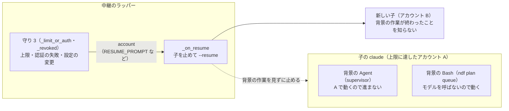
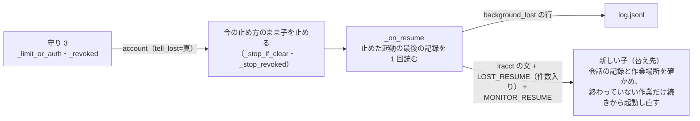
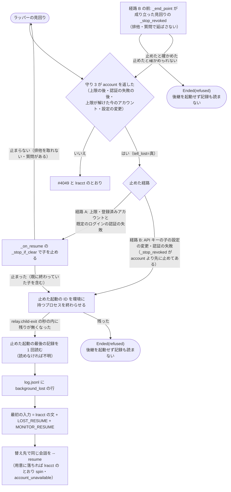

# 中継のラッパー: 利用上限でアカウントを替えた会話が、替えで終わった背景の作業を知って続きから起動し直す（#4063）

中継のラッパーは、利用上限か認証の失敗で停まった子を別のアカウントで起動し直す（lracct の守り 3）とき、背景の supervisor や `ndf plan queue` も子と一緒に終わらせ、起動し直した会話はそれを知らずに終わりの知らせを待ち続けうる。守り 3 は背景の作業を待たずに替え、子が止まった後に #4049 の背景の作業の記録を 1 回だけ読み、起動し直した会話の最初の入力へ「背景の作業と監視（止める前の記録で作業 N 件・監視 M 件。0 件でも確かめる）は替えで終わった。替えの直前まで待っていたもののうち、成果を確かめて終わっていないものだけ続きから起動し直す（キューは元の呼び出しをそのまま、`--resume` を足して打ち直す）」を足し、件数の目安を `log.jsonl` に残す。待つ案（上限が解けるまで・作業が終わるまで・背景の Bash だけ）と替える前に文脈を書かせる案を採らなかった理由は「決定の記録」に、調べた製品は「外部の調査」にある。

## 今の姿

何が起きたか・目的・受け入れ条件は要求仕様（[issue-4063-requirements.md](./issue-4063-requirements.md)、正は #4063 の本文）にある。この文書は「どう解くか」と「なぜその解き方か」だけを書く。パスは `plugins/ndf/` からの相対で書く。

設計に要る今の構造（lracct と #4049 は設計がマージ済みで実装の前。下はその設計の形）:

| 部品 | 振る舞い | 場所 |
| --- | --- | --- |
| 守り 3 の手 | 上限の後（`after_limit` が `switch`）・認証の失敗の後（`auth_pick` が `switch`）に `Step("account", …)` を返す。最初の入力は `RESUME_PROMPT`（「利用上限でアカウントを替えた。中断したところから続ける」）か `AUTH_RESUME_PROMPT`。上限が解けた今のアカウントも `after_limit` が返し、同じ認証で `--resume` する。API キーの子の設定の変更は `_revoked` が `account` を返す | `src/ndf/domains/relay/switch_decide.py` の `_limit_or_auth`・`_revoked`（lracct の詳細設計の 634・633 行目） |
| 子を止める | `_on_resume` が `_stop_if_clear` で子を止め（排他を取れない・質問があれば次の見回りへ送る）、同じ会話を `--resume` と最初の入力で起動する。API キーの子の設定の変更と認証の失敗は、止める条件 `_end_point` が成り立った見回りで `_stop_revoked` が先に止める（排他・質問で延ばさず、止めたと確かめられなければ後継を起動せず `Ended("refused")`） | `src/ndf/domains/relay/wrapper.py` |
| 背景の作業の記録 | `busy-<起動の ID>.json` に作業の件数 `count` と監視の件数 `monitors` を、子の会話の hook が SessionStart・作業の開始・Stop で書く。`signals.read_busy` が `(count, source, at, monitors)` か None（不明）を返す | #4049 の設計の「データ構造」・詳細設計の `read_busy` |
| 子を止める直前の読み直し | `Step.busy` が `"zero"`（作業 0 件のときだけ止める）・`"not_running"`（0 件か不明のときだけ止める）なら、`_stop_if_clear` が子を止める排他（`question.json.lock`）の中で読み直す。`busy` のある手は `needs_background` が見回りで記録を読ませ、`_act` は終わりの時刻を書かない。守り 3 の `account` は `busy` が None で読み直さない。子を起動するたびに、今の起動のもの以外の記録を消す | #4049 の詳細設計の `Step.busy`・`needs_background`・`_act`・`_stop_if_clear` |
| 監視の張り直しの文 | `MONITOR_RESUME`（「背景の監視（…）は替えで終わった。張っていた監視は、直前に受けたカーソル（…）から張り直してから待つ」）。守り 1 の替えにだけ足す | #4049 の決定 9 |

## 文脈と制約

- **上限に達した子は、モデルを呼べない。** 背景の Agent も子のプロセスの中で同じアカウントの認証で動くので進まない。背景の Bash はモデルを呼ばないので動き、`ndf plan` の worker の `claude -p` は上限に当たると替え先のアカウントで打ち直す（lracct の決定 9）
- **API の失敗で終わった応答では Stop が発火せず、StopFailure が発火する**（外部の調査の PRD1。`rate_limit`・`authentication_failed` を種類に持つ）。上限に達した後に背景の作業が終わり、その知らせで子が応答を始めても、応答は失敗して Stop は来ない。#4049 の記録は上限の後に減らず、作業が終わっても 1 件以上のまま残りうる
- **子を止めると背景の Agent は子と一緒に終わり、起動し直した会話へ終わりの知らせは届かない**（#4049 の文脈と制約）。会話の記録には、起動した Agent・背景の Bash の呼び出しが残る
- **背景の Bash は、子を止めただけでは終わると限らない。** 2026-11-22 に中継の下の Claude Code 11.0.15 の子で実測すると、Bash の呼び出し（前景・背景とも）は `/bin/bash -c …` を子の claude の子として、子と別のセッション（SID が自分の PID）・別のプロセスグループで、制御端末なし（`ps` の TTY が `?`）で動かす。今の `_stop_child` は pexpect の `terminate(force=True)` で子の claude のプロセスだけへシグナルを送り、擬似端末を閉じたときの SIGHUP も端末のセッションにしか届かない。強制終了（SIGKILL）では Claude Code が後始末できないので、背景の `ndf plan queue` とその子の `ndf plan next`・worker の `claude -p` は親を失ったまま動き続けうる。一方、子の claude から起動したプロセスは中継の環境変数 `NDF_RELAY_LAUNCH`（起動の ID）を引き継ぐ（#4049 の文脈と制約。外すのはアカウントの登録だけ）
- **背景の作業の成果は作業場所に残る。** `ndf plan queue` は止まったプランを `--resume` で終えたステップから続ける（`skills/development-workflow/references/waiting.md`）。supervisor の成果は worktree のコミットと状態のファイルに残り、conductor は「前の起動が止まった」と添えて起動し直している（このフェーズの起動指示がその例）
- **ラッパーは子へ最初の入力を起動の引数でだけ渡す。** 動いている子の端末へ文を打ち込まない（`_on_handover` の「子の端末へは書かず」）
- lracct の設計とコード、#4049 の記録の形と `Step.busy` は変えない。この課題は `Step` に印を 1 つ足し、子を止めた後に止めた起動の背景のプロセスを終わらせて確かめ、記録を読む
- NDF は普及のフェーズの前で、最初の入力の文と `log.jsonl` の行の形を変えても互換の経路を持たない（MVV Value 4）

## 解き方の全体像

- 守り 3 のすべての `account`（上限の後・認証の失敗の後・上限が解けた今のアカウント・API キーの設定の変更の後）は、背景の作業を待たずに替える。止め方は lracct と #4049 のまま変えない（決定 1・3）
- 子が止まったと確かめた後・次の子を起動する前に、止めた起動の最後の記録を 1 回だけ読む。止めた起動は外れているので、記録はもう開始の記録で変わらない（決定 4）
- 起動し直した会話の最初の入力は、lracct が選ぶ文の後に、作業と監視が替えで終わったことと続け方（`LOST_RESUME`）と、#4049 の `MONITOR_RESUME` を足した文になる。件数が 0 件でも足す（決定 2）
- `log.jsonl` に、止めた起動の最後の記録（件数・時点・時刻、不明を含む）の行を 1 つ書き、守り 3 で失った量の目安を測れる（決定 4）

## データ構造

足す値は 2 つで、どれも実行の間だけのもの（コミットしない）である。

| 値 | 置き場 | 形 | 意味 |
| --- | --- | --- | --- |
| `Step.tell_lost` | `switch_decide.Step` | `bool`（既定は偽） | 子を止めた後、止めた起動の記録を読み、最初の入力と `log.jsonl` に替えで終わった作業を足す。守り 3 の `account` だけが真にする。#4049 の `Step.busy`（止める前に読み直して止めるかを決める）とは別の項目で、`busy` の値と `needs_background`・`_act` の扱いを変えない |
| `background_lost` の行 | `<中継の保存先>/log.jsonl` | `{"kind": "background_lost", "reason": <守り 3 の理由>, "count": <整数か null>, "monitors": <整数か null>, "source": <session/start/stop か null>, "at": <記録の時刻か null>}` | 止めた起動の最後の記録。不明なら 4 つとも null。件数は失った実数でなく目安である（上限の後は Stop が来ないので、終わった作業が残りうる。`source` が `start` なら `count` は読んだ整数のままで、「1 件以上」の下限と読む。表示の「作業 1 件以上」は文にだけ書く）。読み取り 1 回の結果で、読んだ後の旧ファイルの書き換えは映さない |

例: `{"kind": "background_lost", "reason": "work1 が上限に当たり、work2 へ替える", "count": 1, "monitors": 1, "source": "stop", "at": "2026-11-22T03:19:34+00:00"}`（supervisor 1 件と `ndf lanes wait` 1 件を残した最後の Stop の後に上限に当たった）

記録はファイルから読むだけで、ラッパーの状態（`Section`）に写さない。

## 入出力のコントラクト

起動し直した会話の最初の入力は、次の 3 つを半角の空白でつないだ 1 行である。

| 順 | 文 | 出所 |
| --- | --- | --- |
| 1 | lracct が選ぶ文（`RESUME_PROMPT`・`AUTH_RESUME_PROMPT`、従量の接続から戻すときの文） | lracct（変えない） |
| 2 | `LOST_RESUME`: `背景の作業と監視は替えでラッパーが子と一緒に終わらせ、終わりの知らせは届かない（止める前の記録: 作業 {count} 件・監視 {monitors} 件。目安で、終わった作業も入り、Ctrl+B で背景へ回した Bash や記録の後に始めたものは入らない。0 件でも会話の記録を確かめる）。会話の記録で、替えの直前まで終わりを待っていた背景の作業と監視を確かめる。前に取り消したもの・人の答えを待つために止めたものは止めたままにする。件数が 1 件以上か不明なのに会話の記録に待っていた作業が見当たらなければ、圧縮で落ちたとみて、作業場所と .ndf/tmp/ の queue.json（launched があり結果の無い行を持つキュー）・.ndf/handoff/ の引継ぎ文書・worktree の最近のコミットを探す。自動で起動し直すのは、起動の仕方（会話の記録の呼び出しか、queue.json の call・引継ぎ文書の起動の指示）と、作業場所の成果（コミット・状態のファイル・プランの結果）から終わっていないと確かめた証拠の両方がそろったものだけにする。どちらかが欠ければ起動せず、見つけたものと欠けたものを添えて人へ知らせる。supervisor などの Agent は前の起動が止まったことを添えて起動する。ndf plan queue は、会話の記録にある元の呼び出しを同じ作業ディレクトリで、引数を 1 つも変えずに --resume を足して打ち直す`。記録が `start` なら件数を `作業 1 件以上` と書き、不明なら括弧の中を `止める前の記録は読めず、件数は分からない。会話の記録を確かめる` にする | この課題（`switch_decide.lost_prompt`） |
| 3 | `MONITOR_RESUME` | #4049（写さずに同じ定数を使う） |

`LOST_RESUME` の「替えの直前まで終わりを待っていた」「取り消したもの・人の答えを待つために止めたものは止めたままにする」は、続く `MONITOR_RESUME` の張り直しにも掛かる。`MONITOR_RESUME` は #4049 の定数のまま変えず、張り直す監視の範囲は前に置いた `LOST_RESUME` が絞る。

`ndf plan queue` は、子と一緒に終わると結果 JSON（`next` に打ち直しのコマンドを持つ）を出さない。`queue` は再開のときも今回の引数からプランの並びと保存先（`--queue-dir`、無ければ先頭のプランの隣の `<名前>.queue`）を組み立て、その保存先の `queue.json` から完了したプランを読む（`core/plan/cli.py` の `_stages`・`_cmd_queue`、`core/plan/queue_run.py` の `queue_dir`）。止まったプランのパスだけで `queue --resume` を打つと、後続の `--then` のステージが抜け、先頭が変われば保存先も変わって完了の記録を使えない。そのため会話の記録に残る元の呼び出しを、`--fresh` も含めて 1 つも変えずに引き継ぎ、`--resume` を足す。

`--fresh` の扱いも、外す・残すの一律では成り立たない。今の `queue` は `--resume` と併用しても `--fresh` をすべての子の `ndf plan next` へ渡す（`core/plan/queue_run.py` の `_child_args`）ので、残すと今回すでに起動していたプランが終えたステップからでなく新しい回の先頭から流れ、済んだステップの操作を繰り返す。外すと、替えの前にまだ起動していなかったプラン（`--max` で順番を待っていた組・後続の `--then` のステージ）にも新しい回を作る指定が届かず、同じプランの以前の実行記録（状態の保存先の `run.json`）が残っていれば、`assemble_decide.choose_run` が過去の回を続ける。そのため `queue` の側で、プランごとに今回起動したかを記録して分ける（決定 6）。

- `queue` は子の `ndf plan next` を起動する直前に、`queue.json` のそのプランの行へ `"launched": true` を書く（結果を書くときも保つ）。流さずに止めたプラン（`{queue_prs}` が無い・前提のプランが止まった）には書かない
- `--resume` を付けない `queue` は、`queue.json` を空にするときに `"call": {"cwd": <起動した作業ディレクトリ>, "args": <again_args の引数に、元の `--fresh` があれば足したもの>}` を書き、`--resume` の起動は `call` を保つ。会話の記録が圧縮で呼び出しを失っても、`call` の `args` に `--resume` を足して `cwd` で打てば同じキューへ戻る
- `--resume` の起動は、`--fresh` を `launched` の行を持たないプランの子にだけ渡す。`launched` のプランは `--fresh` を渡さず、今回の回を終えたステップから続ける
- キューが止まったときに返す打ち直し（`queue_run.again_args` に `--resume` を足したもの）は、今のまま `--fresh` を含まない。この打ち直しは前の回の結果を返した後に人か会話が打つもので、`--fresh` を足すかはこの課題で変えない
止まったプランは終えたステップから続き、後続のステージは前のステージがすべて完了したときに流れる（`skills/development-workflow/references/waiting.md` の「スプリントを流すコマンド」と同じ打ち直し方）。

元の `--from` を残したまま、完了したプランを流さないことは、今の `queue` では成り立たない。`queue_run._finished` は `entry.start is None`（`--from` が無い）ときだけ完了したプランを除くので、元の呼び出しで `--from` を持つプランが替えの前に完了していても、`--resume` で起動し直し、済んだ操作（PR の作成・マージなど）を繰り返しうる。キュー自身の打ち直し（`again_args`）も元の `--from` を全プランへ写すので、同じことが起きる。会話に「完了したプランの `--from` を外す」と判断させると、`queue.json` を読み違えたときに防げないので、`queue` の側で決める（決定 6）。

- `--resume` は、保存先の `queue.json` が完了（`status` が 0）と記録したプランを、`--from` の有無に依らず流さない。完了したプランを流し直すときは `--resume` を付けずに打つ
- `--resume` を付けない `queue` は、起動の初めに保存先の `queue.json` を `{"plans": {}, "call": …}`（プランの行は空で、`call` だけを持つ）に書き直す。`queue.json` の行は「今のキュー（初めの起動と、その後の `--resume` の続き）で完了・停止したプラン」だけになり、同じ保存先を前に使った別のキューの完了の行で、今回まだ流していないプランを飛ばさない
- `queue.json` の書き込みは、初期化を除いてすべて 1 つの更新（`queue_run._update(qdir, name, fields)`）を通す。更新は `queue.json` を読み、`name` の行に `fields` を重ね（行の他の項目と他のプランの行は残す）、`call` を含む最上位の項目を読んだまま書き戻す。`launched` の追記も結果の保存もこの更新で書き、`plans` だけを書き戻す今の `_record` の形は残さない。書き込むのはキューの主の糸（thread）だけで、回収の糸は書かない

`queue --resume` が続けるのは終えたと記録したステップの後からで、止めた時点で動いていたステップはやり直しになる。そのステップが途中で起こした副作用（作ったブランチ・書いたファイル）は、会話がやり直しの前に作業場所で確かめる。

`log.jsonl` の `background_lost` の行は、子が止まった後・新しい子の起動の前に 1 回書く。その後の起動が替え先の用意の失敗などで `spin`・`account_unavailable` に終わっても、行は残す（止めた子の背景の作業は、そのときも終わっている）。読み手はこの設計では足さない（測った値を見るのは利用者と、閾値を見直す #4069 の受け入れ条件 5）。

## 処理の流れ

- 止め方は変えず、`tell_lost` は止めるかの判断に関わらない。止め方は経路で 2 つに分かれる
  - 経路 A（上限の後・登録済みアカウントと既定のログインの認証の失敗の後・上限が解けた今のアカウント）: `account` を決めた見回りで `_on_resume` が `_stop_if_clear` を打つ。排他を取れない・回答待ちの質問があれば止めずに次の見回りで決め直す。止まるまでの待ちは今と同じだけ続く
  - 経路 B（API キーの子の設定の変更・キーの子の 401 と helper の失敗）: `_drift`・`_key_auth` が `must_end` を立て、止める条件 `_end_point` が成り立った見回りで lracct の `_stop_revoked` が `account` を決めるより先に子を止める。条件が成り立てば、排他を取れない・回答待ちの質問があることを理由に止めるのを延ばさない（質問のファイルが在っても止める。許していない宛先へ送り続けないため）。子の停止・起動の ID の解除・質問の削除を確かめられなければ、替え先を決めず後継も起動せずに `Ended("refused")` で終え、記録は読まない。確かめた後に `_revoked` が `account`・`spin`・`revoked` を決め、`account` のときだけ `_on_resume` で記録を読む（`_on_resume` は止め直さない）。`spin`・`revoked` は次の会話を起動しないので読まない
- 子が止まった後（経路 A・B とも、既に終わっていた子を含む）、記録を読む前に `_stop_launch` が止めた起動の背景のプロセスを終わらせる。対象は、環境の `NDF_RELAY_LAUNCH` が止めた起動の ID と同じプロセスで、ラッパー自身とその祖先は除く（`psutil` で `environ()` を読む。読めないプロセスは対象にしない）。親を失って PID 1 へ付け替わったもの・子のシェルが新しいセッションで起こしたものも、環境で拾える。SIGTERM を送り、`relay.child-exit` の秒まで終わりを待ち、残れば SIGKILL を送って同じ秒まで待つ。それでも残れば、旧い作業が同じ保存先へ書き続けうるので、後継を起動せず記録も読まずに `Ended("refused")` で終え、`log.jsonl` に残ったプロセスの PID を書く。後継の会話が `queue --resume` などを打つのは、旧い起動のプロセスが残っていないと確かめた後に限る
- 子が見回りの前に自分で終わっていたときも、止めた起動の最後の記録を読む。その作業が替えで止まったとは限らないので、`LOST_RESUME` は「最後の記録」「目安」と書き、終わっていないと確かめたものだけを続けさせる
- 替えを決めてから子が止まるまでに子が作業を始めると、#4049 の開始の記録が件数を 1 件以上にする。子が止まり起動が外れた後は `record_start` が書かないので、読んだ記録は止めた起動が最後に開始か Stop で書いた値である（「最後の記録」はこの読んだ時点の値を指す）。止めた子の遅れた Stop の hook が後から書くことはありうるが、それも止めた起動の記録である
- 記録は 1 回だけ読み、文と `background_lost` の行はその 1 回の読み取りの結果から作る。読み直さず、行も後から直さない。例: Stop が作業 0 件を書いた後に子が supervisor を起動し、開始の記録が作業 1 件（`source` が `start`）にした。ラッパーが子を止めてこれを読み、文は「作業 1 件以上」、行は `count: 1`・`source: "start"` になる。その後に止めた子の遅れた Stop の hook が作業 0 件を書いても、文と行は変わらない。文と行は互いに必ず一致し、読んだ後に書き換わった旧ファイルの値とはずれうる。旧ファイルは次の子の起動で `drop_other_busy` が消すので、読んだ後の値は残らない

## 決定の記録

### 決定 1: 上限に達したレーンを止めないため、守り 3 は背景の作業を待たずに替える

- **質問**: 守り 3 が替え先を持つとき、背景に作業が残る子をどう扱うか。比べるのは、待つ費用（上限に達した子は動けず、その間レーンは進まない）と、替えて背景の作業を失う費用である
- **選んだ案**: 待たずに替える（今の時点のまま）。背景の作業を失う費用は、起動し直した会話へ続け方を伝えて小さくする（決定 2）。失うのは、背景の Agent の途中の文脈と、背景の Bash で動いていた途中のステップ（キューが並べて流すプランごとに 1 つずつ）である。作業場所のコミット・状態のファイル・`ndf plan queue` の終えたと記録したステップは残る
- 採らなかった案: 上限が解ける時刻まで待つ（背景の Agent は同じアカウントで動くので、待っても進まない。窓のリセットまでの残りが長ければ、その間レーンが止まる。替え先があるのに待つのは、lracct の不変条件 I14「上限で停まった子は、上限でないアカウント…で同じ会話を続ける」とも食い違う）
- 採らなかった案: 作業が 0 件になるまで待つ（上限の後は Stop が発火しないので、作業が終わっても記録は 1 件以上のまま残りうる。上限が解けた後も、次に正常な Stop が来るまで記録は変わらず、待ちが終わる保証が無い）
- 採らなかった案: 背景の Bash だけが残るときは、それが終わるまで待つ（背景の Bash は上限の後も進むが、終わりを記録で知れないのは前の案と同じである。子のプロセスの木で見分けると、MCP のサーバーなど子が起こすほかのプロセスと区別できず、見分けられないものを作業とする規則（#4049 の決定 7）では待ち続ける。進む作業の主な形の `ndf plan queue` は `--resume` で終えたステップから続くので、失うのは動いていたステップである）
- 採らなかった案: 替える前に supervisor に文脈を引継ぎ文書へ書かせる（上限に達したアカウントではモデルを呼べず、supervisor にも conductor にも書かせられない。上限の手前で書かせる場面は守り 1 で、#4049 が作業の終わりを待つ）
- **代償**: 背景の Agent の途中の文脈（読んだファイル・考えた途中）は失われ、起動し直した supervisor が読み直す分の token を払う。背景の Bash で動いていたステップは、並んで動いていたプランの数だけやり直し、そのステップが途中で起こした副作用は会話が確かめる。どちらの量も決定 4 の行（作業の件数）と `queue.json`（並んで止まったプラン）で目安を測る
- 根拠: Value 5「人の承認・ほかのレーン・背景の作業・CI を待つ間も待つだけで止まらない」・Value 3「版上げ・再起動・セッションの入れ替えをまたいでも、進行中の作業と人の回答は失われず、止まった所から続く」（MVV バージョン 11）。PRD1

### 決定 2: 替えで終わった作業を続きから起動し直させるため、起動し直した会話の最初の入力に、終わった件数と続け方と監視の張り直しを足す

- **質問**: 子を止めて替えた後、背景の作業が終わったことと、続きから起動し直す方法を、だれがどう知らせるか
- **選んだ案**: lracct が選ぶ文の後に `LOST_RESUME`（背景の作業が終わり知らせが届かないこと・止める前の最後の記録の件数・会話の記録と作業場所の成果から終わっていないと確かめたものだけを続けること・supervisor は前の起動が止まったことを添えて起動し直すこと・`ndf plan queue` は `queue --resume` で続けること）と、#4049 の `MONITOR_RESUME` を足す。件数が 0 件でも足す（Ctrl+B で背景へ回った Bash は開始が記録されず、0 件でも残りうる。何も無い会話は確かめて何もしない）。件数は多めにも少なめにも出るので、文は過大（終わった作業も入る）と過少（Ctrl+B で背景へ回した Bash・記録の後に始めたものは入らない）の両方を書き、作業・監視とも 0 件でも会話の記録を確かめると指示する。件数が不明なら「件数は分からない。会話の記録を確かめる」と書く。続けるのは替えの直前まで終わりを待っていた作業と監視だけで、前に取り消したもの・人の答えを待つために止めたものは止めたままにする。`ndf plan queue` は元の呼び出しを作業ディレクトリも含めて変えずに引き継ぎ、`--resume` を足す（完了したプランを流さないこと・`--fresh` を未着手のプランにだけ渡すことは `queue` が決める。「入出力のコントラクト」・決定 6）。文は `switch_decide.lost_prompt(base, background)` だけが作る。何を起動し直すかは会話が自分の記録から決める
- **件数を文に入れる用途**: 会話の記録が自動の圧縮（compact）で要約されると、背景で起動した Agent や Bash の呼び出しが要約から落ちうる。件数が 1 件以上（か不明）なのに会話の記録に待っていた作業が見当たらないとき、会話は「見落としがある」と知って、`LOST_RESUME` が名指す場所（`queue.json`・引継ぎ文書・worktree のコミット）まで探しにいく。探す場所と、自動で起動し直すのに要る裏付け（起動の仕方と、終わっていない証拠の両方）は文が決め、会話に選ばせない。裏付けが欠ければ起動せず人へ知らせるので、圧縮で起動の仕方まで失ったときに推測で作業を起動しない。キューの起動の仕方は `queue.json` の `call` に残るので、会話の記録から落ちても打ち直せる。件数は会話の記録と独立した唯一の手がかりで、件数の無い固定文ではこの食い違いに気づけない。費用は守り 3 の替え 1 回につき十数 token で、替えは上限か認証の失敗のときだけ起きる（見回りや通常の応答には足さない）。会話の記録を確かめる応答（決定の代償）に比べて小さい
- 採らなかった案: 今のとおり何も伝えない（起動し直した会話は背景の作業がまだ動いていると読み、知らせを待ち続けうる。#4049 の決定 9 が監視で見つけた形と同じで、気づくのは conductor か利用者の手になる）
- 採らなかった案: ラッパーが背景の作業を自分で起動し直す（ラッパーは Agent の指示と背景の Bash のコマンドを知らず、どこまで済んだかも判断できない。続きの判断はモデルの仕事で、判断の要らない手順だけを仕組みに置く Value 3 の分け方に合わない）
- 採らなかった案: 作業が 1 件以上のときだけ足す（件数は目安で、0 件でも背景へ回った Bash が残りうる。分岐を足しても、文を読む会話が確かめる手間は変わらない）
- 採らなかった案: 件数を入れない固定文にし、件数は `log.jsonl` にだけ残す（文が十数 token 短くなり、0 件を見て確かめを省くおそれも無い。ただ、圧縮で会話の記録から背景の作業の呼び出しが落ちたとき、会話は待っていた作業があったことに気づけず、続けるべき作業を見落とす。0 件で確かめを省くおそれは、0 件でも確かめる指示を文に入れて防げるので、件数を残して見落としに気づく手がかりを持たせる方を採る）
- 採らなかった案: 背景の作業の一覧（種類・説明・コマンド）を記録に足して文に入れる（#4049 の記録の形を変える。起動した呼び出しは会話の記録に残っているので、会話はそこから読める。同じ事実を 2 か所に持たない）
- 採らなかった案: 監視の文を守り 3 用に別に書く（#4049 の `MONITOR_RESUME` と同じ内容を 2 か所に持つ）
- **代償**: 背景に何も無かった子でも、起動し直した会話は会話の記録を確かめる応答を 1 回打つ。続きを正しく起動し直すか（終わった作業を起動し直さないか）はモデルに任せ、仕組みでは確かめない
- 根拠: Value 3「判断の要らない手順は仕組みが進める」「進行中の作業と人の回答は失われず、止まった所から続く」・Value 11「同じ規則・定数・処理は 1 か所にまとまり、ほかはそこを参照する」・Value 1「ワークフロー上の課題（再起動・告知・確認）で、利用者に操作を求めない」（MVV バージョン 11）

### 決定 3: 規則を 1 つにするため、上限が解けた今のアカウントへの起動し直しと認証の失敗・設定の変更の後の替えにも、同じく待たずに替えて同じ文を足す

- **質問**: 守り 3 の `account` には、上限の後の替えのほかに、上限が解けた今のアカウントへの起動し直し・認証の失敗の後の替え・API キーの設定の変更の後の替えがある。どれに決定 1・2 を当てるか
- **選んだ案**: 4 つすべてに当てる。`_limit_or_auth` と `_revoked` が返す `account` に `tell_lost=True` を付け、`_on_resume` が子の止まった後に記録を読んで文と行を作る。止め方（`_stop_if_clear`・`_stop_revoked`）は変えない
- 採らなかった案: 上限が解けた今のアカウントでは子を止めず、動いている子へ続きの入力を送る（ラッパーは子の端末へ文を打ち込まない形で作られており（`_on_handover`）、打ち込みの仕組みが 1 つ増える。上限の間に終わった背景の作業の知らせは失敗した応答で使われ、記録も減っていないので、子を残しても続けられる保証が無い）
- 採らなかった案: 上限が解けた今のアカウントでは子を止めず、何もしない（今の子のまま続ける）。得: 上限の間も動いていた背景の Bash（`ndf plan queue` の途中のステップ）が止まらず、そのステップのやり直しと途中の副作用の確かめが要らない。その後に終わった背景の作業の知らせが届けば、子は自分で続きを始める。失: 上限の間に終わった作業の知らせは失敗した応答で使われ、子は人の入力を待つ形で止まっている。動いている背景の作業が残っていなければ、知らせはもう来ず、子はいつまでも動かない。残っているかは記録で分からない（上限の間は Stop が来ず記録が減らない）ので、止めない案では知らせが来るかを見分けられない。動かない子を起こすには、端末への打ち込み（前の案）か、`stalled` で人の操作を待つしかない。比べる量: 止める案が失うのは、解けた時点で動いているすべてのステップの、その時点までの処理である。キューは触るファイルの重ならないプランを並べて流す（`--max` まで）ので、動いているステップはキュー 1 本につき並んで動くプランの数だけあり、背景のキューや Bash が複数なら合わせた数になる。上限に当たってから解けるまでの残りは短いこともある（窓の終わり近くで当たれば数分）ので、短いステップでも解けた時点で動いていることは珍しくない。上限の間も worker の `claude -p` は替え先で打ち直して進む（lracct の決定 9）ので、各ステップは上限の前からの処理を積んでおり、失う量はステップ 1 つ分の長さ × 並んで動くプランの数まで大きくなりうる。それでも、量はそのときのステップの長さと並びの数で上が決まり、終えたと記録したステップとコミットは残る（`queue --resume` で終えたステップから続く）。止めない案が失うのは、知らせが来ないときのレーン全体の停止で、人が気づくまで続き、量の上限が無い。どちらの場面かを解けた時点で見分ける手段は無い（上の「失」のとおり、上限の間は記録が減らない）。そのため、上限の無い損を避けることを採り、同じアカウントでも止めて起動し直す。上の上限まで失いうることは代償に書き、決定 4 の行と `queue.json` の止まったプランで実際の量を測る
- 採らなかった案: 上限が解けた今のアカウントでは、作業が 0 件になるまで待ってから起動し直す（上限の間の記録は減らないので、作業が終わった後も待ち続けうる。決定 1 の 2 つ目の案と同じ）
- 採らなかった案: 認証の失敗と設定の変更は除く（認証が失敗したアカウントでは背景の Agent も進まず、設定の変更は許していない宛先へ送らないために止める。どちらも子を止めて替えるので、起動し直した会話が知らない点は上限と同じである）
- 採らなかった案: 設定の変更では、`_stop_revoked` が止める前に排他の中で読む（lracct は設定の変更で子をその見回りで止めることを先にする。読みのために排他を待つと止めるのが遅れ、取れなければ読まずに止める分岐が増える。止めた後に読んでも件数は同じ止めた起動の最後の記録である）
- **代償**: 上限が解けた今のアカウントへの起動し直しでは、上限の間も動いていた背景の Bash を止め、解けた時点で動いていたステップを、並んで動いていたプランの数だけやり直す（今の lracct の形と同じ）。上限の残りが短かった・ステップが長い・並びが多いほど失う量は大きく、ステップ 1 つ分には収まらない。止めない案なら続けられた場合もあるが、上の比べのとおり、上が決まったこの損を払って、知らせが来ずに止まり続ける上限の無い損を無くす。`background_lost` の行はキュー 1 本を作業 1 件と数えるので、並んで動いていたプランの数はキューの `queue.json` で見る。`ndf plan queue` は元の呼び出しに `--resume` を足して打ち直し、起動していたプランは終えたステップから続く
- 根拠: Value 3「同じ手順は毎回同じ結果になる」・Value 11（MVV バージョン 11）

### 決定 4: 失う量の目安を測って規則を見直せるよう、止めた起動の最後の記録を子が止まった後に 1 回だけ読み、log.jsonl に残す

- **質問**: 決定 2 の件数を、いつ、どの経路で読むか。失った量をどこに残すか
- **選んだ案**: `Step` に `tell_lost`（既定は偽）を足し、守り 3 の `account` だけが真にする。`_on_resume` は、子が止まった（止めた・既に終わっていた・`_stop_revoked` が止めた）後、次の子を起動する前に、止めた起動の `signals.read_busy` を 1 回だけ打つ。結果は `lost_prompt` に渡し、`log.jsonl` に `background_lost` の行（`count`・`monitors`・`source`・`at`、不明なら null）を書く。#4049 の `Step.busy` と `needs_background` は変えないので、守り 3 の見回りの判断と `_state` は記録を読まない。読む時点の記録は、止めた起動が外れた後なので開始の記録で変わらず、替えを決めてから止まるまでに始めた作業も入る。確定とする値は、この 1 回の読み取りの結果である。文と行は同じ結果から作るので互いにずれない。読んだ後に止めた子の遅れた Stop の hook が旧ファイルを書き換えても、読み直さず、行も直さない（例: 開始の記録で作業 1 件・`source` が `start` を読んだ後に Stop が 0 件を書いても、文は「作業 1 件以上」、行は `count: 1`・`source: "start"` のまま）。そのため行は読んだ後の旧ファイルの値とはずれうる
- 採らなかった案: `Step.busy` に `"tell"` の値を足し、`_stop_if_clear` の排他の中で読む（`busy` は「止める前に読み直して止めるかを決める」印で、`needs_background` が `busy` のある手で `_state` に記録を読ませ、`_act` が `busy` のある手の終わりの時刻を書かない。どちらの扱いも守り 3 には当たらず、例外の分岐を 2 つ増やす。設定の変更の経路は `_stop_if_clear` を通らず、別に読む所が要る）
- 採らなかった案: 遅れた Stop を待って読み直すか、読み直して行を訂正する（遅れた Stop が来るかも、いつ来るかも決まっておらず、待てば次の子の起動が遅れる。後から訂正すると文と行がずれ、行が 2 つになる。読んだ後の Stop は「止めたときに背景で動いていたか」を変えない。旧ファイルは次の子の起動の `drop_other_busy` が消すので、読み直す先も残らない）
- 採らなかった案: 見回りごとに読む（守り 3 は件数で手を変えないので、止めた後の 1 回で足りる。#4049 の「読むのは件数を要る判定だけ」に合わせる）
- 採らなかった案: lracct の `account` の行に項目を足す（`account` の行は起動が成功した後に書く（lracct の処理の流れ）。件数は止めた起動の値で、起動の成功に依らない。起動の引数（`Launch`）へ件数を通すと、起動の組み立てに替えの理由と関係の無い値が入る）
- 採らなかった案: 測らない（守り 3 で失う量と、待たずに替える決定 1 の代償の大きさを、リリースの後に確かめられない）
- **代償**: 件数は失った実数でなく、止めた起動の最後の記録である。上限の後は Stop が来ないので終わった作業も数え、Ctrl+B で背景へ回った Bash は数えない。また、読んだ後に遅れた Stop が旧ファイルを書き換えても行には映らない。見直しでは、`source` が `stop` なら `at` の Stop の時点で残っていた件数（その後の上限の間に終わったものも入る）、`start` なら `at` の時刻より後に作業が始まり Stop が来ていない（1 件以上の下限）と読み分け、`at` と行の時刻の差で、最後の記録から替えまでの長さを見る。守り 3 の替えのたびに、小さなファイルの読み取りが 1 回と `log.jsonl` の行が 1 つ増える
- 根拠: Value 13「効果は実測（費用・秒・件数）で示され、測らずに良くなったとは言われない」・Value 8（同じ事実を 2 か所に持たない）・Value 9「1 つのモジュール・クラス・関数が 1 つの責務を持ち、名前から役割が読める」（MVV バージョン 11）

### 決定 5: 利用者の全体の設計方針（#4069）に合わせるため、守り 3 では替え先がある限り待機より替えを採り、キャッシュを起こす処理を足さない

- **質問**: 方針（#4069。「文脈は最適な量で再利用し、範囲内のリソースを使い切って処理待ちを作らない」）に照らして、決定 1〜4 が合うか。合わない部分をどう直すか
- **選んだ案**: 次の 3 点で照らし、この課題の範囲では合わない部分は無いと判断した。キャッシュの観点で残る選択（リセットの近い同じアカウントへ戻すか）は lracct の範囲に置いた
  - **待つ費用と作業を失う費用の比べ方**: 方針の目的は「できるだけ早く、できるだけ低コスト」で、ぶつかれば決められた範囲の内で速さを採る。上限に達した子を待たせると、上限が解けるまでレーンは進まず、背景の Agent も進まない（速さを失い、待つ間の作業も増えない）。替えると、背景の Agent の途中の文脈の読み直しと、動いていたステップのやり直しを払う（費用）。範囲（アカウントの使用率の閾値）の内で替え先があるなら、確実に進める替えを採る
  - **プロンプトのキャッシュ**: 替え先のアカウントでは、起動し直した会話は文脈を読み直す（方針の配慮 1「キャッシュを起こす費用は文脈の大きさに比例する」）。リセットまでの残りが短ければ、待って同じアカウントへ戻るほうがキャッシュに当たりうるが、その選び方（どのアカウントへ戻すか）は lracct の `after_limit` が持ち、この課題は変えない。上限のアカウントではモデルを呼べないので、待つ間にキャッシュを起こす処理（#4068）も守り 3 には足せない
  - **処理待ちを作らない**: 待たずに替えるので、守り 3 は待ちを作らない。起動し直した会話が背景の作業を待ち続ける形（知らせの来ない待ち）を決定 2 で無くす。待つ間にオーガナイザーへ知らせる仕組み（#4070）は、待たないので当たらない
- 採らなかった案: 待つ費用と失う費用を実測の値で比べてから決める（方針の配慮 7。今は守り 3 で失った量を集めていない。決定 4 の行で集め、閾値の見直しと同じく実測で見直す）
- **代償**: 替え先が無いとき（`wait_reset`）の待ちは lracct のまま残り、その間の待ちをオーガナイザーへ知らせるかは #4070 に任せる
- 根拠: Value 5「速さと費用がぶつかるときは、決められた範囲（利用上限・並列の枠・承認）の内で速さを採り、同じ速さなら安い方を採る」・Value 2「待機する文脈は、プロンプトのキャッシュの寿命の内に使うか、必要ならキャッシュを起こす。起こす費用が見合わなければ待機を終える」（MVV バージョン 11）。#4069

### 決定 6: 替えで止まったキューを打ち直しても済んだ作業を繰り返さず、未着手のプランは元の指定どおり流すため、`queue --resume` は今のキューの完了と起動の記録で流し方を決める

- **質問**: 起動し直した会話が元の呼び出しに `--resume` を足して `queue` を打ち直すとき、元の呼び出しの `--from` を持つプランが替えの前に完了していたらどう流さないか。元の `--fresh` を、今回すでに起動したプランと未着手のプランへどう効かせるか
- **選んだ案**: `queue` の側で決める。`--resume` は `queue.json` が完了と記録したプランを `--from` があっても流さず、`--resume` の無い起動は `queue.json` を空に書き直す。起動の直前に `launched` を記録し、`--resume` の `--fresh` は `launched` の無いプランにだけ渡す（「入出力のコントラクト」）。会話は元の呼び出しを `--fresh` も含めて変えずに `--resume` を足せばよく、どのプランが完了・起動したかを判断しない
- 採らなかった案: 会話に元の呼び出しから `--fresh` を外させる（今回すでに起動したプランの回は続くが、`--max` で順番を待っていたプランと後続の `--then` のステージに新しい回の指定が届かず、以前の実行記録があれば過去の回を続ける）
- 採らなかった案: 会話に `--fresh` を残させる（今の `queue` は `--fresh` をすべての子へ渡すので、起動していたプランが新しい回の先頭から流れ、済んだステップの操作を繰り返す）
- 採らなかった案: 会話に `queue.json` を読ませ、完了したプランの `--from` を外して打ち直させる（判断を会話に置くと、読み違えたときに済んだ操作を繰り返し、仕組みで防げない。キュー自身の打ち直しの `again_args` にも同じ穴が残る）
- 採らなかった案: `again_args` だけ直し、完了したプランの `--from` を打ち直しから外す（キューが結果 JSON を出さずに終わる替えの場面では `again_args` が出ず、会話は元の呼び出しから組み立てるので防げない）
- 採らなかった案: `--resume` でも `--from` のある完了したプランは流す今の形を残す（`--from` は開始点の指定で、完了したプランを流し直す指示ではない。流し直すときは `--resume` を外せば足りる）
- **代償**: `--resume` と `--from` で完了したプランを流し直す使い方はできなくなる（`--resume` を外して打つ）。`queue.json` の書き込みが、プランの起動ごとに 1 回増える。`LOST_RESUME` は探す場所と裏付けの分だけ長くなる（守り 3 の替え 1 回につき 1 度だけ）。同じ保存先で前のキューの完了の行を引き継いで続ける使い方は、`--resume` を付けた起動に限る
- 根拠: Value 3「同じ手順は毎回同じ結果になる」「進行中の作業と人の回答は失われず、止まった所から続く」（MVV バージョン 11）。決まりはスクリプトで固定し、手順書と会話の判断に頼らない

## 影響と危険

- **働く範囲**: 利用先のリポジトリでも働く（中継のラッパー）。中継の下の Claude Code の子だけで、Codex と中継の外は変わらない
- **プロジェクトごとに違うもの**: 無い。設定も引数も足さない
- **当たるモード**: すべてのモード（中継の下で守り 3 が替える会話）
- **壊れうる箇所**:
  - 守り 3 で替えた会話の最初の入力が長くなり、背景に何も無かった会話も会話の記録を確かめる（決定 2 の代償）
  - 起動し直した会話が、続けるべきでない作業を起動し直すか、続けるべき作業を見落とすことがある。仕組みでは確かめない（決定 2 の代償）。`background_lost` の行と、その後の会話の記録で分かる
  - `Step` に `tell_lost` が増え、`busy` と並ぶ。守り 3 の `account` に `busy` を付けると、作業 1 件で替えずに待ち、上限で止まったままになる（テスト設計の 1 で縛る）。読みを `_start` の後に置くと、起動のときの記録の掃除（`drop_other_busy`）で止めた起動の記録が消え、件数がいつも不明になる（テスト設計の 2 で縛る）
  - 同じファイルを触る別の変更: lracct（`switch_decide.py`・`wrapper.py` を大きく作り直す。実装中）と #4049（同じ 2 つのファイルと `signals.py`・`relay.md`）。この課題はその 2 つの実装の後に、その上で実装する（「設計の結果」）。実装の前に `gh pr list` の触るファイルで打ち直す
  - 守り 3 の替えでは、止めた起動の ID を環境に持つプロセスをすべて終わらせる。子の claude から起動した MCP のサーバーや、人が子のシェルから起こした長いコマンドも終わる（子と一緒に終わるはずのもので、残すと旧い起動の作業が後継の作業と重なる）。終わらないプロセスがあればレーンは `refused` で止まり、人が片付けて `ndf relay` で起動し直す
  - 範囲の外: 次の会話を起動しない終わり（`spin`・`account_unavailable`・`revoked`）も背景の作業を止めるが、伝える会話が無い。人が `ndf relay` で起動し直した会話には伝わらない（「範囲の外の発見」に列挙）

### 代表のリポジトリでの振る舞い

| 代表のリポジトリ | 設定の要点 | 直した後に起きること | この種類で扱えなくなること |
| --- | --- | --- | --- |
| Web サービス（nd-factory） | 中継の下でレーンの conductor が supervisor とプランのキューを背景で回す | 利用上限で替えた conductor が、終わった supervisor とキューを知り、成果を確かめて続きから起動し直す | 無し |
| モバイルアプリ | 同上 | 同上 | 無し |
| 業務文書だけ | 同上（背景の作業は少ない） | 同上。背景の作業が無い会話は確かめて何もしない | 無し |

### ai-plugins だけの事情

- 無し（ラッパーの既定の振る舞いを変えるだけで、このリポジトリだけが置く設定は無い）

## 用語

| 用語 | 意味 | 用語集への反映 |
| --- | --- | --- |
| 子 | 中継のラッパーが包んで起動する Claude Code の会話。止めて同じ会話を `--resume` で起動し直せる | 既存 |
| 見回り | ラッパーが 0.5 秒ごとに子の様子と記録を見て、次の手を決める処理 | 既存 |
| lracct・守り 1〜3 | 利用上限でのアカウントの切り替えの設計（#3604・#3864）。守り 1 は上限の手前で別のアカウントへ替え、守り 2 は替え先が無ければ今のアカウントを使い切り、守り 3 は上限か認証の失敗で停まった子を同じ会話へ戻す | 既存 |
| `wait_reset`・`stalled`・`spin`・`account_unavailable`・`revoked` | lracct の手の名前。順に、子を残して上限が解けるのを待つ・子を残して人の操作を待つ・再起動の繰り返しを見つけて止まる・替え先も今のアカウントも用意できず止まる・API キーの設定の変更で替え先が無く止まる | 既存 |
| 替えで終わった作業 | 守り 3 で子を止めたときに背景に残っていた作業と監視。子と一緒に終わり、終わりの知らせは起動し直した会話へ届かない | 追加 |

用語集（`docs/glossary/glossary.json`）への反映は、この設計 Pull Request の範囲（`issues/issue-4063-*`）の外なので実装の Pull Request で行う。

## テスト設計

| 受け入れ条件 | どの振る舞いで縛るか | どう壊したら落ちるべきか |
| --- | --- | --- |
| 1 | `limit_pick` が `switch` の見回りで、作業 1 件・監視 1 件の記録（`subagent` と `ndf lanes wait` の `shell` を持つ Stop を hook の入口から流して書く）があっても、`decide` は `account`（`tell_lost` が真・`busy` が None）を返し、ラッパーは子を止めて替え先で `--resume` する（`wait_background` にしない） | 守り 3 が件数で待つ・`busy` を付けて読み直しで止めないと落ちる |
| 2 | 1 の起動の実際の起動引数の最初の入力が、`RESUME_PROMPT`・`LOST_RESUME`（作業 1 件・監視 1 件）・`MONITOR_RESUME`（直前のカーソルから張り直す指示）の順の 1 行。記録が無い・壊れた JSON・別の会話のときは「件数は分からない」の形、`source` が `start` なら「作業 1 件以上」。`lost_prompt` は件数 0・1・`start`・None の 4 つで、件数の入り方と順を返す | 文を足さない・順を変える・不明を 0 件と書くと落ちる |
| 3 | 認証の失敗の後の `account`（`AUTH_RESUME_PROMPT`）・上限が解けた今のアカウントの `account`・キーの子の認証の失敗の後の `account`・API キーの設定の変更の後の `account`（`_stop_revoked` が止め、`_on_resume` は止め直さない）で、どれも作業 1 件でも待たずに起動し、起動引数に同じ 2 つの文が続き、`read_busy` は各 1 回。設定の変更で替え先が無い（`revoked`）・`spin` のときは 0 回。API キーの子の経路では、`_end_point` が成り立った見回りで回答待ちの質問と他の持ち手の排他があっても子を止め（次の見回りへ送らない）、質問のファイルを消せない・起動の ID を外せないときは `Ended("refused")` で後継を起動せず `read_busy` は 0 回 | どれかの経路で `tell_lost` を付け忘れる・止め直す・キーの子の停止を排他や質問で延ばす・`refused` で後継を起動するか記録を読む・次の会話が無いのに読むと落ちる |
| 4 | 作業 0 件・監視 0 件の記録で替えても `LOST_RESUME`（0 件。過少もありうることと 0 件でも会話の記録を確かめる指示を含む、1〜3 と同じ定数）が付く。守り 1 の `account`（`busy="zero"`）の最初の入力は、通常の `GUARD_RESUME_PROMPT` と従量の接続から戻すときの文のどちらでも #4049 のとおりで、`MONITOR_RESUME` が 1 回だけ付き `LOST_RESUME` は付かない | 0 件で省く・守り 1 にも足す・`MONITOR_RESUME` を 2 回足すと落ちる |
| 5 | 1 の替えで `log.jsonl` に `{"kind": "background_lost", "count": 1, "monitors": 1, "source": "stop", …}` が新しい子の起動の前に 1 行。不明のときは `count`・`monitors`・`source`・`at` が null。`account` を決めた後に替え先の用意が落ちて `account_unavailable` で終わっても、行は 1 行残る。`account` を決める前に終わる（替え先が無く `wait_reset`）ときは行が無い | 行を書かない・起動の後に書く・不明を 0 と書く・起動の失敗で消すと落ちる |
| 6 | `wait_reset` で待つ見回り 10 回・`stalled` の見回り・守り 3 が `account` を返した見回りの `_state` で、`read_busy` の呼び出しが 0 回。1〜3 の替えでは子が止まった後に 1 回 | 待つ見回りや判断で読む・止める前に読むと落ちる |
| 7 | Stop で作業 0 件を書いた後、`account` を決めてから子を止める前に子の環境の Agent の PreToolUse を入口から流すと、文は「作業 1 件以上」、行は `count: 1`・`source: "start"`（`count` は整数のまま）になり、子は止まる。読んだ後・次の子の起動の前に、止めた起動の Stop（作業 0 件）を hook の入口から流しても、文と行は変わらず、`read_busy` は 1 回のまま、行は 1 行のまま。ラッパーが子を止める排他を持つ間に流した PreToolUse は #4049 のとおり拒否される。見回りの前に子が自分で終わっていた（`isalive` が偽）ときも、最後の記録の件数で文と行を作る | 止まる前に読む・止めた後に開始の記録が変わる・行の `count` に「1 件以上」の文字を入れる・遅れた Stop の後に読み直すか行を書き直す・終わった子で読まないと落ちる |
| 8（決定 6） | 2 本のプラン A・B を `--from A=s2 --from B=s2` で流すキューで、A が完了して `queue.json` に記録された後、B の子が動いている間にキューを止める。同じ呼び出しに `--resume` を足して打ち直すと、子の `ndf plan next` は B の分だけ起動され（`--from s2` 付き）、A は起動されず結果は前の回の完了として返る。`--resume` を付けずに同じ保存先で打つと、`queue.json` は起動の初めに空になり、A も起動される | `_finished` が `--from` のある完了したプランを流す・`--resume` の無い起動が前の `queue.json` の完了の行を残すと落ちる |
| 9（決定 6） | `--max 1` の 1 ステージ目にプラン A・B、`--then` の 2 ステージ目にプラン C を並べ、B と C には状態の保存先に以前の実行記録（終わっていない前の回の `run.json`）を置く。`--fresh` 付きで流し、A の子が動いている間にキューを止める（`queue.json` の A の行は `launched` だけ）。同じ呼び出しに `--resume` を足して打ち直すと、A の子の起動引数に `--fresh` が無く A は止めた回のキーで続き、B と C の子の起動引数には `--fresh` があり、どちらも以前の回と違う新しい回のキーで流れる | `--resume` で `--fresh` をすべての子へ渡す・どの子にも渡さない・`launched` を起動の後か結果の後にだけ書く・流さずに止めたプランに `launched` を書くと落ちる |
| 10（停止） | 擬似端末で起動した子の偽の claude が、`setsid` で新しいセッションの背景のシェルを起こし、その下に孫のプロセス（`NDF_RELAY_LAUNCH` を引き継ぐ）を動かす。上限の `account` で子を止めると、後継の起動と `read_busy` の前に、背景のシェルと孫がどちらも終わっている。環境に別の起動の ID を持つプロセスと、ラッパー自身は終わらせない。SIGTERM を無視するプロセスは SIGKILL で終わる。プロセスの一覧を差し替えて終わらないプロセスを返すと、`Ended("refused")` で後継を起動せず、`read_busy` は 0 回、`log.jsonl` に残った PID が載る | 子だけを止めて背景のシェルが残ったまま後継を起動する・別の起動のプロセスを終わらせる・残りがあるのに後継を起動すると落ちる |
| 11（決定 2） | `--fresh` 付きの `queue` の起動の初めに、`queue.json` の `call` が起動した作業ディレクトリと、`--then`・`--from`・`--max`・`--queue-dir`・`--fresh` を保つ引数を持ち、`--resume` の打ち直しの後も同じ値で残る。2 本のプランの 1 本目の結果を保存した後（`launched` の追記と結果の保存をどちらも経た後）・2 本目の子が動いている間にキューを止めても、`queue.json` は同じ `call` を持ち、その `args` に `--resume` を足して別の作業ディレクトリから打つと、同じ保存先のキューを続ける（1 本目は起動されない）。`lost_prompt` は件数 1・`start`・None のどれでも、件数と会話の記録が食い違うときに探す場所と、起動の仕方と終わっていない証拠の両方がそろわなければ起動せず人へ知らせる指示を持つ定数を返す（定数をそのまま照らし、手順書の文言は照らさない） | `call` を書かない・`--resume` で消す・`launched` の追記か結果の保存で `plans` だけを書き戻して `call` を消す・`--fresh` を落とす・食い違いの指示を件数 0 以外で省くと落ちる |

どのテストも、時刻は差し替えた時計で進め、時間で区切らない。.md の文言を照らすテストにはしない。

## どこを変えるか

設計書のセクションに畳んだ（新設する関数は `lost_prompt`・`_stop_launch`・`_update` の 3 つで、既存の関数のシグネチャは変えない）。`queue_run` の変更は `ndf plan queue` のすべての利用に効く（中継の外の打ち直しも、今のキューで完了したプランを `--from` に依らず流さなくなる。決定 6 の代償）。

| 関数・値 | 保存先 | 種類 | シグネチャ | 責務 |
| --- | --- | --- | --- | --- |
| `lost_prompt` | `src/ndf/domains/relay/switch_decide.py` | 新設 | `lost_prompt(base: str, background: Optional[Background]) -> str` | `base`・`LOST_RESUME`（件数を入れた形。`source` が `start` なら「作業 1 件以上」、None なら `LOST_UNKNOWN`）・`MONITOR_RESUME` を半角の空白でつないで返す。例外を上げない |
| `LOST_RESUME`・`LOST_UNKNOWN` | 同上 | 新設（定数） | `str` | 「入出力のコントラクト」の 2 の文と、不明のときの括弧の中 |
| `Step.tell_lost` | 同上 | 新設（項目） | `tell_lost: bool = False` | 子を止めた後に止めた起動の記録を読み、最初の入力と `log.jsonl` に替えで終わった作業を足す印 |
| `_limit_or_auth`・`_revoked` | 同上 | 変更（lracct の関数。シグネチャは変えない） | lracct のとおり | 返す `account` に `tell_lost=True` を付ける。`prompt` は lracct の文のまま（足すのはラッパー） |
| `_on_resume` | `src/ndf/domains/relay/wrapper.py` | 変更 | 変わらない | `step.tell_lost` が真なら、子が止まった後・`_before_start` と `_start` の前に `_stop_launch` を打ち、残りがあれば `Ended("refused")` で終える。残りが無ければ、止めた起動の ID と会話の ID で `signals.read_busy` を 1 回打ち、`background_lost` の行を書き、起動の `prompt` を `lost_prompt(step.prompt, 読んだ記録)` にする |
| `_stop_launch` | `src/ndf/domains/relay/wrapper.py` | 新設 | `_stop_launch(self, launch: str) -> list[int]` | 環境の `NDF_RELAY_LAUNCH` が `launch` のプロセス（ラッパー自身と祖先を除く）へ SIGTERM、残れば SIGKILL を送り、各 `relay.child-exit` の秒まで待つ。残った PID を返す（空なら終わった）。例外を上げない |
| `_finished` | `src/ndf/core/plan/queue_run.py` | 変更 | 変わらない | `queue.json` が完了と記録したプランなら、`entry.start` に依らず真 |
| `_QueueExecution.__init__` | 同上 | 変更 | 変わらない | `options.resume` が偽なら、保存先の `queue.json` を `{"plans": {}, "call": …}` に書き直してから流す。`call` は `_cmd_queue` が `QueueOptions` に渡す元の呼び出し（作業ディレクトリと引数） |
| `_QueueExecution._start`・`_record` | 同上 | 変更 | 変わらない | `_start` は子を起動する直前にそのプランの行へ `launched` を書き、`resume` かつ行に `launched` があれば `--fresh` を渡さない。`_record` は結果を `_update` で書き、行の `launched` と `queue.json` の `call` を保つ |
| `_update` | 同上 | 新設 | `_update(qdir: Path, name: str, fields: dict[str, Any]) -> None` | `queue.json` を読み、`name` の行に `fields` を重ねて、`call` を含む他の項目を変えずに書き戻す。初期化の後の書き込みはすべてこれを通す |
| 手順書 | `skills/development-workflow/references/relay.md` | 変更 | — | 守り 3 の行に「背景の作業を待たずに替え、替えた会話へ終わった作業と続け方を伝える」と `background_lost` の行を足す |

`_stop_if_clear`・`_stop_revoked`・`_act`・`needs_background` と #4049 の `Step.busy` は変えない。異常系: `read_busy` は失敗を None で返すので、読みは例外を上げない。`log.jsonl` の書き込みが失敗しても今の `_log` の扱いのまま、替えは止めない。

## 設計の結果

| 課題 | 扱い | 統合先 | 触るファイル |
| --- | --- | --- | --- |
| #4063 | 実装する | — | `plugins/ndf/src/ndf/domains/relay/switch_decide.py`、`plugins/ndf/src/ndf/domains/relay/wrapper.py`、`plugins/ndf/skills/development-workflow/references/relay.md`、`plugins/ndf/tests/domains/relay/test_relay_decide.py`、`plugins/ndf/tests/domains/relay/test_relay_wrapper.py`、`plugins/ndf/src/ndf/core/plan/queue_run.py`、`plugins/ndf/tests/core/plan/test_queue_run.py`、`docs/glossary/glossary.json` |

**実装の置き場**: #4049 の実装の後に、同じレーンで別の Pull Request として実装する。#4049 の `Step.busy`・`Background`・`read_busy`・`MONITOR_RESUME` と、lracct の `_revoked`・`_stop_revoked`・`AUTH_RESUME_PROMPT` の上に足すので、両方の実装がマージされるまで着手できない。触るファイルが #4049 と同じなので、別のレーンに並べない。#4049 の実装の Pull Request に入れないのは、#4049 の設計の承認の範囲（守り 3 は読まない）を実装の途中で広げないためである。

## 人へ残す判断

| # | 判断 | 材料 | 推奨 |
| --- | --- | --- | --- |
| 1 | 守り 3 で背景の作業を待たずに替え、失う作業は起動し直した会話に続きから起こさせる形を採るか（決定 1・2） | 待つと上限の窓（5 時間か 7 日）が解けるまでレーンが止まり、背景の Agent は待っても進まない。上限の後は Stop が来ず、作業の終わりを知れない。失うのは Agent の途中の文脈と、背景の Bash で動いていたステップ（キューが並べて流すプランの数だけあり、長いステップの終わり近くなら大きい。上限が解けた今のアカウントへの起動し直しでも同じく失う。決定 3）で、終えた成果は作業場所に残る。失う量の目安は `background_lost` の行で測る | 採る |

## 未確認のまま残ること

| 項目 | 内容 |
| --- | --- |
| StopFailure の入力 | 公式の文書の見えた範囲では、StopFailure の入力に `background_tasks` があるかは書かれていない。あれば、上限の後も記録を最新に保てるが、この設計は守り 3 で件数を判断に使わないので影響しない。件数は下限か過大のどちらにもなりうる（上限の後に終わった作業を数える） |
| 背景の Agent の上限の後の振る舞い | 上限に達した後の背景の Agent が、失敗して終わるか、打ち直しで待つかは採っていない。どちらでも進まないので決定 1 は変わらない |
| 起動し直した supervisor への続きの渡し方 | 起動し直した会話から、前の会話の背景の Agent を `SendMessage` で続けられるかは確かめていない。続けられれば `LOST_RESUME` にその手を足せる。実装の `tdd-cycle` で、`--resume` した会話から前の Agent の ID へ送って分かる |
| 文の効き目 | 起動し直した会話が `LOST_RESUME` を読んで正しく起動し直すかは、リリースの後の `background_lost` の行と、その後の会話の記録で分かる |

## 外部の調査

| 種類 | 調べるか | 理由 |
| --- | --- | --- |
| 標準・仕様 | 調べない | 最初の入力の文と記録の行は、プラグインの中のラッパーの取り決めだけで形が決まる |
| 主要な製品 | 調べる | 上限の後に hook が何を受けるかは Claude Code の hook の仕様で決まる |
| ライブラリとサービス | 調べない | 足すのは文の組み立てと既存の記録の読み取りだけで、選ぶ部品が無い |

### 主要な製品

| # | 製品 | どう解いているか | 設計への反映 | 出典 |
| --- | --- | --- | --- | --- |
| PRD1 | Claude Code の hook（Stop・StopFailure） | ターンの終わりは Stop か StopFailure で、StopFailure は「API の失敗でターンが終わったとき」に発火し、種類に `rate_limit`・`authentication_failed` などを持つ。出力は無視される | 上限の後は Stop が来ず、#4049 の記録が減らないと読む。守り 3 で件数を待つ判断に使わない（決定 1・3） | https://code.claude.com/docs/en/hooks（2026-11-22） |

調べた量: 候補 1 件・取得の試み 1 回。

### 確かめられなかったこと

- StopFailure の入力の項目の全体（文書の見えた範囲に無かった。「未確認のまま残ること」）
