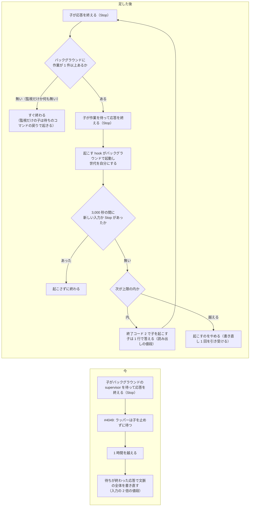
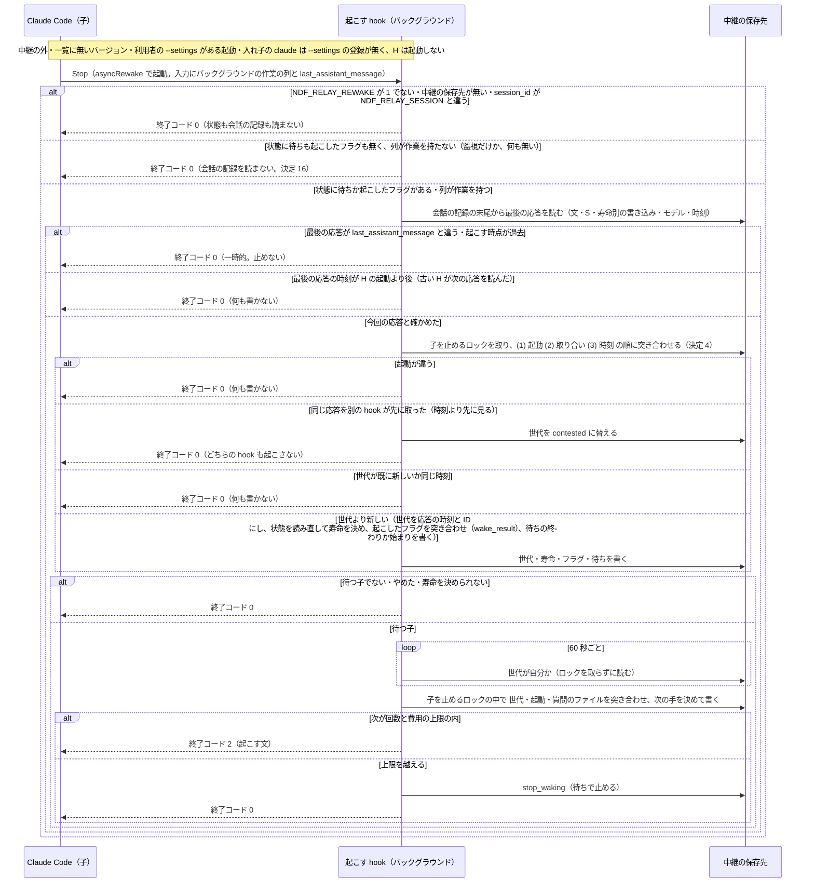

# 中継の下で待つ子のキャッシュ: 寿命の手前で起こし、書き直し 1 回分の費用に届いたらやめる（#4068 #4199）

中継（`ndf relay`。Claude Code の会話を「子」として包んで動かす NDF のプロセス）の下では、子が supervisor などのバックグラウンドの作業を待つ。キャッシュの寿命（メインの会話は 1 時間）を越えて待つと、子は待ちが終わった最初の応答で文脈の全体を入力の 2 倍の値段で書き直す。この設計の解き方は次の 4 つである。語の意味は末尾の「用語」にある。

- **起こす**: 子の応答の終わり（Stop）に `asyncRewake` でバックグラウンドに起動する hook を 1 つ足す。hook は寿命の手前（最後の応答から 3,000 秒）で終了コード 2 で終わって子を起こし、読み出しの値段（Opus 5.5 は入力の 0.05 倍）でキャッシュを保つ
- **やめる**: 起こした費用の合計が書き直し 1 回に届く回数で、起こすのをやめる
- **起こす相手を絞る**: 起こすのは、バックグラウンドに作業が 1 件以上残る子だけである。監視（待ちのコマンド）だけを待つ子は、そのコマンドが知らせの無いときも上限の 3,000 秒（11.0.33 から。前は 540 秒か 600 秒）までに戻り、そのたびに起きて張り直す。寿命の 1 時間の内に起きるので、hook はすぐ終わる（決定 16）。監視とは、背景で動かしたコマンドが待ちのコマンドだけのものを指す。待ちのコマンドは `ndf lanes wait`・`ndf plan wait`・`ndf progress wait`・`ndf ci watch` である。Claude Code の Monitor ツールの呼び出しも、そのコマンドが待ちのコマンドだけなら監視、ほかは作業に数える（#4049 の `relay_busy.task_kind`）
- **寿命と費用の決め方（#4199 を統合して決めた）**: 寿命は、応答の寿命別の書き込みから決める。両方 0 で決まらないときだけ、子を止めるロック（ラッパーが子を止めるときに取るファイルのロック）の中で読み直した状態の寿命で補う（決定 13）。費用は寿命別の書き込みにそれぞれの倍率を掛けて数える（決定 14・15）

採らなかった案は決定ごとに、既定値の根拠は「測った結果」と「外部の調査」にある。

> **設計承認の変更要求への答え（決定 16）**: 既にある見張りは、待ちのコマンドを背景で打ち、戻るたびに張り直す仕組みである。待ちのコマンドは知らせが無くても上限の 3,000 秒までに戻るので、監視だけを待つ子は寿命の内に起きている。上限は 11.0.33 で 540 秒・600 秒から 3,000 秒に上がった。張り直す応答の遅れは長くて数秒で、余白の 600 秒に収まるので、この判断は変わらない（決定 16 の「上限を 3,000 秒に上げた後の確かめ」）。2026-11-18（11.0.0）の後の中継の子で、監視だけを待って 1 時間を越えた回は 0 回だった。1 時間を越えて書き直したのは、supervisor などの作業だけを待つ子（10 回）と、質問の回答を待つ子（25 回。この課題の範囲の外）と、何も残っていない子（4 回。待つ相手が無いので範囲の外）である。そこで、起こす hook は残し、対象を作業が 1 件以上残る子に縮めた。監視だけの大きな子を新しい会話へ引き継ぐ経路（元の決定 5・#4068 の受け入れ条件 5）は外した。費用の見込みは縮めても変わらない（50 分を越えた待ちに監視だけの待ちは無かった）

## 今の姿

要求と受け入れ条件は次の 2 本にある。

| 課題 | 要求仕様のコピー | 正 |
| --- | --- | --- |
| #4068 | [issue-4068-requirements.md](./issue-4068-requirements.md) | 課題 #4068 の本文 |
| #4199 | [issue-4199-requirements.md](./issue-4199-requirements.md) | 課題 #4199 の本文 |

この設計は #4049 と #3995 の上に立ち、両方の実装の後に実装する。今回の応答の確かめと文脈の量の読み取りには、#4089 の読み取り関数を使う。関数は `adapters/transcript.py` の `read_tail`・`last_context`・`timestamp_seconds` である。#4089 は 2026-11-24 の時点で未実装である。実装の順で次のように分ける。どちらの順でも、`adapters/transcript.py` は 1 つで、2 つの実装が別々に作ることは無い。

- #4089 より先にこの設計を実装するとき: この実装の中で、#4089 の詳細設計のとおりにその読み取り関数を作る。そのとき #4089 の実装に残る作業は、今の呼び出し元をこの関数へ置き換えることだけになる（#4089 の設計の「#4068 の実装」）
- #4089 が先のとき: 作らずに使う

| 課題 | 使うもの | 文書 |
| --- | --- | --- |
| #4049 | バックグラウンドの作業の分け方 | 確定仕様 [ndf-relay-background-wait.md](../docs/specifications/ndf-relay-background-wait.md) |
| #3995 | 数え手（判断開始の値の知らせを数え直すカウンター。決定 10） | [issue-3995-design.md](https://github.com/devbasex/ai-plugins/blob/e37fe7d5056c1f9231210a6912a780e5503c3c9e/issues/issue-3995-design.md) |
| #4089 | 会話の記録の末尾の読み取り関数（未実装。上の段落） | [issue-4089-design.md](./issue-4089-design.md) |

**2 つの課題を 1 本にまとめた理由（共通の原因）**: どちらも、起こす hook が会話の記録から寿命と費用を決める同じ部品の規則である。#4068 はその部品を足す。#4199 は、#4068 の元の設計（main にマージ済み・未実装）のその部品にあった 3 つの欠けを、実装の前に直す。3 つの欠けは次のとおりである。

- 寿命を、ロックの外で読んだ古い状態の値で補っていた
- 起こした応答の書き込みを、1 つの寿命の倍率で数えていた
- 避けた書き直しを、別の応答の寿命の倍率で数え得た

欠けは元の設計の決定 2（寿命の表）・4（記録から読む値）・9（起こす記録と集計）の規則の中にあった。この文書では、直した規則を決定 13（寿命の補い）・14（起床の費用）・15（避けた書き直し）に書いた。決定 2 の寿命の表と決定 9 の集計は、その決定を指す。別の文書に分けると、同じ規則を 2 か所が持つ。

**世代と予約（下の図で使う語）**: 起こす hook は Stop のたびに 1 つ起動するので、眠っている hook が同時にいくつもあり得る。世代は、そのうち起こしてよい hook を会話ごとに 1 つに決める値である。世代は次の 3 つの組で、新しい出来事のたびに書き換わる。

- 最新の出来事（応答の記録・利用者の入力・起床）の時刻
- それを書いた書き込み元の ID（`by`。起こす hook なら起動ごとに作る乱数の ID、UserPromptSubmit の guard なら固定の文字列 `"turn"`）
- 起こす hook が取った応答の `message.id`

予約は、眠っている hook が持つ「起こす時点に起こす」という予定である。世代が別の書き込み元に替わると、その hook は起こさずに終わる（予約が失効する）。

- 待ちは長い。2026-10-24〜11-22 のこのマシンのメインの会話では、20,000 token 以上の文脈のまま応答の間が 1 時間を越えたのが 276 回あった。そのうち 263 回で、次の応答が書き直した（「測った結果」）
- 中継のラッパーは子の端末へ利用者の入力しか書かない（`relay.md` の「承認ゲートを越えない守り」）。NDF 10.x にあった、子の端末へ文字を打ち込む仕組み（入力注入。#931）は、11.x の作り直しで外した
- Claude Code は、バックグラウンドで動く hook が終了コード 2 で終わると、入力を待つ会話をすぐに起こす（`asyncRewake`）。NDF の hook はこれを使っていない

## 文脈と制約

- **待つ子を止めない。** 作業が残る子を止めると作業を失う（#4049 の決定 4・7）。この設計は、作業の子を起こすか起こさないかだけを決める。監視だけの子には何もしない（決定 16）
- **子の端末へ書かない。** 端末へ書いた文は人の入力と区別できず、質問の表示中に書くと選択肢 1 を決める（NDF 10.x の実測。`docs/specifications/ndf-relay-install-and-restart.md` の「入力注入の実測と不変条件」）
- **費用は、入力の値段を 1 とした倍率で比べる。** 書き込みは 5 分の寿命で 1.25 倍、1 時間で 2 倍である。読み出しは多くのモデルで 0.1 倍、Opus 5.5 と Sonnet 5.5 で 0.05 倍、Fable 5.1・5.2 と Mythos 5.1・5.2 で 0.025 倍である。出力は Opus 5.5 で入力の 5 倍である（「外部の調査」の PRD1・PRD2）
- **待ちの長さは前もって分からない。** supervisor の 1 フェーズ・CI・承認の取り次ぎで長さが変わり、見込みを出す手段は今無い
- **寿命と使ったモデルは、公式の契約では渡らない。** 会話の記録（`~/.claude/projects/…/<会話>.jsonl`）の `usage` と `message.model` から読む。この形は Claude Code の公開の契約ではない（#4049 が読む Stop の入力の列と同じ立場）
- **Stop の時点で、最後の応答が会話の記録に載っているとは限らない。** 公式の文書は、バージョンによっては Stop の時点で最後の応答が記録に無いと書く（PRD3）
- **定額のプランの費用は、週の利用上限の消費である。** 書き込みと読み出しを上限にどの比で数えるかは公開されていない。従量の値段の比で近似する（#4068 の前提 4）
- 実装の順は #3995 → lracct（#3604・#3864。中継のラッパーが、利用上限に当たったアカウントから別のアカウントへ子を切り替えて続ける仕組み）→ #4049 → この課題である。#4089 はこの課題の前でも後でもよい（「今の姿」）

## 解き方の全体像

1. **中継の子の Stop にだけ、起こす hook を足す。** プラグインの hook の登録（`hooks/claude.json`）には足さない。ラッパーは子を起動するとき、`--settings` で Stop に `asyncRewake: true` の登録を 1 つ渡す（決定 1・6・7）
   - 登録を渡す 3 つの条件（「登録の渡し方」）: 起動する claude のバージョンが、実測に通ったバージョンの一覧にある。一致は完全一致で見る（一覧は `cache.rewake` の `versions`）。利用者が `--settings` を指定していない。宣言した余白と確かめる間隔で、起こす時点がバックグラウンドの hook の `timeout` の内に届く
   - 登録を渡すときだけ、子の環境に `NDF_RELAY_REWAKE=1` も渡す（#4068 の受け入れ条件 3 の「対応を確かめたバージョンでだけ渡す環境変数」）
   - hook のプロセスが起動しない会話: 次の 4 つである。中継の外の会話・一覧に無いバージョン・利用者が `--settings` を指定した起動・入れ子の claude（`--settings` を受け継がない）。登録を受けた子では、子が応答を終えるたびに Claude Code がバックグラウンドで hook を 1 つ起動する
   - 起動した hook がすぐ終わる 3 つの場合: `NDF_RELAY_REWAKE` が `1` でない（登録の無い起動からエントリポイントを直接呼んでも眠りを作らない）。入力の `session_id` がラッパーの渡す `NDF_RELAY_SESSION` と違う。状態に待ちも起こしたフラグも無く、Stop の入力のバックグラウンドの作業の列が作業を持たない（監視だけか、何も無い。会話の記録を読まずに終わる。決定 16）
2. **今回の応答を確かめ、世代を自分にする。** 眠る hook は世代が自分のままのときだけ起こすので、起こしてよい hook は会話ごとに 1 つに限られる（世代の意味は図の前の段落）。次の順で確かめる（決定 4・6）
   1. 会話の記録の最後の応答が、Stop の入力の `last_assistant_message` と同じ文か。違えば今回の応答はまだ記録に無いので、起こさずに終わる
   2. その記録の時刻が hook の起動の時刻以前か。後なら、遅れて動いた古い hook が次の応答を読んだので、何も書かずに終わる
   3. ロックの中で、その応答（`message.id`）を別の hook が先に取っていないか。1 つの応答を終えた Stop は 1 つなので、2 つの hook が同じ応答を取れば、どちらが今回の Stop かを決められない。そのときは世代の書き込み元を `contested`（2 つの hook が 1 つの応答を取り合ったフラグ）に替え、どちらの hook も起こさない。先に取った hook がその応答で待ちを始めていて、まだ起こしていなければ、その待ちも取り消す。待つ子かは Stop ごとの作業の件数で決まる。先に取った hook が古い Stop なら、その件数は今の会話に合わないためである。これを時刻の比べより先に見るのは、同じ応答を取り合う 2 つの hook が同じ時刻を持つためである。時刻を先に比べると「同じ時刻の先の書き込み元」で終わり、取り合いに気付けない
   4. 取り合いでなければ時刻を比べ、世代より新しいときだけ、その応答の記録の時刻と `message.id` を世代にして書く。前の hook の予約はこれで失効する
3. **起こす時点まで眠る。** 待つ子（作業が 1 件以上残り、回答待ちの質問が無い子）なら、その応答からモデル・文脈の量 `S` を読み、寿命をロックの中で決める。
   - 会話の記録から読んだ時点では、応答の寿命別の書き込みだけで決める。両方 0 なら未定のまま渡す
   - ロックの中で読み直した状態の寿命で補う。それでも未定なら待ちを始めず、`wait_start` も `n_max` も作らずに起こさない

   起こす時点（最後の応答の時刻 + 寿命 − 余白）はその寿命から決める（決定 13）。眠る間は 60 秒ごとに状態のファイルの世代だけを見て、新しい Stop か利用者の入力（UserPromptSubmit）で世代が替わっていれば終わる（決定 2・6）
4. **起こすか、やめるか。** 次の 2 つがそろえば、起こす文で終了コード 2 で終わる。
   - 今の待ちで起こした回数 `k` の次の 1 回が、上限 `n_max = floor((w − r) × S / (r × S + d))` の内である
   - その待ちで起こした費用の累計に次の 1 回を足しても、判定の時の書き直し 1 回に収まる

   どちらかを越えるなら、その待ちでは起こさない（決定 3）
5. **起きた応答を確かめる。** 次の Stop の hook が、起こす文から始まった応答の最初のモデル呼び出しの読み出しを見る。読み出しが `S` の 9 割未満なら当たらなかったので、その会話では起こすのをやめる（決定 4）
6. **記録して測り直す。** 待ちの始まり・起こした・起きた結果・待ちの終わり・やめたを起こす記録に 1 行ずつ書き、`ndf relay cache report` が集める。起床の費用は 1 時間と 5 分の書き込みを別々に数えてそれぞれの倍率を掛け、内訳が欠けるか合計と合わない起床は費用の集計から外す。避けた書き直しは待ちが終わる直前の応答の量・寿命・モデルで数え、当たりと待ちの長さは待ちを終えた入力とその最初のモデル呼び出しで決める。値は上限の設定の `cache.*` に置く（決定 8・9・14・15）

採らなかった案（全体の形）: 既にある見張りに任せ、起こす hook を足さない。監視だけを待つ子は、待ちのコマンドが上限の 3,000 秒までに戻るので、その戻りで寿命の内に起きている。しかし、supervisor などの作業だけを待つ子は、作業が終わるまで知らせが届かず、11.0.0 の後も 10 回書き直した。作業を待つ子を起こす仕組みはほかに無いので採らない。監視だけの子は起こす対象から外した（決定 16）

## データ構造

**上限の設定（`plugins/ndf/contracts/limits/`。方針 1 つにつき 1 ファイル）に足す方針のファイル**は、下の表の 8 つである（既定値は「測った結果」から決めた。ファイルの名前・スキーマと読み手の直しは詳細設計）。`cache.*` の 7 つと、バックグラウンドの hook の予算 `hook.budget.stop-rewake` である。#4068 の受け入れ条件 13 が挙げる 7 つの値は、次のファイルに当たる。

- `cache.wake`（余白と確かめ直す間隔）
- `cache.write-ratio`・`cache.read-ratio`・`cache.wake-cost`・`cache.output-ratio`・`cache.rewake`

残りの `cache.hit`（受け入れ条件 8 の「9 割」）・`hook.budget.stop-rewake` は、この設計で値にした分で、同じく上限の設定にだけ置く

| 方針のファイル | 値 | 意味 |
| --- | --- | --- |
| `cache.wake` | `seconds` 600・`interval` 60 | 起こす時点の余白（寿命からこの秒を引く）と、眠る間に世代を確かめる間隔 |
| `cache.write-ratio` | `1h` 2.0・`5m` 1.25 | 寿命ごとの書き込みの倍率 |
| `cache.read-ratio` | 既定 0.1。`claude-opus-5-5`・`claude-sonnet-5-5` は 0.05。`claude-fable-5-1`・`claude-fable-5-2`・`claude-mythos-5-1`・`claude-mythos-5-2` は 0.025 | モデルごとの読み出しの倍率。表に無いモデルは既定 |
| `cache.output-ratio` | 既定 5 | 出力の倍率（集計で起こす応答の費用を出す） |
| `cache.wake-cost` | `count` 2,000 | 起こす応答 1 回の費用 `d`（入力の値段に直した token） |
| `cache.hit` | `ratio` 0.9 | 起きた応答の読み出しが `S` のこの割合以上なら当たりとみなす |
| `cache.rewake` | `versions`（実装の PR では空。有効化の PR の実測で決める。決定 7 の「一覧に載せる手順」） | 起こす hook を働かせてよい Claude Code のバージョンの一覧（文字列の配列）。決定 7 の実測を通ったバージョンだけを載せ、バージョンの文字列の完全一致で判定する。上下の範囲にしないので、一覧の 2 つのバージョンの間にある測っていないバージョンでも働かせない。新しいバージョンは測り直して通ったら一覧に足す。決めるまでは空で、空なら働かせない |
| `hook.budget.stop-rewake` | `timeout` 3,300・`deadline` 3,300・`margin` 240・`p95_ms` 500・`inject_chars` 1,000 | 起こす hook の予算（今の `hook.budget.*` と同じ形）。`timeout` は登録に書く秒で、起こす時点の最大 3,000 秒 + 確かめる間隔 60 秒 + 余り 240 秒。`p95_ms` は待つ子でない Stop で終わるまでの時間（決定 7 の実測 11） |

元の設計にあった引継ぎの見積り `cache.handoff` は、監視だけの子の引継ぎ（元の決定 5）と一緒に外した（決定 16）。判断開始の値（#3995）も、起こす hook は読まない。

**起こす状態（中継の保存先の `<ラッパーの名前>/keep-<会話の session_id>.json`）**: 会話（`session_id`）ごとに 1 つ置く。起動（ラッパーが子を起動するたびの ID）ではなく会話ごとにするのは、アカウントの替えなどで同じ会話を起動し直しても、回数とやめた理由を引き継ぐためである。

| 項目 | 意味 |
| --- | --- |
| `generation` | 最新の世代。`at`（時刻）・`by`（書き込み元の ID）・`message_id`（起こす hook の Stop が取った応答。ほかの書き込み元は空）の組。時刻の取得元は書き込み元ごとに決める（決定 6）。新しい時刻のときだけ書き換え、同じ時刻なら先に書いたほうを残す。起こす hook の Stop は、時刻を比べる前に `message_id` を突き合わせる。同じ `message_id` を別の hook が取りに来たときは、時刻に依らず `by` を「決められない」（`contested`）に替え、どちらの hook も起こさない（決定 4） |
| `wait_id` | 今の待ちの ID（待ちが始まった Stop の世代の `at`。待ちが始まった応答の時刻でもある）。`wait_end` を書くときに消す |
| `k`・`n_max`・`spent` | 今の待ちで起こした回数と、その待ちの上限と、その待ちで起こした費用の見積りの累計（起こすたびに判定の時の `S` で `r × S + d` を足す。通常の起床の前の費用の照合に使う。決定 3）。`wait_start` で `k` と `spent` を 0、`n_max` を始まりの `S` の式の値にし、`wait_end` で消す |
| `wait_stop` | 今の待ちで起こすのをやめた理由（上限・起床を突き合わせられない）。その待ちの間だけ起こさず、`wait_end` で消す（待ちを終える規則は表の下）。次の待ちでは起こす |
| `ttl` | 最後に分かった寿命（`1h`・`5m`）。分かった寿命でだけ書き換え、寿命の分からない応答で消さない（決定 13） |
| `last` | 突き合わせ終えた最後の応答の `message_id`・`tokens`・`model`・`ttl`（ロックの中で決めた寿命）・`at`。`wait_end` が待ちの終わりの直前の応答の量・寿命・モデルを書くのに使う（決定 15）。待ちの間の `last.ttl` は必ず分かっている（寿命の分からない応答では待ちを始めず、待ちの間は状態の `ttl` で補えるため） |
| `opened` | 待ちの間に UserPromptSubmit の guard が受けた通常の入力の時刻（待ちが在り、`pending` が無いか、`pending` が在っても入力の `prompt` が起床の文でないときに書く。実測 5）。次の Stop で、今回の応答を始めた入力の行が末尾の範囲から押し出されて突き合わせられなくても、これが最後の応答より後なら待ちを終える（`wait_end` の当たりと読み出しは null）。`wait_end` で消す |
| `pending` | 起こした直後のフラグ（`wake_id`・起こす前の `S`・起こした時刻・起こす前の最後の応答の ID・その応答のモデルと寿命（`wake_result` の値付けに使う。決定 13））。次の Stop で突き合わせて消す。`wake` の行が書けずに起こした起床でも、`wake_result` の `tokens`・`model`・`ttl` はこのフラグからコピーする（行からは復元しない） |
| `stopped` | この会話で起こすのをやめた理由（当たらない・記録の形が違う）。在ればその会話では二度と起こさない |
| `noted` | 一時的な理由（記録が読めない・今回の応答が未記録・起こす時点が過去・寿命がまだ分からない）のうち、`stop_waking` を書き終えた理由の集合。止めずに次の Stop で読み直し、同じ理由の行は会話で 1 度だけ書く |

待ちを終える規則（`wait_end` を書く Stop）:

- `wait_end` は、今回の応答を始めた入力が通常の入力（利用者の入力・バックグラウンドの作業の知らせ）だと確かめた Stop でだけ書く。確かめる証拠は 2 つある。会話の記録の入力の行の形と、guard が待ちの間に書いた `opened`（記録の入力の行が末尾の範囲の外へ押し出されたとき）である（#4068 の受け入れ条件 4 の「ただし」。2026-11-24 に Issue #4068 の本文へ足した）。`opened` で終えた待ちの `wait_end` は、当たりと読み出しを null にする
- バックグラウンドの作業の件数は待ちを終える根拠にしない。待つ子でない Stop（バックグラウンドが 0 件）でも、始めた入力が起床の文か、形を決められなければ待ちを終えない（突き合わせられない応答を `wait_end` の当たりの根拠にしない）
- そのため、突き合わせられない起床が続いても `k` と `wait_stop` は戻らない
- 待つ子でない Stop では眠らないので、待ちが残っても起こさない

止める範囲は理由で決める。会話の記録の形の変化と、起こしても当たらないこと（配送の遅れ・寿命の設定）は、その会話の続く待ちでも変わらないので会話で止める。上限は待ちの長さで決まるので、待ちで止める。一時的な失敗は止めない。

**起こす記録（中継の保存先の `<ラッパーの名前>/cache-log.jsonl`）**: 1 行が 1 つの出来事である。どの行も `kind`・`at`・`launch`・`session_id`・`wait_id` を持つ。

| `kind` | いつ | 足す項目 |
| --- | --- | --- |
| `wait_start` | 待つ子の Stop で、待ちが始まった | `tokens`・`ttl`・`model`・`n_max` |
| `wake` | 起こした（終了コード 2） | `wake_id`（起こすたびに新しい ID）・`tokens`・`age`（最後の応答から起こすまでの秒）・`k`・`n_max`・`spent`（この起床を足した後の累計） |
| `wake_result` | 起こしたフラグを突き合わせた Stop（フラグを消すときは必ず 1 行書く） | `wake_id`・`outcome`（`woke`（起床の応答を突き合わせた）・`preempted`（通常の入力が先に応答し、起床の呼び出しが無かった。呼び出し 0・費用 0・`priced` 真）・`truncated`（起床の呼び出しが末尾の範囲から欠けた）・`unknown`（フラグの直後の入力の形を決められない）。`woke` のほかは `hit` が null）・`hit`（真偽。起床の最初のモデル呼び出しの読み出しで決める。最初の呼び出しの書き込みが両方 0 でも読み出しで決め、行を書く。最初の呼び出しが末尾の範囲から欠ければ null）・`tokens`（起こす前の `S`）・`first_read`（最初の呼び出しの読み出し）・`calls`（起床に属するモデル呼び出しの数。起床の文から次の入力までの `message.id` の数で、Tool の結果は入力に数えない）・`cache_read`・`cache_write_1h`・`cache_write_5m`・`output`（どれも起床に属する全呼び出しの合計）・`priced`（真偽。寿命別の書き込みを全呼び出しで読め、2 つの和が書き込みの合計と合ったか。偽なら 2 つの書き込みの合計を書かない）・`model`・`ttl`（どちらもフラグの値。起こした時の判定に使った応答のもの）・`w_1h`・`w_5m`・`r`・`out`（費用の計算に使った倍率）（決定 14） |
| `wait_end` | 待ちの後の、通常の入力で始まった応答の Stop | `opened_at`（待ちを終えた入力の行の時刻）・`age`（`last` の時刻から `opened_at` までの秒）・`k`・`hit`（待ちを終えた入力の最初のモデル呼び出しの読み出しが `tokens` の 9 割以上か）・`cache_read`（その最初の呼び出しの読み出し）・`tokens`・`model`・`ttl`・`w`・`r`（この 5 つは、待ちが終わる直前の応答のもの。状態の `last` を更新する前に読んだ値と、その寿命とモデルの倍率）（決定 15）。行の `at` は Stop の時刻で、当たりと待ちの長さには使わない。入力の行を突き合わせられず `opened` で終えた待ちでは、`opened_at` は guard の時刻、`hit`・`cache_read` は null |
| `stop_waking` | 起こすのをやめた・一時的に起こさなかった | `reason`・`scope`（`session`・`wait`・`once`）・`k`・`n_max` |
| `wait_void` | 取り合い（決定 4）で、先に世代を取った hook がその応答で始めた、まだ起こしていない待ちを取り消した | `reason`（`contested`）。集計はこの `wait_id` の待ちをどの値にも入れず、`metrics` の `voided_waits` に数える |

**登録の渡し方**: ラッパーが子の起動の引数に `--settings <JSON>` を足す。足すのは、次の 3 つがそろうときだけである。

- 起動する claude のバージョンが `cache.rewake` の `versions` のどれかと完全に一致する。起動する claude は、起動先（候補）を確定した最終の環境の `PATH` で解いた実行ファイルである。従量の接続（API キーなどの従量課金で claude を動かす起動先。`metered`）の設定は、子の環境の `PATH` を上書きでき、親と別の `claude` を起動し得る
- 受け継ぐ引数（`claude_args` の `carried`）に利用者の `--settings` が無い。`--settings <値>` と `--settings=<値>` のどちらの形も指定ありとみなす
- 宣言した `cache.wake` の値で、起こす時点がバックグラウンドの hook の `timeout` の内に届く。届くとは、次の 4 つがすべて成り立つことである。
  - 確かめる間隔が 0 より大きい
  - 眠る hook 1 つ（1 回の眠り）が世代を確かめる回数（(1 時間 − 余白) ÷ 間隔 の切り上げ）が 300 回以内。待ちが続けば起床の Stop ごとに新しい hook が眠り直すので、回数は待ち全体でなく眠り 1 回ごとに数える（既定の 600・60 で 50 回。余白 600 で間隔 9 秒は 334 回、余白 550 で間隔 10 秒は 305 回で越える）。300 回は、利用者が間隔を極端に短く宣言したときに、眠る hook が休まずに状態のファイルを読み続けるのを防ぐ守りの値である。Claude Code の制約ではない（既定の 50 回の 6 倍の余裕を置いた）
  - 余白が 0 以上 1 時間未満
  - 1 時間 − 余白 + 間隔 + バックグラウンドの予算の `margin` が `timeout` 以下（既定の 600・60・240 で 3,300 秒ちょうど）

  届かなければ登録を足さず、ラッパーの記録に理由を残し、`ndf check` も破れとする。例えば利用者が余白を 120 秒にすると、3,780 秒になり `timeout` の 3,300 秒を越える。このまま登録すると、バックグラウンドの hook は毎回起こす前に打ち切られる。そのため、この場合は登録を足さない

利用者の `--settings` があるときは登録を足さず、利用者の引数をそのまま初回の起動と再開に渡す（決定 7）。起こす登録は子の起動の引数の 1 つの `--settings` に入れ、`--settings` を 2 つにしない。`--settings` は最後の 1 つだけが効くので、2 つにすると子の認証の設定か起こす登録のどちらかが効かなくなる。入れ方は、下の手順 4 の 2 つの場合で分かれる。

- 用意の前に版を読む候補: 起動先を決める前の起動引数（`_launch_target` へ渡す引数）に足す。API キーの従量の子では、今の `account_choice._compose` がその起動引数の `--settings`（1 つだけ）を読む。それを `apiKeyHelper` と `ConfigChange` の hook を合わせた 1 つの `--settings` に作り直すので、起こす登録も同じ 1 つに残る
- 用意の後に版を読む候補: 用意した起動の引数の `--settings` に足すか、`--settings` が無ければ 1 つ足す

**版を読む時点と起動先を用意する順（この文書の版の判定の手順は、ここだけに書く）**: 「起動先を用意する」は次の 2 つの処理を指す。アカウントの使用を記録に届ける処理と、子に効く設定を確かめる処理（設定の検証・実効の設定の確かめ・固定できるかの確かめ）である。ラッパーは次の順で行う。

1. 登録つきの引数を作るかを決める。利用者の `--settings` が無く、上の 3 つ目の条件（届く）を満たし、`cache.rewake` の `versions` が空でないときだけ作る。作らなければ、版を読まずに登録の無い引数で起動する（`--version` の起動は増えない）
2. 候補（起動先）ごとに、従量の接続の設定を 1 回だけ読み、その値を重ねて子の最終の環境の `PATH` を合成する。合成はファイルを書かない純粋な計算で、読んだ同じ値を手順 4 の用意にも渡す
3. その `PATH` で `claude` の実パスを解く
4. 版を読み、登録を足すかを決め、起動先を用意する。版を読む時点は、解いた実行ファイルで次のとおり分かれる。どちらでも、用意は候補ごとに 1 度だけで、届けと確かめの回数は今と変わらない
   - 起動先を選ぶ前の下限の確かめ（`require`）と同じ実行ファイル（従量の接続でない候補はいつもこれ）: 用意の前に、既存の版の記録から版を読む（`--version` を打ち直さない）。一覧と完全に一致すれば登録つきの引数を、ほかは登録の無い引数を選び、選んだ引数で用意する
   - 別の実行ファイルを指す従量の接続: 先に登録の無い引数で用意する。設定の確かめと固定を通った候補でだけ版を読む。一覧と完全に一致すれば、用意した引数の `--settings` に登録を足す（API キーの子は、作り直した 1 つの `--settings` に足す）。確かめか固定で落ちる候補では版を読まない
5. 登録を足した起動にだけ、子の環境に `NDF_RELAY_REWAKE=1` を足し、今の起動の記録に登録を渡したと書く

関数の名前と `--version` の起動の回数は、詳細設計の「ラッパー」の起動の手順にある。

登録の中身は Stop の `asyncRewake: true` の登録 1 つで、プラグインの登録と並んで動く。プラグインの根の環境変数は `--settings` の hook に渡らないので、command は `hooks/entry.py` の絶対パスで書く。登録を足した起動にだけ、子の環境へ `NDF_RELAY_REWAKE=1` を足す（登録を足さない起動では渡さない）。hook はこの変数を自分で確かめ、無ければすぐ終わる（#4068 の受け入れ条件 3）。登録と変数の両方で限るのは、登録だけでは、登録の無い起動から `rewake` のエントリポイントを直接呼んだときに眠りを防げないためである。対象の会話は #4049 の `NDF_RELAY_SESSION` でも限る。

## 処理の流れ

UserPromptSubmit の guard（今の `turn` に足す）は、中継の下（`session_id` が `NDF_RELAY_SESSION` と同じ）で働く。ロックの中でまず次の 2 つを突き合わせる。

- ラッパーの今の起動が自分の起動（`NDF_RELAY_LAUNCH`）か
- その起動に起こす hook の登録を渡したか（ラッパーが今の起動の記録に書く）

どちらも満たすときだけ、世代をその入力の時刻に書き換え、眠る hook の予約を失効させる。待ちがあれば、通常の入力の時刻を `opened` にも書く（「データ構造」。手順は詳細設計の「UserPromptSubmit の guard」の 3 つ）。起こす状態のファイルがまだ無い会話では、世代だけを持つ状態を作る。最初の待ちでバックグラウンドの hook より先に入力が届いても、その入力で後から動く hook を失効させるためである。起きた応答の前にも UserPromptSubmit が発火する（実測）。起こす hook はロックの中でフラグを書いてから終わるので、その UserPromptSubmit が世代を替えても、起こした事実は失われない。

起こす文（既定）: `【ndf-relay】キャッシュを保つための起床（<k>/<n_max>）。Tool を呼ばずに「待機を続ける」の 1 行だけで応答を終える。`

## 決定の記録

各決定の「根拠」の行は、次の基準を番号で指す。

| 番号 | 中身 |
| --- | --- |
| Value 2（MVV 版 11。正本は `.ndf/mvv.md` の Value） | 安く使える。待機する文脈は、プロンプトのキャッシュの寿命の内に使うか、必要ならキャッシュを起こす。起こす費用が見合わなければ待機を終える |
| Value 3 | 同じ手順は毎回同じ結果になる。判断の要らない手順は仕組みが進め、結果が実行ごとにばらつかない |
| Value 4 | どのプロジェクトでもそのまま使える |
| Value 5 | 速く届く。決められた範囲の資源を使い、待つ間も止まらない |
| Value 6 | 使うほど散らからない。作業で生んだものは役目を終えると片付き、Issue の一覧は膨らまない |
| Value 8 | 正しいデータ構造で作られる。同じ事実を 2 か所に持たず、履歴は追記で持つ |
| Value 9 | 責務の分かれた設計で作られる。まだ要らない仕組みは先回りして作らず、後から足せる土台に留める |
| 方針 1（#4069 の配慮事項 1） | キャッシュを起こす費用は文脈の大きさに比例する。待機してキャッシュを起こすか、引継ぎで切るかを文脈の大きさで決める |
| 方針 7（#4069 の配慮事項 7） | 測らないと決められない。キャッシュの当たり率などを記録し、閾値の見直しに使う |

決定 11 の「配慮 1〜8」も #4069 の配慮事項で、中身は決定 11 の表の左の列にある。

### 決定 1: 子の端末へ書かずに起こすため、Stop に `asyncRewake` のバックグラウンドの hook を足し、終了コード 2 で起こす

- **質問**: 入力を待つ子を、誰がどの手段で起こすか
- **選んだ案**: 中継のラッパーが起動する子にだけ、`--settings` で Stop に hook を 1 つ足す。hook は `asyncRewake: true` で登録し、プラグインの登録には足さない。Claude Code はその子の Stop ごとにこの hook をバックグラウンドで起動する。hook が終了コード 2 で終わると、入力を待つ会話をすぐに起こし、標準エラーの文を system reminder として渡す（公式の文書と 2026-11-22 の実測。PRD3）。起きた応答の Stop がまた hook を起動するので、待つ間は起こす間隔ごとに起きる鎖になる。ラッパーは見回りを足さない
- 採らなかった案:
  - ラッパーが子の端末へ短い文を書く。端末へ書いた文は人の入力と区別できず、質問の表示中には選択肢 1 を決める。NDF 10.x の入力注入が守った不変条件 G1〜G4（質問の表示中は書かない・応答が再開していたら書かない・確かめ直しと書き込みを質問の始まりとロックで分ける・人の入力を装える自由な文を送らない。`docs/specifications/ndf-relay-install-and-restart.md` の「入力注入の実測と不変条件」）を作り直すことになる
  - モデル自身に `ScheduleWakeup`・`CronCreate` で起床を予約させる。手順への追従に頼るので、予約を忘れた待ちで外れる。仕組みで進めるのが Value 3 である
  - 既にある見張りと `/goal` の確かめに任せ、起こす hook を足さない。見張りは、待ちのコマンド（`ndf lanes wait`・`ndf plan wait`・`ndf progress wait`）を背景で打つ仕組みである。コマンドは知らせが無くても上限の 3,000 秒までに戻り、戻るたびに張り直す。監視だけを待つ子にはこれで足りる。作業だけを待つ子は作業が終わるまで起きない（11.0.0 の後の中継の子で 10 回、最長 175 分）。`/goal` の確かめの間隔は中央値 66.2 分で寿命を越える。監視だけの子に限って採り、作業の子には採らない（決定 16）
  - 子にバックグラウンドの `sleep` を張らせ、その終わりの知らせで起きる。同じく追従に頼り、#4049 の監視として数えられる
  - 別のプロセスから `claude -p --resume <会話> --fork-session` で同じ前置きを読ませる。対話と `-p` で system prompt と Tool の一覧が同じかを確かめていない。違えば前置きが一致せず、起こせない
  - プラグインの登録（`hooks/claude.json`）に足し、hook の中で環境変数を見てすぐ終わる。プラグインを入れた全ての会話の Stop ごとにプロセスが 1 つ増え、すぐ終わっても起動の費用は残る
- **代償**: 中継の子の Stop ごとに、バックグラウンドの hook のプロセスが 1 つ起動する（中継の外の会話では起動しない）。待ち・起こしたフラグ・バックグラウンドの作業の無い会話では、会話の記録を読まずにすぐ終わる。待つ子では、新しい Stop か入力が来るまで眠る（決定 6）。子の会話には、起こすたびに起こす文と 1 行の返事が残る（実測で書き込み 319 token・出力 139 token）
- **根拠**: Value 2・Value 3（MVV 版 11）

### 決定 2: 寿命の内に確かに起こすため、起こす時点を最後の応答の時刻から寿命 − 600 秒にし、5 分の寿命では起こさない

- **質問**: 最後の応答から何秒で起こすか。寿命はどう決めるか
- **選んだ案**: 起こす時点 = 最後の応答の時刻 + 寿命 − 余白（`cache.wake.seconds` 600）。1 時間の寿命なら 3,000 秒である。寿命は要求の始まりから数えるが、記録の時刻は応答の終わりなので、余白は、最後の要求 1 回にかかる時間と、世代を確かめる間隔（60 秒）の分のずれを吸収する。寿命は最後の応答の `usage.cache_creation` で次の表のとおり決める

| 1 時間の書き込み | 5 分の書き込み | 寿命 |
| --- | --- | --- |
| 正 | 正か 0 | 1 時間（公式の文書は、1 つの要求の中で 1 時間の項目を 5 分の項目より前に置くと決めている。前置きの大部分は 1 時間で保たれるので 1 時間とする。実測では両方に書いた応答は 0 件。PRD1） |
| 0 | 正 | 5 分。起こさない。余白の宣言によらず 5 分の寿命は常に除く（既定の余白 600 秒では #4068 の受け入れ条件 1 の「起こす間隔」が 0 以下になる。5 分の子を 1 分ごとに起こしても、起こす費用が寿命の短さに見合わない） |
| 0 | 0 | 子を止めるロックの中で読み直した状態の `ttl`（前に分かった寿命）。無ければ決められないので起こさない（決定 13） |
| 項目が無い・型が違う | | 決められないので起こさない（決定 4） |

- 採らなかった案: 寿命 − 300 秒（55 分）。55〜60 分の間は 120 組のうち 106 組が当たり（88%）で、50〜55 分の 39 組のうち 39 組（100%）より下がる。余白を詰める根拠が無い。ラッパーが見る子の出力の静かな時間から数える案も採らない。キャッシュの読みと関係しない
- **代償**: 起こす回数が 1 時間に 1.2 回になる（55 分より 1 割多い）。応答の長さと配送の遅れが余白を越えれば、起こしても当たらない。そのときは決定 4 が起こすのをやめる。5 分の寿命の会話（メインの会話では少ない）は今のまま切れる
- **根拠**: Value 2（MVV 版 11）。方針 7（#4069）: 余白は起こす記録の `wake` の `age` と `wake_result` の `hit` で測り直す（決定 9）

### 決定 3: 待ちの長さを知らずに費用を抑えるため、起こした費用の合計が書き直し 1 回に届く回数で起こすのをやめる

- **質問**: 起こし続けるか、どこでやめるか（待ちの長さは前もって分からない）
- **選んだ案**: 起こす 1 回の費用は `r × S + d` で、書き直し 1 回の追加の費用は `(w − r) × S` である。今の待ちで起こした回数 `k` が `n_max = floor((w − r) × S / (r × S + d))` に達するまで起こし、達したらその待ちでは起こさない。上限で止めるのは待ちの単位で、待ちが終わって（`wait_end`）次の待ちが始まれば（`wait_start`）、`k` を 0 にし、`n_max` をその始まりの `S` で決め直す。待ちが上限の前に終われば書き直しを丸ごと避け、上限を越えても費用は「何もしない」の 2 倍を越えない。ここで「何もしない」の費用は、最後に起こした時の `S`・寿命・モデルでの書き直し 1 回分である（下の「費用の約束の範囲」。最後の起床の後に `S` がさらに減れば、その時点の書き直しは小さくなり、2 倍の比べには使わない）（スキーレンタル問題（借りるか買うかの問題）の、損益の分かれ目で買う決め方。借り続けた費用が買う値段に届いたら買う）。`n_max` は待ちの始まりの `S` で決め、待ちの間は変えない。通常の起床の前には、回数（`k + 1 ≤ n_max`）に加えて費用の累計も照合する。その待ちで起こした費用の累計 `spent` に次の 1 回を足した値が、判定の時の書き直し 1 回分を越えるなら（`spent + r × S + d > (w − r) × S`。`S`・`w`・`r` は判定の時の応答のもの。決定 13）、回数の上限の内でもその待ちでは起こさない（`wait_stop` は上限）
- **受け入れ条件 4 との関係**: 受け入れ条件 4 が決めるのは回数の上限 `n_max` と、上限に達したらその待ちで起こさないことである。上限まで必ず起こすことは求めていない。費用の照合は、`n_max` に届く前にも起こすのをやめ得る 2 つ目のやめる条件で、受け入れ条件 4 の上限を緩めない。倍率が変わらず `S` が減らない待ちでは照合は先に効かないので（下の「回数の上限との関係」）、受け入れ条件 4 の例（`k` 34 で 35 回目を起こす）はそのまま成り立つ。照合が先に効く見本（モデルが替わる・`S` が圧縮で減る）は、テスト設計の受け入れ条件 4 の行で確かめる
- **費用の約束の範囲**:
  - 約束すること: 起こした費用の見積りの累計が、最後に起こした時の `S`・寿命・モデルでの書き直し 1 回分 `B(S) = (w − r) × S` を越えない。費用の照合がこれを直接守るので、待ちの間に `S` が減っても、モデルが替わって読み出しの倍率が上がっても成り立つ
  - 約束しないこと: 待ちの始まりの `S` での書き直しを越えないこと（起こすたびに `S` は数百 token 増え、避ける書き直しもその `S` の書き直しになる）
  - 回数の上限との関係: 倍率が変わらず `S` が減らない待ちでは、費用の照合は回数の上限より先に効かない（既定の値の上限の例は変わらない）。理由は次の式である。`f(S) = (w − r) × S / (r × S + d)` は `S` について増える。そのため、`k` 回目の起床の `S_k` が始まりの `S_0` 以上なら `n_max ≤ f(S_0) ≤ f(S_k)` である。累計は `Σ (r × S_i + d) ≤ n_max × (r × S_k + d) ≤ (w − r) × S_k` になる
  - 例 1（Opus 5.5・1 時間・`d` 2,000。`S` が増える）: `S` 500,000 から起こすたびに 300 増える待ちの `n_max` 36 回の累計は 981,450 である。始まりの書き直し 975,000 は越えるが、36 回目の `S` 510,500 での書き直し 995,475 は越えない
  - 例 2（倍率が上がる）: `S` 500,000 のまま、最初の 1 回を Opus 5.5（読み出し 0.05）で起こす。その後のモデルが読み出し 0.1 に替わると、1 回は 52,000 で書き直しは 950,000 になる。回数の上限 36 だけなら累計は 1,847,000 になるが、費用の照合で 18 回目（累計 911,000）の後の 19 回目を起こさない
- 上限の例（Opus 5.5・1 時間・`d` 2,000）: `S` = 20,000 で 13 回、100,000 で 27 回、400,000 で 35 回、500,000 で 36 回。起こす間隔 3,000 秒なら 11〜30 時間に当たる。読み出し 0.1 倍のモデルでは、100,000〜500,000 で 15〜18 回（12.5〜15 時間）
- 採らなかった案:
  - 待ちの見込みの時間で決める。見込みを出す手段が無い。起こす記録に待ちの長さが溜まれば、工程ごとの見込みで上限を縮める改善を後から足せる
  - 上限なしで起こし続ける。止まったバックグラウンドの作業を待つ子では、費用が際限なく増える
  - 文脈の量の下限を置き、小さい子は起こさない。式は `d` を含むので、小さい文脈でも起こすほうが安いと出る
- **代償**: 上限を越えて続く待ちでは、起こした費用（書き直し 1 回分）と書き直しの両方を払う。過去の 3,000 秒以上の 435 回の待ちに当てると、上限で止まるのは 4 回で、4 回とも最後の起床から寿命を越えて書き直しになった（「測った結果」）。50〜60 分で自然に当たる待ちにも 1 回ずつ起こす費用が掛かる。2 倍の上限は `d` と倍率を見積りのまま置いた値で、実際の費用の保証ではない。待ちの間に `S` が減る（圧縮など）か読み出しの倍率が上がると、費用の照合で回数の上限より早く起こすのをやめ、その後の書き直しを引き受ける
- **根拠**: Value 2（MVV 版 11）。方針 1（#4069）: 起こす費用は `r × S` で文脈の大きさに比例し、上限は書き直しの `(w − r) × S` との比で決まる

### 決定 4: 公式の契約に無い記録の形を使う代わりに、形が違えば起こさず、起こした結果が当たらなければやめる

- **質問**: 寿命・モデル・文脈の量・最後の応答の時刻をどこから得るか。形が変わったときにどう落ちるか
- **選んだ案**:
  - Stop の入力の `transcript_path` の末尾を、#4089 の共有の `read_tail` で読む。読む大きさは上限の設定の `hook.transcript-tail` で、利用者が直した読み取りの上限がそのまま効く。読めなければ空の文字列が返り、今回の応答が未記録と同じ一時的な失敗になる。最後の応答は #4089 の `last_context` が決める（同じ `message.id` の行は 1 つに数える）。起こす hook は自分で末尾を読み直さない
  - **今回の Stop の応答かを突き合わせる**: 最後の応答の文の部分を、Stop の入力の `last_assistant_message` と比べる。文の部分は、同じ `message.id` の行の `text` を区切りなしでつないだものである。比べるときは両方から空白文字（空白・タブ・改行など）を除く（#4089 の設計の「入出力のコントラクト」の「`Reply` の文の比べ方」）。同じときだけ、今回の応答とする。違う・入力に `last_assistant_message` が無いときは、今回の応答がまだ記録に無い（PRD3 のバージョン）か、前の応答だけが完全な行として残っている。前の応答の時刻で数えると起こす時点が過去になり、Stop の直後に起こす鎖になるので、起こさない。これは一時的な失敗として扱い、止めない（次の Stop で読み直す）
  - **今回の応答の記録は hook の起動より前に書かれている**: 文の一致だけでは今回の応答を一つに決められない。既定の起床の返事は毎回「待機を続ける」なので、同じ文の応答は設計の上で繰り返し現れる。遅れて動いた古い Stop の hook が次の同じ文の応答を読むと、古い Stop の作業と監視の件数と、新しい応答の時刻を組み合わせて世代を取ってしまう。そこで、2 つの突き合わせを重ねる
    - **時刻の突き合わせ**: hook は、起動の直後に取った時刻（`run` が最初に `clock()` で取る値。以下 `started`）を持つ。突き合わせた応答の `timestamp` がそれより後なら、その応答は自分の Stop の後に書かれたものとして、何も書かずに終わる（世代も取らない）。ただし、これで弾けるのは、古い hook が動き始めた後に次の応答が書かれた場合だけである。Python の `run` が `started` を取るのは、Claude Code が hook を起動してからインタプリタが立ち上がった後である。そのため機械が混んでいれば、古い hook が動き始める前に次の同じ文の応答が書かれ得る。その応答の `timestamp` は `started` 以前なので、時刻の突き合わせを通る
    - **応答の取り合いの突き合わせ**: 1 つの応答を終えた Stop は 1 つで、その Stop の hook も 1 つである。そこで世代に、取った応答の `message.id` を持たせる。ロックの中で世代の `message_id` が突き合わせた応答と同じで、書き込み元が自分でなければ、2 つの hook が 1 つの応答を取り合っている。どちらが今回の Stop の hook かは順序からも時刻からも決められないので、世代の `by` を `contested` に替えて終わる。先に取った hook は眠りの中で世代が替わったのを見て終わり、どちらも予約を作らない（起こさないので、余分なモデル呼び出しは起きない）。先に取った hook がこの応答で始めた待ちがあれば、`wait_id` は取り合った応答の時刻である。その待ちでまだ起こしていなければ（`k` 0・起こしたフラグ無し）、待ちを状態から消して `wait_void` を 1 行書く。待つ子かは Stop ごとの作業の件数で決まる。先に取った hook が古い Stop なら、作業がすべて終わった会話に存在しない待ちが残るためである。寿命・`last`・起こしたフラグの突き合わせ・待ちの終わりは、取り合った応答と会話の記録だけで決まり、どちらの hook が書いても同じなので残す。起こした後の待ち（`k` 1 以上）は、起こした記録を持つので取り消さない。そのほかの状態は残り、次の Stop の hook が今までどおり決める
    - **ロックの中で判定する順**: (1) ラッパーの今の起動が自分の起動か。違えば何も書かずに終わる。(2) 取り合い。世代の `message_id` が自分の応答の `message.id` と同じで、書き込み元が自分でないかを見る。そうなら `by` を `contested` に替える（既に `contested` ならそのまま）。先に取った hook がその応答で始めた起こしていない待ちを取り消して終わる（上の「応答の取り合いの突き合わせ」）。(3) 時刻。世代の時刻が自分の応答の時刻より新しいか同じなら、何も書かずに終わる。(4) 世代を自分の応答の時刻・`message.id`・自分の ID にする。(2) を (3) より先に見るのは、同じ応答を取り合う 2 つの hook が同じ `timestamp` を持つためである。(3) を先にすると、後から来た hook は必ず「同じ時刻の先の書き込み元」で終わり、先に取った hook（古い hook かもしれない）がそのまま眠って起こす
    - **#4068 の受け入れ条件 2 との関係**: (2) で後から来た hook が古い hook なら、古い hook が起こす状態（世代の `by`）を書き換える。これは受け入れ条件 2 の元の文言「古い Stop の hook は起こす状態と起こす記録を書き換えない」に反する。そこで受け入れ条件 2 に「取り合いの印だけは書く」という例外を足した（2026-11-24。Issue #4068 の本文）。このフラグを書かないと、先に取った hook が古い hook だったときに、古い Stop の作業と監視の件数で起こしてしまう。書き換えるのは世代の `by` だけで、待ち・回数・フラグ・起こす記録は変えない。このフラグは起こさない側にだけ働く
    - **取り合いの代償**: 正しい Stop の hook も起こさない。待つ子では、次の Stop が来ないまま待ちが寿命を越えると、待ちが終わった応答で書き直しを 1 回払う（今の振る舞いと同じ）。取り合いは、古い hook の動き始めが次の応答の記録より遅れたときだけ起きる。その順が実際に起きるかは実測 9 で測る
    - **3 つの突き合わせを重ねる理由**: 世代・時刻・取り合いは、それぞれ別の誤りを防ぐ。世代（新しい時刻でだけ書き換える）は、利用者の入力や次の Stop で前の予約を失効させる。これは起こす仕組みの本体で、応答の ID が取れても外せない。時刻の突き合わせは、古い hook が動き始めた後に書かれた次の応答を読む誤りを防ぐ。取り合いの突き合わせは、古い hook の動き始めが遅れ、その前に書かれた次の応答を読む誤りを防ぐ。文の一致だけでは Stop と応答を結べないので、後の 2 つはどちらも欠かせず、片方では残りの順を防げない。まだ要らない仕組みは作らない方針（Value 9）とは、ID の無いバージョンで要る分だけを置くという関係である
    - **応答の ID が取れたとき**: この実装は応答の ID で突き合わせず、全ての Stop を文と時刻と取り合いの 3 つで結ぶ。今の公式の Stop の入力に応答の ID は無い（PRD3）。どの項目に載るか・記録の `message.id` と同じ値かは実測 9 まで分からず、取る項目を決められないためである（まだ要らない仕組みは作らない。Value 9）。実測 9 で ID を載せる版が見つかれば、設計を別に起こす。その設計は、取る入力の項目・#4089 の `last_context` の手がかり（ID の型）・ID が記録に無いか合わないときの結果を決める。そのときの選ぶ単位は版の一覧でなく Stop ごと（入力に ID が在るか）とする。一覧には ID を渡す版と渡さない版が並び得て、同じ会話が `--resume` で別の版に移ることもあるためである。時刻と取り合いの突き合わせは版によらず残す。ID のある Stop では何も弾かずに通るだけで、ID の無い版の Stop ではこれまでどおり古い hook の取り違えを防ぐ
    - 決定 7 の実測 9 では、次を確かめるまでバージョンの門（起こす hook を働かせてよいバージョンの一覧。決定 7）を開けない。今回の応答の記録の後にバックグラウンドの hook が起動すること。古い hook の動き始めが次の応答の記録より後になる順が、実際に起き得るか（起き得ても上の取り合いの突き合わせで予約を作らない）。取り合いの突き合わせが、その順で 2 つの hook のどちらにも起こさせないこと
  - **起こす時点が過去なら起こさない**: 突き合わせた応答の時刻から決めた起こす時点が、すでに今の時刻以前なら（文が偶然同じ前の応答を読んだときの守り）、起こさずに一時的な失敗とする
  - 今回の応答と確かめた行に `usage`・`timestamp`・`message.model` がそろわなければ、前の行へさかのぼらずに「記録の形が違う」とする
  - `S` は `usage` の入力・読み出し・書き込みの合計、寿命は決定 2 の表、モデルは `message.model`、時刻は `timestamp` である
  - 起こさないときの止める範囲は「データ構造」の起こす状態の表のとおりである。記録の形が違うときは会話で止め（`stopped`）、一時的な失敗（記録が読めない・今回の応答が未記録・起こす時点が過去・寿命がまだ分からない）は止めない。どちらも `stop_waking` は同じ理由で会話に 1 度だけ書く
  - 起こしたフラグ（`pending`）がある Stop では、起こす前の最後の応答（フラグの ID）の直後にある最初の入力の行だけを見る。その行の形で次のとおり扱う。末尾は手順の頭と同じ `read_tail` の文字列で、読み直さない

    | 最初の入力の形 | 扱い |
    | --- | --- |
    | 起床の文の形（決定 7 の実測 8 で決めた形） | その次から次の入力（Tool の結果は入力に数えない）の手前までのモデル呼び出しを、その起床に属する呼び出しとする。当たりは最初の呼び出しの読み出しで決める。それがフラグの `S` の 9 割（`cache.hit.ratio`）未満なら当たらなかったので、`stopped` に理由を書き、その会話では起こさない。最初の呼び出しの書き込みが両方 0 でも、読み出しで当たりを決めて `wake_result` を書く。起床の実費は属する全呼び出しの合計で記録する（起きた子が起こす文に従わずに Tool を呼べば、呼び出しが複数になる。#4068 の受け入れ条件 14） |
    | フラグの ID の応答が末尾の範囲に無い（起床の後の大きな Tool の結果で、読み取りの上限の外へ押し出された） | 起床に属する呼び出しを数えられないので、当たりを判定せず（`hit` は null）、`outcome` を `truncated`、`priced` を偽にした `wake_result` を書いてフラグを消す。範囲の欠けは記録の形の変化ではないので、`stopped` も `wait_stop` も書かない。集計はこの起床を当たりの率・`d`・実費から外し、その待ちを `unpriced_waits` に数える。フラグの ID の応答が範囲に在れば、その後の行はすべて範囲に在る（末尾は連続して読む）ので、途中の呼び出しだけが欠けることは無い |
    | 利用者の入力かバックグラウンドの作業の知らせ | その先は探さずに当たりを判定せず、`outcome` を `preempted` にした `wake_result`（`hit` は null、呼び出し 0 回・費用 0 で `priced` は真）を書いてフラグを消す（先に通常の入力が応答し、起床の呼び出しは無かった。#4068 の受け入れ条件 8）。集計はこの起床を起こした回数に数え、当たりの率・`d`・実費の中央値から外し、待ちの費用には 0 として足す（記録の欠けとして `unpriced_waits` に数えない）。起床の文がその後に別の応答として届かないことは、利用者の入力とバックグラウンドの作業（Bash・Monitor・サブエージェント）の知らせのそれぞれについて実測 8 で確かめる |
    | 決められない（起床の文の形でも通常の入力の形でもない） | 当たりを判定せず、`outcome` を `unknown` にした `wake_result`（`hit` は null、呼び出しが在ったか分からないので `priced` は偽）を書いてフラグを消し、その待ちでは起こさない（`wait_stop` に「起床を突き合わせられない」。突き合わせられない起床を繰り返さない）。この `wait_stop` は、通常の入力で始まった応答で待ちが終わったと確かめるまで消さない（「データ構造」の `wait_stop`）。同じ Stop で待ちを終えて回数 0 の待ちを作り直すことはしない |
  - **待ちを終える Stop**: 待ちがある Stop では、今回の応答をさかのぼって、それを始めた入力（Tool の結果でない最初の入力の行）を探す。その入力と、入力の直後の最初のモデル呼び出しを「待ちを終えた入力」と「待ちを終えた最初の呼び出し」と呼ぶ。今回の応答の Stop の時刻や最後の呼び出しとは別のもので、次のとおり使い分ける

    | 値 | 取り出し元 |
    | --- | --- |
    | 待ちを終えるか | 待ちを終えた入力の形で決める。通常の入力なら終え、起床の文なら終えない。決められない（形が分からない・末尾の範囲に無い）ときは、guard の `opened` が最後の応答より後なら終え（`wait_end` の当たりと読み出しは null）、無ければ終えない（#4068 の受け入れ条件 4）。バックグラウンドの作業の件数が 0 でも、この判定を先にする（バックグラウンドの件数は待ちを終える根拠にしない） |
    | `wait_end` の当たり・読み出し | 待ちを終えた最初の呼び出しの読み出し。待ちを終えた後の Tool の呼び出しで読み出しが戻っても、当たりにしない（最初の呼び出しで書き直したなら、避けられなかった） |
    | 待ちの長さ・`age` | 待ちを終えた入力の行の時刻（`opened_at`）まで。今回の応答の Stop の時刻までにしない（応答に掛かった時間を待ちに数えない） |

    例: 寿命 1 時間・`S` 100,000 の待ちを、最後の起床から 70 分後の利用者の入力が終えた。最初の呼び出しは読み出し 20,000（書き直した）で、その後の Tool の呼び出しは読み出し 101,000 だった。`wait_end` の `hit` は偽で、避けた書き直しに数えない
  - UserPromptSubmit の `prompt`（決定 10 の見分け）は会話の記録に残らない。起きた応答の当たりの判定には使えないので、実測 8 で記録の上の形を決めるまでバージョンの門（決定 7）を開けない
- 採らなかった案: 寿命を 1 時間と決め打つ。サブエージェントは 5 分で書いている（実測）。Claude Code の既定が変われば、当たらない起床に費用を払い続ける。`usage` が読めないときも既定の値で起こす案も採らない。形の変化に気付かないまま費用を使う
- **代償**: Claude Code が記録の形を変えたバージョンでは、直すまで起こさない（今の振る舞いに戻るだけで、作業は失わない）。取り合いが起きた待ちでは、どちらの hook も起こさず、書き直しを 1 回払い得る（上の「取り合いの代償」）
- **根拠**: Value 2・Value 3（MVV 版 11）。公式に無くても使えるものは使い、形の変化を検知して代わりの手段（何もしない）へ落とす（#4068 の要求の「リクエスト（原文）」の 4 つ目。オーガナイザーの指示）

### 決定 5: （外した。決定 16）

元は「上限に達した後、監視だけの大きな子を、引継ぎの費用を含めた上限の最後の起床で新しい会話へ引き継ぐ」決定だった。決定 16 で監視だけの子を起こす対象から外したので、引き継ぎを求める場面が無くなった。そこで、この決定と、#4068 の受け入れ条件 5・引継ぎの見積り `cache.handoff`・引継ぎへ切り替える文を外した。元の決定のうち残る 2 つ（作業の子は上限で起こすのをやめて書き直しを引き受ける・課題の候補「待ちが閾値より長くなったら早めに引き継ぐ」を採らない）は、決定 16 に移した。元の本文は、この Pull Request の 2026-11-24 の版（コミット `48c31a0af`）にある。決定の番号は、ほかの文書の参照を保つために詰めない

### 決定 6: 古い hook が後から子を起こさないため、会話ごとの世代を新しい時刻でだけ書き換え、入力でも失効させ、起こす直前にロックの中で突き合わせる

- **質問**: Stop ごとに起動する hook のうち、どれが起こすか。子が動いた・起動し直された・質問を出した後に、古い hook が起こさないか
- **選んだ案**:
  - **世代の時刻は出来事の時刻で、hook が動いた時刻ではない**: Stop の入力には発生の時刻も hook の ID も無い（PRD3）。バックグラウンドの hook が動いた時刻を使うと、利用者の入力や次の Stop の後に遅れて動いた古い hook が最新の世代を奪う。そこで世代の書き込み元と時刻の取得元を次の 3 つに決める
    - 起こす hook の Stop: 決定 4 で今回の Stop の応答と確かめた応答の時刻と `message.id`。時刻は会話の記録の `timestamp`（同じ `message.id` の最後の行）である。Claude Code が応答を書いた時刻なので、hook が遅れて動いても変わらない
    - UserPromptSubmit の guard: guard が動いた時刻。guard は同期で、入力の処理の前に終わるので、入力の時刻と同じ順になる
    - 起こす hook の起床: 起こす直前のロックの中の時刻
    - 書き込み元の ID（`by`）は、起こす hook が起動のたびに作る乱数の ID（UserPromptSubmit は `turn`）である
  - **出どころの違う時計を比べてよい理由**: 比べる時刻は、会話の記録の `timestamp`（Claude Code が書く。`Z` 付きの UTC の ISO 8601 で、ミリ秒まで）と、guard と hook の `clock()`（Python の `time.time()`。UNIX 秒）の 2 つの出どころである。どちらも同じ機械のシステムの時計から取るので、時刻の帯は `timestamp_seconds`（#4089）が UTC の UNIX 秒へ直せばそろう。丸めは `timestamp` のミリ秒への切り捨てだけで、記録の時刻は実際の時刻以前に寄る。そのため、比べで逆転し得るのは、1 ミリ秒の内に 2 つの出来事が起きたときと、時計を戻す調整（NTP の段の補正・手で替えた）のときだけである
    - 1 ミリ秒の内の 2 つの出来事: 応答の記録と次の入力の間には、少なくともモデルの 1 回の呼び出しか利用者の入力が挟まり、1 ミリ秒には収まらない。同じ時刻になっても、`bump_generation` は先の書き込み元を残し、時刻の突き合わせ（決定 4）は同じ時刻を通す側に倒れる。どちらも起こす側でなく失効の側か、取り合いの突き合わせで止まる
    - 時計を戻す調整: 順が逆転すると、古い hook の世代が新しく見え得る。そのときも、同じ応答を 2 つの hook が取れば取り合いの突き合わせ（決定 4）で起こさず、起こす直前のロックの中で起動・質問のファイルを突き合わせ直す。残る影響は、逆転した時間の分だけ起こす時点がずれることで、起こす 1 回の費用の範囲に収まる。決定 7 の実測 7・9 は時計を調整しない状態で測る
  - **順の守り**: どの書き込み元も子を止めるロック（`signals.STOP_LOCK`）の中で書く。書き換えるのは、書く時刻が状態の `generation` の時刻より新しいときだけである（起こす hook の Stop は、その前に取り合いを見る。決定 4 の「ロックの中で判定する順」）。同じ時刻なら先に書いた書き込み元を残し、後の書き込み元は終わる。遅れて動いた古い Stop の hook は、次の入力の時刻より古い応答の時刻しか持たないので、世代を奪えない。次の入力の時刻は guard が書いたもので、状態のファイルがまだ無くても guard が作って書く。古い hook が新しい同じ文の応答を読んだときは、その応答の時刻が古い hook の動き始めより後なら、決定 4 の時刻の突き合わせで何も書かずに終わる。古い hook の動き始めがその応答より遅れたときは、新しい Stop の hook と同じ `message.id` を取り合う。そのときは決定 4 の取り合いの突き合わせでどちらも起こさない（古い Stop の作業と監視の件数で眠らない）
  - **順を確定できないときの動作**: 上の順は 2 つのことに立つ。応答の始まりがどの経路（利用者の入力・バックグラウンドの作業の知らせ・起床）でも UserPromptSubmit が発火する。その時刻が前の応答の記録の時刻より後である。これを決定 7 の実測 7 で確かめるまで、バージョンの門を開けない（起こさない）
  - **待つ子でない Stop でも世代を書く**ので、前の予約は失効する（状態に待ちもフラグも無い会話では、眠る hook も無いので起こす hook は書かない。UserPromptSubmit の guard は状態が無くても世代を書く）
  - **起動の突き合わせは世代の書き換えより先**: 同じ会話を起動し直した後に、旧い起動の hook か guard が新しい時刻で世代を書くと、新しい起動の予約を失効させる。どの書き込み元も、ロックの中でまず起動を突き合わせる。ラッパーの今の起動（`signals.current_launch`）が自分の起動（`NDF_RELAY_LAUNCH`）と違えば、世代も含めて何も書かない
  - **眠る間は世代だけを見る**（60 秒ごと、会話の記録は読まない）。自分でなければ終わる
  - **状態と起こす記録の書き込みはすべて突き合わせの後**: 対象の書き込みは次の 3 つである。どれも同じロックの区間の中で、ラッパーの今の起動（`signals.current_launch`）が自分の起動か・世代が自分かの順に突き合わせてから書く
    - `_settle` の書き込み（`wake_result`・`wait_end`・`wait_start`・`stopped`・フラグの消去）
    - 眠りから戻った後の上限の処理（`wait_stop`・`stop_waking`）
    - 起こす直前の書き込み

    外れたら何も書かずに終わる。古い hook は新しい待ちの `pending` を消せず、`wait_stop` も立てられない
  - **起こす直前**: ロックの中で、世代・起動・回答待ちの質問のファイルが無いかを突き合わせ、そろえば次の順で書いてから終了コード 2 で終わる。(1) 起こしたフラグ・`k + 1`・世代（起こした時刻） (2) `wake` の行。(1) が書けなければ何も書かずに 0。(2) が書けなくても状態は起こしたことを持つので 2（集計は `wake` の無い `wake_result` を数え、当たりの率と `d` から外す）。失敗の後に `k` や `pending` だけが残ることは無い
  - **失効を保証できる時点**: 起こす直前のロックの中の突き合わせまでである。その突き合わせの後、Claude Code が終了コード 2 を受け取って起こす文を渡すまでの間に届いた入力は、失効させられない（hook の外の出来事で、NDF に止める手段が無い）。#4068 の受け入れ条件 2 はこの時点までの入力を対象にする
- 採らなかった案: 起こす時点まで一度に眠り、起きてから確かめる。古い hook が起こす時点まで残り、Stop の多い子でプロセスが溜まる。ラッパーが hook のプロセスを止める案も採らない。ラッパーは子の hook のプロセスを知らない。hook のプロセスの起動時刻（OS の値）を世代にする案も採らない。起動の時刻と UserPromptSubmit の順を Claude Code は約束しておらず、OS ごとに取り方が違う
- **代償**: 眠る hook は 60 秒ごとに小さなファイルを 1 つ読む。突き合わせの後に届いた入力とは競合する。そのとき起こす文はその応答の前か後に届き、子は 1 行で答える（起こす 1 回の費用が余計に掛かる）。次の Stop は、フラグの直後の最初の入力が通常の入力なので当たりを判定しない（決定 4）。質問の表示へ移る隙での振る舞いは測っていない（「未確認のまま残ること」）。測るまではバージョンの門（決定 7）を開けない
- **根拠**: Value 3（MVV 版 11）

### 決定 7: 応答の終わりを止めないため、ラッパーが起動する claude のバージョンを確かめた上で登録を渡し、実測したバージョンの一覧との完全一致だけで働かせ、利用者の `--settings` があれば登録しない

- **質問**: `asyncRewake` を知らないバージョンが、この hook を前景で走らせたらどうなるか。どのバージョンで働かせてよいか
- **選んだ案**:
  - **バージョンの門**: ラッパーは起動先（候補）ごとに、その子として実際に起動する `claude` の版で決める。起動先を確定した最終の環境（従量の接続の設定が `PATH` を上書きした後の環境）で `claude` の実パスを解き、その版を読む。次の 3 つがそろう起動先だけ、起動の引数に `--settings` で起こす hook の登録を足す。あわせて子の環境に `NDF_RELAY_REWAKE=1` を足し、今の起動の記録に登録を渡したと書く。その版の文字列が `cache.rewake` の `versions` のどれかと完全に一致する。受け継ぐ引数に利用者の `--settings` が無い。宣言した `cache.wake` の値で、起こす時点がバックグラウンドの hook の `timeout` の内に届く（「データ構造」の「登録の渡し方」の 3 つ目。届かなければラッパーの記録に理由を残す）。一覧に無い・読めない・一覧が空なら、登録も変数も足さない。起動先を選ぶ前の環境で解いた `claude` の版は使わない（設定が `PATH` を上書きすると、別の実行ファイルが起動するため）
  - **hook 自身の確かめ**: 起こす hook は、`NDF_RELAY_REWAKE` が `1` でなければすぐ終わる。状態も会話の記録も読まず、眠らずに終了コード 0 で終わる（#4068 の受け入れ条件 3）。登録はプロセスを起動しないための守り、変数は起動したプロセスが眠らないための守りで、両方を置く。登録の無い起動から `hooks/entry.py … rewake` を直接呼んでも、変数が無いので眠らない。入れ子の claude は変数を受け継ぐが、`--settings` を受け継がないのでこの hook が起動せず、起動しても `session_id` が違うので通らない
  - **バージョンの取り方**: `adapters/cli_floor` の既存の版の記録（実パス・更新時刻・大きさの組ごとに `--version` の結果を持つ。`resolve`・`version_at`。API キーで動かす子の起動前に、接続の設定に要る版の下限を確かめる処理（`account_choice._gate_off`。以下「キーの子の版の下限の確かめ」）が既に使う）を読む。版を読む時点（起動先の用意の前か後か）は、「データ構造」の「登録の渡し方」の手順 4 にあり、ここには書かない。用意の後に版を読む候補では、`--version` の起動の数が次のとおりになる。API キーで接続する設定の候補では、版の下限の確かめが設定の確かめの後に既に読む版をそのまま使うので、`--version` の起動は増えない。それ以外の候補では、設定の確かめと固定を通った候補でだけ、`--version` を 1 回打つ。従量の接続の設定は候補ごとに 1 回だけ読み、その同じ値を版を読む環境と起動先の用意の両方に渡す（間に設定が書き換わっても、判定した実行ファイルと起動する実行ファイルが食い違わない）。`require` は変えない（詳細設計の「ラッパー」）
  - **範囲でなく一覧にする理由**: 失効の守り（決定 4・6）は、UserPromptSubmit の発火の順と Stop の記録の形というバージョンごとの振る舞いに立つ。測っていないバージョンではそれが変わり得る。上下の端で比べると、例えば 2.1.330 と 2.1.332 を測って載せたとき、測っていない 2.1.331 でも働く
  - **一覧に載せる手順**: 成果物を 2 つの PR に分ける。実測 6・9 は本番の登録の経路と記録の読み手を使い、実測 2 は起床の文の見分け（`is_wake_input`）を使うので、実装より先には測れないためである
    1. **実装の PR**（この設計の実装）: 無効のまま入れる。`cache.rewake` の `versions` を空、`keep_cache.is_wake_input` を常に None にしてマージする。どの子にも登録が渡らず、今の振る舞いのまま変わらない。完了の条件は単体テストと `ndf check` で、下の 11 は含めない
    2. **有効化の PR**（同じ #4068 の続き。実装の PR のマージの後に作る）: マージした実装で下の 11 を測る。測る間は、測る worktree の中だけで `contracts/limits/cache.rewake.json` の `versions` に測る版を書き、コミットしない。順は、8 を先に測る（起床 1 回で記録の形が分かる）。その形で `is_wake_input` を直し、直した実装で残りの 10 を測る（2 は起床を続けるので、見分けが None のままだと 2 回目から起こさない）。PR に入れるのは次の 3 つである。直した `is_wake_input` とその単体テスト、通った版を書いた `versions`、測った結果である。測った結果は [issue-4068-4199-design-measured.md](./issue-4068-4199-design-measured.md) へ足す。版ごとに合否を決め、11 のすべてに通った版だけを `versions` に書く。11 のどれかに落ちた版は一覧に入れないが、ほかの版の合否には影響しない。測ったどの版も 11 のすべてに通らなかったときに限り、`versions` を空のまま、要求の「注意」のとおり受け入れ条件を直して承認を取り直す
    3. 新しいバージョンも 11 を測り直し、通ったら一覧に足す PR を作る
  - **利用者の `--settings` と重ねない**: ラッパーは利用者の `--settings`（ファイルのパスか JSON）を子の初回の起動と再開に受け継ぐ。`--settings` は最後の 1 つだけが効く（#1543 の実測。`docs/archive/version-decisions/v10.17.9-v10.17.51.md` ）。そのため起こす登録を別の `--settings` で足すと、利用者の設定ファイルの権限や hook が効かなくなる。そこで受け継ぐ引数に `--settings` があれば起こす登録を足さず、その子では起こさない（今の振る舞いのまま）。利用者の引数は並びも中身も変えずに渡す
- **測る 11**（本文の「実測 7」などはこの番号を指す）:
  1. 3,300 秒の `timeout` を受け付け、50 分眠った hook が終了コード 2 で起こせる。600 秒を越える `timeout` は、1,200 秒で 660 秒眠って起こせたことを確かめた（「測った結果」）
  2. 起こす鎖を 10 回続けても、Stop の続行の上限（公式の文書の「8 回続けて続行すると打ち切る」）に掛からない
  3. 会話を `/exit` で終えると、眠る hook のプロセスが終わる
  4. 質問の表示中に終了コード 2 が届いたとき、質問の答えにならない
  5. 起きた応答の UserPromptSubmit の入力の `prompt` に起こす文が頭 `【ndf-relay】` のまま載るか（決定 10 の見分け）。載らないバージョンは一覧に入れない。確かめる理由は次のとおりである。起こしたフラグが在る間に届いた入力が起床の文か通常の入力かを、guard が `prompt` で見分ける。それにより、会話の記録の入力の行が末尾の範囲の外へ押し出されても待ちを終えられる（「データ構造」の起こす状態の `opened`）
  6. Stop の入力に `last_assistant_message` があり、Stop の時点で会話の記録の最後の応答がそれと同じ文で載るか（決定 4 の今回の応答の突き合わせ。載らないバージョンでは起こす hook が一度も起こさない）。同じ文かは #4089 の「`Reply` の文の比べ方」（要素を区切りなしでつなぎ、両方から空白文字を除いて完全一致）で判定する。複数の `text` の要素を持つ応答と、末尾に改行か空白のある応答を、それぞれ含めて確かめる。外れる組が 1 つでもあれば、比べ方を直すまでそのバージョンを一覧に入れない。測り方は、本番と同じ登録の経路に #4089 の測定の hook（`.ndf/tmp/design-4089/measure/` の書き出しの hook）をつないで行う。ラッパーが `rewake_settings` の JSON を `--settings` で渡す。hook は `asyncRewake` のバックグラウンドで起動する。その中で実際の `read_tail` と `last_context(tail, Reply(<入力の last_assistant_message>))` を呼び、状態を書き出す。採用の条件は、通常の待ちの Stop（作業を待って応答を終えた Stop）20 回と、起床の後の Stop 10 回のすべてで `current` になることである。文が記録に在ることを後から確かめるだけでは通さない（#4089 の実測では、同期の Stop の 5 回すべてで今回の応答が未記録だった）。`behind` が 1 回でもあれば一覧に入れない。hook の中で待って読み直す仕組みは足さない（この設計の範囲の外。足すなら別の設計で、待つ時間と読み直しの回数を決める）
  7. 応答の始まりが、利用者の入力・バックグラウンドの作業（Bash・Monitor・サブエージェント）の知らせ・起床のどれでも UserPromptSubmit が発火するか。guard の時刻が前の応答の記録の `timestamp` より後か（決定 6 の世代の順）
  8. 起床の文が会話の記録にどの形で残るか（行の種類・文の頭）。利用者の入力とバックグラウンドの作業の知らせの行と見分けられるか（決定 4 の起きた応答の対応付けと、待ちの終わりの見分け）。終了コード 2 の直後に、利用者の入力と、バックグラウンドの作業（Bash・Monitor・サブエージェント）の知らせのそれぞれが先に応答を始めたとき、起床の文がその後に別の応答として届かないか。`preempted` はこの 4 つの入力のどれにも当てて費用 0 と数えるため、4 つすべてで届かないバージョンだけを一覧に入れる。1 つでも届けば入れない
  9. Stop と今回の応答を一つに結べるか（決定 4）。6 と同じ本番の登録の経路と測定の hook で測る。バックグラウンドの hook が起動するのは今回の応答の記録の後で、その記録の `timestamp` が hook の動き始めの時刻以前か。次の応答の記録が、前の Stop の hook の動き始めより前に書かれる順が起き得るか。次の応答は、利用者の入力・バックグラウンドの作業の知らせ・起床のどれで始まってもよい（機械を混ませ、hook の立ち上がりを遅らせて測る）。起き得るなら、その順で 2 つの hook が同じ `message.id` を取り合い、取り合いの突き合わせでどちらも終了コード 2 を出さないか。Stop の入力に応答の ID が載るバージョンでは、それが記録の `message.id` と一致するか（確かめるのは一致までである。一致しても、この実装は ID で結ばず、そのバージョンも文・時刻・取り合いで結ぶ。ID で結ぶ経路は、決定 4 の「応答の ID が取れたとき」のとおり別の設計で足す）
  10. `--settings` で渡した Stop の `asyncRewake` の登録が、プラグインの登録と並んで動き、`--resume` で起動し直した子でも効くか。`--settings` を受けない入れ子の claude では起動しないか
  11. バックグラウンドの作業も予約も無い Stop で増える費用。Stop の登録は `matcher` を取らない（公式の hook の文書）。登録の条件で対象外の Stop を除けないので、登録を渡した子では全ての Stop で hook のプロセスが 1 回起動する（手順 2 の早期終了は起動の後にしか効かない）。同じバージョンで、Tool を使わない 1 行の応答を 50 回続ける中継を、登録ありと登録なし（なしは 2 回）で流し、次の 2 つがそろえば通る。hook のプロセスの起動から終了までの時間の 95 パーセンタイルが `hook.budget.stop-rewake` の `p95_ms`（500）以内。応答 1 回の所要時間（入力から Stop まで）の中央値の、登録ありと登録なしの差が、登録なしの 2 回どうしの差以内（バックグラウンドで動き、応答の終わりを待たせない）。通らないバージョンは一覧に入れない
      - **登録を絞れるかと、起動の総数**: 開始時に分かる条件は 4 つある。中継の子であること・起動する claude の版・利用者の `--settings` の有無・`cache.wake` が届くことで、どれも既に登録の条件にしている。待つ子かは Stop ごとの `background_tasks` でしか決まらない。中継の子は役割（オーガナイザー・conductor）によらず supervisor を背景で動かし得るので、開始時にはこれ以上絞れない。そこで、対象外の Stop も含めた 1 日あたりの起動の数と処理の時間を、有効化の判断に入れる。数えるのは 2026-11-15 以後の中継の子の会話の記録とラッパーの記録で、比べる相手はプラグインの既存の同期の Stop の hook（`hooks/entry.py claude Stop`。登録を渡した子でも渡さない子でも Stop ごとに 1 回起動する）である。次の 2 つを別々に判定し、どちらかを越えれば通らない
        - **起動の数**: 追加の起動の数は、Stop の数（登録を渡した子では Stop ごとにちょうど 1 回）と、版を確かめる `--version` の追加の起動の数の和である。この和が、同じ期間の既存の同期の Stop の hook の起動の数（Stop の数）の 1.1 倍以内なら通る。Stop ごとの 1 回は登録の仕組みで決まって減らせないので、1 割の余裕は版の確かめの起動だけに当てる
        - **版の確かめの起動の数**: 今のラッパーの記録（`section`・`account` の行）には、候補が解いた実行ファイルも版の記録の鍵も無い。過去の接続の設定（消された設定・ラッパーの動く間に書き換えられた設定）も残らない。そのため、過去の記録からは回数も上限も出せない。そこで、設定と起動の両方を記録した期間で数える。実装の PR で、ラッパーが版の確かめの行 `version_probe` を書く（詳細設計の「ラッパー」の手順 3）。書くのは、版の確かめを打つ候補（キーでない従量の接続で、親と別の実行ファイルを指し、確かめと固定を通った候補）に当たった時点で、その候補を起動できたかどうかに依らない。無効のまま（一覧が空）でも、打つはずだった候補を `--version` を打たずに書く。有効化の PR の実測では、実装の PR のリリースから 7 日以上の記録を使う。ラッパーのプロセス・実パス・更新時刻・大きさの組の重複を除いた数を、版の確かめの起動の数とする。この組は `cli_floor` の記録の鍵と同じなので、有効にしたときに打つ回数と一致する。7 日の Stop の数も同じ期間の会話の記録から数え、2 つの比を「起動の数」の判定に使う
        - **処理の時間**: 処理の時間は hook のプロセスの CPU 時間（ユーザーとシステムの和）で数える。眠っている間は CPU を使わないので数えない。プロセスが生きている長さ（最長でおよそ 3,300 秒）は時間に入れず、眠る hook は会話ごとに 1 つまでしか残らないこと（次の Stop か入力の 60 秒の内にほかは終わる。決定 6）を測った結果に書く。経路は実装の「処理の手順」の分かれ方と同じ 4 つに分け、それぞれを測って、会話の記録から数えた回数で重みを付ける
          - (a) 早期終了: 状態に待ちもフラグも無く、作業が 0 件の Stop（会話の記録を読まない）。上の 50 回で測る
          - (b) 精算だけの経路: 作業が 0 件で、待ちかフラグが残る Stop（会話の記録を読み、フラグの突き合わせと待ちの終わりを行い、眠らない）。作業を背景に残して待ちを始めた後、その作業の完了の知らせで始まった応答の Stop（作業 0 件）を 20 回流して測る
          - (c) 眠りに入る経路: 作業が 1 件以上残る Stop。眠りに入るまで（`_settle` の後、最初の確かめの前）の CPU 時間を 20 回測る
          - (d) 眠る間の確かめと起こす処理: 同じ版の 3 種類の試行を各 3 回流し、それぞれの CPU 時間の中央値を取る。試行 X は眠りに入ってから 5 回確かめた後に入力で世代を替えて終わらせる。試行 Y は 45 回確かめた後に同じく終わらせる。試行 Z は終わらせずに 50 回確かめて起こす。確かめ 1 回の CPU 時間は (Y − X) ÷ 40 である。起こす処理（`_finish` で書いて終了コード 2 で終わるまで）の CPU 時間は Z − Y − 5 ×（確かめ 1 回）である。X と Y と Z は眠りに入るまでが同じで、世代が替わったのを見て終わる確かめも 1 回に数える。3 種類は別の中継の子で並べて流してよい（CPU 時間はプロセスごとに数えるので、互いに混ざらない）
          - 重み: 回数は会話の記録で、実装の状態の決め方をそのまま当てて数える。待ちは作業が 1 件以上残る Stop で始まり、通常の入力（利用者の入力・作業の知らせ）で始まった応答の Stop で終わる。(a) は作業 0 件で待ちの無い Stop の数である。(b) は作業 0 件で待ちが残る Stop の数である（過去の記録には起床が無いので、作業が残る Stop の直後の作業 0 件の Stop がこれに当たる）。(c) は作業が 1 件以上残る Stop の数である。(d) の確かめの回数は、(c) の各 Stop から次の応答か入力までの間（最大 3,000 秒）を 60 秒で割った切り捨ての和、起こす回数は間が 3,000 秒以上の回の数である
          - 判定: 1 日あたりの追加の CPU 時間が、Stop の数と既存の同期の Stop の hook 1 回の CPU 時間の積以内なら通る。1 回の CPU 時間は同じ 50 回で測る。通れば、Stop ごとの hook の処理の時間が今の 2 倍以内である。追加の CPU 時間は次の 4 つの積の合計である。(a)〜(c) の回数と CPU 時間の積の和、確かめの回数と確かめ 1 回の積、起こす回数と起こす処理の積、版の確かめの起動の数と測った `--version` 1 回の CPU 時間の積
        - 数えた値と経路ごとの測った値は、測った結果に書く
- 採らなかった案:
  - 利用者の `--settings` を読んで起こす登録を合わせ、1 つの `--settings` にまとめる（#1543 の `env` と同じ形）。値はファイルのパスか JSON の文字列である。ファイルの中の相対パスの扱いや hook の配列の合わせ方を NDF が決めることになり、利用者の設定の効き方を変え得る。利用者の `--settings` で中継を使う起動は少なく、起こさなくても今の振る舞いに戻るだけなので、まとめる仕組みを足さない
  - hook が自分でバックグラウンドかを見分ける（hook の入力にフラグが無い）
  - バージョンを見ない（前景で走るバージョンでは、Stop が起こす時点まで止まる）
  - ラッパーの始まりに別に `claude --version` を打つ（次の子が別の実行ファイルになったときに古い判定を使う。`--version` の起動が 1 回増える）
  - 起動先を選ぶ前の `require` の版で決める。従量の接続の設定が `PATH` を上書きすると、測っていない版の子にバックグラウンドの hook が渡る。その版が `asyncRewake` を知らず前景で走らせれば、応答の終わりが最大 3,300 秒止まる
  - 下の端だけを置く（測っていない新しいバージョンで、発火の順や記録の形が変わっても眠る hook が働く）
  - 下と上の端で比べる（両端の間の測っていないバージョンでも働く）
- **代償**: 実測で 11 のどれかが通らなければ、そのバージョンでは働かせない。Claude Code の新しいバージョンに替わるたびに、測り直して `versions` に足すまで起こさない（今の振る舞いに戻るだけ）。利用者が `--settings` を指定した中継の子は起こさない。`timeout` に上限があれば、起こす間隔と費用の見積りを、要求ごと直す
- **根拠**: Value 3・Value 4（MVV 版 11）

### 決定 8: 値の保存先を 1 か所にするため、上限の設定の `cache.*` に置く

- **質問**: 起こす間隔・倍率・費用・バージョンの値をどこに置くか
- **選んだ案**: データ構造の表の 8 つの方針（`cache.*` の 7 つと `hook.budget.stop-rewake`）を上限の設定に置く。上限の設定は `contracts/limits/<方針の名前>.json` で、方針 1 つにつき 1 ファイルである。読み手ごとの読み方は次のとおりで、hook とラッパーの分け方は #3995 の決定と同じである

  | 読み手 | 読み方 |
  | --- | --- |
  | 起こす hook | `hooks/tables.policy_value(name, key)` で読む。行の 1 つの値を JSON のまま返すので、`ratios` は辞書で届く。バージョンの一覧（`cache.rewake` の `versions`）は読まない |
  | ラッパー | `contracts/limits` で同じ行を読む。今の `limits.value` は数だけを返す前提なので、文字列の配列を返す `limits.texts(name, key)` を足し、`value` は数でない値に `LimitsError` を上げる |
  | 判定の関数（`keep_cache.ratios`） | `(name, key) -> 値` の取得の関数を受ける |
  | 集計 | 上限の設定を読み直さず、hook が行に書いた倍率で費用を出す（値を直した後も、過去の行の費用は書いた時点の値のまま） |

  今の上限の設定には、倍率の表・既定・割合・バージョンの項目が無い。スキーマ（`contracts/schemas/limits.schema.json`）と読み手（`contracts/limits.py` の `Policy`）に足す（詳細設計）。起こす文は値でなく振る舞いなので、`keep_cache.py` の定数に置く
- 採らなかった案: 倍率を公式の値段の API から取る（取得のインターフェースが無い）。モデルの名前から倍率を推す（新しいモデルの倍率は名前から決まらない。表に無いモデルは既定の 0.1 で、上限が小さくなる側に倒れる）
- **代償**: 値段の表が変わるたびに行を直す。直し忘れると上限が実際とずれるが、起こす記録の `wake_result` の読み出しの値から気付ける
- **根拠**: Value 2（MVV 版 11）。方針 7（#4069）

### 決定 9: 閾値を測って決めるため、待ちごとに起こす記録を残し、集計で余白・起こす費用・待ちの長さを見直す

- **質問**: どのデータで測り、測る前の既定値は何で、どう見直すか
- **選んだ案**:
  - **測る前の既定値**: 余白 600 秒・`d` 2,000・当たりの境 0.9 にした。2026-10-24〜11-22 のこのマシンの会話の記録（メインの会話とサブエージェントの全部）を数えた結果から決めた
    - `d` 2,000: 実測は Haiku 5.5 で書き込み 319・出力 139 token（`319 × 2 + 139 × 5` = 1,333）である。Opus 5.5 では測っていない。Opus 5.5 は 1 行の答えの前に考える出力が Haiku 5.5 より増えると見て、出力 133 token 分（`133 × 5` = 665）を足して切りのよい 2,000 にした。この 665 は測った値ではない
    - 当たりの境 0.9: 実測の起床は、読み出し 54,969 が直前の文脈の全体で、新しく書いたのは届いた文の 319 token（文脈の 0.6%）だった。当たった起床の読み出しは `S` から起こす文の分だけ少なく、外れた起床は system prompt と Tool の一覧の前置きの分しか読まない。0.9 は、起こす文と 1 行の返事の分（数百 token）を十分に許し、前置きだけを読んだ外れとは分ける境として置いた。前置きの大きさ（`S` に対する比）は測っていない
    - 既定値が外れたときの影響: `d` が実際より小さいと上限が多めになり、起こした費用の合計が書き直し 1 回をその比で越える。例えば `S` 100,000（Opus 5.5・1 時間）で実際の `d` が 4,000 なら、`n_max` 27 回の費用は 27 × 9,000 = 243,000 である。これは書き直し 1 回の 195,000 の 1.25 倍になる（`d` を 4,000 にすれば上限は 21 回）。`d` が実際より大きいと上限が少なめになり、書き直しを避けられる待ちが少し減る。当たりの境が高すぎれば当たった起床を外れと読み、その会話で起こすのをやめる（今の振る舞いに戻る）。低すぎれば一部を書き直した起床を当たりと読み、起こし続ける（その書き込みは `wake_result` の実費に出る）。どちらの値も、下の見直し方で `wake_result` が 20 件たまるごとに直す
  - **測るデータ**: 起こす記録の行。待ちを `wait_id` で 1 つにまとめ、始まり・起こした・起きた結果・終わり・やめたを結ぶ
  - **集計**: `ndf relay cache report [--since <日時>]` が全ラッパーの起こす記録から返す
    - 待ちの数
    - 起こした回数: `wake` の行と `wake_result` の行に出る `wake_id` の、重複を除いた数である。`wake_result` の無い `wake` も 1 回に数える。`wake` の行を書けずに `wake_result` だけが残った起床も 1 回に数える
    - 上限で止めた待ちの数: `stop_waking` の `scope` が `wait` で `reason` が上限の行で数える。起床を突き合わせられずに止めた待ちは `stop_waking` を書かないので、`wake_result` の `outcome` が `unknown` の行で数える
    - `age` の幅ごとの当たりの率（`wake` と `wake_id` で結べた組のうち `outcome` が `woke` で `hit` が null でないものだけ。分母はその組の数）
    - `d` の見直しに使う値: 書き込みの費用（`cache_write_1h × w_1h + cache_write_5m × w_5m`。決定 14）`+ output × out`（起床に属する全呼び出しの合計）の中央値。対象は、結べた組のうち `outcome` が `woke` で `priced` が真の起床だけである
    - 起床 1 回の実費: 全呼び出しの `cache_read × r +` 書き込みの費用 `+ output × out`。対象は、結べた組のうち `outcome` が `woke` で `priced` が真の起床である。`d` の値とは式を分け、実費は読み出しの費用も含む。その中央値を出す
    - 待ちの長さ（待ちが始まった応答の時刻 `wait_id` から、`wait_end` の `opened_at` まで。`wait_end` の行の時刻（Stop）までにしない）の中央・75・90 パーセンタイル
    - 待ちごとに避けた書き直しの推定。1 つの待ちで最大 1 回と数える。数えるのは、次の 4 つがそろうときだけである。待ちの長さが待ちの始まりの寿命を越えた。その待ちに当たった起床（結べた組で `hit` が真）が 1 回以上ある。最後に当たった起床から待ちを終えた入力（`opened_at`）までが、待ちの終わりの直前の応答の寿命（`wait_end` の `ttl`）以内である。`wait_end` が当たった（待ちを終えた最初の呼び出しの読み出しが 9 割以上）。避けた書き込みの token と費用の差を別々に出す
      - **推定である理由と前提**: 起こさなかった場合は観測できないので、この値は反実仮想の推定である。前提は「起床が無ければ、待ちの始まりの応答の寿命が切れた時点でキャッシュも切れ、待ちを終えた最初の呼び出しは書き直した」である。前提が外れるのは、ほかの会話やサブエージェントが同じキャッシュを読んで寿命を延ばしたときである。ただし別の会話と共有されるのは system prompt と Tool の一覧の前置きだけで、`S` の 9 割の当たりには届かないと見る（前置きの大きさは測っていない。決定 9 の当たりの境と同じ前提）。待ちの途中で寿命が変わったとき（例えば 1 時間の待ちの途中の応答が 5 分へ書いた）は、待ちの始まりの寿命で「越えた」を、直前の応答の寿命で「最後の起床からの間」を決める。5 分の寿命で始まった待ちは起こさないので、当たった起床が無く数えない。集計の項目の名前と `summary` には「推定」を付け、余白や起こす費用を見直す人が確かめた額と読まないようにする
      - token: `wait_end` の `tokens`（待ちの終わりの直前の `S`）
      - 費用の差: `wait_end` の `(w − r) × tokens` − その待ちの全ての `wake_result` の実費の合計。`w`・`r` は直前の応答の寿命とモデルの倍率である（決定 15）

      起床の無いまま寿命を越えて自然に当たった待ちは数えない。倍率は各行が記録した値を使い、今の上限の設定で計算し直さない
    - `wake` と `wake_result` は `wake_id` で結ぶ。`wake_result` は起床の結果を `outcome`（`woke`・`preempted`・`truncated`・`unknown`）で明示する。これで、割り込みで起床の呼び出しが無かった待ち（`preempted`）と記録の欠けを分ける。`wake_result` の無い `wake`（起きた応答の前に会話が終わった・行を書けなかった）だけが記録の欠けで、起こした回数に数え、当たりの率と実費からは外す。`preempted` の `wake_result` は費用 0 で結べた組とし、当たりの率と `d`・実費の中央値からは外すが、待ちを `unpriced_waits` にしない。実費が欠ける待ちは次の 2 つだけである。1 つは `wake_result` の無い `wake` を持つ待ちである。もう 1 つは `priced` が偽の `wake_result` を持つ待ちである。`outcome` が `truncated`・`unknown` のものと、寿命別の項目の欠けた `woke` が当たる。避けた書き直しに入れず、待ちの数を `metrics` の `unpriced_waits` に出す（決定 14）。`hit` が null かどうかは実費の欠けの条件にしない（`preempted` も `hit` は null だが、費用 0 が分かっている）。先に当たった起床があり、次の起床だけが割り込まれた待ちは、`unpriced_waits` に入らず、避けた書き直しの条件を満たせば数える。`wake` の無い `wake_result` は、当たりの率と `d` から外して数え、実費はその待ちの費用の差に入れる
    - `--since` は待ちの単位で絞る。`wait_start` がその日時以後の待ちだけを集め、途中から始まる待ち（`wait_start` が日時より前か無い）の行は数えて `metrics` に出し、どの集計にも入れない
  - **見直し方**: `wake_result` が 20 件たまるごとに見る。当たりの率が 95% を下回る `age` の幅が起こす時点を含めば余白を広げ、起こす文の起床の `d` の中央値で `d` を直す。直すのは上限の設定の方針で、手順は `relay.md` に書く
- 採らなかった案: 時間で区切った負荷の試験で決める（合否が機械の速さに依り、コードを表さない）。会話の記録を毎回走査して集計する（会話の記録の形に二重に頼る。起こす記録は hook が自分で書く）
- **代償**: 起こす記録は中継の保存先に溜まり、ラッパーの記録と同じく掃除の対象になる（詳細設計）。定額のプランで週の利用上限をどれだけ使ったかは、この記録からは分からない（「未確認のまま残ること」）
- **根拠**: Value 2（MVV 版 11）。方針 7（#4069）

### 決定 10: 起きた応答で #3995 の数え手を数え直させないため、起こす文を中継の入力として見分ける

- **質問**: 起きた応答の前に UserPromptSubmit が発火する（実測）。#3995 の数え手は利用者の入力で数え直し、中継の入力（マーカーのある入力）では数え直さない。起きた応答をどう見分けるか
- **選んだ案**: guard `turn` は、起こす文を中継の入力と見分ける。見分けには UserPromptSubmit の入力の `prompt` の頭 `【ndf-relay】`（`WAKE_HEAD`）を使う。`prompt` に起こす文が載ることは決定 7 の実測 5 で確かめる。載らないバージョンはバージョンの一覧に入れない（同じ見分けで、起こしたフラグの間の通常の入力も `opened` に残すため）。起こす hook は中継のマーカー（`markers.mark`）を書かない。この見分けは数え手と `opened` のためだけである。起きた応答の当たりの判定（決定 4）は、会話の記録の上の起床の文の形（実測 8）で行う
- 採らなかった案: 見分けない（起こすたびに #3995 の判断開始の値の知らせが数え直され、文脈の大きい子に知らせが増える）。起こす直前に中継のマーカーを書き、`markers.take` で見分ける。会話ごとに 1 つのマーカーを次の UserPromptSubmit が消す。そのため利用者の入力が起きた応答より先に届けば、その入力を中継の入力と数え、起こしたフラグの間の通常の入力も見分けられない
- **代償**: `prompt` に起こす文が載らないバージョンでは起こさない（今の振る舞いのまま）
- **根拠**: Value 3（MVV 版 11）

### 決定 11: 利用者の全体の設計方針（#4069）と MVV Value 2 に照らし、合う形にし、方針の残りは #4071・#4070 に置く

- **質問**: この設計は次の 2 つに合うか
  - #4069 の方針（「キャッシュを意識し、必要ならキャッシュを起こす処理なども入れる」）と配慮する事項 1〜8
  - MVV 版 11 の Value 2（「待機する文脈は、プロンプトのキャッシュの寿命の内に使うか、必要ならキャッシュを起こす。起こす費用が見合わなければ待機を終える」）
- **選んだ案**: 次の表のとおり突き合わせ、合わない点は無い。方針のうちこの設計の外にある部分は、分けた Issue に置く

| 突き合わせる項目 | この設計 | 合うか |
| --- | --- | --- |
| 方針「キャッシュを起こす処理を入れる」 | 待つ子を、寿命の手前ごとに起こす（決定 1・2） | 合う |
| Value 2「寿命の内に使うか、必要なら起こす」 | 待ちが起こす時点の前に終われば起こさない（新しい入力と Stop で予約が失効する）。寿命の手前まで続く待ちだけを起こす | 合う |
| Value 2「起こす費用が見合わなければ待機を終える」 | 見合う限度を上限 `n_max` と費用の照合で決める。作業の子は待機を終えると作業を失うので、起こすのをやめて書き直しを引き受ける（決定 3・16）。監視だけの子は待ちのコマンドの戻りで寿命の内に起きるので、起こさず、待機を終えさせもしない（決定 16） | 合う（作業の子は「待機を終える」の代わりに「起こすのをやめる」。作業を失う費用が書き直しより高い。#4049 の決定 9 と同じ判断） |
| 配慮 1「起こす費用は文脈の大きさに比例する」 | 起こす 1 回の費用を `r × S + d`、書き直しを `(w − r) × S` とし、比で上限を決める。#4069 の例の「390k を 1 時間ごとに起こすと 1 回で約 39k」は読み出し 0.1 倍の場合で、Opus 5.5 では約 19.5k になる | 合う |
| 配慮 2「週の利用上限」 | 過去の待ちに当てた見積りで、起こす費用は、自然に当たる待ちに掛かる分を含めて、何もしない費用の約 12% になる。0.115 は、過去の 3,000 秒以上の待ち 435 回に決定 2・3 の規則を当てた起こす費用の合計 13,351,993 を、同じ 435 回の何もしない費用（自然に外れた回の書き直しの追加の費用の和）116,007,698 で割った値である（「測った結果」）。435 回には質問の回答を待っていた・利用者が離れていただけの待ち（この設計が起こさない待ち）も含むので、12% は効果を多めに見た値である。待ちの種類で分けて数え直すと（2026-11-24。同じ期間で 445 回）、この設計が起こす待ち（作業が 1 件以上残る 291 回）だけでは 4,316,828 ÷ 51,928,921 = 0.083（約 8%）になる。監視だけの待ちは 0 回で、対象を縮めても見込みは変わらない（決定 16・「測った結果」）。上限での替え（lracct）は変えない。アカウントを替えるとキャッシュは別になるので、替えの後の最初の応答は書き直しになる（今と同じ） | 合う |
| 配慮 3「人の承認が最も遅い工程」 | 承認ゲートの回答待ちは起こさない（質問の表示中は Stop が来ない。決定 12 で #4071 が持つ）。承認ゲートと承認を求める回数は変えない。起こす文は Tool を呼ばずに 1 行で答えるよう求めるので、待つ間に先へ進めて差し戻しで捨てる作業を作らない | 合う |
| 配慮 4「並列を増やすほど増える費用」 | 起こす hook は GitHub を呼ばず、CI も起動しない。増えるのは中継の子の Stop ごとのバックグラウンドのプロセス 1 つと、待つ子ごとに眠るプロセス 1 つ（60 秒ごとに小さなファイルを 1 つ読むだけ）で、レーンの数を増やさない。touches の重なり（レーンの計画で、変えるファイルの予測が重なること）にも関わらない | 合う |
| 配慮 5「手戻りの費用」 | cross-review の上限ラウンドと収束の基準は扱わない。この設計の手戻りの危険（記録の形の変化・バージョンごとの振る舞い）は、バージョンの門（決定 7）と形が違えば起こさない落ち方（決定 4）で、今の振る舞いに戻る側に倒す | 合う（ラウンドの決め方は範囲の外） |
| 配慮 6「長い文脈は判断を悪くする」 | 起こしても文脈は数百 token しか増えない。文脈の量で新しい会話へ切る判断は #3995 のまま | 合う |
| 配慮 7「測らないと決められない」 | 既定値を過去の記録から決め、起こす記録と集計で見直す（決定 9） | 合う |
| 配慮 8「オーガナイザーが詰まると全体が止まる」 | 監視だけを待つオーガナイザーは起こさない。作業を待って起こされても 1 行で答えるだけで、監視は止めない | 合う |
| 方針「再利用に備えて待機する」 | 待つ子の文脈を寿命の内に保つ | 合う。待機させる規則・サブエージェントの supervisor・バックグラウンドの作業の無い待ちは #4071 が持ち、この設計の式と `cache.*` の値を使う（決定 12） |
| 方針「待っていることを伝える」 | 扱わない | #4070 が持つ |

- 採らなかった案: バックグラウンドの作業の無い待ち（承認ゲートの回答待ち）も同じ hook で起こす。質問の表示中は Stop が来ず、hook が起動しない（決定 12）
- **代償**: #4071 が決まるまで、承認ゲートを待つ子とサブエージェントのキャッシュは今のまま切れる
- **根拠**: Value 2・Value 5（MVV 版 11）

### 決定 12: #4071 をまとめずに分けたまま、キャッシュの式・値・記録を #4068 が持ち、待機させるかの規則とバックグラウンドの作業の無い待ちを #4071 が持つ

- **質問**: #4071（待ちの間の文脈: 再利用できる supervisor・conductor の待機と、キャッシュを起こす処理）の受け入れ条件 1〜3 を、この設計でまとめて扱うか
- **選んだ案**: まとめない。境界を次のとおりにし、#4071 の本文にも同じ境界を書く

| 持ち物 | #4068（この設計） | #4071 |
| --- | --- | --- |
| 起こす費用と書き直しの費用の式・起こす回数の上限 `n_max` | 持つ（決定 3） | 使う（#4071 の受け入れ条件 2 の判定はこの式で満たす） |
| 値の保存先（上限の設定の `cache.*`） | 持つ（決定 8） | 同じ行を読む。足す値もここに足す |
| 起こす記録と集計（`cache-log.jsonl`・`ndf relay cache report`） | 持つ（決定 9） | 同じ記録に行の種類を足して数える（#4071 の受け入れ条件 3） |
| 中継の下でバックグラウンドの作業を待つメインの会話を起こす仕組み（起こす hook。監視だけを待つ会話は起こさない。決定 16） | 持つ（決定 1） | — |
| 後の工程で再利用できる supervisor・conductor を待機させる条件と、待機を終える条件（#4071 の受け入れ条件 1） | 持たない | 持つ |
| バックグラウンドの作業の無い待ち（承認ゲートの回答待ち・`AskUserQuestion` の表示中） | 持たない（質問の表示中は Stop が来ず、起こす hook が起動しない。端末へ書くと答えになる） | 持つ |
| サブエージェント（supervisor）のキャッシュ（寿命 5 分で書く。実測） | 持たない（起こす hook はメインの会話の Stop だけで働き、サブエージェントを起こせない） | 持つ（`supervisor` と `supervisor-waits` の使い分けを含む） |

- まとめない理由: #4071 の中心は「どの supervisor・conductor を再利用に備えて残し、いつ終えるか」の規則である。その保存先は conductor の手順（`agent-layers.md`）とエージェントの定義である。この設計が変えるのは中継の hook とラッパーで、触る場所・確かめ方・承認で見る点が違う。まとめると 1 本の設計文書が 2 つの問題を扱う（`design` の「1 本の設計文書は 1 つの問題を扱う」）。#4071 の受け入れ条件 2・3 は、この設計の式と記録をそのまま使えば満たせるので、#4071 は待機の規則だけを決めればよい
- 採らなかった案: #4071 の受け入れ条件 1〜3 をこの要求仕様へコピーしてまとめる（承認ゲートの待ちとサブエージェントは起こす hook で起こせず、別の仕組みの設計が要る。この設計の範囲が 2 倍になり、承認する人が何を決めるのか読み取りにくくなる）
- **代償**: #4071 の設計が終わるまで、承認ゲートを待つ子とサブエージェントのキャッシュは今のまま切れる。#4071 はこの設計のマージの後に、`cache.*` と起こす記録を前提に設計する
- **根拠**: Value 2・Value 6（MVV 版 11）

### 決定 13: 並んで動く hook の順に依らずに寿命を決めるため、寿命の補いを子を止めるロックの中で読み直した状態で行い、分からない寿命で状態を消さない

- **質問**: 寿命別の書き込みが両方 0 の応答（2026-11-24 の実測でメインの会話の 140,647 応答のうち 84）の寿命を、どの値で補うか。寿命が一度も分かっていないときにどうするか
- **選んだ案**:
  - **ロックの外では補わない**: 会話の記録を読んだ時点では、応答の寿命別の書き込みだけから寿命を読む。1 時間が正なら 1 時間、1 時間が 0 で 5 分が正なら 5 分、両方 0 なら「未定」である。ロックの外で読んだ状態は、会話の記録を読むかの判定（決定 6 の早く終わる判定）にだけ使い、寿命の補いに使わない
  - **ロックの中で補う**: 世代と起動を突き合わせた後、同じロックの区間で状態を読み直し、未定なら状態の `ttl` で補う。応答の書き込みが寿命を示すときは状態に依らずその寿命にする（状態が 5 分で応答が 1 時間へ書けば 1 時間）。起こす時点・`wait_start` の `ttl` と `n_max`・`last.ttl` は、どれもこの寿命から決める
  - **状態の `ttl` は分かった寿命でだけ書き換える**: 補いの結果が未定のときは `ttl` を書き換えない。例えば、後の応答の hook が古い状態（寿命は未定）を読み、ロックを取る前に、先の応答の hook が 1 時間の待ちを始めたとする。後の hook はロックの中で 1 時間を読み直すので、状態の寿命は 1 時間のまま残る
  - **補っても未定なら起こさない**: 待ちを始めない（`wait_start` を書かず、`n_max` も費用も仮の寿命で計算しない）。`stop_waking`（理由は寿命がまだ分からない、`scope` は `once`）を会話で 1 度だけ書いて、終了コード 0 で終わる。会話では止めないので、後の応答で寿命が分かれば、その応答から起こす対象に戻る
  - **会話の記録の読み手の契約**: `keep_cache.last_turn` はロックの外で動くので、状態の寿命を引数に受けない。応答の書き込みが両方 0 なら、`LastTurn.ttl` を None（未定）のまま返す。補うのは `_settle` だけで、ロックの中で読み直した状態の `ttl` を使う。補った寿命は `_settle` が返す応答（`Settled.turn`）に入り、起こす時点・上限・記録はこの値だけを使う（#4089 の詳細設計の「#4068 との受け渡し」も同じ契約）
  - **同じ待ちの途中で寿命かモデルが変わるとき**: 値ごとに使う応答を 1 つに決める。回数の上限 `n_max` は待ちが始まった応答のもので、待ちの間は変えない。今回の起こす時点・起床の費用の足し込み・費用の照合は、ロックの中で寿命を補った今回の応答のものを使う（照合で比べる書き直しは、今の寿命とモデルでの今の `S` の書き直しである）。起きた応答の値付けは、起こした時にフラグへ書いた応答のモデルと寿命を使う。例えば 1 時間で始まった待ちで、起きた応答が 5 分へだけ書けば、その起床の `wake_result` は 1 時間の待ちの起床として値付けし、今回の応答の寿命は 5 分になるので次は起こさない。`k`・`n_max`・`spent` は残り、後の応答が 1 時間へ書けば同じ待ちの続きとして判定する（詳細設計の「寿命とモデルの取り方」）
  - **待ちが終わった後の次の待ち**: 待ちを終えた応答の寿命を、この規則で決めてから次の待ちの上限を決める。待ちを終えた応答が 5 分へ書いたなら、次の待ちは 5 分の寿命で始まり、決定 2 のとおり起こさない
- 採らなかった案:
  - ロックの外で読んだ状態の寿命で補い、ロックの中では補い直さない。並んで動く hook の順によって、古い「未定」で新しい寿命を上書きする
  - ロックの外で読んだ寿命をロックの中で比べ直し、違えばやり直す。ロックの中で読み直すのと結果が同じで、値を 2 つ持つ分だけ手順が増える
  - 寿命が分からないときは 1 時間と仮に決める。5 分で書く会話（サブエージェントの 60,396 応答は 5 分だけに書いた）で、上限と費用を 1 時間の倍率で誤って数える
- **代償**: 状態に寿命が無い会話で、最初の応答の書き込みが両方 0 なら、その待ちでは起こさない（寿命の分かる応答までは今の振る舞いのまま）。ロックの中で状態のファイルを 1 回読み直す
- **根拠**: Value 3・Value 8（MVV 版 11）

### 決定 14: 閾値の見直しに使う起床の費用を実際の値段で数えるため、書き込みを寿命別に合計してそれぞれの倍率を掛け、読めない起床は推し量らずに外す

- **質問**: 起こした応答（起こす文から次の入力までの全呼び出し）の書き込みの費用を、どの倍率で数えるか。寿命別の書き込みを読めない呼び出しがあればどうするか
- **選んだ案**:
  - 起こした応答の全呼び出しについて、2 つの書き込みを別々に合計し、`wake_result` に書く
    - 1 時間の書き込み（`ephemeral_1h_input_tokens`）→ `cache_write_1h`
    - 5 分の書き込み（`ephemeral_5m_input_tokens`）→ `cache_write_5m`

    書き込みの費用は `cache_write_1h × w_1h + cache_write_5m × w_5m` である。`w_1h`・`w_5m` は、記録した時点の上限の設定の `cache.write-ratio` を行にコピーした値である。寿命 1 時間の待ちで 5 分へ 1,000 だけ書けば 1,250、1 回目の呼び出しが 1 時間へ 300・2 回目が 5 分へ 1,000 書けば 1,850 になる
  - この書き込みの費用を、`d` の見直しに使う値と起床 1 回の実費の両方に使う（決定 9）。読み出しと出力の数え方は変えない
  - 最初の呼び出しの寿命別の書き込みが両方 0 でも、`wake_result` を 1 行書く。その呼び出しの書き込みの費用は 0 で、当たりは `first_read` だけで決める
  - 次のどちらかに当たる呼び出しがあれば、`priced` を偽にして 2 つの合計を書かない
    - 寿命別の書き込みの項目が欠ける・整数でない・負である
    - 2 つの和が、書き込みの合計の項目（`cache_creation_input_tokens`）と違う

    集計はその起床を `d` と実費の中央値から外し、その起床を持つ待ちを避けた書き直しから外して `unpriced_waits` に数える。当たりの判定は読み出しで行うので、`priced` に依らない
  - 起こす回数の上限の式の `w` は、待ちの始まりの寿命の倍率のままにする（#4068 の受け入れ条件 4。Opus 5.5・1 時間・`S` 400,000・`d` 2,000 で 35 のまま）
- 採らなかった案:
  - 書き込みの合計に待ちの寿命の倍率を 1 つ掛ける。起床の後の呼び出しが待ちと違う寿命へ書くと、5 分の 1,000 を 2,000 と数える（1.6 倍）
  - 項目の欠けた呼び出しを、合計の項目に待ちの寿命の倍率を掛けて推し量る。推し量った値が `d` の見直しに混ざり、形の変化に気付けない（実測で和の違う応答が 1 件あった）
- **代償**: `wake_result` の項目が 3 つ増える（`cache_write_1h`・`cache_write_5m`・`priced`。倍率は `w` が `w_1h`・`w_5m` の 2 つになる）。`priced` が偽の起床が多いバージョンでは、`d` の見直しの件数が減る
- **根拠**: Value 2・Value 8（MVV 版 11）。方針 7（#4069）: 閾値を測った値で見直す

### 決定 15: 避けた書き直しを、量と寿命とモデルが同じ応答のもので数えるため、待ちが終わる直前の応答の 3 つを `wait_end` に書く

- **質問**: 避けた書き直しの費用 `(w − r) × S` の `S`・`w`・`r` を、どの応答から取るか
- **選んだ案**: 3 つとも、待ちが終わる直前の応答（状態の `last`。待ちを終えた応答の 1 つ前）から取る。`wait_end` の `tokens`・`ttl`・`model` は `last` の値で、`w` はその寿命の書き込みの倍率、`r` はそのモデルの読み出しの倍率である。待ちを終えた応答から取るのは、当たりの判定に使う読み出し（`cache_read`。待ちを終えた入力の最初のモデル呼び出しのもの。決定 4）と、待ちを終えた入力の時刻（`opened_at`）だけである。`_settle` は `wait_end` を、状態の `last` を今回の応答で更新する前に書く（同じロックの区間の中で、`last` の更新は最後）。例えば、直前の応答が寿命 1 時間・Opus 5.5・100,000 token で、待ちを終えた応答が 5 分へ書いたとする。起床の実費を引く前の額は `(2.0 − 0.05) × 100,000` = 195,000 になる
- 採らなかった案: 寿命とモデルを待ちを終えた応答から取る。避けたのは直前の応答の文脈の書き直しで、待ちを終えた応答の寿命（上の例では 5 分の 1.25 倍）で数えると 120,000 になり、約 0.62 倍に少なく数える
- **代償**: `wait_end` は待ちを終えた応答の書き込みと出力を持たない（避けた書き直しの計算に使わず、その応答の費用は集計の対象の外になる）。`last` は決定 13 で寿命を決めた後の値なので、待ちの間は寿命が必ず分かっている
- **根拠**: Value 2・Value 8（MVV 版 11）

### 決定 16: 既にある見張りで足りるかを測り、起こす hook の対象を作業が 1 件以上残る子に縮める（設計承認の変更要求への答え）

- **質問**: 待つ会話は、既にある見張り（待ちのコマンドを背景で打って張り直す仕組みなど）で、キャッシュの寿命の内に起きているか。起きているなら、起こす hook は要るか。要るなら、どの待ちに要るか（利用者の答え「既に20分に１回の見張りが動いており、もう一つは不要では？」と補足「定期的に張りなおしてるはず」）
- **選んだ案**: 起こす hook は残し、対象を、作業（監視でないバックグラウンドの処理。supervisor の Agent・待ちのコマンドでない Bash）が 1 件以上残る子に縮める。「待つ子」は、Stop の時点で作業が 1 件以上あり、回答待ちの質問が無い子である（作業と一緒に監視があってもよい）
  - **監視だけを待つ子**: 起こす hook はすぐ終わる。状態に待ちも起こしたフラグも無ければ、会話の記録を読まずに終わる（「解き方の全体像」の 1）。待ちかフラグが残っていれば（作業を待つ間に始めた待ちを、作業の知らせで始まった応答がまだ終えていないとき）、`_settle` でフラグの突き合わせと待ちの終わりだけを行い、待ちを始めず、眠らない。待ちのコマンドは知らせが無くても上限の 3,000 秒までに戻り、子はその結果の `next` で張り直す。張り直す応答が文脈をキャッシュから読むので、寿命はそのたびに延びる
  - **監視だけの大きな子の引継ぎを外す**: 元の決定 5 の、監視だけの大きい子を引継ぎへ切り替える経路を外す。外したのは次のものである。監視だけの子を起こさないので、この経路は働く場面が無い
    - 要求: #4068 の受け入れ条件 5（番号は詰めず「外した」と残す）
    - 方針のファイル: `cache.handoff`
    - 関数と定数: `handoff_fits`・`next_step` の `end_wait`・`END_WAIT_TEXT`。起こす記録と状態の `text`（`wake` か `end_wait` の区別）と、`stopped` の理由「引継ぎを求めた」も、区別するものが無くなるので外した
    - テスト: 設計のテスト設計の受け入れ条件 5 の行と、詳細設計の `handoff_fits`・`next_step` の引継ぎの観点
  - **作業が 1 件以上残る子**: 決定 1〜4・6〜15 のとおりに起こす。上限（回数の上限 `n_max` か、決定 3 の費用の照合）に達したら、待機は終えない。終えるには子を止めることになり、作業を失う（#4049）。その待ちでは起こすのをやめ（`wait_stop`）、待ちが終わったときの書き直し 1 回を引き受ける。次の待ちでは改めて起こす（元の決定 5 から移した）
  - **課題の候補「待ちが閾値より長くなったら、待っていた作業が終わった後に早めに引き継ぐ」は採らない**（元の決定 5 から移した）。待ちが終わった応答では書き直しをもう払っており、その後に早く切るかは残りの応答の数で決まる。それは #3995 の文脈の量の判断が持つ
  - **費用の見込みは変わらない**: 3,000 秒以上の待ち（2026-10-24〜11-22。数え直して 445 回）に、監視だけの待ちは 0 回だった。縮めて起こさなくなる待ちが無いので、節約の額も比も縮める前と同じである。起こす対象の待ち（291 回）だけで数えた比は 0.083 で、元の 0.115 は起こさない待ち（質問の表示中 127 回・何も残っていない 27 回）まで入れた値だった（「測った結果」）
  - **上限を 3,000 秒に上げた後の確かめ**: 11.0.33 の即時修正（#4463）で、待ちのコマンドが知らせの無いまま戻るまでの上限が 3,000 秒（50 分）に上がった。前の上限は、`ndf lanes wait` が 540 秒、`ndf plan wait`・`ndf progress wait` の既定が 600 秒である。上の判断が変わらないことを、次の 3 点で確かめた。数え方と数の正本は測った結果の文書の「待ちの上限を 3,000 秒に上げた後の確かめ」にある
    1. **監視だけの子は、上限が 3,000 秒でも寿命の内に起きる。** 待ちのコマンドは応答の途中で背景に起動され、その応答の最後のモデル呼び出しはその後に始まる。そのため、待ちのコマンドが戻るのは、最後にキャッシュを読んでから「上限 + 戻りの超過」の内である。戻れば知らせで会話が起き、張り直す応答が文脈をキャッシュから読んで寿命を延ばす。監視だけの子を起こさない判断は変わらない
    2. **余白の 600 秒に収まる。** 11.0.0 の後の中継の子の記録で、応答を終えて待っていた会話に知らせが届いてから、次のモデル呼び出しが始まるまでは 675 回で中央値 0.2 秒・最長 4.1 秒だった。待ちのコマンドが上限を越えて戻った分は最長 21.5 秒だった。合わせても約 26 秒で、最後にキャッシュを読んでから次に読むまでは約 3,026 秒になり、寿命の 3,600 秒まで約 574 秒残る
    3. **起こす hook と待ちのコマンドが同じ頃に起こしても害は無い。** これが起きるのは、作業と監視の両方を待つ子だけである（監視だけの子では hook がすぐ終わる）。hook が起こす時点は最後の応答の記録から 3,000 秒で、待ちのコマンドはその応答の途中（記録の中央値 4.4 秒前）に起動している。待ちのコマンドが先に戻れば、その知らせで始まる応答の UserPromptSubmit の guard が世代を替え、眠る hook は起こさずに終わる（決定 6）。戻りの超過が起動から記録までの差より長いと、hook が先に起こし、数秒後に待ちのコマンドの知らせも届く。そのときも起こすのはその hook 1 つだけである（同じ時点まで眠った 2 つの hook でも終了コード 2 は 1 つ）。知らせが後から届いた場合は、次の Stop が当たりを判定しない（テスト設計の 2）。増える費用は 1 回の読み出し `r × S + d` で、起こした回数と費用の累計に数えるので、待ちごとの費用は書き直し 1 回の内に収まる（決定 3）
  - **反映**: 2026-11-24 に conductor がこの案を採ると決め、Issue #4068・#4199 の本文・要求仕様のコピー・この設計書・詳細設計へ反映した。範囲を縮めたことと、受け入れ条件 5 を外したことは、次の設計承認ゲートで利用者がまとめて承認する
- 採らなかった案:
  - 既にある見張りに任せ、起こす hook を足さない。監視だけを待つ子にはこれで足りるが、作業だけを待つ子は作業が終わるまで知らせが届かない。11.0.0 の後の中継の子で、作業を待って 1 時間を越えた 10 回はすべて書き直した（追加の費用の和 3,669,128。例は下の根拠）。作業を待つ子を寿命の内に起こす仕組みは、ほかに無い
  - 元の設計のまま、監視だけの子も対象に残す。監視だけを待って 1 時間を越えた回は、どの期間でも 0 回だった。監視だけの子に起こす時点は来ず、引継ぎの経路は働く場面が無い。まだ要らない仕組みを作らない（Value 9）
  - 作業を待つ子にも待ちのコマンド（`ndf progress wait` など）を並べて張らせ、その戻りで起こす。手順への追従に頼り、張り忘れた待ちで外れる（Value 3。下の例 A は supervisor だけを待った）。待ちの上限が 3,000 秒になったので、知らせが無いときに起きる間隔は起こす hook と同じ 50 分になった。読み出しの費用で比べた差は無くなった（前の上限の 540 秒・600 秒では約 5.6 倍だった）。採らない理由は追従に頼ることである
  - `/goal` の確かめ（Goal check-in）に任せる。届く間隔は中央値 66.2 分・90 パーセンタイル 255 分で寿命を越える。続けて条件を満たさないと止まる（「idle check-ins paused until your next message」）。`/goal` の無い会話には届かない
  - 質問の表示中の待ちも対象にする。11.0.0 の後の中継の子では一番大きい（25 回・追加の費用 14,088,846）。ただし受け入れ条件 2 が、回答待ちの質問がある子を起こさないと決めている（起こすと質問の答えになり得る）。承認ゲートの回答待ちは #4071 の範囲である（要求仕様の対象範囲の「含まない」）
- **代償**:
  - 監視だけの大きい子が長く待つときの、張り直しの読み出しの費用はこの課題で抑えない。Opus 5.5・`S` 500,000 では 1 回 25,000 である。知らせが無ければ待ちのコマンドは 3,000 秒ごとに戻るので、1 時間に 1.2 回で約 30,000 になり、約 32.5 時間で書き直し 1 回の追加の費用（975,000）に届く。知らせが多いほど張り直しは増える（前の上限の 540 秒では 1 時間に約 6.7 回、約 5.8 時間で届いた）。文脈の量で新しい会話へ切る判断は #3995 が持つ
  - 戻りが寿命を越え得る待ちのコマンドだけを待つ子は、書き直しを 1 回払う（今と同じ。実測で 0 回）。そのコマンドは、`--timeout` を寿命以上にした `ndf plan wait`・`ndf progress wait` と、予算と割り当て待ちの和が寿命を越える `ndf ci watch` である。#4068 の対象範囲の「含まない」に、範囲の外として書いた
  - 判断開始の値以上の監視だけの子が上限を越えて長く待つ場面で、元の決定 5 が得たはずの「引継ぎで書き直し 1 回の予算に収める」効果は無くなる。ただしその場面は実測で 0 回である
- **根拠**: Value 2・Value 3・Value 9（MVV 版 11）。測った結果の正本は [issue-4068-4199-design-measured.md](./issue-4068-4199-design-measured.md) にある。セクションは「既にある見張りと、中継の子の 1 時間を越えた待ち」である。要点は次のとおりである
  - 利用者の言う見張りは、待ちのコマンドを背景で打って張り直す仕組みである。知らせが無いときに戻る上限は 20 分でなく、次の値である。`ndf lanes wait` は 3,000 秒である（`contracts/limits/parallel-wait.poll.json`）。`ndf plan wait`・`ndf progress wait` は `--timeout` の既定 3,000 秒である（`contracts/limits/supervise.wait-default.json`）。どちらも 11.0.33 の即時修正（#4463）で、540 秒・600 秒から上げた。下の実測は、上限が 540 秒・600 秒だった期間に測った値である。2026-11-15 以後の中継の子で、この 3 つと `ndf ci watch` は 1,022 回戻り、最長 25.2 分だった
  - 最長の 25.2 分は、`ndf progress wait` に `--timeout 3300` を指定した 1 回で、作業の知らせで寿命の内に戻った。当時の既定の 600 秒のまま打った `progress wait` は最長 10.0 分（258 回）、`ndf ci watch` は最長 6.0 分だった。これは 2026-11-24 に、2026-11-15 以後の全会話の記録から呼び出しの引数ごとに数え直した値である。最長と 600 秒との差は、既定でなく長い `--timeout` を渡したことによる
  - 宣言の上で寿命の内に戻ると言えるのは、`ndf lanes wait`（3,000 秒。引数で変えられない）と、`--timeout` を既定のまま打った `ndf plan wait`・`ndf progress wait` だけである。戻りが寿命を越え得るのは次の 2 つである。`--timeout` を寿命（3,600 秒）以上にした `plan wait`・`progress wait` と、`ndf ci watch` である。`ndf ci watch` は、`--budget` とランナーの割り当て待ち（予算に数えない。最大 1,800 秒）の和が寿命を越えるときに当たる。これらだけを待つ子も監視だけの子として起こす対象に入れず、寿命を越えれば書き直しを 1 回払う（今と同じ。範囲の外。実測で寿命を越えた回は 0 回）
  - 待つ会話を起こす仕組みの一覧:

    | 仕組み | 間隔 | 効く会話 | 寿命の内か |
    | --- | --- | --- | --- |
    | `ndf lanes wait` の戻り | 知らせが無ければ 3,000 秒 | オーガナイザー（レーンの conductor も、計画で先に進める作業の完了を待つとき） | 内 |
    | `ndf plan wait`・`ndf progress wait` の戻り | 知らせが無ければ既定 3,000 秒（`--timeout`） | conductor | 既定なら内。`--timeout` を寿命以上にすると外れ得る（実測の最長 25.2 分は `--timeout 3300`） |
    | `ndf ci watch` の戻り | `--budget`（必須。既定は無い）とランナーの割り当て待ち（最大 1,800 秒） | CI を待つ conductor | 渡した予算による（実測の最長 6.0 分） |
    | バックグラウンドの Agent の知らせ | 決まらない（実測の最長 128 分） | supervisor に任せた conductor | 外れることがある |
    | `/goal` の確かめ | 中央値 66.2 分 | `/goal` で始めた会話 | 外 |
    | 中継のラッパーの見回り・`ScheduleWakeup` | 起こさない・NDF は使わない | — | — |

  - 1 時間を越えた待ち（元の 276 回と同じ定義。数え直すと元の期間は 282 回・書き直し 270 回）:

    | 範囲 | 1 時間超 / 書き直し | 質問の表示中 | 作業を待つ | 監視だけを待つ | 何も残っていない |
    | --- | --- | ---: | ---: | ---: | ---: |
    | 元の期間（10-24〜11-22）・中継の子 | 99 / 96 | 41 | 55（10 系の待ちのスクリプトと、終わりを拾えなかった呼び出しを含む） | 0 | 3 |
    | 11.0.0 の後・中継の子 | 39 / 39 | 25 | 10 | 0 | 4 |

  - 例（会話の ID・レーンの名前・時刻は伏せた。測った結果の文書の例の表と同じ記号）:
    - 例 A: レーンの conductor が実装の supervisor だけを 128 分待った。知らせの無いまま書き直した（`S` 92,537）
    - 例 B: レーンの conductor が supervisor 2 つを 175 分待った。オーガナイザーの入力で起きて書き直した（`S` 310,503）
    - 例 D: オーガナイザーが承認の質問の回答を 200 分待った（`S` 276,260。質問の表示中なので範囲の外）

## 影響と危険

| 対象 | 影響 | 危険と手当て |
| --- | --- | --- |
| 中継の下で待つ子 | 起こす時点ごとに 1 行の応答をする。会話に起こす文と返事が残る | 子が起こす文に従わず Tool を呼ぶ: 文は Tool を呼ばないよう求める。呼んでも次の時点は、その応答の Stop の最後の応答から数え直す（#4068 の受け入れ条件 14） |
| 中継の子の Stop | バックグラウンドの hook のプロセスが Stop ごとに 1 つ起動する。登録はラッパーが `--settings` で一覧に載ったバージョンの子にだけ、利用者の `--settings` が無いときに渡すので、中継の外の会話・入れ子の claude・利用者の `--settings` がある子では起動しない | 待ち・起こしたフラグ・バックグラウンドの作業の無い会話では、会話の記録を読まずに終わる。待つ子でも、新しい Stop か入力で 60 秒の内に終わる（決定 6） |
| 監視だけを待つ子 | 変わらない。起こす hook は会話の記録を読まずにすぐ終わる | 待ちのコマンドの戻りで寿命の内に起きる。戻りが寿命を越え得る待ちのコマンド（長い `--timeout` の `plan wait`・`progress wait`、長い `--budget` の `ndf ci watch`）だけを待つ子は、今と同じく書き直しを 1 回払う（範囲の外。決定 16） |
| #3995 の数え手 | 起きた応答の前に UserPromptSubmit が発火する（実測） | 中継の入力として見分ける（決定 10） |
| lracct の替え | 変えない | 替えの後は別のアカウントなので書き直しになる（今と同じ）。回数とやめた理由は会話ごとの状態が引き継ぐ |
| Codex | 変わらない | Codex の hook の表には足さない |

### 代表のリポジトリでの振る舞い

| 種類 | 振る舞い | 違い |
| --- | --- | --- |
| Web サービス（nd-factory） | 中継の下でバックグラウンドの supervisor を待つ conductor が、50 分ごとに起こされてキャッシュを保つ | 無し（同じ） |
| モバイルアプリ | 同じ | 無し |
| 業務文書だけ | 同じ | 無し |

### ai-plugins だけの事情

無し（値はプラグインの既定で、このリポジトリだけが置く設定は無い）。

## 用語

#4068 の要求仕様の「用語」の語を使う。実装で用語集（`docs/glossary/glossary.json`、コンテキスト `ndf-relay`）へ足すのは、次の 2 つである。

- 要求の用語のうち新しい 7 語（キャッシュの寿命・キャッシュを起こす・起こす hook・起こす記録・起こす間隔・起こす回数の上限・書き直し）
- 下の表の新設の 4 語

要求の用語のうち、ほかの語は既存の語か、この設計の中の説明で、用語集へは足さない。中継・ラッパー・子・オーガナイザー・レーン・conductor・supervisor・作業・監視・判断開始の値・運用上限・数え手・確かめ直す間隔・守り 1・lracct・MVV である。

| 用語 | 意味 | 変更の種類 |
| --- | --- | --- |
| 起こす hook の世代 | 起こしてよい hook を 1 つに決める値（今回の応答の記録の時刻か入力・起床の時刻、書き込み元の ID（起こす hook の乱数の ID か guard の `turn`）、起こす hook が取った応答の `message.id` の 3 つの組）。会話ごとの起こす状態に置き、新しい時刻でだけ書き換わる | 新設 |
| 待ち（起こす記録の） | 待つ子の Stop で始まり、通常の入力（利用者の入力・バックグラウンドの作業の知らせ）で始まったと確かめた応答の Stop で終わる 1 回の待ち。長さは待ちを終えた入力の時刻までで数える。`wait_id` で見分ける | 新設 |
| 取り合い（`contested`） | 2 つの起こす hook が同じ応答（同じ `message.id`）を自分の Stop の応答として取りに来た状態。世代の書き込み元をこの値に替え、どちらの hook も起こさない（決定 4） | 新設 |
| 寿命別の書き込み | 応答の記録が持つ、1 時間のキャッシュへの書き込みと 5 分のキャッシュへの書き込みの token（`usage.cache_creation` の 2 つの項目）。寿命を決め、起床の書き込みの費用を寿命ごとの倍率で数えるのに使う | 新設 |

この設計が説明なしに使う既存の語:

| 語 | 意味 |
| --- | --- |
| 子を止めるロック | 中継のラッパーが子を止めるときに取るファイルのロック（`signals.STOP_LOCK`。#4049）。この設計では、起こす hook と UserPromptSubmit の guard の状態の書き込みも同じロックの中で行い、ラッパーが子を止める処理と直列にする |
| バックグラウンドの予算の `margin` | hook の予算の方針（`contracts/limits/hook.budget.*.json`）の項目で、hook の処理の締め切りから登録の `timeout` までに残す余りの秒。バックグラウンドの起こす hook では、起こす時点 + 確かめる間隔にこの余りを足して `timeout` 以下に収める |
| 末尾の範囲 | 起こす hook が会話の記録の末尾から読む大きさ（上限の設定の `hook.transcript-tail`。既定 256 KiB）。大きな Tool の結果があると、それより前の行はこの範囲の外になり読めない |
| lracct | #3604・#3864 の、利用上限に当たったアカウントから別のアカウントへ子を切り替えて続ける中継の仕組み |
| 中継・ラッパー | `ndf relay` が Claude Code（子）を包んで起動するプロセス。子の出力と記録を見回り、引継ぎ・アカウントの切り替え・起動し直しを行う（`relay.md`） |
| オーガナイザー・レーンの conductor | 並行開発で、複数のレーン（並べて進める作業の列）を見張る会話と、1 つのレーンの工程を進める会話。どちらも中継の下で動き、バックグラウンドの supervisor や監視を長く待つ（`docs/ndf-parallel-model.md`） |
| 判断開始の値・運用上限 | #3995 が決めた文脈の量の 2 つの閾値。判断開始の値（`context.decide-from`）以上では、切りのよい時点で引継ぎへ切るかを判断し始める。運用上限（`context.limit`。500,000）以上では、ラッパーが引継ぎを求める |
| 数え手 | #3995 の、判断開始の値の知らせを利用者の入力ごとに数え直すカウンター（`context-limit:notice`）。中継が送る入力では数え直さない |
| バージョンの門 | 起こす hook を働かせてよい Claude Code のバージョンを、実測で通ったバージョンの一覧（`cache.rewake` の `versions`）との完全一致で決める仕組み（決定 7）。一覧に無いバージョンでは登録を渡さない（門を開けない） |
| MVV・Value・方針 | MVV は NDF の使命・目指す姿・価値を書いた正本（`.ndf/mvv.md`）。決定の「根拠」の Value の番号と、方針（#4069 の配慮する事項）の番号の中身は「決定の記録」の冒頭の表にある |

## テスト設計

時刻は差し替えた時計で進め、眠りは差し替えた眠りの関数で数える（時間で区切らない）。会話の記録と Stop の入力は、実測の形から作った見本のファイルを使う。並行は、hook の呼び出しの順を差し替えて流す。

#4068 の受け入れ条件:

| 受け入れ条件 | 縛る振る舞い | 落ちるべき壊し方 |
| --- | --- | --- |
| 1 | 1h の最後の応答 + 3,000 秒で終了コード 2、2,999 秒では眠り続ける。5m だけの寿命では起こさない。`cache.wake` の余白を 240 秒にした値でも 5m では起こさない | 余白を引かない・hook の起動から数える・5 分でも起こすと落ちる |
| 2 | 眠る間に新しい Stop の hook・UserPromptSubmit が世代を替えると 0。古い応答の時刻を持つ Stop の hook が、次の入力の guard の後に動いても世代は戻らず、何も書かずに 0。古い hook が、新しい待ちの `pending` を消さず `wait_stop` も立てない。起動が替わる・質問のファイルが在ると 0。2 つの hook を同じ時刻まで眠らせても、終了コード 2 は 1 つだけ。ロックの中の突き合わせの後に入力が届く順（差し替えた呼び出しの順）では 2 で、次の Stop は当たりを判定しない。`session_id` が `NDF_RELAY_SESSION` と違う入れ子の claude の Stop・UserPromptSubmit は、状態を読まず書かずに 0。会話の ID が UUID の形でなければ保存先のファイルの名前を作らずに 0。状態のファイルが無い最初の待ちで、UserPromptSubmit の guard がバックグラウンドの hook より先に動くと、guard が世代だけの状態を作り、後から動いた hook は何も書かずに 0。同じ会話を起動し直した後、旧い起動の guard・hook が新しい時刻でロックを取っても、世代も状態も変えず、新しい起動の予約は残る。作業 1 件の Stop の hook が遅れ、その間に作業 0 件の同じ文（「待機を続ける」）の応答が記録された順では、古い hook は世代を取らずに何も書かずに 0 で、新しい Stop の hook が作業 0 件で決める。古い hook の `started` がその応答の時刻より後になる順（差し替えた時計で、古い hook の動き始めを遅らせる）では、古い hook と新しい hook が同じ `message.id` を取り合い、どちらが先にロックを取っても、世代が `contested` になり、どちらも終了コード 2 を出さない（2 つの hook は同じ応答の時刻を持つので、時刻より先に取り合いを見ないと落ちる）。古い hook（作業 1 件）が先にロックを取った順では、古い hook が書いた `wait_start` の待ちが `wait_void` で取り消され、状態に待ちが残らず、集計の待ちの数に入らない | 時刻を比べずに上書きする・hook が動いた時刻を世代にする・入力で失効させない・状態が無いと guard が書かない・世代より先に起動を突き合わせない・文の一致だけで今回の応答とする・時刻の突き合わせだけで今回の応答とする・ロックの外で突き合わせる・書き込みの前に突き合わせない・会話の ID を見ないと落ちる・取り合いを時刻の比べより後に見る（同じ時刻で先に終わり `contested` に届かない）・先に取った古い hook の待ちを残すと落ちる |
| 3 | プラグインの登録（`render("claude")` と `hooks/claude.json`）に `asyncRewake` の登録が無く、在れば予算の検査が破れとする。ラッパーはバージョンが `versions` のどれかと完全に一致するときだけ起動の引数に `--settings` の登録を足し、一覧に無い・読めない・一覧が空のときは足さない。一覧が `2.1.330` と `2.1.332` のとき、`2.1.331`（範囲の内に当たる測っていないバージョン）・`2.1.333`・`2.1.329` では足さない。受け継ぐ引数に `--settings=x.json` か `--settings x.json` があれば、バージョンが一覧に在っても足さず、初回の起動と `--resume` の再開の引数がどちらも利用者の `--settings` をそのまま 1 つだけ持つ。バージョンは起動先ごとの最終の環境で解いた `claude` の版で決め、親の `PATH` の `claude` が一覧に在っても、従量の接続の設定が `PATH` を上書きして一覧に無い版を指す子には、登録も変数も起動の記録の `rewake` 真も入れない。同じ実行ファイルなら `--version` の起動は `_start` の下限の確かめの 1 回だけ。登録を足した起動だけ子の環境に `NDF_RELAY_REWAKE=1` があり、足さない起動（一覧に無いバージョン・利用者の `--settings`）には無い。登録の無い起動を模して、`NDF_RELAY_REWAKE` の無い環境で `rewake` のエントリポイントを直接呼ぶと、中継の保存先・起動・会話の ID がそろっていても、眠りの関数の呼び出し 0 回・状態と会話の記録の読み取り 0 回で 0。中継の保存先の無い環境の入力でも同じく 0 | プラグインの登録に足す・ラッパーがバージョンを見ない・範囲で比べる・利用者の `--settings` に重ねる・バージョンを別に読む・起動先を選ぶ前の版で決める・hook が変数を確かめず登録の有無だけに頼ると落ちる |
| 4 | Opus 5.5・1h・`S` 400,000・`d` 2,000 で `n_max` 35。作業の子は、起こした回数 `k` が 34 のときは 35 回目を起こし、`k` が 35 のときは 36 回目を起こさずに `stop_waking`（`scope` は `wait`）を書く。その待ちが終わった後の次の待ちの始まりでは `k` 0・`n_max` を始まりの `S` で決め直し、起こす。上限の設定の値を差し替えると上限が変わる。待ちの終わり: 通常の入力の後の Tool の結果が `hook.transcript-tail` の大きさを越え、入力の行が末尾の範囲の外へ押し出された見本（`opening`（待ちを終えた応答を始めた入力の形を返す関数。`wake`・`normal`・`unknown`。詳細設計の `opening`） が `unknown`）では、guard が `opened` を書いていれば `wait_end`（`hit`・`cache_read` が null）を書き、次の待ちを `k` 0 で始める。`opened` が無ければ待ちを終えず、`k`・`n_max`・`spent` を保つ。費用の照合の見本: `S` 500,000 で待ちが始まり、最初の起床の後に読み出し 0.1 のモデルへ替わると、19 回目を起こさず `stop_waking`（`scope` は `wait`）。Opus 5.5・待ちの始まりの `S` 250,000（`n_max` 33）・`k` 20 の待ちで、判定の時の `S` が圧縮で 150,000 に減ると、`spent` 290,000 では 21 回目を起こさずに `stop_waking`（`scope` は `wait`。290,000 + 9,500 = 299,500 が 150,000 の書き直し 292,500 を越える）、`spent` 280,000 なら起こす。`n_max` 0 では起こさない | 式の定数を埋め込む・`k` を数えない・上限で会話ごと止める・費用の照合を省く・`opened` の無い `unknown` で待ちを終える・`opened` のある `unknown` で待ちを終えないと落ちる |
| 5 | （外した。決定 16）。元の行の中の、作業の子の費用の照合の見本（`S` 500,000 で始まり最初の起床の後に読み出し 0.1 のモデルへ替わると 19 回目を起こさず `stop_waking`（`scope` は `wait`）。`S` が圧縮で 150,000 に減ると `spent` 290,000 では起こさず、280,000 なら起こす）は、受け入れ条件 4 の行で確かめる | — |
| 6 | 決定 2 の寿命の表の 4 行。表に無いモデルは 0.1 | 寿命を決め打つと落ちる |
| 7 | 今回の応答と確かめた行に `usage` が無い見本では、前の行があっても起こさず `stop_waking`（`scope` は `session`）が 1 行。同じ会話の 2 回目では行を足さない。最後の行が完全な前の応答で、Stop の入力の `last_assistant_message` が違う見本（今回の応答が未記録）では、眠りの関数 0 回・`stopped` を書かずに 0 で、次の Stop で記録が追いつけば起こす。起こす時点が今より前になる見本でも 0 で止めない | 前の行へさかのぼる・毎回書く・前の応答の時刻で起こす・一時的な失敗で会話ごと止めると落ちる |
| 8 | 起こす文から始まった応答の最初の呼び出しの読み出しがフラグの `S` の 0.89 倍ならやめ、0.9 倍なら続ける。起きた子が起こす文に従わず Tool を 2 回使った起床の見本では、`wake_result` の `calls` が 3 で、`cache_read`・`cache_write_1h`・`cache_write_5m`・`output` が 3 つの呼び出しの合計。その起床の 2 回目の Tool の結果が `hook.transcript-tail` の大きさを越え、フラグの ID の応答が末尾の範囲から押し出された見本では、`hit` が null・`priced` が偽の `wake_result` を書いてフラグを消し、`stopped` も `wait_stop` も書かない。同じ大きな結果でもフラグの ID の応答が範囲に在る見本では、3 つの呼び出しの合計を書く。フラグの直後の最初の入力が通常の入力の見本では、その後に起床の文の応答があっても判定しない。最初の入力の形を決められない見本では判定せず、同じ Stop で `wait_end` も `k` 0 の `wait_start` も書かず、`wait_stop` と `k` が残り、その待ちでは起こさない。その Stop のバックグラウンドの作業が 0 件（待つ子でない）でも同じで、`wait_end` を書かない。その後に通常の入力で始まった応答の Stop で初めて `wait_end` を書く | 起こす文でない応答で判定する・最初の呼び出しだけを実費にする・通常の入力の先を探す・末尾の範囲の欠けを形の変化として止める・突き合わせられない起床で待ちを終えて回数を戻す・バックグラウンドの件数を待ちを終える根拠にすると落ちる |
| 9 | 状態の無い会話の、作業も監視も無い Stop と、監視だけ（`ndf lanes wait` 1 件）の Stop で、会話の記録の読み取り 0 回・眠りの関数 0 回・状態の書き込み 0 回。待ちが残る状態で、作業の知らせで始まった監視だけの Stop は、待ちを終える（`wait_end`）が待ちを始めず眠らない。眠る間の読み取り 0 回 | 先に記録を読む・監視だけの子を待つ子と数える・眠る間に読み直すと落ちる |
| 10 | 決定 10 で決めた形で、起きた応答の UserPromptSubmit が数え手を数え直さない | 見分けないと落ちる |
| 11 | 待ち 1 つで `wait_start`・`wake`・`wake_result`・`wait_end` が `wait_id` でつながり、`wake` と `wake_result` が `wake_id` でつながり、各行が「データ構造」の項目を持つ。起こす直前に状態が書けない順では `k`・`pending` が残らず 0 | 項目を落とす・`wait_id` か `wake_id` を付けない・失敗の後にフラグを残すと落ちる |
| 12 | 見本の記録から、待ちの数・起こした回数（`wake_id` の重複を除いた数。`wake_result` の欠けた `wake` と、`wake` の欠けた `wake_result` を含む。`wake` と `wake_result` がそろった起床 1 つ・`wake` だけ 1 つ・`wake_result` だけ 1 つの見本で 3）・当たりの率（分母は `wake` と結べた `wake_result` のうち `outcome` が `woke` で `hit` が null でないもの）・`d` の中央値（寿命別の書き込みの費用 `+ output × out`）・起床の実費（読み出しを含む）・待ちの長さの分布・避けた書き直し（1 つの待ちで 1 回まで。`wait_end` の `tokens` と行の倍率で、実費を差し引いて計算）を返す。起床 0 回で寿命を越えて自然に当たった待ちは避けた書き直しに数えない。`wake_result` の欠けた `wake` を持つ待ちは避けた書き直しに入れず `unpriced_waits` に数える。割り込みで起床の呼び出しが無かった `wake`（`outcome` `preempted` の `wake_result`）と、同じ待ちの先の当たった起床を持ち寿命を越えて `wait_end` が当たった見本では、`preempted_wakes` に 1 と数え、`unpriced_waits` に入れず、避けた書き直しに数える（`preempted` の費用は 0）。`--since` が途中を指す待ちを集計に入れず数える。待ちを終えた入力の最初の呼び出しが外れ（読み出し 20,000）、その後の Tool の呼び出しが当たった（読み出し 101,000）見本では、`wait_end` の `hit` が偽で避けた書き直しに数えない。寿命 1 時間の待ちで、待ちを終えた入力が待ちの始まりから 3,590 秒、その応答の Stop が 3,650 秒の見本では、待ちの長さは 3,590 秒で寿命を越えず、避けた書き直しに数えない。当たった起床が待ちの始まりから 3,000 秒、待ちを終えた入力が 7,000 秒（最後に当たった起床から 4,000 秒で寿命を越える）で `wait_end` が当たった見本では数えず、6,500 秒（3,500 秒）なら数える。項目の名前と `summary` が推定であることを示す | 当たった起床ごとに書き直しを数える・割り込みの起床を記録の欠けと数える・自然に当たった待ちを数える・費用の差で読み出しを引かない・結べない `wake` を起こした回数から落とす・`wake` の無い `wake_result` を起こした回数から落とす・`wake` の行の数で数える・今の倍率で計算し直す・途中の待ちを混ぜる・待ちを終えた応答の最後の呼び出しで当たりを決める・Stop の時刻まで待ちに数える・最後に当たった起床から寿命を越えた当たりを数えると落ちる |
| 13 | 値はすべて上限の設定から読む。`contracts/limits/` の方針のファイル（`cache.*.json`）を差し替えたテストで、hook（`tables.policy_value`）のエントリポイントから `ratios` の辞書が、ラッパー（`limits.texts`）のエントリポイントから `versions` の文字列の配列が、差し替えた値で届き（バージョンの一覧を読むのはラッパーだけ）、hook が行に書いた倍率で集計が費用を出すことを確かめる。あわせて、`ndf check` の規則 `limit-readers` が、`limits.texts`・`keep_cache.ratios.get`・`rewake_budget` の読み口と各方針の `read_by` の突き合わせで破れ 0 件（CI の検査。詳細設計の「読み手の突き合わせ」） | 定数を埋め込む・読み手ごとに別の値になる・集計が今の値で計算し直す・読み口を `rules.json` に足さない・`read_by` を実際の読み手と違うモジュールにすると落ちる |
| 14 | 起きた応答が Tool を呼んでも、次の起こす時点はその応答の Stop の最後の応答から数える | 起こした時刻から数えると落ちる |

#4199 の受け入れ条件（#4068 の受け入れ条件 1〜14 の行は文言のまま通る。#4199 の 12 はその行が確かめる）:

| 受け入れ条件 | 縛る振る舞い | 落ちるべき壊し方 |
| --- | --- | --- |
| 1・3 | `last_turn` は状態の寿命を引数に受けず、書き込みが両方 0 の応答では `ttl` を None で返す。後の応答の hook（書き込みが両方 0）がロックの外で状態（寿命は未定）を読み、その後で先の応答の hook が 1 時間の待ちを始め、最後に後の hook がロックを取る順（差し替えた呼び出しの順）で、状態の `ttl` は 1 時間のままで、後の応答の起こす時点は 1 時間の寿命から決まる。寿命が一度記録された会話で、両方 0 の応答が続いても `ttl` は残る | ロックの外で読んだ値で補う・未定で `ttl` を上書きすると落ちる |
| 2 | 状態が 5 分で応答が 1 時間へ書けば、応答の後の `ttl` と `last.ttl` は 1 時間。状態が 1 時間で応答が 5 分だけに書けば 5 分 | 状態の寿命を応答の書き込みより先に使うと落ちる |
| 4 | 状態に寿命が無く、応答の書き込みが両方 0 なら、終了コード 0・眠りの関数 0 回・`wait_start` 無し・`stop_waking`（`scope` は `once`）が会話で 1 行。同じ会話の次の応答が 1 時間へ書けば、そこで待ちを始めて起こす | 仮の寿命で `n_max` を書く・会話ごと止めると落ちる |
| 5・6 | 寿命 1 時間の待ちで、起こした応答が 5 分へ 1,000 だけ書けば書き込みの費用は 1,250。1 回目が 1 時間へ 300・2 回目が 5 分へ 1,000 なら 1,850。`d` の中央値と実費の中央値がこの費用を使う | 合計に 1 つの倍率を掛けると落ちる |
| 7 | 起こした応答の最初の呼び出しの書き込みが両方 0 でも `wake_result` が 1 行で、その呼び出しの書き込みの費用は 0、当たりは読み出しだけで決まる | 行を書かない・当たりを書き込みで決めると落ちる |
| 8 | 呼び出しのどれかで寿命別の書き込みの項目が欠ける・整数でない・負・和が合計の項目と違う見本では、`priced` が偽で 2 つの合計が無く、集計はその待ちを避けた書き直しに入れずに `unpriced_waits` に数え、`d` と実費の中央値から外す | 推し量って数える・外した数を出さないと落ちる |
| 9 | 直前の応答が 1 時間・Opus 5.5・100,000 で、待ちを終えた応答が 5 分へ書き、別のモデル（読み出し 0.1）で 30,000 token だった見本で、`wait_end` の `tokens`・`ttl`・`model`・`w`・`r` が 100,000・`1h`・Opus 5.5・2.0・0.05（`last` を更新する前の値）、`cache_read` が待ちを終えた最初の呼び出しの読み出しで、起床の実費を引く前の額が 195,000 | 待ちを終えた応答の寿命かモデルか量で数える（120,000 など）・`last` を更新した後に `wait_end` を書くと落ちる |
| 10 | 9 の見本の続きで、待ちを終えた応答の寿命（5 分）で始まる次の待ちでは起こさない | 前の待ちの寿命を引き継ぐと落ちる |
| 11 | 記録の後に上限の設定の `cache.write-ratio`・`cache.read-ratio` を差し替えても、集計がその行に出す費用は変わらない。`wake_result` が寿命別の書き込みと `w_1h`・`w_5m` を、`wait_end` が `tokens`・`ttl`・`model`・`w`・`r` を持つ | 今の値で計算し直す・項目を落とすと落ちる |
| 14 | 1〜11 のテストは時計と呼び出しの順を差し替え、実際に待たない | — |

#4068 の受け入れ条件 15 と #4199 の受け入れ条件 13 は、文書どうしの突き合わせなので設計レビューで確かめ、テストを書かない。#4068 の受け入れ条件 16 は、上の表のテスト全体の作り方（差し替えた時計と境界の値）の条件である。

.md の文言を突き合わせるテストは書かない。

## どこを変えるか

詳細設計は [issue-4068-4199-design-detail.md](./issue-4068-4199-design-detail.md) にある（新設する関数が 2 つ以上あるため）。

## 設計の結果

| 課題 | 扱い | 統合先 | 触るファイル |
| --- | --- | --- | --- |
| #4068 | 実装する | — | `plugins/ndf/src/ndf/domains/relay/keep_cache.py`、`plugins/ndf/src/ndf/domains/hooks/rewake.py`、`plugins/ndf/src/ndf/domains/hooks/guards/turn.py`、`plugins/ndf/hooks/entry.py`、`plugins/ndf/src/ndf/domains/hooks/registration.py`、`plugins/ndf/src/ndf/domains/hooks/budget.py`、`plugins/ndf/src/ndf/domains/relay/signals.py`、`plugins/ndf/src/ndf/domains/relay/wrapper.py`、`plugins/ndf/src/ndf/domains/relay/wrapper_launch.py`、`plugins/ndf/src/ndf/domains/relay/account_choice.py`、`plugins/ndf/src/ndf/domains/relay/cli_cache.py`、`plugins/ndf/src/ndf/domains/relay/cli.py`、`plugins/ndf/contracts/limits/cache.wake.json`、`plugins/ndf/contracts/limits/cache.write-ratio.json`、`plugins/ndf/contracts/limits/cache.read-ratio.json`、`plugins/ndf/contracts/limits/cache.output-ratio.json`、`plugins/ndf/contracts/limits/cache.wake-cost.json`、`plugins/ndf/contracts/limits/cache.hit.json`、`plugins/ndf/contracts/limits/cache.rewake.json`、`plugins/ndf/contracts/limits/hook.budget.stop-rewake.json`、`plugins/ndf/contracts/limits/hook.transcript-tail.json`、`plugins/ndf/contracts/schemas/limits.schema.json`、`plugins/ndf/src/ndf/contracts/limits.py`、`plugins/ndf/src/ndf/checks/rules.json`、`plugins/ndf/contracts/hooks/runtimes.json`、`plugins/ndf/contracts/domains/ndf-files.json`、`plugins/ndf/contracts/domains/env.json`、`plugins/ndf/contracts/schemas/io/relay.args.schema.json`、`plugins/ndf/contracts/schemas/io/relay.result.schema.json`、`plugins/ndf/hooks/claude.json`、`plugins/ndf/docs/contracts/hooks.md`、`plugins/ndf/docs/contracts/files.md`、`plugins/ndf/docs/contracts/commands.md`、`plugins/ndf/skills/development-workflow/references/relay.md`、`docs/glossary/glossary.json`、`docs/glossary.md`、`plugins/ndf/tests/domains/hooks/test_rewake.py`、`plugins/ndf/tests/domains/hooks/test_registration.py`、`plugins/ndf/tests/domains/hooks/test_budget.py`、`plugins/ndf/tests/domains/hooks/test_guards.py`、`plugins/ndf/tests/domains/relay/test_keep_cache.py`、`plugins/ndf/tests/domains/relay/test_relay_wrapper.py`、`plugins/ndf/tests/domains/relay/test_relay_cli_parse.py`、`plugins/ndf/tests/contracts/test_limits.py`。#4089 より先に実装するときは、加えて `plugins/ndf/src/ndf/adapters/transcript.py`（新設）・`plugins/ndf/src/ndf/domains/hooks/context.py`（`read_tail` を移して import に替える）・`plugins/ndf/tests/adapters/test_transcript.py`（新設）（「今の姿」） |
| #4199 | #4068 へ統合する（同じ設計と実装で満たす） | #4068 | — |

## 未確認のまま残ること

| 項目 | 内容 |
| --- | --- |
| `asyncRewake` の長い `timeout`・鎖・終わり・質問の表示中・UserPromptSubmit の入力・今回の応答の記録・世代の順・起床の文の記録の形・Stop と応答の結び付き・`--settings` の登録・対象外の Stop で増える hook の起動の費用 | 決定 7 の 11 の実測。通るまで `cache.rewake` の `versions` を空にし、働かせない。通らなければ、起こす間隔・費用の見積り・#4068 の受け入れ条件 1 を直す |
| 定額のプランでの費用 | 週の利用上限が、書き込みと読み出しをどの比で数えるかは公開されていない。lracct の使用率の記録で、起こした時刻の前後の使用率の差を見れば比を推せるが、使用率の粒度（1%）が 1 回の起こす費用より粗い。起こした行が溜まったら、日ごとの使用率と起こした回数を並べて見る |
| 対話と `-p` の前置き | 決定 1 の採らなかった案の `--fork-session` の経路で、対話の子と同じ前置きになるかは確かめていない |
| 同じ Stop の同期の guard との順 | 起こす hook は Stop の入力の列を自分で分ける（#4049 の分け方の関数を使う）ので、#4049 の記録のファイルの書き込みの順に依らない。#4049 の記録は読まない |

## 外部の調査

| 種類 | 調べるか | 理由 |
| --- | --- | --- |
| 標準・仕様 | 調べない | キャッシュを起こす規則は、NDF の hook と中継の取り決めだけで形が決まり、従う公開の仕様が無い |
| 主要な製品 | 調べる | キャッシュの値段と寿命、会話を起こす手段は Anthropic の API と Claude Code の仕様で決まる |
| ライブラリとサービス | 調べない | 起こす hook は眠って終わるだけで、使えるライブラリの候補が無い（眠りは差し替えられる関数で包み、テストで数える。詳細設計） |

### 主要な製品

| # | 製品 | どう解いているか | 設計への反映 | 出典 |
| --- | --- | --- | --- | --- |
| PRD1 | Anthropic API のプロンプトのキャッシュ | 寿命の既定は 5 分で、`ttl: "1h"` で 1 時間にできる。キャッシュは使うたびに追加の費用なしで延び、寿命は書くか読む要求の始まりから数える。書き込みは 5 分で入力の 1.25 倍、1 時間で 2 倍、読み出しは 0.1 倍（Opus 5.5・Sonnet 5.5 は 0.05 倍、Fable・Mythos の 5.1・5.2 は 0.025 倍）。5 分で書いた項目は、後の要求で `ttl: "1h"` を付けて読んでも 1 時間にはならず、5 分の寿命のまま延びる | 起こす費用と書き直しの費用の式（決定 3）、起こす時点の余白（決定 2）、モデルごとの倍率の表（決定 8）、寿命ごとの書き込みの倍率で起床と避けた書き直しを数えること（決定 14・15） | https://platform.claude.com/docs/en/build-with-claude/prompt-caching（2026-11-22） |
| PRD2 | Anthropic API の値段 | Opus 5.5 は入力 $4・1 時間の書き込み $8・読み出し $0.20・出力 $20（100 万 token あたり） | 出力の倍率 5（決定 9 の起こす応答の費用） | https://platform.claude.com/docs/en/about-claude/pricing（2026-11-22） |
| PRD3 | Claude Code の hook（`async`・`asyncRewake`・Stop の入力） | `async: true` の hook はバックグラウンドで走り、結果は次の応答に届く。例外として `asyncRewake` の hook が終了コード 2 で終わると、会話が入力を待っていてもすぐに起こし、標準エラー（無ければ標準出力）を system reminder として見せる。`asyncRewake` の hook には `timeout` を課す。Stop の入力の `background_tasks` と `session_crons` で「終わった会話」と「バックグラウンドの作業に起こされるのを待つ会話」を見分けられ、`session_crons` は `CronCreate`・`ScheduleWakeup`・`/loop` の予約を載せる。UserPromptSubmit は、予約した起床・バックグラウンドのサブエージェントの報告・ほかの会話からの知らせでも発火する。Stop の `last_assistant_message` について「会話の記録は、Stop の時点で最後の応答を含むとは限らないバージョンがある」と書く。Stop の hook が続けて 8 回続行させると、Claude Code は次の続行を打ち切る（Tool を呼ぶと数え直す） | 起こす手段（決定 1）、バージョンの門と実測する 11（決定 7）、最後の応答の読み方（決定 4）、起きた応答の見分け（決定 10）。`ScheduleWakeup` を採らない理由（決定 1） | https://code.claude.com/docs/en/hooks（2026-11-22） |

調べた量: 候補 3 件・取得の試み 6 回。

## 測った結果

| 測ったもの | 保存先 |
| --- | --- |
| 既定値を決めた集計（2026-10-24〜11-22 の会話の記録）と `asyncRewake` の実測（2026-11-22） | [issue-4068-4199-design-measured.md](./issue-4068-4199-design-measured.md) |
| #4199 の寿命別の書き込みの集計（2026-11-24） | [issue-4199-requirements.md](./issue-4199-requirements.md) の「何が起きたか」 |
| 既にある見張りと、中継の子の 1 時間を越えた待ちの集計（2026-11-24。決定 16） | [issue-4068-4199-design-measured.md](./issue-4068-4199-design-measured.md) の「既にある見張りと、中継の子の 1 時間を越えた待ち」 |
