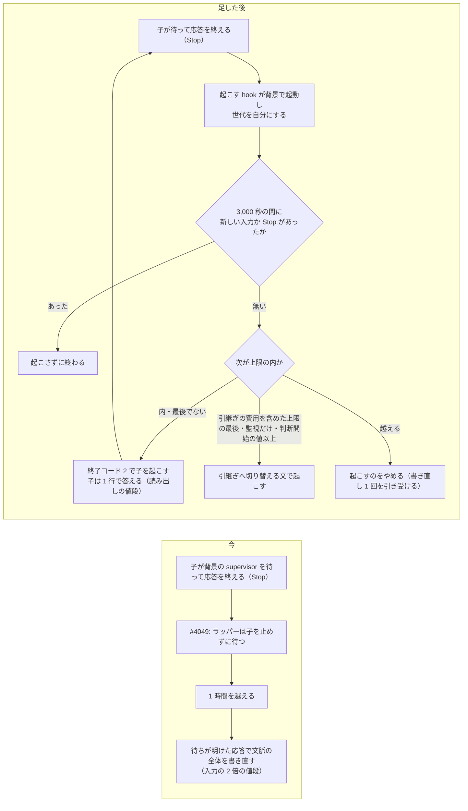
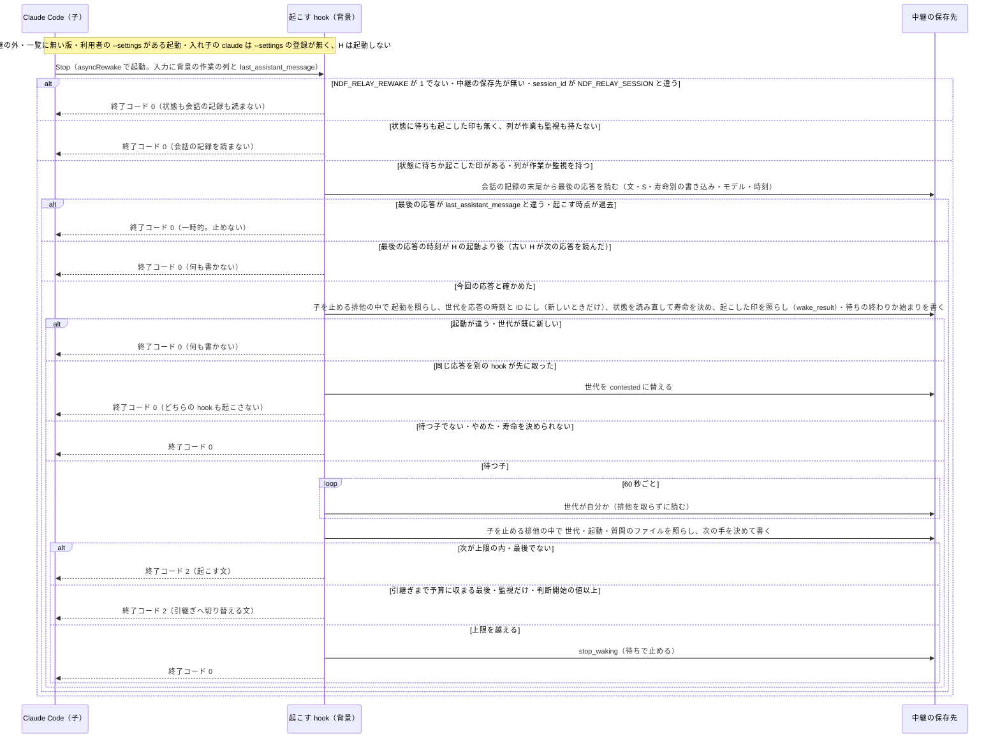

# 中継の下で待つ子のキャッシュ: 寿命の手前で起こし、書き直し 1 回分の費用に届いたらやめる（#4068 #4199）

中継の下で背景の作業か監視を待つ子は、キャッシュの寿命（主の会話は 1 時間）を越えて待つと、待ちが明けた最初の応答で文脈の全体を入力の 2 倍の値段で書き直す。子の応答の終わり（Stop）に `asyncRewake` で背景に起動する hook を 1 つ足し、寿命の手前（最後の応答から 3,000 秒）で終了コード 2 で子を起こして、読み出しの値段（Opus 5.5 は入力の 0.05 倍）でキャッシュを保つ。起こした費用の合計が書き直し 1 回に届く回数でやめ、監視だけを待つ大きな子は、引継ぎの費用まで含めて書き直し 1 回に収まる最後の起床で引継ぎへ切り替え、寿命は子を止める排他の中の最新の状態から決め、費用は寿命別の書き込みにそれぞれの倍率を掛けて数える。採らなかった案は決定ごとに、既定値の根拠は「測った結果」と「外部の調査」にある。

## 今の姿

要求と受け入れ条件は次の 2 本にある。

| 課題 | 要求仕様のコピー | 正 |
| --- | --- | --- |
| #4068 | [issue-4068-requirements.md](./issue-4068-requirements.md) | 課題 #4068 の本文 |
| #4199 | [issue-4199-requirements.md](./issue-4199-requirements.md) | 課題 #4199 の本文 |

この設計は #4049 と #3995 の上に立ち、両方の実装の後に実装する。今回の応答の確かめと文脈の量の読み取りには、#4089 の読み手を使う。

| 課題 | 使うもの | 文書 |
| --- | --- | --- |
| #4049 | 背景の作業の分け方 | 確定仕様 [ndf-relay-background-wait.md](../docs/specifications/ndf-relay-background-wait.md) |
| #3995 | 判断開始の値 | [issue-3995-design.md](https://github.com/devbasex/ai-plugins/blob/e37fe7d5056c1f9231210a6912a780e5503c3c9e/issues/issue-3995-design.md) |
| #4089 | 読み手 | [issue-4089-design.md](./issue-4089-design.md) |

**2 つの課題を 1 本にまとめた理由（共通の原因）**: どちらも、起こす hook が会話の記録から寿命と費用を決める同じ部品の規則の欠けである。#4068 はその部品を足し、#4199 はその部品の寿命の補い（排他の外の古い値を使う）と費用の数え方（1 つの寿命の倍率で数える）の欠けを、実装の前に直す。#4199 の 3 つの欠けは #4068 の決定 2・4・9 の規則の中にあり、別の文書に分けると同じ規則を 2 か所が持つ。

- 待ちは長い。2026-10-24〜11-22 のこのマシンの主の会話では、20,000 token 以上の文脈のまま応答の間が 1 時間を越えたのが 276 回あった。そのうち 263 回で、次の応答が書き直した（「測った結果」）
- 中継のラッパーは子の端末へ利用者の入力しか書かない（`relay.md` の「承認ゲートを越えない守り」）。10 系の入力注入（#931）は 11 系に無い
- Claude Code は、背景で動く hook が終了コード 2 で終わると、入力を待つ会話をすぐに起こす（`asyncRewake`）。NDF の hook はこれを使っていない

## 文脈と制約

- **待つ子を止めない。** 作業が残る子を止めると作業を失う（#4049 の決定 4・7）。この設計は、作業の子を起こすか起こさないかだけを決める
- **子の端末へ書かない。** 端末へ書いた文は人の入力と区別できず、質問の表示中に書くと選択肢 1 を決める（10 系の実測。`docs/specifications/ndf-relay-install-and-restart.md` の「入力注入の実測と不変条件」）
- **費用は、入力の値段を 1 とした倍率で比べる。** 書き込みは 5 分の寿命で 1.25 倍、1 時間で 2 倍である。読み出しは多くのモデルで 0.1 倍、Opus 5.5 と Sonnet 5.5 で 0.05 倍、Fable 5.1・5.2 と Mythos 5.1・5.2 で 0.025 倍である。出力は Opus 5.5 で入力の 5 倍である（「外部の調査」の PRD1・PRD2）
- **待ちの長さは前もって分からない。** supervisor の 1 フェーズ・CI・承認の取り次ぎで長さが変わり、見込みを出す手段は今無い
- **寿命と使ったモデルは、公式の契約では渡らない。** 会話の記録（`~/.claude/projects/…/<会話>.jsonl`）の `usage` と `message.model` から読む。この形は Claude Code の公開の契約ではない（#4049 が読む Stop の入力の列と同じ立場）
- **Stop の時点で、最後の応答が会話の記録に載っているとは限らない。** 公式の文書は、版によっては Stop の時点で最後の応答が記録に無いと書く（PRD3）
- **定額のプランの費用は、週の利用上限の消費である。** 書き込みと読み出しを上限にどの比で数えるかは公開されていない。従量の値段の比で近似する（#4068 の前提 4）
- 実装の順は #3995 → lracct（#3604・#3864）→ #4049 → この課題である

## 解き方の全体像

1. **中継の子の Stop にだけ、起こす hook を足す。** プラグインの hook の登録（`hooks/claude.json`）には足さない。ラッパーは子を起動するとき、`--settings` で Stop に `asyncRewake: true` の登録を 1 つ渡す。渡すのは、起動する claude の版が実測に通った版の一覧（`cache.rewake` の `versions`）のどれかと完全に一致し、利用者が `--settings` を指定していないときだけである。登録を渡すときだけ、子の環境に `NDF_RELAY_REWAKE=1` も渡す（#4068 の受け入れ条件 3 の「対応を確かめた版でだけ渡す環境変数」）。中継の外の会話・一覧に無い版・利用者が `--settings` を指定した起動・入れ子の claude（`--settings` を受け継がない）では、この hook のプロセスは起動しない。登録を受けた子では、子が応答を終えるたびに Claude Code が背景で hook を 1 つ起動する。hook は `NDF_RELAY_REWAKE` が `1` でなければ、登録の有無に依らず眠らずにすぐ終わる（登録の無い起動から入口を直接呼んでも眠りを作らない）。入力の `session_id` がラッパーの渡す `NDF_RELAY_SESSION` と違えばすぐ終わる。状態に待ちも起こした印も無く、Stop の入力の背景の作業の列が作業も監視も持たない会話では、会話の記録を読まずにここで終わる（決定 1・6・7）
2. **今回の応答を確かめ、世代を自分にする。** 会話の記録の最後の応答が、Stop の入力の `last_assistant_message` と同じ文で、その記録の時刻が hook の起動の時刻以前かを照らす。文が違えば今回の応答はまだ記録に無いので、起こさずに終わる。時刻が起動より後なら、遅れて動いた古い hook が次の応答を読んだので、何も書かずに終わる。どちらも通れば、排他の中で、その応答（`message.id`）を別の hook が先に取っていないかを照らす。1 つの応答を終えた Stop は 1 つなので、2 つの hook が同じ応答を取れば、どちらが今回の Stop かを決められない。そのときは世代を「決められない」に替え、どちらの hook も起こさない。照らしを通れば、その応答の記録の時刻と `message.id` を世代にして書き、前の hook の予約を失効させる（決定 4・6）
3. **起こす時点まで眠る。** 待つ子なら、その応答からモデル・文脈の量 `S` を読み、寿命を排他の中で決める（会話の記録から読んだ時点では応答の寿命別の書き込みだけで決め、両方 0 なら未定のまま渡す。排他の中で読み直した状態の寿命で補い、それでも未定なら待ちを始めず、`wait_start` も `n_max` も作らずに起こさない）。起こす時点（最後の応答の時刻 + 寿命 − 余白）はその寿命から決める（決定 13）。眠る間は 60 秒ごとに世代のファイルだけを見て、新しい Stop か利用者の入力（UserPromptSubmit）で世代が替わっていれば終わる（決定 2・6）
4. **起こすか、やめるか、待機を終えるか。** 今の待ちで起こした回数 `k` の次の 1 回が上限 `n_max = floor((w − r) × S / (r × S + d))` の内なら、起こす文で終了コード 2 で終わる。監視だけの子で `S` が判断開始の値以上なら、その待ちで起こした費用の累計に、引継ぎの起床と次のセグメントの始まりの書き込みを足して、判定の時の書き直し 1 回に収まる最後の 1 回を、引継ぎへ切り替える文にする。上限を越えるなら、その待ちでは起こさない（決定 3・5）
5. **起きた応答を確かめる。** 次の Stop の hook が、起こす文から始まった応答の最初のモデル呼び出しの読み出しを見る。読み出しが `S` の 9 割未満なら当たらなかったので、その会話では起こすのをやめる（決定 4）
6. **記録して測り直す。** 待ちの始まり・起こした・起きた結果・待ちの終わり・やめたを起こす記録に 1 行ずつ書き、`ndf relay cache report` が集める。起床の費用は 1 時間と 5 分の書き込みを別々に数えてそれぞれの倍率を掛け、内訳が欠けるか合計と合わない起床は費用の集計から外す。避けた書き直しは待ちが終わる直前の応答の量・寿命・モデルで数え、当たりと待ちの長さは待ちを明けた入力とその最初のモデル呼び出しで決める。値は上限の設定の `cache.*` に置く（決定 8・9・14・15）

## データ構造

**上限の設定（`plugins/ndf/contracts/limits/`。方針 1 つにつき 1 ファイル）に足す方針**（既定値は「測った結果」から決めた。ファイルの名前・スキーマと読み手の直しは詳細設計）

| 行 | 値 | 意味 |
| --- | --- | --- |
| `cache.wake` | `seconds` 600・`interval` 60 | 起こす時点の余白（寿命からこの秒を引く）と、眠る間に世代を確かめる間隔 |
| `cache.write-ratio` | `1h` 2.0・`5m` 1.25 | 寿命ごとの書き込みの倍率 |
| `cache.read-ratio` | 既定 0.1。`claude-opus-5-5`・`claude-sonnet-5-5` は 0.05。`claude-fable-5-1`・`claude-fable-5-2`・`claude-mythos-5-1`・`claude-mythos-5-2` は 0.025 | モデルごとの読み出しの倍率。表に無いモデルは既定 |
| `cache.output-ratio` | 既定 5 | 出力の倍率（集計で起こす応答の費用を出す） |
| `cache.wake-cost` | `count` 2,000 | 起こす応答 1 回の費用 `d`（入力の値段に直した token） |
| `cache.hit` | `ratio` 0.9 | 起きた応答の読み出しが `S` のこの割合以上なら当たりとみなす |
| `cache.handoff` | `calls` 4・`count` 25,000・`start` 60,000 | 引継ぎへ切り替える起床の見積り。モデル呼び出しの数（1 回ごとに `r × S` を読む）、出力と Tool の結果の書き込み（入力の値段に直した token）、次のセグメントの始まりの文脈の量 `S₀`（決定 5） |
| `cache.rewake` | `versions`（実装の最初の実測で決める） | 起こす hook を働かせてよい Claude Code の版の一覧（文字列の配列）。決定 7 の実測を通った版だけを載せ、版の文字列の完全一致で判定する。上下の範囲にしないので、一覧の 2 つの版の間にある測っていない版でも働かせない。新しい版は測り直して通ったら一覧に足す。決めるまでは空で、空なら働かせない |

判断開始の値は、#3995 の `context_thresholds.thresholds` が返す値（`NDF_CONTEXT_LIMIT` で下がった値を含む）を使い、ここに写さない。

**起こす状態（中継の保存先の `<名前>/keep-<会話>.json`）**: 会話（`session_id`）ごとに 1 つ置く。起動（ラッパーが子を起動するたびの ID）ではなく会話ごとにするのは、アカウントの替えなどで同じ会話を起動し直しても、回数とやめた理由を引き継ぐためである。

| 項目 | 意味 |
| --- | --- |
| `generation` | 最新の世代。`at`（時刻）・`by`（書き手の ID）・`message_id`（起こす hook の Stop が取った応答。ほかの書き手は空）の組。時刻の取得元は書き手ごとに決める（決定 6）。新しい時刻のときだけ書き換え、同じ時刻なら先に書いたほうを残す。ただし、同じ `message_id` を別の hook が取りに来たときは `by` を「決められない」（`contested`）に替え、どちらの hook も起こさない（決定 4） |
| `wait_id` | 今の待ちの ID（待ちが始まった Stop の世代の `at`。待ちが始まった応答の時刻でもある）。`wait_end` を書くときに消す |
| `k`・`n_max`・`spent` | 今の待ちで起こした回数と、その待ちの上限と、その待ちで起こした費用の見積りの累計（起こすたびに判定の時の `S` で `r × S + d` を足す。引継ぎの判定に使う。決定 5）。`wait_start` で `k` と `spent` を 0、`n_max` を始まりの `S` の式の値にし、`wait_end` で消す |
| `wait_stop` | 今の待ちで起こすのをやめた理由（上限・起床を照らせない）。その待ちの間だけ起こさず、`wait_end` で消す。次の待ちでは起こす。`wait_end` は、今回の応答を始めた入力が通常の入力（利用者の入力・背景の作業の知らせ）と確かめた Stop でだけ書く。背景の作業の件数は待ちを明ける根拠にしない。待つ子でない Stop（背景が 0 件）でも、始めた入力が起床の文か、形を決められなければ待ちを明けない（照らせない応答を `wait_end` の当たりの根拠にしない）。そのため照らせない起床が続いても `k` と `wait_stop` は戻らない。待つ子でない Stop では眠らないので、待ちが残っても起こさない |
| `ttl` | 最後に分かった寿命（`1h`・`5m`）。分かった寿命でだけ書き換え、寿命の分からない応答で消さない（決定 13） |
| `last` | 照らし終えた最後の応答の `message_id`・`tokens`・`model`・`ttl`（排他の中で決めた寿命）・`at`。`wait_end` が待ちの終わりの直前の応答の量・寿命・モデルを書くのに使う（決定 15）。待ちの間の `last.ttl` は必ず分かっている（寿命の分からない応答では待ちを始めず、待ちの間は状態の `ttl` で補えるため） |
| `opened` | 待ちの間に UserPromptSubmit の guard が受けた通常の入力の時刻（待ちが在り、`pending` が無いか、`pending` が在っても入力の `prompt` が起床の文でないときに書く。実測 5）。次の Stop で、今回の応答を始めた入力の行が末尾の範囲から押し出されて照らせなくても、これが最後の応答より後なら待ちを明ける（`wait_end` の当たりと読み出しは null）。`wait_end` で消す |
| `pending` | 起こした直後の印（`wake_id`・`text`（`wake` か `end_wait`。必須）・起こす前の `S`・起こした時刻・起こす前の最後の応答の ID）。次の Stop で照らして消す。`wake` の行が書けずに起こした起床でも、`wake_result` の `text` はこの印から写す（行からは復元しない） |
| `stopped` | この会話で起こすのをやめた理由（当たらない・記録の形が違う・引継ぎを求めた）。在ればその会話では二度と起こさない |
| `noted` | 一時的な理由（記録が読めない・今回の応答が未記録・起こす時点が過去・寿命がまだ分からない）のうち、`stop_waking` を書き終えた理由の集合。止めずに次の Stop で読み直し、同じ理由の行は会話で 1 度だけ書く |

止める範囲は理由で決める。会話の記録の形の変化と、起こしても当たらないこと（配送の遅れ・寿命の設定）は、その会話の続く待ちでも変わらないので会話で止める。引継ぎを求めた後は、子が次のセグメントへ移る前提なので会話で止める（#4068 の受け入れ条件 5）。上限は待ちの長さで決まるので、待ちで止める。一時的な失敗は止めない。

**起こす記録（中継の保存先の `<名前>/cache-log.jsonl`）**: 1 行 1 出来事で、どの行も `kind`・`at`・`launch`・`session_id`・`wait_id` を持つ。

| `kind` | いつ | 足す項目 |
| --- | --- | --- |
| `wait_start` | 待つ子の Stop で、待ちが始まった | `tokens`・`ttl`・`model`・`n_max` |
| `wake` | 起こした（終了コード 2） | `wake_id`（起こすたびに新しい ID）・`tokens`・`age`（最後の応答から起こすまでの秒）・`k`・`n_max`・`spent`（この起床を足した後の累計）・`text`（`wake` か `end_wait`） |
| `wake_result` | 起こす文から始まった応答の Stop | `wake_id`・`text`（`wake` か `end_wait`。印から写す）・`hit`（真偽。起床の最初のモデル呼び出しの読み出しで決める。最初の呼び出しの書き込みが両方 0 でも読み出しで決め、行を書く。最初の呼び出しが末尾の範囲から欠ければ null）・`tokens`（起こす前の `S`）・`first_read`（最初の呼び出しの読み出し）・`calls`（起床に属するモデル呼び出しの数。起床の文から次の入力までの `message.id` の数で、Tool の結果は入力に数えない）・`cache_read`・`cache_write_1h`・`cache_write_5m`・`output`（どれも起床に属する全呼び出しの合計）・`priced`（真偽。寿命別の書き込みを全呼び出しで読め、2 つの和が書き込みの合計と合ったか。偽なら 2 つの書き込みの合計を書かない）・`model`・`ttl`（待ちの寿命）・`w_1h`・`w_5m`・`r`・`out`（費用の計算に使った倍率）（決定 14） |
| `wait_end` | 待ちの後の、通常の入力で始まった応答の Stop | `opened_at`（待ちを明けた入力の行の時刻）・`age`（`last` の時刻から `opened_at` までの秒）・`k`・`hit`（待ちを明けた入力の最初のモデル呼び出しの読み出しが `tokens` の 9 割以上か）・`cache_read`（その最初の呼び出しの読み出し）・`tokens`・`model`・`ttl`・`w`・`r`（この 5 つは、待ちが終わる直前の応答のもの。状態の `last` を更新する前に読んだ値と、その寿命とモデルの倍率）（決定 15）。行の `at` は Stop の時刻で、当たりと待ちの長さには使わない。入力の行を照らせず `opened` で明けた待ちでは、`opened_at` は guard の時刻、`hit`・`cache_read` は null |
| `stop_waking` | 起こすのをやめた・一時的に起こさなかった | `reason`・`scope`（`session`・`wait`・`once`）・`k`・`n_max` |

**登録の渡し方**: ラッパーが子の起動の引数に `--settings <JSON>` を足す。足すのは、次の 3 つがそろうときだけである。

- 起動する claude の版が `cache.rewake` の `versions` のどれかと完全に一致する
- 受け継ぐ引数（`claude_args` の `carried`）に利用者の `--settings` が無い。`--settings <値>` と `--settings=<値>` のどちらの形も指定ありとみなす
- 宣言した `cache.wake` の値で、起こす時点が背景の hook の `timeout` の内に届く。確かめる間隔が 0 より大きく、待ち 1 回で世代を確かめる回数（(1 時間 − 余白) ÷ 間隔 の切り上げ）が 300 回以内で（既定の 600・60 で 50 回。余白 600 で間隔 9 秒は 334 回、余白 550 で間隔 10 秒は 305 回で越える）、余白が 0 以上 1 時間未満で、1 時間 − 余白 + 間隔 + 背景の予算の `margin` が `timeout` 以下（既定の 600・60・240 で 3,300 秒ちょうど）。届かなければ登録を足さず、ラッパーの記録に理由を残し、`ndf check` も破れとする（利用者が余白を 120 秒にすると 3,780 秒で越えるので、背景の hook が毎回起こす前に打ち切られる）

利用者の `--settings` があるときは登録を足さず、利用者の引数をそのまま初回の起動と再開に渡す（決定 7）。登録は、起動先を決める前の起動引数（`_launch_target` へ渡す引数）に足す。API キーの従量の子では、今の `account_choice._compose` がその起動引数の `--settings`（1 つだけ）を読み、`apiKeyHelper` と `ConfigChange` の hook を合わせた 1 つの `--settings` に作り直すので、起こす登録も同じ 1 つに残る。起動先を決めた後に別の `--settings` を足すことはしない（`--settings` は最後の 1 つだけが効くので、子の認証の設定か起こす登録のどちらかが効かなくなる）。中身は Stop の `asyncRewake: true` の登録 1 つで、プラグインの登録と並んで動く。プラグインの根の環境変数は `--settings` の hook に渡らないので、command は `hooks/entry.py` の絶対パスで書く。登録を足した起動にだけ、子の環境へ `NDF_RELAY_REWAKE=1` を足す（登録を足さない起動では渡さない）。hook はこの変数を自分で確かめ、無ければすぐ終わる（#4068 の受け入れ条件 3）。登録と変数の両方で限るのは、登録だけでは、登録の無い起動から `rewake` の入口を直接呼んだときに眠りを防げないためである。対象の会話は #4049 の `NDF_RELAY_SESSION` でも限る。

## 処理の流れ

UserPromptSubmit の guard（今の `turn` に足す）は、中継の下（`session_id` が `NDF_RELAY_SESSION` と同じ）で働く。排他の中でまず次の 2 つを照らす。

- ラッパーの今の起動が自分の起動（`NDF_RELAY_LAUNCH`）か
- その起動に起こす hook の登録を渡したか（ラッパーが今の起動の記録に書く）

どちらも満たすときだけ、世代をその入力の時刻に書き換え、眠る hook の予約を失効させる。起こす状態のファイルがまだ無い会話では、世代だけを持つ状態を作る。最初の待ちで背景の hook より先に入力が届いても、その入力で後から動く hook を失効させるためである。起きた応答の前にも UserPromptSubmit が発火する（実測）。起こす hook は排他の中で印を書いてから終わるので、その UserPromptSubmit が世代を替えても、起こした事実は失われない。

起こす文（既定）: `【ndf-relay】キャッシュを保つための起床（<k>/<n_max>）。Tool を呼ばずに「待機を続ける」の 1 行だけで応答を終える。`
引継ぎへ切り替える文（既定）: `【ndf-relay】キャッシュを起こす回数の上限に達した。背景は監視だけなので待機を終える。#3995 の引継ぎの手順（張っている監視の命令とカーソルを引継ぎ文書に残す）で引継ぎ文書を書き、ndf-next のブロックで次のセグメントへ切り替える。`

## 決定の記録

### 決定 1: 子の端末へ書かずに起こすため、Stop に `asyncRewake` の背景の hook を足し、終了コード 2 で起こす

- **質問**: 入力を待つ子を、誰がどの手段で起こすか
- **選んだ案**: 中継のラッパーが起動する子にだけ、`--settings` で Stop に `asyncRewake: true` の hook を 1 つ足す（プラグインの登録には足さない）。Claude Code はその子の Stop ごとにこの hook を背景で起動する。hook が終了コード 2 で終わると、入力を待つ会話をすぐに起こし、標準エラーの文を system reminder として渡す（公式の文書と 2026-11-22 の実測。PRD3）。起きた応答の Stop がまた hook を起動するので、待つ間は起こす間隔ごとに起きる鎖になる。ラッパーは見回りを足さない
- 採らなかった案:
  - ラッパーが子の端末へ短い文を書く。端末へ書いた文は人の入力と区別できず、質問の表示中には選択肢 1 を決める。10 系の不変条件 G1〜G4 を作り直すことになる
  - モデル自身に `ScheduleWakeup`・`CronCreate` で起床を予約させる。手順への追従に頼るので、予約を忘れた待ちで外れる。仕組みで進めるのが Value 3 である
  - 子に背景の `sleep` を張らせ、その終わりの知らせで起きる。同じく追従に頼り、#4049 の監視として数えられる
  - 別のプロセスから `claude -p --resume <会話> --fork-session` で同じ前置きを読ませる。対話と `-p` で system prompt と Tool の一覧が同じかを確かめていない。違えば前置きが一致せず、起こせない
  - プラグインの登録（`hooks/claude.json`）に足し、hook の中で環境変数を見てすぐ終わる。プラグインを入れた全ての会話の Stop ごとにプロセスが 1 つ増え、すぐ終わっても起動の費用は残る
- **代償**: 中継の子の Stop ごとに、背景の hook のプロセスが 1 つ起動する（中継の外の会話では起動しない）。待ち・起こした印・背景の作業の無い会話では、会話の記録を読まずにすぐ終わる。待つ子では、新しい Stop か入力が来るまで眠る（決定 6）。子の会話には、起こすたびに起こす文と 1 行の返事が残る（実測で書き込み 319 token・出力 139 token）
- **根拠**: Value 2・Value 3（MVV 版 11）

### 決定 2: 寿命の内に確かに起こすため、起こす時点を最後の応答の時刻から寿命 − 600 秒にし、5 分の寿命では起こさない

- **質問**: 最後の応答から何秒で起こすか。寿命はどう決めるか
- **選んだ案**: 起こす時点 = 最後の応答の時刻 + 寿命 − 余白（`cache.wake.seconds` 600）。1 時間の寿命なら 3,000 秒である。寿命は要求の始まりから数えるが、記録の時刻は応答の終わりなので、余白は最後の要求 1 回の長さと、世代を確かめる間隔（60 秒）を受ける。寿命は最後の応答の `usage.cache_creation` で次の表のとおり決める

| 1 時間の書き込み | 5 分の書き込み | 寿命 |
| --- | --- | --- |
| 正 | 正か 0 | 1 時間（長い寿命の項目が前に並ぶ。PRD1） |
| 0 | 正 | 5 分。余白 600 秒が寿命以上なので起こさない（#4068 の受け入れ条件 1 の「起こす間隔」が 0 以下になる） |
| 0 | 0 | 子を止める排他の中で読み直した状態の `ttl`（前に分かった寿命）。無ければ決められないので起こさない（決定 13） |
| 項目が無い・型が違う | | 決められないので起こさない（決定 4） |

- 採らなかった案: 寿命 − 300 秒（55 分）。55〜60 分の間の当たりは 106 / 120 で、50〜55 分の 39 / 39 より下がる。余白を詰める根拠が無い。ラッパーが見る子の出力の静かな時間から数える案も採らない。キャッシュの読みと関係しない
- **代償**: 起こす回数が 1 時間に 1.2 回になる（55 分より 1 割多い）。応答の長さと配送の遅れが余白を越えれば、起こしても当たらない。そのときは決定 4 が起こすのをやめる。5 分の寿命の会話（主の会話では少ない）は今のまま切れる
- **根拠**: Value 2（MVV 版 11）。方針 7（#4069）: 余白は起こす記録の `wake` の `age` と `wake_result` の `hit` で測り直す（決定 9）

### 決定 3: 待ちの長さを知らずに費用を抑えるため、起こした費用の合計が書き直し 1 回に届く回数で起こすのをやめる

- **質問**: 起こし続けるか、どこでやめるか（待ちの長さは前もって分からない）
- **選んだ案**: 起こす 1 回の費用は `r × S + d` で、書き直し 1 回の追加の費用は `(w − r) × S` である。今の待ちで起こした回数 `k` が `n_max = floor((w − r) × S / (r × S + d))` に達するまで起こし、達したらその待ちでは起こさない。上限で止めるのは待ちの単位で、待ちが明けて（`wait_end`）次の待ちが始まれば（`wait_start`）、`k` を 0 にし、`n_max` をその始まりの `S` で決め直す。`S` と倍率が変わらない限り、待ちが上限の前に明ければ書き直しを丸ごと避け、上限を越えても費用は「何もしない」の 2 倍を越えない（借りるか買うかの問題の、損益の分かれ目で買う決め方）。`n_max` は待ちの始まりの `S` で決め、待ちの間は変えない
- 上限の例（Opus 5.5・1 時間・`d` 2,000）: `S` = 20,000 で 13 回、100,000 で 27 回、400,000 で 35 回、500,000 で 36 回。起こす間隔 3,000 秒なら 11〜30 時間に当たる。読み出し 0.1 倍のモデルでは、100,000〜500,000 で 15〜18 回（12.5〜15 時間）
- 採らなかった案:
  - 待ちの見込みの時間で決める。見込みを出す手段が無い。起こす記録に待ちの長さが溜まれば、工程ごとの見込みで上限を縮める改善を後から足せる
  - 上限なしで起こし続ける。止まった背景の作業を待つ子では、費用が際限なく増える
  - 文脈の量の下限を置き、小さい子は起こさない。式は `d` を含むので、小さい文脈でも起こすほうが安いと出る
- **代償**: 上限を越えて続く待ちでは、起こした費用（書き直し 1 回分）と書き直しの両方を払う。過去の 3,000 秒以上の 435 回の待ちに当てると、上限で止まるのは 4 回で、4 回とも最後の起床から寿命を越えて書き直しになった（「測った結果」）。50〜60 分で自然に当たる待ちにも 1 回ずつ起こす費用が掛かる。2 倍の上限は `S` と倍率を固定した見積りで、実際の費用の保証ではない
- **根拠**: Value 2（MVV 版 11）。方針 1（#4069）: 起こす費用は `r × S` で文脈の大きさに比例し、上限は書き直しの `(w − r) × S` との比で決まる

### 決定 4: 公式の契約に無い記録の形を使う代わりに、形が違えば起こさず、起こした結果が当たらなければやめる

- **質問**: 寿命・モデル・文脈の量・最後の応答の時刻をどこから得るか。形が変わったときにどう落ちるか
- **選んだ案**:
  - Stop の入力の `transcript_path` の末尾を、#4089 の共有の `read_tail` で、上限の設定の `hook.transcript-tail` の大きさだけ読む（利用者が直した読み取りの上限がそのまま効く）。読めなければ空の文字列が返り、今回の応答が未記録と同じ一時的な失敗になる。最後の応答は #4089 の `last_context` が決める（同じ `message.id` の行は 1 つに数える）。起こす hook は自分で末尾を読み直さない
  - **今回の Stop の応答かを照らす**: 最後の応答の文の部分を、Stop の入力の `last_assistant_message` と比べる。文の部分は、同じ `message.id` の行の `text` をつないだものである。同じときだけ、今回の応答とする。違う・入力に `last_assistant_message` が無いときは、今回の応答がまだ記録に無い（PRD3 の版）か、前の応答だけが完全な行として残っている。前の応答の時刻で数えると起こす時点が過去になり、Stop の直後に起こす鎖になるので、起こさない。これは一時的な失敗として扱い、止めない（次の Stop で読み直す）
  - **今回の応答の記録は hook の起動より前に書かれている**: 文の一致だけでは今回の応答を一つに決められない。既定の起床の返事は毎回「待機を続ける」なので、同じ文の応答は設計の上で繰り返し現れる。遅れて動いた古い Stop の hook が次の同じ文の応答を読むと、古い Stop の作業と監視の件数と、新しい応答の時刻を組み合わせて世代を取ってしまう。そこで、2 つの照らしを重ねる
    - **時刻の照らし**: hook が動き始めた時刻（`run` の最初の時計）を持つ。照らした応答の `timestamp` がそれより後なら、その応答は自分の Stop の後に書かれたものとして、何も書かずに終わる（世代も取らない）。ただし、これで弾けるのは、古い hook が動き始めた後に次の応答が書かれた場合だけである。Python の `run` が最初の時計を打つのは、Claude Code が hook を起動してからインタプリタが立ち上がった後なので、機械が混んでいれば、古い hook が動き始める前に次の同じ文の応答が書かれ得る。その応答の `timestamp` は `started` 以前なので、時刻の照らしを通る
    - **応答の取り合いの照らし**: 1 つの応答を終えた Stop は 1 つで、その Stop の hook も 1 つである。そこで世代に、取った応答の `message.id` を持たせる。排他の中で世代の `message_id` が照らした応答と同じで、書き手が自分でなければ、2 つの hook が 1 つの応答を取り合っている。どちらが今回の Stop の hook かは順序からも時刻からも決められないので、世代の `by` を `contested` に替えて終わる。先に取った hook は眠りの中で世代が替わったのを見て終わり、どちらも予約を作らない（起こさないので、余分なモデル呼び出しは起きない）。取り合いの後の状態の待ち・回数は残り、次の Stop の hook が今までどおり決める
    - 版が Stop の入力に応答の ID を載せるなら（決定 7 の実測 9）、その ID と `message.id` の一致を、文と時刻の照らしの代わりに使う。ID で結べば取り合いは起きない
    - 決定 7 の実測 9 では、次を確かめるまで版の門を開けない。今回の応答の記録の後に背景の hook が起動すること。古い hook の動き始めが次の応答の記録より後になる順が、実際に起き得るか（起き得ても上の取り合いの照らしで予約を作らない）。取り合いの照らしが、その順で 2 つの hook のどちらにも起こさせないこと
  - **起こす時点が過去なら起こさない**: 照らした応答の時刻から決めた起こす時点が、すでに今の時刻以前なら（文が偶然同じ前の応答を読んだときの守り）、起こさずに一時的な失敗とする
  - 今回の応答と確かめた行に `usage`・`timestamp`・`message.model` がそろわなければ、前の行へさかのぼらずに「記録の形が違う」とする
  - `S` は `usage` の入力・読み出し・書き込みの合計、寿命は決定 2 の表、モデルは `message.model`、時刻は `timestamp` である
  - 起こさないときの止める範囲は「データ構造」の起こす状態の表のとおりである。記録の形が違うときは会話で止め（`stopped`）、一時的な失敗（記録が読めない・今回の応答が未記録・起こす時点が過去・寿命がまだ分からない）は止めない。どちらも `stop_waking` は同じ理由で会話に 1 度だけ書く
  - 起こした印（`pending`）がある Stop では、起こす前の最後の応答（印の ID）の直後にある最初の入力の行だけを見る。その行の形で次のとおり扱う。末尾は手順の頭と同じ `read_tail` の文字列で、読み直さない

    | 最初の入力の形 | 扱い |
    | --- | --- |
    | 起床の文の形（決定 7 の実測 8 で決めた形） | その次から次の入力（Tool の結果は入力に数えない）の手前までのモデル呼び出しを、その起床に属する呼び出しとする。当たりは最初の呼び出しの読み出しで決める。それが印の `S` の 9 割（`cache.hit.ratio`）未満なら当たらなかったので、`stopped` に理由を書き、その会話では起こさない。最初の呼び出しの書き込みが両方 0 でも、読み出しで当たりを決めて `wake_result` を書く。起床の実費は属する全呼び出しの合計で記録する（引継ぎへ切り替える文の起床は Tool を使い、呼び出しが複数になる） |
    | 印の ID の応答が末尾の範囲に無い（起床の後の大きな Tool の結果で、読み取りの上限の外へ押し出された） | 起床に属する呼び出しを数えられないので、当たりを判じず（`hit` は null）、`priced` を偽にした `wake_result` を書いて印を消す。範囲の欠けは記録の形の変化ではないので、`stopped` も `wait_stop` も書かない。集計はこの起床を当たりの率・`d`・実費から外し、その待ちを `unpriced_waits` に数える。印の ID の応答が範囲に在れば、その後の行はすべて範囲に在る（末尾は連続して読む）ので、途中の呼び出しだけが欠けることは無い |
    | 利用者の入力か背景の作業の知らせ | その先は探さずに当たりを判じず、印を消す（先に通常の入力が応答した。#4068 の受け入れ条件 8） |
    | 決められない（起床の文の形でも通常の入力の形でもない） | 当たりを判じずに印を消し、その待ちでは起こさない（`wait_stop` に「起床を照らせない」。照らせない起床を繰り返さない）。この `wait_stop` は、通常の入力で始まった応答で待ちが明けたと確かめるまで消さない（「データ構造」の `wait_stop`）。同じ Stop で待ちを明けて回数 0 の待ちを作り直すことはしない |
  - **待ちを明ける Stop**: 待ちがある Stop では、今回の応答をさかのぼって、それを始めた入力（Tool の結果でない最初の入力の行）を探す。その入力と、入力の直後の最初のモデル呼び出しを「待ちを明けた入力」と「待ちを明けた最初の呼び出し」と呼ぶ。今回の応答の Stop の時刻や最後の呼び出しとは別のもので、次のとおり使い分ける

    | 値 | 取り出し元 |
    | --- | --- |
    | 待ちを明けるか | 待ちを明けた入力の形だけで決める。通常の入力なら明け、起床の文か決められない（形が分からない・末尾の範囲に無い）なら明けない。背景の作業の件数が 0 でも、この判定を先にする（背景の件数は待ちを明ける根拠にしない） |
    | `wait_end` の当たり・読み出し | 待ちを明けた最初の呼び出しの読み出し。待ちを明けた後の Tool の呼び出しで読み出しが戻っても、当たりにしない（最初の呼び出しで書き直したなら、避けられなかった） |
    | 待ちの長さ・`age` | 待ちを明けた入力の行の時刻（`opened_at`）まで。今回の応答の Stop の時刻までにしない（応答に掛かった時間を待ちに数えない） |

    例: 寿命 1 時間・`S` 100,000 の待ちを、最後の起床から 70 分後の利用者の入力が明けた。最初の呼び出しは読み出し 20,000（書き直した）で、その後の Tool の呼び出しは読み出し 101,000 だった。`wait_end` の `hit` は偽で、避けた書き直しに数えない
  - UserPromptSubmit の `prompt`（決定 10 の見分け）は会話の記録に残らない。起きた応答の当たりの判定には使えないので、実測 8 で記録の上の形を決めるまで版の門（決定 7）を開けない
- 採らなかった案: 寿命を 1 時間と決め打つ。サブエージェントは 5 分で書いている（実測）。Claude Code の既定が変われば、当たらない起床に費用を払い続ける。`usage` が読めないときも既定の値で起こす案も採らない。形の変化に気付かないまま費用を使う
- **代償**: Claude Code が記録の形を変えた版では、直すまで起こさない（今の振る舞いに戻るだけで、作業は失わない）
- **根拠**: Value 2・Value 3（MVV 版 11）。公式に無くても使えるものは使い、形の変化を検知して代わりの手段（何もしない）へ落とす（起動指示）

### 決定 5: 課題の候補「作業の終わりの後の引継ぎを早める」を採らず、監視だけの子は引継ぎの費用を含めた上限の最後の起床で引継ぎへ切り替え、作業の子は書き直しを引き受ける

- **質問**: 上限に達した後、待機を終えるか（Value 2「見合わなければ待機を終える」）。終えるなら、どの子をどう終えるか
- **選んだ案**:
  - **作業が残る子**: 待機は終えない。終えるには子を止めることになり、作業を失う（#4049）。その待ちでは起こすのをやめ（`wait_stop`）、待ちが明けたときの書き直し 1 回を引き受ける。次の待ちでは改めて起こす
  - **監視だけの子**（`ndf lanes wait` を張るオーガナイザーなど）: 判定の時の `S` が判断開始の値以上なら、引継ぎまで含めた費用が書き直し 1 回に収まる最後の起床を、引継ぎへ切り替える文にする（下の「引継ぎの判定」）。子は温かいキャッシュのまま引継ぎ文書を書き、`ndf-next` のブロックで次のセグメントへ切り替える（#4049 で、監視だけならマーカーを書いて切り替わる）。監視は次のセグメントが引継ぎ文書から張り直す（#3995 の引継ぎの手順）。この文で起こした後は `stopped` に「引継ぎを求めた」と書き、子が従わなくても二度は求めない。引継ぎが予算に収まらなければ求めず、`n_max` まで起こす文で起こしてやめる。`n_max` が 0 なら起こさず、求めもしない
  - **上限に含める費用**: `n_max` が予算に入れるのは、通常の起床の `r × S + d` だけである。引継ぎの起床はそれより重いので、`n_max` の最後の 1 回を引継ぎに替えると書き直し 1 回の予算を越える。そこで、引継ぎの起床の費用 `C_h(S)` を次の 3 つの和とする
    - 引継ぎの起床のモデル呼び出しの読み出し `calls × r × S`（Tool を呼ぶたびに文脈の全体を読む。`cache.handoff.calls`）
    - 引継ぎ文書の出力と Tool の結果の書き込み `count`（入力の値段に直した token。`cache.handoff.count`）
    - 次のセグメントの始まりの書き込み `w × S₀`（`S₀` は `cache.handoff.start`）
  - **引継ぎの判定**（待ちの始まりの `S` で回数を固定しない）: 起こすたびに文脈は起こす文と返事の分だけ増える（実測で 1 回に数百 token）ので、待ちの始まりの `S` で引継ぎの回を決めると、起床と引継ぎの読み出しがその分だけ見積りより増え、予算を越え得る。そこで、待ちの状態に、その待ちで起こした費用の累計 `spent`（起こすたびに、その判定の時の `S` で `r × S + d` を足す。`wait_start` で 0）を持ち、判定の時の `S` で次のとおり決める。予算は、その時点で引き継がなければ払う書き直し `B(S) = (w − r) × S` である
    - 収まる: `spent + C_h(S) ≤ B(S)`
    - 引継ぎの文にするのは、監視だけ・`S` が判断開始の値以上・今引き継げば収まり、かつ次のどちらかのとき: 次の 1 回が `n_max` の最後（`k + 1 = n_max`）である。もう 1 回起こすと収まらなくなる（`spent + (r × S + d) + C_h(S) > B(S)`）
    - 保証: 待ちの間に `S` が減らなければ、引継ぎまでの費用の合計は、引き継いだ時の `B(S)` を越えない。前の判定で「もう 1 回起こしても収まる」を確かめており、`S` が増える分は `B` が `(w − r)` の傾きで、`C_h` が `calls × r` の傾きで増える（既定の値で 1.95 と 0.2）ので、前の判定の余裕は減らない。`S` が減って（圧縮など）収まらなくなったときは引継ぎを求めず、`n_max` まで起こしてやめる（書き直しを引き受ける。作業の子と同じ）
    - `d` は測る前の見積りで、`spent` も見積りの累計である（決定 3 の `n_max` と同じ立場）。実際の費用は `wake_result` の実費で測り直す（決定 9）

    #4068 の受け入れ条件 5 の「上限の内の最後の 1 回」は、監視だけで判断開始の値以上の子では、この判定が選ぶ回を指す（受け入れ条件 4 の `n_max` は、作業の子と引継ぎを求めない子の上限で、待ちの始まりの `S` で決める）。例（Opus 5.5・1 時間・`d` 2,000・既定の `calls` 4・`count` 25,000・`start` 60,000。`S` 250,000 の待ちで `n_max` 33）:

    | 起床ごとの `S` の増え方 | 引継ぎの回 | 引継ぎの時の `S` | 引継ぎまでの費用の合計 | `B(S)` |
    | --- | --- | --- | --- | --- |
    | 増えない | 21 回目 | 250,000 | 20 × 14,500 + 195,000 = 485,000 | 487,500 |
    | 1 回に 300 | 21 回目 | 256,000 | 292,850 + 196,200 = 489,050 | 499,200 |

    2 行目を待ちの始まりの `S` で固定した回数と費用で数えると、合計 489,050 が始まりの `B` の 487,500 を越える。判定の時の `S` で数えれば、引き継がなければ払う書き直し（256,000 の書き直しで 499,200）に収まる。引継ぎの後の次のセグメントの起床と応答は、その会話の次の待ちの費用で、この予算には含めない（次のセグメントは別の会話で、`S₀` から改めて上限を決める）
  - **最後の 1 回で引き継ぐ理由**（比べた 3 つ。`S` 250,000・既定の値）:

    | 案 | 待ちが起床 2 回で明けたとき | 待ちが上限を越えて続いたとき |
    | --- | --- | --- |
    | 最初の起床で引き継ぐ | 195,000（引継ぎを毎回払い、文脈も捨てる） | 195,000 |
    | 引継ぎの費用を含めた上限の最後で引き継ぐ（選んだ案） | 29,000（起こすだけで済み、文脈を保つ） | 485,000 |
    | 引き継がず、最後まで起こし続ける | 29,000 | 33 × 14,500 + 487,500 = 966,000（書き直しも払う） |

    待ちの長さは前もって分からず、3,000 秒以上の待ち 435 回のうち上限で止まるのは 4 回だった（「測った結果」）。多くの待ちは数回の起床で明けるので、最初に引き継ぐと、明ける待ちのたびに引継ぎを払い、文脈も捨てる。最後まで起こし続けると、長い待ちで起床と書き直しの両方を払う。上限の最後で引き継げば、短い待ちは起こすだけで済み、長い待ちも書き直し 1 回の予算に収まる（決定 3 と同じ、借りるか買うかの損益の分かれ目で買う決め方）
  - **判断開始の値を条件に残す理由**: 費用だけなら、起こす前に引継ぎが収まるか（`(w − r) × S ≥ C_h(S)`。既定の値で `S` が約 83,000 以上）で決まる。それでも判断開始の値以上に限るのは、引継ぎが文脈を捨て、次のセグメントが引継ぎ文書から読み直すからである。#3995 は判断開始の値を「タイミングを見て切る」値と決めており、それ未満では文脈を保って続ける方を選んでいる（#4068 の受け入れ条件 5）。新しい閾値を足さずに同じ値を使う
  - `calls`・`count`・`start` は測る前の見積りである。`count` 25,000 は引継ぎ文書の出力 5,000 token（出力の倍率 5）、`calls` 4 は引継ぎ文書を書いて `ndf-next` のブロックを出すまでの呼び出し、`start` 60,000 は次のセグメントの system prompt と引継ぎ文書を読んだ始まりの量として置いた。`text` が `end_wait` の `wake_result` の実費（決定 9）が溜まったら、その中央値で `calls`・`count` を直す
  - 運用上限（`context.limit`）以上の監視だけの子は、#4049 のとおりラッパーが先に引継ぎを求めるので、起こす hook は働かない（Stop の後にラッパーが子を止める）
- 採らなかった案:
  - 課題の候補（待ちの長さが閾値を超えたら、作業の終わりの後の引継ぎを早める）。待ちが明けた応答では書き直しをもう払っており、その後に早く切るかは残りの応答の数で決まる。それは #3995 の文脈の量の判断が持つ
  - 上限に達した監視だけの子を、ラッパーが止めて引継ぎを求める文で起動し直す。起動し直しは同じ会話を `--resume` で読むので、キャッシュが温かい今でなければ書き直しになる
  - 上限を越える 1 回を引継ぎの文に使う。上限の費用を越える
  - `n_max` の最後の 1 回を引継ぎに替える。通常の起床の費用で数えた予算に、引継ぎの読み出し・出力と次のセグメントの書き込みが足され、上の例で 32 × 14,500 + 195,000 = 659,000 と書き直し 1 回（487,500）を越える
- **代償**: 判断開始の値未満の監視だけの子は、上限を越えた長い待ちで書き直しを払う。監視だけの大きな子は `n_max` より早く（上の例で 33 回でなく 21 回目で）待機を終える。状態に `spent` を 1 つ持つ。`cache.handoff` の見積りが実際より小さければ、待ち全体の費用が書き直し 1 回をわずかに越える（`end_wait` の `wake_result` の実費で気付いて直す）
- **根拠**: Value 2（MVV 版 11）。方針 1（#4069）: 引継ぎで小さく始め直すほうが安い時点を、文脈の大きさで決める

### 決定 6: 古い hook が後から子を起こさないため、会話ごとの世代を新しい時刻でだけ書き換え、入力でも失効させ、起こす直前に排他の中で照らす

- **質問**: Stop ごとに起動する hook のうち、どれが起こすか。子が動いた・起動し直された・質問を出した後に、古い hook が起こさないか
- **選んだ案**:
  - **世代の時刻は出来事の時刻で、hook が動いた時刻ではない**: Stop の入力には発生の時刻も hook の ID も無い（PRD3）。背景の hook が動いた時刻を使うと、利用者の入力や次の Stop の後に遅れて動いた古い hook が最新の世代を奪う。そこで世代の書き手と時刻の取得元を次の 3 つに決める
    - 起こす hook の Stop: 決定 4 で今回の Stop の応答と確かめた応答の、会話の記録の `timestamp`（同じ `message.id` の最後の行）と、その `message.id`。Claude Code が応答を書いた時刻なので、hook が遅れて動いても変わらない
    - UserPromptSubmit の guard: guard が動いた時刻。guard は同期で、入力の処理の前に終わるので、入力の時刻と同じ順になる
    - 起こす hook の起床: 起こす直前の排他の中の時刻
    - 書き手の ID（`by`）は、起こす hook が起動のたびに作る乱数の ID（UserPromptSubmit は `turn`）である
  - **出どころの違う時計を比べてよい理由**: 比べる時刻は、会話の記録の `timestamp`（Claude Code が書く。`Z` 付きの UTC の ISO 8601 で、ミリ秒まで）と、guard と hook の `clock()`（Python の `time.time()`。UNIX 秒）の 2 つの出どころである。どちらも同じ機械のシステムの時計から取るので、時刻の帯は `timestamp_seconds`（#4089）が UTC の UNIX 秒へ直せばそろう。丸めは `timestamp` のミリ秒への切り捨てだけで、記録の時刻は実際の時刻以前に寄る。そのため、比べで逆転し得るのは、1 ミリ秒の内に 2 つの出来事が起きたときと、時計を戻す調整（NTP の段の補正・手で替えた）のときだけである
    - 1 ミリ秒の内の 2 つの出来事: 応答の記録と次の入力の間には、少なくともモデルの 1 回の呼び出しか利用者の入力が挟まり、1 ミリ秒には収まらない。同じ時刻になっても、`bump_generation` は先の書き手を残し、時刻の照らし（決定 4）は同じ時刻を通す側に倒れる。どちらも起こす側でなく失効の側か、取り合いの照らしで止まる
    - 時計を戻す調整: 順が逆転すると、古い hook の世代が新しく見え得る。そのときも、同じ応答を 2 つの hook が取れば取り合いの照らし（決定 4）で起こさず、起こす直前の排他の中で起動・質問のファイルを照らし直す。残る影響は、逆転した時間の分だけ起こす時点がずれることで、起こす 1 回の費用の範囲に収まる。決定 7 の実測 7・9 は時計を調整しない状態で測る
  - **順の守り**: どの書き手も子を止める排他（`signals.STOP_LOCK`）の中で、書く時刻が状態の `generation` の時刻より新しいときだけ書き換える。同じ時刻なら先に書いた書き手を残し、後の書き手は終わる。遅れて動いた古い Stop の hook は、次の入力の時刻（guard が書いた。状態のファイルがまだ無くても guard が作って書く）より古い応答の時刻しか持たないので、世代を奪えない。古い hook が新しい同じ文の応答を読んだときは、その応答の時刻が古い hook の動き始めより後なら、決定 4 の時刻の照らしで何も書かずに終わる。古い hook の動き始めがその応答より遅れたときは、新しい Stop の hook と同じ `message.id` を取り合うので、決定 4 の取り合いの照らしでどちらも起こさない（古い Stop の作業と監視の件数で眠らない）
  - **順を確定できないときの動作**: 上の順は 2 つのことに立つ。応答の始まりがどの経路（利用者の入力・背景の作業の知らせ・起床）でも UserPromptSubmit が発火する。その時刻が前の応答の記録の時刻より後である。これを決定 7 の実測 7 で確かめるまで、版の門を開けない（起こさない）
  - **待つ子でない Stop でも世代を書く**ので、前の予約は失効する（状態に待ちも印も無い会話では、眠る hook も無いので起こす hook は書かない。UserPromptSubmit の guard は状態が無くても世代を書く）
  - **起動の照らしは世代の書き換えより先**: 同じ会話を起動し直した後に、旧い起動の hook か guard が新しい時刻で世代を書くと、新しい起動の予約を失効させる。どの書き手も、排他の中でまずラッパーの今の起動（`signals.current_launch`）が自分の起動（`NDF_RELAY_LAUNCH`）かを照らし、違えば世代も含めて何も書かない
  - **眠る間は世代だけを見る**（60 秒ごと、会話の記録は読まない）。自分でなければ終わる
  - **状態と起こす記録の書き込みはすべて照らしの後**: 対象の書き込みは次の 3 つである。どれも同じ排他の区間の中で、ラッパーの今の起動（`signals.current_launch`）が自分の起動か・世代が自分かの順に照らしてから書く
    - `_settle` の書き込み（`wake_result`・`wait_end`・`wait_start`・`stopped`・印の消去）
    - 眠りから戻った後の上限の処理（`wait_stop`・`stop_waking`）
    - 起こす直前の書き込み

    外れたら何も書かずに終わる。古い hook は新しい待ちの `pending` を消せず、`wait_stop` も立てられない
  - **起こす直前**: 排他の中で、世代・起動・回答待ちの質問のファイルが無いかを照らし、そろえば次の順で書いてから終了コード 2 で終わる。(1) 起こした印・`k + 1`・世代（起こした時刻） (2) `wake` の行。(1) が書けなければ何も書かずに 0。(2) が書けなくても状態は起こしたことを持つので 2（集計は `wake` の無い `wake_result` を数え、当たりの率と `d` から外す）。失敗の後に `k` や `pending` だけが残ることは無い
  - **失効を保証できる時点**: 起こす直前の排他の中の照らしまでである。その照らしの後、Claude Code が終了コード 2 を受け取って起こす文を渡すまでの間に届いた入力は、失効させられない（hook の外の出来事で、NDF に止める手段が無い）。#4068 の受け入れ条件 2 はこの時点までの入力を対象にする
- 採らなかった案: 起こす時点まで一度に眠り、起きてから確かめる。古い hook が起こす時点まで残り、Stop の多い子でプロセスが溜まる。ラッパーが hook のプロセスを止める案も採らない。ラッパーは子の hook のプロセスを知らない。hook のプロセスの起動時刻（OS の値）を世代にする案も採らない。起動の時刻と UserPromptSubmit の順を Claude Code は約束しておらず、OS ごとに取り方が違う
- **代償**: 眠る hook は 60 秒ごとに小さなファイルを 1 つ読む。照らしの後に届いた入力とは競る。そのとき起こす文はその応答の前か後に届き、子は 1 行で答える（起こす 1 回の費用が余計に掛かる）。次の Stop は、印の直後の最初の入力が通常の入力なので当たりを判じない（決定 4）。質問の表示へ移る隙での振る舞いは測っていない（「未確認のまま残ること」）。測るまでは版の門（決定 7）を開けない
- **根拠**: Value 3（MVV 版 11）

### 決定 7: 応答の終わりを止めないため、ラッパーが起動する claude の版を確かめた上で登録を渡し、実測した版の一覧との完全一致だけで働かせ、利用者の `--settings` があれば登録しない

- **質問**: `asyncRewake` を知らない版が、この hook を前景で走らせたらどうなるか。どの版で働かせてよいか
- **選んだ案**:
  - **版の門**: ラッパーは子を起動するとき、今の `_start` が呼ぶ版の確かめ（`adapters/cli_floor.require`。起動先の実行ファイルごとに `--version` の結果を持つ）の版を使う。次の 2 つがそろえば、起動の引数に `--settings` で起こす hook の登録を足し、子の環境に `NDF_RELAY_REWAKE=1` を足す。その版の文字列が `cache.rewake` の `versions` のどれかと完全に一致する。受け継ぐ引数に利用者の `--settings` が無い。一覧に無い・読めない・一覧が空なら、登録も変数も足さない
  - **hook 自身の確かめ**: 起こす hook は、`NDF_RELAY_REWAKE` が `1` でなければ、状態も会話の記録も読まず、眠らずに終了コード 0 で終わる（#4068 の受け入れ条件 3）。登録はプロセスを起動しないための守り、変数は起動したプロセスが眠らないための守りで、両方を置く。登録の無い起動から `hooks/entry.py … rewake` を直接呼んでも、変数が無いので眠らない。入れ子の claude は変数を受け継ぐが、`--settings` を受け継がないのでこの hook が起動せず、起動しても `session_id` が違うので通らない
  - **版の取り方**: 今の `require` は成功しても `None` を返す。下限の確かめを今のまま保ち、確かめに使った版（同じ実行ファイル・環境で読んだ値。読めなければ None）を返すよう変える。`--version` を別に打たない
  - **範囲でなく一覧にする理由**: 失効の守り（決定 4・6）は、UserPromptSubmit の発火の順と Stop の記録の形という版ごとの振る舞いに立つ。測っていない版ではそれが変わり得る。上下の端で比べると、例えば 2.1.330 と 2.1.332 を測って載せたとき、測っていない 2.1.331 でも働く
  - **一覧に載せる手順**: 実装の最初に下の 10 を測ってから、通った版を一覧に書く。新しい版も 10 を測り直し、通ったら一覧に足す
  - **利用者の `--settings` と重ねない**: ラッパーは利用者の `--settings`（ファイルのパスか JSON）を子の初回の起動と再開に受け継ぐ。`--settings` は最後の 1 つだけが効く（#1543 の実測。`docs/archive/version-decisions/v10.17.9-v10.17.51.md` ）。そのため起こす登録を別の `--settings` で足すと、利用者の設定ファイルの権限や hook が効かなくなる。そこで受け継ぐ引数に `--settings` があれば起こす登録を足さず、その子では起こさない（今の振る舞いのまま）。利用者の引数は並びも中身も変えずに渡す
- **測る 10**（本文の「実測 7」などはこの番号を指す）:
  1. 3,300 秒の `timeout` を受け付け、50 分眠った hook が終了コード 2 で起こせる（600 秒を越える `timeout` は、1,200 秒で 660 秒眠って起こせたことを確かめた。「測った結果」）
  2. 起こす鎖を 10 回続けても、Stop の続行の上限（公式の文書の「8 回続けて続行すると打ち切る」）に掛からない
  3. 会話を `/exit` で終えると、眠る hook のプロセスが終わる
  4. 質問の表示中に終了コード 2 が届いたとき、質問の答えにならない
  5. 起きた応答の UserPromptSubmit の入力の `prompt` に起こす文が頭 `【ndf-relay】` のまま載るか（決定 10 の見分け）。載らない版は一覧に入れない。起こした印が在る間に届いた入力が起床の文か通常の入力かを guard が `prompt` で見分け、会話の記録の入力の行が末尾の範囲の外へ押し出されても待ちを明けられるようにするため（「データ構造」の起こす状態の `opened`）
  6. Stop の入力に `last_assistant_message` があり、Stop の時点で会話の記録の最後の応答がそれと同じ文で載るか（決定 4 の今回の応答の照らし。載らない版では起こす hook が一度も起こさない）
  7. 応答の始まりが、利用者の入力・背景の作業（Bash・Monitor・サブエージェント）の知らせ・起床のどれでも UserPromptSubmit が発火するか。guard の時刻が前の応答の記録の `timestamp` より後か（決定 6 の世代の順）
  8. 起床の文が会話の記録にどの形で残るか（行の種類・文の頭）。利用者の入力と背景の作業の知らせの行と見分けられるか（決定 4 の起きた応答の対応付けと、待ちの終わりの見分け）
  9. Stop と今回の応答を一つに結べるか（決定 4）。背景の hook が起動するのは今回の応答の記録の後で、その記録の `timestamp` が hook の動き始めの時刻以前か。次の応答（利用者の入力・背景の作業の知らせ・起床のどれで始まっても）の記録が、前の Stop の hook の動き始めより前に書かれる順が起き得るか（機械を混ませ、hook の立ち上がりを遅らせて測る）。起き得るなら、その順で 2 つの hook が同じ `message.id` を取り合い、取り合いの照らしでどちらも終了コード 2 を出さないか。Stop の入力に応答の ID が載る版では、それが記録の `message.id` と一致するか（一致すれば ID で結ぶ）
  10. `--settings` で渡した Stop の `asyncRewake` の登録が、プラグインの登録と並んで動き、`--resume` で起動し直した子でも効くか。`--settings` を受けない入れ子の claude では起動しないか
- 採らなかった案:
  - 利用者の `--settings` を読んで起こす登録を合わせ、1 つの `--settings` にまとめる（#1543 の `env` と同じ形）。値はファイルのパスか JSON の文字列である。ファイルの中の相対パスの扱いや hook の配列の合わせ方を NDF が決めることになり、利用者の設定の効き方を変え得る。利用者の `--settings` で中継を使う起動は少なく、起こさなくても今の振る舞いに戻るだけなので、まとめる仕組みを足さない
  - hook が自分で背景かを見分ける（hook の入力に印が無い）
  - 版を見ない（前景で走る版では、Stop が起こす時点まで止まる）
  - ラッパーの始まりに別に `claude --version` を打つ（次の子が別の実行ファイルになったときに古い判定を使う。`--version` の起動が 1 回増える）
  - 下の端だけを置く（測っていない新しい版で、発火の順や記録の形が変わっても眠る hook が働く）
  - 下と上の端で比べる（両端の間の測っていない版でも働く）
- **代償**: 実測で 10 のどれかが通らなければ、その版では働かせない。Claude Code の新しい版に替わるたびに、測り直して `versions` に足すまで起こさない（今の振る舞いに戻るだけ）。利用者が `--settings` を指定した中継の子は起こさない。`timeout` に上限があれば、起こす間隔と費用の見積りを、要求ごと直す
- **根拠**: Value 3・Value 4（MVV 版 11）

### 決定 8: 値の置き場を 1 か所にするため、上限の設定の `cache.*` に置き、判断開始の値は #3995 の関数で読む

- **質問**: 起こす間隔・倍率・費用・版の値をどこに置くか
- **選んだ案**: データ構造の表の 8 つの方針を上限の設定（`contracts/limits/<方針の名前>.json`。方針 1 つにつき 1 ファイル）に置く。読み手ごとの読み方は次のとおりで、hook とラッパーの分け方は #3995 の決定と同じである

  | 読み手 | 読み方 |
  | --- | --- |
  | 起こす hook | `hooks/tables.policy_value(name, key)` で読む。行の 1 つの値を JSON のまま返すので、`ratios` は辞書で届く。版の一覧（`cache.rewake` の `versions`）は読まない |
  | ラッパー | `contracts/limits` で同じ行を読む。今の `limits.value` は数だけを返す前提なので、文字列の配列を返す `limits.texts(name, key)` を足し、`value` は数でない値に `LimitsError` を上げる |
  | 判定の関数（`keep_cache.ratios`） | `(name, key) -> 値` の取得の関数を受ける |
  | 集計 | 上限の設定を読み直さず、hook が行に書いた倍率で費用を出す（値を直した後も、過去の行の費用は書いた時点の値のまま） |

  今の上限の設定には、倍率の表・既定・割合・版の項目が無い。スキーマ（`contracts/schemas/limits.schema.json`）と読み手（`contracts/limits.py` の `Policy`）に足す（詳細設計）。起こす文と引継ぎへ切り替える文は値でなく振る舞いなので、`keep_cache.py` の定数に置く
- 採らなかった案: 倍率を公式の値段の API から取る（取得の口が無い）。モデルの名前から倍率を推す（新しいモデルの倍率は名前から決まらない。表に無いモデルは既定の 0.1 で、上限が小さくなる側に倒れる）
- **代償**: 値段の表が変わるたびに行を直す。直し忘れると上限が実際とずれるが、起こす記録の `wake_result` の読み出しの値から気付ける
- **根拠**: Value 2（MVV 版 11）。方針 7（#4069）

### 決定 9: 閾値を測って決めるため、待ちごとに起こす記録を残し、集計で余白・起こす費用・待ちの長さを見直す

- **質問**: どのデータで測り、測る前の既定値は何で、どう見直すか
- **選んだ案**:
  - **測る前の既定値**: 2026-10-24〜11-22 のこのマシンの会話の記録（主の会話とサブエージェントの全部）を数えた結果から、余白 600 秒・`d` 2,000・当たりの境 0.9 にした
    - `d` 2,000: 実測は Haiku 5.5 で書き込み 319・出力 139 token（`319 × 2 + 139 × 5` = 1,333）である。Opus 5.5 では測っていない。Opus 5.5 は 1 行の答えの前に考える出力が Haiku 5.5 より増えると見て、出力 133 token 分（`133 × 5` = 665）を足して切りのよい 2,000 にした。この 665 は測った値ではない
    - 当たりの境 0.9: 実測の起床は、読み出し 54,969 が直前の文脈の全体で、新しく書いたのは届いた文の 319 token（文脈の 0.6%）だった。当たった起床の読み出しは `S` から起こす文の分だけ少なく、外れた起床は system prompt と Tool の一覧の前置きの分しか読まない。0.9 は、起こす文と 1 行の返事の分（数百 token）を十分に許し、前置きだけを読んだ外れとは分ける境として置いた。前置きの大きさ（`S` に対する比）は測っていない
    - 既定値が外れたときの影響: `d` が実際より小さいと上限が多めになり、起こした費用の合計が書き直し 1 回をその比で越える。例えば `S` 100,000（Opus 5.5・1 時間）で実際の `d` が 4,000 なら、`n_max` 27 回の費用は 27 × 9,000 = 243,000 で、書き直し 1 回の 195,000 の 1.25 倍になる（`d` を 4,000 にすれば上限は 21 回）。`d` が実際より大きいと上限が少なめになり、書き直しを避けられる待ちが少し減る。当たりの境が高すぎれば当たった起床を外れと読み、その会話で起こすのをやめる（今の振る舞いに戻る）。低すぎれば一部を書き直した起床を当たりと読み、起こし続ける（その書き込みは `wake_result` の実費に出る）。どちらの値も、下の見直し方で `wake_result` が 20 件たまるごとに直す
  - **測るデータ**: 起こす記録の行。待ちを `wait_id` で 1 つにまとめ、始まり・起こした・起きた結果・終わり・やめたを結ぶ
  - **集計**: `ndf relay cache report [--since <日時>]` が全ラッパーの起こす記録から返す
    - 待ちの数・起こした回数（`wake` の行の数。`wake_result` の無い `wake` も数える）・上限で止めた待ちの数
    - `age` の幅ごとの当たりの率（`wake` と `wake_id` で結べた組だけ。分母は組の数）
    - `d` の見直しに使う値: 書き込みの費用（`cache_write_1h × w_1h + cache_write_5m × w_5m`。決定 14）`+ output × out`（起床に属する全呼び出しの合計）の中央値。対象は、結べた組のうち起こす文（`text` が `wake`）で `priced` が真の起床だけである。引継ぎへ切り替える文の起床は Tool を使って呼び出しが増えるので、`d` の中央値に入れない
    - 起床 1 回の実費: `priced` が真の起床の、全呼び出しの `cache_read × r +` 書き込みの費用 `+ output × out`。`d` の値とは式を分け、実費は読み出しの費用も含む。起こす文と引継ぎへ切り替える文の別に中央値を出す
    - 待ちの長さ（待ちが始まった応答の時刻 `wait_id` から、`wait_end` の `opened_at` まで。`wait_end` の行の時刻（Stop）までにしない）の中央・75・90 パーセンタイル
    - 待ちごとに避けた書き直し。1 つの待ちで最大 1 回と数える。数えるのは、待ちの長さが寿命を越え、その待ちに当たった起床（結べた組で `hit` が真）が 1 回以上あり、`wait_end` が当たった（待ちを明けた最初の呼び出しの読み出しが 9 割以上）ときだけである。避けた書き込みの token と費用の差を別々に出す
      - token: `wait_end` の `tokens`（待ちの終わりの直前の `S`）
      - 費用の差: `wait_end` の `(w − r) × tokens` − その待ちの全ての `wake_result` の実費の合計。`w`・`r` は直前の応答の寿命とモデルの倍率である（決定 15）

      起床の無いまま寿命を越えて自然に当たった待ちは数えない。倍率は各行が記録した値を使い、今の上限の設定で計算し直さない
    - `wake` と `wake_result` は `wake_id` で結ぶ。`wake_result` の無い `wake`（起きた応答の前に会話が終わった・通常の入力が先に応答した）は起こした回数に数え、当たりの率と実費からは外す。`hit` が null の `wake_result`（起床の呼び出しが末尾の範囲から欠けた）は当たりの率から外す。その `wake` を持つ待ちと、`priced` が偽の `wake_result` を持つ待ちは、実費が欠ける。避けた書き直しに入れず、待ちの数を `metrics` の `unpriced_waits` に出す（決定 14）。`wake` の無い `wake_result` は、当たりの率と `d` から外して数え、実費はその待ちの費用の差に入れる
    - `--since` は待ちの単位で絞る。`wait_start` がその日時以後の待ちだけを集め、途中から始まる待ち（`wait_start` が日時より前か無い）の行は数えて `metrics` に出し、どの集計にも入れない
  - **見直し方**: `wake_result` が 20 件たまるごとに見る。当たりの率が 95% を下回る `age` の幅が起こす時点を含めば余白を広げ、起こす文の起床の `d` の中央値で `d` を直す。直すのは上限の設定の方針で、手順は `relay.md` に書く
- 採らなかった案: 時間で区切った負荷の試験で決める（合否が機械の速さに依り、コードを表さない）。会話の記録を毎回走査して集計する（会話の記録の形に二重に頼る。起こす記録は hook が自分で書く）
- **代償**: 起こす記録は中継の保存先に溜まり、ラッパーの記録と同じく掃除の対象になる（詳細設計）。定額のプランで週の利用上限をどれだけ使ったかは、この記録からは分からない（「未確認のまま残ること」）
- **根拠**: Value 2（MVV 版 11）。方針 7（#4069）

### 決定 10: 起きた応答で #3995 の数え手を数え直させないため、起こす文を中継の入力として見分ける

- **質問**: 起きた応答の前に UserPromptSubmit が発火する（実測）。#3995 の数え手は利用者の入力で数え直し、中継の入力（マーカーのある入力）では数え直さない。起きた応答をどう見分けるか
- **選んだ案**: guard `turn` は UserPromptSubmit の入力の `prompt` の頭 `【ndf-relay】`（`WAKE_HEAD`）で、起こす文（起こす・引継ぎへ切り替える）を中継の入力と見分ける。`prompt` に起こす文が載ることは決定 7 の実測 5 で確かめ、載らない版は版の一覧に入れない（同じ見分けで、起こした印の間の通常の入力も `opened` に残すため）。起こす hook は中継のマーカー（`markers.mark`）を書かない。この見分けは数え手と `opened` のためだけで、起きた応答の当たりの判定（決定 4）は会話の記録の上の起床の文の形（実測 8）で行う
- 採らなかった案: 見分けない（起こすたびに #3995 の判断開始の値の知らせが数え直され、文脈の大きな子に知らせが増える）。起こす直前に中継のマーカーを書き、`markers.take` で見分ける（会話ごとに 1 つのマーカーを次の UserPromptSubmit が消すので、利用者の入力が起きた応答より先に届けば、その入力を中継の入力と数え、起こした印の間の通常の入力も見分けられない）
- **代償**: `prompt` に起こす文が載らない版では起こさない（今の振る舞いのまま）
- **根拠**: Value 3（MVV 版 11）

### 決定 11: 利用者の全体の設計方針（#4069）と MVV Value 2 に照らし、合う形にし、方針の残りは #4071・#4070 に置く

- **質問**: この設計は次の 2 つに合うか
  - #4069 の方針（「キャッシュを意識し、必要ならキャッシュを起こす処理なども入れる」）と配慮する事項 1〜8
  - MVV 版 11 の Value 2（「待機する文脈は、プロンプトのキャッシュの寿命の内に使うか、必要ならキャッシュを起こす。起こす費用が見合わなければ待機を終える」）
- **選んだ案**: 次の表のとおり照らし、合わない点は無い。方針のうちこの設計の外にある部分は、分けた Issue に置く

| 照らす項目 | この設計 | 合うか |
| --- | --- | --- |
| 方針「キャッシュを起こす処理を入れる」 | 待つ子を、寿命の手前ごとに起こす（決定 1・2） | 合う |
| Value 2「寿命の内に使うか、必要なら起こす」 | 待ちが起こす時点の前に明ければ起こさない（新しい入力と Stop で予約が失効する）。寿命の手前まで続く待ちだけを起こす | 合う |
| Value 2「起こす費用が見合わなければ待機を終える」 | 見合う限度を上限 `n_max` で決める。監視だけで判断開始の値以上の子は、引継ぎまで含めた費用が書き直し 1 回に収まる最後の起床で待機を終え、引継ぎまで含めて書き直し 1 回の費用に収める。作業の子は待機を終えると作業を失うので、起こすのをやめて書き直しを引き受ける（決定 3・5） | 合う（作業の子は「待機を終える」の代わりに「起こすのをやめる」。作業を失う費用が書き直しより高い。#4049 の決定 9 と同じ判断） |
| 配慮 1「起こす費用は文脈の大きさに比例する」 | 起こす 1 回の費用を `r × S + d`、書き直しを `(w − r) × S` とし、比で上限を決める。#4069 の例の「390k を 1 時間ごとに起こすと 1 回で約 39k」は読み出し 0.1 倍の場合で、Opus 5.5 では約 19.5k になる | 合う |
| 配慮 2「週の利用上限」 | 過去の待ちに当てた見積りで、起こす費用は、自然に当たる待ちに掛かる分を含めて、何もしない費用の約 12%（0.115）になる（「測った結果」）。上限での替え（lracct）は変えない。アカウントを替えるとキャッシュは別になるので、替えの後の最初の応答は書き直しになる（今と同じ） | 合う |
| 配慮 3「人の承認が最も遅い工程」 | 承認ゲートの回答待ちは起こさない（質問の表示中は Stop が来ない。決定 12 で #4071 が持つ）。承認ゲートと承認を求める回数は変えない。起こす文は Tool を呼ばずに 1 行で答えるよう求めるので、待つ間に先へ進めて差し戻しで捨てる作業を作らない | 合う |
| 配慮 4「並列を増やすほど増える費用」 | 起こす hook は GitHub を呼ばず、CI も起動しない。増えるのは中継の子の Stop ごとの背景のプロセス 1 つと、待つ子ごとに眠るプロセス 1 つ（60 秒ごとに小さなファイルを 1 つ読むだけ）で、レーンの数を増やさない。touches の重なりにも関わらない | 合う |
| 配慮 5「手戻りの費用」 | cross-review の上限ラウンドと収束の基準は扱わない。この設計の手戻りの危険（記録の形の変化・版ごとの振る舞い）は、版の門（決定 7）と形が違えば起こさない落ち方（決定 4）で、今の振る舞いに戻る側に倒す | 合う（ラウンドの決め方は範囲の外） |
| 配慮 6「長い文脈は判断を悪くする」 | 起こしても文脈は数百 token しか増えない。大きな監視だけの子は上限で引継ぎへ進む | 合う |
| 配慮 7「測らないと決められない」 | 既定値を過去の記録から決め、起こす記録と集計で見直す（決定 9） | 合う |
| 配慮 8「オーガナイザーが詰まると全体が止まる」 | オーガナイザーは起こされても 1 行で答えるだけで、監視は止めない。上限で引継ぎへ進んで文脈を小さくする | 合う |
| 方針「再利用に備えて待機する」 | 待つ子の文脈を寿命の内に保つ | 合う。待機させる規則・サブエージェントの supervisor・背景の作業の無い待ちは #4071 が持ち、この設計の式と `cache.*` の値を使う（決定 12） |
| 方針「待っていることを伝える」 | 扱わない | #4070 が持つ |

- 採らなかった案: 背景の作業の無い待ち（承認ゲートの回答待ち）も同じ hook で起こす。質問の表示中は Stop が来ず、hook が起動しない（決定 12）
- **代償**: #4071 が決まるまで、承認ゲートを待つ子とサブエージェントのキャッシュは今のまま切れる
- **根拠**: Value 2・Value 5（MVV 版 11）

### 決定 12: #4071 をまとめずに分けたまま、キャッシュの式・値・記録を #4068 が持ち、待機させるかの規則と背景の作業の無い待ちを #4071 が持つ

- **質問**: #4071（待ちの間の文脈: 再利用できる supervisor・conductor の待機と、キャッシュを起こす処理）の受け入れ条件 1〜3 を、この設計でまとめて扱うか
- **選んだ案**: まとめない。境界を次のとおりにし、#4071 の本文にも同じ境界を書く

| 持ち物 | #4068（この設計） | #4071 |
| --- | --- | --- |
| 起こす費用と書き直しの費用の式・起こす回数の上限 `n_max` | 持つ（決定 3） | 使う（#4071 の受け入れ条件 2 の判定はこの式で満たす） |
| 値の置き場（上限の設定の `cache.*`） | 持つ（決定 8） | 同じ行を読む。足す値もここに足す |
| 起こす記録と集計（`cache-log.jsonl`・`ndf relay cache report`） | 持つ（決定 9） | 同じ記録に行の種類を足して数える（#4071 の受け入れ条件 3） |
| 中継の下で背景の作業か監視を待つ主の会話を起こす仕組み（起こす hook） | 持つ（決定 1） | — |
| 後の工程で再利用できる supervisor・conductor を待機させる条件と、待機を終える条件（#4071 の受け入れ条件 1） | 持たない | 持つ |
| 背景の作業の無い待ち（承認ゲートの回答待ち・`AskUserQuestion` の表示中） | 持たない（質問の表示中は Stop が来ず、起こす hook が起動しない。端末へ書くと答えになる） | 持つ |
| サブエージェント（supervisor）のキャッシュ（寿命 5 分で書く。実測） | 持たない（起こす hook は主の会話の Stop だけで働き、サブエージェントを起こせない） | 持つ（`supervisor` と `supervisor-waits` の使い分けを含む） |

- まとめない理由: #4071 の中心は「どの supervisor・conductor を再利用に備えて残し、いつ終えるか」の規則である。その置き場は conductor の手順（`agent-layers.md`）とエージェントの定義である。この設計が変えるのは中継の hook とラッパーで、触る場所・確かめ方・承認で見る点が違う。まとめると 1 本の設計文書が 2 つの問題を扱う（`design` の「1 本の設計文書は 1 つの問題を扱う」）。#4071 の受け入れ条件 2・3 は、この設計の式と記録をそのまま使えば満たせるので、#4071 は待機の規則だけを決めればよい
- 採らなかった案: #4071 の受け入れ条件 1〜3 をこの要求仕様へ写してまとめる（承認ゲートの待ちとサブエージェントは起こす hook で起こせず、別の仕組みの設計が要る。この設計の範囲が 2 倍になり、承認する人が何を決めるのか読み取りにくくなる）
- **代償**: #4071 の設計が終わるまで、承認ゲートを待つ子とサブエージェントのキャッシュは今のまま切れる。#4071 はこの設計のマージの後に、`cache.*` と起こす記録を前提に設計する
- **根拠**: Value 2・Value 6（MVV 版 11）

### 決定 13: 並んで動く hook の順に依らずに寿命を決めるため、寿命の補いを子を止める排他の中で読み直した状態で行い、分からない寿命で状態を消さない

- **質問**: 寿命別の書き込みが両方 0 の応答（2026-11-24 の実測で主の会話の 140,647 応答のうち 84）の寿命を、どの値で補うか。寿命が一度も分かっていないときにどうするか
- **選んだ案**:
  - **排他の外では補わない**: 会話の記録を読んだ時点では、応答の寿命別の書き込みだけから寿命を読む（1 時間が正なら 1 時間、1 時間が 0 で 5 分が正なら 5 分、両方 0 なら「未定」）。排他の外で読んだ状態は、会話の記録を読むかの判定（決定 6 の早く終わる判定）にだけ使い、寿命の補いに使わない
  - **排他の中で補う**: 世代と起動を照らした後、同じ排他の区間で状態を読み直し、未定なら状態の `ttl` で補う。応答の書き込みが寿命を示すときは状態に依らずその寿命にする（状態が 5 分で応答が 1 時間へ書けば 1 時間）。起こす時点・`wait_start` の `ttl` と `n_max`・`last.ttl` は、どれもこの寿命から決める
  - **状態の `ttl` は分かった寿命でだけ書き換える**: 補いの結果が未定のときは `ttl` を書き換えない。例えば、後の応答の hook が古い状態（寿命は未定）を読み、排他を取る前に、先の応答の hook が 1 時間の待ちを始めたとする。後の hook は排他の中で 1 時間を読み直すので、状態の寿命は 1 時間のまま残る
  - **補っても未定なら起こさない**: 待ちを始めない（`wait_start` を書かず、`n_max` も費用も仮の寿命で計算しない）。`stop_waking`（理由は寿命がまだ分からない、`scope` は `once`）を会話で 1 度だけ書いて、終了コード 0 で終わる。会話では止めないので、後の応答で寿命が分かれば、その応答から起こす対象に戻る
  - **会話の記録の読み手の契約**: `keep_cache.last_turn` は排他の外で動くので、状態の寿命を引数に受けない。応答の書き込みが両方 0 なら、`LastTurn.ttl` を None（未定）のまま返す。補うのは `_settle` だけで、排他の中で読み直した状態の `ttl` を使う。補った寿命は `_settle` が返す応答（`Settled.turn`）に入り、起こす時点・上限・記録はこの値だけを使う（#4089 の詳細設計の「#4068 との受け渡し」も同じ契約）
  - **待ちが明けた後の次の待ち**: 待ちを明けた応答の寿命を、この規則で決めてから次の待ちの上限を決める。待ちを明けた応答が 5 分へ書いたなら、次の待ちは 5 分の寿命で始まり、決定 2 のとおり起こさない
- 採らなかった案:
  - 排他の外で読んだ状態の寿命で補い、排他の中では補い直さない。並んで動く hook の順によって、古い「未定」で新しい寿命を上書きする
  - 排他の外で読んだ寿命を排他の中で比べ直し、違えばやり直す。排他の中で読み直すのと結果が同じで、値を 2 つ持つ分だけ手順が増える
  - 寿命が分からないときは 1 時間と仮に決める。5 分で書く会話（サブエージェントの 60,396 応答は 5 分だけに書いた）で、上限と費用を 1 時間の倍率で誤って数える
- **代償**: 状態に寿命が無い会話で、最初の応答の書き込みが両方 0 なら、その待ちでは起こさない（寿命の分かる応答までは今の振る舞いのまま）。排他の中で状態のファイルを 1 回読み直す
- **根拠**: Value 3・Value 8（MVV 版 11）

### 決定 14: 閾値の見直しに使う起床の費用を実際の値段で数えるため、書き込みを寿命別に合計してそれぞれの倍率を掛け、読めない起床は推し量らずに外す

- **質問**: 起こした応答（起こす文か引継ぎへ切り替える文から次の入力までの全呼び出し）の書き込みの費用を、どの倍率で数えるか。寿命別の書き込みを読めない呼び出しがあればどうするか
- **選んだ案**:
  - 起こした応答の全呼び出しについて、2 つの書き込みを別々に合計し、`wake_result` に書く
    - 1 時間の書き込み（`ephemeral_1h_input_tokens`）→ `cache_write_1h`
    - 5 分の書き込み（`ephemeral_5m_input_tokens`）→ `cache_write_5m`

    書き込みの費用は `cache_write_1h × w_1h + cache_write_5m × w_5m` である。`w_1h`・`w_5m` は、記録した時点の上限の設定の `cache.write-ratio` を行に写した値である。寿命 1 時間の待ちで 5 分へ 1,000 だけ書けば 1,250、1 回目の呼び出しが 1 時間へ 300・2 回目が 5 分へ 1,000 書けば 1,850 になる
  - この書き込みの費用を、`d` の見直しに使う値と起床 1 回の実費の両方に使う（決定 9）。読み出しと出力の数え方は変えない
  - 最初の呼び出しの寿命別の書き込みが両方 0 でも、`wake_result` を 1 行書く。その呼び出しの書き込みの費用は 0 で、当たりは `first_read` だけで決める
  - 次のどちらかに当たる呼び出しがあれば、`priced` を偽にして 2 つの合計を書かない
    - 寿命別の書き込みの項目が欠ける・整数でない・負である
    - 2 つの和が、書き込みの合計の項目（`cache_creation_input_tokens`）と違う

    集計はその起床を `d` と実費の中央値から外し、その起床を持つ待ちを避けた書き直しから外して `unpriced_waits` に数える。当たりの判定は読み出しで行うので、`priced` に依らない
  - 起こす回数の上限の式の `w` は、待ちの始まりの寿命の倍率のままにする（#4068 の受け入れ条件 4。Opus 5.5・1 時間・`S` 400,000・`d` 2,000 で 35 のまま）
- 採らなかった案:
  - 書き込みの合計に待ちの寿命の倍率を 1 つ掛ける。起床の後の呼び出しが待ちと違う寿命へ書くと、5 分の 1,000 を 2,000 と数える（1.6 倍）
  - 項目の欠けた呼び出しを、合計の項目に待ちの寿命の倍率を掛けて推し量る。推し量った値が `d` の見直しに混ざり、形の変化に気付けない（実測で和の違う応答が 1 件あった）
- **代償**: `wake_result` の項目が 3 つ増える（`cache_write_1h`・`cache_write_5m`・`priced`。倍率は `w` が `w_1h`・`w_5m` の 2 つになる）。`priced` が偽の起床が多い版では、`d` の見直しの件数が減る
- **根拠**: Value 2・Value 8（MVV 版 11）。方針 7（#4069）: 閾値を測った値で見直す

### 決定 15: 避けた書き直しを、量と寿命とモデルが同じ応答のもので数えるため、待ちが終わる直前の応答の 3 つを `wait_end` に書く

- **質問**: 避けた書き直しの費用 `(w − r) × S` の `S`・`w`・`r` を、どの応答から取るか
- **選んだ案**: 3 つとも、待ちが終わる直前の応答（状態の `last`。待ちを明けた応答の 1 つ前）から取る。`wait_end` の `tokens`・`ttl`・`model` は `last` の値で、`w` はその寿命の書き込みの倍率、`r` はそのモデルの読み出しの倍率である。待ちを明けた応答から取るのは、当たりの判定に使う読み出し（`cache_read`。待ちを明けた入力の最初のモデル呼び出しのもの。決定 4）と、待ちを明けた入力の時刻（`opened_at`）だけである。`_settle` は `wait_end` を、状態の `last` を今回の応答で更新する前に書く（同じ排他の区間の中で、`last` の更新は最後）。例えば、直前の応答が寿命 1 時間・Opus 5.5・100,000 token で、待ちを明けた応答が 5 分へ書いたとする。起床の実費を引く前の額は `(2.0 − 0.05) × 100,000` = 195,000 になる
- 採らなかった案: 寿命とモデルを待ちを明けた応答から取る。避けたのは直前の応答の文脈の書き直しで、明けた応答の寿命（上の例では 5 分の 1.25 倍）で数えると 120,000 になり、約 0.62 倍に少なく数える
- **代償**: `wait_end` は待ちを明けた応答の書き込みと出力を持たない（避けた書き直しの計算に使わず、その応答の費用は集計の対象の外になる）。`last` は決定 13 で寿命を決めた後の値なので、待ちの間は寿命が必ず分かっている
- **根拠**: Value 2・Value 8（MVV 版 11）

## 影響と危険

| 対象 | 影響 | 危険と手当て |
| --- | --- | --- |
| 中継の下で待つ子 | 起こす時点ごとに 1 行の応答をする。会話に起こす文と返事が残る | 子が起こす文に従わず Tool を呼ぶ: 文は Tool を呼ばないよう求める。呼んでも次の時点は、その応答の Stop の最後の応答から数え直す（#4068 の受け入れ条件 14） |
| 中継の子の Stop | 背景の hook のプロセスが Stop ごとに 1 つ起動する。登録はラッパーが `--settings` で一覧に載った版の子にだけ、利用者の `--settings` が無いときに渡すので、中継の外の会話・入れ子の claude・利用者の `--settings` がある子では起動しない | 待ち・起こした印・背景の作業の無い会話では、会話の記録を読まずに終わる。待つ子でも、新しい Stop か入力で 60 秒の内に終わる（決定 6） |
| 監視だけの大きな子 | 引継ぎまで含めた費用が書き直し 1 回に収まる最後の起床で引継ぎへ進む | 子が切り替えなければ、二度は求めず、書き直し 1 回で済む（決定 5） |
| #3995 の数え手 | 起きた応答の前に UserPromptSubmit が発火する（実測） | 中継の入力として見分ける（決定 10） |
| lracct の替え | 変えない | 替えの後は別のアカウントなので書き直しになる（今と同じ）。回数とやめた理由は会話ごとの状態が引き継ぐ |
| Codex | 変わらない | Codex の hook の表には足さない |

### 代表のリポジトリでの振る舞い

| 種類 | 振る舞い | 違い |
| --- | --- | --- |
| Web サービス（nd-factory） | 中継の下で背景の supervisor を待つ conductor が、50 分ごとに起こされてキャッシュを保つ | 無し（同じ） |
| モバイルアプリ | 同じ | 無し |
| 業務文書だけ | 同じ | 無し |

### ai-plugins だけの事情

無し（値はプラグインの既定で、このリポジトリだけが置く設定は無い）。

## 用語

#4068 の要求仕様の「用語」の 7 語（キャッシュの寿命・キャッシュを起こす・起こす hook・起こす記録・起こす間隔・起こす回数の上限・書き直し）を使う。実装で用語集（`docs/glossary/glossary.json`、コンテキスト `ndf-relay`）へ足す。

| 用語 | 意味 | 変更の種類 |
| --- | --- | --- |
| 起こす hook の世代 | 起こしてよい hook を 1 つに決める値（今回の応答の記録の時刻か入力・起床の時刻と、書き手の ID）。会話ごとの起こす状態に置き、新しい時刻でだけ書き換わる | 新設 |
| 待ち（起こす記録の） | 待つ子の Stop で始まり、通常の入力（利用者の入力・背景の作業の知らせ）で始まったと確かめた応答の Stop で終わる 1 回の待ち。長さは待ちを明けた入力の時刻までで数える。`wait_id` で見分ける | 新設 |
| 寿命別の書き込み | 応答の記録が持つ、1 時間のキャッシュへの書き込みと 5 分のキャッシュへの書き込みの token（`usage.cache_creation` の 2 つの項目）。寿命を決め、起床の書き込みの費用を寿命ごとの倍率で数えるのに使う | 新設 |

## テスト設計

時刻は差し替えた時計で進め、眠りは差し替えた眠りの関数で数える（時間で区切らない）。会話の記録と Stop の入力は、実測の形から作った見本のファイルを使う。並行は、hook の呼び出しの順を差し替えて流す。

#4068 の受け入れ条件:

| 受け入れ条件 | 縛る振る舞い | 落ちるべき壊し方 |
| --- | --- | --- |
| 1 | 1h の最後の応答 + 3,000 秒で終了コード 2、2,999 秒では眠り続ける。5m だけの寿命では起こさない | 余白を引かない・hook の起動から数える・5 分でも起こすと落ちる |
| 2 | 眠る間に新しい Stop の hook・UserPromptSubmit が世代を替えると 0。古い応答の時刻を持つ Stop の hook が、次の入力の guard の後に動いても世代は戻らず、何も書かずに 0。古い hook が、新しい待ちの `pending` を消さず `wait_stop` も立てない。起動が替わる・質問のファイルが在ると 0。2 つの hook を同じ時刻まで眠らせても、終了コード 2 は 1 つだけ。排他の中の照らしの後に入力が届く順（差し替えた呼び出しの順）では 2 で、次の Stop は当たりを判じない。`session_id` が `NDF_RELAY_SESSION` と違う入れ子の claude の Stop・UserPromptSubmit は、状態を読まず書かずに 0。会話の ID が UUID の形でなければ保存先のファイルの名前を作らずに 0。状態のファイルが無い最初の待ちで、UserPromptSubmit の guard が背景の hook より先に動くと、guard が世代だけの状態を作り、後から動いた hook は何も書かずに 0。同じ会話を起動し直した後、旧い起動の guard・hook が新しい時刻で排他を取っても、世代も状態も変えず、新しい起動の予約は残る。作業 1 件の Stop の hook が遅れ、その間に作業 0 件の同じ文（「待機を続ける」）の応答が記録された順では、古い hook は世代を取らずに何も書かずに 0 で、新しい Stop の hook が作業 0 件で決める。古い hook の `started` がその応答の時刻より後になる順（差し替えた時計で、古い hook の動き始めを遅らせる）では、古い hook と新しい hook が同じ `message.id` を取り合い、どちらが先に排他を取っても、世代が `contested` になり、どちらも終了コード 2 を出さない | 時刻を比べずに上書きする・hook が動いた時刻を世代にする・入力で失効させない・状態が無いと guard が書かない・世代より先に起動を照らさない・文の一致だけで今回の応答とする・時刻の照らしだけで今回の応答とする・排他の外で照らす・書き込みの前に照らさない・会話の ID を見ないと落ちる |
| 3 | プラグインの登録（`render("claude")` と `hooks/claude.json`）に `asyncRewake` の登録が無く、在れば予算の検査が破れとする。ラッパーは版が `versions` のどれかと完全に一致するときだけ起動の引数に `--settings` の登録を足し、一覧に無い・読めない・一覧が空のときは足さない。一覧が `2.1.330` と `2.1.332` のとき、`2.1.331`（範囲の内に当たる測っていない版）・`2.1.333`・`2.1.329` では足さない。受け継ぐ引数に `--settings=x.json` か `--settings x.json` があれば、版が一覧に在っても足さず、初回の起動と `--resume` の再開の引数がどちらも利用者の `--settings` をそのまま 1 つだけ持つ。版の判定で `--version` の起動は `_start` の下限の確かめの 1 回だけ。登録を足した起動だけ子の環境に `NDF_RELAY_REWAKE=1` があり、足さない起動（一覧に無い版・利用者の `--settings`）には無い。登録の無い起動を模して、`NDF_RELAY_REWAKE` の無い環境で `rewake` の入口を直接呼ぶと、中継の保存先・起動・会話の ID がそろっていても、眠りの関数の呼び出し 0 回・状態と会話の記録の読み取り 0 回で 0。中継の保存先の無い環境の入力でも同じく 0 | プラグインの登録に足す・ラッパーが版を見ない・範囲で比べる・利用者の `--settings` に重ねる・版を別に読む・hook が変数を確かめず登録の有無だけに頼ると落ちる |
| 4 | Opus 5.5・1h・`S` 400,000・`d` 2,000 で `n_max` 35。作業の子は `k` 34 で起こし、35 で起こさず `stop_waking`（`scope` は `wait`）。その待ちが明けた後の次の待ちの始まりでは `k` 0・`n_max` を始まりの `S` で決め直し、起こす。上限の設定の値を差し替えると上限が変わる | 式の定数を埋め込む・`k` を数えない・上限で会話ごと止めると落ちる |
| 5 | 判断開始の値を 250,000 にした状態で、監視だけ・待ちの始まりの `S` 250,000（式で `n_max` 33）。判定の時の `S` が増えない見本では、20 回目は起こす文、21 回目（`spent` 290,000）は引継ぎへ切り替える文になり、その後の Stop では次の待ちでも起こさない。起床ごとに `S` が 300 増える見本でも 21 回目（`S` 256,000・`spent` 292,850）が引継ぎで、引継ぎまでの費用の合計 489,050 が判定の時の `B(S)` 499,200 以下。判定の時の `S` 249,999 では 21 回目も起こす文で、33 回目まで起こす文、34 回目は上限で `stop_waking`。作業 1 件なら 250,000 でも起こす文だけ。`NDF_CONTEXT_LIMIT=200000` では判断開始の値 200,000 で、`S` 250,000 が切り替える文になる。`cache.handoff` の `count` を大きくして引継ぎが収まらない値にすると、監視だけでも引継ぎを求めない。判定の時の `S` が待ちの始まりより減って収まらなくなった見本でも引継ぎを求めない。`n_max` 0 では起こさない | 上限を越える 1 回を使う・`n_max` の最後の 1 回を引継ぎにする（引継ぎの費用を上限に含めない）・引継ぎの回を待ちの始まりの `S` で固定する・`spent` を足さない・判断開始の値を行から直接読む・作業の子に引継ぎを求める・求めた後も起こすと落ちる |
| 6 | 決定 2 の寿命の表の 4 行。表に無いモデルは 0.1 | 寿命を決め打つと落ちる |
| 7 | 今回の応答と確かめた行に `usage` が無い見本では、前の行があっても起こさず `stop_waking`（`scope` は `session`）が 1 行。同じ会話の 2 回目では行を足さない。最後の行が完全な前の応答で、Stop の入力の `last_assistant_message` が違う見本（今回の応答が未記録）では、眠りの関数 0 回・`stopped` を書かずに 0 で、次の Stop で記録が追いつけば起こす。起こす時点が今より前になる見本でも 0 で止めない | 前の行へさかのぼる・毎回書く・前の応答の時刻で起こす・一時的な失敗で会話ごと止めると落ちる |
| 8 | 起こす文から始まった応答の最初の呼び出しの読み出しが印の `S` の 0.89 倍ならやめ、0.9 倍なら続ける。Tool を 2 回使った引継ぎの起床の見本では、`wake_result` の `calls` が 3 で、`cache_read`・`cache_write_1h`・`cache_write_5m`・`output` が 3 つの呼び出しの合計。引継ぎの起床の 2 回目の Tool の結果が `hook.transcript-tail` の大きさを越え、印の ID の応答が末尾の範囲から押し出された見本では、`hit` が null・`priced` が偽の `wake_result` を書いて印を消し、`stopped` も `wait_stop` も書かない。同じ大きな結果でも印の ID の応答が範囲に在る見本では、3 つの呼び出しの合計を書く。印の直後の最初の入力が通常の入力の見本では、その後に起床の文の応答があっても判じない。最初の入力の形を決められない見本では判じず、同じ Stop で `wait_end` も `k` 0 の `wait_start` も書かず、`wait_stop` と `k` が残り、その待ちでは起こさない。その Stop の背景の作業が 0 件（待つ子でない）でも同じで、`wait_end` を書かない。その後に通常の入力で始まった応答の Stop で初めて `wait_end` を書く | 起こす文でない応答で判じる・最初の呼び出しだけを実費にする・通常の入力の先を探す・末尾の範囲の欠けを形の変化として止める・照らせない起床で待ちを明けて回数を戻す・背景の件数を待ちを明ける根拠にすると落ちる |
| 9 | 状態の無い会話の、作業も監視も無い Stop で会話の記録の読み取り 0 回。眠る間の読み取り 0 回 | 先に記録を読む・眠る間に読み直すと落ちる |
| 10 | 決定 10 で決めた形で、起きた応答の UserPromptSubmit が数え手を数え直さない | 見分けないと落ちる |
| 11 | 待ち 1 つで `wait_start`・`wake`・`wake_result`・`wait_end` が `wait_id` でつながり、`wake` と `wake_result` が `wake_id` でつながり、各行が「データ構造」の項目を持つ。起こす直前に状態が書けない順では `k`・`pending` が残らず 0 | 項目を落とす・`wait_id` か `wake_id` を付けない・失敗の後に印を残すと落ちる |
| 12 | 見本の記録から、待ちの数・起こした回数（`wake_result` の欠けた `wake` を含む）・当たりの率（分母は `wake` と結べた `wake_result`）・起こす文の起床だけの `d` の中央値（寿命別の書き込みの費用 `+ output × out`）・起床の実費（読み出しを含む）・待ちの長さの分布・避けた書き直し（1 つの待ちで 1 回まで。`wait_end` の `tokens` と行の倍率で、実費を差し引いて計算）を返す。起床 0 回で寿命を越えて自然に当たった待ちは避けた書き直しに数えない。`wake_result` の欠けた `wake` を持つ待ちは避けた書き直しに入れず `unpriced_waits` に数える。`--since` が途中を指す待ちを集計に入れず数える。待ちを明けた入力の最初の呼び出しが外れ（読み出し 20,000）、その後の Tool の呼び出しが当たった（読み出し 101,000）見本では、`wait_end` の `hit` が偽で避けた書き直しに数えない。寿命 1 時間の待ちで、待ちを明けた入力が待ちの始まりから 3,590 秒、その応答の Stop が 3,650 秒の見本では、待ちの長さは 3,590 秒で寿命を越えず、避けた書き直しに数えない | 当たった起床ごとに書き直しを数える・自然に当たった待ちを数える・費用の差で読み出しを引かない・引継ぎの起床を `d` に混ぜる・結べない `wake` を起こした回数から落とす・今の倍率で計算し直す・途中の待ちを混ぜる・待ちを明けた応答の最後の呼び出しで当たりを決める・Stop の時刻まで待ちに数えると落ちる |
| 13 | 値はすべて上限の設定から読む。`contracts/limits/` の方針のファイル（`cache.*.json`）を差し替えたテストで、hook（`tables.policy_value`）の入口から `ratios` の辞書が、ラッパー（`limits.texts`）の入口から `versions` の文字列の配列が、差し替えた値で届き（版の一覧を読むのはラッパーだけ）、hook が行に書いた倍率で集計が費用を出すことを確かめる。あわせて、`ndf check` の規則 `limit-readers` が、`limits.texts`・`keep_cache.ratios.get`・`rewake_budget` の読み口と各方針の `read_by` の突き合わせで破れ 0 件（CI の検査。詳細設計の「読み手の突き合わせ」） | 定数を埋め込む・読み手ごとに別の値になる・集計が今の値で計算し直す・読み口を `rules.json` に足さない・`read_by` を実際の読み手と違うモジュールにすると落ちる |
| 14 | 起きた応答が Tool を呼んでも、次の起こす時点はその応答の Stop の最後の応答から数える | 起こした時刻から数えると落ちる |

#4199 の受け入れ条件（#4068 の受け入れ条件 1〜14 の行は文言のまま通る。#4199 の 12 はその行が確かめる）:

| 受け入れ条件 | 縛る振る舞い | 落ちるべき壊し方 |
| --- | --- | --- |
| 1・3 | `last_turn` は状態の寿命を引数に受けず、書き込みが両方 0 の応答では `ttl` を None で返す。後の応答の hook（書き込みが両方 0）が排他の外で状態（寿命は未定）を読み、その後で先の応答の hook が 1 時間の待ちを始め、最後に後の hook が排他を取る順（差し替えた呼び出しの順）で、状態の `ttl` は 1 時間のままで、後の応答の起こす時点は 1 時間の寿命から決まる。寿命が一度記録された会話で、両方 0 の応答が続いても `ttl` は残る | 排他の外で読んだ値で補う・未定で `ttl` を上書きすると落ちる |
| 2 | 状態が 5 分で応答が 1 時間へ書けば、応答の後の `ttl` と `last.ttl` は 1 時間。状態が 1 時間で応答が 5 分だけに書けば 5 分 | 状態の寿命を応答の書き込みより先に使うと落ちる |
| 4 | 状態に寿命が無く、応答の書き込みが両方 0 なら、終了コード 0・眠りの関数 0 回・`wait_start` 無し・`stop_waking`（`scope` は `once`）が会話で 1 行。同じ会話の次の応答が 1 時間へ書けば、そこで待ちを始めて起こす | 仮の寿命で `n_max` を書く・会話ごと止めると落ちる |
| 5・6 | 寿命 1 時間の待ちで、起こした応答が 5 分へ 1,000 だけ書けば書き込みの費用は 1,250。1 回目が 1 時間へ 300・2 回目が 5 分へ 1,000 なら 1,850。`d` の中央値と実費の中央値がこの費用を使う | 合計に 1 つの倍率を掛けると落ちる |
| 7 | 起こした応答の最初の呼び出しの書き込みが両方 0 でも `wake_result` が 1 行で、その呼び出しの書き込みの費用は 0、当たりは読み出しだけで決まる | 行を書かない・当たりを書き込みで決めると落ちる |
| 8 | 呼び出しのどれかで寿命別の書き込みの項目が欠ける・整数でない・負・和が合計の項目と違う見本では、`priced` が偽で 2 つの合計が無く、集計はその待ちを避けた書き直しに入れずに `unpriced_waits` に数え、`d` と実費の中央値から外す | 推し量って数える・外した数を出さないと落ちる |
| 9 | 直前の応答が 1 時間・Opus 5.5・100,000 で、待ちを明けた応答が 5 分へ書き、別のモデル（読み出し 0.1）で 30,000 token だった見本で、`wait_end` の `tokens`・`ttl`・`model`・`w`・`r` が 100,000・`1h`・Opus 5.5・2.0・0.05（`last` を更新する前の値）、`cache_read` が待ちを明けた最初の呼び出しの読み出しで、起床の実費を引く前の額が 195,000 | 明けた応答の寿命かモデルか量で数える（120,000 など）・`last` を更新した後に `wait_end` を書くと落ちる |
| 10 | 9 の見本の続きで、待ちを明けた応答の寿命（5 分）で始まる次の待ちでは起こさない | 前の待ちの寿命を引き継ぐと落ちる |
| 11 | 記録の後に上限の設定の `cache.write-ratio`・`cache.read-ratio` を差し替えても、集計がその行に出す費用は変わらない。`wake_result` が寿命別の書き込みと `w_1h`・`w_5m` を、`wait_end` が `tokens`・`ttl`・`model`・`w`・`r` を持つ | 今の値で計算し直す・項目を落とすと落ちる |
| 14 | 1〜11 のテストは時計と呼び出しの順を差し替え、実際に待たない | — |

.md の文言を照らすテストは書かない。

## どこを変えるか

詳細設計は [issue-4068-4199-design-detail.md](./issue-4068-4199-design-detail.md) にある（新設する関数が 2 つ以上あるため）。

## 設計の結果

| 課題 | 扱い | 統合先 | 触るファイル |
| --- | --- | --- | --- |
| #4068 | 実装する | — | `plugins/ndf/src/ndf/domains/relay/keep_cache.py`、`plugins/ndf/src/ndf/domains/hooks/rewake.py`、`plugins/ndf/src/ndf/domains/hooks/guards/turn.py`、`plugins/ndf/hooks/entry.py`、`plugins/ndf/src/ndf/domains/hooks/registration.py`、`plugins/ndf/src/ndf/domains/hooks/budget.py`、`plugins/ndf/src/ndf/adapters/cli_floor.py`、`plugins/ndf/src/ndf/domains/relay/signals.py`、`plugins/ndf/src/ndf/domains/relay/wrapper.py`、`plugins/ndf/src/ndf/domains/relay/cli_cache.py`、`plugins/ndf/src/ndf/domains/relay/cli.py`、`plugins/ndf/contracts/limits/cache.wake.json`、`plugins/ndf/contracts/limits/cache.write-ratio.json`、`plugins/ndf/contracts/limits/cache.read-ratio.json`、`plugins/ndf/contracts/limits/cache.output-ratio.json`、`plugins/ndf/contracts/limits/cache.wake-cost.json`、`plugins/ndf/contracts/limits/cache.hit.json`、`plugins/ndf/contracts/limits/cache.rewake.json`、`plugins/ndf/contracts/limits/cache.handoff.json`、`plugins/ndf/contracts/limits/hook.budget.stop-rewake.json`、`plugins/ndf/contracts/limits/hook.transcript-tail.json`、`plugins/ndf/contracts/schemas/limits.schema.json`、`plugins/ndf/src/ndf/contracts/limits.py`、`plugins/ndf/contracts/hooks/runtimes.json`、`plugins/ndf/contracts/domains/ndf-files.json`、`plugins/ndf/contracts/domains/env.json`、`plugins/ndf/contracts/schemas/io/relay.args.schema.json`、`plugins/ndf/contracts/schemas/io/relay.result.schema.json`、`plugins/ndf/hooks/claude.json`、`plugins/ndf/docs/contracts/hooks.md`、`plugins/ndf/docs/contracts/files.md`、`plugins/ndf/docs/contracts/commands.md`、`plugins/ndf/skills/development-workflow/references/relay.md`、`docs/glossary/glossary.json`、`docs/glossary.md`、`plugins/ndf/tests/domains/hooks/test_rewake.py`、`plugins/ndf/tests/domains/hooks/test_registration.py`、`plugins/ndf/tests/domains/hooks/test_budget.py`、`plugins/ndf/tests/domains/hooks/test_guards.py`、`plugins/ndf/tests/domains/relay/test_keep_cache.py`、`plugins/ndf/tests/domains/relay/test_relay_wrapper.py`、`plugins/ndf/tests/domains/relay/test_relay_cli_parse.py` |
| #4199 | マージする | #4068 | — |

## 未確認のまま残ること

| 項目 | 内容 |
| --- | --- |
| `asyncRewake` の長い `timeout`・鎖・終わり・質問の表示中・UserPromptSubmit の入力・今回の応答の記録・世代の順・起床の文の記録の形・Stop と応答の結び付き・`--settings` の登録 | 決定 7 の 10 の実測。通るまで `cache.rewake` の `versions` を空にし、働かせない。通らなければ、起こす間隔・費用の見積り・#4068 の受け入れ条件 1 を直す |
| 定額のプランでの費用 | 週の利用上限が、書き込みと読み出しをどの比で数えるかは公開されていない。lracct の使用率の記録で、起こした時刻の前後の使用率の差を見れば比を推せるが、使用率の粒度（1%）が 1 回の起こす費用より粗い。起こした行が溜まったら、日ごとの使用率と起こした回数を並べて見る |
| 対話と `-p` の前置き | 決定 1 の採らなかった案の `--fork-session` の経路で、対話の子と同じ前置きになるかは確かめていない |
| 同じ Stop の同期の guard との順 | 起こす hook は Stop の入力の列を自分で分ける（#4049 の分け方の関数を使う）ので、#4049 の記録のファイルの書き込みの順に依らない。#4049 の記録は読まない |

## 外部の調査

| 種類 | 調べるか | 理由 |
| --- | --- | --- |
| 標準・仕様 | 調べない | キャッシュを起こす規則は、NDF の hook と中継の取り決めだけで形が決まり、従う公開の仕様が無い |
| 主要な製品 | 調べる | キャッシュの値段と寿命、会話を起こす手段は Anthropic の API と Claude Code の仕様で決まる |
| ライブラリとサービス | 調べない | 起こす hook は眠って終わるだけで、使えるライブラリの候補が無い（眠りは差し替えられる関数で包み、テストで数える。詳細設計） |

### 主要な製品

| # | 製品 | どう解いているか | 設計への反映 | 出典 |
| --- | --- | --- | --- | --- |
| PRD1 | Anthropic API のプロンプトのキャッシュ | 寿命の既定は 5 分で、`ttl: "1h"` で 1 時間にできる。キャッシュは使うたびに追加の費用なしで延び、寿命は書くか読む要求の始まりから数える。書き込みは 5 分で入力の 1.25 倍、1 時間で 2 倍、読み出しは 0.1 倍（Opus 5.5・Sonnet 5.5 は 0.05 倍、Fable・Mythos の 5.1・5.2 は 0.025 倍）。5 分で書いた項目を読む要求は、`ttl: "1h"` を付けても 5 分の寿命を延ばす | 起こす費用と書き直しの費用の式（決定 3）、起こす時点の余白（決定 2）、モデルごとの倍率の表（決定 8）、寿命ごとの書き込みの倍率で起床と避けた書き直しを数えること（決定 14・15） | https://platform.claude.com/docs/en/build-with-claude/prompt-caching（2026-11-22） |
| PRD2 | Anthropic API の値段 | Opus 5.5 は入力 $4・1 時間の書き込み $8・読み出し $0.20・出力 $20（100 万 token あたり） | 出力の倍率 5（決定 9 の起こす応答の費用） | https://platform.claude.com/docs/en/about-claude/pricing（2026-11-22） |
| PRD3 | Claude Code の hook（`async`・`asyncRewake`・Stop の入力） | `async: true` の hook は背景で走り、結果は次の応答に届く。例外として `asyncRewake` の hook が終了コード 2 で終わると、会話が入力を待っていてもすぐに起こし、標準エラー（無ければ標準出力）を system reminder として見せる。`asyncRewake` の hook には `timeout` を課す。Stop の入力の `background_tasks` と `session_crons` で「終わった会話」と「背景の作業に起こされるのを待つ会話」を見分けられ、`session_crons` は `CronCreate`・`ScheduleWakeup`・`/loop` の予約を載せる。UserPromptSubmit は、予約した起床・背景のサブエージェントの報告・ほかの会話からの知らせでも発火する。Stop の `last_assistant_message` について「会話の記録は、Stop の時点で最後の応答を含むとは限らない版がある」と書く。Stop の hook が続けて 8 回続行させると、Claude Code は次の続行を打ち切る（Tool を呼ぶと数え直す） | 起こす手段（決定 1）、版の門と実測する 10（決定 7）、最後の応答の読み方（決定 4）、起きた応答の見分け（決定 10）。`ScheduleWakeup` を採らない理由（決定 1） | https://code.claude.com/docs/en/hooks（2026-11-22） |

調べた量: 候補 3 件・取得の試み 6 回。

## 測った結果

| 測ったもの | 置き場 |
| --- | --- |
| 既定値を決めた集計（2026-10-24〜11-22 の会話の記録）と `asyncRewake` の実測（2026-11-22） | [issue-4068-4199-design-measured.md](./issue-4068-4199-design-measured.md) |
| #4199 の寿命別の書き込みの集計（2026-11-24） | [issue-4199-requirements.md](./issue-4199-requirements.md) の「何が起きたか」 |
