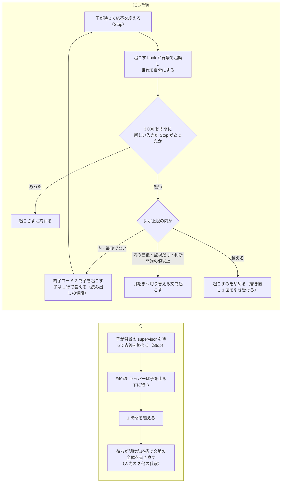
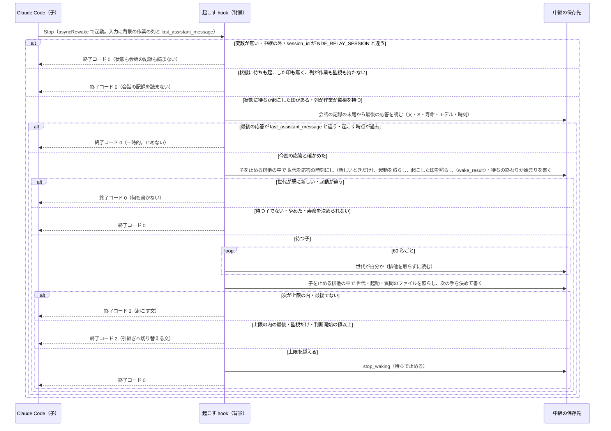

# 中継の下で待つ子のキャッシュ: 寿命の手前で起こし、書き直し 1 回分の費用に届いたらやめる（#4068）

中継の下で背景の作業か監視を待つ子は、キャッシュの寿命（主の会話は 1 時間）を越えて待つと、待ちが明けた最初の応答で文脈の全体を入力の 2 倍の値段で書き直す。子の応答の終わり（Stop）に、Claude Code の `asyncRewake` で背景に起動する hook を 1 つ足す。hook は寿命の手前（最後の応答から 3,000 秒）で終了コード 2 で終わって子を起こし、子は読み出しの値段（Opus 5.5 は入力の 0.05 倍）で文脈を読んでキャッシュを保つ。起こした費用の合計が書き直し 1 回に届く回数で起こすのをやめ、監視だけを待つ子のうち判断開始の値以上のものは、上限の内の最後の起こす文で引継ぎへ切り替える。

## 今の姿

要求と受け入れ条件は [issue-4068-requirements.md](./issue-4068-requirements.md)（正は課題 #4068 の本文）にある。この設計は #4049 の背景の作業の分け方（[issue-4049-design.md](./issue-4049-design.md)）と #3995 の判断開始の値（[issue-3995-design.md](./issue-3995-design.md)）の上に立ち、両方の実装の後に実装する。

- 待ちは長い。2026-10-24〜11-22 のこのマシンの主の会話で、20,000 token 以上の文脈のまま応答の間が 1 時間を越えたのは 276 回あり、そのうち 263 回で次の応答が書き直した（「測った結果」）
- 中継のラッパーは子の端末へ利用者の入力しか書かない（`relay.md` の「承認ゲートを越えない守り」）。10 系の入力注入（#931）は 11 系に無い
- Claude Code は、背景で動く hook が終了コード 2 で終わると、入力を待つ会話をすぐに起こす（`asyncRewake`）。NDF の hook はこれを使っていない

## 文脈と制約

- **待つ子を止めない。** 作業が残る子を止めると作業を失う（#4049 の決定 4・7）。この設計は、作業の子を起こすか起こさないかだけを決める
- **子の端末へ書かない。** 端末へ書いた文は人の入力と区別できず、質問の表示中に書くと選択肢 1 を決める（10 系の実測。`docs/specifications/ndf-relay-install-and-restart.md` の「入力注入の実測と不変条件」）
- **費用は、入力の値段を 1 とした倍率で比べる。** 書き込みは 5 分の寿命で 1.25 倍、1 時間で 2 倍である。読み出しは多くのモデルで 0.1 倍、Opus 5.5 と Sonnet 5.5 で 0.05 倍、Fable 5.1・5.2 と Mythos 5.1・5.2 で 0.025 倍である。出力は Opus 5.5 で入力の 5 倍である（「外部の調査」の PRD1・PRD2）
- **待ちの長さは前もって分からない。** supervisor の 1 フェーズ・CI・承認の取り次ぎで長さが変わり、見込みを出す手段は今無い
- **寿命と使ったモデルは、公式の契約では渡らない。** 会話の記録（`~/.claude/projects/…/<会話>.jsonl`）の `usage` と `message.model` から読む。この形は Claude Code の公開の契約ではない（#4049 が読む Stop の入力の列と同じ立場）
- **Stop の時点で、最後の応答が会話の記録に載っているとは限らない。** 公式の文書は、版によっては Stop の時点で最後の応答が記録に無いと書く（PRD3）
- **定額のプランの費用は、週の利用上限の消費である。** 書き込みと読み出しを上限にどの比で数えるかは公開されていない。従量の値段の比で近似する（要求の前提 4）
- 実装の順は #3995 → lracct（#3604・#3864）→ #4049 → この課題である

## 解き方の全体像

1. **Stop に、起こす hook を足す。** 子が応答を終えるたびに、Claude Code が背景で NDF の hook を 1 つ起動する（`asyncRewake: true`）。ラッパーが版を確かめて渡す変数が無い会話・中継の外・入れ子の claude（入力の `session_id` がラッパーの渡す `NDF_RELAY_SESSION` と違う）では、すぐ終わる。状態に待ちも起こした印も無く、Stop の入力の背景の作業の列が作業も監視も持たない会話では、会話の記録を読まずにここで終わる（決定 1・6・7）
2. **今回の応答を確かめ、世代を自分にする。** 会話の記録の最後の応答が、Stop の入力の `last_assistant_message` と同じ文かを照らす。違えば今回の応答はまだ記録に無いので、起こさずに終わる。同じなら、その応答の記録の時刻を世代の時刻にして書き、前の hook の予約を失効させる（決定 4・6）
3. **起こす時点まで眠る。** 待つ子なら、その応答から寿命・モデル・文脈の量 `S` を読み、起こす時点（最後の応答の時刻 + 寿命 − 余白）を決める。眠る間は 60 秒ごとに世代のファイルだけを見て、新しい Stop か利用者の入力（UserPromptSubmit）で世代が替わっていれば終わる（決定 2・6）
4. **起こすか、やめるか、待機を終えるか。** 今の待ちで起こした回数 `k` の次の 1 回が上限 `n_max = floor((w − r) × S / (r × S + d))` の内なら、起こす文で終了コード 2 で終わる。次が上限の内の最後の 1 回で、監視だけの子で `S` が判断開始の値以上なら、引継ぎへ切り替える文で起こす。上限を越えるなら、その待ちでは起こさない（決定 3・5）
5. **起きた応答を確かめる。** 次の Stop の hook が、起こす文から始まった応答の `usage` を見る。読み出しが `S` の 9 割未満なら当たらなかったので、その会話では起こすのをやめる（決定 4）
6. **記録して測り直す。** 待ちの始まり・起こした・起きた結果・待ちの終わり・やめたを起こす記録に 1 行ずつ書き、`ndf relay cache report` が集める。値は `limits.json` の `cache.*` の行に置く（決定 8・9）

## データ構造

**上限の設定（`plugins/ndf/contracts/limits.json`）に足す行**（既定値は「測った結果」から決めた。スキーマと読み手の直しは詳細設計）

| 行 | 値 | 意味 |
| --- | --- | --- |
| `cache.wake` | `seconds` 600・`interval` 60 | 起こす時点の余白（寿命からこの秒を引く）と、眠る間に世代を確かめる間隔 |
| `cache.write-ratio` | `1h` 2.0・`5m` 1.25 | 寿命ごとの書き込みの倍率 |
| `cache.read-ratio` | 既定 0.1。`claude-opus-5-5`・`claude-sonnet-5-5` は 0.05。`claude-fable-5-1`・`claude-fable-5-2`・`claude-mythos-5-1`・`claude-mythos-5-2` は 0.025 | モデルごとの読み出しの倍率。表に無いモデルは既定 |
| `cache.output-ratio` | 既定 5 | 出力の倍率（集計で起こす応答の費用を出す） |
| `cache.wake-cost` | `count` 2,000 | 起こす応答 1 回の費用 `d`（入力の値段に直した token） |
| `cache.hit` | `ratio` 0.9 | 起きた応答の読み出しが `S` のこの割合以上なら当たりとみなす |
| `cache.rewake` | `version`（実装の最初の実測で決める） | 起こす hook を働かせてよい Claude Code の最も古い版。決めるまでは空で、空なら働かせない |

判断開始の値は、#3995 の `context_thresholds.thresholds` が返す値（`NDF_CONTEXT_LIMIT` で下がった値を含む）を使い、ここに写さない。

**起こす状態（中継の保存先の `<名前>/keep-<会話>.json`）**: 会話（`session_id`）ごとに 1 つ置く。起動（ラッパーが子を起動するたびの ID）ではなく会話ごとにするのは、アカウントの替えなどで同じ会話を起動し直しても、回数とやめた理由を引き継ぐためである。

| 項目 | 意味 |
| --- | --- |
| `generation` | 最新の世代。`at`（時刻）と `by`（書き手の ID）の組。時刻の取得元は書き手ごとに決める（決定 6）。新しい時刻のときだけ書き換え、同じ時刻なら先に書いたほうを残す |
| `wait_id` | 今の待ちの ID（待ちが始まった Stop の世代の `at`）。`wait_end` を書くときに消す |
| `k`・`n_max` | 今の待ちで起こした回数と、その待ちの上限。`wait_start` で `k` を 0、`n_max` を始まりの `S` の式の値にし、`wait_end` で消す |
| `wait_stop` | 今の待ちで起こすのをやめた理由（上限・起床を照らせない）。その待ちの間だけ起こさず、`wait_end` で消す。次の待ちでは起こす |
| `ttl` | 最後に分かった寿命（`1h`・`5m`） |
| `last` | 照らし終えた最後の応答の `message_id`・`tokens`・`model`・`ttl`・`at`。`wait_end` が待ちの終わりの直前の `S` を書くのに使う |
| `pending` | 起こした直後の印（`wake_id`・起こす前の `S`・起こした時刻・起こす前の最後の応答の ID）。次の Stop で照らして消す |
| `stopped` | この会話で起こすのをやめた理由（当たらない・記録の形が違う・引継ぎを求めた）。在ればその会話では二度と起こさない |
| `noted` | 一時的な理由（記録が読めない・今回の応答が未記録・起こす時点が過去）のうち、`stop_waking` を書き終えた理由の集合。止めずに次の Stop で読み直し、同じ理由の行は会話で 1 度だけ書く |

止める範囲は理由で決める。会話の記録の形の変化と、起こしても当たらないこと（配送の遅れ・寿命の設定）は、その会話の続く待ちでも変わらないので会話で止める。引継ぎを求めた後は、子が次のセグメントへ移る前提なので会話で止める（要求の受け入れ条件 5）。上限は待ちの長さで決まるので、待ちで止める。一時的な失敗は止めない。

**起こす記録（中継の保存先の `<名前>/cache-log.jsonl`）**: 1 行 1 出来事で、どの行も `kind`・`at`・`launch`・`session_id`・`wait_id` を持つ。

| `kind` | いつ | 足す項目 |
| --- | --- | --- |
| `wait_start` | 待つ子の Stop で、待ちが始まった | `tokens`・`ttl`・`model`・`n_max` |
| `wake` | 起こした（終了コード 2） | `wake_id`（起こすたびに新しい ID）・`tokens`・`age`（最後の応答から起こすまでの秒）・`k`・`n_max`・`text`（`wake` か `end_wait`） |
| `wake_result` | 起こす文から始まった応答の Stop | `wake_id`・`hit`（真偽）・`tokens`（起こす前の `S`）・`cache_read`・`cache_write`・`output`・`model`・`ttl`・`w`・`r`・`out`（費用の計算に使った倍率） |
| `wait_end` | 待ちの後の、起こす文でない応答の Stop | `age`・`k`・`hit`（読み出しが前の `S` の 9 割以上か）・`tokens`（待ちの終わりの直前の `S`。状態の `last.tokens`）・`cache_read`・`cache_write`・`output`・`model`・`ttl`・`w`・`r`・`out` |
| `stop_waking` | 起こすのをやめた・一時的に起こさなかった | `reason`・`scope`（`session`・`wait`・`once`）・`k`・`n_max` |

**環境変数**: ラッパーが子へ渡す `NDF_RELAY_REWAKE=1`（起動する claude の版が `cache.rewake.version` 以上のときだけ）。対象の会話は #4049 の `NDF_RELAY_SESSION` で限る。

## 処理の流れ

UserPromptSubmit の guard（今の `turn` に足す）は、中継の下（`session_id` が `NDF_RELAY_SESSION` と同じ）で、排他の中で世代をその入力の時刻に書き換え、眠る hook の予約を失効させる。起きた応答の前にも UserPromptSubmit が発火する（実測）。起こす hook は排他の中で印を書いてから終わるので、その UserPromptSubmit が世代を替えても、起こした事実は失われない。

起こす文（既定）: `【ndf-relay】キャッシュを保つための起床（<k>/<n_max>）。Tool を呼ばずに「待機を続ける」の 1 行だけで応答を終える。`
引継ぎへ切り替える文（既定）: `【ndf-relay】キャッシュを起こす回数の上限に達した。背景は監視だけなので待機を終える。#3995 の引継ぎの手順（張っている監視の命令とカーソルを引継ぎ文書に残す）で引継ぎ文書を書き、ndf-next のブロックで次のセグメントへ切り替える。`

## 決定の記録

### 決定 1: 子の端末へ書かずに起こすため、Stop に `asyncRewake` の背景の hook を足し、終了コード 2 で起こす

- **質問**: 入力を待つ子を、誰がどの手段で起こすか
- **選んだ案**: Stop の hook の設定に、`asyncRewake: true` の hook をもう 1 つ足す。Claude Code は Stop ごとにこの hook を背景で起動する。hook が終了コード 2 で終わると、入力を待つ会話をすぐに起こし、標準エラーの文を system reminder として渡す（公式の文書と 2026-11-22 の実測。PRD3）。起きた応答の Stop がまた hook を起動するので、待つ間は起こす間隔ごとに起きる鎖になる。ラッパーは見回りを足さない
- 採らなかった案:
  - ラッパーが子の端末へ短い文を書く。端末へ書いた文は人の入力と区別できず、質問の表示中には選択肢 1 を決める。10 系の不変条件 G1〜G4 を作り直すことになる
  - モデル自身に `ScheduleWakeup`・`CronCreate` で起床を予約させる。手順への追従に頼るので、予約を忘れた待ちで外れる。仕組みで進めるのが Value 3 である
  - 子に背景の `sleep` を張らせ、その終わりの知らせで起きる。同じく追従に頼り、#4049 の監視として数えられる
  - 別のプロセスから `claude -p --resume <会話> --fork-session` で同じ前置きを読ませる。対話と `-p` で system prompt と Tool の一覧が同じかを確かめていない。違えば前置きが一致せず、起こせない
- **代償**: hook を登録した会話の Stop ごとに、背景の hook のプロセスが 1 つ起動する。待ち・起こした印・背景の作業の無い会話では、会話の記録を読まずにすぐ終わる。待つ子では、新しい Stop か入力が来るまで眠る（決定 6）。子の会話には、起こすたびに起こす文と 1 行の返事が残る（実測で書き込み 319 token・出力 139 token）
- **根拠**: Value 2・Value 3（MVV 版 11）

### 決定 2: 寿命の内に確かに起こすため、起こす時点を最後の応答の時刻から寿命 − 600 秒にし、5 分の寿命では起こさない

- **質問**: 最後の応答から何秒で起こすか。寿命はどう決めるか
- **選んだ案**: 起こす時点 = 最後の応答の時刻 + 寿命 − 余白（`cache.wake.seconds` 600）。1 時間の寿命なら 3,000 秒である。寿命は要求の始まりから数えるが、記録の時刻は応答の終わりなので、余白は最後の要求 1 回の長さと、世代を確かめる間隔（60 秒）を受ける。寿命は最後の応答の `usage.cache_creation` で次の表のとおり決める

| 1 時間の書き込み | 5 分の書き込み | 寿命 |
| --- | --- | --- |
| 正 | 正か 0 | 1 時間（長い寿命の項目が前に並ぶ。PRD1） |
| 0 | 正 | 5 分。余白 600 秒が寿命以上なので起こさない（要求の受け入れ条件 1 の「起こす間隔」が 0 以下になる） |
| 0 | 0 | 状態の `ttl`（前に分かった寿命）。無ければ決められないので起こさない |
| 項目が無い・型が違う | | 決められないので起こさない（決定 4） |

- 採らなかった案: 寿命 − 300 秒（55 分）。55〜60 分の間の当たりは 106 / 120 で、50〜55 分の 39 / 39 より下がる。余白を詰める根拠が無い。ラッパーが見る子の出力の静かな時間から数える案も採らない。キャッシュの読みと関係しない
- **代償**: 起こす回数が 1 時間に 1.2 回になる（55 分より 1 割多い）。応答の長さと配送の遅れが余白を越えれば、起こしても当たらない。そのときは決定 4 が起こすのをやめる。5 分の寿命の会話（主の会話では少ない）は今のまま切れる
- **根拠**: Value 2（MVV 版 11）。方針 7（#4069）: 余白は起こす記録の `wake` の `age` と `wake_result` の `hit` で測り直す（決定 9）

### 決定 3: 待ちの長さを知らずに費用を抑えるため、起こした費用の合計が書き直し 1 回に届く回数で起こすのをやめる

- **質問**: 起こし続けるか、どこでやめるか（待ちの長さは前もって分からない）
- **選んだ案**: 起こす 1 回の費用は `r × S + d` で、書き直し 1 回の追加の費用は `(w − r) × S` である。今の待ちで起こした回数 `k` が `n_max = floor((w − r) × S / (r × S + d))` に達するまで起こし、達したらその待ちでは起こさない。上限で止めるのは待ちの単位で、待ちが明けて（`wait_end`）次の待ちが始まれば（`wait_start`）、`k` を 0 にし、`n_max` をその始まりの `S` で決め直す。`S` と倍率が変わらない限り、待ちが上限の前に明ければ書き直しを丸ごと避け、上限を越えても費用は「何もしない」の 2 倍を越えない（借りるか買うかの問題の、損益の分かれ目で買う決め方）。`n_max` は待ちの始まりの `S` で決め、待ちの間は変えない
- 上限の例（Opus 5.5・1 時間・`d` 2,000）: `S` = 20,000 で 13 回、100,000 で 27 回、400,000 で 35 回、500,000 で 36 回。起こす間隔 3,000 秒なら 11〜30 時間に当たる。読み出し 0.1 倍のモデルでは、100,000〜500,000 で 15〜18 回（12.5〜15 時間）
- 採らなかった案:
  - 待ちの見込みの時間で決める。見込みを出す手段が無い。起こす記録に待ちの長さが溜まれば、工程ごとの見込みで上限を縮める改善を後から足せる
  - 上限なしで起こし続ける。止まった背景の作業を待つ子では、費用が際限なく増える
  - 文脈の量の下限を置き、小さい子は起こさない。式は `d` を含むので、小さい文脈でも起こすほうが安いと出る
- **代償**: 上限を越えて続く待ちでは、起こした費用（書き直し 1 回分）と書き直しの両方を払う。過去の 3,000 秒以上の 435 回の待ちに当てると、上限で止まるのは 4 回で、4 回とも最後の起床から寿命を越えて書き直しになった（「測った結果」）。50〜60 分で自然に当たる待ちにも 1 回ずつ起こす費用が掛かる。2 倍の上限は `S` と倍率を固定した見積りで、実際の費用の保証ではない
- **根拠**: Value 2（MVV 版 11）。方針 1（#4069）: 起こす費用は `r × S` で文脈の大きさに比例し、上限は書き直しの `(w − r) × S` との比で決まる

### 決定 4: 公式の契約に無い記録の形を使う代わりに、形が違えば起こさず、起こした結果が当たらなければやめる

- **質問**: 寿命・モデル・文脈の量・最後の応答の時刻をどこから得るか。形が変わったときにどう落ちるか
- **選んだ案**:
  - Stop の入力の `transcript_path` の末尾を読む。最後の `assistant` の行（同じ `message.id` の行は 1 つに数える）を最後の応答とする
  - **今回の Stop の応答かを照らす**: 最後の応答の文の部分（同じ `message.id` の行の `text` をつないだもの）が、Stop の入力の `last_assistant_message` と同じときだけ、今回の応答とする。違う・入力に `last_assistant_message` が無いときは、今回の応答がまだ記録に無い（PRD3 の版）か、前の応答だけが完全な行として残っている。前の応答の時刻で数えると起こす時点が過去になり、Stop の直後に起こす鎖になるので、起こさない。これは一時的な失敗として扱い、止めない（次の Stop で読み直す）
  - **起こす時点が過去なら起こさない**: 照らした応答の時刻から決めた起こす時点が、すでに今の時刻以前なら（文が偶然同じ前の応答を読んだときの守り）、起こさずに一時的な失敗とする
  - 今回の応答と確かめた行に `usage`・`timestamp`・`message.model` がそろわなければ、前の行へさかのぼらずに「記録の形が違う」とする
  - `S` は `usage` の入力・読み出し・書き込みの合計、寿命は決定 2 の表、モデルは `message.model`、時刻は `timestamp` である
  - 起こさないときの止める範囲は「データ構造」の起こす状態の表のとおりである。記録の形が違うときは会話で止め（`stopped`）、一時的な失敗（記録が読めない・今回の応答が未記録・起こす時点が過去）は止めない。どちらも `stop_waking` は同じ理由で会話に 1 度だけ書く
  - 起こした印（`pending`）がある Stop では、起こす前の最後の応答（印の ID）の直後にある最初の入力の行だけを見る。それが起床の文の形（決定 7 の実測 8 で決めた形）なら、その次の応答を起きた応答とし、読み出しが印の `S` の 9 割（`cache.hit.ratio`）未満なら当たらなかったので、`stopped` に理由を書き、その会話では起こさない。最初の入力が利用者の入力か背景の作業の知らせなら、その先は探さずに当たりを判じず、印を消す（先に通常の入力が応答した。要求の受け入れ条件 8）。最初の入力の形を決められない（起床の文の形でも通常の入力の形でもない）ときは、当たりを判じずに印を消し、その待ちでは起こさない（`wait_stop` に「起床を照らせない」。照らせない起床を繰り返さない）
  - 中継のマーカー（決定 10 の一方の形）は UserPromptSubmit の guard が読んで消すもので、会話の記録には残らない。起きた応答の見分けには使えないので、実測 8 で記録の上の形を決めるまで版の門（決定 7）を開けない
- 採らなかった案: 寿命を 1 時間と決め打つ。サブエージェントは 5 分で書いている（実測）。Claude Code の既定が変われば、当たらない起床に費用を払い続ける。`usage` が読めないときも既定の値で起こす案も採らない。形の変化に気付かないまま費用を使う
- **代償**: Claude Code が記録の形を変えた版では、直すまで起こさない（今の振る舞いに戻るだけで、作業は失わない）
- **根拠**: Value 2・Value 3（MVV 版 11）。公式に無くても使えるものは使い、形の変化を検知して代わりの手段（何もしない）へ落とす（起動指示）

### 決定 5: 課題の候補「作業の終わりの後の引継ぎを早める」を採らず、監視だけの子は上限の内の最後の起床で引継ぎへ切り替え、作業の子は書き直しを引き受ける

- **質問**: 上限に達した後、待機を終えるか（Value 2「見合わなければ待機を終える」）。終えるなら、どの子をどう終えるか
- **選んだ案**:
  - **作業が残る子**: 待機は終えない。終えるには子を止めることになり、作業を失う（#4049）。その待ちでは起こすのをやめ（`wait_stop`）、待ちが明けたときの書き直し 1 回を引き受ける。次の待ちでは改めて起こす
  - **監視だけの子**（`ndf lanes wait` を張るオーガナイザーなど）: 上限の内の最後の 1 回（`k + 1 = n_max`）を、`S` が判断開始の値以上なら引継ぎへ切り替える文にする。費用は上限の内に収まる。子は温かいキャッシュのまま引継ぎ文書を書き、`ndf-next` のブロックで次のセグメントへ切り替える（#4049 で、監視だけならマーカーを書いて切り替わる）。監視は次のセグメントが引継ぎ文書から張り直す（#3995 の引継ぎの手順）。この文で起こした後は `stopped` に「引継ぎを求めた」と書き、子が従わなくても二度は求めない。`n_max` が 0 なら起こさず、求めもしない
  - 判断開始の値を使う理由: 比べるのは「書き直し 1 回 `(w − r) × S`」と「温かいまま引継ぎ文書を書く `r × S` + 出力 + 次のセグメントの始まりの書き込み `w × S₀`」である。`S₀` を 60,000、引継ぎ文書の出力を入力の値段で 25,000 とすると、`S` が約 76,000（`(w × S₀ + 出力) / (w − 2r)`）を越えれば引継ぎのほうが安い。ただし引継ぎは文脈を捨て、次のセグメントが読み直す費用がかかる。#3995 は判断開始の値を「タイミングを見て切る」値と決めており、監視だけで待つ時点はその切りどころに当たる。新しい閾値を足さずに同じ値を使う
  - 運用上限（`context.limit`）以上の監視だけの子は、#4049 のとおりラッパーが先に引継ぎを求めるので、起こす hook は働かない（Stop の後にラッパーが子を止める）
- 採らなかった案:
  - 課題の候補（待ちの長さが閾値を超えたら、作業の終わりの後の引継ぎを早める）。待ちが明けた応答では書き直しをもう払っており、その後に早く切るかは残りの応答の数で決まる。それは #3995 の文脈の量の判断が持つ
  - 上限に達した監視だけの子を、ラッパーが止めて引継ぎを求める文で起動し直す。起動し直しは同じ会話を `--resume` で読むので、キャッシュが温かい今でなければ書き直しになる
  - 上限を越える 1 回を引継ぎの文に使う。上限の費用を越える
- **代償**: 判断開始の値未満の監視だけの子は、上限を越えた長い待ちで書き直しを払う。上限の内の最後の 1 回を引継ぎに使うので、その子は上限より 1 回早く待機を終える
- **根拠**: Value 2（MVV 版 11）。方針 1（#4069）: 引継ぎで小さく始め直すほうが安い時点を、文脈の大きさで決める

### 決定 6: 古い hook が後から子を起こさないため、会話ごとの世代を新しい時刻でだけ書き換え、入力でも失効させ、起こす直前に排他の中で照らす

- **質問**: Stop ごとに起動する hook のうち、どれが起こすか。子が動いた・起動し直された・質問を出した後に、古い hook が起こさないか
- **選んだ案**:
  - **世代の時刻は出来事の時刻で、hook が動いた時刻ではない**: Stop の入力には発生の時刻も hook の ID も無い（PRD3）。背景の hook が動いた時刻を使うと、利用者の入力や次の Stop の後に遅れて動いた古い hook が最新の世代を奪う。そこで世代の書き手と時刻の取得元を次の 3 つに決める
    - 起こす hook の Stop: 決定 4 で今回の Stop の応答と確かめた応答の、会話の記録の `timestamp`（同じ `message.id` の最後の行）。Claude Code が応答を書いた時刻なので、hook が遅れて動いても変わらない
    - UserPromptSubmit の guard: guard が動いた時刻。guard は同期で、入力の処理の前に終わるので、入力の時刻と同じ順になる
    - 起こす hook の起床: 起こす直前の排他の中の時刻
    - 書き手の ID（`by`）は、起こす hook が起動のたびに作る乱数の ID（UserPromptSubmit は `turn`）である
  - **順の守り**: どの書き手も子を止める排他（`signals.STOP_LOCK`）の中で、書く時刻が状態の `generation` の時刻より新しいときだけ書き換える。同じ時刻なら先に書いた書き手を残し、後の書き手は終わる。遅れて動いた古い Stop の hook は、次の入力の時刻（guard が書いた）より古い応答の時刻しか持たないので、世代を奪えない。古い hook が新しい応答を読んだ（文が偶然同じ）ときは、新しい hook と同じ応答の時刻を持つので、先に書いたほうが 1 つだけ眠る。どちらが眠っても同じ応答から数える
  - **順を確定できないときの動作**: 上の順は、応答の始まりがどの経路（利用者の入力・背景の作業の知らせ・起床）でも UserPromptSubmit が発火し、その時刻が前の応答の記録の時刻より後であることに立つ。これを決定 7 の実測 7 で確かめるまで、版の門を開けない（起こさない）
  - **待つ子でない Stop でも世代を書く**ので、前の予約は失効する（状態に待ちも印も無い会話では、眠る hook も無いので書かない）
  - **眠る間は世代だけを見る**（60 秒ごと、会話の記録は読まない）。自分でなければ終わる
  - **状態と起こす記録の書き込みはすべて照らしの後**: `_settle` の書き込み（`wake_result`・`wait_end`・`wait_start`・`stopped`・印の消去）、眠りから戻った後の上限の処理（`wait_stop`・`stop_waking`）、起こす直前の書き込みのどれも、同じ排他の区間の中で、世代が自分か・ラッパーの今の起動（`signals.current_launch`）が自分の起動かを照らしてから書く。外れたら何も書かずに終わる。古い hook は新しい待ちの `pending` を消せず、`wait_stop` も立てられない
  - **起こす直前**: 排他の中で、世代・起動・回答待ちの質問のファイルが無いかを照らし、そろえば次の順で書いてから終了コード 2 で終わる。(1) 中継のマーカー（決定 10 でマーカーの形にしたとき） (2) 起こした印・`k + 1`・世代（起こした時刻） (3) `wake` の行。(1) が書けなければ何も書かずに 0。(2) が書けなければ (1) のマーカーを消して 0。(3) が書けなくても状態は起こしたことを持つので 2（集計は `wake` の無い `wake_result` を数えて外す）。失敗の後に `k` や `pending` だけが残ることは無い
  - **失効を保証できる時点**: 起こす直前の排他の中の照らしまでである。その照らしの後、Claude Code が終了コード 2 を受け取って起こす文を渡すまでの間に届いた入力は、失効させられない（hook の外の出来事で、NDF に止める手段が無い）。要求の受け入れ条件 2 はこの時点までの入力を対象にする
- 採らなかった案: 起こす時点まで一度に眠り、起きてから確かめる。古い hook が起こす時点まで残り、Stop の多い子でプロセスが溜まる。ラッパーが hook のプロセスを止める案も採らない。ラッパーは子の hook のプロセスを知らない。hook のプロセスの起動時刻（OS の値）を世代にする案も採らない。起動の時刻と UserPromptSubmit の順を Claude Code は約束しておらず、OS ごとに取り方が違う
- **代償**: 眠る hook は 60 秒ごとに小さなファイルを 1 つ読む。照らしの後に届いた入力とは競る。そのとき起こす文はその応答の前か後に届き、子は 1 行で答える（起こす 1 回の費用が余計に掛かる）。次の Stop は、印の直後の最初の入力が通常の入力なので当たりを判じない（決定 4）。質問の表示へ移る隙での振る舞いは測っていない（「未確認のまま残ること」）。測るまでは版の門（決定 7）を開けない
- **根拠**: Value 3（MVV 版 11）

### 決定 7: 応答の終わりを止めないため、ラッパーが起動する claude の版を確かめた上で変数を渡し、版の門は実装の最初の実測で開ける

- **質問**: `asyncRewake` を知らない版が、この hook を前景で走らせたらどうなるか。どの版で働かせてよいか
- **選んだ案**: ラッパーは子を起動するとき、今の `_start` が呼ぶ版の確かめ（`adapters/cli_floor.require`。起動先の実行ファイルごとに `--version` の結果を持つ）の版を使い、`cache.rewake.version` 以上なら `NDF_RELAY_REWAKE=1` を渡す。今の `require` は成功しても `None` を返すので、下限の確かめを今のまま保ち、確かめに使った版（同じ実行ファイル・環境で読んだ値。読めなければ None）を返すよう変える。`--version` を別に打たない。足りない・読めない・`cache.rewake.version` が空なら渡さず、親から受け継いだ同じ変数も子の環境から消す。hook はこの変数が無ければすぐ終わる。`cache.rewake.version` は、実装の最初に次の 8 つを測ってから、通った版を書く
  - 3,300 秒の `timeout` を受け付け、50 分眠った hook が終了コード 2 で起こせる（600 秒を越える `timeout` は、1,200 秒で 660 秒眠って起こせたことを確かめた。「測った結果」）
  - 起こす鎖を 10 回続けても、Stop の続行の上限（公式の文書の「8 回続けて続行すると打ち切る」）に掛からない
  - 会話を `/exit` で終えると、眠る hook のプロセスが終わる
  - 質問の表示中に終了コード 2 が届いたとき、質問の答えにならない
  - 起きた応答の UserPromptSubmit の入力に起こす文が載るか（決定 10 の数え手の見分け方を決める）
  - Stop の入力に `last_assistant_message` があり、Stop の時点で会話の記録の最後の応答がそれと同じ文で載るか（決定 4 の今回の応答の照らし。載らない版では起こす hook が一度も起こさない）
  - 応答の始まりが、利用者の入力・背景の作業（Bash・Monitor・サブエージェント）の知らせ・起床のどれでも UserPromptSubmit が発火し、guard の時刻が前の応答の記録の `timestamp` より後か（決定 6 の世代の順）
  - 起床の文が会話の記録にどの形で残るか（行の種類・文の頭）。利用者の入力と背景の作業の知らせの行と見分けられるか（決定 4 の起きた応答の対応付け）
- 採らなかった案: hook が自分で背景かを見分ける（hook の入力に印が無い）。版を見ない（前景で走る版では、Stop が起こす時点まで止まる）。ラッパーの始まりに別に `claude --version` を打つ（次の子が別の実行ファイルになったときに古い判定を使う。`--version` の起動が 1 回増える）
- **代償**: 実測で 8 つのどれかが通らなければ、その版では働かせない。`timeout` に上限があれば、起こす間隔と費用の見積りを、要求ごと直す
- **根拠**: Value 3・Value 4（MVV 版 11）

### 決定 8: 値の置き場を 1 か所にするため、`limits.json` の `cache.*` に置き、判断開始の値は #3995 の関数で読む

- **質問**: 起こす間隔・倍率・費用・版の値をどこに置くか
- **選んだ案**: データ構造の表の 7 行を `limits.json` に置く。起こす hook は `hooks/tables.policy_value(name, key)`（行の 1 つの値を JSON のまま返すので、`ratios` は辞書、`version` は文字列で届く）で読み、ラッパーは `contracts/limits` で同じ行を読む（#3995 の決定と同じ分け方）。今の `limits.value` は数だけを返す前提なので、文字列を返す `limits.text(name, key)` を足し、`value` は数でない値に `LimitsError` を上げる。判定の関数（`keep_cache.ratios`）は `(name, key) -> 値` の取得の関数を受ける。集計は `limits.json` を読み直さず、hook が行に書いた倍率で費用を出す（値を直した後も、過去の行の費用は書いた時点の値のまま）。今の上限の設定のスキーマ（`contracts/schemas/limits.schema.json`）と読み手（`contracts/limits.py` の `Policy`）は、倍率の表・既定・割合・版の項目を持たないので、足す（詳細設計）。起こす文と引継ぎへ切り替える文は値でなく振る舞いなので、`keep_cache.py` の定数に置く
- 採らなかった案: 倍率を公式の値段の API から取る（取得の口が無い）。モデルの名前から倍率を推す（新しいモデルの倍率は名前から決まらない。表に無いモデルは既定の 0.1 で、上限が小さくなる側に倒れる）
- **代償**: 値段の表が変わるたびに行を直す。直し忘れると上限が実際とずれるが、起こす記録の `wake_result` の読み出しの値から気付ける
- **根拠**: Value 2（MVV 版 11）。方針 7（#4069）

### 決定 9: 閾値を測って決めるため、待ちごとに起こす記録を残し、集計で余白・起こす費用・待ちの長さを見直す

- **質問**: どのデータで測り、測る前の既定値は何で、どう見直すか
- **選んだ案**:
  - **測る前の既定値**: 2026-10-24〜11-22 のこのマシンの会話の記録（主の会話とサブエージェントの全部）を数えた結果から、余白 600 秒・`d` 2,000・当たりの境 0.9 にした。`d` の実測は Haiku 5.5 で書き込み 319・出力 139 token（`319 × 2 + 139 × 5` = 1,333）で、Opus 5.5 の考える量の分を足した
  - **測るデータ**: 起こす記録の行。待ちを `wait_id` で 1 つにまとめ、始まり・起こした・起きた結果・終わり・やめたを結ぶ
  - **集計**: `ndf relay cache report [--since <日時>]` が全ラッパーの起こす記録から返す
    - 待ちの数・起こした回数・上限で止めた待ちの数
    - `age` の幅ごとの当たりの率（分母は `wake_result` の行の数）
    - 起こす応答 1 回の費用（`cache_write × w + output × cache.output-ratio`）の中央値
    - 待ちの長さ（`wait_start` から `wait_end` まで）の中央・75・90 パーセンタイル
    - 待ちごとに避けた書き直し。1 つの待ちで最大 1 回と数え、寿命を越えて続いた待ちの `wait_end` が当たったときだけ、避けた書き込みの token（`wait_end` の `tokens`。待ちの終わりの直前の `S`）と費用の差（`(w − r) × S` − その待ちで起こした費用の合計）を別々に出す。倍率は各行が記録した `w`・`r`・`out` を使い、今の `limits.json` で計算し直さない
    - `wake` と `wake_result` は `wake_id` で結ぶ。`wake_result` の無い `wake`（起きた応答の前に会話が終わった）は当たりの率の分母に入れず、`wake` の無い `wake_result` は数えて外す
    - `--since` は待ちの単位で絞る。`wait_start` がその日時以後の待ちだけを集め、途中から始まる待ち（`wait_start` が日時より前か無い）の行は数えて `metrics` に出し、どの集計にも入れない
  - **見直し方**: `wake_result` が 20 件たまるごとに見る。当たりの率が 95% を下回る `age` の幅が起こす時点を含めば余白を広げ、起こす費用の中央値で `d` を直す。直すのは `limits.json` の行で、手順は `relay.md` に書く
- 採らなかった案: 時間で区切った負荷の試験で決める（合否が機械の速さに依り、コードを表さない）。会話の記録を毎回走査して集計する（会話の記録の形に二重に頼る。起こす記録は hook が自分で書く）
- **代償**: 起こす記録は中継の保存先に溜まり、ラッパーの記録と同じく掃除の対象になる（詳細設計）。定額のプランで週の利用上限をどれだけ使ったかは、この記録からは分からない（「未確認のまま残ること」）
- **根拠**: Value 2（MVV 版 11）。方針 7（#4069）

### 決定 10: 起きた応答で #3995 の数え手を数え直させないため、起こす文を中継の入力として見分ける

- **質問**: 起きた応答の前に UserPromptSubmit が発火する（実測）。#3995 の数え手は利用者の入力で数え直し、中継の入力（マーカーのある入力）では数え直さない。起きた応答をどう見分けるか
- **選んだ案**: UserPromptSubmit の入力に起こす文が載るなら、guard `turn` は文の頭 `【ndf-relay】` で中継の入力と見分ける。載らないなら、起こす hook は起こす直前に中継のマーカー（`markers.mark`）を書き、`turn` が今のとおり `markers.take` で見分ける。どちらにするかは決定 7 の実測で決め、両方の起こす文（起こす・引継ぎへ切り替える）に当てる。この見分けは数え手のためだけで、起きた応答の当たりの判定（決定 4）は会話の記録の上の起床の文の形（実測 8）で行う。マーカーは記録に残らないので、その判定には使わない
- 採らなかった案: 見分けない（起こすたびに #3995 の判断開始の値の知らせが数え直され、文脈の大きな子に知らせが増える）
- **代償**: マーカーの形では、会話ごとに 1 つのマーカーを次の UserPromptSubmit が消すので、利用者の入力が起きた応答より先に届けば、その入力を中継の入力と数える（知らせが 1 回減るだけで、子は止まらない）。マーカーを書いたのに起こす文が届かなかったときも同じである
- **根拠**: Value 3（MVV 版 11）

### 決定 11: 利用者の全体の設計方針（#4069）と MVV Value 2 に照らし、合う形にし、方針の残りは #4071・#4070 に置く

- **質問**: この設計は #4069 の方針（「キャッシュを意識し、必要ならキャッシュを起こす処理なども入れる」）と配慮する事項 1〜8、MVV 版 11 の Value 2（「待機する文脈は、プロンプトのキャッシュの寿命の内に使うか、必要ならキャッシュを起こす。起こす費用が見合わなければ待機を終える」）に合うか
- **選んだ案**: 次の表のとおり照らし、合わない点は無い。方針のうちこの設計の外にある部分は、分けた Issue に置く

| 照らす項目 | この設計 | 合うか |
| --- | --- | --- |
| 方針「キャッシュを起こす処理を入れる」 | 待つ子を、寿命の手前ごとに起こす（決定 1・2） | 合う |
| Value 2「寿命の内に使うか、必要なら起こす」 | 待ちが起こす時点の前に明ければ起こさない（新しい入力と Stop で予約が失効する）。寿命の手前まで続く待ちだけを起こす | 合う |
| Value 2「起こす費用が見合わなければ待機を終える」 | 見合う限度を上限 `n_max` で決める。監視だけで判断開始の値以上の子は、上限の内の最後の起床で待機を終える。作業の子は待機を終えると作業を失うので、起こすのをやめて書き直しを引き受ける（決定 3・5） | 合う（作業の子は「待機を終える」の代わりに「起こすのをやめる」。作業を失う費用が書き直しより高い。#4049 の決定 9 と同じ判断） |
| 配慮 1「起こす費用は文脈の大きさに比例する」 | 起こす 1 回の費用を `r × S + d`、書き直しを `(w − r) × S` とし、比で上限を決める。#4069 の例の「390k を 1 時間ごとに起こすと 1 回で約 39k」は読み出し 0.1 倍の場合で、Opus 5.5 では約 19.5k になる | 合う |
| 配慮 2「週の利用上限」 | 過去の待ちに当てた見積りで、起こす費用は、自然に当たる待ちに掛かる分を含めて、何もしない費用の約 12%（0.115）になる（「測った結果」）。上限での替え（lracct）は変えない。アカウントを替えるとキャッシュは別になるので、替えの後の最初の応答は書き直しになる（今と同じ） | 合う |
| 配慮 6「長い文脈は判断を悪くする」 | 起こしても文脈は数百 token しか増えない。大きな監視だけの子は上限で引継ぎへ進む | 合う |
| 配慮 7「測らないと決められない」 | 既定値を過去の記録から決め、起こす記録と集計で見直す（決定 9） | 合う |
| 配慮 8「オーガナイザーが詰まると全体が止まる」 | オーガナイザーは起こされても 1 行で答えるだけで、監視は止めない。上限で引継ぎへ進んで文脈を小さくする | 合う |
| 方針「再利用に備えて待機する」 | 待つ子の文脈を寿命の内に保つ | 合う。待機させる規則・サブエージェントの supervisor・背景の作業の無い待ちは #4071 が持ち、この設計の式と `cache.*` の値を使う（決定 12） |
| 方針「待っていることを伝える」 | 扱わない | #4070 が持つ |

- 採らなかった案: 背景の作業の無い待ち（承認ゲートの回答待ち）も同じ hook で起こす。質問の表示中は Stop が来ず、hook が起動しない（決定 12）
- **代償**: #4071 が決まるまで、承認ゲートを待つ子とサブエージェントのキャッシュは今のまま切れる
- **根拠**: Value 2・Value 5（MVV 版 11）

### 決定 12: #4071 をまとめずに分けたまま、キャッシュの式・値・記録を #4068 が持ち、待機させるかの規則と背景の作業の無い待ちを #4071 が持つ

- **質問**: #4071（待ちの間の文脈: 再利用できる supervisor・conductor の待機と、キャッシュを起こす処理）の受け入れ条件 1〜3 を、この設計でまとめて扱うか
- **選んだ案**: まとめない。境界を次のとおりにし、#4071 の本文にも同じ境界を書く

| 持ち物 | #4068（この設計） | #4071 |
| --- | --- | --- |
| 起こす費用と書き直しの費用の式・起こす回数の上限 `n_max` | 持つ（決定 3） | 使う（#4071 の受け入れ条件 2 の判定はこの式で満たす） |
| 値の置き場（`limits.json` の `cache.*`） | 持つ（決定 8） | 同じ行を読む。足す値もここに足す |
| 起こす記録と集計（`cache-log.jsonl`・`ndf relay cache report`） | 持つ（決定 9） | 同じ記録に行の種類を足して数える（#4071 の受け入れ条件 3） |
| 中継の下で背景の作業か監視を待つ主の会話を起こす仕組み（起こす hook） | 持つ（決定 1） | — |
| 後の工程で再利用できる supervisor・conductor を待機させる条件と、待機を終える条件（#4071 の受け入れ条件 1） | 持たない | 持つ |
| 背景の作業の無い待ち（承認ゲートの回答待ち・`AskUserQuestion` の表示中） | 持たない（質問の表示中は Stop が来ず、起こす hook が起動しない。端末へ書くと答えになる） | 持つ |
| サブエージェント（supervisor）のキャッシュ（寿命 5 分で書く。実測） | 持たない（起こす hook は主の会話の Stop だけで働き、サブエージェントを起こせない） | 持つ（`supervisor` と `supervisor-waits` の使い分けを含む） |

- まとめない理由: #4071 の中心は「どの supervisor・conductor を再利用に備えて残し、いつ終えるか」の規則で、置き場は conductor の手順（`agent-layers.md`）とエージェントの定義である。この設計が変えるのは中継の hook とラッパーで、触る場所・確かめ方・承認で見る点が違う。まとめると 1 本の設計文書が 2 つの問題を扱う（`design` の「1 本の設計文書は 1 つの問題を扱う」）。#4071 の受け入れ条件 2・3 は、この設計の式と記録をそのまま使えば満たせるので、#4071 は待機の規則だけを決めればよい
- 採らなかった案: #4071 の受け入れ条件 1〜3 をこの要求仕様へ写してまとめる（承認ゲートの待ちとサブエージェントは起こす hook で起こせず、別の仕組みの設計が要る。この設計の範囲が 2 倍になり、承認する人が何を決めるのか読み取りにくくなる）
- **代償**: #4071 の設計が終わるまで、承認ゲートを待つ子とサブエージェントのキャッシュは今のまま切れる。#4071 はこの設計のマージの後に、`cache.*` と起こす記録を前提に設計する
- **根拠**: Value 2・Value 6（MVV 版 11）

## 影響と危険

| 対象 | 影響 | 危険と手当て |
| --- | --- | --- |
| 中継の下で待つ子 | 起こす時点ごとに 1 行の応答をする。会話に起こす文と返事が残る | 子が起こす文に従わず Tool を呼ぶ: 文は Tool を呼ばないよう求める。呼んでも次の時点は、その応答の Stop の最後の応答から数え直す（要求の受け入れ条件 14） |
| hook を登録した会話の Stop | 背景の hook のプロセスが Stop ごとに 1 つ起動する。中継の外の会話でも起動し、変数が無いのですぐ終わる | 待ち・起こした印・背景の作業の無い会話では、会話の記録を読まずに終わる。待つ子でも、新しい Stop か入力で 60 秒の内に終わる（決定 6） |
| 監視だけの大きな子 | 上限の内の最後の起床で引継ぎへ進む | 子が切り替えなければ、二度は求めず、書き直し 1 回で済む（決定 5） |
| #3995 の数え手 | 起きた応答の前に UserPromptSubmit が発火する（実測） | 中継の入力として見分ける（決定 10） |
| lracct の替え | 変えない | 替えの後は別のアカウントなので書き直しになる（今と同じ）。回数とやめた理由は会話ごとの状態が引き継ぐ |
| Codex | 変わらない | Codex の hook の表には足さない |

### 代表のリポジトリでの振る舞い

| 種類 | 振る舞い | 違い |
| --- | --- | --- |
| Web サービス（nd-factory） | 中継の下で背景の supervisor を待つ conductor が、50 分ごとに起こされてキャッシュを保つ | 無し（同じ） |
| モバイルアプリ | 同じ | 無し |
| 業務文書だけ | 同じ | 無し |

### ai-plugins だけの事情

無し（値はプラグインの既定で、このリポジトリだけが置く設定は無い）。

## 用語

要求仕様の「用語」の 7 語（キャッシュの寿命・キャッシュを起こす・起こす hook・起こす記録・起こす間隔・起こす回数の上限・書き直し）を使う。実装で用語集（`docs/glossary/glossary.json`、コンテキスト `ndf-relay`）へ足す。

| 用語 | 意味 | 変更の種類 |
| --- | --- | --- |
| 起こす hook の世代 | 起こしてよい hook を 1 つに決める値（今回の応答の記録の時刻か入力・起床の時刻と、書き手の ID）。会話ごとの起こす状態に置き、新しい時刻でだけ書き換わる | 新設 |
| 待ち（起こす記録の） | 待つ子の Stop で始まり、起こす文でない応答の Stop で終わる 1 回の待ち。`wait_id` で見分ける | 新設 |

## テスト設計

時刻は差し替えた時計で進め、眠りは差し替えた眠りの関数で数える（時間で区切らない）。会話の記録と Stop の入力は、実測の形から作った見本のファイルを使う。並行は、hook の呼び出しの順を差し替えて流す。

| 要求の受け入れ条件 | 縛る振る舞い | 落ちるべき壊し方 |
| --- | --- | --- |
| 1 | 1h の最後の応答 + 3,000 秒で終了コード 2、2,999 秒では眠り続ける。5m だけの寿命では起こさない | 余白を引かない・hook の起動から数える・5 分でも起こすと落ちる |
| 2 | 眠る間に新しい Stop の hook・UserPromptSubmit が世代を替えると 0。古い応答の時刻を持つ Stop の hook が、次の入力の guard の後に動いても世代は戻らず、何も書かずに 0。古い hook が、新しい待ちの `pending` を消さず `wait_stop` も立てない。起動が替わる・質問のファイルが在ると 0。2 つの hook を同じ時刻まで眠らせても、終了コード 2 は 1 つだけ。排他の中の照らしの後に入力が届く順（差し替えた呼び出しの順）では 2 で、次の Stop は当たりを判じない。`session_id` が `NDF_RELAY_SESSION` と違う入れ子の claude の Stop・UserPromptSubmit は、状態を読まず書かずに 0。会話の ID が UUID の形でなければ保存先のファイルの名前を作らずに 0 | 時刻を比べずに上書きする・hook が動いた時刻を世代にする・入力で失効させない・排他の外で照らす・書き込みの前に照らさない・会話の ID を見ないと落ちる |
| 3 | 変数が無いと眠りの関数の呼び出し 0 回・会話の記録の読み取り 0 回で 0。ラッパーは版が `cache.rewake.version` 未満・読めない・空のとき変数を渡さず、受け継いだ変数を消す。版の判定で `--version` の起動は `_start` の下限の確かめの 1 回だけ | 変数を見ずに眠る・ラッパーが版を見ない・版を別に読むと落ちる |
| 4 | Opus 5.5・1h・`S` 400,000・`d` 2,000 で `n_max` 35。作業の子は `k` 34 で起こし、35 で起こさず `stop_waking`（`scope` は `wait`）。その待ちが明けた後の次の待ちの始まりでは `k` 0・`n_max` を始まりの `S` で決め直し、起こす。`limits.json` の値を差し替えると上限が変わる | 式の定数を埋め込む・`k` を数えない・上限で会話ごと止めると落ちる |
| 5 | 判断開始の値を 250,000 にした状態で、監視だけ・待ちの始まりの `S` 250,000（式で `n_max` 33）・`k` 32 の次（33 回目）は、判定の時の `S` 250,000 なら引継ぎへ切り替える文になり、その後の Stop では次の待ちでも起こさない。判定の時の `S` 249,999 では 33 回目も起こす文で、次の 34 回目は上限で `stop_waking`。作業 1 件なら 250,000 でも起こす文だけ。`NDF_CONTEXT_LIMIT=200000` では判断開始の値 200,000 で、`S` 250,000 が切り替える文になる。`n_max` 0 では起こさない | 上限を越える 1 回を使う・判断開始の値を行から直接読む・作業の子に引継ぎを求める・求めた後も起こすと落ちる |
| 6 | 決定 2 の寿命の表の 4 行。表に無いモデルは 0.1 | 寿命を決め打つと落ちる |
| 7 | 今回の応答と確かめた行に `usage` が無い見本では、前の行があっても起こさず `stop_waking`（`scope` は `session`）が 1 行。同じ会話の 2 回目では行を足さない。最後の行が完全な前の応答で、Stop の入力の `last_assistant_message` が違う見本（今回の応答が未記録）では、眠りの関数 0 回・`stopped` を書かずに 0 で、次の Stop で記録が追いつけば起こす。起こす時点が今より前になる見本でも 0 で止めない | 前の行へさかのぼる・毎回書く・前の応答の時刻で起こす・一時的な失敗で会話ごと止めると落ちる |
| 8 | 起こす文から始まった応答の読み出しが印の `S` の 0.89 倍ならやめ、0.9 倍なら続ける。印の直後の最初の入力が通常の入力の見本では、その後に起床の文の応答があっても判じない。最初の入力の形を決められない見本では判じず、その待ちでは起こさない | 起こす文でない応答で判じる・通常の入力の先を探す・照らせない起床を繰り返すと落ちる |
| 9 | 状態の無い会話の、作業も監視も無い Stop で会話の記録の読み取り 0 回。眠る間の読み取り 0 回 | 先に記録を読む・眠る間に読み直すと落ちる |
| 10 | 決定 10 で決めた形で、起きた応答の UserPromptSubmit が数え手を数え直さない | 見分けないと落ちる |
| 11 | 待ち 1 つで `wait_start`・`wake`・`wake_result`・`wait_end` が `wait_id` でつながり、`wake` と `wake_result` が `wake_id` でつながり、各行が「データ構造」の項目を持つ。起こす直前のマーカーか状態が書けない順では `k`・`pending` が残らず 0 | 項目を落とす・`wait_id` か `wake_id` を付けない・失敗の後に印を残すと落ちる |
| 12 | 見本の記録から、待ちの数・起こした回数・当たりの率（分母は `wake` と結べた `wake_result`）・`d` の中央値・待ちの長さの分布・避けた書き直し（1 つの待ちで 1 回まで。`wait_end` の `tokens` と行の倍率で計算）を返す。`wake_result` の欠けた `wake` と、`--since` が途中を指す待ちを集計に入れず数える | 当たった起床ごとに書き直しを数える・今の倍率で計算し直す・途中の待ちを混ぜると落ちる |
| 13 | 値はすべて `limits.json` から読む。値を差し替えたテストで、hook（`tables.policy_value`）・ラッパー（`limits.text`）の入口から、`ratios` の辞書と `version` の文字列が差し替えた値で届き、hook が行に書いた倍率で集計が費用を出すことを確かめる | 定数を埋め込む・読み手ごとに別の値になる・集計が今の値で計算し直すと落ちる |
| 14 | 起きた応答が Tool を呼んでも、次の起こす時点はその応答の Stop の最後の応答から数える | 起こした時刻から数えると落ちる |

.md の文言を照らすテストは書かない。

## どこを変えるか

詳細設計は [issue-4068-design-detail.md](./issue-4068-design-detail.md) にある（新設する関数が 2 つ以上あるため）。

## 設計の結果

| 課題 | 扱い | 統合先 | 触るファイル |
| --- | --- | --- | --- |
| #4068 | 実装する | — | 詳細設計の地図の表のとおり |
| #4071 | 分けたまま | — | 無し（決定 12 の境界を #4071 の本文に書いた） |

## 未確認のまま残ること

| 項目 | 内容 |
| --- | --- |
| `asyncRewake` の長い `timeout`・鎖・終わり・質問の表示中・UserPromptSubmit の入力・今回の応答の記録・世代の順・起床の文の記録の形 | 決定 7 の 8 つの実測。通るまで `cache.rewake.version` を空にし、働かせない。通らなければ、起こす間隔・費用の見積り・要求の受け入れ条件 1 を直す |
| 定額のプランでの費用 | 週の利用上限が、書き込みと読み出しをどの比で数えるかは公開されていない。lracct の使用率の記録で、起こした時刻の前後の使用率の差を見れば比を推せるが、使用率の粒度（1%）が 1 回の起こす費用より粗い。起こした行が溜まったら、日ごとの使用率と起こした回数を並べて見る |
| 対話と `-p` の前置き | 決定 1 の採らなかった案の `--fork-session` の経路で、対話の子と同じ前置きになるかは確かめていない |
| 同じ Stop の同期の guard との順 | 起こす hook は Stop の入力の列を自分で分ける（#4049 の分け方の関数を使う）ので、#4049 の記録のファイルの書き込みの順に依らない。#4049 の記録は読まない |

## 測った結果

2026-11-22 に、このマシンの `~/.claude/projects/` の全会話の記録（2026-10-24〜11-22、主の会話と `subagents/` の下のサブエージェント）を、応答ごとに `message.id` で 1 回に数えて集計した。直前の文脈が 20,000 token 以上の応答の組だけを数えた。

| 応答の間 | 主の会話の当たり / 外れ | サブエージェントの当たり / 外れ |
| --- | --- | --- |
| 5 分未満 | 119,453 / 79 | 43,741 / 21 |
| 5 分〜30 分 | 2,704 / 42 | 114 / 225 |
| 30 分〜55 分 | 493 / 28 | 8 / 21 |
| 55 分〜60 分 | 106 / 14 | 0 / 3 |
| 60 分〜65 分 | 12 / 15 | 0 / 0 |
| 65 分〜2 時間 | 1 / 144 | 0 / 5 |
| 2 時間超 | 0 / 104 | 0 / 9 |

- 書き込みの寿命: 主の会話は 1 時間 477,384,213 token・5 分 11,982,796 token、サブエージェントは 1 時間 7,964,964 token・5 分 207,235,478 token
- 使ったモデル: `claude-opus-5-5` が 127,870 応答で、ほかは 300 未満
- 応答の間が 1 時間を越えた主の会話の組は 276 回で、そのうち 263 回で書き直した（13 回は 60〜65 分と 65 分〜2 時間の間で当たった）。263 回の書き直した合計は 44,641,212 token、直前の文脈の合計は 55,714,372 token。間の中央は 1.94 時間・75 パーセンタイルは 2.85 時間・90 パーセンタイルは 5.48 時間、2 時間未満が 159 回・2〜8 時間が 94 回・8 時間超が 10 回
- 起こす時点（3,000 秒）を越えた主の会話の組は 435 回で、自然に当たったのは 158 回（50〜60 分の 145 回と 1 時間を越えた 13 回）。50 分の手前の当たりは 45〜50 分で 45 / 46、50〜55 分で 39 / 39
- 435 回に決定 2・3 の規則を当てた見積り（Opus 5.5、`r` 0.05・`w` 2・起こす間隔 3,000 秒・`d` 2,000。当たりは次の応答の読み出しが前の `S` の 9 割以上）: 何もしない費用は、自然に外れた各回の直前の文脈 `S` に `w − r` を掛けた和で 116,007,698（入力の値段に直した token。実際の書き込みを値付けした額ではない）。起こす費用は、各回の間を 3,000 秒で割った切り捨てを起こしたい回数 `n`、実際に起こす回数を `m = min(n, n_max)` とし、`m × (r × S + d)` に、最後に保てた時点（`m` 回目の起床。`m` が 0 なら最後の応答）から待ちの終わりまでが 3,600 秒以上なら書き直し `(w − r) × S` を足した和で 13,351,993（比 0.115）。このうち、自然に当たった 158 回に余計に掛かる起こす費用は 1,513,249。上限を越えた待ちは 4 回で、4 回とも最後の起床から 3,600 秒を越えて書き直しになる。引継ぎの費用は含めない。組の取り方はこの節の頭の段落のとおりで、`S` は組の前の応答の `usage` の 3 つの数の合計である
- 余白の判断: 自然に当たる待ちの費用を足しても比は 0.107 から 0.115 に上がるだけで、余白 600 秒（50 分で起こす）を変えるほどではない。50〜55 分の当たりは 39 / 39 で、55〜60 分（106 / 120）より外れが少ないので、余白を詰めずに 600 秒のままにする
- この 435 回には、背景の作業を待たない待ち（利用者が離れていた・会話を後で再開した）も含む。会話の記録からは、その時点で背景の作業か監視が残っていたかを決められない（Stop の入力の列は記録に残らない）ので、対象の待ちだけに絞った分布は起こす記録が溜まってから集計で出す（決定 9）。起こすのは背景の作業か監視を待つ子だけなので、実際に当たる待ちはこの一部である

`asyncRewake` の実測（2026-11-22、Claude Code 2.1.330・Haiku 5.5、作業ディレクトリは一時ディレクトリ）: Stop に `asyncRewake: true`・`timeout` 120 の hook を置き、20 秒眠って終了コード 2 で終わらせた。会話は hook の起動の 20 秒後に起き、`Stop hook feedback` の知らせとして標準エラーの文が届き、モデルは「待機を続ける」と答えた。起きた応答の前に UserPromptSubmit の hook が発火した。起きた応答の `usage` は読み出し 54,969（直前の文脈の全体）・書き込み 319・出力 139 token で、書き込みは 1 時間の寿命だった。続けて、`timeout` 1,200 の hook で 660 秒眠らせた。hook の起動の 660 秒後に会話が起き、起きた応答の `usage` は読み出し 54,969・書き込み 325・出力 177 token だった（NDF の hook の表の上限 600 秒を越える `timeout` を Claude Code は受け付ける）。

## 外部の調査

| 種類 | 調べるか | 理由 |
| --- | --- | --- |
| 標準・仕様 | 調べない | キャッシュを起こす規則は、NDF の hook と中継の取り決めだけで形が決まり、従う公開の仕様が無い |
| 主要な製品 | 調べる | キャッシュの値段と寿命、会話を起こす手段は Anthropic の API と Claude Code の仕様で決まる |
| ライブラリとサービス | 調べない | 起こす hook は眠って終わるだけで、使えるライブラリの候補が無い（眠りは差し替えられる関数で包み、テストで数える。詳細設計） |

### 主要な製品

| # | 製品 | どう解いているか | 設計への反映 | 出典 |
| --- | --- | --- | --- | --- |
| PRD1 | Anthropic API のプロンプトのキャッシュ | 寿命の既定は 5 分で、`ttl: "1h"` で 1 時間にできる。キャッシュは使うたびに追加の費用なしで延び、寿命は書くか読む要求の始まりから数える。書き込みは 5 分で入力の 1.25 倍、1 時間で 2 倍、読み出しは 0.1 倍（Opus 5.5・Sonnet 5.5 は 0.05 倍、Fable・Mythos の 5.1・5.2 は 0.025 倍）。5 分で書いた項目を読む要求は、`ttl: "1h"` を付けても 5 分の寿命を延ばす | 起こす費用と書き直しの費用の式（決定 3）、起こす時点の余白（決定 2）、モデルごとの倍率の表（決定 8） | https://platform.claude.com/docs/en/build-with-claude/prompt-caching（2026-11-22） |
| PRD2 | Anthropic API の値段 | Opus 5.5 は入力 $4・1 時間の書き込み $8・読み出し $0.20・出力 $20（100 万 token あたり） | 出力の倍率 5（決定 9 の起こす応答の費用） | https://platform.claude.com/docs/en/about-claude/pricing（2026-11-22） |
| PRD3 | Claude Code の hook（`async`・`asyncRewake`・Stop の入力） | `async: true` の hook は背景で走り、結果は次の応答に届く。例外として `asyncRewake` の hook が終了コード 2 で終わると、会話が入力を待っていてもすぐに起こし、標準エラー（無ければ標準出力）を system reminder として見せる。`asyncRewake` の hook には `timeout` を課す。Stop の入力の `background_tasks` と `session_crons` で「終わった会話」と「背景の作業に起こされるのを待つ会話」を見分けられ、`session_crons` は `CronCreate`・`ScheduleWakeup`・`/loop` の予約を載せる。UserPromptSubmit は、予約した起床・背景のサブエージェントの報告・ほかの会話からの知らせでも発火する。Stop の `last_assistant_message` について「会話の記録は、Stop の時点で最後の応答を含むとは限らない版がある」と書く。Stop の hook が続けて 8 回続行させると、Claude Code は次の続行を打ち切る（Tool を呼ぶと数え直す） | 起こす手段（決定 1）、版の門と実測する 8 つ（決定 7）、最後の応答の読み方（決定 4）、起きた応答の見分け（決定 10）。`ScheduleWakeup` を採らない理由（決定 1） | https://code.claude.com/docs/en/hooks（2026-11-22） |

調べた量: 候補 3 件・取得の試み 6 回。
