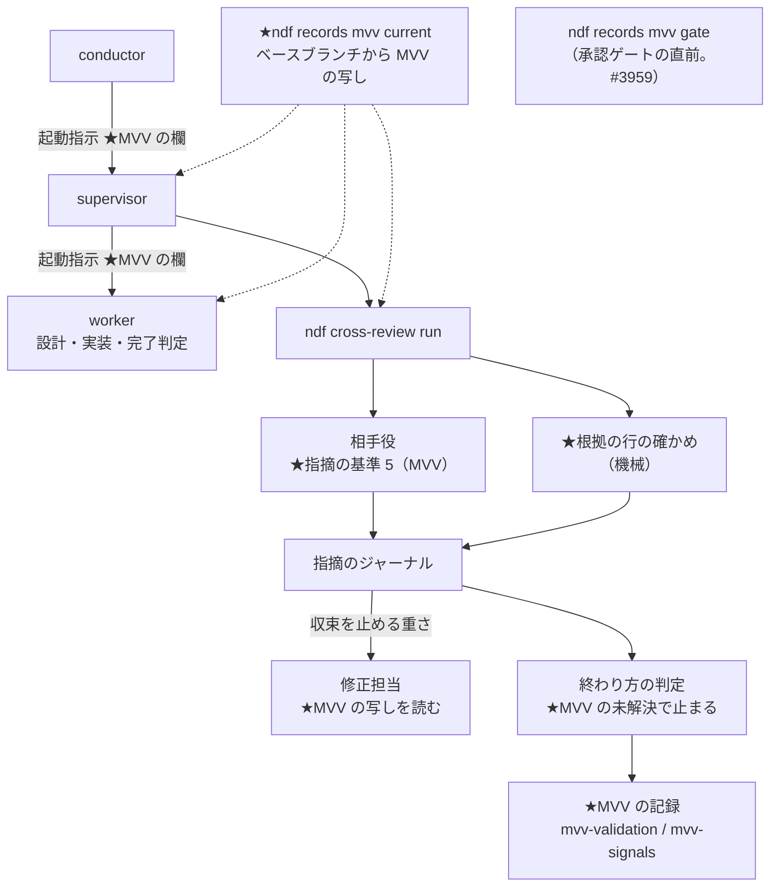
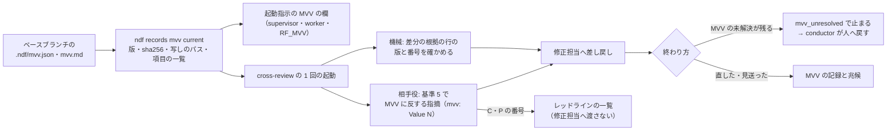
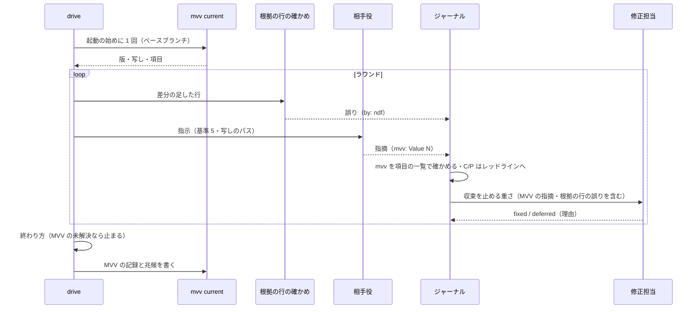

# 工程と MVV: 担当が承認済みの MVV を読んで動き、cross-review が MVV に反する出力と誤った根拠の行を差し戻す（#4076）

MVV に反する設計（#4049 の最初の設計）が cross-review の 3 ラウンドと設計承認の資料を素通りし、根拠の行の版の誤り（#4058）も止まらなかった。承認済みの MVV の写しをベースブランチから 1 か所で作り各工程の担当へ渡し、cross-review では指摘の基準に「MVV に反する」を足し、根拠の行の版と番号をラウンドの中で機械が確かめる。MVV に反する指摘と根拠の行の誤りは今の修正担当へ差し戻し、直せずに残ればレビューが止まって人へ戻り、判定と差し戻しは MVV の記録に残る。採らなかった案は「決定の記録」に、調べた製品は付録の「外部の調査」にある。

## 今の姿

何が起きたか・目的・受け入れ条件は要求仕様（[issue-4076-requirements.md](./issue-4076-requirements.md)、正は #4076 の本文）にある。この文書は「どう解くか」と「なぜその解き方か」だけを書く。



★ が変わる位置である。設計に要る今の構造:

| 部品 | 今の振る舞い | 場所 |
| --- | --- | --- |
| 指摘の基準 | 基準 1・2・4 と、`.ndf/review.json` の重点があるときだけ現れる基準 3。相手役と修正担当への「指摘の基準」のセクションをここから組む | `plugins/ndf/contracts/data/review-criteria.json`、`plugins/ndf/src/ndf/domains/crossreview/criteria_decide.py` の `criteria_lines`・`reviewer_block`・`fixer_block` |
| 相手役の出力 | 最後の行の JSON の `findings` の 1 件は `text`・`severity`・`path`・`line`・`section`（スプリントブランチでは `impact` が足された。#4014） | `drive.py` の `_review_prompt` |
| 指摘のジャーナル | 指摘を `text` から作るキーで 1 行にまとめ、出し直しで重い方の重要度を残す | `crossreview/journal.py` の `FindingJournal` |
| 終わり方 | 収束を止める重さ（`critical`・`major`。`contracts/domains/severities.json` の `blocking`）の未解決・理由の無い見送りが 1 件でもあれば `incomplete`（gaps つき）。プランは `incomplete` のルートへ進み、gaps は承認資料の「未確認の点」になる | `crossreview/finish_decide.py` |
| MVV の承認の記録 | `.ndf/mvv.json` の最後のバージョンが今の承認。ほかの参照（ブランチ）の設定は `decl_at` で読む。版は `current_version` | `plugins/ndf/src/ndf/domains/records/mvv.py`・`mvv_decide.py` |
| レッドラインの表 | 共通原則とプロジェクト MVV の「必ず人の承認が要る操作」の表から番号と操作を引く | `records/mvv_material_decide.py` の `redlines` |
| 改訂の兆候 | `mvv-signals.jsonl` の覆し（`override_reject`・`override_pass`）と「判定できない」（`unknown`）を、今の版の行だけ数えて閾値と比べる | `mvv_decide.count_signals`、`ndf records mvv signals` |
| 起動指示 | conductor → supervisor・supervisor → worker の起動指示の項目に MVV の欄が無い | `plugins/ndf/skills/development-workflow/references/agent-layers.md` の「起動の指示」 |
| cross-refactoring | 提案と計画のプロンプトの `$RF_MVV` を呼び手（Skill の本文の手順）が埋める | `plugins/ndf/skills/cross-refactoring/prompts/propose.md`・`plan.md` |

#4049 の最初の設計が通ったのは、相手役の指示に MVV が無く（基準 1・2・4 は誤動作・レッドライン・食い違いだけを見る）、承認ゲートの直前の判定は `normal` では打たれない（#3959）ためである。根拠の行の版の誤りは、どの部品も根拠の行を読まないので止まらなかった。

## 文脈と制約

- **触る部品の多くは、同じレーンのスプリント（`sprint/p12-lcrfast-r1`）が変えている。** #4014（重い指摘に起きることの 1 文 `impact`。PR #4023）・#4030（修正担当へのテストを CI に寄せる指示。PR #4033）はスプリントブランチへマージ済みで、#4013（修正担当の会話を続ける）は実装中である。どれも `review-criteria.json`・`criteria_decide.py`・`drive.py`・`journal.py` を触る。この設計はスプリントブランチの形（`impact`・`fixer_ci_only`・`fixer_sessions`）を前提に書く
- **#3959 が承認ゲートの直前の判定を受け持つ。** `normal` でも判定する・承認資料の根拠の行を確かめる・即時修正のプランに判定を置く、の 3 つは #3959 に残す。同じ確かめを 2 か所に作らないため、根拠の行の確かめの関数と MVV の写しはこの設計が作り、#3959 はそれを承認資料へ当てる
- **相手役は読むだけで、作業場所（PR の head の worktree）のファイルを読める。** 指示の本文は相手役ごと・ラウンドごとに送られる
- **このリポジトリはテストを CI に寄せる**（`.ndf/project.json` の `test.ci.only` が真）。相手役の LLM の出力に依る受け入れ条件 7 は CI で確かめられない
- **MVV を変える PR は、承認ゲートで人が見る**（共通原則の C7、`ndf records mvv gate` の検査 5）。PR の head の MVV は承認されていない

## 解き方の全体像



- `ndf records mvv current --base <ベースブランチ>` が、ベースブランチの承認済みの MVV の本文を内容で名付けた写しに書き、版・写しのパス・実在する項目の一覧を返す。起動指示の MVV の欄・cross-refactoring の `$RF_MVV`・cross-review の指示は、この結果だけを使う
- cross-review は承認済みの MVV があるとき、相手役と修正担当に基準 5（MVV に反する）と写しのパスを渡す。相手役は反する項目を `mvv` に書き、ジャーナルはそれを持つ
- 同じ起動は毎ラウンド、相手役を起動する前に差分の足した行の根拠の行を確かめ、版の違い・実在しない番号を NDF の指摘として同じジャーナルへ入れる
- MVV に反する指摘と根拠の行の誤りは収束を止める重さで修正担当へ戻り、上限のラウンドで残れば `mvv_unresolved` で止まる。レッドラインの番号を名指す指摘は修正担当へ渡さず、結果の `mvv.redlines` に載せて承認ゲートで人が見る
- 終わるときに、MVV の指摘ごとの終わり方を `mvv-validation.jsonl` へ書く。修正担当が「反しない」として見送ったものは `mvv-signals.jsonl` の `review_disputed` に書き、「判定できない」と同じ閾値で数える

## 構成要素

| 要素 | 責務 |
| --- | --- |
| MVV の写し（`ndf records mvv current`。新設） | ベースブランチの承認済みの MVV を読み、sha256 を確かめ、内容で名付けた写しを書き、版・写しのパス・項目の一覧を返す。承認済みでなければ写しを書かず状態だけを返す |
| 根拠の行の確かめ（`mvv_decide` の関数。新設） | 文書の根拠の行（`根拠: … （MVV バージョン N）`）を拾い、版と項目の番号を MVV の写しの項目の一覧と照らして誤りを返す。純粋な関数 |
| 指摘の基準 5（`review-criteria.json`・`criteria_decide`） | 承認済みの MVV があるときだけ現れる MVV の観点の文と、`mvv` のキーの説明を組む |
| cross-review の駆動（`drive.py`） | 起動の始めに MVV の写しを得る。毎ラウンド、相手役の前に根拠の行を確かめる。指示に基準 5 と写しのパスを足す |
| 指摘のジャーナル（`journal.py`） | 相手役の `mvv` を確かめて行に持つ。NDF の指摘（根拠の行の誤り）を行にする。レッドラインの行を修正担当へ渡さない |
| 終わり方の判定（`finish_decide.py`） | MVV の未解決を欠け `mvv_unresolved` にし、結果を止める側にする。MVV の要約（`mvv`）を結果に足す |
| MVV の記録（`records/mvv.py`・`mvv_decide.py`） | cross-review の MVV の行（`mvv-review`）と兆候 `review_disputed` を書き、`count_signals` が数える |
| 手順書（`agent-layers.md`・`project-mvv.md` ほか） | 起動指示の MVV の欄、「工程での読み方」の節、参照切れの直し |

## 入出力のコントラクト

### `ndf records mvv current --base <ブランチ>`

| 項目 | 内容 |
| --- | --- |
| 入力 | `--base`（必須。ベースブランチ）。`<リモート>/<ブランチ>` の `.ndf/mvv.json` と本文を `git show` で読む（`signals` と同じ参照の作り方 `signals_ref`） |
| 出力（`ok`） | `outputs.mvv`: `{"state": "approved", "version": 11, "sha256": "<64 桁>", "path": "<写しの絶対パス>", "items": ["Mission", "Vision", "Value 1", …, "Value 17", "P1", …, "P4", "C1", …, "C8"]}` |
| 出力（承認済みでない） | `ok` で `outputs.mvv` は `{"state": "absent" か "unapproved" か "mismatch"}` だけ。写しを書かない |
| 失敗 | 設定や本文を読めない（`unreadable`）は `refused`（`cause.kind`: `precondition`）。`summary` に読めないファイルと理由 |
| 写しの置き場 | MVV の記録の保存先（`NDF_MVV_STATE_DIR`）の下の `snapshots/v<版>-<sha256 の先頭 12 文字>.md`。同じ中身なら書き直さない |
| 項目の一覧 | `## Value` の番号つきの項目の番号、`## 必ず人の承認が要る操作` の表の `P<番号>`、共通原則の表の `C<番号>`、`Mission`・`Vision`（セクションがあるとき） |

### 相手役の指摘（足すキー）

```json
{"text": "<指摘>", "severity": "major", "impact": "<起きること>", "mvv": "Value 5", "path": "", "line": null, "section": ""}
```

`mvv` は基準 5 の指摘だけが持つ任意のキーで、項目の一覧の 1 つ（`Value <番号>`・`Vision`・`Mission`・`P<番号>`・`C<番号>`）を書く。基準 5 が現れない起動では指示に出ず、来ても読まない。

### cross-review の結果 JSON（足すキー）

`outputs.mvv`（承認済みの MVV があるときだけ）:

```json
{"version": 11, "findings": [{"id": "r1-2", "item": "Value 5", "by": "codex", "outcome": "fixed"}],
 "citations": [{"id": "r1-n1", "path": "issues/issue-4058-design.md", "line": 51, "outcome": "fixed"}],
 "redlines": [{"id": "r2-1", "item": "P1", "text": "<指摘>"}],
 "disputed": ["r1-3"]}
```

終わり方に欠け `mvv_unresolved`（MVV の指摘か根拠の行の誤りが未解決のまま残った）が足される。欠けがこの種類を含めば、状態は `incomplete` でなく止まる側（`work_stopped` と同じ終了コード）になる。

## 処理の流れ



## 決定の記録

### 決定 1: 担当が承認された MVV だけを読むため、ベースブランチの MVV から内容で名付けた写しを 1 か所で作る

- **質問**: 各工程の担当へ渡す MVV をどこから取り、どの形で渡すか
- **選んだ案**: `ndf records mvv current --base <ブランチ>` を使う。このコマンドが、ベースブランチの `.ndf/mvv.json` の最後のバージョンと本文の sha256 を確かめる。続けて MVV の記録の保存先に `v<版>-<sha256 の先頭>.md` の写しを書き、版・パス・項目の一覧を返す。起動指示・`$RF_MVV`・cross-review は、この結果のパスと版だけを渡す
- 採らなかった案: PR の head の作業場所の `.ndf/mvv.md` を指す。Copilot の code review は head から指示を読むが、MVV を変える PR は C7 で人が見るまで承認されていない。変えた本文で確かめると自分を通す
- 採らなかった案: MVV の本文を指示へ埋め込む（相手役ごと・ラウンドごとに約 17 KB を送り、送った本文は読まれなくても費用になる。写しを読ませれば読む担当だけが払う）
- 採らなかった案: 承認ゲートの直前の判定（`ndf records mvv gate`）の材料の組み立てをそのまま使う。判定は PR の本文と差分まで 1 つの材料にまとめるので、工程の担当と相手役には大きすぎる
- **代償**: `current` のコマンドは打つたびに `git fetch <リモート> <ブランチ>` を 1 回打ってから読むので、その分だけ遅い。取得に失敗したら古い MVV を読まずに止まる。cross-review は起動の始めの同期で取得した比較基点の参照（`--base`）をそのまま読み、差分と MVV を同じ参照から取る
- 作り方: 自前で作る
- 比べた候補: PRD1 / PRD2
- 根拠: Value 3 / Value 11 / Value 2（MVV バージョン 11）

### 決定 2: 担当が MVV を入力に受けるため、起動指示の項目に MVV の欄を足す

- **質問**: 設計・詳細設計・実装・完了判定の supervisor と worker に、どう MVV を渡すか
- **選んだ案**: `agent-layers.md` の conductor → supervisor と supervisor → worker の起動指示の項目に「MVV」を足す。値は `current` の結果から `MVV: 版 <版>・本文 <写しのパス>（承認済み）` か `MVV: 無し（<状態>）` の 1 行で、作業の前に読むことを守る規則に足す。cross-refactoring の `$RF_MVV` も同じ 1 行と、写しを読んで判断の基準にする指示で埋める
- 採らなかった案: hook で起動指示の MVV の欄の有無を止める（プランの worker の指示は呼び手が書き、組み立てる処理が NDF にまだ無い。欄の無い起動を止めても中身の正しさは確かめられず、確かめは決定 4・5 のレビューが持つ）
- 採らなかった案: 担当が自分で `.ndf/mvv.md` を探して読む（今の形。読むかが担当に任され、#4049 の設計者も読まなかった）
- **代償**: 欄を書き忘れた起動は止まらない。起動指示は AI が書くので、受け入れ条件 1 のうち起動指示の欄は手順書（`agent-layers.md`）の項目でだけ縛り、テストでは縛らない。その担当の出力の MVV への反しは、cross-review の基準 5 と根拠の行の確かめが拾う
- 根拠: Value 3 / Value 15（MVV バージョン 11）

### 決定 3: MVV に反する出力を承認より前に見つけるため、cross-review の指摘の基準に基準 5 を足す

- **質問**: 相手役が MVV を独立に確かめる観点を、どの形で基準に入れるか
- **選んだ案**: `review-criteria.json` に、承認済みの MVV があるときだけ現れる基準 5「プロジェクト MVV（版 N。本文は <写しのパス>）の Mission・Vision・Value の文に反する」と、指摘に `mvv`（反する項目）を書く指示を置く。基準 5 の指摘も `impact` を求め（#4014）、1 文には「反する文と、そのため利用者に何が起きるか」を書かせる。設計 PR と単位の PR の両方で、同じ cross-review の起動が基準 5 を持つ
- 採らなかった案: 重点（`.ndf/review.json` の `focus`、基準 3）に MVV を書く（プロジェクトが設定しないと現れず、項目の番号を返させる形も無い）
- 採らなかった案: MVV だけを見る相手役のラウンドを別に足す（相手役の起動が倍になる。同じ差分を同じ相手役が読むので、基準を 1 つ足せば足りる）
- 採らなかった案: 承認ゲートの直前の LLM の判定を各 PR で打つ（判定は 1 回の 1 者の判断で修正担当へ渡らず、差し戻しにならない）
- **代償**: 相手役 1 つ・1 ラウンドあたり写しの読み込み（約 17 KB）が増える。指摘が増えればラウンドも増えうる
- 作り方: 自前で作る
- 比べた候補: PRD1 / PRD2
- 根拠: Value 1 / Value 7 / Value 2（MVV バージョン 11）

### 決定 4: 自己申告の根拠の行を通さないため、cross-review のラウンドの中で根拠の行の版と番号を機械が確かめる

- **質問**: 設計文書と PR の根拠の行の版と番号を、どこで確かめ、外れたらどう差し戻すか
- **選んだ案**: cross-review が毎ラウンド、相手役を起動する前に、PR の差分の足した行から根拠の行（行頭が `- 根拠:` か `根拠:` で、`（MVV バージョン N` を含む行。コードのブロックの中は除く）を拾い、版が今の版と違うか項目が一覧に無ければ、NDF の指摘（`by: ndf`・`severity: major`・`mvv` に誤った項目）としてジャーナルへ入れる。修正担当が直し、直るまで毎ラウンド同じキーで出し直される
- 採らなかった案: 工程の定義に確かめのステップ（`ndf.script`）を足して工程を失敗で返す（課題の本文の S3。失敗の後は conductor のやり直しになり、直す担当も直す指示も別に要る。cross-review は既に直す担当と収束の判定を持つ）
- 採らなかった案: 足した行でなく文書の全体を確かめる（今の版より前に書かれた設計文書の根拠の行が、毎回誤りになる）
- MVV を変える PR では、ベースブランチの版と head の版の両方を正しい版として受ける。head の版は、head の `.ndf/mvv.json` の最後のバージョンが head の本文の sha256 と一致するときだけ数える。新しい版を引く根拠の行が、直せない誤りにならないためである。項目の一覧は 2 つの版の和を使う
- **代償**: 確かめるのは cross-review を通る PR の差分だけである。PR の本文は確かめない（設計 PR の本文は決定を写さない形で、根拠の行を持たない）。承認資料（PR の外）は #3959 が同じ関数で確かめるまで残る
- 作り方: 自前で作る
- 比べた候補: PRD2
- 根拠: Value 3 / Value 13 / Value 11（MVV バージョン 11）

### 決定 5: 人へ戻す範囲をレッドラインと決められないものに絞るため、MVV の指摘を 3 つの経路に分ける

- **質問**: MVV に反する指摘を、修正担当・止まる・人のどれへ渡すか
- **選んだ案**: 次の表で分ける。止まるときの欠けは `mvv_unresolved` で、結果は `incomplete` でなく止まる側になり、conductor は理由を添えて人へ戻す（AI が決められない）

| 指摘 | 経路 |
| --- | --- |
| `mvv` が `Value`・`Vision`・`Mission` の項目・根拠の行の誤り | 収束を止める重さで修正担当へ。直せば終わり、理由を添えた見送りは `disputed` として記録と兆候へ |
| 上の指摘が上限のラウンドで未解決 | 欠け `mvv_unresolved` で止まる |
| `mvv` が `P<番号>`・`C<番号>` | 修正担当へ渡さず `redlines` に載せ、MVV の記録（`mvv-review`・終わり方 `redline`）へ書く。収束は止めない。設計 PR の分は設計承認の資料に、単位の PR の分はスプリントの記録からリリース承認の資料に載り、人が見る |
| `mvv` が項目の一覧に無い | `mvv` を外して普通の指摘として扱い、注意に載せる |

- 採らなかった案: MVV の未解決も今どおり `incomplete` の欠けにして承認資料の「未確認の点」へ回す。単位の PR は承認ゲートを通らずにスプリントブランチへ入るので、反したまま次の工程へ進む
- 採らなかった案: 修正担当の見送りを認めない（相手役の誤った指摘でも直させることになり、反しない理由を書く道が無くなる。食い違いは兆候として数えるほうが MVV の文言の曖昧さを拾える）
- 修正担当の見送り（`disputed`）は、修正担当が理由を添えて「反しない」と判断した記録である。受け入れ条件 4 の「直すまで進まない」は、反すると認めたものと決めきれなかったもの（未解決）に当てる。見送りは止めない代わりに、レッドラインと同じ承認の資料に理由とともに載り、人が見る
- **代償**: MVV の未解決が残ると、単位の PR の実装が止まって人を待つ。承認の資料の MVV の欄が長くなる
- 根拠: Value 1 / Value 5（MVV バージョン 11）

### 決定 6: 工程の中で MVV が働いたかを数えるため、cross-review の MVV の判定を記録し、食い違いを兆候に数える

- **質問**: 工程ごとの判定と差し戻しをどこに残し、改訂の兆候にどう数えるか
- **選んだ案**: cross-review の終わりに、MVV の指摘と根拠の行の誤りごとに 1 行を `mvv-validation.jsonl` へ足す。行は種類 `mvv-review`・PR・項目・終わり方・版を持つ。修正担当が理由を添えて見送った MVV の指摘は、`mvv-signals.jsonl` に種類 `review_disputed` を足す。件数は PR と指摘の id の組で 1 件とし、`count_signals` が「判定できない」と合わせて `settings.revise_after.unknowns` と比べる。根拠の行の誤りは兆候に数えない
- 同じ閾値で数えるのは、「判定できない」が AI が MVV で決めきれなかった数であり、相手役と修正担当の食い違いも AI の中で決めきれなかったことに当たるためである。別の閾値は設定のキーを足すことになり、件数の実績が無いうちは値を決められない
- 採らなかった案: 見送りを覆し（`override_*`）に数える（覆しは人が AI の判定を退けた記録で、相手役と修正担当の食い違いに人は入っていない）
- 採らなかった案: 根拠の行の誤りも兆候に数える（版や番号の写し間違いは MVV の文言の誤りでなく、MVV の「改訂」の節は判定側の不具合を方向の誤りに数えないと決めている）
- **代償**: 兆候の「判定できない」の数が増え、改訂の提案が早まりうる
- 根拠: Value 13 / Value 14（MVV バージョン 11）

### 決定 7: 参照切れを無くし読み方の正本を置くため、`project-mvv.md` に「工程での読み方」の節を足す

- **質問**: `design`・`tdd-cycle`・`requirements-design`・`decisions.md` が指す節に何を置くか
- **選んだ案**: 節は、工程ごとに MVV のどこを読むか・`current` の結果の欄の書き方・反する疑いを人へ戻す形・「MVV なし」の扱いを持つ。読む箇所は、設計・詳細設計は Value と必ず人の承認が要る操作、実装は Value 9〜12、完了判定は Value 13 である。根拠の行の形の正本は今どおり `decisions.md` の「根拠の行」に置き、節からリンクする。4 つの参照は節の見出しのアンカーへ直す
- 採らなかった案: 参照を消して各 Skill に読み方を書く（同じ読み方が 4 か所に写る）
- **代償**: 無い
- 根拠: Value 11 / Value 14（MVV バージョン 11）

## 影響と危険

- **働く範囲**: 利用先のリポジトリでも働く。基準 5・根拠の行の確かめ・記録が現れるのは、承認済みの MVV（状態 `approved`）を持つリポジトリだけである。持たないリポジトリでは cross-review の指示・ジャーナル・結果の形が今と変わらない（受け入れ条件 8）
- **プロジェクトごとに違うもの**: MVV の本文と項目の一覧は、そのリポジトリのベースブランチの `.ndf/mvv.md` から読む。新しい設定のキーは足さない。兆候の閾値は今の `settings.revise_after` を使う
- **当たるモード**: cross-review を通るモード（`standard`・`legacy-refactor`・`documentation` の設計 PR と単位の PR）。起動指示の MVV の欄はすべてのモード
- **同じファイルを触る別の変更**: `sprint/p12-lcrfast-r1`（#4014・#4030・#4013）が同じ 4 ファイルを触る。実装はこのスプリントが main へ入った後の main から切る。先に始めると `review-criteria.json` の `summary` と `reviewer_block` が衝突する
- **#3959**: 承認資料の根拠の行の確かめと `normal` の判定は #3959 が持ち、この設計の `current` と根拠の行の確かめの関数を使う。#3959 の設計がこの 2 つを別に作らないよう、この関係を設計承認の資料に載せ、承認の後に #3959 の本文の「関連」へ書き足す
- **壊れうる箇所**: 根拠の行を拾う規則が、根拠の行でない文（事象の説明で「MVV バージョン 1」と引いた文）を拾うと、直せない指摘で止まる。規則は行頭の `根拠:` に限り、テストで縛る

### 代表のリポジトリでの振る舞い

| 代表のリポジトリ | 設定の要点 | 直した後に起きること | この種類で扱えなくなること |
| --- | --- | --- | --- |
| Web サービス | 承認済みの MVV があり、コードの単位の PR を cross-review が見る | 単位の PR の相手役が基準 5 でコードの選択（依存・層の向き）を MVV と照らす。根拠の行は設計 PR に当たる | 無し |
| モバイルアプリ | 同上。配布の手段が違うだけ | 同上 | 無し |
| 業務文書だけ | 文書の PR を cross-review が見る。MVV が無いことが多い | MVV が無ければ今と同じ。あれば文書が MVV の文に反するかを相手役が見る | 無し |

### このリポジトリだけの事情

- 無し（新しい値を足さない。ai-plugins の MVV の版 11 は例として使うだけで、仕組みはどのプロジェクトの MVV も読む）

## 用語

設計文書の本文で使う新しい語を、実装の PR で用語集へ足す（この設計 PR は `issues/issue-4076-*` だけを触る）。

- **MVV の写し**: `ndf records mvv current` がベースブランチの承認済みの MVV の本文から作る、内容で名付けたファイル
- **根拠の行の確かめ**: 文書の根拠の行が引く MVV の版と項目の番号を、MVV の写しの項目の一覧と照らす機械の確かめ
- **MVV に反する指摘**: cross-review の基準 5 に当たる指摘。`mvv` に反する項目を持つ

## テスト設計

| 受け入れ条件・不変条件 | どの振る舞いで縛るか | どう壊したら落ちるべきか |
| --- | --- | --- |
| 1 | `current` がベースブランチの承認済みの本文から写しを書き、版・パス・項目を返す。PR の head の本文が違っても写しはベースブランチの中身になる | head の本文を読む・sha256 が合わない本文で写しを書く・同じ中身で別のファイルを書く |
| 1 | cross-review の相手役と修正担当の指示に、写しのパスと版が入る | 指示にパスが無い・本文が埋め込まれる |
| 2・8 | 承認済みの MVV があるときだけ `reviewer_block`・`fixer_block` に基準 5 が現れる。無いときは今の文と同じ | MVV が無いのに基準 5 が出る・あるのに出ない |
| 2 | `mvv` が `Value N` の指摘は収束を止める重さで修正担当へ渡る | `minor` 扱いで渡らない |
| 3 | 版の違う根拠の行・実在しない番号の根拠の行が NDF の指摘になり、直るまでラウンドごとに同じキーで出る。行頭が `根拠:` でない文とコードのブロックの中は拾わない | 誤りを拾わない・説明の文を拾う・直した後も出し直す |
| 4 | `P`・`C` の `mvv` の指摘は修正担当へ渡らず `redlines` に載る。MVV の指摘の未解決が上限で残ると `mvv_unresolved` で止まる側の結果になる | レッドラインを修正担当へ渡す・未解決が `incomplete` で進む |
| 5 | MVV の指摘ごとに `mvv-review` の行が書かれ、見送りは `review_disputed` として `count_signals` の「判定できない」に数えられる | 見送りが数えられない・根拠の行の誤りが数えられる |
| 6 | 4 つの参照のアンカーが `project-mvv.md` の節を指す（リンクの検査 `check-markdown-links.py`） | 節の見出しを変えて参照が切れる |
| 7 | 手動確認（リリースの後）。要求仕様の「リリース後の確認の計画」 | — |

## どこを変えるか

詳細設計は別ファイル [issue-4076-design-detail.md](./issue-4076-design-detail.md) にした。新設する関数が 2 つ以上あり、既存の関数のシグネチャを変えるためである。

## 設計の結果

| 課題 | 扱い | 統合先 | 触るファイル |
| --- | --- | --- | --- |
| #4076 | 実装する | — | `plugins/ndf/src/ndf/domains/records/mvv.py`、`plugins/ndf/src/ndf/domains/records/mvv_decide.py`、`plugins/ndf/src/ndf/domains/records/mvv_gate.py`、`plugins/ndf/src/ndf/domains/records/cli.py`、`plugins/ndf/contracts/data/review-criteria.json`、`plugins/ndf/src/ndf/domains/crossreview/criteria_decide.py`、`plugins/ndf/src/ndf/domains/crossreview/drive.py`、`plugins/ndf/src/ndf/domains/crossreview/journal.py`、`plugins/ndf/src/ndf/domains/crossreview/finish_decide.py`、`plugins/ndf/src/ndf/domains/crossreview/report_decide.py`、`plugins/ndf/docs/contracts/commands.md`、`plugins/ndf/skills/development-workflow/references/project-mvv.md`、`plugins/ndf/skills/development-workflow/references/agent-layers.md`、`plugins/ndf/skills/development-workflow/references/approval-request.md`、`plugins/ndf/skills/design/SKILL.md`、`plugins/ndf/skills/design/references/decisions.md`、`plugins/ndf/skills/tdd-cycle/SKILL.md`、`plugins/ndf/skills/requirements-design/SKILL.md`、`plugins/ndf/skills/cross-refactoring/SKILL.md`、`plugins/ndf/skills/cross-review/SKILL.md`、`plugins/ndf/skills/fix/SKILL.md`、`docs/glossary/glossary.json`、`docs/glossary.md`、`plugins/ndf/tests/domains/records/test_mvv_current.py`、`plugins/ndf/tests/domains/records/test_mvv_citations.py`、`plugins/ndf/tests/domains/crossreview/test_crossreview_criteria.py`、`plugins/ndf/tests/domains/crossreview/test_crossreview_journal.py`、`plugins/ndf/tests/domains/crossreview/test_crossreview_run.py`、`plugins/ndf/tests/domains/crossreview/test_crossreview_finish.py` |

## 未確認のまま残ること

| 項目 | 内容 |
| --- | --- |
| 基準 5 で増える費用 | 相手役 1 つ・1 ラウンドあたりの入力の増え方（写し約 17 KB）を token で測っていない。実装の PR の cross-review で、相手役の出力の使用量を前後で比べて分かる |
| 受け入れ条件 7 | #4049 の最初の設計（PR #4060 のコミット `3daeda92`）で相手役が Value 5 を挙げるかは、相手役の LLM の出力に依る。リリースの後の手動確認で分かる |
| 誤った指摘の割合 | 基準 5 で相手役が反しないものを反すると書く割合は分からない。`review_disputed` の数で、使い始めてから分かる |

## 外部の調査

| 種類 | 調べるか | 理由 |
| --- | --- | --- |
| 標準・仕様 | 調べない | プロジェクトの価値の文書にレビューを照らす形を定めた業界の標準は無く、根拠の行の形は NDF の規約（`decisions.md`）が決めた形である |
| 主要な製品 | 調べる | AI のコードレビューの製品が、プロジェクトの規約をレビューへどう渡し、合否にするかを比べる |
| ライブラリとサービス | 調べない | 根拠の行の確かめは NDF が決めた 1 行の形の照合で、使える汎用の部品が無い。写しは `git show` とファイルの書き込みで足りる |

### 主要な製品

| # | 製品 | どう解いているか | 設計への反映 | 出典 |
| --- | --- | --- | --- | --- |
| PRD1 | GitHub Copilot code review | `.github/copilot-instructions.md`・パスごとの指示・`AGENTS.md`・`CLAUDE.md` を読み、レビューの基準に使う。指示は PR の head のブランチから読む（同じ PR で指示の変更を試せる） | 規約をレビューの指示へ渡す形は採る。head から読む点は採らず、承認済みのベースブランチから読む（決定 1） | https://docs.github.com/en/copilot/how-tos/use-copilot-agents/request-a-code-review/use-code-review （2026-11-22） |
| PRD2 | CodeRabbit | パスの指示・指示の文書・`AGENTS.md` などの規約のファイルはレビューを導くだけで合否を持たない。合否を持つのは別の仕組み（custom checks）だけ | 相手役の観点（導く）と、機械の確かめ（合否）を分ける形を採る（決定 3・4） | https://docs.coderabbit.ai/guides/review-instructions （2026-11-22） |

### 確かめられなかったこと

| 対象 | 試した手段 | 結果と理由 |
| --- | --- | --- |
| Claude Code の GitHub Action のレビューが `CLAUDE.md` を読むか | https://github.com/anthropics/claude-code-action | トップのページに記載が無く、確かめられなかった |

調べた量: 候補 3 件・取得の試み 3 回。
