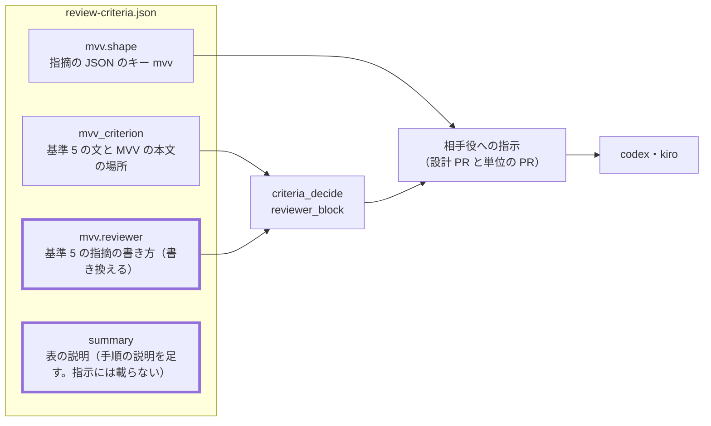
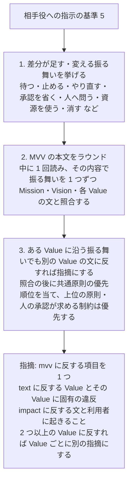

# cross-review の MVV の基準: 差分の振る舞いを Value の文と 1 つずつ突き合わせて指摘させる（#4076）

これまで（11.0.31 から今まで）の cross-review は、レビューを担当する AI（相手役。codex と kiro）に MVV に反するものを指摘させているが、何をどの文と比べるかは相手役に任せている。cross-review は、相手役が PR を読んで指摘を出し、修正担当の AI がその指摘を直すか見送る仕組みである。2026-11-24 に、MVV の Value 5 に反していた #4049 の最初の設計（ https://github.com/devbasex/ai-plugins/pull/4060 ）を読ませたが、相手役は Value 5 を挙げなかった。その設計は、背景で動く監視が終わるまで引継ぎ（作業内容を文書に残して Claude Code を終了し、新しいセッションで作業を続ける処理）を始めない形だった。

この PR（#4076 の設計）は直し方を決めるだけで、指示の文はまだ変えない。この後の実装の PR で、相手役への指示の指摘の基準の 5 番目（基準 5。MVV に反するかを見る）の指摘の仕方を、差分の振る舞いを挙げてから MVV の Value の文と 1 つずつ比べさせる手順へ書き換え、ある Value に沿う振る舞いでも別の Value に反すれば指摘させる。その実装では基準の表（`review-criteria.json`）の 2 か所（`mvv.reviewer` と、`summary` の `mvv` の説明）とそのテストを変え、コードと出力の形は変えない。採らなかった案は「決定の記録」に、調べたことは末尾の「外部の調査」に書く。

## 今の姿

この節の終わりまでは、変える前の今の状態を書く。直し方は次の節から後に書く。

何が起きたか・目的・受け入れ条件は要求仕様（[issue-4076-requirements.md](./issue-4076-requirements.md)、正は #4076 の本文）にある。この文書は残りの作業（受け入れ条件 7 と 9）の「どう解くか」と「なぜその解き方か」だけを書く。

これまで、相手役（codex・kiro）への指示の「指摘の基準」のセクションは、`criteria_decide.reviewer_block` が基準の表から組んでいる。設計 PR（設計書を載せる PR）も単位の PR（実装を 1 単位ずつ載せる PR）も、`drive.py` の同じ 1 か所（`_review_prompt` の中の `reviewer_block` の呼び出し）を通っている。この経路は変えない。図の太枠は、この後の実装の PR で変える予定の 2 か所（レビュー指示の `mvv.reviewer` の文と、表の説明の `summary`）を示す。`summary` は表を保守する人向けの説明で、指示には載らない。

これまでの `mvv.reviewer` が求めているのは、指摘の書き方だけである（中身は決定 1 の「選んだ案」に挙げた 3 つの決まり）。差分の中のどの振る舞いを、どの Value の文と比べるかは書いていない。

2026-11-24 に 2 回試した（記録: https://github.com/devbasex/ai-plugins/pull/4419#issuecomment-7127514486 ）。相手役は「背景の監視が終わるまで引継ぎを待つ」を、作業を失わないための正しい待ち（Value 3 と NDF の共通原則の C4 に沿う振る舞い）と読んだ。Value 3 は「同じ手順は毎回同じ結果になる」で、進行中の作業と人の回答が失われず止まった所から続くことも定めている。C4 は、データの削除や強制 push などの戻せない操作を「必ず人の承認が要る操作」に定めている。相手役は、Value 5 の「待つ間も待つだけで止まらない」とは比べなかった。ここまでが変える前の今の状態である。

## 文脈と制約

- 指示に MVV の本文をコピーしない。今と同じく本文の場所（起動の始めに保存したスナップショットのパス）だけを渡す（受け入れ条件 9・非機能の条件の「性能・拡張性」）。相手役が本文を読むのは 1 ラウンドに 1 回だけで、`mvv.reviewer` に足す手順の文は UTF-8 で 3,000 バイト以下にする（同じ非機能の条件）
- 基準の文は `review-criteria.json` の 1 か所に置く。`fix` の SKILL.md の表は人向けのコピーのまま（非機能の条件の「運用・保守性」）
- コマンド・相手役の出力の JSON・cross-review の結果 JSON の形は変えない（要求仕様の「影響」）。指摘の `mvv` は 1 件に 1 項目のまま
- 承認済みの MVV が無いリポジトリでは、基準 5 も書き方の文も指示に現れない（受け入れ条件 8）
- 修正担当への指示（`mvv.fixer`）と根拠の行の確かめの文（`mvv.citation`）は変えない（要求仕様の「含まない」）
- Value 5 の文（`.ndf/mvv.md`）と受け入れ条件 7 の文は変えない（要求仕様の「含まない」）
- NDF はどのプロジェクトの MVV にも効く製品の機能である（起票者の推定 S1）。指示の文に ai-plugins の MVV の項目の番号や文を書かない

## 解き方の全体像

この節から後は、この PR で決めて、実装でこれから変える形を書く。

- この設計では、承認済みの MVV があるとき、`mvv.reviewer` の文を、図の 3 つの手順を順に行うよう相手役に求める内容へ変える。設計 PR と単位の PR は同じ文を受け取る
- 指示が渡す MVV は今と同じく本文の場所だけである。各相手役はラウンド中に本文を 1 回読み、その内容を使って振る舞いを 1 つずつ照合する
- 指摘の形（`mvv` に 1 項目、impact に 1 文）は、今のまま変えない。1 つの振る舞いが 2 つ以上の Value に反するときは、Value ごとに指摘を分け、それぞれの `text` に反する Value とその Value に固有の違反を書く
- マージ前に、#4049 の最初の設計を入力にした一時の PR へ、この変更の `ndf cross-review run` を 1 回流す。相手役の指摘が、監視の終わりを待って引継ぎが止まる振る舞いを Value 5 に反すると書いているか（`mvv`・`text`・`impact`）を、この変更の PR に記録する（決定 2）

## 決定の記録

### 決定 1: 相手役が振る舞いと Value の文を比べ落とさないよう、基準 5 の書き方の文を「振る舞いを挙げる → Value ごとに比べる → 沿う Value があっても反すれば書く」の手順に書き換える

- **質問**: 相手役が差分の振る舞いを MVV の Value の文と比べるよう、指示のどこを・どう具体にするか
- **選んだ案**: 基準の表の `mvv.reviewer` の文の先頭に 3 つの手順を足す。今の書き方の決まりはその後ろに残す。今の決まりは、`mvv` に項目を 1 つ書く・impact に反する文と利用者に起きることを書く・必ず人の承認が要る操作は見送り済みでも書く、の 3 つである
  - 手順 1 は、振る舞いの種類を例として並べる（何かの終わりを待つ・止める・やり直す・承認を省く・人へ問う・資源や費用を使う・作ったものを消す）
  - 手順 2 は、基準 5 に書いたパスの MVV の本文を、各相手役にラウンド中に 1 回だけ読ませる。読んだ内容を使って、手順 1 で挙げた振る舞いを 1 つずつ、Mission・Vision と Value の最初から最後までの文と照合させる。振る舞いごとに本文を読み直させない（非機能の条件が、本文を読む量の上限を相手役 1 つ・1 ラウンドあたり 1 回分と決めているため）。手順 1〜3 の文は、非機能の条件が指示の増分の上限とする 3,000 バイト（UTF-8）以下に収める
  - 手順 3 は、ある Value に沿う振る舞い（作業を失わないための待ちなど）でも、別の Value の文に反すれば、反する Value の指摘として書かせる
  - 手順 3 では、各 Value を照合した後に、NDF の共通原則の優先順位（上位の原則 > 利用者の承認 > プロジェクトの MVV > スプリントの MVV > 効率）を当てさせる。この順位はスプリントの MVV を含むが、cross-review は相手役へスプリントの MVV を渡さない。そこで指示の文には「スプリントの MVV が渡されていないときは、その順位を飛ばし、プロジェクトの MVV の次に効率を置いて当てる」と書く。上位の原則や人の承認が求める制約に従う振る舞いそのもの（必ず人の承認が要る操作の承認を待つことなど）は、下位の Value の違反として指摘させない。その制約が求める範囲を超えて止めている部分（承認を待つ間に、並べられる承認の要らない作業まで止めることなど）は指摘させる
  - 手順 3 で 2 つ以上の Value に反するときは、Value ごとに指摘を分けさせる。それぞれの指摘の `text` には、反する Value と、その Value に固有の違反の中身を書かせる。`text` を使い回して `mvv` と `impact` だけを変えると、指摘の記録（`journal.py` の `Journal.enter`）が `text` から作るキーで 1 件にまとめてしまうためである
  - 手順 3 は、2026-11-24 の試行で相手役が待ちを Value 3・C4 の側だけで読んだ形への手当てである
- 採らなかった案: 指示に Value 5 の番号や「背景の作業を待つ設計」の例を名指しで書く。ai-plugins の MVV の番号と文を製品の指示へ持ち込むことになり、ほかのプロジェクトの MVV では番号も文も合わない。条件 7 の入力だけに合わせた指示になる
- 採らなかった案: 指示へ MVV の Value の文をコピーして並べる（受け入れ条件 9 と非機能の条件が本文の場所だけを渡すと決めている。バージョン 11 で約 17 KB を相手役とラウンドごとに足す）
- 採らなかった案: 相手役の出力に、挙げた振る舞いと比べた Value の一覧を返すキーを足す（相手役の出力の JSON の形を変える。要求仕様の「影響」が公開インタフェースを変えないと決めている）
- 採らなかった案: MVV の照らし合わせだけを行う相手役の起動を別に足す（相手役とラウンドごとに起動が 1 つ増え、費用が倍近くになる。今の起動の中で手順を足せば、同じ本文を 1 回読むだけで済む）
- 採らなかった案: 基準 5 の基準の文（`mvv_criterion`）の側に手順を書く（基準の文は修正担当への指示にも載る。修正担当への指示は変えないと要求仕様が決めている）
- **代償**: 相手役への指示が長くなり、MVV に反する指摘が今より多く出て、ラウンドが止まりうる（要求仕様の「影響」の「既存の振る舞い」）。LLM の判断に依るので、手順を書いても Value 5 の指摘が出る保証は無い（「未確認のまま残ること」）
- 作り方: 自前で作る・標準に倣う
- 比べた候補: STD1 / STD2 / PRD1 / PRD2
- 根拠: Value 4「ai-plugins の流儀を、使う側のプロジェクトに持ち込まない」・Value 2「文脈は最適な量に保たれる」（MVV バージョン 11）。STD1・STD2

### 決定 2: 条件 7 の試行が当時の木と今の MVV を同時に読むよう、3daeda927 に空のコミットを 1 つ重ねた一時ブランチを main 宛ての PR にし、`--base 0682abefe` で流す

- **質問**: マージ前の試行とリリース後の確認で、#4049 の最初の設計を cross-review へどう入力するか（要求仕様の前提 3 が設計に任せた）
- **選んだ案**: 一時ブランチを 3daeda927（#4049 の最初の設計を書いたコミット。main に取り込み済み）から作り、空のコミット（`git commit --allow-empty`）を 1 つ重ねて push する。`--base` に渡す 0682abefe は 3daeda927 の 1 つ前のコミットである。このブランチを main 宛ての一時の PR にし、次を流す
  - 空のコミットが要るのは、3daeda927 が main の祖先だからである。そのままの head では main との差分が無く、main 宛ての PR にならない。空のコミットを重ねると、木を変えずに main より 1 つ先行する head ができる
  - 相手役が読む木として、メインディレクトリから一時ブランチをチェックアウトした worktree を `git worktree add` で作る（登録済みの worktree。メインディレクトリそのものは `--worktree` に渡せない）
  - 状態の保存先として、その worktree とこの変更の worktree の外に、新しい空のディレクトリを作る
  - コマンド: `<この変更の worktree>/plugins/ndf/bin/ndf cross-review run --pr <一時の PR> --base 0682abefe --worktree <一時ブランチの worktree> --state-dir <新しいディレクトリ> --reviewer codex --reviewer kiro --max-rounds 1 > <結果のファイル>`。標準出力の結果 JSON は、どの出力を合否に使うかを決めるのに要るので、状態の保存先の外のファイルへ保存する
  - 実行ファイルはこの変更の worktree のもの、`--worktree` は一時ブランチの worktree で、2 つを別のディレクトリにする。この変更の worktree を `--worktree` に渡すと、相手役は当時の設計でなく今の木を読む
  - 相手役が読む木は 3daeda927 と同じになる。差分は 0682abefe からの 3 ファイルだけになる（`issues/issue-4049-design.md`・`issue-4049-design-detail.md`・`issue-4049-requirements.md`）
  - `--base` がコミットなので、MVV は PR のマージ先の main（承認済みのバージョン 11）から読まれる
  - 判定は、ラウンド 1 の相手役ごとの元の出力にある「対象の指摘」で決める。対象の指摘とは、`mvv` が Value 5 で、かつ `text` と `impact` が「背景の監視が終わるまで引継ぎを待ち、新しいセッションへ作業を引き継げない」振る舞いを、Value 5 の「背景の作業・CI を待つ間も待つだけで止まらない」に反すると書いている指摘である。別の振る舞いに対する Value 5 の指摘は、対象の指摘に数えない。判定の 3 つの結果は、どの出力を使うかを決めた後の項目に書く
  - 状態ファイルの指摘の一覧は、合否に使わない。指摘の記録（`journal.py` の `Journal.enter`）は、`text` が同じ指摘を相手役をまたいで 1 件にまとめ、先に入った `impact` を残したまま、`mvv` を後から入った指摘で分類し直す。そのため一覧からは、どの相手役がどの `mvv` と `impact` で出したかを読み取れない
  - 判定に使うのは、NDF が採用した codex と kiro の出力だけである。採用したかは、結果 JSON の `process`（ラウンドの実行記録）で決める。`run` が `round 1 codex` か `round 1 kiro` で、`result` が「指摘 <件数> 件」で始まる行が、採用した出力である
  - 採用した出力のファイルは、状態の保存先（`--state-dir`）にある。`result` に「（起動し直した）」が付かない行は `round1-<相手役>.out`、付く行は `round1-<相手役>-retry.out` を読む。名前は `drive.py` の `round_stem` が `round<ラウンド>-<相手役><接尾辞>` の形で付ける
  - `result` が「回答無し」で始まる行の出力は、ファイルから指摘の配列を読めても使わない。NDF は、実行が完了していない出力と、サンドボックスの失敗を検出した出力を採用しない（`seats.py` の `launch_reviewers`）
  - 起動し直しても結果の無い席を、NDF が Claude の読むだけの起動で埋めることがある（`seats.py` の `fill_seat`。状態ファイルのラウンドの記録の `filled` に残る）。この Claude の席の出力は、条件 7 の判定に含めない。条件 7 で確かめるのは、2026-11-24 の試行と同じ codex と kiro に、書き換えた指示が効くかである
  - 判定の結果は次の 3 つのどれかになる

    | 結果 | 当てはまるとき | 次にすること |
    | --- | --- | --- |
    | 合格 | 採用された出力のどれかに、対象の指摘が 1 件以上ある（もう片方が採用されなかったときも含む） | 結果をこの変更の PR に記録する |
    | 不合格 | codex と kiro の出力が両方とも採用され、どちらにも対象の指摘が無い | 課題を閉じずに基準 5 の文を直す |
    | 判定保留 | 対象の指摘が無く、codex と kiro のどちらかの出力が採用されなかった | 不合格とせず、基準 5 の文も直さない。下の「判定保留のときのやり直し」に従う |

  - 判定保留のときのやり直し: 作り直す前に、採用されなかった理由を結果 JSON の `process`（「回答無し（<種類>）」）と `warnings` から読み、原因を解消してから流す。ログインの切れ、サンドボックスの失敗、学習の設定で断られた（状態ファイルのラウンドの記録の `filled` の理由が `unready:` で始まる）などである。学習の設定で断られるとは、相手役の CLI のアカウントが入力をモデルの学習に使う設定か、設定を確かめられないために、NDF が起動しないことである。学習の設定で断られた席は、同じ設定のまま作り直しても Claude で埋められ、採用される出力は得られない
    - 原因が分からないときと、利用者の設定を変えないと解消できないとき（学習の設定など）は、作り直さずに止め、理由を添えて人に報告する
    - 判定保留からの作り直しは、マージ前の試行とリリース後の確認のそれぞれで 2 回までとする。2 回作り直しても判定保留なら、それ以上作り直さずに止め、各回の理由を添えて人に報告する
  - 一時の PR を作る前に、codex と kiro のログインと、`ndf training check --runtime codex` で codex の学習の設定を確かめる。どれかが通らなければ一時の PR を作らずに止め、理由を添えて人に報告する。起動の前に断られた席は Claude で埋められるので（`seats.py` の `fill_refused`）、そのまま流しても codex か kiro の出力は採用されない
    - kiro は学習の設定を確かめる口が無く、`ndf training check` で確かめられない。kiro が起動の前に断られたときは、判定保留のときのやり直しの条件に従い、利用者の設定を変えないと解消できない原因として止める
  - 条件 7 の合否に使う MVV はバージョン 11 である。初回の試行の前に、main の `.ndf/mvv.json` の最後のバージョンが 11 であることを確かめる。流した後に、状態ファイルのラウンドの記録にある MVV の識別子（`mvv.id`。`approved:<バージョン>:<本文の sha256>:<共通原則の sha256>`）のバージョンが 11 であることを確かめ、この識別子を結果と一緒にこの変更の PR に記録する
  - やり直しとリリース後の確認では、流した後に `mvv.id` を読み、初回の値と全体が一致するかを確かめる。共通原則も相手役に渡り、手順 3 で指摘するかを決める入力なので、共通原則の sha256 だけが違う場合も一致とみなさない
  - `mvv.id` が初回と違う試行と、バージョン 11 以外で流れた試行は、同じ条件の再現として扱わない。別の条件で流した参考の結果として、違った値と一緒に記録する。その結果を条件 7 の合否に使うときは、どの文に反する指摘を合格とするかを人に確かめてから判定する
  - `--max-rounds 1` はレビューだけの実行ではない。ラウンド 1 の判定が修正必須（`CHANGES_REQUIRED`）なら、`drive.py` の `_round` が修正担当を起動し、修正のコミットを一時ブランチへ push する。この修正と push は一時ブランチの中だけで起き、合否には使わない。レビューだけで止める入口は今の cross-review に無く、試行のためだけの入口は製品に足さない
  - 試行をやり直すときは、修正が載った一時ブランチを使い回さない。3daeda927 から別の名前の一時ブランチを作り直し、空のコミットを重ねて新しい一時の PR にし、新しい状態の保存先で流す
  - リリース後の確認も同じ組み方で、配ったバージョンの `ndf` で流す
  - 一時の PR とブランチ、一時ブランチの worktree は、確かめの後に閉じて消す
- 採らなかった案: 3daeda927 を今の main の上へ cherry-pick した PR。2026-11-24 の 1 回目の試行で、相手役が #4049 の最終の実装を読み、設計を「既存の実装との食い違い」として指摘した。読む木が当時と違う
- 採らなかった案: 0682abefe に作ったブランチを宛先にした PR（`--base` がコミットのとき、MVV は PR のマージ先のブランチから読まれる。宛先が当時の木になると、バージョン 11 より前の MVV を読む）
- 採らなかった案: 空のコミットの代わりに目印のファイルを足すコミット（`--base 0682abefe` からの差分にそのファイルが入り、相手役が読む差分が当時の 3 ファイルからずれる）
- 採らなかった案: PR を作らず、同じ差分・同じ作業ツリー・承認済みの MVV を渡してレビューだけを流す。PR CI も修正担当も起動しないので、試行 1 回あたりの処理の回数は一番少ない。ただし今の cross-review には入口が無い。`ndf cross-review run` は `--pr` が必須で、`--base` がコミットのときの MVV も PR のマージ先から読む。この入口は条件 7 の試行のためだけに製品へ足すことになり、要求仕様の「影響」が変えないと決めたコマンドの形も変わる
- 採らなかった案: 一時の PR を 1 つだけ作り、試行のたびに一時ブランチを 3daeda927 と空のコミットへ戻して使い回す。PR の作成による PR CI は 1 回で済むが、ブランチを戻すたびに強制 push が要り、そのたびに head の更新で PR CI も起動する。強制 push は共通原則の C4 で必ず人の承認が要る操作なので、試行ごとに承認を待つことになる
- **代償**: 一時の PR とブランチを作って消す手間が試行ごとに残る。試行 1 回ごとに、ワークフローの起動が 12〜22 回、修正担当の起動が 0〜1 回増える。一時の PR に起きるイベントごとの内訳は次の表のとおりである

    | イベント | 直接起動するワークフロー | 後続で起動するワークフロー | 計 |
    | --- | --- | --- | --- |
    | 一時の PR を作る（`opened`） | `pull_request` の 7 本と、`pull_request_target` の `renovate-gate.yml`・`release-cd.yml` | `script-structure.yml`（名前は `Script structure`）の完了で `deps-affected-comment.yml` | 10 |
    | cross-review が PR に記録のコメントを書く（`issue_comment`） | `release-cd.yml` | 無し | 書くたびに 1（1 回の実行で少なくとも 1） |
    | 修正担当が push する（`synchronize`。修正必須のときだけ） | PR を作るときと同じ 9 本 | `deps-affected-comment.yml` | 10 |
    | 確かめの後に一時の PR を閉じる（`closed`） | `release-cd.yml` | 無し | 1 |

  - 起動しないもの: `deps-weekly.yml` は `pull_request` を `.github/renovate.json` などのパスに絞っていて、一時の PR の差分には当たらない。`renovate-gate.yml` の `status` は、ワークフローが `github.token` で付けた commit status では起動しない
  - 起動したワークフローの中で動くジョブは、`pull_request` の 7 本では次の表のとおりである。`pull_request_target` と後続の 3 本では、`renovate-gate.yml` の `renovate-gate`（Renovate の PR でなければ checkout せずに success を付ける）、`release-cd.yml` の `approval-check`（`issue_comment` のときは本文に `ndf:release-approval` が無ければ飛ばす）、`deps-affected-comment.yml` の `deps-affected-comment`（元の実行が `pull_request` のときだけ動く）が動く。`release-cd.yml` のほかのジョブは `workflow_dispatch`・`push`・承認のコメントのときだけ動くので、一時の PR では動かない

    | `pull_request` のワークフロー | 起動したときに動くジョブ |
    | --- | --- |
    | `pr-base-guard.yml` | `guard`（`pull_request` のときだけ動く条件で、PR では動く） |
    | `lint.yml` | `lint` |
    | `glossary.yml` | `glossary-check` |
    | `script-structure.yml` | `script-structure-check`・`ndf-contracts-check` |
    | `runtime-plugin-validate.yml` | 8 つの検査のジョブと、`pull_request` のときだけ動く `required-checks-check` |
    | `pytest.yml` | `ci-scope` と集計の `pytest` は必ず動く。`pytest-shard`・`pytest-ndf-ok-tools`・`pytest-docs` は `ci-scope` の判定で動くかが決まる |
    | `runtime-plugin-smoke.yml` | `ci-scope` は必ず動く。`runtime-smoke`（claude と codex の 2 ジョブ）は起動するが、`ci-scope` が省くと判定すれば中のステップを飛ばす |

  - 条件付きのジョブは、`scripts/ci-heavy-skip.py` が PR の merge-base から head までの差分で決める。PR の作成のときは差分が空なので「版数と説明だけ」、修正の push の後は修正担当が文書だけを直していれば「文書だけ」と判定され、全体のテストと smoke の本体は省かれる見込みである（コードを読んだ見込みで、試行の時点まで確かめていない）
  - 試行 1 回の合計: 修正必須でなければ、PR の作成 10・記録のコメント 1・PR を閉じる 1 で 12 回になる。修正必須なら、修正担当が 1 回起動し、修正の push の 10 回が足されて 22 回になる。記録のコメントを 2 回以上書けば、その分だけ増える
  - 修正と push は合否に使わないので、この分は判定のためには要らない処理である。レビューだけで止める入口が無いことの代償として受け入れる
  - 試行はマージ前とリリース後の少なくとも 2 回なので、合わせてワークフローの起動が 24〜44 回、修正担当が 0〜2 回増える。判定保留から作り直すと、1 回ごとに同じ数が足される（作り直しの上限は上の「判定保留のときのやり直し」）
  - 採らなかった案との比べ: レビューだけを流す案は、ワークフローの起動も修正担当も 0 回である。一時の PR を使い回す案は、PR の作成の 10 回と閉じる 1 回が初回と最後だけになる。ただし、試行ごとに強制 push の 10 回と記録のコメントの 1 回が要り、修正必須なら修正の push の 10 回も足される。どちらも採らない理由は、それぞれの案に書いたとおりである
  - GitHub が空のコミット 1 つだけ先行する PR を受け付けることは、試行の時点まで確かめられない（「未確認のまま残ること」）
- 根拠: Value 3「同じ操作を打ち直しても、結果は 1 回打ったときと変わらない」（MVV バージョン 11）。マージ前の試行・やり直し・リリース後の確認のどれでも、相手役が読む木と差分が同じになる組み方を選んだ。MVV と共通原則はその都度 main と NDF から読むので、初回に記録した識別子と全体を比べて同じ条件かを確かめる

## 影響と危険

- **働く範囲**: 利用先のリポジトリでも働く。承認済みの MVV があるリポジトリで、cross-review の相手役への指示の基準 5 の書き方の文が変わる。設計 PR と単位の PR の両方に当たる。cross-refactoring の `$RF_MVV` と修正担当への指示は変わらない
- **プロジェクトごとに違うもの**: MVV の本文（Value の数と文）は、今と同じく各リポジトリのベースブランチの `.ndf/mvv.md` から読む。指示の文はどのリポジトリでも同じで、設定も引数も足さない
- **当たるモード**: cross-review を通るすべてのモード（設計 PR と単位の PR のレビュー）。モードごとの分岐は足さない
- **壊れうる箇所**: 相手役の指摘が増え、MVV に反する指摘で収束が遅れうる。修正担当は今と同じく本文を読んで反しなければ理由を添えて見送れるので、止まり続けはしない。見送りは `ndf records mvv signals` の改訂の兆候に数えられ、後から読める
- **同じファイルを触る別の変更**: `review-criteria.json` は cross-review の基準の文を持つ唯一のファイルで、ほかのレーンの変更が同時に触ると衝突しうる。衝突したら、この変更が直すのは `mvv.reviewer` と `summary` の該当の文だけなので、その 2 か所だけを合わせる

### 代表のリポジトリでの振る舞い

| 代表のリポジトリ | 設定の要点 | 直した後に起きること | この種類で扱えなくなること |
| --- | --- | --- | --- |
| Web サービス | 承認済みの MVV があれば基準 5 が載る | 単位の PR の cross-review で、相手役が差分の振る舞いを MVV の Value の文と比べ、反すれば Value ごとに指摘する | 無し |
| モバイルアプリ | 同上 | 同上 | 無し |
| 業務文書だけ | 承認済みの MVV が無ければ基準 5 は載らない | MVV があれば文書の PR でも同じ手順の指示が載る。MVV が無ければ今と変わらない | 無し |

### ai-plugins だけの事情

- 無し（指示の文は製品の基準の表に置き、ai-plugins の MVV の番号と文を書かない。条件 7 の入力のコミット 3daeda927・0682abefe は試行の手順だけが使い、製品には入れない）

## テスト設計

| 受け入れ条件・不変条件 | どの振る舞いで縛るか | どう壊したら落ちるべきか |
| --- | --- | --- |
| 9（書き方の文が両方の相手役へ届く） | 既存の `test_approved_mvv_of_the_base_reaches_both_prompts_as_snapshots` に足す。既存のテストの偽の起動口が受け取った codex と kiro の指示が、どちらも基準の表から組んだ `mvv.reviewer` の文を含む。文は表から読み、テストに文字列リテラルで書かない。相手役の実プロセスは起動しない。設計 PR と単位の PR は同じ組み立てを通るので、1 つの経路で縛る | 相手役の 1 つにだけ書き方の文を載せるように壊すと落ちる |
| 9（本文はコピーしない） | 同じテストに足す。偽の起動口が受け取った相手役の指示が、テストの MVV の本文にしか無い行を含まない。基準 5 の行がスナップショットのパスを含むことは、同じテストが既に縛っている | 指示へスナップショットの本文を埋め込むように壊すと落ちる |
| 9（指示が手順を求める） | CI では縛らない。書き方の文が指示の組み立てに載ることは既存の `test_issue_4076_criterion_5_appears_only_with_the_approved_mvv` が縛っているが、文の中身は表から読むので、表から手順を消しても通る。確かめは 2 つある。1 つ目に、組み立てた相手役への指示の基準 5 を読み、手順 1〜3 があることを確かめる。2 つ目に、`mvv.reviewer` に足した手順 1〜3 の文の UTF-8 のバイト数を測り、3,000 バイト以下であることを確かめる。読むだけでは上限を確かめたことにならない。手順が効くかは条件 7 の試行で確かめる | — |
| 8（MVV が無いと変わらない） | 既存のテスト（`.ndf/mvv.json` が無い・未承認のリポジトリで、指示に基準 5・書き方の文・`mvv` のキーが現れない）をそのまま通す | 承認済みの MVV が無くても書き方の文を載せるように壊すと落ちる |
| 7 | CI では確かめない（相手役の LLM の出力に依る）。マージ前に決定 2 の組み方で 1 回流し、決定 2 の合否の決め方で判定し、結果と MVV の識別子をこの変更の PR に記録する。リリース後に配ったバージョンで同じ組み方で確かめ直す | — |

## どこを変えるか

新しく作る関数も、シグネチャを変える関数も無い。そのため詳細設計は別の文書にせず、このセクションに書く。

| ファイル | 変える中身 | 決定 |
| --- | --- | --- |
| `plugins/ndf/contracts/data/review-criteria.json` | `mvv.reviewer` の文の先頭に決定 1 の 3 つの手順を足し、今の書き方の決まりを後ろに残す。差し込みは今と同じ `{number}` だけにし、MVV の番号と文を書かない。`summary` の `mvv` の説明に、reviewer が振る舞いと Value の突き合わせの手順も持つことを足す | 決定 1 |
| `plugins/ndf/tests/domains/crossreview/test_crossreview_mvv.py` | 既存の `test_approved_mvv_of_the_base_reaches_both_prompts_as_snapshots` に、テスト設計の 9（書き方の文が両方の相手役へ届く・本文はコピーしない）の確かめを足す | 決定 1 |

## 設計の結果

| 課題 | 扱い | 統合先 | 触るファイル |
| --- | --- | --- | --- |
| #4076 | 実装する | — | `plugins/ndf/contracts/data/review-criteria.json`、`plugins/ndf/tests/domains/crossreview/test_crossreview_mvv.py` |

## 未確認のまま残ること

| 項目 | 内容 |
| --- | --- |
| 書き換えた指示で相手役が Value 5 を挙げるか | 相手役の LLM の判断に依り、文面からは決まらない。マージ前の 1 回の試行（決定 2）で分かり、リリース後の確認で確かめ直す。不合格なら課題を閉じずに基準 5 の文を直し、判定保留なら基準 5 の文は直さずに決定 2 のやり直しの条件に従う（要求仕様のドメインイベント E3・E4） |
| GitHub が空のコミット 1 つだけ main より先行する一時の PR を受け付けるか | 一時の PR を作る時点まで確かめていない（PR を作ると外へ出るため、設計の時点では試していない）。マージ前の試行の最初の手順で分かる。受け付けなければ試行を進めず、組めなかったことを報告する |

## 外部の調査

| 種類 | 調べるか | 理由 |
| --- | --- | --- |
| 標準・仕様 | 調べる | LLM に原則への適合を判定させる指示の書き方に、モデルの提供元の公開の指針がある |
| 主要な製品 | 調べる | AI のコードレビューの製品が、チームの基準を指示へどう渡しているかを比べる |
| ライブラリとサービス | 調べない | 変えるのは既存の基準の表の 2 か所の文で、足す依存も置き換える部品も無い |

### 標準・仕様

| # | 標準・仕様 | 何を定めているか | 設計への反映 | 出典 |
| --- | --- | --- | --- | --- |
| STD1 | Anthropic の Chain of thought の指針（Guided chain of thought） | 考える手順を指示の中で具体に示すと、判断の質が上がる。「段階を追って考える」と書くだけの形より、どの手順を踏むかを書く形を勧める | 基準 5 を「反するものを指摘する」だけにせず、振る舞いを挙げる → Value ごとに比べる → 反すれば書く、の手順で示す（決定 1） | https://docs.claude.com/en/docs/build-with-claude/prompt-engineering/chain-of-thought （2026-11-25） |
| STD2 | Constitutional AI（Bai ほか、2022）と Anthropic の「Specific versus General Principles for Constitutional AI」 | 原則に照らす批評は、原則を 1 つ選んで「この応答は原則 X に反するか」と問う形で行う。一般的な原則だけより、具体の原則と組み合わせると特定の振る舞いを捉えやすい | Value を 1 つずつ取り出して比べさせ、全体の印象で「MVV に反するか」を判断させない（決定 1 の手順 2） | https://arxiv.org/abs/2212.08073 ・ https://www.anthropic.com/news/specific-versus-general-principles-for-constitutional-ai （2026-11-25） |

### 主要な製品

| # | 製品 | どう解いているか | 設計への反映 | 出典 |
| --- | --- | --- | --- | --- |
| PRD1 | CodeRabbit の review instructions・path instructions | チームの基準は組み込みのレビューの補足として渡す。適用する範囲を書かない規則は、当てはめ方がばらつくと案内している | 基準 5 を既存の指示の補足として足し、組み込みの基準 1〜4・6 は変えない。手順 1 で振る舞いの種類を例示し、何に当てはめるかを書く（決定 1） | https://docs.coderabbit.ai/configuration/path-instructions ・ https://docs.coderabbit.ai/configuration/guides/write-instructions （2026-11-25） |
| PRD2 | CodeRabbit の code guidelines | AGENTS.md などの既存の基準の文書を、レビューの指示へ写さずに参照させる。基準の文書を変更の差分として読ませると誤る | MVV の本文を指示へコピーせず、スナップショットのパスを渡して読ませる今の形を保つ（決定 1 の採らなかった案） | https://docs.coderabbit.ai/knowledge-base/code-guidelines （2026-11-25） |

### 確かめられなかったこと

| 対象 | 試した手段 | 結果と理由 |
| --- | --- | --- |
| Constitutional AI の論文の付録にある批評の指示の原文 | 検索「Anthropic Constitutional AI critique each principle prompt」 | 検索の抜粋に原文が無く、論文の本文は取得していない。設計には原則を 1 つずつ問う形だけを使い、文面は写さない |
| GitHub Copilot code review のカスタム指示の扱い | 試していない | 比べる製品を 1 つ（CodeRabbit）に絞った |

調べた量: 候補 4 件・取得の試み 3 回。
