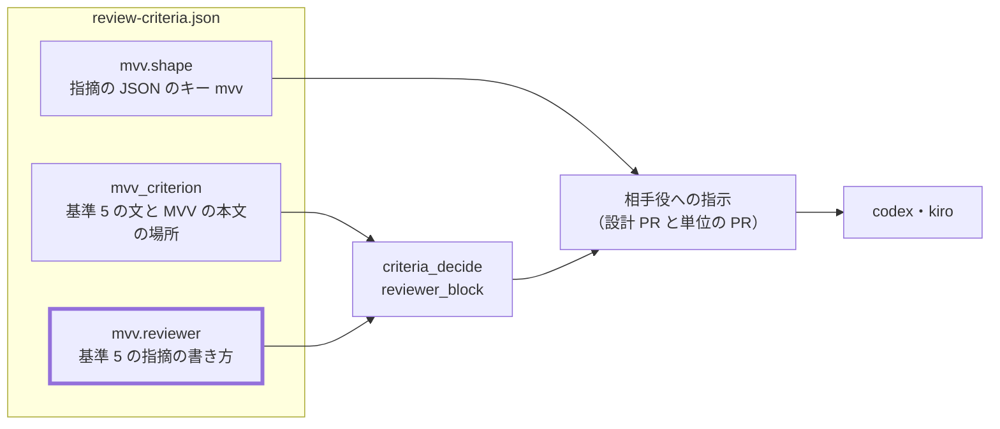
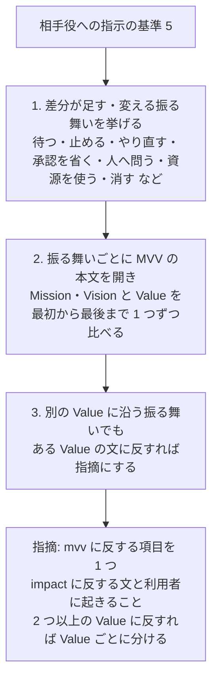

# cross-review の MVV の基準: 差分の振る舞いを Value の文と 1 つずつ突き合わせて指摘させる（#4076）

11.0.31 の cross-review は、MVV の Value 5 に反する設計（背景の作業の終わりを待って子を止める #4049 の最初の設計）を読んでも、相手役が Value 5 を挙げなかった。相手役への指示の基準 5 の文を、差分の振る舞いを挙げてから MVV の Value の文と 1 つずつ比べさせる手順に書き換え、ある Value に沿う振る舞いでも別の Value に反すれば指摘させる。変えるのは基準の表（`review-criteria.json`）の文 1 つで、コードと出力の形は変えない。採らなかった案は「決定の記録」に、調べたことは末尾の「外部の調査」にある。

## 今の姿

何が起きたか・目的・受け入れ条件は要求仕様（[issue-4076-requirements.md](./issue-4076-requirements.md)、正は #4076 の本文）にある。この文書は残りの作業（受け入れ条件 7 と 9）の「どう解くか」と「なぜその解き方か」だけを書く。

相手役（codex・kiro）への指示の「指摘の基準」のセクションは、`criteria_decide.reviewer_block` が基準の表から組む。設計 PR も単位の PR も、`drive.py` の同じ 1 か所（`_review_prompt` の中の `reviewer_block` の呼び出し）を通る。変えるのは、図の太枠の文 1 つである。

今の `mvv.reviewer` が求めるのは、指摘の書き方だけである（中身は決定 1 の「選んだ案」に挙げた 3 つの決まり）。差分の中のどの振る舞いを、どの Value の文と比べるかは書いていない。

2026-11-24 に 2 回試した（記録: https://github.com/devbasex/ai-plugins/pull/4419#issuecomment-7127514486 ）。相手役は「背景の作業の終わりを待ってから子を止める」を、作業を失わないための正しい待ち（Value 3・C4 の側）と読んだ。Value 5 の「待つだけで止まらない」とは比べなかった。

## 文脈と制約

- 指示に MVV の本文をコピーしない。今と同じく本文の場所（起動の始めに保存したスナップショットのパス）だけを渡す（受け入れ条件 9・非機能の条件の「性能・拡張性」）
- 基準の文は `review-criteria.json` の 1 か所に置く。`fix` の SKILL.md の表は人向けのコピーのまま（非機能の条件の「運用・保守性」）
- コマンド・相手役の出力の JSON・cross-review の結果 JSON の形は変えない（要求仕様の「影響」）。指摘の `mvv` は 1 件に 1 項目のまま
- 承認済みの MVV が無いリポジトリでは、基準 5 も書き方の文も指示に現れない（受け入れ条件 8）
- 修正担当への指示（`mvv.fixer`）と根拠の行の確かめの文（`mvv.citation`）は変えない（要求仕様の「含まない」）
- Value 5 の文（`.ndf/mvv.md`）と受け入れ条件 7 の文は変えない（要求仕様の「含まない」）
- NDF はどのプロジェクトの MVV にも効く製品の機能である（起票者の推定 S1）。指示の文に ai-plugins の MVV の項目の番号や文を書かない

## 解き方の全体像

- 承認済みの MVV があるとき、相手役への指示の基準 5 の書き方の文（`mvv.reviewer`）が、図の 3 つの手順を順に求める。設計 PR と単位の PR は同じ文を受け取る
- 指示が渡す MVV は今と同じく本文の場所だけで、相手役は手順 2 でその本文を読む
- 指摘の形（`mvv` に 1 項目、impact に 1 文）は変わらない。1 つの振る舞いが 2 つ以上の Value に反するときは、Value ごとに指摘を分ける
- マージ前に、#4049 の最初の設計を入力にした一時の PR へ、この変更の `ndf cross-review run` を 1 回流す。相手役の指摘の `mvv` に Value 5 があるかを、この変更の PR に記録する（決定 2）

## 決定の記録

### 決定 1: 相手役が振る舞いと Value の文を比べ落とさないよう、基準 5 の書き方の文を「振る舞いを挙げる → Value ごとに比べる → 沿う Value があっても反すれば書く」の手順に書き換える

- **質問**: 相手役が差分の振る舞いを MVV の Value の文と比べるよう、指示のどこを・どう具体にするか
- **選んだ案**: 基準の表の `mvv.reviewer` の文の先頭に 3 つの手順を足す。今の書き方の決まりはその後ろに残す。今の決まりは、`mvv` に項目を 1 つ書く・impact に反する文と利用者に起きることを書く・必ず人の承認が要る操作は見送り済みでも書く、の 3 つである
  - 手順 1 は、振る舞いの種類を例として並べる（何かの終わりを待つ・止める・やり直す・承認を省く・人へ問う・資源や費用を使う・作ったものを消す）
  - 手順 2 は、振る舞いごとに基準 5 に書いたパスの MVV の本文を開かせる。Mission・Vision と Value を、最初から最後まで 1 つずつ比べることを求める
  - 手順 3 は、ある Value に沿う振る舞い（作業を失わないための待ちなど）でも、別の Value の文に反すれば、反する Value の指摘として書かせる。2 つ以上の Value に反すれば、Value ごとに指摘を分けさせる
  - 手順 3 は、2026-11-24 の試行で相手役が待ちを Value 3・C4 の側だけで読んだ形への手当てである
- 採らなかった案: 指示に Value 5 の番号や「背景の作業を待つ設計」の例を名指しで書く。ai-plugins の MVV の番号と文を製品の指示へ持ち込むことになり、ほかのプロジェクトの MVV では番号も文も合わない。条件 7 の入力だけに合わせた指示になる
- 採らなかった案: 指示へ MVV の Value の文をコピーして並べる（受け入れ条件 9 と非機能の条件が本文の場所だけを渡すと決めている。バージョン 11 で約 17 KB を相手役とラウンドごとに足す）
- 採らなかった案: 相手役の出力に、挙げた振る舞いと比べた Value の一覧を返すキーを足す（相手役の出力の JSON の形を変える。要求仕様の「影響」が公開インタフェースを変えないと決めている）
- 採らなかった案: MVV の照らし合わせだけを行う相手役の起動を別に足す（相手役とラウンドごとに起動が 1 つ増え、費用が倍近くになる。今の起動の中で手順を足せば、同じ本文を 1 回読むだけで済む）
- 採らなかった案: 基準 5 の基準の文（`mvv_criterion`）の側に手順を書く（基準の文は修正担当への指示にも載る。修正担当への指示は変えないと要求仕様が決めている）
- **代償**: 相手役への指示が長くなり、MVV に反する指摘が今より多く出て、ラウンドが止まりうる（要求仕様の「影響」の「既存の振る舞い」）。LLM の判断に依るので、手順を書いても Value 5 の指摘が出る保証は無い（「未確認のまま残ること」）
- 作り方: 自前で作る・標準に倣う
- 比べた候補: STD1 / STD2 / PRD1 / PRD2
- 根拠: Value 4「ai-plugins の流儀を、使う側のプロジェクトに持ち込まない」・Value 2「文脈は最適な量に保たれる」（MVV バージョン 11）。STD1・STD2

### 決定 2: 条件 7 の試行が当時の木と今の MVV を同時に読むよう、3daeda927 に空のコミットを 1 つ重ねた一時ブランチを main 宛ての PR にし、`--base 0682abefe` で流す

- **質問**: マージ前の試行とリリース後の確認で、#4049 の最初の設計を cross-review へどう入力するか（要求仕様の前提 3 が設計に任せた）
- **選んだ案**: 一時ブランチを 3daeda927 から作り、空のコミット（`git commit --allow-empty`）を 1 つ重ねて push する。このブランチを main 宛ての一時の PR にし、次を流す
  - コマンド: `plugins/ndf/bin/ndf cross-review run --pr <一時の PR> --base 0682abefe --reviewer codex --reviewer kiro --max-rounds 1`
  - 相手役が読む木は 3daeda927 と同じになる。差分は 0682abefe からの 3 ファイルだけになる（`issues/issue-4049-design.md`・`issue-4049-design-detail.md`・`issue-4049-requirements.md`）
  - `--base` がコミットなので、MVV は PR のマージ先の main（承認済みのバージョン 11）から読まれる
  - リリース後の確認も同じ組み方で、配ったバージョンの `ndf` で流す
  - 一時の PR とブランチは、確かめの後に閉じて消す
- 採らなかった案: 3daeda927 を今の main の上へ cherry-pick した PR。2026-11-24 の 1 回目の試行で、相手役が #4049 の最終の実装を読み、設計を「既存の実装との食い違い」として指摘した。読む木が当時と違う
- 採らなかった案: 0682abefe に作ったブランチを宛先にした PR（`--base` がコミットのとき、MVV は PR のマージ先のブランチから読まれる。宛先が当時の木になると、バージョン 11 より前の MVV を読む）
- 採らなかった案: 空のコミットの代わりに目印のファイルを足すコミット（`--base 0682abefe` からの差分にそのファイルが入り、相手役が読む差分が当時の 3 ファイルからずれる）
- **代償**: 一時の PR とブランチを作って消す手間が試行ごとに残る。GitHub が空のコミット 1 つだけ先行する PR を受け付けることは、試行の時点まで確かめられない（「未確認のまま残ること」）
- 根拠: Value 3「同じ操作を打ち直しても、結果は 1 回打ったときと変わらない」（MVV バージョン 11）

## 影響と危険

- **働く範囲**: 利用先のリポジトリでも働く。承認済みの MVV があるリポジトリで、cross-review の相手役への指示の基準 5 の書き方の文が変わる。設計 PR と単位の PR の両方に当たる。cross-refactoring の `$RF_MVV` と修正担当への指示は変わらない
- **プロジェクトごとに違うもの**: MVV の本文（Value の数と文）は、今と同じく各リポジトリのベースブランチの `.ndf/mvv.md` から読む。指示の文はどのリポジトリでも同じで、設定も引数も足さない
- **当たるモード**: cross-review を通るすべてのモード（設計 PR と単位の PR のレビュー）。モードごとの分岐は足さない
- **壊れうる箇所**: 相手役の指摘が増え、MVV に反する指摘で収束が遅れうる。修正担当は今と同じく本文を読んで反しなければ理由を添えて見送れるので、止まり続けはしない。見送りは `ndf records mvv signals` の改訂の兆候に数えられ、後から読める
- **同じファイルを触る別の変更**: `review-criteria.json` は cross-review の基準の文を持つ唯一のファイルで、ほかのレーンの変更が同時に触ると衝突しうる。衝突したら、この変更が直すのは `mvv.reviewer` と `summary` の該当の文だけなので、その 2 か所だけを合わせる

### 代表のリポジトリでの振る舞い

| 代表のリポジトリ | 設定の要点 | 直した後に起きること | この種類で扱えなくなること |
| --- | --- | --- | --- |
| Web サービス | 承認済みの MVV があれば基準 5 が載る | 単位の PR の cross-review で、相手役が差分の振る舞いを MVV の Value の文と比べ、反すれば Value ごとに指摘する | 無し |
| モバイルアプリ | 同上 | 同上 | 無し |
| 業務文書だけ | 承認済みの MVV が無ければ基準 5 は載らない | MVV があれば文書の PR でも同じ手順の指示が載る。MVV が無ければ今と変わらない | 無し |

### ai-plugins だけの事情

- 無し（指示の文は製品の基準の表に置き、ai-plugins の MVV の番号と文を書かない。条件 7 の入力のコミット 3daeda927・0682abefe は試行の手順だけが使い、製品には入れない）

## テスト設計

| 受け入れ条件・不変条件 | どの振る舞いで縛るか | どう壊したら落ちるべきか |
| --- | --- | --- |
| 9（指示が手順を求める） | 承認済みの MVV があるとき、相手役への「指摘の基準」のセクションが、基準の表の `mvv.reviewer` の文（`{number}` を基準の番号で埋めたもの）を含む。文は表から読み、テストに文字列リテラルで書かない | `reviewer_block` が `_mvv_lines("reviewer", …)` を載せないように壊すと落ちる |
| 9（設計 PR と単位の PR の両方） | 承認済みの MVV がある PR で `ndf cross-review run` を流すと、codex と kiro の両方への指示が同じ書き方の文を含む。設計 PR と単位の PR は同じ組み立てを通るので、1 つの経路で縛る | 相手役の 1 つにだけ書き方の文を載せるように壊すと落ちる |
| 9（本文はコピーしない） | 相手役への指示が、MVV の本文にしか無い行を含まず、基準 5 の行がスナップショットのパスを含む | 指示へスナップショットの本文を埋め込むように壊すと落ちる |
| 8（MVV が無いと変わらない） | 既存のテスト（`.ndf/mvv.json` が無い・未承認のリポジトリで、指示に基準 5・書き方の文・`mvv` のキーが現れない）をそのまま通す | 承認済みの MVV が無くても書き方の文を載せるように壊すと落ちる |
| 7 | CI では確かめない（相手役の LLM の出力に依る）。マージ前に決定 2 の組み方で 1 回流し、相手役の指摘の `mvv` に Value 5 があるかと結果をこの変更の PR に記録する。リリース後に配ったバージョンで同じ組み方で確かめ直す | — |

## どこを変えるか

新しく作る関数も、シグネチャを変える関数も無い。そのため詳細設計は別の文書にせず、このセクションに書く。

| ファイル | 変える中身 | 決定 |
| --- | --- | --- |
| `plugins/ndf/contracts/data/review-criteria.json` | `mvv.reviewer` の文の先頭に決定 1 の 3 つの手順を足し、今の書き方の決まりを後ろに残す。差し込みは今と同じ `{number}` だけにし、MVV の番号と文を書かない。`summary` の `mvv` の説明に、reviewer が振る舞いと Value の突き合わせの手順も持つことを足す | 決定 1 |
| `plugins/ndf/tests/domains/crossreview/test_crossreview_criteria.py` | テスト設計の 9（指示が手順を求める）の行を足す | 決定 1 |
| `plugins/ndf/tests/domains/crossreview/test_crossreview_mvv.py` | テスト設計の 9（両方の相手役・本文はコピーしない）の行を足す | 決定 1 |

## 設計の結果

| 課題 | 扱い | 統合先 | 触るファイル |
| --- | --- | --- | --- |
| #4076 | 実装する | — | `plugins/ndf/contracts/data/review-criteria.json`、`plugins/ndf/tests/domains/crossreview/test_crossreview_criteria.py`、`plugins/ndf/tests/domains/crossreview/test_crossreview_mvv.py` |

## 未確認のまま残ること

| 項目 | 内容 |
| --- | --- |
| 書き換えた指示で相手役が Value 5 を挙げるか | 相手役の LLM の判断に依り、文面からは決まらない。マージ前の 1 回の試行（決定 2）で分かり、リリース後の確認で確かめ直す。出なければ課題を閉じずに基準 5 の文を直す（要求仕様のドメインイベント E3・E4） |
| GitHub が空のコミット 1 つだけ main より先行する一時の PR を受け付けるか | 一時の PR を作る時点まで確かめていない（PR を作ると外へ出るため、設計の時点では試していない）。マージ前の試行の最初の手順で分かる。受け付けなければ試行を進めず、組めなかったことを報告する |

## 外部の調査

| 種類 | 調べるか | 理由 |
| --- | --- | --- |
| 標準・仕様 | 調べる | LLM に原則への適合を判定させる指示の書き方に、モデルの提供元の公開の指針がある |
| 主要な製品 | 調べる | AI のコードレビューの製品が、チームの基準を指示へどう渡しているかを比べる |
| ライブラリとサービス | 調べない | 変えるのは既存の基準の表の文 1 つで、足す依存も置き換える部品も無い |

### 標準・仕様

| # | 標準・仕様 | 何を定めているか | 設計への反映 | 出典 |
| --- | --- | --- | --- | --- |
| STD1 | Anthropic の Chain of thought の指針（Guided chain of thought） | 考える手順を指示の中で具体に示すと、判断の質が上がる。「段階を追って考える」と書くだけの形より、どの手順を踏むかを書く形を勧める | 基準 5 を「反するものを指摘する」だけにせず、振る舞いを挙げる → Value ごとに比べる → 反すれば書く、の手順で示す（決定 1） | https://docs.claude.com/en/docs/build-with-claude/prompt-engineering/chain-of-thought （2026-11-25） |
| STD2 | Constitutional AI（Bai ほか、2022）と Anthropic の「Specific versus General Principles for Constitutional AI」 | 原則に照らす批評は、原則を 1 つ選んで「この応答は原則 X に反するか」と問う形で行う。一般的な原則だけより、具体の原則と組み合わせると特定の振る舞いを捉えやすい | Value を 1 つずつ取り出して比べさせ、全体の印象で「MVV に反するか」を判断させない（決定 1 の手順 2） | https://arxiv.org/abs/2212.08073 ・ https://www.anthropic.com/news/specific-versus-general-principles-for-constitutional-ai （2026-11-25） |

### 主要な製品

| # | 製品 | どう解いているか | 設計への反映 | 出典 |
| --- | --- | --- | --- | --- |
| PRD1 | CodeRabbit の review instructions・path instructions | チームの基準は組み込みのレビューの補足として渡す。適用する範囲を書かない規則は、当てはめ方がばらつくと案内している | 基準 5 を既存の指示の補足として足し、組み込みの基準 1〜4・6 は変えない。手順 1 で振る舞いの種類を例示し、何に当てはめるかを書く（決定 1） | https://docs.coderabbit.ai/configuration/path-instructions ・ https://docs.coderabbit.ai/configuration/guides/write-instructions （2026-11-25） |
| PRD2 | CodeRabbit の code guidelines | AGENTS.md などの既存の基準の文書を、レビューの指示へ写さずに参照させる。基準の文書を変更の差分として読ませると誤る | MVV の本文を指示へコピーせず、スナップショットのパスを渡して読ませる今の形を保つ（決定 1 の採らなかった案） | https://docs.coderabbit.ai/knowledge-base/code-guidelines （2026-11-25） |

### 確かめられなかったこと

| 対象 | 試した手段 | 結果と理由 |
| --- | --- | --- |
| Constitutional AI の論文の付録にある批評の指示の原文 | 検索「Anthropic Constitutional AI critique each principle prompt」 | 検索の抜粋に原文が無く、論文の本文は取得していない。設計には原則を 1 つずつ問う形だけを使い、文面は写さない |
| GitHub Copilot code review のカスタム指示の扱い | 試していない | 比べる製品を 1 つ（CodeRabbit）に絞った |

調べた量: 候補 4 件・取得の試み 3 回。
