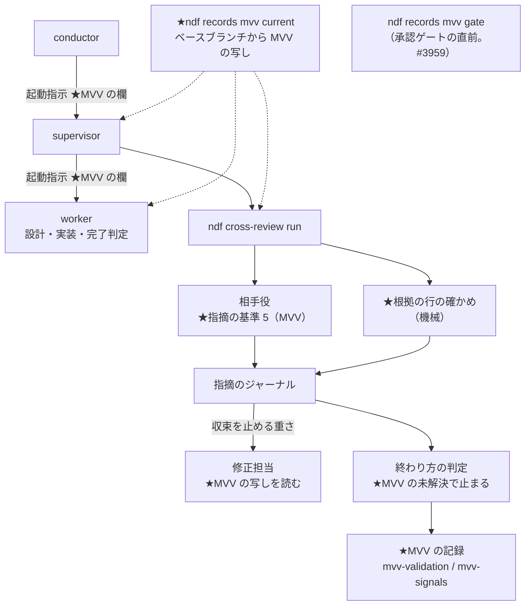
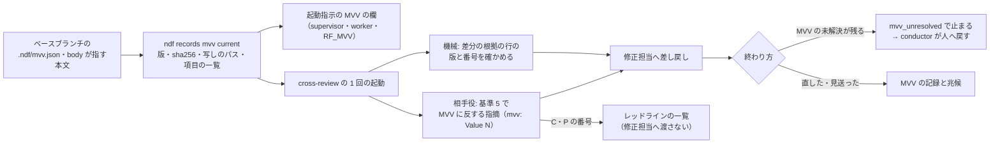
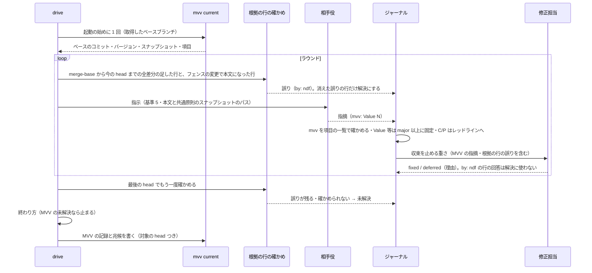

# 工程と MVV: 担当が承認済みの MVV を読んで動き、cross-review が MVV に反する出力と誤った根拠の行を差し戻す（#4076）

MVV に反する設計（#4049 の最初の設計）が cross-review の 3 ラウンドと設計承認の資料を素通りし、根拠の行の版の誤り（#4058）も止まらなかった。承認済みの MVV の写しをベースブランチから 1 か所で作り各工程の担当へ渡し、cross-review では指摘の基準に「MVV に反する」を足し、根拠の行の版と番号をラウンドの中で機械が確かめる。MVV に反する指摘と根拠の行の誤りは今の修正担当へ差し戻し、直せずに残ればレビューが止まって人へ戻り、判定と差し戻しは MVV の記録に残る。採らなかった案は「決定の記録」に、調べた製品は付録の「外部の調査」にある。

## 今の姿

何が起きたか・目的・受け入れ条件は要求仕様（[issue-4076-requirements.md](./issue-4076-requirements.md)、正は #4076 の本文）にある。この文書は「どう解くか」と「なぜその解き方か」だけを書く。

この文書は、直しの設計（#4090 #4099。[issue-4090-4099-design.md](./issue-4090-4099-design.md)）と実装計画 [issue-4076-plan.md](./issue-4076-plan.md) の保存先の変更を反映した最終形である。「直しの決定 N」はその設計の決定 N を指し、直しで採らなかった案はそちらの「決定の記録」にある。変えていない文の「写し」は、この文書の「スナップショット」と同じものである。



★ が変わる位置である。設計に要る今の構造:

| 部品 | 今の振る舞い | 場所 |
| --- | --- | --- |
| 指摘の基準 | 基準 1・2・4 と、`.ndf/review.json` の重点があるときだけ現れる基準 3。相手役と修正担当への「指摘の基準」のセクションをここから組む | `plugins/ndf/contracts/data/review-criteria.json`、`plugins/ndf/src/ndf/domains/crossreview/criteria_decide.py` の `criteria_lines`・`reviewer_block`・`fixer_block` |
| 相手役の出力 | 最後の行の JSON の `findings` の 1 件は `text`・`severity`・`path`・`line`・`section`（スプリントブランチでは `impact` が足された。#4014） | `drive.py` の `_review_prompt` |
| 指摘のジャーナル | 指摘を `text` から作るキーで 1 行にまとめ、出し直しで重い方の重要度を残す | `crossreview/journal.py` の `FindingJournal` |
| 終わり方 | 収束を止める重さ（`critical`・`major`。`contracts/domains/severities.json` の `blocking`）の未解決・理由の無い見送りが 1 件でもあれば `incomplete`（gaps つき）。プランは `incomplete` のルートへ進み、gaps は承認資料の「未確認の点」になる | `crossreview/finish_decide.py` |
| MVV の承認の記録 | `.ndf/mvv.json` の最後のバージョンが今の承認。ほかの参照（ブランチ）の設定は `decl_at` で読む。版は `current_version` | `plugins/ndf/src/ndf/domains/records/mvv.py`・`mvv_decide.py` |
| レッドラインの表 | 共通原則とプロジェクト MVV の「必ず人の承認が要る操作」の表から番号と操作を引く | `records/mvv_material_decide.py` の `redlines` |
| 改訂の兆候 | `mvv-signals.jsonl` の覆し（`override_reject`・`override_pass`）と「判定できない」（`unknown`）を、今の版の行だけ数えて閾値と比べる | `mvv_decide.count_signals`、`ndf records mvv signals` |
| 起動指示 | conductor → supervisor・supervisor → worker の起動指示の項目に MVV の欄が無い | `plugins/ndf/skills/development-workflow/references/agent-layers.md` の「起動の指示」 |
| cross-refactoring | 提案と計画のプロンプトの `$RF_MVV` を呼び手（Skill の本文の手順）が埋める | `plugins/ndf/skills/cross-refactoring/prompts/propose.md`・`plan.md` |

#4049 の最初の設計が通ったのは、相手役の指示に MVV が無く（基準 1・2・4 は誤動作・レッドライン・食い違いだけを見る）、承認ゲートの直前の判定は `normal` では打たれない（#3959）ためである。根拠の行の版の誤りは、どの部品も根拠の行を読まないので止まらなかった。

## 文脈と制約

- **触る部品の多くは、同じレーンのスプリント（`sprint/p12-lcrfast-r1`）が変えている。** #4014（重い指摘に起きることの 1 文 `impact`。PR #4023）・#4030（修正担当へのテストを CI に寄せる指示。PR #4033）はスプリントブランチへマージ済みで、#4013（修正担当の会話を続ける）は実装中である。どれも `review-criteria.json`・`criteria_decide.py`・`drive.py`・`journal.py` を触る。この設計はスプリントブランチの形（`impact`・`fixer_ci_only`・`fixer_sessions`）を前提に書く
- **#3959 が承認ゲートの直前の判定を受け持つ。** `normal` でも判定する・承認資料の根拠の行を確かめる・即時修正のプランに判定を置く、の 3 つは #3959 に残す。同じ確かめを 2 か所に作らないため、根拠の行の確かめの関数と MVV の写しはこの設計が作り、#3959 はそれを承認資料へ当てる
- **相手役は読むだけで、作業場所（PR の head の worktree）のファイルを読める。** 指示の本文は相手役ごと・ラウンドごとに送られる
- **このリポジトリはテストを CI に寄せる**（`.ndf/project.json` の `test.ci.only` が真）。相手役の LLM の出力に依る受け入れ条件 7 は CI で確かめられない
- **MVV を変える PR は、承認ゲートで人が見る**（共通原則の C7、`ndf records mvv gate` の検査 5）。PR の head の MVV は承認されていない

## 解き方の全体像



- `ndf records mvv current --base <ブランチ>` が、ベースブランチの承認済みの MVV の本文と NDF の共通原則を、中身で名付けたスナップショットに書き、バージョン・スナップショットのパス・実在する項目の一覧を返す。本文と承認の記録が合わなければ止まる。起動指示の MVV の欄・cross-refactoring の `$RF_MVV`・cross-review の指示は、この結果だけを使う
- cross-review は起動の始めに取得したベースをコミット 1 つに固定し、MVV のスナップショット・差分の起点・merge-base・再利用の判定のすべてへ同じコミットを渡す
- cross-review は承認済みの MVV があるとき、相手役と修正担当に基準 5（MVV に反する）と、本文・共通原則のスナップショットのパスを渡す。相手役は反する項目を `mvv` に書き、ジャーナルはそれを、判定したときの MVV の識別子（`judged_mvv`）とともに持つ
- 同じ起動は毎ラウンド、相手役を起動する前に、比較基点（merge-base）から今の head までの PR 全体の差分で、足した行と、フェンスの変更で新たに本文になった行から根拠の行を確かめ、バージョンの違い・そのバージョンに実在しない番号・解析できない形を NDF の指摘として同じジャーナルへ入れる。NDF の指摘は確かめ直しで誤りが消えたときだけ解決する。確かめの成否は指摘と別に持ち、最後の head で成功していなければ収束しない
- MVV に反する指摘と根拠の行の誤りは収束を止める重さ（`major` 以上に固定）で修正担当へ戻り、上限のラウンドで残れば `mvv_unresolved` で止まる。レッドラインの番号を名指す指摘は修正担当へ渡さず、結果の `mvv.redlines` に載せる。レッドラインと見送りを承認ゲートでどう扱うかは #3959 が持つ
- 終わるときに、今回の識別子で判定した MVV の指摘ごとの終わり方を `mvv-validation.jsonl` へ書く。修正担当が「反しない」として見送ったものは `mvv-signals.jsonl` の `review_disputed` に書き、「判定できない」と同じ閾値で数える。結果と記録の自由記述は、記録のコメントと同じ伏せ字（`Hub.clean`）を通す

## 構成要素

| 要素 | 責務 |
| --- | --- |
| MVV の写し（`ndf records mvv current`。新設） | ベースブランチの承認済みの MVV を読み、sha256 を確かめ、中身で名付けた本文と共通原則のスナップショットを書き、バージョン・スナップショットのパス・項目の一覧を返す。既にあるスナップショットも全 SHA-256 で確かめてから使う。承認済みでなければスナップショットを書かず状態だけを返し、本文が承認の記録と合わなければ止める |
| 根拠の行の確かめ（`mvv_decide`・`mvv`・`crossreview/changes.py` の関数。新設） | 文書の根拠の行を拾い（コードのブロックの内外と決定の見出しは `adapters.markdown` の解析で決める）、引いたバージョンから項目の一覧を引いて、バージョンが承認済みか・項目がそのバージョンに実在するか・形を解析できるかを確かめて誤りを返す。判定（`parse_citation`・`citation_errors`）は純粋な関数 |
| 指摘の基準 5（`review-criteria.json`・`criteria_decide`） | 承認済みの MVV があるときだけ現れる MVV の観点の文と、`mvv` のキーの説明を組む |
| cross-review の駆動（`drive.py`） | 起動の始めに MVV のスナップショットを得てベースをコミットに固定する。毎ラウンド、相手役の前と終わり方の判定の前に、PR 全体の差分で根拠の行を確かめる（差分と本文の読み取りと確かめは `changes.py`、設定の読み取りは `settings.py`）。指示に基準 5 とスナップショットのパスを足す。ラウンドの記録に MVV の識別子と確かめの成否を残し、識別子が変われば収束の再利用と差分の縮小をしない |
| 指摘のジャーナル（`journal.py`） | 相手役の `mvv` を確かめて指摘に持ち、有効な Mission・Vision・Value の指摘を `major` 以上に固定する。分類に判定した識別子を添え、今回と違えば分類を外して履歴に残す。NDF の指摘（根拠の行の誤り）を持ち、確かめ直しの結果だけで解決する。レッドラインの指摘を修正担当へ渡さない |
| 引継ぎ（`prior_decide.py`・`report_decide.py`） | 記録のコメントの一覧に MVV の分類と識別子を埋め、別の状態ディレクトリからの再開で戻す |
| 終わり方の判定（`finish_decide.py`） | MVV の未解決（レッドラインの指摘を除く）と、最後の head で根拠の行の確かめが成功していないことを欠け `mvv_unresolved` にし、結果を止める側にする。MVV の要約（`mvv`）を結果に足す |
| MVV の記録（`records/mvv.py`・`mvv_decide.py`） | cross-review の MVV の記録（`mvv-review`。対象の head・見送りの理由・レッドラインの本文を持ち、自由記述は伏せて書く）と兆候 `review_disputed` を書き、`count_signals` が数える |
| 手順書（`agent-layers.md`・`project-mvv.md` ほか） | 起動指示の MVV の欄、「工程での読み方」の節、参照切れの直し |

## 入出力のコントラクト

### `ndf records mvv current --base <ブランチ>`

| 項目 | 内容 |
| --- | --- |
| 入力 | `--base`（必須。ベースブランチ）・`--allow-mismatch`（任意）。`Git.fetch_branch_or_raise` で `+refs/heads/<ブランチ>:refs/remotes/<リモート>/<ブランチ>` を取得し、`<リモート>/<ブランチ>` を解いたコミットから `.ndf/mvv.json` と本文を読む。本文の場所は設定の最上位の `body`（既定 `mvv.md`）を `.ndf/` からの相対で解く |
| 出力（`ok`） | `outputs.mvv`: `{"state": "approved", "version": 11, "sha256": "<64 桁>", "path": "<本文のスナップショットの絶対パス>", "principles_path": "<共通原則のスナップショットの絶対パス>", "items": ["Mission", "Vision", "Value 1", …, "Value 17", "P1", …, "P4", "C1", …, "C8"]}` |
| 出力（承認済みでない） | `ok` で `outputs.mvv` は `{"state": "absent" か "unapproved"}` だけ。スナップショットを書かない。承認済みのハッシュの無い設定は、本文が無くても `unapproved`。`absent` は、参照をコミットへ解決できて、`git ls-tree` でそのコミットのツリーに `.ndf/mvv.json` のエントリが無いと確かめたときだけ |
| 失敗 | 参照をコミットへ解決できない・取得に失敗した・設定の有無を確かめられない（ツリーや blob の読み取りの失敗）・設定を読めない・承認済みのハッシュがあるのに本文を読めない（`unreadable`）・本文のパスが絶対パスか `..` を含む・設定が壊れている・本文が承認の記録と合わない（`mismatch`）・スナップショットを書けないは `refused`（`cause.kind`: `precondition`）。`summary` に読めない参照かファイルと理由（`mismatch` は「ベースの MVV の本文が承認の記録と合わない」と本文のパス）。`--allow-mismatch` を付けた `mismatch` だけは `ok`・`outputs.mvv.state: mismatch`・`warnings` に同じ文（MVV を直す工程の起動指示が使う。cross-review は使わない） |
| スナップショットの保存先 | MVV の記録の保存先（`NDF_MVV_STATE_DIR`）の下の `snapshots/v<バージョン>-<sha256 の先頭 12 文字>.md` と `snapshots/principles-<sha256 の先頭 12 文字>.md`。同じ名前のファイルも全 SHA-256 で確かめ、同じ中身なら書き直さず、違えば検証済みの中身で置き換える |
| 項目の一覧 | `## Value` の番号つきの項目の番号、`## 必ず人の承認が要る操作` の表の `P<番号>`、共通原則の表の `C<番号>`、`Mission`・`Vision`（セクションがあるとき） |

### 相手役の指摘（足すキー）

```json
{"text": "<指摘>", "severity": "major", "impact": "<起きること>", "mvv": "Value 5", "path": "", "line": null, "section": ""}
```

`mvv` は基準 5 の指摘だけが持つ任意のキーで、項目の一覧の 1 つ（`Value <番号>`・`Vision`・`Mission`・`P<番号>`・`C<番号>`）を書く。基準 5 が現れない起動では指示に出ず、来ても読まない。`mvv` が一覧にある `Value`・`Vision`・`Mission` の指摘は、相手役が付けた `severity` が `minor` でも `impact` が無くても、ジャーナルが `major` 以上に固定する（#4014 の `effective_severity` で下げない）。

### 根拠の行の形と誤り

受け付ける根拠の行の形（直しの決定 8）:

| 形 | 例 | 読み方 |
| --- | --- | --- |
| ` / ` で区切る | `- 根拠: Value 6 / P1（MVV バージョン 11）` | 項目 `Value 6`・`P1`、バージョン 11 |
| `・` で区切り、引用文を添える | `- 根拠: Value 7「…」・Value 11「…」（MVV バージョン 11）` | 引用文（`「` から対応する `」` まで）を除き、項目 `Value 7`・`Value 11`、バージョン 11 |
| 外部の調査の番号を後ろに置く | `- 根拠: Value 3（MVV バージョン 11）。STD1` | バージョンの括弧の後ろは読まない |
| スプリント MVV を添える | `- 根拠: Value 6 / スプリント Value 4（MVV バージョン 11・スプリント MVV 3f9a1c2e）` | 項目 `Value 6`（スプリントの項目は確かめない）、バージョン 11 |
| バージョンの書式を外す | `- 根拠: Value 3「…」（MVV 版 11）` | `format` の誤り |
| バージョンの表記を壊す | `- 根拠: Value 5（MVV バージョン 11x）`・`- 根拠: Value 5（MVV バージョン 11` | `format` の誤り（`（MVV` から終わりの `）` までをバージョンの表記として全体を確かめる） |
| バージョンが無い・解析できない（決定の根拠の行） | `### 決定 N` の下の `- 根拠: Value 3` | `format` の誤り |
| 承認済みの MVV があるのに `（MVV なし）` | `- 根拠: 根拠なし（MVV なし）` | `format` の誤り |

誤りの 1 件は `{"path", "line", "cited", "kind", "version", "unknown"}`。`kind` は `version`（承認済みでないバージョン）・`unknown`（そのバージョンに実在しない項目）・`format`（バージョンを読めない。`version` は None、`unknown` は空）。`cited` は種類によらず項目の部分（`根拠:` の後ろから引用文と `（MVV` から後ろを除いた値）で、行の原文を入れない。

### 記録のコメントの一覧（足す欄）

`open_block` の 1 件（`id`・`text`・`by`・`severity`・`path`・`line`・`section`・`thread`）に `mvv`・`mvv_pinned`・`redline_items`・`judged_mvv`・`unpinned_severity`・`record_id`（MVV の記録のキー。内容から作らない乱数の値）を足す。`by: ndf` の指摘の照合キー（`citation_key`）は手元のジャーナルだけに持ち、載せない。未解決の重い指摘に加えて、`redline` の指摘と `by: ndf` の指摘は重さによらず載せる。

### cross-review の結果 JSON（足すキー）

`outputs.mvv`（承認済みの MVV があるときだけ）:

```json
{"version": 11, "sha256": "<64 桁>", "head": "<対象の head の SHA>",
 "findings": [{"id": "r1-2", "item": "Value 5", "by": "codex", "outcome": "fixed"}],
 "citations": [{"id": "r1-n1", "path": "issues/issue-4058-design.md", "line": 51, "cited": "Value 5", "unknown": [], "outcome": "fixed"}],
 "redlines": [{"id": "r2-1", "item": "P1", "text": "<指摘>"}],
 "disputed": [{"id": "r1-3", "item": "Value 5", "reason": "<修正担当の見送りの理由>"}]}
```

`findings`・`citations`・`redlines`・`disputed` に載るのは、`judged_mvv` が今回の識別子と同じ指摘だけである。`disputed` は、ジャーナルの MVV の指摘（`mvv` が `Value`・`Vision`・`Mission`）のうち終わり方が `deferred` のもので、`reason` はその見送りの理由である。MVV の記録の `mvv-review` も、同じ指摘を終わり方 `deferred`・同じ理由で持つ（承認ゲートでこの記録を読むのは #3959）。`disputed` の `reason`・`redlines` の `text`・`citations` の `path`・`cited`・`unknown` は `Hub.clean` を通した値で、参照先の公開範囲を照会できない起動では固定の文 `WITHHELD` になる。根拠の行の誤りは見送れない（決定 4）ので `disputed` に入らない。

終わり方に欠け `mvv_unresolved`（MVV の指摘か根拠の行の誤りが未解決のまま残った・最後の head で根拠の行の確かめが成功していない）が足される。確かめの成否は指摘と別に渡すので、NDF の指摘が 0 件でも確かめに失敗すれば欠けになる。欠けがこの種類を含めば、状態は `incomplete` でなく止まる側（`work_stopped` と同じ終了コード）になる。レッドラインの指摘（`P`・`C`）はこの欠けにも `unresolved_finding` にも数えない。

## 処理の流れ



根拠の行の誤り（`by: ndf`）の解決は機械だけが決める。修正担当の `fixed`・`deferred` は修正の報告として受けるが終わり方にはせず、スレッドの resolve でも解決しない。次の確かめ直しで同じキーの誤りが出なければ `fixed`、出れば（見送り済みでも）`unresolved` に戻す。確かめに失敗した（差分や文書を読めない）ラウンドは `by: ndf` の指摘の終わり方を何も変えず、確かめが成功した head（`checked_head`）を進めない。収束は、最後の head での確かめ直しが成功し誤りが 0 件のときだけ認める。同じ（merge-base・head・識別子）の確かめの結果は 1 回の起動の中で使い回し、Git を打ち直さない。

## 決定の記録

### 決定 1: 担当が承認された MVV だけを読むため、ベースブランチの MVV から内容で名付けた写しを 1 か所で作る

- **質問**: 各工程の担当へ渡す MVV をどこから取り、どの形で渡すか
- **選んだ案**: `ndf records mvv current --base <ブランチ>` を使う。このコマンドが、ベースブランチの `.ndf/mvv.json` の最後のバージョンと、設定の最上位の `body` で解いた本文の sha256 を確かめる。続けて MVV の記録の保存先に本文と共通原則のスナップショット（`v<バージョン>-<sha256 の先頭>.md`・`principles-<sha256 の先頭>.md`）を書き、バージョン・パス・項目の一覧を返す。起動指示・`$RF_MVV`・cross-review は、この結果のパスとバージョンだけを渡す
- 本文の場所は純粋な関数 `mvv_decide.body_path` が 1 か所で解き、`current`・`review-scope`・`preflight.mvv_body` が使う（既定外のパスで承認したリポジトリでも止まらない。直しの決定 1）
- 本文が承認の記録と合わない（`mismatch`）ときは `current` が止める。cross-review は PR の中身によらず相手役を起動しない。設定の有無は `git ls-tree` でツリーに無いと確かめたときだけ `absent` にし、読み取りの失敗を `absent` に落とさない（直しの決定 15）
- 共通原則の本文もスナップショットで渡すのは、共通原則のファイルを持たない利用先の相手役が `C<番号>` の操作を判断できるようにするためである（直しの決定 11）
- 採らなかった案: PR の head の作業場所の `.ndf/mvv.md` を指す。Copilot の code review は head から指示を読むが、MVV を変える PR は C7 で人が見るまで承認されていない。変えた本文で確かめると自分を通す
- 採らなかった案: MVV の本文を指示へ埋め込む（相手役ごと・ラウンドごとに約 17 KB を送り、送った本文は読まれなくても費用になる。写しを読ませれば読む担当だけが払う）
- 採らなかった案: 承認ゲートの直前の判定（`ndf records mvv gate`）の材料の組み立てをそのまま使う。判定は PR の本文と差分まで 1 つの材料にまとめるので、工程の担当と相手役には大きすぎる
- **代償**: `current` のコマンドは打つたびに `fetch_branch_or_raise`（取得先を明示した refspec）で 1 回取得してから読むので、その分だけ遅い。`--single-branch` で別のブランチを clone した作業場所でも新しいバージョンを読む（直しの決定 13）。取得に失敗したら古い MVV を読まずに止まる。cross-review は起動の始めの同期で head とベースを 1 回で取得し、`current` が解いたベースのコミットに固定して、差分・merge-base・再利用の判定・MVV に同じコミットを渡す（直しの決定 9）。既にあるスナップショットも起動ごとに 1 回読み、全 SHA-256 で確かめ、違えば検証済みの中身で置き換える（直しの決定 10）。壊れたベースを直す PR は cross-review を通らず、人の操作になる（工程の中で直す経路は #4155）
- cross-review の起動の始めに `current` が失敗した（参照を解決できない・設定が壊れている・旧い形・本文が承認の記録と合わない・スナップショットを書けない）ときは、相手役を起動する前に `refused`（`precondition`）で止める。MVV を抜いて続けると、MVV を持つリポジトリの単位の PR が基準 5 を通らずにスプリントブランチへ入り、承認ゲートでも拾われない（#4049 と同じ素通り）。止まるのは相手役の費用を払う前で、`summary` に直すファイルと理由を出す。MVV の無いリポジトリ（`absent`）は失敗ではないので今どおり動く
- 作り方: 自前で作る
- 比べた候補: PRD1 / PRD2
- 根拠: Value 3 / Value 11 / Value 2（MVV バージョン 11）

### 決定 2: 担当が MVV を入力に受けるため、起動指示の項目に MVV の欄を足す

- **質問**: 設計・詳細設計・実装・完了判定の supervisor と worker に、どう MVV を渡すか
- **選んだ案**: `agent-layers.md` の conductor → supervisor と supervisor → worker の起動指示の項目に「MVV」を足す。値は `current` の結果から `MVV: 版 <版>・本文 <写しのパス>（承認済み）` か `MVV: 無し（<状態>）` の 1 行で、作業の前に読むことを守る規則に足す。cross-refactoring の `$RF_MVV` も同じ 1 行と、写しを読んで判断の基準にする指示で埋める
- 採らなかった案: hook で起動指示の MVV の欄の有無を止める（プランの worker の指示は呼び手が書き、組み立てる処理が NDF にまだ無い。欄の無い起動を止めても中身の正しさは確かめられず、確かめは決定 4・5 のレビューが持つ）
- 採らなかった案: 担当が自分で `.ndf/mvv.md` を探して読む（今の形。読むかが担当に任され、#4049 の設計者も読まなかった）
- **代償**: 欄を書き忘れた起動は止まらない。起動指示は AI が書くので、受け入れ条件 1 のうち起動指示の欄は手順書（`agent-layers.md`）の項目でだけ縛り、テストでは縛らない。その担当の出力の MVV への反しは、cross-review の基準 5 と根拠の行の確かめが拾う
- 根拠: Value 3 / Value 15（MVV バージョン 11）

### 決定 3: MVV に反する出力を承認より前に見つけるため、cross-review の指摘の基準に基準 5 を足す

- **質問**: 相手役が MVV を独立に確かめる観点を、どの形で基準に入れるか
- **選んだ案**: `review-criteria.json` に、承認済みの MVV があるときだけ現れる基準 5「プロジェクト MVV（バージョン N。本文は <スナップショットのパス>）の Mission・Vision・Value の文に反する。必ず人の承認が要る操作は、本文の表と NDF の共通原則（<スナップショットのパス>）の C1〜C8 で決める」と、指摘に `mvv`（反する項目）を書く指示を置く。基準 5 の指摘も `impact` を求め（#4014）、1 文には「反する文と、そのため利用者に何が起きるか」を書かせる。設計 PR と単位の PR の両方で、同じ cross-review の起動が基準 5 を持つ
- 基準 5 の指摘は `mvv` が一覧にある `Value`・`Vision`・`Mission` なら、ジャーナルが重さを `major` 以上に固定する（相手役の `minor` も #4014 の `effective_severity` の引き下げも受けない）。重さを相手役に任せると、同じ反しが相手役ごとに修正担当へ渡ったり渡らなかったりする
- ラウンドの記録に MVV の識別子を残し、前の実行の収束の再利用と差分の縮小（前の head からの差分）は、識別子が今回と同じときだけ認める。識別子は、承認済みなら `"approved:<version>:<sha256>:<共通原則の sha256>"`、承認済みでなければ `"<state>:::"` である（承認済みでないときは基準 5 が無いので共通原則の sha256 を含めず、NDF のバージョン上げで再利用を失わない。直しの決定 11）。ベースブランチで MVV が新しく承認されても PR の head と merge-base は変わらないので、MVV を照合しないと基準 5 を一度も通らない収束を返す
- 採らなかった案: 重点（`.ndf/review.json` の `focus`、基準 3）に MVV を書く（プロジェクトが設定しないと現れず、項目の番号を返させる形も無い）
- 採らなかった案: MVV だけを見る相手役のラウンドを別に足す（相手役の起動が倍になる。同じ差分を同じ相手役が読むので、基準を 1 つ足せば足りる）
- 採らなかった案: 承認ゲートの直前の LLM の判定を各 PR で打つ（判定は 1 回の 1 者の判断で修正担当へ渡らず、差し戻しにならない）
- **代償**: 相手役 1 つ・1 ラウンドあたりスナップショットの読み込み（約 17 KB）が増える。指摘が増えればラウンドも増えうる。承認済みの MVV を持つリポジトリでは、NDF のバージョン上げで共通原則が変わると前の収束を再利用しない
- 作り方: 自前で作る
- 比べた候補: PRD1 / PRD2
- 根拠: Value 1 / Value 3 / Value 2（MVV バージョン 11）

### 決定 4: 自己申告の根拠の行を通さないため、cross-review のラウンドの中で根拠の行の版と番号を機械が確かめる

- **質問**: 設計文書と PR の根拠の行の版と番号を、どこで確かめ、外れたらどう差し戻すか
- **選んだ案**: cross-review が毎ラウンド、相手役を起動する前に、比較基点（その起動の merge-base）から今の head までの PR 全体の差分で、次の 2 つの行のうちコードのブロックの外にある根拠の行の候補を確かめる。(a) 足した行、(b) 差分で変わっていないが、ベース（merge-base）の同じ行がコードのブロックの内側だった行（フェンスを外して本文へ出した誤りを通さない。直しの決定 14）。誤りは NDF の指摘（`by: ndf`・`severity: major`・`cited` に引いた項目。`mvv` は置かない。引いた項目が `P`・`C` でも相手役の `mvv` の分類に掛けず、レッドラインにしないで修正担当へ差し戻す）としてジャーナルへ入れる。相手役へ渡す差分が前の head からに狭まっても、確かめる範囲は変えない。修正担当が直し、直るまで毎ラウンド同じキーで出し直される
- 候補は、本文を左から空白と `- ` を除いた先頭が `根拠:` で、`MVV` を含む行か、`### 決定 <数>` の見出しの下の行とする。受け付ける形は「入出力のコントラクト」の表のとおりで、` / ` と `・` の区切りと引用文を受け、バージョンを読めない候補は `format` の誤りにする（書式を外しただけで誤りが消えない。直しの決定 8）。決定の見出しの下の `根拠:` の行は MVV を引かなくても候補になるので、当たる項目が無い決定は `根拠: 根拠なし（MVV バージョン N）。STD1` の形で書く
- コードのブロックの内外は、差分の hunk からでなく文書の全体を `adapters/markdown.code_lines`（CommonMark の囲みとインデントのコードブロック）で解析して決める（hunk が既存のフェンスの途中から始まると、足した行だけでは内外が分からない。自前の走査は 4 字のフェンスやリストの中のフェンスを誤る。直しの決定 2）。候補を持つファイルだけ本文を読み、head は起動の中で読んだ本文を使い回し、ベースは (b) を調べるときだけまとめて 1 回読む。確かめの結果は（merge-base・head・識別子）で 1 回の起動の中で使い回す（直しの決定 3）
- NDF の指摘の解決は確かめ直しだけが決める。修正担当の `fixed`・`deferred` もスレッドの resolve も終わり方にせず（直しの決定 12）、次の確かめ直しで誤りが消えれば `fixed`、残れば見送り済みでも `unresolved` に戻す。確かめに失敗したラウンドは解決させず、終わり方の判定の前に最後の head でもう一度確かめ、誤りが 0 件で成功したときだけ収束させる。確かめの成否は指摘と別にラウンドの記録（`mvv_checked`）と駆動の状態（`checked_head`）に持ち、NDF の指摘が 0 件でも、最後の head で成功していなければ `mvv_unresolved` で止まる。収束の再利用も `mvv_checked` が真のラウンドだけに認める（直しの決定 4）。修正担当の回答だけで誤ったバージョンを残したまま収束しないためである
- 採らなかった案: 工程の定義に確かめのステップ（`ndf.script`）を足して工程を失敗で返す（課題の本文の S3。失敗の後は conductor のやり直しになり、直す担当も直す指示も別に要る。cross-review は既に直す担当と収束の判定を持つ）
- 採らなかった案: 足した行でなく文書の全体を確かめる（今の版より前に書かれた設計文書の根拠の行が、毎回誤りになる）
- 正しい版はベースブランチの承認済みの版だけである（要求仕様の前提 1）。MVV を変える PR でも head の版は受けない。承認されていない版の項目を根拠にすると、変えた本文で自分を通すことになる（決定 1 で head の本文を読まないのと同じ理由）。MVV を変える PR の設計文書は承認済みの版を引き、新しい版を引くのはその版がベースブランチで承認された後の PR である
- 照合はバージョンごとの項目の一覧（バージョン → 項目）を引く形にする。バージョンと項目を別々に比べると、あるバージョンに無い項目を別のバージョンの番号で引いても通るためである。今は承認済みのバージョン 1 つだけが表にあるので、ほかのバージョンを引けばバージョンの誤り、そのバージョンに無い項目を引けば項目の誤りになる
- **代償**: 確かめるのは cross-review を通る PR の差分だけである。PR の本文は確かめない（設計 PR の本文は決定を書き写さない形で、根拠の行を持たない）。承認資料（PR の外）は #3959 が同じ関数で確かめるまで残る。フェンスに触れずにインデントのコードブロックの前に段落を足して本文にする編集は拾わない。人が resolve したスレッドの NDF の指摘も、誤りが残る限り未解決のまま出し直される
- 作り方: 自前で作る
- 比べた候補: PRD2
- 根拠: Value 3 / Value 13 / Value 11（MVV バージョン 11）

### 決定 5: 人へ戻す範囲をレッドラインと決められないものに絞るため、MVV の指摘を 3 つの経路に分ける

- **質問**: MVV に反する指摘を、修正担当・止まる・人のどれへ渡すか
- **選んだ案**: 次の表で分ける。止まるときの欠けは `mvv_unresolved` で、結果は `incomplete` でなく止まる側になり、conductor は理由を添えて人へ戻す（AI が決められない）

| 指摘 | 経路 |
| --- | --- |
| `mvv` が `Value`・`Vision`・`Mission` の項目・根拠の行の誤り | `major` 以上に固定して修正担当へ。直せば終わり。MVV の指摘の理由を添えた見送りは `disputed` として記録と兆候へ（根拠の行の誤りは見送れない。決定 4） |
| 上の指摘が上限のラウンドで未解決 | 欠け `mvv_unresolved` で止まる |
| `mvv` が `P<番号>`・`C<番号>` | 修正担当へ渡さず `redlines` に載せ、MVV の記録（`mvv-review`・終わり方 `redline`・対象の head・伏せた指摘の本文）へ書く。収束は止めず、欠け（`mvv_unresolved`・`unresolved_finding`）にも数えない。承認ゲートでの扱い（資料に載せる・`fast`・`auto` で省かない）は #3959 へ移した |
| `mvv` が項目の一覧に無い | `mvv` を外して普通の指摘として扱い、注意に載せる |
| `judged_mvv` が今回の識別子と違う（前のバージョンで判定した） | 出し直されたかと終わり方（`fixed`・`unresolved`・`redline`・`deferred`）によらず、分類を外して `mvv_history` へ残し、重さを固定前（`unpinned_severity`）へ戻す。出し直されれば今回の申告だけで分類し直す。出し直されなければ MVV の分類の無い指摘として残り、今回の結果と記録に載せない |

- 分類ごとに判定したときの識別子（`judged_mvv`）を持たせるのは、前のバージョンのレッドラインを新しいバージョンの head の記録に載せず、前のバージョンの分類で差し戻しを抑えないためである（直しの決定 6）。見送りの `skipped_mvv` は見送りの時点の識別子で、役割を分ける
- 別の状態ディレクトリで再開しても分類を落とさないため、記録のコメントの一覧に分類・識別子・固定前の重さを埋めて戻す。`by: ndf` の指摘は、スレッドが resolve されていても信頼済みの最新の記録から戻す。照合キーは載せないので、戻した `by: ndf` の指摘と同じ誤りは、元の指摘が `fixed` になり新しい指摘が 1 回だけ足される（直しの決定 5・7）
- 採らなかった案: MVV の未解決も今どおり `incomplete` の欠けにして承認資料の「未確認の点」へ回す。単位の PR は承認ゲートを通らずにスプリントブランチへ入るので、反したまま次の工程へ進む
- 採らなかった案: 修正担当の見送りを認めない（相手役の誤った指摘でも直させることになり、反しない理由を書く道が無くなる。食い違いは兆候として数えるほうが MVV の文言の曖昧さを拾える）
- 修正担当の見送り（`disputed`）は、修正担当が理由を添えて「反しない」と判断した記録である。受け入れ条件 4 の「直すまで進まない」は、反すると認めたものと決めきれなかったもの（未解決）に当てる。見送りは止めない代わりに、理由とともに結果と MVV の記録に残る。承認ゲートでの扱いは #3959 が持つ
- **代償**: MVV の未解決が残ると、単位の PR の実装が止まって人を待つ。`fast`・`auto` でレッドラインの指摘が残っても承認ゲートが省かれる危険は、#3959 が直すまで残る。識別子が変わった起動では、出し直されない前のバージョンの MVV の指摘は分類の無い指摘として残り、固定前から重ければ修正担当へ渡って収束を止める
- 根拠: Value 1 / Value 5（MVV バージョン 11）

### 決定 6: 工程の中で MVV が働いたかを数えるため、cross-review の MVV の判定を記録し、食い違いを兆候に数える

- **質問**: 工程ごとの判定と差し戻しをどこに残し、改訂の兆候にどう数えるか
- **選んだ案**: cross-review の終わりに、`judged_mvv` が今回の識別子と同じ MVV の指摘と根拠の行の誤りごとに 1 件を `mvv-validation.jsonl` へ足す。記録は種類 `mvv-review`・repo・PR・対象の head・指摘のキー・指摘の id・項目・終わり方・バージョンを持ち、見送りは理由を、レッドラインは指摘の本文を持つ（承認ゲートと承認資料での読み方は #3959 が持つ）。理由・本文・根拠の行の誤りの項目は、書く前に記録のコメントと同じ `Hub.clean` を通す。修正担当が理由を添えて見送った MVV の指摘は、`mvv-signals.jsonl` に種類 `review_disputed` を足す。指摘のキーは、分類を初めて置いたときに 1 度だけ作る乱数の値（`record_id`）で、id（`r1-2` など）は起動ごとに採番し直されるので重ねる判定にも数え方にも使わない。件数は repo・PR・指摘のキーの組で 1 件とし、`count_signals` が「判定できない」と合わせて `settings.revise_after.unknowns` と比べる。根拠の行の誤りは兆候に数えない
- 参照先の公開範囲を照会できない起動では、結果の伏せる欄を固定の文 `WITHHELD` にして返し、MVV の記録には自由記述の欄を置かずに `withheld: true` を置いた記録を書く（`review_disputed` は普段どおり書く）。次の起動で伏せていない記録を書き直す。記録が復旧するまで設計承認ゲートを省かない規則は #3959 の `review_holds` が持つ（直しの決定 7・16）
- 同じ閾値で数えるのは、「判定できない」が AI が MVV で決めきれなかった数であり、相手役と修正担当の食い違いも AI の中で決めきれなかったことに当たるためである。別の閾値は設定のキーを足すことになり、件数の実績が無いうちは値を決められない
- 採らなかった案: 記録のキーを本文や項目のハッシュにする（小文字化・切り詰めで別々の指摘が 1 つになり、伏せ字を通した本文から再開すると同じ指摘のキーが変わる。生の値のハッシュを公開すると、非公開のリポジトリ名などの候補を突き合わせられる。直しの決定 7 の `record_key` を、内容から作らない `record_id` に置き換える）
- 採らなかった案: 見送りを覆し（`override_*`）に数える（覆しは人が AI の判定を退けた記録で、相手役と修正担当の食い違いに人は入っていない）
- 採らなかった案: 根拠の行の誤りも兆候に数える（版や番号の写し間違いは MVV の文言の誤りでなく、MVV の「改訂」の節は判定側の不具合を方向の誤りに数えないと決めている）
- **代償**: 兆候の「判定できない」の数が増え、改訂の提案が早まりうる。伏せた記録は元の文と一致しないので、参照先の公開範囲が変わった打ち直しは `mvv-review` を 1 件足す。記録のキーはジャーナルと記録のコメントだけが引き継ぐので、記録のコメントの一覧に載らない指摘（見送り済みの MVV の指摘）を別の状態ディレクトリで相手役が出し直すと、新しいキーの記録になる（元の保留は残り、人へ問う側に倒す。見送りも 2 件に数える）
- 根拠: Value 13 / Value 14（MVV バージョン 11）

### 決定 7: 参照切れを無くし読み方の正本を置くため、`project-mvv.md` に「工程での読み方」の節を足す

- **質問**: `design`・`tdd-cycle`・`requirements-design`・`decisions.md` が指す節に何を置くか
- **選んだ案**: 節は、工程ごとに MVV のどこを読むか・`current` の結果の欄の書き方・反する疑いを人へ戻す形・「MVV なし」の扱いを持つ。どの工程も写しの全体（Mission・Vision・Value・必ず人の承認が要る操作）を読み、その工程の出力が触れる項目を本文から選んで判断と根拠の行に使う。項目の番号は利用先ごとに意味が違うので、節は番号で読む範囲を固定しない（ai-plugins の番号は例として添えるだけ）。根拠の行の形の正本は今どおり `decisions.md` の「根拠の行」に置き、節からリンクする。4 つの参照は節の見出しのアンカーへ直す
- 採らなかった案: 参照を消して各 Skill に読み方を書く（同じ読み方が 4 か所に写る）
- **代償**: 無い
- 根拠: Value 11 / Value 14（MVV バージョン 11）

## 影響と危険

- **働く範囲**: 利用先のリポジトリでも働く。基準 5・根拠の行の確かめ・記録が現れるのは、承認済みの MVV（状態 `approved`）を持つリポジトリだけである。持たないリポジトリでは cross-review の指示・ジャーナル・結果の形が今と変わらない（受け入れ条件 8）
- **プロジェクトごとに違うもの**: MVV の本文と項目の一覧は、そのリポジトリの設定が指す本文から読む。リリース対象の `current`・`review-scope`・preflight は、`.ndf/mvv.json` の最上位の `body` を宣言から読み、`body_path` で解く（決定 1）。`mvv.md` は `body` が無いときの既定値としてだけ使い、コードに固定しない。`current` と `review-scope` はベースブランチから、preflight は作業場所から読む。新しい設定のキーは足さない。兆候の閾値は今の `settings.revise_after` を使う
- **当たるモード**: cross-review を通るモード（`standard`・`legacy-refactor`・`documentation` の設計 PR と単位の PR）。起動指示の MVV の欄はすべてのモード
- **同じファイルを触る別の変更**: `sprint/p12-lcrfast-r1`（#4014・#4030・#4013）が同じ 4 ファイルを触る。実装はこのスプリントが main へ入った後の main から切る。先に始めると `review-criteria.json` の `summary` と `reviewer_block` が衝突する
- **#4084（#4045 の設計の直し）**: `journal.apply_fix`・`enter` と MVV の再判定を触る。後に入る PR が、#4084 の重さの置き直しを、分類を外す箇所（決定 5）でも打つ
- **#3959**: 承認資料の根拠の行の確かめと `normal` の判定は #3959 が持ち、この設計の `current` と根拠の行の確かめの関数を使う。#3959 の設計がこの 2 つを別に作らないよう、この関係を設計承認の資料に載せ、承認の後に #3959 の本文の「関連」へ書き足す
- **壊れうる箇所**: 根拠の行を拾う規則が、根拠の行でない文（説明の中で「MVV バージョン 1」と引いた文）を拾うと、直せない指摘で止まる。規則は先頭の `根拠:` に限り、テストで縛る。決定の見出しを `### 決定 N` 以外で書いた文書では、`MVV` を含む行だけが候補になる

### 代表のリポジトリでの振る舞い

| 代表のリポジトリ | 設定の要点 | 直した後に起きること | この種類で扱えなくなること |
| --- | --- | --- | --- |
| Web サービス | 承認済みの MVV があり、コードの単位の PR を cross-review が見る | 単位の PR の相手役が基準 5 でコードの選択（依存・層の向き）を MVV と照らす。根拠の行は設計 PR に当たる | 無し |
| モバイルアプリ | 同上。配布の手段が違うだけ | 同上 | 無し |
| 業務文書だけ | 文書の PR を cross-review が見る。MVV が無いことが多い | MVV が無ければ今と同じ。あれば文書が MVV の文に反するかを相手役が見る | 無し |

### このリポジトリだけの事情

- 無し（新しい値を足さない。ai-plugins の MVV の版 11 は例として使うだけで、仕組みはどのプロジェクトの MVV も読む）

## 用語

設計文書の本文で使う新しい語を、実装の PR で用語集へ足す（この設計 PR は `issues/issue-4076-*` だけを触る）。

- **MVV の写し**: `ndf records mvv current` がベースブランチの承認済みの MVV の本文から作る、内容で名付けたファイル
- **根拠の行の確かめ**: 文書の根拠の行が引く MVV の版と項目の番号を、MVV の写しの項目の一覧と照らす機械の確かめ
- **MVV に反する指摘**: cross-review の基準 5 に当たる指摘。`mvv` に反する項目を持つ

## テスト設計

| 受け入れ条件・不変条件 | どの振る舞いで縛るか | どう壊したら落ちるべきか |
| --- | --- | --- |
| 1 | `current` がベースブランチの承認済みの本文からスナップショットを書き、バージョン・パス・項目を返す。PR の head の本文が違ってもスナップショットはベースブランチの中身になる。参照を解決できないときは `absent` でなく `precondition` | head の本文を読む・sha256 が合わない本文でスナップショットを書く・同じ中身で別のファイルを書く・解決できない参照を `absent` にする |
| 1（4090-1） | 設定の最上位の `body` を既定外の値にしたリポジトリで、`current` が承認済みを返し、`review-scope` が同じパスの blob で識別子を得る。`..` を含む値は `MvvError` | `.ndf/mvv.md` を読む・`versions[].body` を本文にする |
| 1（4090-9） | ローカルの `main` が古く、リモートの `main` に新しい MVV と別の変更が入ったとき、`current`・merge-base・相手役の差分の起点・`Basis` がリモートのコミットを使い、既にベースへ入った変更が差分に出ない | `cfg.base` の名前で差分を作る |
| 1（4090-10） | スナップショットの保存先に同じ名前で違う中身のファイルを置くと、`current` の後は検証済みの中身になる | 同じ名前なら確かめない |
| 1（4090-13） | `--single-branch` で別のブランチを clone した作業場所で、リモートの `main` で新しいバージョンを承認した後に `ndf records mvv current --base main` が新しいバージョンを返す | `git fetch <リモート> <ブランチ>` で取る |
| 1 | cross-review の起動の始めに `current` が失敗すると、相手役を起動せずに `precondition` で止まる | MVV を抜いて相手役を起動する |
| 1・8（4099-2） | ベースの本文を承認の後に書き換えたリポジトリで、`ndf cross-review run` が相手役を起動せず `refused`（`precondition`）、`ndf records mvv current` も `refused`。本文を戻す PR でも同じに止まる。`--allow-mismatch` は `ok`・`state: mismatch`。`unapproved`・`absent` のベースでは今どおり基準 5 を外して続く。設定の blob を欠損させたベース・`ls-tree` が失敗するベースは `refused` | `mismatch` を MVV なしと同じに読んで収束する・読み取りの失敗を `absent` に落とす |
| 2 | MVV の識別子（状態・バージョン・sha256・共通原則の sha256）が前の実行と違えば、収束を再利用せず全差分を読む | MVV が変わっても前の収束を返す |
| 2・8（4090-11） | 基準 5 の指示に共通原則のスナップショットのパスが載り、中身はプラグインの本文と同じ。承認済みのベースで共通原則の本文を変えると前の収束を再利用しない。`absent`・`unapproved` のベースでは識別子が `"<state>:::"` で、変えても再利用する | C 番号の一覧だけを渡す・共通原則を再利用の条件にしない・MVV の無いベースの識別子に共通原則を入れる |
| 1 | cross-review の相手役と修正担当の指示に、写しのパスと版が入る | 指示にパスが無い・本文が埋め込まれる |
| 2・8 | 承認済みの MVV があるときだけ `reviewer_block`・`fixer_block` に基準 5 が現れる。無いときは今の文と同じ | MVV が無いのに基準 5 が出る・あるのに出ない |
| 2 | `mvv` が `Value N` の指摘は、相手役が `minor` を付けても `impact` が無くても `major` で修正担当へ渡る | `minor` 扱いで渡らない・`effective_severity` で下がる |
| 3 | バージョンの違う根拠の行・引いたバージョンに無い番号の根拠の行が NDF の指摘になり、直るまでラウンドごとに同じキーで出る。相手役への差分が前の head からに狭まっても出る。先頭が `根拠:` でない文と、head の文書でコードのブロックの内側にある行（hunk がフェンスの途中から始まる場合を含む）は拾わない | 誤りを拾わない・説明の文を拾う・直した後も出し直す・増分のラウンドで誤りが消える・head のバージョンを正しいバージョンとして受ける |
| 3（4090-2） | 4 字のバッククォートで開き、3 字の行と `- 根拠: Value 1（MVV バージョン 1）` を含み、4 字で終わる例で、内側の行を拾わず、終わりの後の行を拾う。リストの中のフェンスとチルダのフェンスも同じ | 3 字の行で終わったとみなす |
| 3（4090-3） | 確かめのための Git の起動の数を場合ごとに縛る。フェンスに触れずに編集した PR の無修正の収束は、終わり方の判定の直前の確かめ直しを含め 0 回。フェンスの行を消した文書を含むときはベースのまとめ読みの 1 回だけ。範囲が狭まったラウンドは計 3 回、最後のラウンドの後に push した head の終わり方の判定は計 4 回が上限で、文書の数を増やしても増えない。識別子を変えると打ち直し、前の確かめが失敗した組は打ち直す | ラウンドごと・文書ごとに `git show` を打つ・失敗を使い回す・フェンスに触れない編集でベースを読む |
| 3（4090-8） | `・` と引用文の形が 2 項目・バージョン 11 で通る（引用文の中に `（` と ` / ` を含んでも同じ）。バージョンの書式の外れ・`（MVV バージョン 11x）`・終わりの `）` の欠け・決定の根拠の行のバージョンの欠け・承認済みのときの `（MVV なし）` は `format`。スプリント MVV の括弧と括弧の後ろの `。STD1` は通る。バージョンの誤りの行の書式を外すと、誤りが `format` の新しいキーで残る | `・` の行を 1 項目に読む・書式を外すと誤りが消える・バージョンの数字の後ろを確かめない |
| 3（4099-1） | ベースでフェンスの内側にあった前のバージョンの根拠の行が、フェンスの開始行と終了行だけを消した差分で本文に出ると拾う。ベースから本文で変わっていない根拠の行は拾わない。日本語を含むパスの文書と、改名したうえでフェンスを消した文書でも同じに拾う | `+` の行だけを読む・ファイルの全体を読む・ベースとして head の本文を読む・引用されたパスや改名の新しいパスでベースを開けず確かめを落とす |
| 3 | 修正担当が `fixed`・`deferred` と答えても、確かめ直しで誤りが残れば未解決に戻り、最後の head で確かめに失敗すれば `mvv_unresolved` で止まる | 回答だけで解決する・見送り済みの誤りで収束する |
| 3（4090-4） | NDF の指摘が 0 件の PR で、最後の確かめの `git diff` が失敗すると `mvv_unresolved` で止まる。そのラウンドの記録は `mvv_checked: false` で、打ち直しの起動はその head を収束として再利用しない。最後のラウンドで修正を push した後は新しい head で読み直す。`mvv_checked: true` の収束がある打ち直しは、確かめを重ねずに収束を返す | 指摘が無いと止まらない・失敗したラウンドの収束を返す・push 前の古い対象で確かめる・再利用の経路で `checked_head` が無く止まる |
| 3（4090-12） | 未解決の `by: ndf` の指摘のスレッドを別の実行が resolve しても、`_settle_resolved` の後も `unresolved` のまま | resolve で `fixed` にする |
| 4 | `P`・`C` の `mvv` の指摘は修正担当へ渡らず `redlines` に載り、`mvv_unresolved` にも `unresolved_finding` にもならない。MVV の指摘の未解決が上限で残ると `mvv_unresolved` で止まる側の結果になる | レッドラインを修正担当へ渡す・レッドラインで止まる・未解決が `incomplete` で進む |
| 4（4090-5） | 未解決の `Value 5`・`P1` のレッドライン・`by: ndf` の指摘を持つ記録のコメントを残し、空の状態ディレクトリから再開すると、3 つが分類と `judged_mvv` を持って戻る。識別子の違う指摘は分類を外し、重さを `unpinned_severity` へ戻す。人が resolve した `by: ndf` のスレッドの指摘も戻り、確かめが失敗した起動では未解決のまま。一覧に照合キーが無く、`record_id` は戻り、同じ誤りの再検出で元の指摘が元の記録のキーで `fixed` になり新しい指摘が 1 回だけ足される。検出から再開と `outputs.mvv.citations`・MVV の記録までを 1 本で通す | 普通の指摘として戻る・`minor` のレッドラインが一覧に載らない・固定した重さのまま戻る・resolve で消える・`by: ndf` の指摘に `judged_mvv` が無い・一覧に照合キーを載せる |
| 4（4090-6） | 前のバージョンで `P1` とされた指摘が新しいバージョンで `Value 5` として出し直されると、レッドラインでなくなり、`major` で修正担当へ渡り、収束を止める。前の分類は `mvv_history` に残る。出し直されない前のバージョンの `fixed`・`unresolved`・`redline` の指摘は今回の `outputs.mvv` と `record_review` に載らない | 前のバージョンのレッドラインが今回の記録に載る・前の分類で差し戻しを抑える・履歴を消す |
| 4（4090-7） | 見送りの理由・レッドラインの本文・根拠の行の項目に偽の秘密を入れても、`outputs.mvv` と `mvv-validation.jsonl`・`mvv-signals.jsonl` の `key` を含むどの欄にも原文もその小文字の形も無く、同じ指摘の再実行で記録が増えない。別々の非公開リポジトリへの参照だけが違う 2 つの見送りは `review_disputed` が 2 件になる。参照先の公開範囲を照会できない起動でも結果が返り、`withheld: true` の記録と `review_disputed` が書かれ、次の起動で同じ指摘が直されても `count_signals` で 1 件のまま（`fast` の設計承認ゲートを省かないことは #3959 の実装で縛る） | 伏せずに書く・`key` に本文の断片を書く・伏せた後の値で別々の指摘を 1 つにする・`format` の `cited` に行の原文を入れる・照会の失敗で結果を返さないか記録を書かない |
| 5 | MVV の指摘ごとに `mvv-review` の行が書かれ、見送りは `review_disputed` として `count_signals` の「判定できない」に数えられる。未解決のまま記録のコメントから戻して id が変わっても同じ指摘は 1 件、新しい版では記録と兆候の両方が書かれる | 見送りが数えられない・根拠の行の誤りが数えられる・id で重ねる・旧版の行が新しい版の記録を抑える |
| 6 | 4 つの参照のアンカーが `project-mvv.md` の節を指す（リンクの検査 `check-markdown-links.py`） | 節の見出しを変えて参照が切れる |
| 7 | 手動確認（リリースの後）。要求仕様の「リリース後の確認の計画」 | — |

## どこを変えるか

詳細設計は別ファイル [issue-4076-design-detail.md](./issue-4076-design-detail.md) にした。新設する関数が 2 つ以上あり、既存の関数のシグネチャを変えるためである。

## 設計の結果

| 課題 | 扱い | 統合先 | 触るファイル |
| --- | --- | --- | --- |
| #4076 | 実装する | — | `plugins/ndf/src/ndf/domains/records/mvv.py`、`plugins/ndf/src/ndf/domains/records/mvv_decide.py`、`plugins/ndf/src/ndf/domains/records/mvv_gate.py`、`plugins/ndf/src/ndf/domains/records/cli.py`、`plugins/ndf/contracts/data/review-criteria.json`、`plugins/ndf/src/ndf/domains/crossreview/criteria_decide.py`、`plugins/ndf/src/ndf/domains/crossreview/drive.py`、`plugins/ndf/src/ndf/domains/crossreview/journal.py`、`plugins/ndf/src/ndf/domains/crossreview/finish_decide.py`、`plugins/ndf/src/ndf/domains/crossreview/report_decide.py`、`plugins/ndf/src/ndf/domains/crossreview/scope_decide.py`、`plugins/ndf/src/ndf/domains/crossreview/cli.py`、`plugins/ndf/docs/contracts/commands.md`、`plugins/ndf/skills/development-workflow/references/project-mvv.md`、`plugins/ndf/skills/development-workflow/references/agent-layers.md`、`plugins/ndf/skills/design/SKILL.md`、`plugins/ndf/skills/design/references/decisions.md`、`plugins/ndf/skills/tdd-cycle/SKILL.md`、`plugins/ndf/skills/requirements-design/SKILL.md`、`plugins/ndf/skills/cross-refactoring/SKILL.md`、`plugins/ndf/skills/cross-review/SKILL.md`、`plugins/ndf/skills/fix/SKILL.md`、`docs/glossary/glossary.json`、`docs/glossary.md`、`plugins/ndf/tests/domains/records/test_mvv_current.py`、`plugins/ndf/tests/domains/records/test_mvv_citations.py`、`plugins/ndf/tests/domains/crossreview/test_crossreview_criteria.py`、`plugins/ndf/tests/domains/crossreview/test_crossreview_journal.py`、`plugins/ndf/tests/domains/crossreview/test_crossreview_run.py`、`plugins/ndf/tests/domains/crossreview/test_crossreview_finish.py`、`plugins/ndf/src/ndf/domains/records/preflight.py`、`plugins/ndf/src/ndf/domains/crossreview/changes.py`、`plugins/ndf/src/ndf/domains/crossreview/settings.py`、`plugins/ndf/src/ndf/domains/crossreview/prior_decide.py`、`plugins/ndf/tests/domains/crossreview/test_crossreview_prior.py`、`plugins/ndf/tests/domains/crossreview/test_crossreview_scope.py`、`plugins/ndf/tests/domains/crossreview/test_crossreview_report.py`、`plugins/ndf/tests/domains/crossreview/test_crossreview_mvv.py`、`plugins/ndf/tests/domains/crossreview/test_crossreview_citations.py`、`plugins/ndf/tests/domains/records/test_cli.py` |

## 未確認のまま残ること

| 項目 | 内容 |
| --- | --- |
| 基準 5 で増える費用 | 相手役 1 つ・1 ラウンドあたりの入力の増え方（写し約 17 KB）を token で測っていない。実装の PR の cross-review で、相手役の出力の使用量を前後で比べて分かる |
| 受け入れ条件 7 | #4049 の最初の設計（PR #4060 のコミット `3daeda92`）で相手役が Value 5 を挙げるかは、相手役の LLM の出力に依る。リリースの後の手動確認で分かる |
| 誤った指摘の割合 | 基準 5 で相手役が反しないものを反すると書く割合は分からない。`review_disputed` の数で、使い始めてから分かる |

## 外部の調査

| 種類 | 調べるか | 理由 |
| --- | --- | --- |
| 標準・仕様 | 調べない | プロジェクトの価値の文書にレビューを照らす形を定めた業界の標準は無く、根拠の行の形は NDF の規約（`decisions.md`）が決めた形である |
| 主要な製品 | 調べる | AI のコードレビューの製品が、プロジェクトの規約をレビューへどう渡し、合否にするかを比べる |
| ライブラリとサービス | 調べない | 根拠の行の確かめは NDF が決めた 1 行の形の照合で、使える汎用の部品が無い。写しは `git show` とファイルの書き込みで足りる |

### 主要な製品

| # | 製品 | どう解いているか | 設計への反映 | 出典 |
| --- | --- | --- | --- | --- |
| PRD1 | GitHub Copilot code review | `.github/copilot-instructions.md`・パスごとの指示・`AGENTS.md`・`CLAUDE.md` を読み、レビューの基準に使う。指示は PR の head のブランチから読む（同じ PR で指示の変更を試せる） | 規約をレビューの指示へ渡す形は採る。head から読む点は採らず、承認済みのベースブランチから読む（決定 1） | https://docs.github.com/en/copilot/how-tos/use-copilot-agents/request-a-code-review/use-code-review （2026-11-22） |
| PRD2 | CodeRabbit | パスの指示・指示の文書・`AGENTS.md` などの規約のファイルはレビューを導くだけで合否を持たない。合否を持つのは別の仕組み（custom checks）だけ | 相手役の観点（導く）と、機械の確かめ（合否）を分ける形を採る（決定 3・4） | https://docs.coderabbit.ai/guides/review-instructions （2026-11-22） |

### 確かめられなかったこと

| 対象 | 試した手段 | 結果と理由 |
| --- | --- | --- |
| Claude Code の GitHub Action のレビューが `CLAUDE.md` を読むか | https://github.com/anthropics/claude-code-action | トップのページに記載が無く、確かめられなかった |

調べた量: 候補 3 件・取得の試み 3 回。
