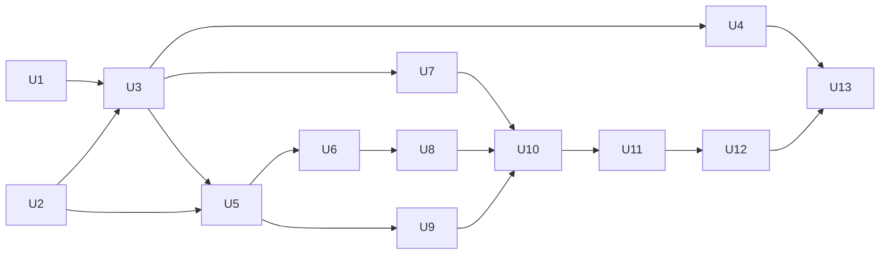

# #4076 #4090 #4099: 工程が承認済みの MVV を読み、cross-review が MVV に反する出力と誤った根拠の行を差し戻す

## 関連リンク

- 要求仕様: [issue-4076-requirements.md](./issue-4076-requirements.md)（正は #4076 の本文）。受け入れ条件は番号で指す。直しの #4090 は [issue-4090-requirements.md](./issue-4090-requirements.md)
- 設計書: [issue-4076-design.md](./issue-4076-design.md)、詳細設計書: [issue-4076-design-detail.md](./issue-4076-design-detail.md)
- 直しの設計（#4090 #4099）: [issue-4090-4099-design.md](./issue-4090-4099-design.md)、[issue-4090-4099-design-detail.md](./issue-4090-4099-design-detail.md)。#4090・#4099 の実装はこの計画の単位に入る（直しの設計の「設計の結果」の統合先が #4076 の実装の PR である）
- この実装を前提にする計画: [issue-3959-plan.md](./issue-3959-plan.md)（#3959 の単位 2〜4 はこの計画の単位がすべて main へ入った後に始める）
- モード: `standard`（`ndf records mvv current` のサブコマンドと cross-review の結果 JSON のキーを足し、手順書を変える。公開インタフェースが変わる）

## 修正対象

#4076 の詳細設計書の「地図」と、#4090 #4099 の詳細設計書の「地図」の足す・変える項目からコピーした。下の 3 か所はこの計画で保存先を変えた（理由は各タスクの「変更内容」と「リスクと対処」）。

- `drive.py` の今の「範囲」（変更の読み取り）と設定の読み取りを、新しい `changes.py`・`settings.py` へ先に移す。全差分と本文の読み取り（`_Target`・`_review_diff`・`_diff_files`・`_base_lines`）と根拠の行の確かめ（`_citations`・`_final_target`・`_final_citations`）も `changes.py` に置く。`drive.py` は今 998 行で、`ndf check` の構造の規則（`checks/rules.json` の `structure.max_lines` 1,000 行）を足すだけで超えるため
- `fenced_lines`・`decision_lines` は `records/mvv_decide.py` でなく `records/mvv.py` に置く。名前が `_decide` で終わるモジュールは `ndf.adapters` を読めない（`structure.decide_forbidden_imports`）ため、`adapters.markdown.code_lines`・`atx_headings` を呼ぶ関数を判断のモジュールに置けない。`parse_citation`・`citation_errors` は本文を読まない純粋な関数なので `mvv_decide.py` に残す
- cross-review の起動を通すテストは、`test_crossreview_run.py`（今 872 行）へ足さずに `test_crossreview_mvv.py`・`test_crossreview_citations.py` を新設して置く（同じ 1,000 行の規則がテストのファイルにも当たる）

| ファイル | 変える中身 | 単位 |
| --- | --- | --- |
| `issues/issue-4076-design.md`・`issues/issue-4076-design-detail.md` | #4090 #4099 の設計の「#4076 の文書のどこを置き換えるか」の表の 15 か所と、上の保存先の 3 つの変更 | U1 |
| `plugins/ndf/src/ndf/domains/crossreview/changes.py`（新設） | `drive.py` から移す `Changed`・`_regular_blobs`・`_local_text`・`_committed_texts`・`changed`・`sections`・`changed_sections`（U2。別のモジュールから読む名前は下線を外した）。`_committed_texts` がコミットを引数に取る・`_Target`・`_review_diff`・`_diff_files`・`_base_lines`（U8）。`_citations`・`_final_target`・`_final_citations`（U10） | U2・U8・U10 |
| `plugins/ndf/src/ndf/domains/crossreview/settings.py`（新設） | `drive.py` から移す `ReviewSettings`・`settings_path`・`_inside`・`read_settings`・`blob_id`・`proposed_differs`・`outside_checkout` と、`outside_checkout` が使う `RunConfig`・`DriveStopped`・`DEFAULT_MAX_ROUNDS`（U2。別のモジュールから読む名前は下線を外した）。`RunConfig` に欄 `base_commit: Optional[str] = None` を足す（U5） | U2・U5 |
| `plugins/ndf/src/ndf/domains/crossreview/drive.py` | 移した関数を呼ぶ形にする（U2）。`_start` がスナップショットを得てベースをコミットに固定し、失敗は `refused`（U5）。`_review_prompt`・`_fix_prompt` に基準 5 とパス（U5）。`_prepare_round`・`_reusable`・ラウンドの記録の MVV の識別子（U6）。`_Prepared` に `docs`・`full_diff`（U8）。修正担当へ `handable` を渡す（U9）。`_round` の確かめ・`last_target`・`_settle_resolved` が `by: ndf` の指摘を飛ばす・ラウンドの記録の `mvv_checked`（U10）。`_start` の引継ぎと `restate`（U11）。`_Run.clean`・`_summary` が `mvv_outputs`・`record_review` を呼ぶ（U12） | U2・U5・U6・U8〜U12 |
| `plugins/ndf/src/ndf/domains/crossreview/cli.py` | `changed_sections`・`read_settings` の呼び先（U2）。`Basis` に MVV の識別子・`cmd_scope` がベースのコミットと共通原則の sha256 を求める（U6） | U2・U6 |
| `plugins/ndf/src/ndf/adapters/git.py` | `Git.run_bytes`（新設） | U3 |
| `plugins/ndf/src/ndf/core/converge/worktree.py` | `fetch_head`・`sync_worktree` に `base_branch` | U3 |
| `plugins/ndf/src/ndf/domains/records/mvv.py` | `Snapshot`・`current`・`_write_verified`・`decl_from`・`principles`（`mvv_gate` から移す）（U3）。`fenced_lines`・`decision_lines`（U7）。`record_review`・`record_key`（U12） | U3・U7・U12 |
| `plugins/ndf/src/ndf/domains/records/mvv_decide.py` | `items_of`・`body_path`（U3）。`parse_citation`・`citation_errors`（U7）。`count_signals` が `review_disputed` を数える（U12） | U3・U7・U12 |
| `plugins/ndf/src/ndf/domains/records/mvv_gate.py` | `principles` を消し `mvv.principles` を呼ぶ | U3 |
| `plugins/ndf/src/ndf/domains/records/preflight.py` | `mvv_body` が `body_path` を呼ぶ（返す値は同じ） | U3 |
| `plugins/ndf/src/ndf/domains/records/cli.py` | `_mvv_current`（`fetch_branch_or_raise`・`--allow-mismatch`） | U4 |
| `plugins/ndf/docs/contracts/commands.md` | `ndf records mvv current` の項目 | U4 |
| `plugins/ndf/contracts/schemas/result.schema.json`・`plugins/ndf/contracts/version.json` | 結果 JSON の `outputs` のキーに `mvv` を足し、コントラクトのバージョンを 1 つ上げる | U4 |
| `plugins/ndf/contracts/schemas/io/records.args.schema.json` | `ndf records mvv current` の引数（`ndf check --write-spec` が生成する） | U4 |
| `plugins/ndf/contracts/data/review-criteria.json` | キー `mvv_criterion`・`mvv_number`・`mvv`（`reviewer`・`fixer`・`citation`） | U5 |
| `plugins/ndf/src/ndf/domains/crossreview/criteria_decide.py` | `criteria_lines`・`reviewer_block`・`fixer_block`・`mvv_item` | U5 |
| `plugins/ndf/src/ndf/domains/crossreview/scope_decide.py` | `Basis.mvv`・`read_by_all_head`・`reviewed_of`・`state_scope`（U6）。`read_by_all_head` が `mvv_checked` を見る（U10） | U6・U10 |
| `plugins/ndf/src/ndf/domains/crossreview/journal.py` | `ingest`・`handable`・`skipped_texts`・`apply_fix`・`enter`・`restate`（U9）。`ingest_citations`・`citation_key`・`apply_fix` が `by: ndf` の指摘の終わり方を変えない（U10）。`carry`（U11） | U9・U10・U11 |
| `plugins/ndf/src/ndf/domains/crossreview/finish_decide.py` | `_finding_gaps` がレッドラインを除き MVV の指摘の未解決を `mvv_unresolved` にする（U9）。`mvv_checked` の引数と `by: ndf` の未解決・`finish` が止まる側になる（U10） | U9・U10 |
| `plugins/ndf/src/ndf/domains/crossreview/prior_decide.py` | `Carried` の欄・`recorded`・`carried` | U11 |
| `plugins/ndf/src/ndf/domains/crossreview/report_decide.py` | `open_block`（U11）。`mvv_outputs`・`once`（U12） | U11・U12 |
| `plugins/ndf/skills/development-workflow/references/project-mvv.md` | 節「工程での読み方」 | U13 |
| `plugins/ndf/skills/development-workflow/references/agent-layers.md` | 起動指示の項目に「MVV」、守る規則に「MVV の欄のスナップショットを作業の前に読む」 | U13 |
| `plugins/ndf/skills/design/SKILL.md`・`design/references/decisions.md`・`tdd-cycle/SKILL.md`・`requirements-design/SKILL.md` | 参照を `project-mvv.md#工程での読み方` へ直す。`decisions.md` の例のバージョンを `current` のバージョンを書く形にし、「根拠の行」の表に `・` の区切りと引用文の形を足す | U13 |
| `plugins/ndf/skills/cross-refactoring/SKILL.md` | `$RF_MVV` を `current` の結果とスナップショットを読む指示で埋める手順 | U13 |
| `plugins/ndf/skills/cross-review/SKILL.md`・`fix/SKILL.md` | 基準 5・`mvv_unresolved`・`outputs.mvv` の説明。`fix` の「指摘の基準」の表に基準 5 | U13 |
| `docs/glossary/glossary.json`・`docs/glossary.md`（生成物） | 設計書の「用語」の 3 語（`ndf records glossary render` で作り直す） | U13 |

テストのファイルは各タスクの対象ファイルに挙げる。

## タスク分解

### Task 1: #4076 の設計文書を直しの設計とこの計画の保存先に合わせる

- **対象ファイル:** `issues/issue-4076-design.md`、`issues/issue-4076-design-detail.md`
- **変更内容:** #4090 #4099 の設計の「#4076 の文書のどこを置き換えるか」の表のとおり、15 か所を直しの詳細設計の節で置き換える。あわせて、この計画の「修正対象」の頭に書いた保存先の 3 つの変更（`changes.py`・`settings.py`、`fenced_lines`・`decision_lines` の `mvv.py`、新設のテストのファイル 2 つ）を地図と関数の表に反映する。要求仕様（`issues/issue-4076-requirements.md`）は変えない
- **満たす受け入れ条件:** 4090:14（元の文書を #4076 の実装で合わせる）
- **進め方:** テスト駆動を適用しない（文書だけの変更。`.md` の文言を照合するテストは書かない決まり）。`python3 scripts/check-markdown-links.py` 相当のリンクの検査が CI で通ることで確かめる

### Task 2: 承認済みの MVV が無いときの cross-review の振る舞いを縛る退行テスト

- **対象ファイル:** `plugins/ndf/tests/domains/crossreview/test_crossreview_criteria.py`、`plugins/ndf/tests/domains/crossreview/test_crossreview_run.py`
- **変更内容:** 機能追加の最初のタスクとして、今の振る舞いを先に縛る。`.ndf/mvv.json` の無いリポジトリで、相手役と修正担当の指示の基準の文・ジャーナルの指摘・結果 JSON の `outputs` のキーが今と同じであること（前提 2）。Task 3 の移動の前後で同じテストが通ることも確かめる
- **満たす受け入れ条件:** 4076:8
- **進め方:** 今のコードで通るテストを書く

### Task 3: `drive.py` の変更の読み取りと設定の読み取りを別のモジュールへ移す（準備のリファクタリング）

- **対象ファイル:** `plugins/ndf/src/ndf/domains/crossreview/drive.py`、`plugins/ndf/src/ndf/domains/crossreview/changes.py`（新設）、`plugins/ndf/src/ndf/domains/crossreview/settings.py`（新設）、`plugins/ndf/src/ndf/domains/crossreview/cli.py`、`plugins/ndf/tests/domains/crossreview/test_crossreview_scope.py`、`plugins/ndf/tests/domains/crossreview/test_crossreview_run.py`、`plugins/ndf/tests/domains/crossreview/test_crossreview_fixer_sessions.py`、`plugins/ndf/tests/route/test_flows.py`
- **変更内容:** `drive.py` の「範囲」の区切り（`_Changed`〜`changed_sections`。約 95 行）を `changes.py` へ、「始め」の区切りのうち設定の読み取り（`ReviewSettings`〜`outside_checkout`。約 100 行）を `settings.py` へ、中身を変えずに移す。`outside_checkout` が使う `RunConfig`（と既定の `DEFAULT_MAX_ROUNDS`）・`DriveStopped` も `settings.py` へ移す（`settings.py` から `drive.py` を読むと import の輪になる）。外から読む名前（`changed_sections`・`read_settings`・`ReviewSettings`・`outside_checkout`・`RunConfig`・`DriveStopped`・`DEFAULT_MAX_ROUNDS`）は呼び手とテストを新しいモジュールへ向ける。`drive.py` は約 800 行になり、U5〜U12 で足す約 150 行を入れても 1,000 行の規則の下に収まる。地図に無いファイルを足す理由は「修正対象」の頭のとおり
- **満たす受け入れ条件:** 4076:8（振る舞いを変えない）
- **進め方:** 振る舞いを変えない移動なので、Task 2 のテストと既存のテストが移動の前後で同じに通ることで確かめる（テストの期待の差分は import の先だけ）

### Task 4: Git の元のバイト列の読み取りと、同期の 1 回の取得でベースも取る

- **対象ファイル:** `plugins/ndf/src/ndf/adapters/git.py`、`plugins/ndf/src/ndf/core/converge/worktree.py`、`plugins/ndf/tests/adapters/test_git.py`、`plugins/ndf/tests/domains/crossreview/test_crossreview_push_sync.py`
- **変更内容:** #4076 の詳細設計の「MVV の写し」の節の `Git.run_bytes` と、`fetch_head`・`sync_worktree` の `base_branch`（1 回の `git fetch` に refspec を 2 本並べる）。テストのファイル 2 つは地図に無いが、変える関数の既存のテストの置き先である
- **満たす受け入れ条件:** 4076:1（ベースの承認済みの MVV を読む前提）
- **進め方:** 失敗するテスト（`base_branch` を渡しても refspec が 1 本）→ 通す最小実装 → 整理

### Task 5: MVV のスナップショット（`Snapshot`・`current`）

- **対象ファイル:** `plugins/ndf/src/ndf/domains/records/mvv.py`、`plugins/ndf/src/ndf/domains/records/mvv_decide.py`、`plugins/ndf/src/ndf/domains/records/mvv_gate.py`、`plugins/ndf/src/ndf/domains/records/preflight.py`、`plugins/ndf/tests/domains/records/test_mvv_current.py`（新設）、`plugins/ndf/tests/domains/records/test_preflight.py`
- **変更内容:** #4090 #4099 の詳細設計の「MVV の写し」の節（#4076 の同じ節を置き換えた形）。`Snapshot` は `commit`・`principles_sha256`・`principles_path` を持つ。`current` の手順 (1)〜(5)、`body_path`・`items_of`・`_write_verified`・`decl_from`、`principles` の `mvv_gate.py` から `mvv.py` への移動、`preflight.mvv_body` が `body_path` を呼ぶこと。`mismatch` は `allow_mismatch` が偽なら `MvvError`
- **満たす受け入れ条件:** 4076:1、4076:8（テスト設計の 4090-1・4090-10・4099-2 の `current` の側）
- **進め方:** 失敗するテスト（作業場所の本文が違っても、ベースの承認済みの本文のスナップショットを返す）→ 通す最小実装 → 整理

### Task 6: `ndf records mvv current --base` のコマンド

- **対象ファイル:** `plugins/ndf/src/ndf/domains/records/cli.py`、`plugins/ndf/docs/contracts/commands.md`、`plugins/ndf/tests/domains/records/test_cli.py`
- **変更内容:** `_mvv_current` が `git.Git(root).fetch_branch_or_raise(<リモート>, <ブランチ>)` で取得してから `current` を呼ぶ。`--allow-mismatch` を足す。結果の `outputs.mvv` と `refused` の形は設計書の「入出力のコントラクト」のとおり
- **満たす受け入れ条件:** 4076:1（テスト設計の 4090-13・4099-2 の CLI の側）
- **進め方:** 失敗するテスト（`--single-branch` で clone した作業場所で、リモートで新しいバージョンを承認した後も古いバージョンを返す）→ 通す最小実装 → 整理

### Task 7: 基準 5 の指示と、起動の始めのスナップショットとベースのコミットの固定

- **対象ファイル:** `plugins/ndf/contracts/data/review-criteria.json`、`plugins/ndf/src/ndf/domains/crossreview/criteria_decide.py`、`plugins/ndf/src/ndf/domains/crossreview/drive.py`、`plugins/ndf/src/ndf/domains/crossreview/settings.py`、`plugins/ndf/tests/domains/crossreview/test_crossreview_criteria.py`、`plugins/ndf/tests/domains/crossreview/test_crossreview_mvv.py`（新設）
- **変更内容:** #4090 #4099 の詳細設計の「基準 5 と識別子」の節のうち指示の側（`criteria_lines`・`reviewer_block`・`fixer_block`・`mvv_item`、共通原則のスナップショットのパスを指示に載せる）と、#4076 の詳細設計（正本）の「MVV の写し」の節の `drive._start`（MVV を読むブランチは、`--base` がブランチ名ならその名前、`<リモート>/<ブランチ>` ならリモート名を外した名前、コミットの SHA などなら PR のマージ先 `baseRefName`。`sync_worktree` の `base_branch` にそのブランチを渡し、`current` をそのブランチのリモート追跡参照で呼ぶ。`settings.RunConfig` に足す `base_commit` を `dataclasses.replace` で差分の起点に固定する。差分の起点は、`--base` がブランチなら `snap.commit`、SHA などなら渡されたコミット。`MvvError` か `baseRefName` を読めないときは相手役を起動せず `refused`）。`_merge_base` と相手役の差分の起点は固定したコミットを使う。`test_crossreview_mvv.py` は起動を通すテストの置き先（「修正対象」の頭のとおり）
- **満たす受け入れ条件:** 4076:1、4076:2、4076:8（テスト設計の 4090-9・4090-11 の指示の側）
- **進め方:** 失敗するテスト（承認済みの MVV があるのに指示に基準 5 とスナップショットのパスが無い）→ 通す最小実装 → 整理

### Task 8: MVV の識別子と収束の再利用・詳細レビュー済みのセクション

- **対象ファイル:** `plugins/ndf/src/ndf/domains/crossreview/scope_decide.py`、`plugins/ndf/src/ndf/domains/crossreview/cli.py`、`plugins/ndf/src/ndf/domains/crossreview/drive.py`、`plugins/ndf/tests/domains/crossreview/test_crossreview_scope.py`、`plugins/ndf/tests/domains/crossreview/test_crossreview_mvv.py`
- **変更内容:** `Basis.mvv`（識別子は状態・バージョン・sha256・共通原則の sha256）、`read_by_all_head`・`reviewed_of`・`state_scope`、`cmd_scope` がネットワークに出ずに手元の `<リモート>/<MVV を読むブランチ>`（`--base` が SHA のときは `run` が残したマージ先のブランチ）から識別子を得る、ラウンドの記録に識別子を書く（`_prepare_round`・`_reusable`）
- **満たす受け入れ条件:** 4076:2（テスト設計の 4076 の 2 の再利用と 4090-1・4090-11 の `review-scope` の側）
- **進め方:** 失敗するテスト（MVV のバージョンが上がった後の起動が前の収束を返す）→ 通す最小実装 → 整理

### Task 9: 根拠の行の判定

- **対象ファイル:** `plugins/ndf/src/ndf/domains/records/mvv_decide.py`、`plugins/ndf/src/ndf/domains/records/mvv.py`、`plugins/ndf/tests/domains/records/test_mvv_citations.py`（新設）
- **変更内容:** #4090 #4099 の詳細設計の「根拠の行の確かめ」の節の `parse_citation`・`citation_errors`（4 要素の入力・`kind` に `format`）を `mvv_decide.py` に、`fenced_lines`（`adapters.markdown.code_lines` の真の行の番号）と `decision_lines`（`atx_headings` で `### 決定 <数>` の下の行の番号）を `mvv.py` に置く。保存先を変えた理由は「修正対象」の頭のとおり
- **満たす受け入れ条件:** 4076:3（テスト設計の 4090-2・4090-8）
- **進め方:** 失敗するテスト（4 字のフェンスの中の 3 字の行の後にある `- 根拠: Value 1（MVV バージョン 1）` を拾う）→ 通す最小実装 → 整理

### Task 10: 全差分と本文の読み取り

- **対象ファイル:** `plugins/ndf/src/ndf/domains/crossreview/changes.py`、`plugins/ndf/src/ndf/domains/crossreview/drive.py`、`plugins/ndf/tests/domains/crossreview/test_crossreview_citations.py`（新設）
- **変更内容:** #4090 #4099 の詳細設計の `_Target`・`_review_diff`・`_diff_files`・`_base_lines`・`_committed_texts`（コミットを引数に取る。既存の呼び手は `"HEAD"` を渡す）を `changes.py` に置き、`_Prepared` に `docs`・`full_diff` を足す。確かめの配線はまだしない（U10）
- **満たす受け入れ条件:** 4076:3（テスト設計の 4099-1 の差分の読み取りの側）
- **進め方:** 失敗するテスト（改名したうえでフェンスを消した文書で、ベースの本文を元のパスで読めない）→ 通す最小実装 → 整理

### Task 11: ジャーナルの MVV の分類とレッドライン

- **対象ファイル:** `plugins/ndf/src/ndf/domains/crossreview/journal.py`、`plugins/ndf/src/ndf/domains/crossreview/finish_decide.py`、`plugins/ndf/src/ndf/domains/crossreview/drive.py`、`plugins/ndf/tests/domains/crossreview/test_crossreview_journal.py`、`plugins/ndf/tests/domains/crossreview/test_crossreview_finish.py`
- **変更内容:** #4076 の詳細設計の「ジャーナルとレッドライン」を #4090 #4099 の「ジャーナルと引継ぎ」で置き換えた形のうち、引継ぎを除く部分（U5 が先に入れた `mvv`・`redline`・`redline_items` の上に、`ingest`・`enter` の `judged_mvv`・`unpinned_severity`、`handable`・`skipped_texts`・`apply_fix` の `skipped_mvv`、`restate`、`mvv_history`）。`_finding_gaps` はレッドラインを最初に除き、`mvv` を持つ指摘の未解決を `mvv_unresolved` にする。`drive.py` は修正担当へ `handable` の結果を渡す
- **満たす受け入れ条件:** 4076:2、4076:4（テスト設計の 4090-6）
- **進め方:** 失敗するテスト（`P1` の指摘が収束を止める。修正担当へ渡らないことは U5 のテストが縛る）→ 通す最小実装 → 整理

### Task 12: 根拠の行の確かめの配線と確かめの成否

- **対象ファイル:** `plugins/ndf/src/ndf/domains/crossreview/changes.py`、`plugins/ndf/src/ndf/domains/crossreview/journal.py`、`plugins/ndf/src/ndf/domains/crossreview/drive.py`、`plugins/ndf/src/ndf/domains/crossreview/finish_decide.py`、`plugins/ndf/src/ndf/domains/crossreview/scope_decide.py`、`plugins/ndf/tests/domains/crossreview/test_crossreview_citations.py`、`plugins/ndf/tests/domains/crossreview/test_crossreview_journal.py`、`plugins/ndf/tests/domains/crossreview/test_crossreview_finish.py`、`plugins/ndf/tests/domains/crossreview/test_crossreview_scope.py`
- **変更内容:** `_citations`（鍵 `(merge_base, head, 識別子)` で使い回す・候補のファイルの (a) と (b)）・`_final_target`・`_final_citations` を `changes.py` に置き、`_round` と終わり方の判定の直前に打つ。`ingest_citations`・`citation_key`、`apply_fix` が `by: ndf` の指摘の終わり方を変えない、`_settle_resolved` が `by: ndf` の指摘を飛ばす。`_finding_gaps` の `mvv_checked`、`finish` が `mvv_unresolved` で止まる側になる、`read_by_all_head` が `mvv_checked` の真のラウンドだけを返す
- **満たす受け入れ条件:** 4076:3（テスト設計の 4090-3・4090-4・4090-12・4099-1 の配線の側）
- **進め方:** 失敗するテスト（バージョン 11 のリポジトリで「根拠: Value 5（MVV バージョン 1）」を足した PR が収束する）→ 通す最小実装 → 整理

### Task 13: 記録のコメントからの MVV の分類の引継ぎ

- **対象ファイル:** `plugins/ndf/src/ndf/domains/crossreview/prior_decide.py`、`plugins/ndf/src/ndf/domains/crossreview/report_decide.py`、`plugins/ndf/src/ndf/domains/crossreview/journal.py`、`plugins/ndf/src/ndf/domains/crossreview/drive.py`、`plugins/ndf/tests/domains/crossreview/test_crossreview_prior.py`、`plugins/ndf/tests/domains/crossreview/test_crossreview_report.py`
- **変更内容:** #4090 #4099 の詳細設計の「ジャーナルと引継ぎ」の引継ぎの部分（`Carried` の欄、`recorded`・`carried`、`open_block`、`carry`、`drive._start` が resolve 済みの `by: ndf` の件も戻す、`carry` の後に `restate` を 1 回打つ）
- **満たす受け入れ条件:** 4076:4（テスト設計の 4090-5）
- **進め方:** 失敗するテスト（空の状態ディレクトリから再開すると `P1` のレッドラインが普通の指摘に戻る）→ 通す最小実装 → 整理

### Task 14: 結果の `outputs.mvv` と MVV の記録・兆候

- **対象ファイル:** `plugins/ndf/src/ndf/domains/crossreview/report_decide.py`、`plugins/ndf/src/ndf/domains/crossreview/drive.py`、`plugins/ndf/src/ndf/domains/records/mvv.py`、`plugins/ndf/src/ndf/domains/records/mvv_decide.py`、`plugins/ndf/tests/domains/crossreview/test_crossreview_report.py`、`plugins/ndf/tests/domains/records/test_mvv_record_review.py`（新設）、`plugins/ndf/tests/domains/records/test_mvv.py`
- **変更内容:** #4090 #4099 の詳細設計の「終わり方と結果」（`mvv_outputs`・`once`・`record_review`・`record_key`、`_Run.clean`、`_summary` の順序）と、#4076 の詳細設計の `count_signals` の `review_disputed`。`record_review` は `clean` が None なら自由記述を持たない `withheld: true` の記録を書く（#3959 の `review_holds` の 3 つ目の規則がこの記録を読む）。`record_review` のテストは #3959 の計画の Task 5 が書き足す `test_mvv_record_review.py` を新設して置く（#3959 と置き先をそろえる）
- **満たす受け入れ条件:** 4076:4、4076:5（テスト設計の 4090-7）
- **進め方:** 失敗するテスト（修正担当の見送り 1 件で `review_disputed` が書かれない）→ 通す最小実装 → 整理

### Task 15: 手順書と用語集

- **対象ファイル:** `plugins/ndf/skills/development-workflow/references/project-mvv.md`、`plugins/ndf/skills/development-workflow/references/agent-layers.md`、`plugins/ndf/skills/design/SKILL.md`、`plugins/ndf/skills/design/references/decisions.md`、`plugins/ndf/skills/tdd-cycle/SKILL.md`、`plugins/ndf/skills/requirements-design/SKILL.md`、`plugins/ndf/skills/cross-refactoring/SKILL.md`、`plugins/ndf/skills/cross-review/SKILL.md`、`plugins/ndf/skills/fix/SKILL.md`、`docs/glossary/glossary.json`、`docs/glossary.md`
- **変更内容:** #4076 の詳細設計の「手順書」の表と、#4090 #4099 の置き換えの表の `decisions.md` の項目。用語集の 3 語を足して `ndf records glossary render` で作り直す
- **満たす受け入れ条件:** 4076:1、4076:2、4076:4、4076:6
- **進め方:** テスト駆動を適用しない（`.md` の文言を照合するテストは書かない決まり）。リンクの検査（4 つの参照のアンカーが `project-mvv.md` の節を指す）と `ndf records glossary render --check` が CI で通ることで確かめる

## レビューの単位

機械が読む形は [issue-4076-plan.units.json](./issue-4076-plan.units.json)（#3702 の単位のファイルの形）にある。

| 単位 | 含むタスク | 満たす受け入れ条件 | 見込みの差分の行数 | 実際の行数 |
| --- | --- | --- | --- | --- |
| U1 設計文書の置き換え | Task 1 | 4090:14 | 約 350 | （実装の後に書き足す） |
| U2 準備のリファクタリング | Task 2・3 | 4076:8 | 約 510（移動の追加と削除の和。中身の変更は import の先だけ） | |
| U3 MVV のスナップショット | Task 4・5 | 4076:1・4076:8 | 約 530 | |
| U4 スナップショットのコマンド | Task 6 | 4076:1 | 約 180 | |
| U5 基準 5 と起動の始め | Task 7 | 4076:1・4076:2・4076:8 | 約 450 | |
| U6 MVV の識別子と再利用 | Task 8 | 4076:2 | 約 350 | |
| U7 根拠の行の判定 | Task 9 | 4076:3 | 約 350 | |
| U8 全差分と本文の読み取り | Task 10 | 4076:3 | 約 350 | |
| U9 ジャーナルの分類とレッドライン | Task 11 | 4076:2・4076:4 | 約 420 | |
| U10 確かめの配線と成否 | Task 12 | 4076:3 | 約 550 | |
| U11 記録のコメントからの引継ぎ | Task 13 | 4076:4 | 約 380 | |
| U12 結果と MVV の記録 | Task 14 | 4076:4・4076:5 | 約 550 | |
| U13 手順書と用語集 | Task 15 | 4076:1・4076:2・4076:4・4076:6 | 約 350 | |

- 行数は追加と削除の和で、`git diff --shortstat <ベース>...HEAD -- . ':(exclude)docs/glossary.md'` で数える（`docs/glossary.md` は生成物なので数えない）
- **1 課題 1 単位にしない理由:** 見込みは合わせて約 5,300 行で 1,000 行を超えるので、タスクの依存の向きで分けた。#4090・#4099 は #4076 の実装の PR に入る直しなので、別の単位にせず各単位へ入れた（テスト設計の `4090-<n>`・`4099-<n>` の番号は各タスクの「満たす受け入れ条件」に添えた）
- **400 行を超える単位の理由:** U2 は移動の追加と削除が両方数えられ、中身の変更は約 100 行である。U3 は `Snapshot` と `current` と `principles` の移動を同じコミットで通さないと `mvv_gate.py` が古い `principles` を読む。U5 は基準 5 の指示と `_start` のスナップショットを同じ単位で通さないと、指示にパスがあるのにスナップショットが無い起動ができる。U9・U10・U12 は、ジャーナルの分類・確かめの成否・結果と記録のそれぞれで、行き先の関数とその判定を分けると単独でテストが通らない
- **実行の順:** U1 と U2 を最初に流してスプリントブランチへマージする（互いに独立で並列にしてよい。U2 は準備のリファクタリング、U1 は実装が読む設計文書の置き換え）。次に U3。U3 の後は U4・U5・U7 を並列にしてよい（触るファイルが重ならない）。U6 は U5 の後、U8 は U6 の後、U9 は U5 の後で U6・U7・U8 と並列にしてよい（`drive.py` は関数ごとに分かれ、衝突は取り込みで解ける）。U10 は U7・U8・U9 の後、U11 は U10 の後、U12 は U11 の後、U13 は U4 と U12 の後
- どの単位も `.ndf/` のファイルを触らない
- バージョンを上げるのは U1〜U13 がすべて main に入った後（#3959 の設計の決定 7。#3959 の単位 2〜4 もこの後に始める）

## リファクタリングの時機

| 時機 | 対象 | 理由 |
| --- | --- | --- |
| 実装の前（準備のリファクタリング） | `crossreview/drive.py` の「範囲」と設定の読み取りを `changes.py`・`settings.py` へ移す（Task 3。U2） | `drive.py` は 998 行で、構造の規則の 1,000 行を足すだけで超える。15 タスクのうち `drive.py` を触るのは 8 つ（Task 3・7・8・10〜14）で、足す見込みは約 600 行（うち根拠の行の確かめが約 450 行）。そのファイルを覆うテストは `test_crossreview_run.py` の 45 件ほか。根拠の行の確かめは差分と本文を読む責務で、今の「範囲」と同じ責務なので、同じ新しいモジュールにまとめる |
| 実装の中 | 各タスクで行う | `tdd-cycle` のリファクタリングのステップ |
| スプリントの終わり（cross-refactoring） | `records/mvv.py` の `current` と `crossreview/cli.py` の `cmd_scope` が、それぞれ設定の blob を読んで本文のパスを解く処理（U3・U6）。`changes.py` の `_committed_texts` と `records/mvv.py` の `run_bytes` の読み取りの重なり（U3・U8） | 単位をまたいで同じ形の処理が 2 か所にできうる |

## リスクと対処

| リスク | 対処 |
| --- | --- |
| `drive.py` が U5〜U12 の後に 1,000 行に近づき、ほかのレーンの変更（計画 p9 の lz1-contract の U4 が `DEFAULT_MAX_ROUNDS` を上限の設定から読む）と合わせて超える | 単位ごとに `wc -l` で測り、950 行を超えたら次の単位の最初のタスクで「修正担当」の区切り（約 165 行）を `fixer.py` へ移す |
| 計画 p9 の lz1-contract の U5 が、`mvv-validation.jsonl`・`mvv-signals.jsonl` の記録を種類ごとのスキーマ（`contracts/schemas/internal/mvv-validation.schema.json`・`mvv-signals.schema.json`）で確かめるようにする。U12 が足す `mvv-review` の記録と `review_disputed` の兆候がスキーマに無いと、書けずに落ちる | U12 を始める前に lz1-contract の U5 が main へ入ったかを確かめ、入っていれば U12 で 2 つのスキーマに記録の種類を足す（触るファイルが 2 つ増える）。入っていなければ、lz1-contract の U5 の PR へこの 2 種類を伝える（重なりの一覧はこの計画を出した PR の本文にある） |
| lz1-contract の U5 が `records/mvv.py` の記録の読み書きを `jsonl` の種類つきの呼び出しへ変え、U3・U7・U12 の `records/mvv.py` と衝突する | 関数が分かれる（lz1-contract は記録の読み書き、この計画は `current`・`fenced_lines`・`record_review`）。後に入る PR が取り込みで解く |
| `docs/glossary/glossary.json` を lz1-contract の U1 と #3959 の単位 5 も触る | U13 の直前に main を取り込み、`ndf records glossary render` で `docs/glossary.md` を作り直す（生成物を手で直さない） |
| `agent-layers.md` を計画 p9 の lsplit（#4287 がスプリントブランチへマージ済み）と #3959 の単位 5 も触る | U13 を lsplit のスプリントが main へ入った後に始める。#3959 の単位 5 は U13 の後 |
| `plugins/ndf/docs/contracts/commands.md` を lsplit（#4286・#4287・#4291・#4307・#4313）と計画 p12 の lctx（#4312）も触る | 足すのは `ndf records mvv current` の項目だけで、ほかの項目を動かさない。取り込みで解く |
| 根拠の行を拾う規則が、根拠の行でない文を拾って直せない指摘で止まる | 規則は行頭の `根拠:` に限り（`parse_citation`）、Task 9 のテストで文中の引用を拾わないことを縛る |

## 切り戻し手順

- データの移行は無い。記録のファイルに足すのは新しい種類の記録だけで、古い記録は読み方を変えない
- 単位ごとの PR を revert すれば戻る。U2 を戻すときは U3 以降をすべて先に戻す（`changes.py`・`settings.py` を後の単位が使う）。U12 を戻すと、#3959 の単位 3 の `review_holds` の 3 つ目の規則が読む `withheld: true` の記録が書かれなくなるので、#3959 の単位 3 より後には戻さない

## 完了の定義

- [ ] 受け入れ条件 1〜6・8 をすべて満たし、条件ごとに検証手段と結果が対応している。条件 7 はリリースの後に、要求仕様の「リリース後の確認の計画」のとおり #4049 の最初の設計（PR #4060 の最初のコミット）を head にした PR へ `ndf cross-review run` を流して確かめる
- [ ] #4090 #4099 の設計の「テスト設計」の 15 項目（`4090-1`〜`4090-13`・`4099-1`・`4099-2`）が各単位のテストで縛られている
- [ ] 各単位の PR の CI が通り、`cross-review` が収束している（`.ndf/project.json` の `test.ci.only` が真なので手元でテストを打たない）
