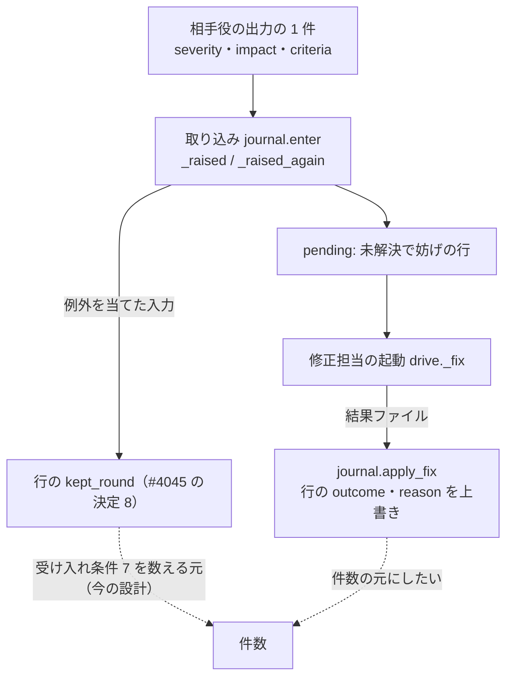
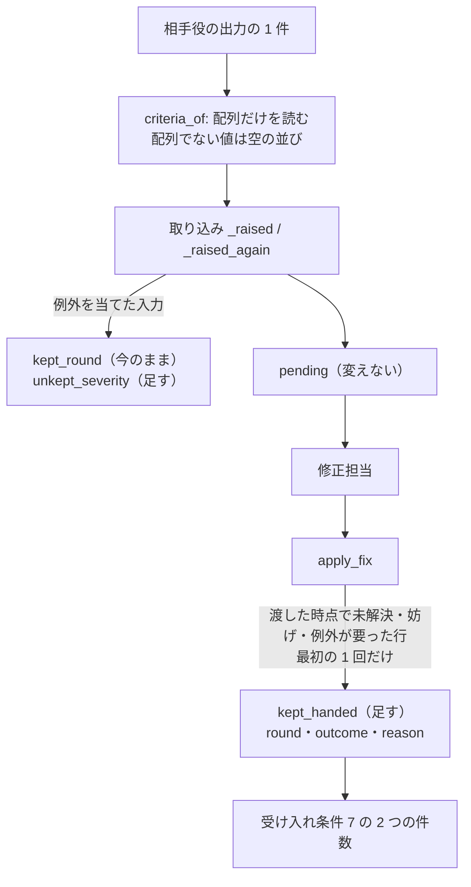

# #4045 の設計: 単一値の criteria を基準 2 と読まず、例外で実際に渡した回だけを数える（#4084）

#4045 の設計（PR #4080）は、配列でない `criteria` の扱いが要求と食い違い、受け入れ条件 7 を数える `kept_round` が例外無しでも渡る行・渡らない行まで数える。`criteria` は配列だけを読むと決めて要求に合わせ、例外を当てた記録（`kept_round`）とは別に、例外が無ければ渡らなかった行を修正担当へ渡して結果を受けた回の記録（`kept_handed`）を足し、受け入れ条件 7 はこちらで数える。置き換える #4045 の節と決定は「#4045 の文書のどこを置き換えるか」に、採らなかった案は「決定の記録」にある。

## 今の姿

何が起きたか・目的・受け入れ条件は要求仕様（[issue-4084-requirements.md](./issue-4084-requirements.md)、正は #4084 の本文）にある。直す対象は #4045 の設計文書 [issue-4045-design.md](./issue-4045-design.md) と詳細設計 [issue-4045-design-detail.md](./issue-4045-design-detail.md) で、従う要求は [issue-4045-requirements.md](./issue-4045-requirements.md)（前提 2・受け入れ条件 3・7）である。前提にするコードは #4045 と同じく `sprint/p12-lcrfast-r1`（head `68d887913`）の形である。

今の設計の数え方が外れる経路は 3 つで、どれも「例外を当てた入力の記録」と「例外によって修正担当へ渡した記録」を 1 つの項目（`kept_round`）で兼ねることが原因である。

| 経路 | 行の扱い（スプリントブランチのコード） | 今の設計の数え方 |
| --- | --- | --- |
| 同じラウンドに別の相手役が同じ指摘を `impact` 付きの `major` で返す | 例外が無くても `major` で妨げになり、修正担当へ渡る | 例外の効果として「下げずに渡した件数」に入る |
| 見送り済みの行へ同じ指摘が基準 2・`impact` 無しで出し直される | `enter` は `_raised_again` を呼ぶが、終わり方は見送りのまま。`pending` は未解決の行しか選ばないので渡らない | 渡した件数と見送った件数の両方に入り、前の見送りの理由が今回の判断として読まれる |
| 修正担当が結果を返さずにラウンドが終わる（`_fix` が None・中断） | `apply_fix` が呼ばれない | 渡した件数に入る |
| 例外で渡して直した行が、後のラウンドで別の理由で見送られる | 行の `outcome`・`reason` は最後の結果で上書きされる | 例外で渡した回の結果でなく、後の回の見送りが数えられる |

`criteria` の単一値は、要求の前提 2（形が違う値は基準 2 に当たらない）と、詳細設計の `criteria_of`（整数か文字列の 1 つを要素 1 つの配列と読む）が食い違う。

## 文脈と制約

- #4045 の要求仕様（正は #4045 の本文）は変えない。食い違いは設計の側を要求へ合わせる（#4084 の前提 1）
- 直す文書は #4045 の設計文書と詳細設計で、#4045 は実装の前である。`issues/issue-4045-*` はこの PR で書き換えず、#4045 の実装の PR でこの設計に合わせて直す
- #4045 のほかの決定（1・3〜7）と、#4076・#4013 との持ち物の分け方（#4045 の決定 6）は変えない
- 決定の根拠に引く MVV の項目は main の `.ndf/mvv.md`（MVV バージョン 11）にある
- この文書の「例外」は、#4045 の「1 文（`impact`）が無くても基準 2 の重い指摘を下げない」規則を指す。「例外を当てない重さ」は、同じ入力を基準の並び無しで `effective_severity` に通した重さを指す

## 解き方の全体像

- `criteria_of` は配列だけを読み、配列でない値（整数 `2`・文字列 `"2"` を含む）は空の並びにする。配列の要素は今のとおり整数と文字列を受ける（決定 1）
- 取り込みは今のとおり例外を当てた入力に `kept_round` を置く。同じ行に、例外を当てない重さを入力ごとに重ねた `unkept_severity` を持たせる（決定 2）
- 修正担当の結果を取り込むとき（`apply_fix`）、取り込む前の行が未解決で妨げの重さを持ち、`unkept_severity` が妨げでない（例外が要った）なら、その回のラウンド・終わり方・理由を `kept_handed` に置く。置くのは最初の 1 回だけである（決定 2・3）
- 受け入れ条件 7 の「下げずに渡した件数」は `kept_handed` を持つ行の数、「見送った件数」はそのうち `kept_handed.outcome` が見送りの行の数で、理由は `kept_handed.reason` を読む（決定 3）

## データ構造

状態ファイル（`cross-review-pr<元の番号>-state.json`）のジャーナルの行（`findings[]`）に、#4045 が足す `criteria`・`kept_round` に加えて 2 つの項目を足す。ラウンドの記録（`rounds[]`）と修正担当の結果ファイルの形は変えない。

| 項目 | 置き場 | 型 | 置く条件 | 中身 |
| --- | --- | --- | --- | --- |
| `kept_round`（#4045 のまま） | 行 | 整数 | 取り込みか出し直しの入力に例外を当てたとき。行が既に持てば置き直さない | 例外を初めて当てた入力のラウンドの番号。修正担当への添え書き（`kept_without_impact`）だけが読み、受け入れ条件 7 では数えない |
| `unkept_severity`（足す） | 行 | 尺度の値 | `kept_round` を初めて置くとき。以後は行へ入る入力ごとに更新する | 行へ入った入力を例外を当てずに重ねた重さ。初めて置くときは、その入力の前の行の `severity`（新しい行なら無し）と、その入力の例外を当てない重さの重い方。以後の入力では、今の値とその入力の例外を当てない重さの重い方 |
| `kept_handed`（足す） | 行 | オブジェクト `{"round": 整数, "outcome": 終わり方, "reason": 文字列 か null}` | 修正担当の結果を取り込むとき、取り込む前の行が未解決（`unresolved`）で、`severity` が妨げになる重さで、`unkept_severity` が妨げにならない重さで、行がまだ持たないとき | 例外によって修正担当へ渡し、結果を受けた最初の回の、結果を取り込んだラウンドの番号・修正担当が返した終わり方（`fixed` か `deferred`）・理由。後のラウンドの結果で書き換えない |

`unkept_severity` を `kept_round` の無い行に置かないのは、例外を当てていない行では例外を当てない重さが `severity` と常に等しいためである。`kept_round` を置く前の入力は例外を当てずに入っているので、その時点の行の `severity` が、それまでの入力を例外を当てずに重ねた重さになる。

取り込む前の行が未解決で妨げの重さを持つことは、`pending` がその行を修正担当へ渡した条件と同じである（ラウンドの中で、取り込みを終えてから修正担当を起動し、結果を取り込むまでの間に行へ入力は入らない）。見送り済みの行（終わり方が `deferred`）は `pending` に選ばれないので、出し直しで `kept_round` が付いても `kept_handed` は付かない。

## #4045 の文書のどこを置き換えるか

#4045 の実装の PR は、次の表のとおり `issues/issue-4045-design.md` と `issues/issue-4045-design-detail.md` を直してから実装する。要求仕様（`issues/issue-4045-requirements.md`）は変えない。

| 文書 | 節・決定 | 今の中身 | 置き換えた後 |
| --- | --- | --- | --- |
| 設計文書 | 入出力のコントラクトの「`criteria` の値」の表 | 「文字列か整数の 1 つの値」を要素 1 つの配列と読む行がある | その行を消し、「無い・`null`・真偽値・オブジェクト・ほかの型」の行を「配列でない値（文字列か整数の 1 つの値・`null`・真偽値・オブジェクトを含む）か、無い」に置き換える（決定 1） |
| 設計文書 | 決定 2 の「選んだ案」 | 「整数と 1 つの値も受ける」 | 「配列の要素は整数も受ける。配列でない値は空の並びにする（要求の前提 2）」へ。採らなかった案に「1 つの値も要素 1 つの配列と読む」（理由は #4084 の決定 1）を足す |
| 設計文書 | 解き方の全体像の最後の箇条 | 受け入れ条件 7 を `kept_round` を持つ行と `outcome` が `deferred` の行で数える | `kept_handed` を持つ行と、そのうち `kept_handed.outcome` が `deferred` の行で数える |
| 設計文書 | データ構造の項目の表 | `criteria`・`kept_round` の 2 行 | `unkept_severity`・`kept_handed` の 2 行を足し、`kept_round` の中身に「受け入れ条件 7 では数えない」を足す（この文書の「データ構造」の表のとおり） |
| 設計文書 | 決定 8 | `kept_round` だけを残し、それで数える | #4084 の決定 2・3 で置き換える。#4045 の決定 8 の「採らなかった案」のうち `kept_handed_round`・`kept_result` を退けた理由は、#4084 の決定 3 の「退けた理由が成り立たなくなった」に移す |
| 設計文書 | テスト設計の受け入れ条件 3・7 の行 | 3: 形が違う値に単一値を含まない。7: `kept_round` の付き方を縛る | 3: 整数 `2`・文字列 `"2"` の単一値で `impact` の無い `major` が `minor` になることを足す。7: この文書の「テスト設計」の受け入れ条件 7 の行で置き換える |
| 設計文書 | 未確認のまま残ること | 件数を `kept_round` と `outcome` で数える | `kept_handed` で数える |
| 設計文書 | 設計の結果の触るファイル | 9 ファイル | 変えない（足す処理は同じ `criteria_decide.py`・`journal.py` とそのテストに入る） |
| 詳細設計 | 地図の `journal.py` の行・関数の表 | `_raised`・`enter`・`_raised_again` | `apply_fix`（変更。責務だけ）を足し、`criteria_decide.py` の行に `kept_needed`（新設）を足す |
| 詳細設計 | `criteria_of` の処理の手順の 2 行目 | 真偽値でない整数か文字列の 1 つを要素 1 つの配列と同じに読む | 消す。3 行目を「値が配列でない（整数・文字列・`null`・真偽値・浮動小数・オブジェクト）か、無い」→ 空の並びへ |
| 詳細設計 | `criteria_of` の単体テストの観点 | 正常に `"2"` → `("2",)` | 正常から外し、異常に `2`・`"2"` → 空を足す |
| 詳細設計 | ジャーナルの行の基準の並び（journal）の関数の表 | `_raised`・`_raised_again` が `kept_round` を置く | 同じ表に `unkept_severity` の置き方と `apply_fix` の `kept_handed` を足す（この文書の「どこを変えるか」のとおり） |
| 詳細設計 | ラウンド全体（`test_crossreview_run.py`）の観点 | 例外で渡り `kept_round` が残る | この文書の「テスト設計」の受け入れ条件 3・4 の行を足す |

## 決定の記録

### 決定 1: 要求と詳細設計を 1 通りに読めるよう、`criteria` は配列だけを読み、配列でない値は空の並びにする

- **質問**: 配列でない `criteria`（整数 `2`・文字列 `"2"`）を、要素 1 つの配列と読むか、形が違う値として空の並びにするか
- **選んだ案**: 配列だけを読む。配列でない値はすべて空の並び（基準 2 に当たらない指摘）にする。配列の要素は今の #4045 の詳細設計のとおり、真偽値を除く整数と、前後の空白を除いた文字列を受ける
- 採らなかった案: 要素 1 つの配列と読み、#4045 の要求の前提 2・受け入れ条件 3 を書き換える（要求の正は #4045 の本文で、承認済みの要求を設計の直しで変えることになる。相手役への指示は配列の形だけを示すので、1 つの値は指示に従わなかった出力であり、そのような出力を広く受けるほど、#4014 の設計が退けた危険（1 文を書かずに基準 2 と名乗る指摘が止める側に残る）の入口が増える）
- 採らなかった案: 配列でない値を読んだら注意に載せる（#4045 の異常系の表は `criteria` の形の違いを注意に載せないと決めており、`impact` の欠けと同じ扱いをそろえる）
- **代償**: 相手役が基準 2 の指摘を `"criteria": "2"` と書き損じ、さらに 1 文も書かなければ、その指摘は `minor` へ下がる。2 つの書き損じが重なった場合に限る
- 根拠: Value 3「判断の要らない手順は仕組みが進めるので、結果が実行ごとにばらつかない」・Value 11「同じ規則・定数・処理は 1 か所にまとまり、ほかはそこを参照する」（MVV バージョン 11）

### 決定 2: 例外の効果だけを数えるため、例外を当てない重さを行に重ね、修正担当へ渡した時点で例外が要ったかを決める

- **質問**: 「例外によって修正担当へ渡した」を、行の何から決めるか
- **選んだ案**: `kept_round` を初めて置くときに、行へ `unkept_severity`（例外を当てない重さ）を置き、以後の入力ごとに重い方へ更新する。修正担当の結果を取り込むとき、`unkept_severity` が妨げにならない重さの行だけを「例外が要った行」とする。判定は純粋な関数 `criteria_decide.kept_needed(row)` の 1 か所に置く
- 採らなかった案: 行が 1 文（`impact`）を持たないことで決める（別の相手役が同じ指摘を `impact` 付きの `minor` で返すと行は 1 文を持つが、妨げの重さは例外だけから来ており、例外の効果を数え落とす）
- 採らなかった案: 取り込みを終えた時点で、そのラウンドの入力だけを例外無しで重ね直す（`enter` に渡す入力の並びをラウンドの終わりまで持ち回る必要があり、前のラウンドから引き継いだ行の重さを足し損なう。行に 1 つの値を重ねれば、ラウンドを跨いでも同じ規則で決まる）
- 採らなかった案: `raised_severity`（相手役が付けた元の重要度）で決める（元の重要度は下げる前の値で、例外を当てない重さとは違う。引き継いだ行は `raised_severity` を持たない）
- **代償**: ジャーナルの行の項目が 1 つ増える。`kept_round` の無い行には置かないので、例外を当てない行の形は #4045 と変わらない
- 根拠: Value 3「判断の要らない手順（…集計…）は仕組みが進めるので、結果が実行ごとにばらつかない」・Value 13「効果は実測（費用・秒・件数）で示され」（MVV バージョン 11）

### 決定 3: 受け入れ条件 7 が渡した回の判断だけを数えるよう、修正担当の結果を取り込むときに `kept_handed` を 1 回だけ置く

- **質問**: 「下げずに渡した件数」と「そのうち見送った件数」を、どの記録から数えるか
- **選んだ案**: `journal.apply_fix` が結果を取り込むとき、取り込む前の行が未解決で、妨げの重さを持ち、`kept_needed` が真で、`kept_handed` をまだ持たなければ、`kept_handed` に `{"round": 結果を取り込んだラウンド, "outcome": 修正担当が返した終わり方, "reason": 理由}` を置く。受け入れ条件 7 は `kept_handed` を持つ行の数と、そのうち `kept_handed.outcome` が `deferred` の行の数で数え、見送りの理由は `kept_handed.reason` を読む。`kept_round` は添え書きのためだけに残す
- 採らなかった案: #4045 の決定 8 のまま `kept_round` で数える（「今の姿」の表の 4 つの経路で件数が例外の効果より多く出る）
- 採らなかった案: 修正担当への指示を組むとき（`pending` の後）に渡した印を置く（起動が結果を返さずに終わった回も数える。結果を受けた回だけが受け入れ条件 7 の「渡して、直すか見送った」に当たる）
- 採らなかった案: `kept_handed` を最後の回の結果で書き換える（後のラウンドで例外と関係の無い理由で見送られると、例外で渡した回の判断が消える）
- 採らなかった案: 修正担当の結果に基準 2 に当たるかの判断を書かせる（#4045 の決定 8 と同じ理由で採らない。見送りの理由は `kept_handed.reason` に残る）
- **退けた理由が成り立たなくなった**: #4045 の決定 8 は、修正担当が結果を返したラウンドを残す案（`kept_handed_round`）を「稀な経路のためだけの項目」として、終わり方と判断の組を残す案（`kept_result`）を「終わり方は行の `outcome` が既に持つ」として退けた。#4082・#4083・#4087 の cross-review が示したとおり、同じラウンドの重なり・見送り済みの出し直し・結果の無い起動・後のラウンドの上書きはどれも普通のラウンドで起きるので、2 つを 1 つの項目にまとめて採る
- **代償**: `apply_fix` が行の項目を 1 つ書くようになる。`drive` の 4 関数（`_round`・`_fix_record`・`_take_fix`・`merge_fix`）と修正担当の結果ファイルの形は変えない。駆動の外で結果をマージする `merge_fix` も `apply_fix` を通るので、同じ規則で置かれる
- 根拠: Value 13「効果は実測（費用・秒・件数）で示され」・Value 3「判断の要らない手順（…集計…）は仕組みが進めるので、結果が実行ごとにばらつかない」・Value 9「まだ要らない仕組みは先回りして作らず、後から足せる土台に留める」（MVV バージョン 11）

## 影響と危険

- **働く範囲**: この PR は設計文書だけで、振る舞いは変わらない。#4045 の実装の後は、利用先のリポジトリでも `ndf cross-review run` を打つすべての PR のレビューに効く
- **プロジェクトごとに違うもの**: 無い（#4045 と同じく NDF の契約とコードが持つ）
- **当たるモード**: cross-review を通すすべてのモード
- **#4045 の文書との食い違い**: この PR のマージから #4045 の実装の PR までの間、`issues/issue-4045-*` は直す前の中身のまま残る。#4045 の実装は、この設計を先に読んで #4045 の文書を「#4045 の文書のどこを置き換えるか」の表のとおり直してから実装する。#4045 の要求仕様の写しに、この課題への参照を足す必要は無い（要求は変わらない）
- **実装の順**: #4045 の実装と同じ PR で入れる。#4045 の実装の起点（`sprint/p12-lcrfast-r1` が main へ入った後の main）は変えない
- **同じファイルを触る別の変更**:
  - #4076・#4090（レーン lcrfast）: `journal`（`_raised`・`ingest`）と `review-criteria.json` を触る。この設計が足すのは `apply_fix` と `criteria_decide.kept_needed` と行の 2 項目で、#4045 の決定 6 の持ち物の分け方は変えない。`apply_fix` を #4076・#4090 が触るときは、後に入る方が `kept_handed` を置く条件を落とさない
  - #4013（修正担当の会話を続ける）: `drive._fix_prompt` と修正担当の起動を触る。この設計は `drive` を変えない
- **壊れうる箇所**: 修正担当が渡していない id の結果を返したとき、取り込む前のその行が未解決で妨げの重さを持てば、渡したものとして数える。`pending` が渡すのは未解決で妨げの行のすべてなので、その条件の行は必ず渡した集合に入っている
- **用語集**: 足す語は無い

### 代表のリポジトリでの振る舞い

| 代表のリポジトリ | 設定の要点 | 直した後に起きること | この種類で扱えなくなること |
| --- | --- | --- | --- |
| Web サービス（nd-factory） | 実装とリファクタリングの PR を cross-review が見る | #4045 の実装の後、基準 2 で下げずに渡した件数が、例外が要った行を実際に渡した回だけで数えられる。`criteria` を 1 つの値で書いた指摘は基準 2 に当たらない | 無し |
| モバイルアプリ | 同上 | 同上 | 無し |
| 業務文書だけ | 設計・文書の PR を cross-review が見る | 同上 | 無し |

### ai-plugins だけの事情

- 無し（規則と記録の形は NDF の契約とコードが持ち、このリポジトリの宣言の値を使わない）

## テスト設計

#4045 の実装の PR で縛る。受け入れ条件の番号は #4045 の要求仕様のものである。

| 受け入れ条件 | どの振る舞いで縛るか | どう壊したら落ちるべきか |
| --- | --- | --- |
| 3. 形が違う `criteria` の重い指摘は `minor` | 整数 `2`・文字列 `"2"`・`" 2 "` の単一値で、1 文の無い `major` が `minor` になり、行に `criteria` と `kept_round` が無い。配列 `[2]`・`["2"]` では今のとおり下げない | 単一値を要素 1 つの配列と読む |
| 7. 数える元の記録（同じラウンドの重なり） | 同じラウンドに、相手役 A が基準 2・`impact` 無しの `major`、相手役 B が同じ指摘を `impact` 付きの `major` で返す。行は修正担当へ渡り、結果を取り込んだ後も `kept_handed` が無い（`kept_round` はある） | 例外を当てた入力があれば渡した記録を置く |
| 7. 数える元の記録（見送り済みの出し直し） | 見送り済み（`deferred`）の行へ、同じ指摘が基準 2・`impact` 無しの `major` で出し直される。修正担当は起動されず、`kept_handed` が無い。行の `outcome`・`reason` は前の見送りのまま | 出し直しで `kept_round` が付いた行を渡したと数える |
| 7. 数える元の記録（結果の無い起動） | 例外が要った行を渡すラウンドで、修正担当が結果ファイルを書かずに終わる（`_fix` が None）。行に `kept_handed` が無い。次のラウンドで結果を受けると、そのラウンドの番号で置かれる | 渡そうとしただけで記録を置く |
| 7. 数える元の記録（渡した回の結果） | 例外で渡した行を修正担当が `deferred` で返すと `kept_handed` が `{"round": n, "outcome": "deferred", "reason": <理由>}` になる。`fixed` で返した行が後のラウンドで同じ指摘の `impact` 付きの出し直しで未解決へ戻り、`deferred` で返されても、`kept_handed` は最初の `fixed` の回のまま | 後のラウンドの結果で書き換える・最後の行の `outcome` で数える |
| 7. 数える元の記録（引き継いだ行） | 前の実行から引き継いだ `minor` の行が、基準 2・`impact` 無しの `major` で出し直されて渡り、結果を受けると `kept_handed` が置かれる（`unkept_severity` は `minor`） | 引き継いだ行で例外の要否を決められない |
| 4. 修正担当への添え書き | `kept_without_impact` と `fixer_impact` は #4045 のまま。`kept_handed` の有無で添え書きが変わらない | 添え書きの判定が `kept_handed` を読む |

## どこを変えるか

新設する関数 1（`criteria_decide.kept_needed`）・シグネチャを変える関数 0 のため、詳細設計はこのセクションに畳む（#4045 の詳細設計に対する変更として書く）。レビューの単位と実装計画は #4045 の実装に含める。

| ファイル | 関数 | 種類 | 変える前（#4045 の詳細設計） | 変えた後 |
| --- | --- | --- | --- | --- |
| `plugins/ndf/src/ndf/domains/crossreview/criteria_decide.py` | `criteria_of(value)` | 変更（#4045 の新設の中身） | 配列・整数・文字列の 1 つを読む | 配列だけを読む。配列でない値・無い値は空の並び。配列の要素の読み方は変えない |
| 同上 | `kept_needed(row: Mapping[str, Any]) -> bool` | 新設 | — | 行が `unkept_severity` を持ち、それが `severity_of` で尺度の値に読め、`blocking` が偽のときだけ真。`unkept_severity` の無い行（例外を当てていない行・前の版の行）・尺度に無い値は偽。純粋な関数で副作用は無い |
| `plugins/ndf/src/ndf/domains/crossreview/journal.py` | `_raised(item, round_no)` | 変更（#4045 の変更の中身） | `kept_applies` が真なら `kept_round` を置く | 同じ条件で `unkept_severity` に `effective_severity(raised, impact)`（基準の並び無し）も置く |
| 同上 | `FindingJournal._raised_again(known, item, round_no)` | 変更（#4045 の変更の中身） | 今回の入力が `kept_round` を持ち行が持たなければ置く | 行が `unkept_severity` を持てば、今回の入力の例外を当てない重さと重い方へ更新する。今回 `kept_round` を初めて置くなら、更新前の行の `severity` と今回の例外を当てない重さの重い方を `unkept_severity` に置く。見送り済みの行でも置き・更新する（数えないのは `kept_handed` の側で決まる） |
| 同上 | `FindingJournal.apply_fix(items, handed, round_no)` | 変更（責務だけ。シグネチャは変えない） | 結果の終わり方と理由を行に上書きする | 上書きの前に、行が未解決で `severity` が妨げの重さ、`kept_needed(row)` が真、`kept_handed` が無ければ、`kept_handed` に `{"round": round_no, "outcome": item["outcome"], "reason": 理由}` を置く。足すべき内容の新しい行（`rebuild`）には置かない |

異常系: `unkept_severity`・`kept_handed` の値が状態ファイルで壊れている（型が違う）ときは、どちらも無い行として読む（`kept_needed` は偽、`kept_handed` は置き直さず数えない）。#4045 の異常系の表と同じく注意に載せない。

## 設計の結果

| 課題 | 扱い | 統合先 | 触るファイル |
| --- | --- | --- | --- |
| #4084 | 実装する | #4045 の実装の PR | `plugins/ndf/src/ndf/domains/crossreview/criteria_decide.py`、`plugins/ndf/src/ndf/domains/crossreview/journal.py`、`plugins/ndf/tests/domains/crossreview/test_crossreview_criteria.py`、`plugins/ndf/tests/domains/crossreview/test_crossreview_journal.py`、`plugins/ndf/tests/domains/crossreview/test_crossreview_run.py`、`issues/issue-4045-design.md`、`issues/issue-4045-design-detail.md` |

## 外部の調査

省く: #4045 の設計の外部の調査（SARIF・CWE・code scanning・CodeQL・Semgrep・SonarQube）で比べた形の中で、既に決めた記録の項目を数え方に合わせて分けるだけで、比べる新しい形が無い
