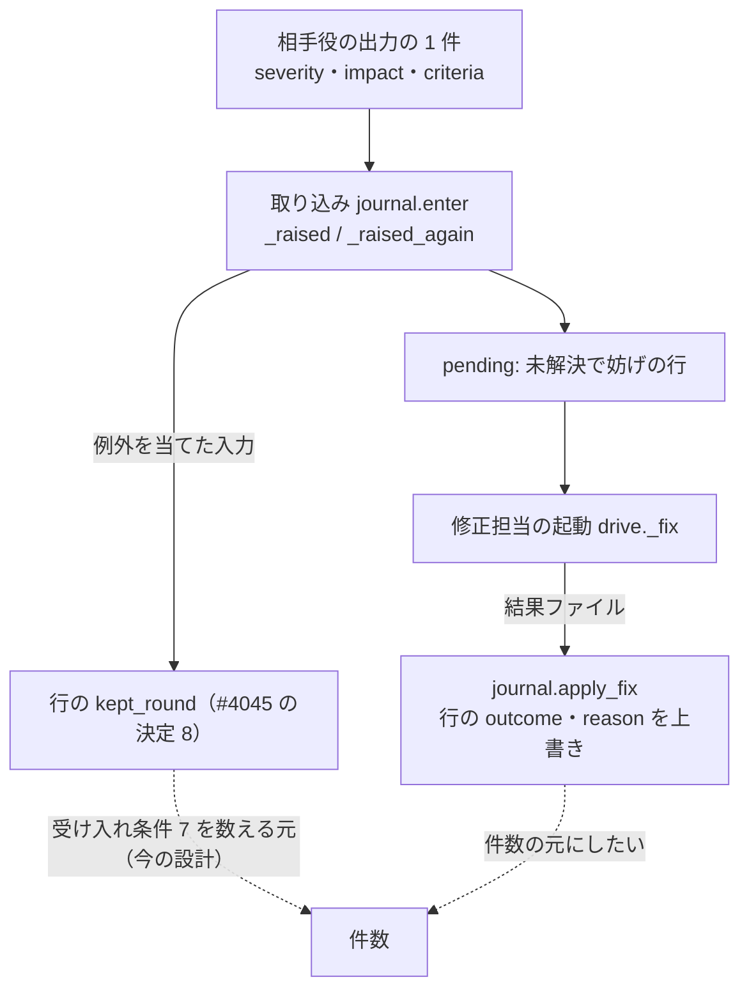
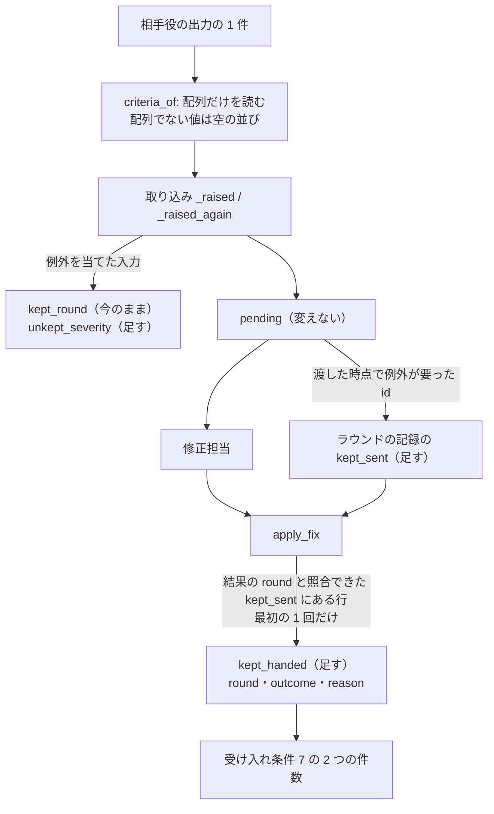

# #4045 の設計: 単一値の criteria を基準 2 と読まず、例外で実際に渡した回だけを数える（#4084）

#4045 の設計（PR #4080）は、配列でない `criteria` の扱いが要求と食い違い、受け入れ条件 7 を数える `kept_round` が例外無しでも渡る行・渡らない行まで数える。`criteria` は配列だけを読むと決めて要求に合わせ、例外を当てた記録（`kept_round`）とは別に、例外が無ければ渡らなかった行を修正担当へ渡して結果を受けた回の記録（`kept_handed`）を足し、受け入れ条件 7 はこちらで数える。置き換える #4045 の節と決定は「#4045 の文書のどこを置き換えるか」に、採らなかった案は「決定の記録」にある。

## 今の姿

何が起きたか・目的・受け入れ条件は要求仕様（[issue-4084-requirements.md](./issue-4084-requirements.md)、正は #4084 の本文）にある。直す対象は #4045 の設計文書 [issue-4045-design.md](./issue-4045-design.md) と詳細設計 [issue-4045-design-detail.md](./issue-4045-design-detail.md) で、従う要求は [issue-4045-requirements.md](./issue-4045-requirements.md)（前提 2・受け入れ条件 3・7）である。前提にするコードは #4045 と同じく `sprint/p12-lcrfast-r1`（head `68d887913`）の形である。

今の設計の数え方が外れる経路は 3 つで、どれも「例外を当てた入力の記録」と「例外によって修正担当へ渡した記録」を 1 つの項目（`kept_round`）で兼ねることが原因である。

| 経路 | 行の扱い（スプリントブランチのコード） | 今の設計の数え方 |
| --- | --- | --- |
| 同じラウンドに別の相手役が同じ指摘を `impact` 付きの `major` で返す | 例外が無くても `major` で妨げになり、修正担当へ渡る | 例外の効果として「下げずに渡した件数」に入る |
| 見送り済みの行へ同じ指摘が基準 2・`impact` 無しで出し直される | `enter` は `_raised_again` を呼ぶが、終わり方は見送りのまま。`pending` は未解決の行しか選ばないので渡らない | 渡した件数と見送った件数の両方に入り、前の見送りの理由が今回の判断として読まれる |
| 修正担当が結果を返さずにラウンドが終わる（`_fix` が None・中断） | `apply_fix` が呼ばれない | 渡した件数に入る |
| 例外で渡して直した行が、後のラウンドで別の理由で見送られる | 行の `outcome`・`reason` は最後の結果で上書きされる | 例外で渡した回の結果でなく、後の回の見送りが数えられる |

`criteria` の単一値は、要求の前提 2（形が違う値は基準 2 に当たらない）と、詳細設計の `criteria_of`（整数か文字列の 1 つを要素 1 つの配列と読む）が食い違う。

## 文脈と制約

- #4045 の要求仕様（正は #4045 の本文）は変えない。食い違いは設計の側を要求へ合わせる（#4084 の前提 1）
- 直す文書は #4045 の設計文書と詳細設計で、#4045 は実装の前である。`issues/issue-4045-*` はこの PR で書き換えず、#4045 の実装の PR でこの設計に合わせて直す
- #4045 のほかの決定（1・3〜7）と、#4076・#4013 との持ち物の分け方（#4045 の決定 6）は変えない
- 決定の根拠に引く MVV の項目は main の `.ndf/mvv.md`（MVV バージョン 11）にある
- この文書の「相手役」は cross-review で差分を読んで指摘を返す AI（codex・kiro）、「基準 2」は指摘の基準のうち秘密・認証認可・利用者のデータ・戻せない操作に触れるもの、「1 文」は指摘の項目 `impact`（起きることの 1 文）、「妨げになる重さ」は収束を止める重要度（`critical`・`major`）を指す
- この文書の「例外」は、#4045 の「1 文（`impact`）が無くても基準 2 の重い指摘を下げない」規則を指す。「例外を当てない重さ」は、同じ入力を基準の並び無しで `effective_severity` に通した重さを指す

## 解き方の全体像

- `criteria_of` は配列だけを読み、配列でない値（整数 `2`・文字列 `"2"` を含む）は空の並びにする。配列の要素は今のとおり整数と文字列を受ける（決定 1）
- 取り込みは今のとおり例外を当てた入力に `kept_round` を置く。同じ行に、例外を当てない重さを入力ごとに重ねた `unkept_severity` を持たせる（決定 2）
- 修正担当を起動する前に、そのラウンドで実際に渡した指摘（`pending` が返した行）のうち、渡した時点で例外が要った（`kept_needed`）行の id をラウンドの記録の `kept_sent` に残す。修正担当には結果ファイルへ起動したラウンドの番号（`round`）を書かせる。結果を生成した起動のラウンドは、駆動の中では起動したラウンド、駆動の外で残った結果（起動時の自動取り込みと `merge-fix`）では結果の `round` で決める。結果を取り込むとき（`apply_fix`）、そのラウンドの記録の `kept_sent` に行の id があれば、その回のラウンド・終わり方・理由を `kept_handed` に置く。取り込む時点の行の状態では決めない。置くのは最初の 1 回だけである（決定 2・3・5）
- #4076 が MVV の識別子の違う見送りの出し直しを今回の申告だけで再判定するとき、判定用の `unkept_severity`・`kept_round` も今回の入力だけから置き直す。既に置いた `kept_handed` は履歴として残す（決定 4）
- `kept_needed` は、#4076 が MVV の指摘として `major` 以上に固定した行（`mvv_pinned`）を、例外が無くても渡る行として偽にする。レッドラインの行は #4076 が `pending` から外すので `kept_sent` に入らない（決定 4）
- 受け入れ条件 7 の「下げずに渡した件数」は `kept_handed` を持つ行の数、「見送った件数」はそのうち `kept_handed.outcome` が見送りの行の数で、理由は `kept_handed.reason` を読む（決定 3）

## データ構造

状態ファイル（`cross-review-pr<元の番号>-state.json`）のジャーナルの行（`findings[]`）に、#4045 が足す `criteria`・`kept_round` に加えて 2 つの項目を、ラウンドの記録（`rounds[]`）に 1 つの項目を、修正担当の結果ファイルに 1 つの項目を足す。

| 項目 | 置き場 | 型 | 置く条件 | 中身 |
| --- | --- | --- | --- | --- |
| `kept_round`（#4045 のまま） | 行 | 整数 | 取り込みか出し直しの入力に例外を当てたとき。行が既に持てば置き直さない。ただし #4076 の MVV の識別子の違う見送りの再判定では、今回の入力に例外を当てれば今回のラウンドで置き直し、当てなければ消す | 例外を初めて当てた入力のラウンドの番号。修正担当への添え書き（`kept_without_impact`）だけが読み、受け入れ条件 7 では数えない |
| `unkept_severity`（足す） | 行 | 尺度の値 | `kept_round` を初めて置くとき。以後は行へ入る入力ごとに更新する。#4076 の MVV の識別子の違う見送りの再判定では、今回の入力だけから置き直す | 行へ入った入力を例外を当てずに重ねた重さ。初めて置くときは、その入力の前の行の `severity`（新しい行なら無し）と、その入力の例外を当てない重さの重い方。以後の入力では、今の値とその入力の例外を当てない重さの重い方。MVV の再判定では、前の値と前の行の `severity` を捨て、今回の入力に例外を当てればその入力の例外を当てない重さを置き、当てなければ消す |
| `kept_handed`（足す） | 行 | オブジェクト `{"round": 整数, "outcome": 終わり方, "reason": 文字列 か null}` | 修正担当の結果を取り込むとき、結果を生成した起動のラウンドの記録の `kept_sent` に行の id があり、行がまだ持たないとき | 例外によって修正担当へ渡し、結果を受けた最初の回の、渡したラウンド（結果を生成した起動のラウンド）の番号・修正担当が返した終わり方（`fixed` か `deferred`）・理由。後のラウンドの結果でも、MVV の再判定でも書き換えない（履歴） |
| `kept_sent`（足す） | ラウンドの記録 | 文字列の配列 | 修正必須の判定で修正担当を起動する前（状態ファイルへ書く前） | そのラウンドで修正担当へ渡した指摘（`pending` が返した行。足すべき内容は含まない）のうち、渡した時点で `kept_needed(row)` が真の行の `id` |
| `sent_mvv`（#4076 との統合で足す） | ラウンドの記録 | 文字列 | `kept_sent` と同じ時点。#4076 の実装が入った後だけ書く | 修正担当を起動した時点の MVV の識別子（#4076 の「今回の識別子」）。外から取り込む結果の見送りを、この識別子に帰属させる（決定 5） |
| `rejudged_round`（#4076 との統合で足す） | 行 | 整数 | #4076 の MVV の識別子の違う見送りの再判定で、`unkept_severity`・`kept_round` を置き直す同じ分岐 | 行を新しい識別子で再判定したラウンドの番号。これより前のラウンドで起動した修正担当の結果は、行の終わり方を上書きしない（決定 5） |
| `round`（足す） | 修正担当の結果ファイル | 整数 | 修正担当が結果を書くとき（指示の JSON の形に起動したラウンドの番号を値で埋めて渡す） | 結果を生成した修正担当の起動のラウンドの番号。読むのは駆動の外で残った結果を取り込む 2 つの経路（起動時の `_ingest_pending` と `merge_fix`）だけで、駆動の中の `_fix` は読まずに起動したラウンドを使う。外からの取り込みで無い・整数でない・その番号のラウンドの記録が無い結果は、照合できない結果として扱う（決定 5） |

`unkept_severity` を `kept_round` の無い行に置かないのは、例外を当てていない行では例外を当てない重さが `severity` と常に等しいためである。`kept_round` を置く前の入力は例外を当てずに入っているので、その時点の行の `severity` が、それまでの入力を例外を当てずに重ねた重さになる。

例外で渡したかは、行の状態から推さずに、渡した時点の `kept_sent` と、結果を生成した起動の照合で決める。`pending` が何を渡すかは #4076 が変える（レッドラインの行を外す）ので、行が未解決で妨げの重さを持つことは渡した証拠にならない。取り込む時点の行の `unkept_severity` は渡した後の入力で変わる（旧ラウンドでは例外で渡した行が、次のラウンドで根拠付きの `major` になる）ので、取り込む時点の `kept_needed` でも決めない。修正担当が渡していない id の結果を返しても、`kept_sent` に無ければ `kept_handed` を置かない。駆動の中の `_fix` は起動の前に残りの結果ファイルを退避するので、起動の後にある結果はその起動のもので、結果の `round` を読まずに起動したラウンドの `kept_sent` を使う（結果の `round` が無い・起動したラウンドと違っても同じ）。駆動の外で残った結果を取り込む 2 つの経路（`run` の起動時の `_ingest_pending` と `merge_fix`）は、結果ファイルの `round` と同じ番号のラウンドの記録の `kept_sent` を読む（最後のラウンドとは限らない。同じ id が複数のラウンドの記録にあっても、照合したラウンドだけを読む）。照合できない結果（`round` が無い・その番号の記録が無い）と、`kept_sent` の無いラウンドの記録（この項目を足す前の版で書いた状態ファイル）では空として読み、`kept_handed` を置かない（数え落とすのは版を跨いだ 1 ラウンドと、修正担当が指示の番号を書き損じて駆動の外に残った結果だけである）。見送り済みの行（終わり方が `deferred`）は `pending` に選ばれず `kept_sent` に入らないので、出し直しで `kept_round` が付いても `kept_handed` は付かない。

## 決定の記録

### 決定 1: 要求と詳細設計を 1 通りに読めるよう、`criteria` は配列だけを読み、配列でない値は空の並びにする

- **質問**: 配列でない `criteria`（整数 `2`・文字列 `"2"`）を、要素 1 つの配列と読むか、形が違う値として空の並びにするか
- **選んだ案**: 配列だけを読む。配列でない値はすべて空の並び（基準 2 に当たらない指摘）にする。配列の要素は今の #4045 の詳細設計のとおり、真偽値を除く整数と、前後の空白を除いた文字列を受ける
- 採らなかった案: 要素 1 つの配列と読み、#4045 の要求の前提 2・受け入れ条件 3 を書き換える（要求の正は #4045 の本文で、承認済みの要求を設計の直しで変えることになる。相手役への指示は配列の形だけを示すので、1 つの値は指示に従わなかった出力であり、そのような出力を広く受けるほど、#4014 の設計が退けた危険（1 文を書かずに基準 2 と名乗る指摘が止める側に残る）の入口が増える）
- 採らなかった案: 配列でない値を読んだら注意に載せる（#4045 の異常系の表は `criteria` の形の違いを注意に載せないと決めており、`impact` の欠けと同じ扱いをそろえる）
- **代償**: 相手役が基準 2 の指摘を `"criteria": "2"` と書き損じ、さらに 1 文も書かなければ、その指摘は `minor` へ下がる。2 つの書き損じが重なった場合に限る
- 根拠: Value 3「判断の要らない手順は仕組みが進めるので、結果が実行ごとにばらつかない」・Value 11「同じ規則・定数・処理は 1 か所にまとまり、ほかはそこを参照する」（MVV バージョン 11）

### 決定 2: 例外の効果だけを数えるため、例外を当てない重さを行に重ね、修正担当へ渡した時点で例外が要ったかを決める

- **質問**: 「例外によって修正担当へ渡した」を、行の何から決めるか
- **選んだ案**: `kept_round` を初めて置くときに、行へ `unkept_severity`（例外を当てない重さ）を置き、以後の入力ごとに重い方へ更新する。修正担当へ渡す時点（修正担当を起動する前）に、`unkept_severity` が妨げにならない重さで、ほかの規則（#4076 の MVV による固定）でも妨げにならない行だけを「例外が要った行」とし、その id をラウンドの記録に残す（決定 3・5）。判定は純粋な関数 `criteria_decide.kept_needed(row)` の 1 か所に置く（決定 4）
- 採らなかった案: 行が 1 文（`impact`）を持たないことで決める（別の相手役が同じ指摘を `impact` 付きの `minor` で返すと行は 1 文を持つが、妨げの重さは例外だけから来ており、例外の効果を数え落とす）
- 採らなかった案: 取り込みを終えた時点で、そのラウンドの入力だけを例外無しで重ね直す（`enter` に渡す入力の並びをラウンドの終わりまで持ち回る必要があり、前のラウンドから引き継いだ行の重さを足し損なう。行に 1 つの値を重ねれば、ラウンドを跨いでも同じ規則で決まる）
- 採らなかった案: `raised_severity`（相手役が付けた元の重要度）で決める（元の重要度は下げる前の値で、例外を当てない重さとは違う。引き継いだ行は `raised_severity` を持たない）
- **代償**: ジャーナルの行の項目が 1 つ増える。`kept_round` の無い行には置かないので、例外を当てない行の形は #4045 と変わらない
- 根拠: Value 3「判断の要らない手順（…集計…）は仕組みが進めるので、結果が実行ごとにばらつかない」・Value 13「効果は実測（費用・秒・件数）で示され」（MVV バージョン 11）

### 決定 3: 受け入れ条件 7 が渡した回の判断だけを数えるよう、修正担当の結果を取り込むときに `kept_handed` を 1 回だけ置く

- **質問**: 「下げずに渡した件数」と「そのうち見送った件数」を、どの記録から数えるか
- **選んだ案**: `drive._round` が修正担当を起動する前に、`pending` が返した行のうち `kept_needed` が真の行の id をラウンドの記録の `kept_sent` に書く。`journal.apply_fix` が結果を取り込むとき、結果を生成した起動のラウンドの `kept_sent` に行の id があり（決定 5）、`kept_handed` をまだ持たなければ、`kept_handed` に `{"round": 渡したラウンド, "outcome": 修正担当が返した終わり方, "reason": 理由}` を置く。受け入れ条件 7 は `kept_handed` を持つ行の数と、そのうち `kept_handed.outcome` が `deferred` の行の数で数え、見送りの理由は `kept_handed.reason` を読む。`kept_round` は添え書きのためだけに残す
- 採らなかった案: #4045 の決定 8 のまま `kept_round` で数える（「今の姿」の表の 4 つの経路で件数が例外の効果より多く出る）
- 採らなかった案: 修正担当への指示を組むとき（`pending` の後）に行へ渡した印を置く（起動が結果を返さずに終わった回も数える。結果を受けた回だけが受け入れ条件 7 の「渡して、直すか見送った」に当たる。`kept_sent` はラウンドの記録に置き、結果を受けたときだけ行へ写す）
- 採らなかった案: 渡した集合を記録せず、取り込む前の行が未解決で妨げの重さを持つことで渡したと推す（#4076 は `pending` からレッドラインの行を外すので、修正担当がレッドラインの id の結果を返すと、渡していない行を数える。`pending` の選び方が変わるたびに推し方が外れる）
- 採らなかった案: `kept_handed` を最後の回の結果で書き換える（後のラウンドで例外と関係の無い理由で見送られると、例外で渡した回の判断が消える）
- 採らなかった案: 修正担当の結果に基準 2 に当たるかの判断を書かせる（#4045 の決定 8 と同じ理由で採らない。見送りの理由は `kept_handed.reason` に残る）
- **退けた理由が成り立たなくなった**: #4045 の決定 8 は、修正担当が結果を返したラウンドを残す案（`kept_handed_round`）を「稀な経路のためだけの項目」として、終わり方と判断の組を残す案（`kept_result`）を「終わり方は行の `outcome` が既に持つ」として退けた。#4082・#4083・#4087 の cross-review が示したとおり、同じラウンドの重なり・見送り済みの出し直し・結果の無い起動・後のラウンドの上書きはどれも普通のラウンドで起きるので、2 つを 1 つの項目にまとめて採る
- **代償**: `apply_fix` が行の項目を 1 つ書き、ラウンドの記録に `kept_sent` が 1 つ増える。`apply_fix` のシグネチャに渡した id とそのラウンドの名前付き引数が、`drive._fix_record` にラウンドの記録の並びと起動したラウンドの引数が、`drive._take_fix` に起動したラウンドの引数が増え、`drive._fix`・`drive._ingest_pending`・`drive.merge_fix` がそれを渡す。`drive._fix_prompt` は引数にラウンドの番号を足す。修正担当の結果ファイルに `round` が 1 つ増える（決定 5）。駆動の外で結果をマージする `merge_fix` も `apply_fix` を通るので、同じ規則で置かれる
- 根拠: Value 13「効果は実測（費用・秒・件数）で示され」・Value 3「判断の要らない手順（…集計…）は仕組みが進めるので、結果が実行ごとにばらつかない」・Value 9「まだ要らない仕組みは先回りして作らず、後から足せる土台に留める」（MVV バージョン 11）

### 決定 4: #4076 と同時に入っても例外の効果だけを数えるため、MVV による固定を `kept_needed` で読み、MVV の再判定では判定用の項目を置き直す

- **質問**: #4076（各工程が MVV に従ったかを確かめる）は、有効な `P`・`C` を挙げた指摘をレッドラインとして `pending` から外し、有効な `Value`・`Vision`・`Mission` を挙げた指摘を `major` 以上に固定して `effective_severity` を当てない（`mvv_pinned`）。基準 2 と有効な `Value` を併記した `impact` の無い `major` は、例外が無くても `major` で渡る。どちらの実装が後に入っても、この行に `kept_handed` を付けないには何で決めるか
- **選んだ案**: `kept_needed(row)` は、行の `mvv_pinned` が真なら偽を返す（MVV による固定は例外を当てない重さの一部として扱う）。`unkept_severity` は基準 2 の例外だけを外した重さで、MVV による固定は行の `mvv_pinned` から `kept_needed` が読む。レッドラインの行は `pending` に選ばれないので `kept_sent` に入らず、`kept_handed` は付かない（決定 3）。#4076 が MVV の識別子の違う見送りの出し直しで行の旧い分類と重要度を消して今回の申告だけで置き直すとき、判定用の `unkept_severity`・`kept_round` も同じ時点で消し、今回の入力だけから置き直す（今回の入力に例外を当てれば、`unkept_severity` はその入力の例外を当てない重さ、`kept_round` は今回のラウンド。当てなければ両方とも無し）。同じ分岐で行の `rejudged_round` に今回のラウンドを置く（決定 5 の古い結果の判別に使う）。`kept_handed` は消さず履歴として残す（旧版で例外によって渡した回の判断は、版が変わっても受け入れ条件 7 の件数に残る）。置き直しは `_raised_again` の中の、#4076 が重要度を置き直す同じ分岐に置く（旧値を残すと、旧版の根拠付き `major` の再提示で `unkept_severity: major` を持つ行が、新版で基準 2・`impact` 無しの `major` として初めて結果を受けても数えられない）。#4045 の実装が先なら `mvv_pinned` を持つ行はまだ無く、#4076 の実装が書き始めた時点で効く。#4076 の実装が先なら、#4045 の実装が `kept_needed` を書くときに既にある項目を読む。どちらの順でも、後に入る PR は下の「テスト設計」の #4076 との統合の行を足す。`apply_fix` の呼び出し契約は、統合した後のシグネチャを `apply_fix(self, items, handed, round_no, *, mvv: Optional[str] = None, kept_sent: Collection[str] = (), sent_round: Optional[int] = None)` の 1 つに揃える。#4076 の `mvv` と、この設計の `kept_sent`・`sent_round` はどれも `*` の後ろの名前付きだけの引数にし、呼び手（`drive._fix_record` の 1 か所）は名前を付けて渡す（#4076 の詳細設計は `mvv` を 4 番目の位置引数に書き、引数の足し方を実装で決めるとしているので、この形で決める。先に入る PR も名前付きだけで足す）。位置で渡すと、後から入った引数と取り違えて MVV の識別子を `kept_sent` に、id の並びを `mvv` に渡し、見送りの再判定と件数を壊すためである。後に入る PR は、1 件の見送り（`deferred`）を取り込むと同じ行に `skipped_mvv` と `kept_handed` の両方が保存されるテストを足す
- 採らなかった案: MVV の再判定でも `unkept_severity` の旧値を残し、重い方へ重ねる（#4076 が重要度の重ね合わせを当てない理由と同じく、旧版の基準で付いた重さが新版の判定を左右する。旧版の根拠付き `major` が残ると、新版の例外を数え落とす）
- 採らなかった案: MVV の再判定で `kept_handed` も消す（旧版で例外によって渡し、直すか見送った回は実際に起きた判断で、版が変わっても受け入れ条件 7 の件数から消える理由が無い）
- 採らなかった案: `_raised` が `unkept_severity` を置くときに MVV の固定も当てる（#4076 が識別子の変更で `mvv_pinned` を消して重さを置き直すとき、`unkept_severity` も同じ規則で置き直す必要があり、規則が 2 か所に分かれる）
- **代償**: `kept_needed` が #4076 の行の項目 `mvv_pinned` の名前に依る。#4076 がこの項目の名前か意味を変えるときは `kept_needed` も直す（#4076 の詳細設計の `_blocking` の行と同じ項目を読む）
- 根拠: Value 11「同じ規則・定数・処理は 1 か所にまとまり、ほかはそこを参照する」・Value 3「判断の要らない手順（…集計…）は仕組みが進めるので、結果が実行ごとにばらつかない」（MVV バージョン 11）

### 決定 5: 古い結果を取り込んでも例外で渡した回を数え違えないよう、結果ファイルに起動のラウンドを書かせ、渡した時点の `kept_sent` と照合する

- **質問**: 駆動の外で残った結果を `merge_fix`（`ndf cross-review merge-fix --file`）で取り込むとき、その結果がどの起動のもので、その起動に渡した時点で例外が要った行はどれかを、何から決めるか
- **選んだ案**: 修正担当への指示の JSON の形に、起動したラウンドの番号を値で埋めた `"round": <n>` を足し、修正担当はそのまま結果ファイルへ書く。`_round` は渡す時点で `kept_needed` が真の行の id を `kept_sent` に書く（#4076 の実装の後は、起動の時点の MVV の識別子を `sent_mvv` に書く）。結果を取り込む経路は 3 つあり、どれも `drive._fix_record` の 1 か所で「どのラウンドの起動の結果か」を決め、そのラウンドの記録の `kept_sent`・`sent_mvv` と番号を `apply_fix` へ名前付きで渡す
  - 駆動の中（`_fix`）: 起動の前に残りの結果ファイルを退避するので、起動の後の結果はその起動のものである。結果の `round` は読まず（無い・起動したラウンドと違っても）、起動したラウンドを使う。修正担当が番号だけを書き損じた結果で、実際に渡した回を数え落とさないためである
  - 起動時の自動取り込み（`_ingest_pending`。前の起動で修正担当が結果を書いた直後に駆動が止まり、`run` を打ち直したとき）と `merge_fix`: 結果の `round` と同じ番号のラウンドの記録を探して使う。照合できなければ（`round` が無い・整数でない・その番号の記録が無い）、照合できない結果として扱う
  - MVV の識別子の帰属（#4076 との統合）: 見送りの `skipped_mvv` には、取り込む時点の識別子でなく、照合したラウンドの `sent_mvv`（その結果を生成した起動の識別子）を書く。行の `rejudged_round` が照合したラウンドより大きい（結果を生成した起動の後に、行を新しい識別子で再判定した）とき、その結果は行の終わり方・理由・`skipped_mvv` を上書きしない（`kept_handed` は決定 4 のとおり履歴として置く）。照合できない結果は、`skipped_mvv` を書かず（どの版の見送りにも帰属させない。#4076 の `skipped_texts`・`disputed` に載らず、出し直しを抑えない）、`rejudged_round` を持つ行の終わり方を上書きしない（古さを判別できないため）。`sent_mvv` の無いラウンドの記録（#4076 の前の版）と照合した結果も、`skipped_mvv` を書かない
  - 終わり方と理由の取り込みと、`fix` の記録を最後のラウンドに置く今の振る舞いは、上の上書きしない場合を除いて変えない
- 採らなかった案: 最後のラウンドの `sent` と取り込む時点の行の `kept_needed` で決める（前の形。旧ラウンドで例外によって渡した行が次のラウンドで根拠付きの `major` になった後に旧ラウンドの結果を取り込むと、例外で渡した回を数え落とす。同じ id が複数のラウンドで渡ると、どの回の結果か判別できない）
- 採らなかった案: 結果ファイルのパスをラウンドごとに分ける（`merge-fix --file` は利用者が任意のパスを渡せるので、パスの名前は結果の出どころの証拠にならない。ファイルの中身に書けば、移されても読める）
- 採らなかった案: 結果の `round` が照合できないときに最後のラウンドへ寄せて数える（数え違いが件数へ入る。照合できない結果で数え落とすのは、修正担当が指示の番号を書き損じた回だけである）
- 採らなかった案: 駆動の中でも結果の `round` を起動したラウンドと照合し、違えば `kept_handed` を置かない（退避の後の結果は起動のものと決まっているので、照合は書き損じで数え落とす経路を増やすだけである）
- 採らなかった案: 外から取り込む見送りの `skipped_mvv` を取り込む時点の識別子で書く（旧版の起動が返した見送りが新版の `disputed` に載り、次のレビューの出し直しも抑えられる）
- 採らなかった案: 古い結果でも行の終わり方を上書きする（新版で再判定して未解決に戻した行が旧版の見送りで閉じ、新版の判断を経ずに収束する）
- **代償**: 修正担当の結果ファイルの形に `round` が 1 つ増える。`store.read_fix_result` の番号の照合（`pr`）は変えず、`round` が無い・違う結果も読み込みは止めない（直した・見送ったを失わない）
- 根拠: Value 3「判断の要らない手順（…集計…）は仕組みが進めるので、結果が実行ごとにばらつかない」・Value 13「効果は実測（費用・秒・件数）で示され」（MVV バージョン 11）

## 影響と危険

- **働く範囲**: この PR は設計文書だけで、振る舞いは変わらない。#4045 の実装の後は、利用先のリポジトリでも `ndf cross-review run` を打つすべての PR のレビューに効く
- **プロジェクトごとに違うもの**: 無い（#4045 と同じく NDF の契約とコードが持つ）
- **当たるモード**: cross-review を通すすべてのモード
- **#4045 の文書との食い違い**: この PR のマージから #4045 の実装の PR までの間、`issues/issue-4045-*` は直す前の中身のまま残る。#4045 の実装は、この設計を先に読んで #4045 の文書を「#4045 の文書のどこを置き換えるか」の表のとおり直してから実装する。#4045 の要求仕様の写しに、この課題への参照を足す必要は無い（要求は変わらない）
- **実装の順**: #4045 の実装と同じ PR で入れる。#4045 の実装の起点（`sprint/p12-lcrfast-r1` が main へ入った後の main）は変えない
- **同じファイルを触る別の変更**:
  - #4076・#4090（レーン lcrfast）: `journal`（`_raised`・`ingest`・`pending` が使う `_blocking`）と `review-criteria.json` を触り、レッドラインの行を `pending` から外し、MVV の指摘を `mvv_pinned` で `major` 以上に固定する。この設計が足すのは `apply_fix` の `kept_handed` と `criteria_decide.kept_needed` と行の 2 項目とラウンドの記録の `kept_sent` と結果ファイルの `round` で、#4045 の決定 6 の持ち物の分け方は変えない。統合の規則は決定 4 のとおりで、後に入る方が `kept_needed` の `mvv_pinned` の読みと、MVV の再判定での `unkept_severity`・`kept_round` の置き直しと、「テスト設計」の #4076 との統合の行を落とさない
  - #4013（修正担当の会話を続ける）: `drive._fix_prompt` と修正担当の起動を触る。この設計は `drive._fix` の引数の受け渡し（起動したラウンドを `_take_fix` へ）と、`_fix_prompt` の結果の JSON の形に `round` を足すことだけを触り、指示の文と起動の形は変えない
- **壊れうる箇所**: `kept_sent` は `pending` が返した行の id だけから作り、修正担当の指示に載せた行と同じ並びを読む。指示を組む関数（`_fix_prompt`）と `kept_sent` を作る箇所が別の並びを読むようになると食い違うので、どちらも `_round` の同じ `open_` から作る
- **用語集**: 足す語は無い

### 代表のリポジトリでの振る舞い

| 代表のリポジトリ | 設定の要点 | 直した後に起きること | この種類で扱えなくなること |
| --- | --- | --- | --- |
| Web サービス（nd-factory） | 実装とリファクタリングの PR を cross-review が見る | #4045 の実装の後、基準 2 で下げずに渡した件数が、例外が要った行を実際に渡した回だけで数えられる。`criteria` を 1 つの値で書いた指摘は基準 2 に当たらない | 無し |
| モバイルアプリ | 同上 | 同上 | 無し |
| 業務文書だけ | 設計・文書の PR を cross-review が見る | 同上 | 無し |

### ai-plugins だけの事情

- 無し（規則と記録の形は NDF の契約とコードが持ち、このリポジトリの宣言の値を使わない）

## テスト設計

#4045 の実装の PR で縛る。受け入れ条件の番号は #4045 の要求仕様のものである。

| 受け入れ条件 | どの振る舞いで縛るか | どう壊したら落ちるべきか |
| --- | --- | --- |
| 3. 形が違う `criteria` の重い指摘は `minor` | 整数 `2`・文字列 `"2"`・`" 2 "` の単一値で、1 文の無い `major` が `minor` になり、行に `criteria` と `kept_round` が無い。配列 `[2]`・`["2"]` では今のとおり下げない | 単一値を要素 1 つの配列と読む |
| 7. 数える元の記録（同じラウンドの重なり） | 同じラウンドに、相手役 A が基準 2・`impact` 無しの `major`、相手役 B が同じ指摘を `impact` 付きの `major` で返す。行は修正担当へ渡り、結果を取り込んだ後も `kept_handed` が無い（`kept_round` はある） | 例外を当てた入力があれば渡した記録を置く |
| 7. 数える元の記録（見送り済みの出し直し） | 見送り済み（`deferred`）の行へ、同じ指摘が基準 2・`impact` 無しの `major` で出し直される。修正担当は起動されず、`kept_handed` が無い。行の `outcome`・`reason` は前の見送りのまま | 出し直しで `kept_round` が付いた行を渡したと数える |
| 7. 数える元の記録（結果の無い起動） | 例外が要った行を渡すラウンドで、修正担当が結果ファイルを書かずに終わる（`_fix` が None）。行に `kept_handed` が無い。次のラウンドで結果を受けると、そのラウンドの番号で置かれる | 渡そうとしただけで記録を置く |
| 7. 数える元の記録（渡した回の結果） | 例外で渡した行を修正担当が `deferred` で返すと `kept_handed` が `{"round": n, "outcome": "deferred", "reason": <理由>}` になる。`fixed` で返した行が後のラウンドで同じ指摘の `impact` 付きの出し直しで未解決へ戻り、`deferred` で返されても、`kept_handed` は最初の `fixed` の回のまま | 後のラウンドの結果で書き換える・最後の行の `outcome` で数える |
| 7. 数える元の記録（見送りは書き換わらない） | 見送り（`deferred`）の行は `pending` に選ばれず修正担当へ渡らないので、`kept_handed.outcome` が `deferred` の行は後のラウンドで終わり方が変わらない。上書きが起き得るのは `fixed` の後の再発だけで、上の行が縛る | 見送り済みの行を渡す |
| 7. 数える元の記録（引き継いだ行） | 前の実行から引き継いだ `minor` の行が、基準 2・`impact` 無しの `major` で出し直されて渡り、結果を受けると `kept_handed` が置かれる（`unkept_severity` は `minor`） | 引き継いだ行で例外の要否を決められない |
| 4. 修正担当への添え書き | `kept_without_impact` と `fixer_impact` は #4045 のまま。`kept_handed` の有無で添え書きが変わらない | 添え書きの判定が `kept_handed` を読む |
| 7. 数える元の記録（渡していない id） | 修正担当が、そのラウンドで渡していない行（`kept_sent` に無い。例外を当てた未解決の `major`）の id の結果を返しても、`kept_handed` が無い。`kept_sent` の無いラウンドの記録を `merge_fix` で取り込んでも置かない | 行の状態から渡したと推す |
| 7. 数える元の記録（旧ラウンドの結果を後から取り込む） | ラウンド 1 で例外が要った行を渡し（`kept_sent` に入る）、修正担当の結果（`round: 1`）が駆動の外に残る。ラウンド 2 で同じ指摘が根拠付きの `major` で再提示されて `unkept_severity` が `major` になり、行はラウンド 2 でも渡る（ラウンド 2 の `kept_sent` には入らない）。その後に `merge_fix --file` でラウンド 1 の結果を取り込むと `kept_handed.round` が 1 で置かれる。同じ行で `round: 2` の結果を取り込むと置かれない。`round` の無い結果・記録に無い番号の結果では置かれず、終わり方と理由は取り込まれる | 最後のラウンドの記録や取り込む時点の `kept_needed` で決める・照合できない結果を最後のラウンドへ寄せる |
| 7. 数える元の記録（駆動の中の起動と結果の対応） | `_fix` が、起動の前に残っていた結果ファイル（前のラウンドの `round`）を退避し、起動の後の結果をそのラウンドの `kept_sent` で取り込む。指示の JSON の形の `round` が起動したラウンドの番号になっている。起動の後の結果の `round` が無い・起動したラウンドと違う番号でも、`kept_handed.round` は起動したラウンドで置かれる | 残りの結果を今回の起動の結果として数える・駆動の中で結果の `round` を照合して数え落とす |
| 7. 数える元の記録（結果を書いた直後に止まって `run` を打ち直す） | ラウンド 1 で例外が要った行を渡し、修正担当が結果（`round: 1`）を書いた直後に駆動が止まる。`run` を打ち直すと、起動時の `_ingest_pending` が結果の `round` でラウンド 1 の `kept_sent` を読んで取り込み、`kept_handed.round` が 1 で置かれる。`round` の無い結果では止まらずに終わり方と理由を取り込み、`kept_handed` は置かれない | 起動時の取り込みが照合の引数を渡さずに止まる・空を渡して渡した回を数え落とす |
| 7. 数える元の記録（#4076 との統合。後に入る PR で足す） | 基準 2 と有効な `Value` を併記した `impact` の無い `major`（`mvv_pinned`）が渡り、結果を受けても `kept_handed` が無い。基準 2 と有効な `P` を併記した指摘（レッドライン）は `kept_sent` に入らず、修正担当がその id の結果を返しても `kept_handed` が無い。`kept_needed` の単体テストは、`mvv_pinned` が真の行で偽を返すことを #4045 の実装の PR で縛る | MVV の固定を例外の効果として数える・レッドラインを渡したと数える |
| 7. 数える元の記録（#4076 の MVV の再判定。後に入る PR で足す） | 旧版の識別子で、基準 2・`impact` 無しの `major` に例外を当てた行が、同じ指摘の根拠付きの `major` の再提示で `unkept_severity: major` になり、見送られる。MVV の版を上げ、同じ指摘が基準 2・`impact` 無しの `major` で再提示されると、行の `unkept_severity` は今回の入力の例外を当てない重さ（`minor`）に、`kept_round` は今回のラウンドに置き直される。行は渡って `kept_sent` に入り、初めて結果を受けると `kept_handed` が置かれる。旧版で既に `kept_handed` を持つ行では、再判定の後も旧い `kept_handed` が残り、置き直されない。今回の入力が根拠付きなら `unkept_severity`・`kept_round` は消える | MVV の再判定で `unkept_severity` の旧値を残す・`kept_handed` を消すか書き換える |
| 7. 数える元の記録（#4076 との統合の呼び出し契約。後に入る PR で足す） | 例外で渡した `mvv_pinned` でない行を修正担当が `deferred` で返すと、1 回の取り込みで同じ行に `skipped_mvv`（起動の時点の識別子）と `kept_handed`（`outcome: deferred`）の両方が保存される | `apply_fix` へ引数を位置で渡して取り違える・片方だけを保存する |
| 7. 数える元の記録（#4076 の旧版の結果を後から取り込む。後に入る PR で足す） | 旧版の識別子でラウンド 1 に例外が要った行を渡し、結果（`round: 1`・`deferred`）が駆動の外に残る。MVV の版を上げたラウンド 2 で同じ指摘が出し直されて行が再判定される（`rejudged_round: 2`）。その後に `merge_fix --file`（または `run` の打ち直しの `_ingest_pending`）でラウンド 1 の結果を取り込むと、`kept_handed.round` は 1 で置かれるが、行の終わり方は未解決のまま、`skipped_mvv` は書かれず、新版の `disputed` に載らない。再判定の無い行では見送りが取り込まれ、`skipped_mvv` はラウンド 1 の `sent_mvv` になる。`round` の無い結果の見送りは `skipped_mvv` を持たず、`rejudged_round` を持つ行の終わり方を変えない | 取り込む時点の識別子で見送りを帰属させる・旧版の結果で再判定した行を閉じる |

## どこを変えるか

詳細設計は [issue-4084-design-detail.md](./issue-4084-design-detail.md) にある（新設する関数 1（`criteria_decide.kept_needed`）と、シグネチャを変える関数 4（`journal.FindingJournal.apply_fix`・`drive._fix_prompt`・`drive._fix_record`・`drive._take_fix`）のため別ファイル。#4045 の詳細設計に対する変更として書く）。レビューの単位と実装計画は #4045 の実装に含める。

## #4045 の文書のどこを置き換えるか

#4045 の実装の PR は、次の表のとおり `issues/issue-4045-design.md` と `issues/issue-4045-design-detail.md` を直してから実装する。要求仕様（`issues/issue-4045-requirements.md`）は変えない。

| 文書 | 節・決定 | 今の中身 | 置き換えた後 |
| --- | --- | --- | --- |
| 設計文書 | 入出力のコントラクトの「`criteria` の値」の表 | 「文字列か整数の 1 つの値」を要素 1 つの配列と読む行がある | その行を消し、「無い・`null`・真偽値・オブジェクト・ほかの型」の行を「配列でない値（文字列か整数の 1 つの値・`null`・真偽値・オブジェクトを含む）か、無い」に置き換える（決定 1） |
| 設計文書 | 決定 2 の「選んだ案」 | 「整数と 1 つの値も受ける」 | 「配列の要素は整数も受ける。配列でない値は空の並びにする（要求の前提 2）」へ。採らなかった案に「1 つの値も要素 1 つの配列と読む」（理由は #4084 の決定 1）を足す |
| 設計文書 | 解き方の全体像の最後の箇条 | 受け入れ条件 7 を `kept_round` を持つ行と `outcome` が `deferred` の行で数える | `kept_handed` を持つ行と、そのうち `kept_handed.outcome` が `deferred` の行で数える |
| 設計文書 | データ構造の項目の表 | `criteria`・`kept_round` の 2 行 | `unkept_severity`・`kept_handed`・`kept_sent`・結果ファイルの `round` の 4 行を足し、`kept_round` の中身に「受け入れ条件 7 では数えない」と MVV の再判定での置き直しを足す（この文書の「データ構造」の表のとおり） |
| 設計文書 | 決定 8 | `kept_round` だけを残し、それで数える | #4084 の決定 2・3 で置き換える。#4045 の決定 8 の「採らなかった案」のうち `kept_handed_round`・`kept_result` を退けた理由は、#4084 の決定 3 の「退けた理由が成り立たなくなった」に移す |
| 設計文書 | テスト設計の受け入れ条件 3・7 の行 | 3: 形が違う値に単一値を含まない。7: `kept_round` の付き方を縛る | 3: 整数 `2`・文字列 `"2"` の単一値で `impact` の無い `major` が `minor` になることを足す。7: この文書の「テスト設計」の受け入れ条件 7 の行で置き換える |
| 設計文書 | 未確認のまま残ること | 件数を `kept_round` と `outcome` で数える | `kept_handed` で数える |
| 設計文書 | 設計の結果の触るファイル | 9 ファイル | `plugins/ndf/src/ndf/domains/crossreview/drive.py` と `plugins/ndf/tests/domains/crossreview/test_crossreview_store.py`（`merge_fix` のテスト）が 9 ファイルに無ければ足す |
| 詳細設計 | 地図の `journal.py` の行・関数の表 | `_raised`・`enter`・`_raised_again` | `apply_fix`（変更。名前付きだけの引数 `kept_sent`・`sent_round` を足す）を足し、`criteria_decide.py` の行に `kept_needed`（新設）を足す。`drive.py` の行（`_round`・`_fix`・`_fix_record`・`_take_fix`・`_ingest_pending`・`merge_fix`）を足す（[issue-4084-design-detail.md](./issue-4084-design-detail.md) の地図のとおり） |
| 詳細設計 | `criteria_of` の処理の手順の 2 行目 | 真偽値でない整数か文字列の 1 つを要素 1 つの配列と同じに読む | 消す。3 行目を「値が配列でない（整数・文字列・`null`・真偽値・浮動小数・オブジェクト）か、無い」→ 空の並びへ |
| 詳細設計 | `criteria_of` の単体テストの観点 | 正常に `"2"` → `("2",)` | 正常から外し、異常に `2`・`"2"` → 空を足す |
| 詳細設計 | ジャーナルの行の基準の並び（journal）の関数の表 | `_raised`・`_raised_again` が `kept_round` を置く | 同じ表に `unkept_severity` の置き方と `apply_fix` の `kept_handed` を足し、ラウンドの記録の `kept_sent` を書く・渡す `drive` の関数の行と、MVV の再判定での置き直しを足す（[issue-4084-design-detail.md](./issue-4084-design-detail.md) のとおり） |
| 詳細設計 | ラウンド全体（`test_crossreview_run.py`）の観点 | 例外で渡り `kept_round` が残る | この文書の「テスト設計」の #4045 の受け入れ条件 3・7 の行を足す |

## 設計の結果

| 課題 | 扱い | 統合先 | 触るファイル |
| --- | --- | --- | --- |
| #4084 | 実装する | #4045 の実装の PR | `plugins/ndf/src/ndf/domains/crossreview/criteria_decide.py`、`plugins/ndf/src/ndf/domains/crossreview/journal.py`、`plugins/ndf/src/ndf/domains/crossreview/drive.py`、`plugins/ndf/tests/domains/crossreview/test_crossreview_criteria.py`、`plugins/ndf/tests/domains/crossreview/test_crossreview_journal.py`、`plugins/ndf/tests/domains/crossreview/test_crossreview_run.py`、`plugins/ndf/tests/domains/crossreview/test_crossreview_store.py`、`issues/issue-4045-design.md`、`issues/issue-4045-design-detail.md` |

## 外部の調査

省く: #4045 の設計の外部の調査（SARIF・CWE・code scanning・CodeQL・Semgrep・SonarQube）で比べた形の中で、既に決めた記録の項目を数え方に合わせて分けるだけで、比べる新しい形が無い
