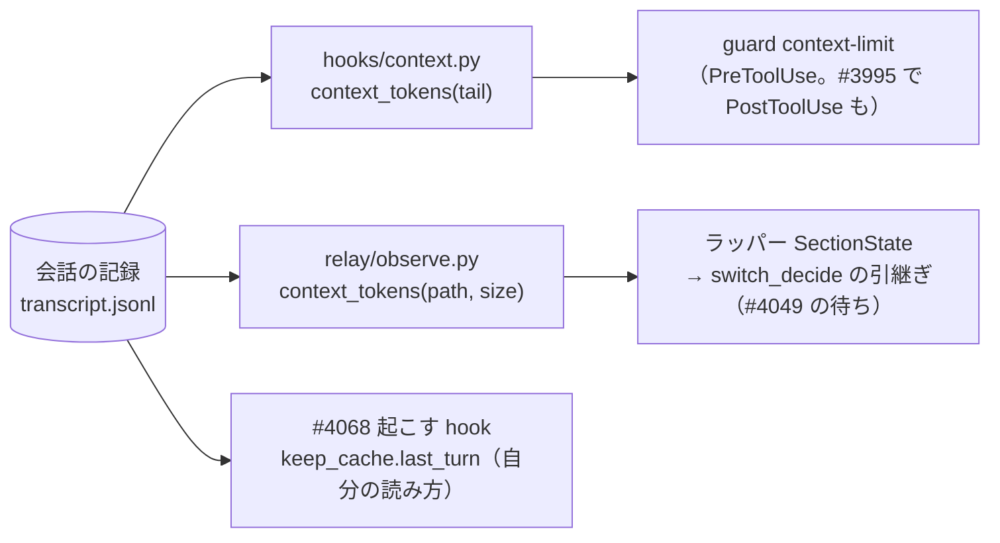
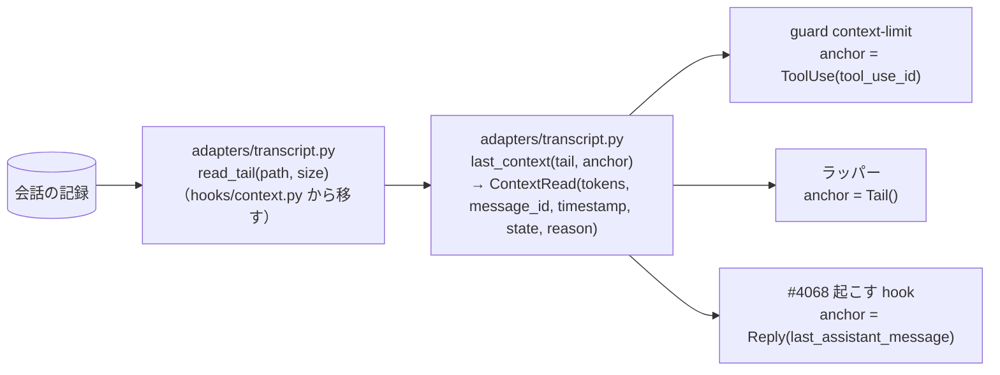
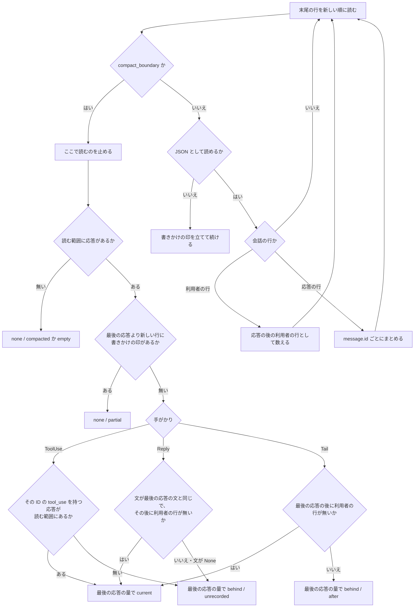

# 文脈の量の読み手: どの応答の量かと古さを返し、圧縮の前の量と合成の応答の 0 で判定しない（#4089）

hook の時点では今の応答がまだ会話の記録に無いことが多く、guard `context-limit` と中継のラッパーは、読んだ量が 1 つ前の応答のものか、圧縮の前の量か、API の失敗の 0 かを見分けられない（[要求](./issue-4089-requirements.md)）。読み手を 1 つの関数にまとめ、量とともに応答の ID・時刻・今の応答のものか（`current`・`behind`・`none`）を返し、呼ぶ側が必ず渡す手がかり（`tool_use_id`・`last_assistant_message`・無し）で今の応答を見分ける。古い量は今の量のほぼ下限として「上限以上」の判定に使い、圧縮の境は越えず、合成の応答は数えない。実測した版と結果は「測った結果」に、採らなかった案は各決定にある。

## 今の姿

要求と受け入れ条件は [issue-4089-requirements.md](./issue-4089-requirements.md) にある。パスは `plugins/ndf/src/ndf/` からの相対で書く（main の `ec8340675`）。

| 部品 | 今の振る舞い | 場所 |
| --- | --- | --- |
| hook の読み手 | 末尾から `"usage"` を含む行を探し、`message.usage` の 3 つの数の和を返す。量だけを返す | `domains/hooks/context.py` の `context_tokens` |
| ラッパーの読み手 | 同じ探し方を別に持つ。末尾 `size` バイトを読み、量だけを返す | `domains/relay/observe.py` の `context_tokens`・`_usage_total` |
| guard `context-limit` | PreToolUse で量が運用上限以上なら止める。#3995 の設計で、PostToolUse で判断開始の値以上を 1 度知らせ、PreToolUse が読んだ量を `tool_use_id` ごとに覚えて PostToolUse は読み直さない | `domains/hooks/guards/context_limit.py` |
| ラッパーの引継ぎ | 見回りごとに量を読み、量が上限以上で子が 5 秒静かなら引継ぎを求める。#4049 の設計で、その前に背景の作業の記録を読んで待つ | `domains/relay/wrapper.py`・`switch_decide.py` |
| #4068 の起こす hook（実装はこれから） | Stop の入力の `last_assistant_message` と最後の応答の文を照らし、違えば「今回の応答が未記録」として起こさない。読み方を自分で持つ | 詳細設計の `keep_cache.last_turn` |

## 文脈と制約

- **会話の記録は非同期に書かれ、hook の時点では今の応答を含まないことがある。** 公式の文書がそう書き（PRD1）、実測では Stop の 5 回すべてと PreToolUse の大半で今の応答が無かった（「測った結果」）。同じ版・同じ起動の形でも有無が変わるので、版の一覧では決まらない
- **hook の入力に応答の ID は無い。** 今の応答を一つに決める手がかりは、Tool の hook の `tool_use_id`（応答の `tool_use` の要素の `id` と同じ）と、Stop の `last_assistant_message`（今回の応答の文）だけである（PRD1）
- **会話の記録の形は公開の契約ではない**（#4068 の決定 4 と同じ立場）。形が違えば量を返さない側へ落ちる
- **圧縮の境をまたがない続く 2 つの応答の量は減らない。** このマシンの会話の記録の 125,537 組で、減ったのは 14 組、最大 8,014 token（前の量の 5% 未満）だった。古い量は今の量のほぼ下限になる
- **読み取りの回数を増やさない。** #3995 は PostToolUse の読み取りを省くために、PreToolUse の値を覚える仕組みを置いた（#3995 の決定 3）。この設計はその回数を変えない

## 解き方の全体像

実装を終えた後は、文脈の量を読む関数は `adapters/transcript.py` の `last_context` の 1 つだけになり、記録の末尾を読む `read_tail` も同じモジュールに移る。返り値は量と、その量を持つ応答の `message.id` と時刻、今の応答かの状態を持つ。呼ぶ側は手がかり（`anchor`）を必ず渡す。guard は `ToolUse`、#4068 の起こす hook は `Reply`、ラッパーは `Tail` である。guard とラッパーは、状態に関わらず量を「上限以上か」の判定に使う（古い量は今の量のほぼ下限）。量そのものを使う #4068 だけが `current` を求める。圧縮の境より前の量・合成の応答の 0・書きかけの行の向こうの量は、どの呼ぶ側にも届かない。

## データ構造

`Anchor`（`adapters/transcript.py`）は、今の応答を見分ける手がかりで、次の 3 つのどれかである。

| 種類 | 持つ値 | 渡す呼ぶ側 |
| --- | --- | --- |
| `ToolUse` | `tool_use_id: str` | guard `context-limit`（PreToolUse・PostToolUse の入力の `tool_use_id`） |
| `Reply` | `text: Optional[str]` | #4068 の起こす hook（Stop の入力の `last_assistant_message`。入力に無ければ None） |
| `Tail` | 無し | ラッパー（hook の入力を持たない） |

`ContextRead`（同じモジュール。凍結した dataclass）:

| 項目 | 型 | 意味 |
| --- | --- | --- |
| `tokens` | `Optional[int]` | 読んだ応答の文脈の量。`state` が `none` なら None |
| `message_id` | `Optional[str]` | 読んだ応答の `message.id` |
| `timestamp` | `Optional[str]` | 読んだ応答の最後の行の `timestamp`（記録のまま。比べる側が解く） |
| `state` | `str` | `current`（手がかりに合う今の応答か、それより後の応答）・`behind`（今の応答より前の応答）・`none`（量が無い） |
| `reason` | `Optional[str]` | `state` が `current` でない理由。`unrecorded`（手がかりに合う応答が無い）・`after`（`Tail` で、応答の後に利用者の行がある）・`compacted`（圧縮の境の後に応答が無い）・`partial`（応答より新しい行に、JSON として読めない行がある）・`empty`（末尾に応答が無い）・`form`（照らしを通った応答の `usage` の形が違う。照らしに外れた応答の形が違うときは、照らしの理由のまま `none`） |

読む単位の決まり:

- **会話の行**は、`type` が `user` か `assistant` で、`isSidechain` が真でない行である。会話でない行（`last-prompt`・`api-request`・`attachment` など）は飛ばす
- **応答**は、同じ `message.id` の `assistant` の会話の行のまとまりである。`message.model` が `<synthetic>` の行（合成の応答）は応答に数えず、飛ばす。応答の間に別の行が挟まっても、同じ `message.id` なら 1 つにまとめる。**最後の応答**は、最も新しい物理の行を持つ応答である。応答の時刻はその最後の物理の行の `timestamp`、文と `tool_use` の要素はまとまり全体からファイルの順に読む
- **利用者の行**は、`type` が `user` の会話の行のすべて（入力・Tool の結果・`isMeta` の行）である。どれも応答の後に足された文脈である
- **文脈の量**は、返す応答の `usage` の `input_tokens`・`cache_read_input_tokens`・`cache_creation_input_tokens` の和である。`usage` が object で `input_tokens` が整数であることを求め、2 つのキャッシュの項目は無ければ 0 とする。どれかが整数以外の値を持てば `form` である。`usage` を確かめるのは返す応答の 1 つだけで、照らしに外れた応答の形は見ない
- **読む範囲**は、最後の `system` の `compact_boundary` の行より後である

## 入出力のコントラクト

`last_context(tail: str, anchor: Anchor) -> ContextRead`

- 入力の `tail` は `read_tail` が返す文字列（先頭の切れた行を捨てた末尾）である。呼ぶ側が別の手段で読んだ文字列を渡さない
- 例外を投げない。ファイルを開かない（読み取りの回数は呼ぶ側が決める）

`read_tail(path: str, size: int) -> str` は今の `domains/hooks/context.py` の `read_tail` をそのまま移す。読めない（`OSError`）ときは空を返し、`last_context` は `none`（`empty`）を返す。

## 処理の流れ

`ToolUse` で、その Tool を呼んだ応答が記録にあれば、最後の応答はその応答かそれより後の応答で、今の量に最も近い。並列の呼び出し（1 つの応答の 2 つの `tool_use` が別々の行にある）でも、背景で動く Tool の PostToolUse が後の応答の後に来ても、同じ規則で決まる。`Reply` で「その後に利用者の行が無い」を求めるのは、同じ文の応答（#4068 の起床の返事「待機を続ける」）が続くとき、前の応答を今の応答と読まないためである。今の応答が未記録なら、前の応答の後には今の応答を起こした入力の行がある。

呼ぶ側の振る舞い:

| 呼ぶ側 | 手がかり | `current` | `behind` | `none` |
| --- | --- | --- | --- | --- |
| guard の PreToolUse（運用上限） | `ToolUse` | 量が上限以上なら止める | 同じ。上限未満なら止めない | 判定しない（今の None と同じ） |
| guard の PostToolUse（判断開始の値の知らせ。#3995） | PreToolUse が覚えた値を使う。覚えていなければ `ToolUse` で読む | #3995 の規則（`decide_from ≤ tokens < limit` で、利用者の入力ごとに 1 度）で知らせる | 同じ | 知らせない |
| ラッパーの引継ぎ（#3995・#4049） | `Tail` | 量が上限以上で静かなら今の判定へ進む | 同じ。上限未満なら次の見回りで読み直す | 求めない |
| #4068 の起こす hook | `Reply` | 今回の応答として量・時刻を使う | 一時的な失敗（今の「今回の応答が未記録」） | `form` は「記録の形が違う」。`compacted`・`partial`・`empty` は一時的な失敗 |

## 決定の記録

### 決定 1: 読み方の誤りを 1 か所で直すため、2 つの読み手を消して `adapters/transcript.py` の `last_context` 1 つにし、`read_tail` も移す

- **質問**: 文脈の量を読む関数をどこに幾つ置くか
- **選んだ案**: `adapters/transcript.py` を新設し、`last_context`・`Anchor`・`ContextRead` を置く。`domains/hooks/context.py` の `read_tail` を中身を変えずに移す。`domains/hooks/context.py` の `context_tokens` と `domains/relay/observe.py` の `context_tokens`・`_usage_total` を消す。guard は `ctx.transcript_tail`（`read_tail` の結果）を、ラッパーは `read_tail(path, size)` の結果を渡す。#4068 の `keep_cache.last_turn` は、今回の応答かの照らしと量の和をこの関数に任せ、寿命・モデルの読み取りだけを持つ
- 採らなかった案: `relay/observe.py` に置いて hook から読む。hook の層が中継のラッパーの部品を読むことになり、`observe.py` の責務（ラッパーが子の画面と記録から読む事実）を越える。今の 2 つを残して同じ直しを両方へ入れる案も採らない。同じ規則を 2 か所に持ち、片方だけ直される（今の姿がそれである）。ラッパーが今の `agents.tail` を使い続ける案も採らない。`agents.tail` は任意のバイトの位置から返し、先頭の切れた行を捨てず、`FileNotFoundError` 以外の読めない失敗を見回りへ投げる
- **代償**: 呼ぶ側の 3 つ（guard・ラッパー・#4068 の実装）が同じ関数の振る舞いの変化を受ける。テストの見本を 1 か所（`tests/adapters/test_transcript.py`）に集め、呼ぶ側のテストは状態ごとの振る舞いだけを見る
- **根拠**: Value 9（責務の分かれた設計）・Value 6（使うほど散らからない）。記録の形の読み方は Claude Code の外の形を読む部品であり、`adapters` の層に置く

### 決定 2: 呼ぶ側が古さを見分けるため、返り値に応答の ID・時刻・状態を持たせ、記録の行の位置は持たせない

- **質問**: 「どの応答の量か」を何で表すか
- **選んだ案**: `message_id`（`message.id`）・`timestamp`（その応答の最後の行の時刻）・`state`・`reason` を返す（「データ構造」）。古さの判定は関数の中で手がかりと照らして済ませ、呼ぶ側は `state` だけで分ける
- 採らなかった案: 記録の行の位置（末尾からの行の番号・ファイルの中のバイトの位置）。呼ぶ側ごとに読む末尾の大きさが違い（hook は 256 KiB、ラッパーは設定の値）、同じ応答でも値が変わる。比べる相手が無く、古さを決められない。時刻だけを返して呼ぶ側に比べさせる案も採らない。hook の入力に今の応答の時刻は無く、比べる基準が無い
- **代償**: `message_id` と `timestamp` を使うのは今は #4068 だけで、guard は判定の記録に `state` を残すだけである
- **根拠**: Value 8（正しいデータ構造）。古さは手がかりとの一致で決まる事実で、位置の数ではない

### 決定 3: 版の一覧に頼らず今の応答を見分けるため、呼ぶ側に手がかり（`ToolUse`・`Reply`・`Tail`）を必ず渡させて照らす

- **質問**: 今の応答が記録にあるかを、どう決めるか
- **選んだ案**: 手がかりを 3 つの種類の型（`Anchor`）にし、呼ぶ側が必ず 1 つ渡す。Tool の hook は `ToolUse`、Stop は `Reply`、ラッパーは `Tail` である。規則は「処理の流れ」のとおりで、`Reply` は #4068 の決定 4 の文の照らしに「その後に利用者の行が無い」を足したものである。`Reply` の文が None（Stop の入力に `last_assistant_message` が無い）なら `behind`（`unrecorded`）にする
- 採らなかった案: Claude Code の版ごとに「Stop の時点で記録にあるか」の一覧を持ち、無い版でだけ古いとする。実測では同じ版の同じ起動の形でも有無が変わり（2.1.330 の PreToolUse で有る回と無い回）、公式の文書も非同期の書き込みとしか書かない（PRD1）。一覧は事実を表せない。hook の中で記録が追いつくまで待ってから読む案も採らない。Tool の hook の予算の中で待つ時間を足し、待っても書かれる保証が無い。手がかりを省略できる引数（既定 None）にする案も採らない。`last_assistant_message` が欠けた Stop が、手がかり無しの規則に落ちて前の応答を `current` と読む
- **代償**: `Tail` は、利用者の行が書かれる前の短い間は今の応答を `current` と読む。ラッパーは子が 5 秒静かなときだけ量で判定するので、その間は判定に使われない
- **根拠**: Value 3（同じ手順は毎回同じ結果）。公式に無くても使える形は使い、形が違えば `none`・`form` へ落とす（起動指示・#4068 の決定 4 と同じ立場）

### 決定 4: 圧縮の後に圧縮の前の量で止めないため、`compact_boundary` の行で読むのを止め、合成の応答を数えず、書きかけの行の向こうを使わない

- **質問**: 圧縮の境・API の失敗の行・読めない行をどう扱うか
- **選んだ案**: 末尾から読んで最後の `system` の `compact_boundary` の行に会ったら止め、それより前の応答の量を返さない。境の後に応答が無ければ `none`（`compacted`）。`message.model` が `<synthetic>` の `assistant` の行は、量も持たず、手がかりの照らしにも数えない。最後の応答より新しい行に JSON として読めない行（末尾の書きかけ・壊れた行）があれば、その行が利用者の行か圧縮の境かを決められないので、`none`（`partial`）にする
- 採らなかった案: 境の行の `compactMetadata.postTokens` を量として返す。圧縮の後に API が数えた量ではなく、`usage` と同じ物差しかを確かめていない。次の応答で正しい量が来るので、その間は判定しないほうが誤らない。合成の応答の 0 を `none` として返す案も採らない。合成の応答の前の本当の応答の量は、文脈の下限として正しい。読めない行を飛ばす案（今の 2 つの関数の振る舞い）も採らない。書きかけの行が圧縮の境なら、圧縮の前の量を返す
- **代償**: 圧縮の直後、最初の応答が記録に書かれるまでの Tool の呼び出しは、guard が判定しない。圧縮の後の文脈は小さく（28 回の圧縮の後の量は 12,790〜35,349）、この 28 回の範囲では、その間に上限を越えることは無い。書きかけの行を読んだ判定も 1 回だけ判定しない
- **根拠**: Value 7（根本原因から直す）・Value 2（圧縮で減った文脈を捨てて引継ぎの費用を払わない）

### 決定 5: 判定を遅らせず読み取りも増やさないため、古い量を今の量のほぼ下限として「上限以上」の判定に使い、#3995 の覚えた値は状態ごと使う

- **質問**: 古い量（`behind`）のとき、#3995 の止め・知らせと、#4049 の前のラッパーの引継ぎはどうするか
- **選んだ案**: guard の PreToolUse は、状態に関わらず量が運用上限以上なら止め、上限未満なら止めない。PostToolUse の知らせは #3995 の規則（`decide_from ≤ tokens < limit` の帯で、利用者の入力ごとに 1 度）のまま、比べる量の状態を問わない。#3995 の PreToolUse が `tool_use_id` ごとに覚える値は `{"tokens": …, "state": …}` にし（#3995 の詳細設計の `{"tokens": …}` に `state` を足す）、PostToolUse はそれを使って読み直さない。`state` の無い値を取り出したときは `behind` とみなして同じに使う。ラッパーも状態に関わらず量が上限以上で静かなら今の判定（#4049 の待ちを含む）へ進み、上限未満なら次の見回りで読み直す。guard の判定の記録（`notes`）は、止め・知らせ・何もしないのどれでも `context_tokens` と `context_state` を持つ
- 採らなかった案: `behind` のときは判定しない。Stop と PreToolUse の大半で今の応答が無いので、運用上限の止めがほとんど働かなくなる。PostToolUse が、PreToolUse の値が `behind` のときに読み直す案も採らない。実測では 2 つ目以降の Tool の PreToolUse の多くが `behind` で、PostToolUse の読み取りが Tool の呼び出しごとに戻る（#3995 の決定 3 が省いた読み取り）
- **代償**: 古い量は厳密な下限ではない。圧縮の境をまたがずに量が減った組が 14 組あり（最大 8,014 token）、上限のすぐ上の古い量で止めたとき、今の量が上限の 8,014 token 下までにあることがある。運用上限 500,000 の 1.6% の幅で、引継ぎを 1 応答分早めるだけである。逆に、上限をまたいだ応答の Tool の呼び出しは、その応答を記録に読めない間は通る。止まるのは、その応答の量を `current` か `behind` で読んだ最初の判定である（続く 2 つの応答の量の差は中央 1,244・最大 83,623 token）
- **根拠**: Value 2（読み取りを増やさない）・Value 3（判定は記録の状態だけで決まる）

### 決定 6: 起こす費用を正しい量で決めるため、#4068 は `current` だけを今回の応答とし、照らした応答の形の違いだけを「記録の形が違う」にする

- **質問**: 量そのものを使う #4068 は、状態ごとにどうするか
- **選んだ案**: 起こす hook は `last_context(tail, Reply(<Stop の入力の last_assistant_message か None>))` を呼び、`current` のときだけ量を `S`、時刻を最後の応答の時刻として使う。`behind`・`compacted`・`partial`・`empty` は一時的な失敗（次の Stop で読み直す）で、`form` は「記録の形が違う」（会話で止める）とする。`form` は照らしを通った応答の `usage` の形の違いにだけ出るので、照らしに外れた前の応答の欠けで会話ごと止めることは無い。寿命（`usage.cache_creation`）とモデル（`message.model`）は `last_turn` が同じ `message_id` の行から読み、欠ければ「記録の形が違う」とする。#4068 の時刻の照らし（応答の時刻が hook の動き始めより後なら何も書かない）は `ContextRead.timestamp` で行う
- 採らなかった案: #4068 だけ読み方を自分で持ち続ける。照らしの規則が 2 か所に分かれ、片方の直しが届かない（決定 1）。照らしの前に `usage` の形を確かめる案も採らない。今回でない応答の欠けで会話ごと起こすのをやめる
- **代償**: #4068 の詳細設計の `last_turn` の「責務」の行は、照らしと量の和をこの関数に任せる形で実装する。シグネチャと返り値（`TurnRead`）は変えない。`Reply` に「その後に利用者の行が無い」を足したので、#4068 の決定 4 が心配した「同じ文の前の応答を今回の応答と読む」場合は `behind` になる
- **根拠**: Value 9。#4068 の決定 4 の規則を保ち、置き場を 1 つにする

### 決定 7: 利用者の全体の設計方針（#4069）と MVV に照らし、読み取りを増やさずに誤った引継ぎを無くす形にする

- **質問**: この設計は #4069 の方針（文脈は最適な量で再利用する・無駄な読み込みをしない・大きすぎる文脈は引継ぎで切る）と MVV 版 11 に合うか
- **選んだ案**: 合う。圧縮で小さくなった文脈を、圧縮の前の量で引継ぎへ送らない（最適な文脈量。Value 2）。古い量で「上限以上」を判定し、大きすぎる文脈を切る判定を弱めない。会話の記録の読み取りの回数は #3995 の設計のまま（無駄な読み込みをしない）。版の一覧を持たないので、Claude Code の版上げで設定を足さない（Value 3・Value 4）
- 採らなかった案: 今の応答が記録に書かれるまで hook が待つ。待ちを作らない方針（#4069）に反し、hook の予算を使う
- **代償**: 古い量の近さの幅（決定 5 の代償）の分だけ、引継ぎが 1 応答分早まることがある
- **根拠**: #4069 の「方針（利用者の原文）」と Value 2・3・4（MVV 版 11）

## 影響と危険

- **働く範囲**: NDF を入れたどのリポジトリでも働く（guard `context-limit` と中継のラッパー）。設定と引数は増えない。当たるモードは全モード（hook とラッパーはモードを見ない）
- **#3995 の実装と同じファイルを触る**: guard `context-limit` の `check` と、#3995 が足す `tool_use_id` ごとの覚えた値。#3995 の実装の中でこの関数へ置き換えるか、#3995 の後に続けて実装する。#3995 の知らせ（`advise`）に `notes` を載せるため、`verdict.advise` に `notes` の引数を足す（[詳細設計](./issue-4089-design-detail.md)）
- **#4068 の実装**: `keep_cache.last_turn` がこの関数を呼ぶ。#4068 を先に実装するなら、その中で `adapters/transcript.py` を作る
- **末尾に今の応答の行が入らないとき**: 大きな Tool の結果（256 KiB を超える）の後では、末尾に応答が無く `none`（`empty`）になる。今も None で判定しないのと同じである
- **形の変化**: Claude Code が `compact_boundary` や `<synthetic>` の形を変えると、境で止まらない・合成の応答を数える。今の振る舞いへ戻るだけで、止めすぎる側へ新しく倒れることは無い

### 代表のリポジトリでの振る舞い

| 種類 | 直した後に起きること | この種類で扱えなくなること |
| --- | --- | --- |
| Web サービス（nd-factory） | 中継の下のレーンが圧縮の後に圧縮の前の量で引継ぎへ送られない。guard の判定の記録に状態が残る | 無し |
| モバイルアプリ | 同上（hook とラッパーは言語と配布の手段を見ない） | 無し |
| 業務文書だけ | 同上 | 無し |

### ai-plugins だけの事情

- 無し（この設計は NDF の hook とラッパーの読み方だけを変え、ai-plugins の運用の値を使わない）

## 用語

| 用語 | 意味 | 反映 |
| --- | --- | --- |
| 今の応答 | 呼ぶ側の時点の応答。Tool の hook ではその Tool を呼んだ応答、Stop では Stop を起こした応答、ラッパーでは記録の最後の会話の行である応答 | 追加 |
| 古い量 | 今の応答より前の応答の量（状態 `behind`）。圧縮の境をまたがなければ、今の量のほぼ下限 | 追加 |
| 合成の応答 | Claude Code が API を呼ばずに書く `assistant` の行（`message.model` が `<synthetic>`）。`usage` はすべて 0 | 追加 |
| 圧縮の境 | 会話の圧縮で Claude Code が書く `system` の `compact_boundary` の行 | 追加 |
| 手がかり | 今の応答を見分けるために呼ぶ側が渡す値（`tool_use_id`・`last_assistant_message`・無し） | 追加 |

## テスト設計

| # | 確かめること | 落ちる実装 |
| --- | --- | --- |
| 1 | `ToolUse` で、その ID の `tool_use` を持つ応答が最後にある記録で `current`・その量・`message_id`・最後の物理の行の `timestamp`。同じ `message.id` の 3 行（thinking・text・tool_use）の間に会話でない行が挟まっても 1 つに数える。その応答の後にさらに応答がある記録では、後の応答の量で `current` | 行ごとに数える・最初の行の時刻を返す・照らした応答の古い量を返す |
| 2 | 実測の形の見本（最後の会話の行が利用者の入力・1 つ前の応答と Tool の結果で終わる）で `ToolUse` は `behind`（`unrecorded`）で、1 つ前の応答の量。並列の 2 つの `tool_use` が別々の行にある応答では、どちらの ID でも `current` | 手がかりを見ない・最後の行の要素だけを照らす |
| 3 | `Reply` が最後の応答の文と同じで後ろに利用者の行が無ければ `current`。実測の Stop の形（`done` が未記録で最後が `middle` と Tool の結果）は `behind`。同じ文「待機を続ける」の前の応答の後に起床の入力の行がある見本は `behind`。`Reply(None)` は `behind`（`unrecorded`）。複数の `text` の要素はファイルの順につなぐ | 文だけを照らす・None で手がかり無しに落ちる・逆順でつなぐ |
| 4 | `Tail` で、最後の会話の行が応答なら `current`、後ろに Tool の結果・入力・`isMeta` の行があれば `behind`（`after`）。会話でない行と `isSidechain` の行は数えない | 会話でない行で古いとする |
| 5 | 最後の応答の後に合成の応答（`<synthetic>`・`usage` が 0）がある記録で、前の応答の量を返し 0 を返さない | 0 を返す |
| 6 | `compact_boundary` の後に応答が無い記録で `none`（`compacted`）、後に応答があればその量。境の前に 600,000 の応答がある見本で、guard の PreToolUse が止めない | 境を越える |
| 7 | 最後の応答より新しい行に JSON として読めない行（書きかけの末尾・壊れた行）があれば `none`（`partial`）。読めない行が最後の応答より古ければ量を返す | 読めない行を飛ばす |
| 8 | 返す応答の `usage` に `input_tokens` が無い・キャッシュの項目が文字列なら `form`。キャッシュの項目が無ければ 0 として和を返す。`Reply` で照らしに外れた前の応答の `usage` が壊れていれば `none`（`unrecorded`）で、`form` にならない | 欠けを 0 にする・照らす前に形を確かめる |
| 9 | guard の PreToolUse: `behind` の 500,000 で止め、`behind` の 499,999 で止めない。`current` も同じ。`none` で判定しない。どの判定の `notes` にも `context_tokens` と `context_state` がある | `behind` で判定しない・状態を残さない |
| 10 | guard の PostToolUse（#3995 の後）: PreToolUse が `behind` の 250,000 を覚えた呼び出しで、読み取り 0 回のまま知らせ、`advise` の `notes` に状態がある。499,999 で知らせ、500,000 で知らせない。並列の `Pre(A) → Pre(B) → Post(A) → Post(B)` で、各 PostToolUse が自分の ID の量と状態を使い、読み取りは 2 回。`state` の無い覚えた値は `behind` として使う | `behind` で読み直す・帯を外す・他の ID の値を使う |
| 11 | ラッパー: `behind` の上限の量で静かな子に引継ぎを求め（#4049 の待ちは今のとおり）、`behind` の上限 − 1 で求めない。`none` で求めない。記録のファイルが読めない（権限の誤り）見本で、見回りが例外で止まらず量は None | 読めない失敗を投げる |
| 12 | #4068 の `last_turn`（#4068 の実装の中で）: `current` で起こす時点を決め、`behind`・`compacted`・`partial`・`empty` は一時的な失敗、照らした応答の `form` と寿命・モデルの欠けは「記録の形が違う」 | 一時的な失敗で会話ごと止める |
| 13 | 読み手は渡された文字列だけを使い、ファイルを開かない（guard の 1 回の判定で `read_tail` の呼び出しは 1 回のまま） | 読み手の中で記録を読み直す |

上限と判断開始の値は #3995 の関数が返す値（既定 500,000・250,000）を使い、境は − 1 と値で確かめる。時間で区切らず、.md の文言を照らさない。見本は「測った結果」の実測の記録の形から作る。

## どこを変えるか

関数ごとの仕様と異常系は [詳細設計](./issue-4089-design-detail.md) にある（新設する関数が `last_context` の 1 つで、既存の `verdict.advise` のシグネチャを変えるため、別ファイルにした）。

契約と手順書は変えない。`contracts/hooks/guards.json` の `context-limit` と `relay.md` の引継ぎの判定は「文脈の量が上限を超えた」とだけ書き、どの応答の量かを約束していない（main の `ec8340675` で確かめた）。

## 設計の結果

| 項目 | 値 |
| --- | --- |
| 触るファイル | `plugins/ndf/src/ndf/adapters/transcript.py`（新設）・`plugins/ndf/src/ndf/domains/hooks/context.py`・`plugins/ndf/src/ndf/domains/hooks/verdict.py`・`plugins/ndf/src/ndf/domains/hooks/guards/context_limit.py`・`plugins/ndf/src/ndf/domains/relay/observe.py`・`plugins/ndf/src/ndf/domains/relay/wrapper.py`・`plugins/ndf/tests/adapters/test_transcript.py`（新設）・`plugins/ndf/tests/domains/hooks/test_context.py`・`plugins/ndf/tests/domains/hooks/test_guards.py`・`plugins/ndf/tests/domains/relay/` の `context_tokens` を差し替えるテスト |
| 新設する関数 | 1（`last_context`）。移す関数 1（`read_tail`） |
| シグネチャを変える関数 | 1（`verdict.advise`） |
| 詳細設計 | [issue-4089-design-detail.md](./issue-4089-design-detail.md) |
| 実装の順 | #3995 の実装と同時かその後。#4068 より前なら `last_turn` はこの関数を使って書く |

## 未確認のまま残ること

- **Codex の会話の記録**: 形が違い、ラッパーは包まないので範囲の外。Codex で guard を働かせるときは別に読み方を決める
- **ほかの版の対話の形**: 対話の形は 2.1.330 の 1 回だけ測った。規則は版を見ないので、版ごとの有無は振る舞いを変えない
- **`compact_boundary` の後に、圧縮の前の応答の写しが `usage` つきで書かれる版**: 28 回の圧縮では無かった。書かれたら、写しの量（圧縮の前の量）を今の量として読む。テストの見本 6 に写しの形を足すのは、見つけた時点で行う

## 測った結果

2026-11-23 06:11〜06:20 JST、Claude Code 2.1.328・2.1.329・2.1.330、モデル Haiku 5.5、作業ディレクトリは一時ディレクトリ。PreToolUse・PostToolUse・Stop に、入力と会話の記録の末尾の会話の行 4 つ（種類・`message.id`・`stop_reason`・要素の種類・`usage`・文の頭・時刻）を書き出す hook を置いた。会話は「`start` と言って `echo hi` を打ち、`middle` と言って `echo bye` を打ち、`done` と答える」（1 回目だけ Tool 1 つ）。

| 版 | 起動の形 | Pre 1 | Post 1 | Pre 2 | Post 2 | Stop |
| --- | --- | --- | --- | --- | --- | --- |
| 2.1.330 | `-p`（Tool 1 つ） | 無し（最後は利用者の入力。会話でない行のみ後ろ） | あり | — | — | 無し |
| 2.1.330 | `-p` | あり | あり | 無し（1 つ前の応答と Tool の結果で終わる） | あり | 無し |
| 2.1.328 | `-p` | 無し | あり | 無し | あり | 無し |
| 2.1.329 | `-p` | 無し | あり | 無し | 無し | 無し |
| 2.1.330 | 対話（tmux の端末） | 無し | あり | あり | あり | 無し |

- 「あり」は、その時点の今の応答（Tool の hook では入力の `tool_use_id` の `tool_use` を持つ応答、Stop では入力の `last_assistant_message` と同じ文の応答）が記録にあったことを指す。表の 2〜5 行目は、hook が書き出した末尾の `message.id` と、会話を終えた後の記録の `tool_use.id`・文の対応を照らして数え直した（`recount-by-id.txt`）。1 行目の書き出しは 2 行目の測定で上書きしたので、測った時点の画面の出力（末尾の行の種類と `message.id`）だけが根拠である
- Stop の入力の `last_assistant_message` は 5 回とも今回の応答の文（`done`）で、記録の最後の応答は `middle` の応答だった。`done` の応答は、会話を終えた後の記録には書かれていた
- 同じ `message.id` の行（thinking・text・tool_use）はどれも同じ `usage` を持っていた
- このマシンの会話の記録（6,045 本）: 合成の応答 32 行の `usage` はすべて 0。`compact_boundary` 28 回の後は、どれも `usage` を持たない利用者の行（要約）が続いた。圧縮の前の量 233,526〜407,290、後の量 12,790〜35,349。圧縮の境をまたがない続く 2 つの応答（サブエージェントの行と合成の応答を除く）は 125,537 組あった。量が減ったのは 14 組（最大 8,014 token）で、増えた量は中央 1,244・上位 10% 5,150・上位 1% 25,423・最大 83,623 token
- 見本と書き出しの hook: `/work/ai-plugins/.ndf/tmp/design-4089/measure/`（コミットしない）

## 外部の調査

| 種類 | 調べるか | 理由 |
| --- | --- | --- |
| 標準・仕様 | 調べない | 会話の記録の形は Claude Code だけが決め、従う公開の仕様が無い |
| 主要な製品 | 調べる | 記録を書く時点と hook の入力は Claude Code の仕様で決まる |
| ライブラリとサービス | 調べない | JSONL の末尾を読むだけで、標準ライブラリで足りる |

### 主要な製品

| # | 製品 | どう解いているか | 設計への反映 | 出典 |
| --- | --- | --- | --- | --- |
| PRD1 | Claude Code の hook の入力 | `transcript_path` の説明に「会話の記録は非同期に書かれ、メモリ上の会話より遅れることがあり、hook が発火した時点で今の turn の最新の応答を含まないことがある。今の turn の最後の応答の文が要る hook は、Stop と SubagentStop の `last_assistant_message` を使う」とある。Tool の hook の入力は `tool_use_id` を持つ。入力に応答の ID は無い（`prompt_id` は利用者の入力の ID） | 版の一覧を持たず手がかりで照らす（決定 3）。Stop は `last_assistant_message`、Tool の hook は `tool_use_id` | https://code.claude.com/docs/en/hooks （2026-11-23 取得） |

調べた量: 候補 1 件・取得の試み 1 回。
