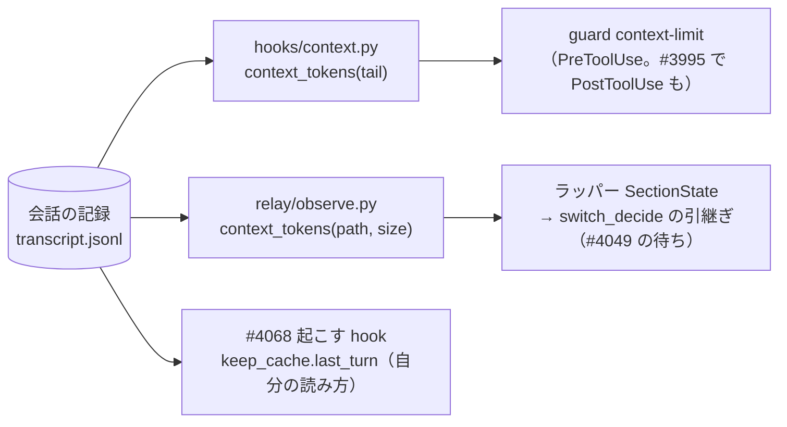
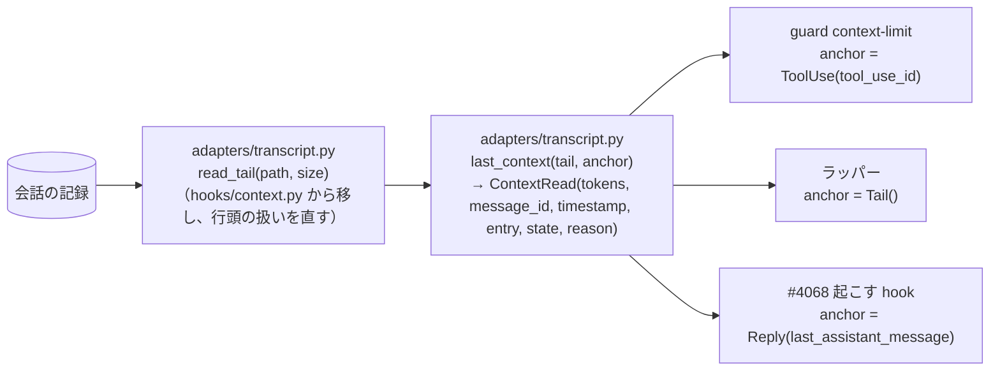
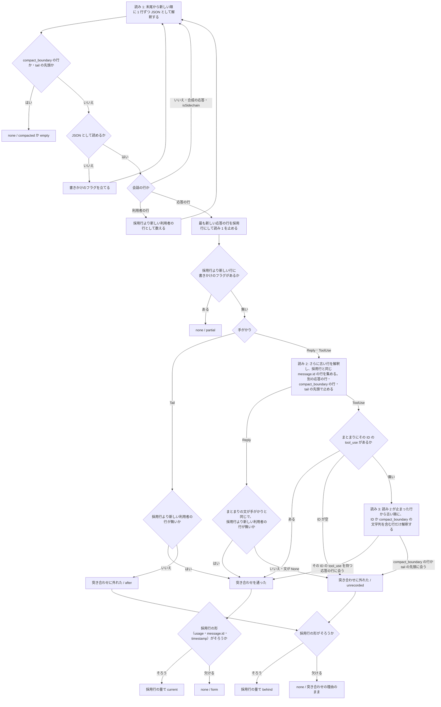

# 文脈の量の読み手: どの応答の量かと古さを返し、圧縮の前の量と合成の応答の 0 で判定しない（#4089）

hook の時点では今の応答がまだ会話の記録に無いことが多く、guard `context-limit` と中継のラッパーは、読んだ量が 1 つ前の応答のものか、圧縮の前の量か、API の失敗の 0 かを見分けられない（[要求](./issue-4089-requirements.md)）。読み手を 1 つの関数にまとめ、量とともに応答の ID・時刻・今の応答のものか（`current`・`behind`・`none`）を返し、呼ぶ側が必ず渡す手がかり（`tool_use_id`・`last_assistant_message`・無し）で今の応答を見分ける。古い量は今の量のほぼ下限として「上限以上」の判定に使い、圧縮の境は越えず、合成の応答は数えない。実測したバージョンと結果は「測った結果」に、採らなかった案は各決定にある。

## 今の姿

要求と受け入れ条件は [issue-4089-requirements.md](./issue-4089-requirements.md) にある。パスは `plugins/ndf/src/ndf/` からの相対で書く（main の `ec8340675`）。

| 部品 | 今の振る舞い | 場所 |
| --- | --- | --- |
| hook の読み手 | 末尾から `"usage"` を含む行を探し、`message.usage` の 3 つの数の和を返す。量だけを返す | `domains/hooks/context.py` の `context_tokens` |
| ラッパーの読み手 | 同じ探し方を別に持つ。末尾 `size` バイトを読み、量だけを返す | `domains/relay/observe.py` の `context_tokens`・`_usage_total` |
| guard `context-limit` | PreToolUse で量が運用上限以上なら止める。#3995 の設計で、PostToolUse で判断開始の値以上を 1 度知らせ、PreToolUse が読んだ量を `tool_use_id` ごとに覚えて PostToolUse は読み直さない | `domains/hooks/guards/context_limit.py` |
| ラッパーの引継ぎ | 見回りごとに量を読み、量が上限以上で子が 5 秒静かなら引継ぎを求める。#4049 の設計で、その前にバックグラウンドの作業の記録を読んで待つ | `domains/relay/wrapper.py`・`switch_decide.py` |
| #4068 の起こす hook（実装はこれから） | Stop の入力の `last_assistant_message` と最後の応答の文を突き合わせ、違えば「今回の応答が未記録」として起こさない。読み方を自分で持つ | 詳細設計の `keep_cache.last_turn` |

## 文脈と制約

- **会話の記録は非同期に書かれ、hook の時点では今の応答を含まないことがある。** 公式の文書がそう書き（PRD1）、実測では Stop の 5 回すべてと PreToolUse の大半で今の応答が無かった（「測った結果」）。同じバージョン・同じ起動の形でも有無が変わるので、バージョンの一覧では決まらない
- **hook の入力に応答の ID は無い。** 今の応答を一つに決める手がかりは次の 2 つだけである（PRD1）。Tool の hook の `tool_use_id`（応答の `tool_use` の要素の `id` と同じ）と、Stop の `last_assistant_message`（今回の応答の文）である
- **会話の記録の形は公開の契約ではない**（#4068 の決定 4 と同じ立場）。形が違えば量を返さない側へ落ちる
- **圧縮の境をまたがない続く 2 つの応答の量は減らない。** このマシンの会話の記録の 125,537 組で、減ったのは 14 組、最大 8,014 token（前の量の 5% 未満）だった。古い量は今の量のほぼ下限になる
- **読み取りの回数を増やさない。** #3995 は PostToolUse の読み取りを省くために、PreToolUse の値を覚える仕組みを置いた（#3995 の決定 3）。この設計はその回数を変えない

## 解き方の全体像

実装を終えた後は、文脈の量を読む関数は `adapters/transcript.py` の `last_context` の 1 つだけになり、記録の末尾を読む `read_tail` も同じモジュールに移る。返り値は量と、その量を持つ応答の `message.id` と時刻、今の応答かの状態を持つ。呼ぶ側は手がかり（`anchor`）を必ず渡す。guard は `ToolUse`、#4068 の起こす hook は `Reply`、ラッパーは `Tail` である。guard とラッパーは、状態に関わらず量を「上限以上か」の判定に使う（古い量は今の量のほぼ下限）。量そのものを使う #4068 だけが `current` を求める。圧縮の境より前の量・合成の応答の 0・書きかけの行の向こうの量は、どの呼ぶ側にも届かない。

## データ構造

`Anchor`（`adapters/transcript.py`）は、今の応答を見分ける手がかりで、次の 3 つのどれかである。

| 種類 | 持つ値 | 渡す呼ぶ側 |
| --- | --- | --- |
| `ToolUse` | `tool_use_id: str` | guard `context-limit`（PreToolUse・PostToolUse の入力の `tool_use_id`） |
| `Reply` | `text: Optional[str]` | #4068 の起こす hook（Stop の入力の `last_assistant_message`。入力に無ければ None） |
| `Tail` | 無し | ラッパー（hook の入力を持たない） |

`ContextRead`（同じモジュール。凍結した dataclass）:

| 項目 | 型 | 意味 |
| --- | --- | --- |
| `tokens` | `Optional[int]` | 読んだ応答の文脈の量。`state` が `none` なら None（`form` でも None） |
| `message_id` | `Optional[str]` | 読んだ応答の採用行の `message.id`。`state` が `none` なら None。ただし `form` では、採用行の `message.id` が空でない文字列なら持つ（#4068 が Stop と応答を結ぶ `ref` を作るため） |
| `timestamp` | `Optional[str]` | 読んだ応答の最後の行の `timestamp`（記録のまま。`current`・`behind` なら `timestamp_seconds` で UNIX 秒に直せることを確かめ済み）。`state` が `none` なら None。ただし `form` では、`timestamp_seconds` で直せる文字列なら持つ（`message_id` と同じ理由） |
| `entry` | `Optional[Mapping[str, Any]]` | 採用行を `json.loads` した object（`state` が `none` なら None。`form` では採用行の object を持つ）。#4068 の `last_turn` が寿命・モデル・キャッシュ・出力の量をこの行から読むために持たせ、記録を読み直させない。比べと hash からは外す（`field(compare=False)`） |
| `state` | `str` | `current`（手がかりに合う今の応答か、それより後の応答）・`behind`（今の応答より前の応答）・`none`（量が無い） |
| `reason` | `Optional[str]` | `state` が `current` でない理由。`unrecorded`（手がかりに合う応答が無い）・`after`（`Tail` で、応答の後に利用者の行がある）・`compacted`（圧縮の境の後に応答が無い）・`partial`（応答より新しい行に、JSON として読めない行がある）・`empty`（末尾に応答が無い）・`form`（突き合わせを通った応答の採用行の形（`usage`・`message.id`・`timestamp`）が違う。突き合わせに外れた応答の形が違うときは、突き合わせの理由のまま `none`） |

読む単位の決まり:

- **会話の行**は、`type` が `user` か `assistant` で、`isSidechain` が真でない行である。会話でない行（`last-prompt`・`api-request`・`attachment` など）は飛ばす。`isSidechain` が真の行はサブエージェントの会話の行で、その `usage` は子の文脈の量であり、親の会話の文脈ではないので数えない
- **応答**は、同じ `message.id` の `assistant` の会話の行のまとまりである。`message.model` が `<synthetic>` の行（合成の応答）は応答に数えず、飛ばす。応答の間に別の行が挟まっても、同じ `message.id` なら 1 つにまとめる（1 つの応答の行が別の応答の行をまたいで再び現れることは無い。このマシンの会話の記録の 130,047 応答で 0 件）。`message.id` が空でない文字列でない `assistant` の行は、その行だけで 1 つの応答とする。**最後の応答**は、最も新しい物理の行を持つ応答である。文と `tool_use` の要素はまとまり全体からファイルの順に読む
- **量・ID・時刻の採用元**は、最後の応答の**最も新しい物理の行**（以下「採用行」）だけである。量はその行の `message.usage`、ID はその行の `message.id`、時刻はその行の `timestamp` から読む。同じ応答の前の行が完全でも、そちらへ替えない（#4068 の詳細設計の「最後の行に `usage` が無ければ前の行が完全でも `form`」と同じ）
- **採用行の形**は、`message.id` が空でない文字列・`timestamp` が `timestamp_seconds` で UNIX 秒に直せる文字列・`usage` が下の「文脈の量」の形であることを求める。`timestamp_seconds(text: str) -> Optional[float]`（同じモジュール）は、末尾の `Z` を `+00:00` に替えて `datetime.fromisoformat` で解く。時差を持つ時刻なら UNIX 秒を、解けない・時差が無いなら None を返す。どれかが欠けるか型が違うときは次のとおりにする。突き合わせを通った応答（`current` の候補）なら `none`（`form`）にする。突き合わせに外れた応答（`behind` の候補）なら、突き合わせの理由（`unrecorded`・`after`）のまま `none` にする。突き合わせの結果は形に依らずに決まる（`ToolUse` の突き合わせは `tool_use` の要素、`Reply` は文と利用者の行、`Tail` は利用者の行だけを見る）。同じ応答の採用行より前の行と、ほかの応答の行の形は見ない
- **利用者の行**は、`type` が `user` の会話の行のすべて（入力・Tool の結果・`isMeta` の行）である。`isMeta` の行は、Claude Code が利用者の入力の形で差し込む内部の行（Skill の本文・Stop の hook の差し戻しの文・画像の注記など。`isMeta` が真の `user` の行）で、次の応答の入力に入る。どれも応答の後に足された文脈なので、その後の応答はまだ無い（量は古い）と読む
- **文脈の量**は、採用行の `usage` の `input_tokens`・`cache_read_input_tokens`・`cache_creation_input_tokens` の和である。`usage` が object で `input_tokens` が整数であることを求め、2 つのキャッシュの項目は無ければ 0 とする。どれかが整数以外の値を持てば `form` である
- **読む範囲**は、最後の `system` の `compact_boundary` の行より後である

## 入出力のコントラクト

`last_context(tail: str, anchor: Anchor) -> ContextRead`

- 入力の `tail` は `read_tail` が返す文字列（先頭の切れた行を捨てた末尾）である。呼ぶ側が別の手段で読んだ文字列を渡さない
- 例外を投げない。ファイルを開かない（読み取りの回数は呼ぶ側が決める）
- **`Reply` の文の比べ方**: 記録の側の文は、最後の応答のまとまりの `text` の要素をファイルの順に区切りの文字なしでつないだものである。比べる前に、記録の側の文と `Reply.text` の両方から空白文字（Python の `str.split()` が区切りに使う文字。空白・タブ・改行など）をすべて除く。除いた後の 2 つの文字列が完全に一致すれば同じとする。空白を除くのは、Claude Code が `last_assistant_message` を作るときの要素の間の区切り（改行か無しか）と、前後の空白・末尾の改行の扱いが公開されていないためである。空白だけが違う別の応答を同じと読む危険は、「その後に利用者の行が無い」の条件が抑える（下の「処理の流れ」）。この比べ方が実際の Stop の入力と記録の組で成り立つことは、#4068 の決定 7 の実測 6 で確かめる（複数の `text` の要素を持つ応答と、末尾に改行のある応答を含む）

`read_tail(path: str, size: int) -> str` は今の `domains/hooks/context.py` の `read_tail` を移し、先頭の行の扱いだけを直す。読み始めの位置 `start = max(0, ファイルの大きさ − size)` について:

- `start` が 0 なら、ファイルの全体を返す
- `start` が 0 より大きければ、`start − 1` から 1 バイト多く読み、その直前のバイトが改行なら読み始めは行頭なので、先頭の行は完全な行として残す。改行でなければ、最初の改行までの切れた行を捨てる。読んだ範囲に改行が 1 つも無い（1 行が `size` を超える）なら空を返す
- 読めない（`OSError`）ときは空を返し、`last_context` は `none`（`empty`）を返す

今の実装は、ファイルが `size` より大きく改行があれば、読み始めが行頭でも先頭の行を捨てる。今のラッパーの読み方（`agents.tail`）はその行を読めるので、窓の先頭にだけ応答があり、その後を Tool の結果が占める記録では、移した後に上限以上でも引継ぎを求めなくなる。直した契約はこの場合も応答を残す。同じ `read_tail` を使う hook のほかの読み手（`last_reply` など）には、捨てていた完全な行が 1 行増えるだけである。

## 処理の流れ

走査は 3 つの読みに分け、手がかりごとに要る所で止める（手順の正本は詳細設計の「繰り返しの終わる条件」）。どの手がかりも、最後の応答より古い行の書きかけ・壊れた行は結果を変えない。`Tail`（ラッパーの見回り）は読み 1 で終わり、最後の応答の行より古い行を解釈しない。`Reply` は最後の応答のまとまりと、その前の別の応答の行 1 つまでを解釈する。`ToolUse` で ID が最後の応答に無いときだけ、古い行のうち ID か `compact_boundary` の文字列を含む行を解釈する。全行を解釈して応答を `message.id` ごとに集める実装にしないのは、ラッパーの見回りごとに、末尾の全行（測った例で中央 134.5 行）を解釈することになるためである（「測った結果」の解釈の時間）。採用行の形は、突き合わせの結果が決まった後に採用行の 1 行だけで確かめる（決定 6）。

`ToolUse` で、その Tool を呼んだ応答が記録にあれば、最後の応答はその応答かそれより後の応答で、今の量に最も近い。並列の呼び出し（1 つの応答の 2 つの `tool_use` が別々の行にある）でも、バックグラウンドで動く Tool の PostToolUse が後の応答の後に来ても、同じ規則で決まる。`Reply` で「その後に利用者の行が無い」を求めるのは、同じ文の応答（#4068 の起床の返事「待機を続ける」）が続くとき、前の応答を今の応答と読まないためである。今の応答が未記録なら、前の応答の後には今の応答を起こした入力の行がある。

呼ぶ側の振る舞い:

| 呼ぶ側 | 手がかり | `current` | `behind` | `none` |
| --- | --- | --- | --- | --- |
| guard の PreToolUse（運用上限） | `ToolUse` | 量が上限以上なら止める | 同じ。上限未満なら止めない | 判定しない（今の None と同じ） |
| guard の PostToolUse（判断開始の値の知らせ。#3995） | PreToolUse が覚えた値を使う。覚えていなければ `ToolUse` で読む | #3995 の規則（`decide_from ≤ tokens < limit` で、利用者の入力ごとに 1 度）で知らせる | 同じ | 知らせない |
| ラッパーの引継ぎ（#3995・#4049） | `Tail` | 量が上限以上で静かなら今の判定へ進む | 同じ。上限未満なら次の見回りで読み直す | 求めない |
| #4068 の起こす hook | `Reply` | 今回の応答として量・時刻を使う | 一時的な失敗（今の「今回の応答が未記録」） | `form` は「記録の形が違う」で、その会話ではキャッシュを起こすのをやめる（子は止めない。決定 6）。`compacted`・`partial`・`empty` は一時的な失敗 |

## 決定の記録

各決定の「根拠」の行は、次の基準を番号で指す。

| 番号 | 中身 |
| --- | --- |
| Value 2（MVV 版 11。正本は `.ndf/mvv.md` の Value） | 安く使える。文脈は最適な量に保ち、無駄な読み直しをしない。大きすぎる文脈は引継ぎで切って小さく始め直す |
| Value 3 | 同じ手順は毎回同じ結果になる。判断の要らない手順は仕組みが進め、結果が実行ごとにばらつかない |
| Value 4 | どのプロジェクトでもそのまま使える |
| Value 6 | 使うほど散らからない |
| Value 7 | 不具合が根本原因から直される。現象の場所でなく根本原因の場所で直し、共通の層へ寄せる |
| Value 8 | 正しいデータ構造で作られる。同じ事実を 2 か所に持たない |
| Value 9 | 責務の分かれた設計で作られる。層が分かれ、下の層は上の層を読まず、1 つの関数が 1 つの責務を持つ |
| #4069 の方針 | 利用者の全体の設計方針（#4069 の「方針（利用者の原文）」）。文脈は最適な量で再利用し、無駄な読み込みをしない。大きすぎる文脈は引継ぎで切る。処理待ちを作らない |

### 決定 1: 読み方の誤りを 1 か所で直すため、2 つの読み手を消して `adapters/transcript.py` の `last_context` 1 つにし、`read_tail` も移す

- **質問**: 文脈の量を読む関数をどこに幾つ置くか
- **選んだ案**: `adapters/transcript.py` を新設し、`last_context`・`Anchor`・`ContextRead` を置く。`domains/hooks/context.py` の `read_tail` を移し、読み始めが行頭なら先頭の行を残すように直す（「入出力のコントラクト」）。`domains/hooks/context.py` の `context_tokens` と `domains/relay/observe.py` の `context_tokens`・`_usage_total` を消す。guard は `ctx.transcript_tail` を、ラッパーは `read_tail(path, size)` の結果を渡す。`ctx.transcript_tail` は、hook の 1 回の事象で会話の記録の末尾を `read_tail` で 1 度だけ読んで持つ値である。#4068 の `keep_cache.last_turn`（#4068 の起こす hook が、Stop の時点の会話の記録の末尾から今回の応答を読み、その量・寿命・モデル・時刻を返す関数。#4068 の詳細設計）は、今回の応答かの突き合わせと量の和をこの関数に任せ、寿命・モデルの読み取りだけを持つ
- 採らなかった案: `relay/observe.py` に置いて hook から読む。hook の層が中継のラッパーの部品を読むことになり、`observe.py` の責務（ラッパーが子の画面と記録から読む事実）を越える。今の 2 つを残して同じ直しを両方へ入れる案も採らない。同じ規則を 2 か所に持ち、片方だけ直される（今の姿がそれである）。ラッパーが今の `agents.tail`（会話の記録の末尾を決まった大きさで読む既存の関数。ラッパーの見回りが使う）を使い続ける案も採らない。`agents.tail` は任意のバイトの位置から返し、先頭の切れた行を捨てず、`FileNotFoundError` 以外の読めない失敗を見回りへ投げる
- **代償**: 呼ぶ側の 3 つ（guard・ラッパー・#4068 の実装）が同じ関数の振る舞いの変化を受ける。テストの見本を 1 か所（`tests/adapters/test_transcript.py`）に集め、呼ぶ側のテストは状態ごとの振る舞いだけを見る
- **根拠**: Value 9（責務の分かれた設計）・Value 6（使うほど散らからない）。記録の形の読み方は Claude Code の外の形を読む部品であり、`adapters` の層に置く

### 決定 2: 呼ぶ側が古さを見分けるため、返り値に応答の ID・時刻・状態を持たせ、記録の行の位置は持たせない

- **質問**: 「どの応答の量か」を何で表すか
- **選んだ案**: `message_id`（`message.id`）・`timestamp`（その応答の最後の行の時刻）・`state`・`reason` を返す（「データ構造」）。古さの判定は関数の中で手がかりと突き合わせて済ませ、呼ぶ側は `state` だけで分ける
- 採らなかった案: 記録の行の位置（末尾からの行の番号・ファイルの中のバイトの位置）。呼ぶ側ごとに読む末尾の大きさが違い（hook は 256 KiB、ラッパーは設定の値）、同じ応答でも値が変わる。比べる相手が無く、古さを決められない。時刻だけを返して呼ぶ側に比べさせる案も採らない。hook の入力に今の応答の時刻は無く、比べる基準が無い
- **代償**: `message_id` と `timestamp` を使うのは今は #4068 だけで、guard は判定の記録に `state` を残すだけである
- **根拠**: Value 8（正しいデータ構造）。古さは手がかりとの一致で決まる事実で、位置の数ではない

### 決定 3: バージョンの一覧に頼らず今の応答を見分けるため、呼ぶ側に手がかり（`ToolUse`・`Reply`・`Tail`）を必ず渡させて突き合わせる

- **質問**: 今の応答が記録にあるかを、どう決めるか
- **選んだ案**: 手がかりを 3 つの種類の型（`Anchor`）にし、呼ぶ側が必ず 1 つ渡す。Tool の hook は `ToolUse`、Stop は `Reply`、ラッパーは `Tail` である。規則は「処理の流れ」のとおりで、`Reply` は #4068 の決定 4 の文の突き合わせに「その後に利用者の行が無い」を足したものである。`Reply` の文が None（Stop の入力に `last_assistant_message` が無い）なら `behind`（`unrecorded`）にする
- 採らなかった案: Claude Code のバージョンごとに「Stop の時点で記録にあるか」の一覧を持ち、無いバージョンでだけ古いとする。実測では同じバージョンの同じ起動の形でも有無が変わり（2.1.330 の PreToolUse で有る回と無い回）、公式の文書も非同期の書き込みとしか書かない（PRD1）。一覧は事実を表せない。hook の中で記録が追いつくまで待ってから読む案も採らない。Tool の hook の予算の中で待つ時間を足し、待っても書かれる保証が無い。手がかりを省略できる引数（既定 None）にする案も採らない。`last_assistant_message` が欠けた Stop が、手がかり無しの規則に落ちて前の応答を `current` と読む
- **代償**: `Tail` は、利用者の行が書かれる前の短い間は今の応答を `current` と読む。ラッパーは子が 5 秒静かなときだけ量で判定するので、その間は判定に使われない
- **根拠**: Value 3（同じ手順は毎回同じ結果）。公式に無くても使える形は使い、形が違えば `none`・`form` へ落とす（起動指示・#4068 の決定 4 と同じ立場）

### 決定 4: 圧縮の後に圧縮の前の量で止めないため、`compact_boundary` の行で読むのを止め、合成の応答を数えず、書きかけの行の向こうを使わない

- **質問**: 圧縮の境・API の失敗の行・読めない行をどう扱うか
- **選んだ案**: 末尾から読んで最後の `system` の `compact_boundary` の行に会ったら止め、それより前の応答の量を返さない。境の後に応答が無ければ `none`（`compacted`）。`message.model` が `<synthetic>` の `assistant` の行は、量も持たず、手がかりの突き合わせにも数えない。最後の応答より新しい行に JSON として読めない行（末尾の書きかけ・壊れた行）があれば、その行が利用者の行か圧縮の境かを決められないので、`none`（`partial`）にする
- 採らなかった案: 境の行の `compactMetadata.postTokens` を量として返す。圧縮の後に API が数えた量ではなく、`usage` と同じ物差しかを確かめていない。次の応答で正しい量が来るので、その間は判定しないほうが誤らない。合成の応答の 0 を `none` として返す案も採らない。合成の応答の前の本当の応答の量は、文脈の下限として正しい。読めない行を飛ばす案（今の 2 つの関数の振る舞い）も採らない。書きかけの行が圧縮の境なら、圧縮の前の量を返す
- **代償**: 圧縮の直後、最初の応答が記録に書かれるまでの Tool の呼び出しは、guard が判定しない。圧縮の後の文脈は小さく（28 回の圧縮の後の量は 12,790〜35,349）、この 28 回の範囲では、その間に上限を越えることは無い。書きかけの行を読んだ判定も 1 回だけ判定しない
- **根拠**: Value 7（根本原因から直す）・Value 2（圧縮で減った文脈を捨てて引継ぎの費用を払わない）

### 決定 5: 判定を遅らせず読み取りも増やさないため、古い量を今の量のほぼ下限として「上限以上」の判定に使い、#3995 の覚えた値は状態ごと使う

- **質問**: 古い量（`behind`）のとき、#3995 の止め・知らせと、#4049 の前のラッパーの引継ぎはどうするか
- **選んだ案**: guard の PreToolUse は、状態に関わらず量が運用上限以上なら止め、上限未満なら止めない。PostToolUse の知らせは #3995 の規則（`decide_from ≤ tokens < limit` の帯で、利用者の入力ごとに 1 度）のまま、比べる量の状態を問わない。#3995 の PreToolUse が `tool_use_id` ごとに覚える値は `{"tokens": …, "state": …}` にする。#3995 の詳細設計の `{"tokens": …}` に `state` を足す形である。PostToolUse はそれを使って読み直さない。`state` の無い値を取り出したときは `behind` とみなして同じに使う。ラッパーも状態に関わらず量が上限以上で静かなら今の判定（#4049 の待ちを含む）へ進み、上限未満なら次の見回りで読み直す。guard の判定の記録（`notes`）は、止め・知らせ・何もしないのどれでも `context_tokens` と `context_state` を持つ
- 採らなかった案: `behind` のときは判定しない。Stop と PreToolUse の大半で今の応答が無いので、運用上限の止めがほとんど働かなくなる。PostToolUse が、PreToolUse の値が `behind` のときに読み直す案も採らない。実測では 2 つ目以降の Tool の PreToolUse の多くが `behind` である。そのため PostToolUse の読み取りが Tool の呼び出しごとに戻る（#3995 の決定 3 が省いた読み取り）
- **運用上限の性質**: 運用上限は、Tool の呼び出しの前に即時に強制する上限ではなく、**記録から読めた量で次の判定から止める運用の閾値**とする。即時に強制するには、上限をまたいだ応答の量を、その応答の Tool の PreToolUse で知る必要がある。hook の入力は量を持たず、記録への書き込みは hook と競合する（「測った結果」で 1 つ目の Tool の PreToolUse の 5 回のうち 4 回が未記録）。そのため記録が追いつくのを待つほかに手段が無い。待ちは Tool の hook の予算（上限の設定の `contracts/limits/hook.budget.pre-tool-use.json` の `p95_ms` 100・`deadline` 1 秒。#3345 の決定 90 で決めた PreToolUse の予算。`hook.budget.post-tool-use.json` も同じ値）を使い、待っても書かれる保証が無い（決定 3 の採らなかった案）
- **代償**: 古い量は厳密な下限ではない。圧縮の境をまたがずに量が減った組が 14 組あり（最大 8,014 token）、上限のすぐ上の古い量で止めたとき、今の量が上限の 8,014 token 下までにあることがある。運用上限 500,000 の 1.6% の幅で、引継ぎを 1 応答分早めるだけである。逆に、上限をまたいだ応答の Tool の呼び出しは、その応答の量を記録から読めない間は通る。通るのはその 1 つの応答の Tool の呼び出しだけである。このマシンの会話の記録で Tool を呼ぶ応答 118,384 のうち、Tool の呼び出しは 110,571（93%）が 1 つ、99% が 3 つ以下、最大 22 だった。次の応答の最初の PreToolUse では、またいだ応答は前の応答として記録にある（「測った結果」の 2 つ目の Tool の PreToolUse は、未記録でも 1 つ前の応答を読めた）。その量（上限以上）を `behind` で読んで止める（止まる条件は下の「超過を許す理由」の 2）
- **超過を許す理由**: 超過の幅は、またいだ応答の量の増分と、その応答の Tool の結果の分である。量の増分の実測は中央 1,244・上位 1% 25,423・最大 83,623 token で、これは実測の値であり上限を保証しない。それでも許す理由は次の 3 つである。1 応答分の超過の損失は、すべての呼び出しに待ちを足す損失より小さい
  1. 運用上限は引継ぎを始める運用の値で、モデルの文脈の窓の端ではない（#3995 の前の guard は 800,000 で止めていた）。越えても会話は壊れず、払うのは引継ぎで運ぶ文脈と費用の 1 応答分の増加だけである
  2. 止まるのは、次の 2 つがそろう最初の PreToolUse である。量の読み手が、圧縮の境より後の応答で上限以上の量を読める（`current` か `behind`）。#3995 の通過の条件（`_passes`。中継の下で引継ぎを待つなど）に当たらない。この PreToolUse で止まり、それより後の Tool の呼び出しは越え続けない。次のときは止まらず、上限の判定を持ち越す
     - 次の応答が Tool を呼ばない: PreToolUse が無いので判定が無い。Tool を呼ばない応答は Tool の結果を足さないので、その応答の間に文脈を大きく増やさない。次に Tool を呼ぶ応答の最初の PreToolUse が判定する
     - 間に圧縮が入った: 圧縮の境より前の量（またいだ応答の量を含む）は読まない（決定 4）。圧縮の後の文脈は小さく（実測で 12,790〜35,349）、圧縮の前の量で止める理由が無い。圧縮の後の最初の応答が記録に書かれるまで判定しない（`none`・`compacted`）
     - 大きな Tool の結果で、またいだ応答が末尾の読み取りの範囲の外へ押し出された: 範囲に応答が無ければ `none`（`empty`）で判定しない（「影響と危険」の「末尾に今の応答の行が入らないとき」）。次に応答が範囲に入った PreToolUse が判定する
     - 量が読めない形（`partial`・`form`）: 判定しない（決定 4・6）

     「次の応答の最初の PreToolUse で必ず止める」ために、圧縮の前の量を覚えて圧縮の後の Tool の呼び出しまで拒否することはしない
  3. 即時の強制の代わりに払う記録の待ちは、Tool の呼び出しごとの hook の時間（上限の手前の呼び出しを含むすべての呼び出し）にかかる。効くのは上限をまたぐまれな 1 応答だけである
- **期待する動き**（テスト設計 14）: 上限をまたぐ応答 R の Tool の PreToolUse で、R が未記録なら、前の応答の量（上限未満）を `behind` で読んで通す。R が記録された後の R の Tool の PreToolUse は、R の量（上限以上）を `current` で読んで止める。R の後の応答の最初の Tool の PreToolUse は、その応答が未記録でも R の量を `behind` で読んで止める。R と次の Tool の呼び出しの間に圧縮の境があれば、圧縮の前の R の量では止めない。PostToolUse の知らせは、R の Tool の PreToolUse が覚えた量（上限未満なら帯の中で知らせる）で決める
- **根拠**: Value 2（読み取りを増やさない）・Value 3（判定は記録の状態だけで決まる）

### 決定 6: 起こす費用を正しい量で決めるため、#4068 は `current` だけを今回の応答とし、突き合わせた応答の採用行の形の違いだけを「記録の形が違う」にする

- **質問**: 量そのものを使う #4068 は、状態ごとにどうするか
- **選んだ案**: 起こす hook は `last_context(tail, Reply(<Stop の入力の last_assistant_message か None>))` を呼ぶ。`current` のときだけ、量を `S`、時刻を最後の応答の時刻として使う。`behind`・`compacted`・`partial`・`empty` は一時的な失敗（次の Stop で読み直す）で、`form` は「記録の形が違う」（会話で止める）とする。「会話で止める」は、#4068 の起こす hook がその会話（同じ `session_id`）では以後キャッシュを起こさなくなることを指す（#4068 の起こす状態の `stopped`）。子の claude もラッパーも止めず、guard とラッパーの判定にも効かない。`form` は、突き合わせを通った応答の採用行の形（`usage`・`message.id`・`timestamp`。「読む単位の決まり」の「採用行の形」）の違いにだけ出る。そのため、突き合わせに外れた前の応答の欠けで会話ごと止めることは無い。`last_turn` は `ContextRead.entry`（量と同じ採用行）から次の値を読む。キャッシュの寿命（`usage.cache_creation`）・モデル（`message.model`）・読み出し・書き込み・出力の量である。記録は読み直さない。寿命・モデル・出力の量が欠ければ「記録の形が違う」とする。読み出し（`cache_read_input_tokens`）と書き込み（`cache_creation_input_tokens`）の量は、省略されていれば 0 とする。文脈の量の和と同じ規則で、詳細設計の「#4068 との受け渡し」の表のとおりである。「記録の形が違う」にはしない。#4068 の時刻の突き合わせ（応答の時刻が hook の動き始めより後なら何も書かない）は `timestamp_seconds(ContextRead.timestamp)` で行う。読む項目ごとの取り出し元は詳細設計の「#4068 との受け渡し」の表にある
- 採らなかった案: #4068 だけ読み方を自分で持ち続ける。突き合わせの規則が 2 か所に分かれ、片方の直しが届かない（決定 1）。突き合わせの前に `usage` の形を確かめる案も採らない。今回でない応答の欠けで会話ごと起こすのをやめる
- **実測の未記録との関係**: 「測った結果」では、同期の Stop の hook の 5 回すべてで今回の応答が未記録だった。#4068 の起こす hook は `asyncRewake` のバックグラウンドで起動し、同期の hook と起動の時刻が違うので、この実測はそのまま当てはまらない。#4068 は hook の中で待って読み直す仕組みを足さない。本番と同じ登録の経路で、実際の `last_context(Reply(...))` が通常の待ちの Stop と起床の後の Stop のすべてで `current` になることを、#4068 の決定 7 の実測 6・9 で確かめ、版の一覧に載せる条件にする。未記録が常態の版は一覧に入れず、起こす hook はその版では働かない（今の振る舞いのまま）。この関数の規則（`behind` を `current` と読まない）は、どちらの結果でも変えない
- **代償**: #4068 の詳細設計の `last_turn` の「責務」の行は、突き合わせと量の和をこの関数に任せる形で実装する。シグネチャと返り値（`TurnRead`）は #4068 の詳細設計のまま使う。`TurnRead` は、読めた応答 `LastTurn`（`message.id`・時刻・量・寿命・モデル・読み出し・書き込み・出力）か、読めなかった理由（未記録・形が違う・次の応答を読んだ）を持つ型である。寿命が両方 0 のときは未定（None）で返し、補いは #4068 の `_settle`（起こす hook が、子を止めるロックの中で状態を読み直して書く関数）がロックの中で行う。起こす状態・起こす記録の規則は #4068 の設計のまま（範囲の外）。`Reply` に「その後に利用者の行が無い」を足したので、#4068 の決定 4 が心配した「同じ文の前の応答を今回の応答と読む」場合は `behind` になる
- **根拠**: Value 9。#4068 の決定 4 の規則を保ち、保存先を 1 つにする

### 決定 7: 利用者の全体の設計方針（#4069）と MVV に照らし、読み取りを増やさずに誤った引継ぎを無くす形にする

- **質問**: この設計は #4069 の方針（文脈は最適な量で再利用する・無駄な読み込みをしない・大きすぎる文脈は引継ぎで切る）と MVV 版 11 に合うか
- **選んだ案**: 合う。圧縮で小さくなった文脈を、圧縮の前の量で引継ぎへ送らない（最適な文脈量。Value 2）。古い量で「上限以上」を判定し、大きすぎる文脈を切る判定を弱めない。会話の記録の読み取りの回数は #3995 の設計のまま（無駄な読み込みをしない）。読んだ末尾の解釈も、手がかりごとに要る所で止め、古い行は ID か圧縮の境の文字列を含む行だけを解釈する（「処理の流れ」の 3 つの読み）。バージョンの一覧を持たないので、Claude Code のバージョン上げで設定を足さない（Value 3・Value 4）
- 採らなかった案: 今の応答が記録に書かれるまで hook が待つ。待ちを作らない方針（#4069）に反し、hook の予算を使う
- **代償**: 古い量の近さの幅（決定 5 の代償）の分だけ、引継ぎが 1 応答分早まることがある
- **根拠**: #4069 の「方針（利用者の原文）」と Value 2・3・4（MVV 版 11）

## 影響と危険

- **働く範囲**: NDF を入れたどのリポジトリでも働く（guard `context-limit` と中継のラッパー）。設定と引数は増えない。当たるモードは全モード（hook とラッパーはモードを見ない）
- **#3995 の実装と同じファイルを触る**: guard `context-limit` の `check` と、#3995 が足す `tool_use_id` ごとの覚えた値。#3995 の実装の中でこの関数へ置き換えるか、#3995 の後に続けて実装する。`verdict.advise` に `notes` の引数を足す（[詳細設計](./issue-4089-design-detail.md)）。#3995 の知らせ（`advise`）に `notes` を載せるためである
- **#4068 の実装**: `keep_cache.last_turn` がこの関数を呼ぶ。#4068 を先に実装するなら、その中で `adapters/transcript.py` を作る。#4068 の寿命の補いと起床の費用の数え方の穴（設計レビューで見つけた）は #4199 が直し、この設計は触らない
- **末尾に今の応答の行が入らないとき**: 大きな Tool の結果（256 KiB を超える）の後では、末尾に応答が無く `none`（`empty`）になる。今も None で判定しないのと同じである
- **形の変化**: Claude Code が `compact_boundary` や `<synthetic>` の形を変えると、境で止まらない・合成の応答を数える。今の振る舞いへ戻るだけで、止めすぎる側へ新しく倒れることは無い

### 代表のリポジトリでの振る舞い

| 種類 | 直した後に起きること | この種類で扱えなくなること |
| --- | --- | --- |
| Web サービス（nd-factory） | 中継の下のレーンが圧縮の後に圧縮の前の量で引継ぎへ送られない。guard の判定の記録に状態が残る | 無し |
| モバイルアプリ | 同上（hook とラッパーは言語と配布の手段を見ない） | 無し |
| 業務文書だけ | 同上 | 無し |

### ai-plugins だけの事情

- 無し（この設計は NDF の hook とラッパーの読み方だけを変え、ai-plugins の運用の値を使わない）

## 用語

| 用語 | 意味 | 反映 |
| --- | --- | --- |
| 今の応答 | 呼ぶ側の時点の応答。Tool の hook ではその Tool を呼んだ応答、Stop では Stop を起こした応答、ラッパーでは記録の最後の会話の行である応答 | 追加 |
| 古い量 | 今の応答より前の応答の量（状態 `behind`）。圧縮の境をまたがなければ、今の量のほぼ下限 | 追加 |
| 合成の応答 | Claude Code が API を呼ばずに書く `assistant` の行（`message.model` が `<synthetic>`）。`usage` はすべて 0 | 追加 |
| 圧縮の境 | 会話の圧縮で Claude Code が書く `system` の `compact_boundary` の行 | 追加 |
| 手がかり | 今の応答を見分けるために呼ぶ側が渡す値（`tool_use_id`・`last_assistant_message`・無し） | 追加 |
| `isMeta` の行 | Claude Code が利用者の入力の形で会話へ差し込む内部の行（Skill の本文・Stop の hook の差し戻しの文など）。次の応答の入力に入るので利用者の行に数える | 追加 |
| `isSidechain` の行 | サブエージェントの会話の行。親の会話の文脈ではないので数えない | 追加 |

この設計は、既存の語（中継のラッパー・引継ぎ・運用上限・判断開始の値・起こす hook）を意味を変えずに使う。[要求](./issue-4089-requirements.md) の「用語」に 1 文ずつ定めた。運用上限は、記録から読めた量で次の判定から止める運用の閾値として使う（決定 5）。

## テスト設計

| # | 確かめること | 落ちる実装 |
| --- | --- | --- |
| 1 | `ToolUse` で、その ID の `tool_use` を持つ応答が最後にある記録で `current`・その量・`message_id`・最後の物理の行の `timestamp`。同じ `message.id` の 3 行（thinking・text・tool_use）の間に会話でない行が挟まっても 1 つに数える。その応答の後にさらに応答がある記録では、後の応答の量で `current` | 行ごとに数える・最初の行の時刻を返す・突き合わせた応答の古い量を返す |
| 2 | 実測の形の見本（最後の会話の行が利用者の入力・1 つ前の応答と Tool の結果で終わる）で `ToolUse` は `behind`（`unrecorded`）で、1 つ前の応答の量。並列の 2 つの `tool_use` が別々の行にある応答では、どちらの ID でも `current` | 手がかりを見ない・最後の行の要素だけを突き合わせる |
| 3 | `Reply` が最後の応答の文と同じで後ろに利用者の行が無ければ `current`。実測の Stop の形（`done` が未記録で最後が `middle` と Tool の結果）は `behind`。同じ文「待機を続ける」の前の応答の後に起床の入力の行がある見本は `behind`。`Reply(None)` は `behind`（`unrecorded`）。複数の `text` の要素はファイルの順につなぐ。`text` の要素が `"a"`・`"b"` の応答は、`Reply("a\n\nb")`・`Reply("ab")`・`Reply("ab\n")` のどれでも `current`、`Reply("ba")` は `behind`。末尾に改行のある `text`（`"done\n"`）の応答は `Reply("done")` で `current` | 文だけを突き合わせる・None で手がかり無しに落ちる・逆順でつなぐ・区切りか前後の空白の違いで外す |
| 4 | `Tail` で、最後の会話の行が応答なら `current`、後ろに Tool の結果・入力・`isMeta` の行があれば `behind`（`after`）。会話でない行と `isSidechain` の行は数えない | 会話でない行で古いとする |
| 5 | 最後の応答の後に合成の応答（`<synthetic>`・`usage` が 0）がある記録で、前の応答の量を返し 0 を返さない | 0 を返す |
| 6 | `compact_boundary` の後に応答が無い記録で `none`（`compacted`）、後に応答があればその量。境の前に 600,000 の応答がある見本で、guard の PreToolUse が止めない | 境を越える |
| 7 | 最後の応答より新しい行に JSON として読めない行（書きかけの末尾・壊れた行）があれば `none`（`partial`）。読めない行が最後の応答より古ければ量を返す | 読めない行を飛ばす |
| 8 | 返す応答の `usage` に `input_tokens` が無い・キャッシュの項目が文字列なら `form`。キャッシュの項目が無ければ 0 として和を返す。`Reply` で突き合わせに外れた前の応答の `usage` が壊れていれば `none`（`unrecorded`）で、`form` にならない | 欠けを 0 にする・突き合わせる前に形を確かめる |
| 9 | guard の PreToolUse: `behind` の 500,000 で止め、`behind` の 499,999 で止めない。`current` も同じ。`none` で判定しない。どの判定の `notes` にも `context_tokens` と `context_state` がある | `behind` で判定しない・状態を残さない |
| 10 | guard の PostToolUse（#3995 の後）: PreToolUse が `behind` の 250,000 を覚えた呼び出しで、読み取り 0 回のまま知らせ、`advise` の `notes` に状態がある。499,999 で知らせ、500,000 で知らせない。並列の `Pre(A) → Pre(B) → Post(A) → Post(B)` で、各 PostToolUse が自分の ID の量と状態を使い、読み取りは 2 回。`state` の無い覚えた値は `behind` として使う | `behind` で読み直す・帯を外す・他の ID の値を使う |
| 11 | ラッパー: `behind` の上限の量で静かな子に引継ぎを求め（#4049 の待ちは今のとおり）、`behind` の上限 − 1 で求めない。`none` で求めない。記録のファイルが読めない（権限の誤り）見本で、見回りが例外で止まらず量は None | 読めない失敗を投げる |
| 12 | #4068 の `last_turn`（#4068 の実装の中で）: `current` で起こす時点を決め、`behind`・`compacted`・`partial`・`empty` は一時的な失敗、突き合わせた応答の `form` と寿命・モデル・出力の量の欠けは「記録の形が違う」。同じ `message.id` の 2 行で前の行と採用行の `usage`（読み出し・書き込み・寿命別の書き込み）が違う記録で、`LastTurn` の `tokens`・`cache_read`・`cache_write`・`ttl` がすべて採用行の値。採用行の寿命別の書き込みが両方 0 なら `ttl` は None（未定。補いは #4068 の `_settle` がロックの中で行う。#4068・#4199 の設計の決定 13） | 一時的な失敗で会話ごと止める・記録を読み直して前の行の値を混ぜる |
| 13 | 読み手は渡された文字列だけを使い、ファイルを開かない（guard の 1 回の判定で `read_tail` の呼び出しは 1 回のまま） | 読み手の中で記録を読み直す |
| 14 | 上限をまたぐ応答 R（前の応答 499,999・R 500,000）: R が未記録の記録で、R の Tool の PreToolUse は `behind` の 499,999 で通す。R が記録された後の R の Tool の PreToolUse は `current` の 500,000 で止める。R の後の応答が未記録の記録で、その応答の Tool の PreToolUse は `behind` の 500,000 で止める。R の後に `compact_boundary` の行と要約の利用者の行が続き、圧縮の後の応答が未記録の記録では、次の Tool の PreToolUse は `none`（`compacted`）で止めない。圧縮の後の応答（30,000）が記録された後は 30,000 で止めない。R の後に `hook.transcript-tail` の大きさを越える Tool の結果の行があり、R が範囲の外にある記録では `none`（`empty`）で止めない | 記録を待つ・未記録の間に止める・次の応答で止め損なう・圧縮の前の量を持ち越して圧縮の後で止める |
| 15 | `read_tail`: 行の長さ 10 バイトの 3 行（`A…\n`・`B…\n`・`C…\n`）のファイルで、`size` 20（読み始めの直前が改行）は `B…\nC…\n`、`size` 15（行の途中）は `C…\n`、`size` 40（ファイルより大きい）は全体、改行を含まない 30 バイトの 1 行のファイルで `size` 10 は空。窓の先頭の行だけが応答で後を Tool の結果が占める記録で、ラッパーの `Tail` は上限の量を読んで引継ぎを求める | 行頭でも先頭の行を捨てる・切れた行を返す |
| 16 | 採用行: 同じ `message.id` の 2 行の最後の行に `usage` が無い記録で、`Reply` が文に合えば `none`（`form`）で `tokens` は None、`message_id`・`timestamp`・`entry` は採用行の値、合わなければ `none`（`unrecorded`）で 4 つとも None。採用行の `message.id` が無い・数値、`timestamp` が無い・数値・`"yesterday"`（解けない文字列）・`"2026-11-22T12:00:00"`（時差が無い）の記録で、突き合わせを通れば `form`、外れれば突き合わせの理由の `none`。`"2026-11-22T12:00:00.123Z"` は読める。同じ応答の前の行の `usage` だけが壊れた記録は、採用行の量を返す | 前の行の `usage` へ替える・ID や時刻の欠けで `current` を返す・`form` で読めた ID と時刻を捨てる |
| 17 | 早い終わり: モジュールの `json.loads` を数える差し替え（monkeypatch）で、最も新しい応答の行の前に 100 行の古い会話の行を置いた見本を読む。`Tail` の解釈の回数は最も新しい応答の行までの行数で、古い 100 行を解釈しない。`Reply` は最後の応答のまとまりと、その前の別の応答の行 1 つまで。`ToolUse` は ID が最後の応答にあれば `Reply` と同じ回数で、無ければ古い 100 行のうち ID か `compact_boundary` の文字列を含む行だけを解釈する。`ToolUse("")` は古い行を探さずに `behind`（`unrecorded`）。直前の応答の最後の物理の行（読み 2 が止まった行）にだけ対象の ID の `tool_use` がある見本で、`current` で最後の応答の量 | 全行を解釈する・空の ID がすべての行に当たる・読み 2 が止まった行を読み 3 で突き合わせない |

上限と判断開始の値は #3995 の関数が返す値（既定 500,000・250,000）を使い、境は − 1 と値で確かめる。時間で区切らず、.md の文言を突き合わせない。見本は「測った結果」の実測の記録の形から作る。

## どこを変えるか

関数ごとの仕様と異常系は [詳細設計](./issue-4089-design-detail.md) にある。新設する関数が `last_context`・`timestamp_seconds` の 2 つで、既存の `verdict.advise` のシグネチャを変えるため、別ファイルにした。

契約と手順書は変えない。`contracts/hooks/guards.json` の `context-limit` と `relay.md` の引継ぎの判定は、「文脈の量が上限を超えた」とだけ書く。どの応答の量かは約束していない（main の `ec8340675` で確かめた）。

## 設計の結果

| 項目 | 値 |
| --- | --- |
| 触るファイル | `plugins/ndf/src/ndf/adapters/transcript.py`（新設）・`plugins/ndf/src/ndf/domains/hooks/context.py`・`plugins/ndf/src/ndf/domains/hooks/verdict.py`・`plugins/ndf/src/ndf/domains/hooks/guards/context_limit.py`・`plugins/ndf/src/ndf/domains/relay/observe.py`・`plugins/ndf/src/ndf/domains/relay/wrapper.py`・`plugins/ndf/tests/adapters/test_transcript.py`（新設）・`plugins/ndf/tests/domains/hooks/test_context.py`・`plugins/ndf/tests/domains/hooks/test_guards.py`・`plugins/ndf/tests/domains/relay/` の `context_tokens` を差し替えるテスト |
| 新設する関数 | 2（`last_context`・`timestamp_seconds`）。移して先頭の行の扱いを直す関数 1（`read_tail`） |
| シグネチャを変える関数 | 1（`verdict.advise`） |
| 詳細設計 | [issue-4089-design-detail.md](./issue-4089-design-detail.md) |
| 実装の順 | #3995 の実装と同時かその後。#4068 より前なら `last_turn` はこの関数を使って書く |

## 未確認のまま残ること

- **Codex の会話の記録**: 形が違い、ラッパーは包まないので範囲の外。Codex で guard を働かせるときは別に読み方を決める
- **ほかのバージョンの対話の形**: 対話の形は 2.1.330 の 1 回だけ測った。規則はバージョンを見ないので、バージョンごとの有無は振る舞いを変えない
- **`compact_boundary` の後に、圧縮の前の応答のコピーが `usage` つきで書かれるバージョン**: 28 回の圧縮では無かった。書かれたら、コピーの量（圧縮の前の量）を今の量として読む。テストの見本 6 にコピーの形を足すのは、見つけた時点で行う

## 外部の調査

| 種類 | 調べるか | 理由 |
| --- | --- | --- |
| 標準・仕様 | 調べない | 会話の記録の形は Claude Code だけが決め、従う公開の仕様が無い |
| 主要な製品 | 調べる | 記録を書く時点と hook の入力は Claude Code の仕様で決まる |
| ライブラリとサービス | 調べない | JSONL の末尾を読むだけで、標準ライブラリで足りる |

### 主要な製品

| # | 製品 | どう解いているか | 設計への反映 | 出典 |
| --- | --- | --- | --- | --- |
| PRD1 | Claude Code の hook の入力 | `transcript_path` の説明に「会話の記録は非同期に書かれ、メモリ上の会話より遅れることがあり、hook が発火した時点で今の turn の最新の応答を含まないことがある。今の turn の最後の応答の文が要る hook は、Stop と SubagentStop の `last_assistant_message` を使う」とある。Tool の hook の入力は `tool_use_id` を持つ。入力に応答の ID は無い（`prompt_id` は利用者の入力の ID） | バージョンの一覧を持たず手がかりで突き合わせる（決定 3）。Stop は `last_assistant_message`、Tool の hook は `tool_use_id` | https://code.claude.com/docs/en/hooks （2026-11-23 JST 取得） |

調べた量: 候補 1 件・取得の試み 1 回。

## 測った結果

| 項目 | 値 |
| --- | --- |
| 日時 | 2026-11-23 06:11〜06:20 JST（UTC では 2026-11-22 21:11〜21:20。#4089 の起票は 2026-11-22 17:02 JST で、測定はその約 13 時間後） |
| Claude Code | 2.1.328・2.1.329・2.1.330 |
| モデル | Haiku 5.5 |
| 作業ディレクトリ | 一時ディレクトリ |

PreToolUse・PostToolUse・Stop に hook を置いた。hook は、入力と会話の記録の末尾の会話の行 4 つ（種類・`message.id`・`stop_reason`・要素の種類・`usage`・文の頭・時刻）を書き出す。会話は「`start` と言って `echo hi` を打ち、`middle` と言って `echo bye` を打ち、`done` と答える」（1 回目だけ Tool 1 つ）。

| バージョン | 起動の形 | Pre 1 | Post 1 | Pre 2 | Post 2 | Stop |
| --- | --- | --- | --- | --- | --- | --- |
| 2.1.330 | `-p`（Tool 1 つ） | 無し（最後は利用者の入力。会話でない行のみ後ろ） | あり | — | — | 無し |
| 2.1.330 | `-p` | あり | あり | 無し（1 つ前の応答と Tool の結果で終わる） | あり | 無し |
| 2.1.328 | `-p` | 無し | あり | 無し | あり | 無し |
| 2.1.329 | `-p` | 無し | あり | 無し | 無し | 無し |
| 2.1.330 | 対話（tmux の端末） | 無し | あり | あり | あり | 無し |

- 「あり」は、その時点の今の応答が記録にあったことを指す。今の応答は、Tool の hook では入力の `tool_use_id` の `tool_use` を持つ応答、Stop では入力の `last_assistant_message` と同じ文の応答である。表の 2〜5 行目は数え直した値である（`recount-by-id.txt`）。数え直しでは、hook が書き出した末尾の `message.id` と、会話を終えた後の記録の `tool_use.id`・文の対応を突き合わせた。1 行目の書き出しは 2 行目の測定で上書きしたので、測った時点の画面の出力（末尾の行の種類と `message.id`）だけが根拠である
- Stop の入力の `last_assistant_message` は 5 回とも今回の応答の文（`done`）で、記録の最後の応答は `middle` の応答だった。`done` の応答は、会話を終えた後の記録には書かれていた
- 同じ `message.id` の行（thinking・text・tool_use）はどれも同じ `usage` を持っていた
- このマシンの会話の記録（6,045 本）: 合成の応答 32 行の `usage` はすべて 0。`compact_boundary` 28 回の後は、どれも `usage` を持たない利用者の行（要約）が続いた。圧縮の前の量 233,526〜407,290、後の量 12,790〜35,349。圧縮の境をまたがない続く 2 つの応答（サブエージェントの行と合成の応答を除く）は 125,537 組あった。量が減ったのは 14 組（最大 8,014 token）で、増えた量は中央 1,244・上位 10% 5,150・上位 1% 25,423・最大 83,623 token
- 同じ会話の記録で、同じ `message.id` の行が別の応答の行の後に再び現れたことは 130,047 応答で 0 件。Tool を呼ぶ応答 118,384 のうち、Tool が 1 つは 110,571、99% は 3 つ以下、最大 22
- 読み手の解釈の時間（2026-11-23 JST、このマシンの 256 KiB を超える会話の記録のうち大きい 200 本の末尾 256 KiB。行は中央 134.5・最大 341。5 回の最小）: 全行を `json.loads` する走査は中央 1.59・p95 1.91・最大 2.98 ms。最も新しい応答の行で止める走査（`Tail`）は中央 0.26・p95 0.34・最大 0.73 ms。最後の応答の後は ID と `compact_boundary` の文字列を含む行だけを解釈する走査（`ToolUse` で ID が見つからない最悪の経路）は中央 0.43・p95 0.68・最大 1.23 ms
- 見本と書き出しの hook・計測のスクリプト: `/work/ai-plugins/.ndf/tmp/design-4089/measure/`（コミットしない）
