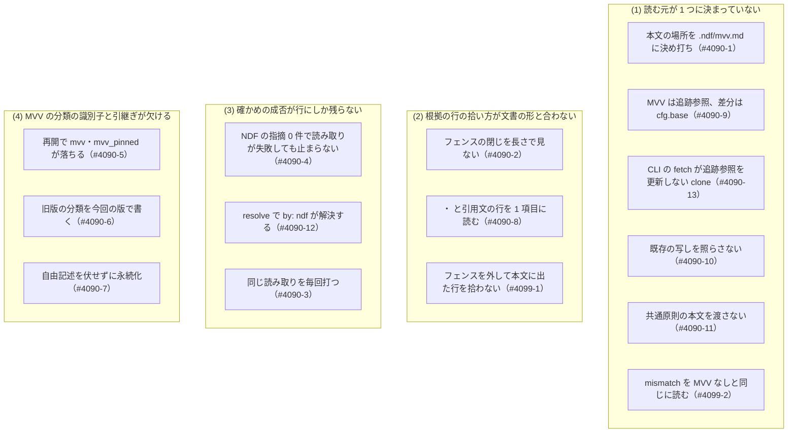
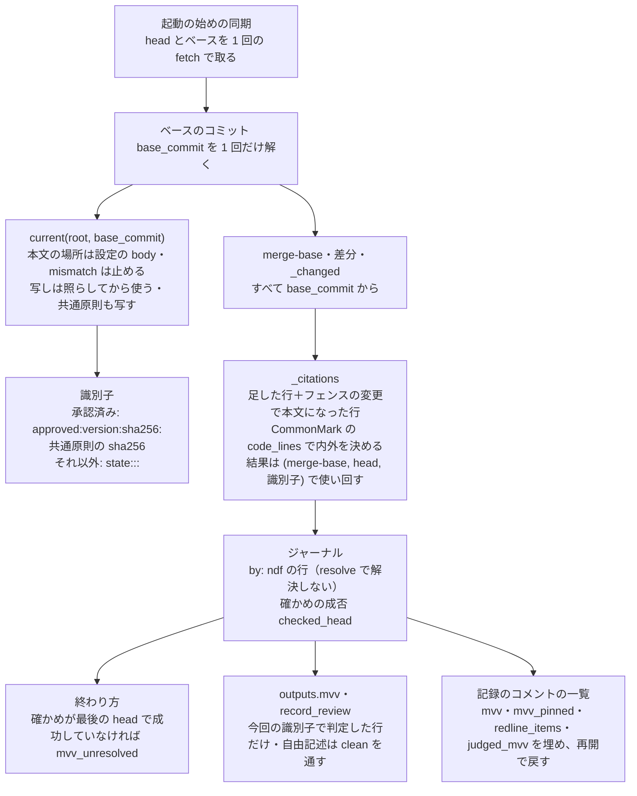

# #4076 の設計: MVV の写しと根拠の行の確かめを、本文の場所・ベースの版・再開の後も誤らない形にする（#4090 #4099）

#4076 の設計と詳細設計（PR #4077）は、MVV の本文と比較の基点の読み方、根拠の行の拾い方、確かめの成否と MVV の分類の持ち方が足りず、書かれたとおりに作ると cross-review が誤って止まるか、MVV の指摘を落とす（15 点）。ベースのコミットを起動の始めに 1 つに固定して本文・差分・再利用へ同じものを渡し、コードのブロックの内外は既存の CommonMark の解析で決め、確かめの成否と分類の識別子をジャーナルと記録のコメントに持たせる。置き換える #4076 の節は「#4076 の文書のどこを置き換えるか」に、#3959 との境は決定 16 に、採らなかった案は「決定の記録」にある。

## 今の姿

何が起きたか・目的・受け入れ条件は要求仕様（[issue-4090-requirements.md](./issue-4090-requirements.md)、正は #4090 の本文と、[issue-4099-requirements.md](./issue-4099-requirements.md)、正は #4099 の本文）にある。直す対象は #4076 の設計文書 [issue-4076-design.md](./issue-4076-design.md) と詳細設計 [issue-4076-design-detail.md](./issue-4076-design-detail.md) で、従う要求は [issue-4076-requirements.md](./issue-4076-requirements.md) である。#4076 の仕組みを使う #3959 の設計は [issue-3959-4055-design.md](./issue-3959-4055-design.md) と [issue-3959-4055-design-detail.md](./issue-3959-4055-design-detail.md) にある。

**2 つの課題を 1 本にまとめたのは、15 点がすべて同じ部品（#4076 の詳細設計の「MVV の写し」「根拠の行の確かめ」「ジャーナルとレッドライン」「終わり方と結果」の 4 節）の同じ欠けから出るためである。** 欠けは次の 4 つに分かれ、各点はどれか 1 つに当たる。

設計に要る今のコード（main 428f91f9e）の形は次のとおりである。

| 部品 | 今の振る舞い | 場所 |
| --- | --- | --- |
| 本文の場所 | 設定の最上位の `body`（既定 `mvv.md`）を `.ndf/` からの相対で読む。`versions[].body` は承認した本文の中身 | `records/preflight.py` の `mvv_body`、`contracts/schemas/ndf-settings/mvv.schema.json` |
| コードのブロックの判定 | markdown-it-py（CommonMark）で、囲みとインデントのコードブロックの行を返す | `adapters/markdown.py` の `code_lines` |
| 比較の基点 | `_changed`・`_merge_base`・相手役の差分は `cfg.base`（`--base` の名前）をそのまま Git に渡す | `crossreview/drive.py` |
| ブランチの取得 | `fetch_branch` は宛先を明示した refspec で `refs/remotes/<リモート>/<名前>` を更新する | `adapters/git.py` |
| 記録のコメントの一覧 | `open_block` は未解決の重い指摘の `id`・`text`・`by`・`severity`・`path`・`line`・`section` だけを埋め、`prior_decide.recorded`・`carried` が戻す | `crossreview/report_decide.py`・`prior_decide.py` |
| 別の実行の resolve | `_settle_resolved` は resolve されたスレッドの未解決の行を `by` によらず `fixed` にする | `crossreview/drive.py` |
| 伏せ字 | 記録のコメントの自由記述は書き先に応じた `Hub.clean`（`publisher.guarded`）を値ごとに通す | `crossreview/cli.py` |

## 文脈と制約

- #4076 の要求仕様（正は #4076 の本文）は変えない。食い違いは設計の側を要求へ合わせて直す（#4090・#4099 の前提 1）
- 直す文書は #4076 の設計文書と詳細設計で、#4076 は実装の前である。`issues/issue-4076-*` はこの PR で書き換えず、#4076 の実装の PR でこの設計に合わせて直す
- #3959 の設計（PR #4093）は #4076 の `current`・`Snapshot`・`fenced_lines`・`citation_errors`・`record_review` を使い、それらの記録を読む `review_holds` を新設する。`issues/issue-3959-*` もこの PR で書き換えず、境を決定 16 に書く
- 前提にするコードは #4076 と同じく、スプリントブランチ `sprint/p12-lcrfast-r1` が main へ入った後の形である
- この文書の「相手役」は cross-review で差分を読んで指摘を返す AI（codex・kiro）、「修正担当」は指摘を直す AI、「基準 5」は #4076 が足す MVV の文に反する指摘の基準、「NDF の指摘」は根拠の行の誤りを機械が出した行（`by: ndf`）、「識別子」は前の収束・見送りがどの版の MVV で判定されたかを見分ける値（#4076 の `"<state>:<version>:<sha256>"` に、承認済みのときだけこの設計で共通原則の sha256 を足した形。「データ構造」の節）を指す
- 決定の根拠に引く MVV の項目は main の `.ndf/mvv.md`（MVV バージョン 11）にある

## 解き方の全体像

- 起動の始めに取得したベースをコミット 1 つに解き、MVV の写し・差分の起点・merge-base・再利用の判定のすべてへ同じコミットを渡す。`current` はそのコミットから、設定の最上位の `body` で場所を解いた本文を読み、承認の記録と合わなければ（`mismatch`）止める（決定 1・9・15）
- 写しはベースの本文と共通原則の 2 つで、どちらも名前が中身で決まり、既にあるファイルも全 SHA-256 で照らしてから使う。共通原則の sha256 は識別子に入る（決定 10・11）
- 根拠の行は、PR で足した行と、フェンスの変更で新たに本文になった行から拾い、コードのブロックの内外は `adapters/markdown.code_lines` で決める。受け付ける形は `・` と ` / ` の区切りと引用文を含み、決定の根拠の行で解析できない行と、版の書式を外した行は誤りとして返す（決定 2・8・14）
- 確かめの成否は指摘の行と別にラウンドの記録（`mvv_checked`）と駆動の状態（`checked_head`）に持ち、最後の head で成功していなければ `mvv_unresolved` で止まる。収束の再利用も同じ head での成功を求め、`by: ndf` の行はスレッドの resolve では解決しない。同じ（merge-base・head・識別子）の確かめの結果は 1 回の起動の中で使い回す（決定 3・4・12）
- MVV の分類はそれを判定したときの識別子（`judged_mvv`）を持ち、今回の識別子と違う行は今回の結果と記録に載せない。記録のコメントの一覧は分類と識別子を埋め、別の状態ディレクトリからの再開でも戻る。結果と記録の自由記述と根拠の行の誤りのパスは、記録のコメントと同じ `Hub.clean` を通す。`by: ndf` の行の照合キーは手元のジャーナルだけに持ち、公開のコメントに載せない（決定 5・6・7）

## データ構造

ジャーナルの行・ラウンドの記録・記録のコメントの一覧・駆動の状態に足す項目（#4076 が足す `mvv`・`mvv_pinned`・`redline`・`redline_items`・`skipped_mvv` は変えずに使う）。

| 置き場 | 項目 | 型 | 意味 | 書く時点 |
| --- | --- | --- | --- | --- |
| ジャーナルの行 | `judged_mvv` | 文字列か無い | `mvv`・`mvv_pinned`・`redline`・`redline_items` を決めたときの識別子。MVV の分類を持たない行は持たない | `ingest`・`enter`・`carry` が分類を置くとき |
| ジャーナルの行 | `unpinned_severity` | 重要度か無い | `mvv_pinned` で `major` 以上に固定する前の重さ（相手役の申告に `effective_severity` を当てた値） | 固定するとき |
| ジャーナルの行 | `mvv_history` | 配列か無い | 識別子が変わって分類を外したときの旧い分類（`judged_mvv`・`mvv`・`redline_items`・`outcome`・`skipped_mvv`）。追記だけ | 分類を外すとき |
| ラウンドの記録 | `mvv_checked` | 真偽値 | このラウンドの head で根拠の行の確かめが成功したか | ラウンドの記録を書くとき |
| 駆動の状態（`_Run`） | `checked_head` | 文字列か None | 根拠の行の確かめが最後に成功した head | `_citations` が成功したとき |
| 駆動の状態（`_Run`） | `citations` | 辞書 | （merge-base・head・識別子）→ 成功した確かめの結果 | `_citations` が成功したとき（失敗は入れない） |
| 記録のコメントの一覧（`open_block` の 1 件） | `mvv`・`mvv_pinned`・`redline_items`・`judged_mvv`・`unpinned_severity` | 行と同じ | 再開で分類・固定前の重さを戻すため | 記録のコメントを書くとき |
| `Snapshot` | `commit` | 文字列 | `current` が解いたベースのコミット（#3959 の詳細設計と同じ欄） | `current` |
| `Snapshot` | `principles_sha256`・`principles_path` | 文字列 | 共通原則の sha256 と写しのパス | `current` |

識別子は、承認済みなら `"approved:<version>:<sha256>:<共通原則の sha256>"`、承認済みでなければ（`absent`・`unapproved`）`"<state>:::"` にする。承認済みでないときは基準 5 が無く共通原則を渡さないので、共通原則の sha256 を含めない（含めると NDF の版上げのたびに、MVV を持たない全利用先で前の収束と詳細レビュー済みを再利用できなくなる）。`review-scope` も同じ規則で作る。#4076 の「識別子の無い前の記録は、今回が `absent` のときだけ同じとみなす」はそのまま使う。

## 入出力のコントラクト

| 入出力 | #4076 の設計 | 置き換えた後 |
| --- | --- | --- |
| `ndf records mvv current --base` の取得 | `git fetch <リモート> <ブランチ>` | `Git.fetch_branch_or_raise(<リモート>, <ブランチ>)`（`+refs/heads/<ブランチ>:refs/remotes/<リモート>/<ブランチ>`） |
| `ndf records mvv current` の `mismatch` | `ok`・`outputs.mvv.state: mismatch` | `refused`（`precondition`）、`summary` に「ベースの MVV の本文が承認の記録と合わない」と本文のパス。`--allow-mismatch` を付けたときだけ `ok`・`outputs.mvv.state: mismatch`・`warnings` に同じ文（MVV を直す工程の起動指示に写す） |
| `ndf cross-review run` のベースの `mismatch` | 基準 5 を外して続ける | 相手役を起動せず `refused`（`precondition`）。`summary` は上と同じ。壊れたベースを直す PR も同じに止まる（決定 15） |
| `current` の設定の有無 | `git cat-file -e` の失敗をすべて `absent` | `git ls-tree` でツリーに設定のエントリが無いと確かめたときだけ `absent`。ツリーや blob の読み取りの失敗は `refused`（`precondition`） |
| `outputs.mvv.path` | ベースの本文の写し | 同じ。`principles_path`（共通原則の写し）を足す |
| 根拠の行の誤りの 1 件（`citation_errors`） | `{"path", "line", "cited", "version", "unknown"}` | `kind`（`version`・`unknown`・`format`）を足す。`format` は版を読めない行で、`version` は None、`unknown` は空。`cited` は種類によらず項目の部分（`根拠:` の後ろから引用文と `（MVV` から後ろを除いた値）で、行の原文を入れない。`cited`・`unknown` は結果と記録へ書く前に `clean` を通す（決定 7） |
| 記録のコメントの一覧の 1 件 | `id`・`text`・`by`・`severity`・`path`・`line`・`section`・`thread` | `mvv`・`mvv_pinned`・`redline_items`・`judged_mvv`・`unpinned_severity` を足す。照合キー（`citation_key`）は載せない（決定 7）。未解決の重い行に加えて、`redline` の行と `by: ndf` の行は重さによらず載せる |

受け付ける根拠の行の形（決定 8）:

| 形 | 例 | 読み方 |
| --- | --- | --- |
| ` / ` で区切る | `- 根拠: Value 6 / P1（MVV バージョン 11）` | 項目 `Value 6`・`P1`、版 11 |
| `・` で区切り、引用文を添える | `- 根拠: Value 7「…」・Value 11「…」（MVV バージョン 11）` | 引用文（`「` から対応する `」` まで）を除き、項目 `Value 7`・`Value 11`、版 11 |
| 外部の調査の番号を後ろに置く | `- 根拠: Value 3（MVV バージョン 11）。STD1` | 版の括弧の後ろは読まない |
| スプリント MVV を添える | `- 根拠: Value 6 / スプリント Value 4（MVV バージョン 11・スプリント MVV 3f9a1c2e）` | 項目 `Value 6`（スプリントの項目は照らさない）、版 11 |
| 版の書式を外す | `- 根拠: Value 3「…」（MVV 版 11）` | `format` の誤り |
| 版の表記を壊す | `- 根拠: Value 5（MVV バージョン 11x）`・`- 根拠: Value 5（MVV バージョン 11` | `format` の誤り（`（MVV` から閉じの `）` までを版の表記として全体を照らす） |
| 版が無い・解析できない（決定の根拠の行） | `### 決定 N` の下の `- 根拠: Value 3` | `format` の誤り |
| 承認済みの MVV があるのに `（MVV なし）` | `- 根拠: 根拠なし（MVV なし）` | `format` の誤り |

## 決定の記録

### 決定 1: 既定外のパスで承認したリポジトリでも止まらないため、本文の場所を設定の最上位の `body` から 1 つの関数で解く

- **質問**: `current` と `review-scope` の blob の照合は、MVV の本文をどのパスから読むか（#4090 の事象 1）
- **選んだ案**: 純粋な関数 `mvv_decide.body_path(decl)` が、設定の最上位の `body`（文字列でなければ表 `ndf-files` の `mvv-body` の既定）を `.ndf/` からの相対で解き、リポジトリの根からの POSIX のパスを返す。`current`・`review-scope`・`preflight.mvv_body` の 3 つがこの関数を使う。絶対パスと `..` を含む値は `MvvError`（`precondition`）にする
- 採らなかった案: `versions` の最後の件の `body`（本文の中身）を本文として使う（承認の記録と本文のファイルの一致を確かめる今の規則（`project-mvv.md` の状態の表）が、記録だけで閉じてしまい、`mismatch` を見分けられなくなる）
- 採らなかった案: `preflight.mvv_body` を `current` から呼ぶ（作業場所のファイルのパスを返す関数で、ベースのコミットから読む `current` とは基点が違う。純粋な関数へ切り出して両方が使う方が、同じ規則が 1 か所に残る）
- **代償**: `preflight.py` も触る（返す値は変えない）
- 根拠: Value 11 / Value 4（MVV バージョン 11）

### 決定 2: 4 字で開いたフェンスの中の行を拾わないため、コードのブロックの内外を既存の CommonMark の解析で決める

- **質問**: `fenced_lines` は、フェンスの開きと閉じをどの規則で決めるか（#4090 の事象 2）
- **選んだ案**: `fenced_lines` を自前の走査で作らず、`adapters/markdown.code_lines`（markdown-it-py の CommonMark の解析。囲みとインデントのコードブロック）の真の行の番号（1 始まり）を返す関数にする。CommonMark の閉じのフェンスは「開いたフェンスと同じ種類の文字で、開いた数以上」であり、リストの中のフェンスと閉じないフェンスも同じ規則で決まる
- 採らなかった案: 自前の走査に開きの文字と長さを持たせる（#4076 の書いた規則を直す形。リストの中のインデントとインデントのコードブロックを別に書くことになり、同じ解析が 2 つになる）
- 採らなかった案: 囲みだけを内側とし、インデントのコードブロックは外側とする（4 字の空白で始まる行は CommonMark でも GitHub の表示でもコードのブロックで、書き手と読み手はコード例として読む。外側とすると、例として書いた根拠の行を誤りとして差し戻す）
- **代償**: `mvv_decide` が `adapters.markdown` を読む（純粋な解析で、git もファイルも読まない。依存の向きは `records` → `adapters` で今と同じ）
- 作り方: 既存の部品を使う
- 比べた候補: STD1 / LIB1
- 根拠: Value 12 / Value 11（MVV バージョン 11）

### 決定 3: 無修正で収束するラウンドで同じ読み取りを打ち直さないため、確かめの材料と結果を（merge-base・head・識別子）で使い回す

- **質問**: `_citations` は、全差分と head 側の本文をいつ読み、どこまで使い回すか（#4090 の事象 3）
- **選んだ案**: 次の 3 つで Git の起動を減らす
  - head 側の Markdown の本文は `_prepare_round` の `_changed` が読んだ本文（`_Changed.docs`）を `_Prepared` に載せて使う。Markdown でない候補のファイルと足りない本文は、既存の `_committed_texts` で 1 回にまとめて読む
  - 全差分は、そのラウンドの相手役の差分が全差分（範囲が `FULL` で起点が merge-base）なら書いたファイルを読み、狭まっていれば `git diff <merge-base>...<head>` を 1 回打つ
  - 成功した確かめの結果を駆動の状態 `citations` に（merge-base・head・識別子）の組で置き、同じ組の確かめ（終わり方の判定の直前の確かめ直しを含む）はそれを返す。失敗した確かめは置かない
  - 確かめは `_Prepared` でなく、merge-base・head・本文・差分のファイルを持つ対象（`_Target`）を受ける。終わり方の判定の直前は、最後のラウンドと同じ head ならそのラウンドの対象（結果は使い回し）を、最後のラウンドの後に修正を push した新しい head なら、その head と merge-base を明示した対象を作り、そのコミットの差分と本文を読む。レビュー用の準備（`_prepare_round`）はやり直さない
- 採らなかった案: 状態ファイルに確かめの結果を残して起動をまたいで使い回す（結果は head の本文から機械的に作れる値で、残すと正本の外に写した値になる。起動をまたぐと 1 回の読み直しで済む）
- **代償**: `_Prepared` に本文が載り、ラウンドの間はメモリに残る（#4076 の文書の上限 `_oversized_docs` の内）
- 根拠: Value 2 / Value 8（MVV バージョン 11）

### 決定 4: 確かめに失敗した head で収束しないため、確かめの成否を指摘の行と別に終わり方の判定へ渡す

- **質問**: NDF の指摘が 0 件の PR で最後の確かめが失敗したとき、何が止めるか（#4090 の事象 4）
- **選んだ案**: 駆動は確かめが成功した head を `checked_head` に置く。`finish_decide._finding_gaps` に引数 `mvv_checked: bool`（承認済みの MVV があり、`checked_head` が終わり方を判定する head と同じとき真）を足し、偽なら `mvv_unresolved` の欠けを足す。ラウンドの記録に `mvv_checked` を書き、`read_by_all_head` は `mvv_checked` が真でない（無い・偽）ラウンドの head を収束として返さない。承認済みの MVV が無い起動は確かめないので、`mvv_checked` を真とみなす
- 採らなかった案: 確かめの失敗をジャーナルの仮の行（`by: ndf`）にする（行が PR のスレッドと記録のコメントへ出て、指摘でないものが修正担当の指示と一覧に混ざる）
- **代償**: `finish_decide` の関数の引数が 1 つ増える
- 根拠: Value 13 / Value 3（MVV バージョン 11）

### 決定 5: 別の状態ディレクトリで再開しても MVV の指摘を落とさないため、記録のコメントの一覧と引継ぎに分類と識別子を足す

- **質問**: `--state-dir` を変えて再開したとき、未解決の MVV の指摘とレッドラインをどこから戻すか（#4090 の事象 5）
- **選んだ案**: `open_block` の 1 件に `mvv`・`mvv_pinned`・`redline_items`・`judged_mvv`・`unpinned_severity` を足し、`redline` の行と `by: ndf` の行は重さによらず載せる。`by: ndf` の行の照合キー `citation_key` は手元のジャーナルだけに持ち、一覧には載せない（決定 7）。`prior_decide.Carried` に同じ 5 つとスレッドの番号を足し、`recorded` はスレッドのある件からも分類を `thread` ごとの対応表として返す。スレッドから戻す関数 `carried` は、その表で同じスレッドの件に分類を重ねる。`by: ndf` の件は、スレッドが resolve されていても信頼済みの最新の記録から戻す（解決できるのは機械の確かめだけ。決定 12）。`FindingJournal.carry` は、`judged_mvv` が今回の識別子と同じ件だけ分類を戻し（`mvv` は `mvv_item` で今回の項目の一覧と照らし直す）、違う件は決定 6 の旧版の行として戻す（重さは `unpinned_severity` へ戻す）。根拠の行の誤りの `by: ndf` の行は、`ingest_citations` が今回の識別子を `judged_mvv` に書く
- 採らなかった案: スレッドの本文に分類を書く（相手役と人が読む本文に機械の値が混ざり、書き手が信頼できるかの確かめ（`trusted`）を本文ごとに要する。記録のコメントの一覧は既に信頼できる書き手の最新の 1 件だけを読む）
- **代償**: 記録のコメントの末尾の一覧が少し長くなる
- 根拠: Value 3 / Value 8（MVV バージョン 11）

### 決定 6: 旧版のレッドラインと分類を新版の結果に載せないため、分類ごとに判定したときの識別子を持たせる

- **質問**: MVV の識別子が変わったとき、旧版で決めた `fixed`・`unresolved`・`redline`・`deferred` の行をどう扱うか（#4090 の事象 6）
- **選んだ案**: 行の分類を置くときに `judged_mvv` に今回の識別子を書く。今回の識別子と違う行は、相手役が出し直したか（`enter`）によらず、今回の判定・結果・記録に使う前に分類を外す。外すときは旧い分類を `mvv_history` へ追記し、`mvv`・`mvv_pinned`・`redline`・`redline_items`・`judged_mvv` を消して重さを `unpinned_severity` へ戻す。出し直された行は今回の申告だけで分類し直す（#4076 の `enter` の規則を、見送り以外の終わり方とレッドラインにも当てる）。`outputs.mvv` と `record_review` は `judged_mvv` が今回の識別子と同じ行だけを対象にする
- 採らなかった案: 旧版の行を消す（旧版で人が見るべきだったレッドラインの履歴が無くなる。履歴は追記で持つ）
- 採らなかった案: 見送りの `skipped_mvv` だけを見る今の形のまま、`fixed`・`unresolved`・`redline` は識別子を見ない（旧版の `P1` が新版の head・版のレッドラインとして承認資料に載る。事象 6）
- 採らなかった案: 分類し直し待ちの状態（`pending_mvv`）を持つ（識別子が 2 回変わる・再開する場合の穴が直すたびに出た。PR #4121 の r2-7・r3-5・r3-6・r3-8。外すことは conductor が決めた）
- **代償**: 識別子が変わった起動では、出し直されない旧版の MVV の指摘は、MVV の分類の無い指摘として残る（重さは固定する前の値へ戻り、未解決で重ければ修正担当へ渡り収束を止める。新版の基準 5 で出し直されれば分類し直される）。#4076 の `skipped_mvv` は見送りの時点の識別子として残し、`judged_mvv` と役割を分ける。版が変わった後の出し直しで、重い方を残す規則により旧い重さが残りうる。重い側に倒れて修正担当へ渡るので、指摘を落とす向きではない（PR #4121 の r1-10）
- 根拠: Value 8 / Value 3（MVV バージョン 11）

### 決定 7: 秘密の引用を記録へ残さないため、結果と記録の自由記述を記録のコメントと同じ `clean` で伏せ、照合キーは手元のジャーナルだけに持つ

- **質問**: `outputs.mvv` と `mvv-validation.jsonl` の見送りの理由・レッドラインの本文を、どの規則で伏せるか（#4090 の事象 7）
- **選んだ案**: `drive._summary` が `report_decide.comment` に渡す `Hub.clean`（`publisher.guarded`。記録のコメントの自由記述に既に通している規則）を、`mvv_outputs` と `record_review` にも渡す。`record_review` と `mvv_outputs` は引数 `clean` を足し、`reason`・`text` と、根拠の行の誤りの `path`・`cited`・`unknown`（`outputs.mvv.citations` と記録の `item`）を書く前に値の並びを 1 回で通す（PR #4121 の r9-1・r9-3）。`_summary` は `Hub.clean` を 1 回の終わり方の中だけ値ごとに覚える包み（`report_decide.once`）で包んで 2 つに渡し、`record_review` の値は `mvv_outputs` の値に含まれるので照会を足さない（PR #4121 の r10-4）。照会に失敗したら、`outputs.mvv` の伏せる欄を固定の文にして結果を返す（PR #4121 の r10-5）。MVV の記録は、自由記述の欄を置かずに `withheld: true` を置いた `mvv-review` の行と、自由記述を持たない `review_disputed` の行を書き、注意を残して次の起動で伏せていない行を書き直す。#3959 の `review_holds` は、キーの最後の行が伏せた行（今の版）なら保留にし、記録が復旧するまで設計承認ゲートを省かない。`review_disputed` は版ごとに 1 回なので、次の起動で同じ指摘が直されても見送られても足さず、数え落としも重ねもしない（PR #4121 の r12-1・r12-2）。ジャーナルには生の値を残し、修正担当への指示と照合キーはそれを使う。`format` の誤りの `cited` も項目の部分だけで、行の原文・引用文・版の表記を入れない（決定 8）。`outputs.mvv` は承認資料（#3959）と PR のコメントへ写るので、書き先が公開でなくても同じ規則を使う
  - 記録の `key`: 伏せ字は表示のためだけに使い、記録上の同一性に使わない。`mvv-review` と `review_disputed` の `key` は、ジャーナルの行の生の本文に先に `run_log.redact` を当て、その後で `oscillation.finding_key` の小文字化・切り詰めを当てた文字列の SHA-256（`records.mvv.record_key`）にする。秘密は小文字化・切り詰めの前に伏せるのでハッシュの元に入らず、キーから戻すことも候補を照らすこともできない。参照先の公開範囲によらないので、伏せ字が同じになる別々の指摘は別のキーのままで、公開範囲が変わっても同じ指摘のキーは変わらない（PR #4121 の r10-1・r10-2）
  - 照合キー: `by: ndf` の行の照合キー `citation_key` は、生の `[path, cited, kind]` から作り、手元の状態ファイル（ジャーナル）だけに持つ。記録のコメントの一覧とスレッドの引継ぎには載せない（決定 5）。公開しないので、伏せ字も鍵も通さない
- 採らなかった案: 記録に自由記述を書かない（#3959 の承認資料が見送りの理由とレッドラインの本文を読む）
- 採らなかった案: 照会に失敗した起動は MVV の記録を書かず、次の起動で書く（#3959 の設計承認ゲートが行の無い PR を保留なしと読んで `fast`・`auto` で省き、次の起動で直された見送りの `review_disputed` が一度も書かれず改訂の兆候から落ちる。PR #4121 の r12-1・r12-2）
- 採らなかった案: `run_log.redact`（秘密だけ）を使う（公開の PR へ写る経路で、記録のコメントより弱い規則になる）
- 採らなかった案: 公開のコメント（記録のコメントの一覧とスレッドの引継ぎ）に照合キーを載せる（伏せ字の後の値のハッシュにしても、公開されたキーから秘密の候補を照らせる穴と、キーを作る時点と記録のコメントを書く時点の間に参照先の公開範囲が変わる穴が続いた。PR #4121 の r3-4・r7-2・r8-4。照合キーを手元のジャーナルだけに持つことは conductor が決めた）
- 採らなかった案: 参照先の公開範囲を照会しない最も強い伏せ字（`sealed`）を足す（`adapters/publish.py` の伏せ字の規則へ範囲が広がり、参照の URL の表記とジャーナルのキーへ指摘が続いた。PR #4121 の r7-1・r8-1〜r8-3・r9-2。記録のコメントと同じ伏せ字へ戻すことは conductor が決めた。URL の表記の隙は #4165 で扱う）
- 採らなかった案: 記録の `key` に伏せた後の本文（ジャーナルの行の `key` を `clean` に通した値）を使う（`finding_key` が小文字化した後では環境変数の秘密が原文と一致せず伏せられずに残り、別々の非公開リポジトリへの参照だけが違う指摘が同じキーに潰れ、公開範囲が変わると同じ指摘のキーが変わる。PR #4121 の r10-1・r10-2）
- 採らなかった案: 照合キーを手元の鍵の HMAC にする（鍵の置き場と、鍵の違う手元からの再開の扱いが要る。キーを公開しなければ要らない。PR #4121 の r8-4・r9-1。採らないことは conductor が決めた）
- 採らなかった案: 結果と記録の伏せ字だけ、記録のコメントより照会の少ない規則にする（照会を減らすには `Publisher` の照会の使い回しか、照会しない伏せ字が要り、どちらもこの課題の範囲の外へ広がる。`Hub.clean` を記録のコメントと、`mvv_outputs`・`record_review` をまとめた 1 回の 2 か所で呼ぶので照会は増えるが、代償として受ける。conductor の判断）
- 採らなかった案: 参照先の公開範囲の照会を `Publisher` の中で使い回す（PR #4121 の r5-3・r6-3 で、使い回す範囲と公開の判定を持ち越す期間の穴が直すたびに出た。照会し直すのは今の `Publisher` にもともとある振る舞いで、#4090・#4099 の範囲の外にある。#4156 へ分けることは conductor が決めた）
- **代償**: 伏せた記録は元の文と一致しない。重ねない判定の理由・本文は伏せた後の値で比べるので、参照先の公開範囲が変わった打ち直しは `mvv-review` を 1 行足す（`key` は変わらないので `review_disputed` は足さない）。秘密の値だけが違う 2 つの指摘は同じ `key` になり、秘密の環境変数の有無が起動ごとに違うと同じ指摘の `key` が変わりうる（どちらも秘密の値を指摘の本文に含むときだけ）。照会に失敗した起動の記録は自由記述を持たず、次の起動（同じ head なら再利用の経路）で書き直すまで、その PR の設計承認ゲートは人に問う。別の状態ディレクトリで打ち直してジャーナルに無い指摘は伏せた行のまま残り、その PR のゲートは人に問い続ける（余分な人の承認の側に倒す）。別の状態ディレクトリで再開すると、照合キーが記録に無いので、同じ誤りの元の `by: ndf` の行が `fixed` になり、新しい行が 1 回だけ足される（誤りは落ちない）。`Hub.clean` を呼ぶたびに `Publisher._private_refs` が参照先の公開範囲を照会するので、別リポジトリの参照を含む起動では記録のコメントと、`mvv_outputs`・`record_review` をまとめた 1 回の 2 か所で照会する（再利用の経路では後者の 1 回だけ）（今の `Publisher` の振る舞い。使い回しは #4156 で扱う）。参照の URL のうち、ホスト名の大文字・明示ポート・パーセントエンコードを含むものを今の伏せ字が拾わない隙は、記録のコメントと同じく残る（#4165 で扱う）
- 根拠: Value 17 / Value 11（MVV バージョン 11）

### 決定 8: 既存の設計の根拠の行を誤って止めず、書式を外しただけで誤りが消えないため、受け付ける形を広げ、決定の根拠の行は解析できなければ誤りにする

- **質問**: `citation_errors` は根拠の行のどの形を受け、どの行を誤りとするか（#4090 の事象 8）
- **選んだ案**: 根拠の行の候補は、本文を左から空白と `- ` を除いた先頭が `根拠:` で、(a) `MVV` を含む行か、(b) `### 決定 <数>` の見出しの下（次の見出しまで）の行とする。候補の解析は、`根拠:` の後ろから引用文（`「` から対応する `」` まで。入れ子を数える）を除き、最初の `（MVV` から閉じの `）` までを版の表記とし、全体が `（MVV バージョン <数>）` か `（MVV バージョン <数>・スプリント MVV <sha256 の先頭 8 文字>）` のときだけ版を読む。閉じの `）` の後ろ（`。STD1` など）は読まない。版の表記の前を ` / ` と `・` で分けて項目にする。版を読めない候補（`（MVV 版 11）`・`（MVV バージョン 11x）`・閉じの `）` の欠け・版の欠け・承認済みの MVV があるのに `（MVV なし）`）は `kind: format` の誤りとして返す。誤りの `cited` は種類によらず、`根拠:` の後ろから引用文と最初の `（MVV` から後ろを除いた項目の部分とし、`format` でも行の原文を入れない（`cited`・`unknown` は決定 7 の `clean` を通して書く。PR #4121 の r9-3）。#4051 と PR #4095 の直した後の形（`・` と引用文）は通る。`decisions.md` の「根拠の行」の表に受け付ける 2 つの区切りと引用文を足す（#4076 の実装の PR が既に `decisions.md` を直すので、同じ PR で足す）
- 採らなかった案: ` / ` だけを受け、#4051 の行を `decisions.md` の形へ直させる（起票者の推定 S2。既にマージした設計文書は足した行でないので確かめられないが、同じ形の行を今後の設計が書くたびに誤りになり、意味の同じ書き方の違いで差し戻すことになる）
- 採らなかった案: `（MVV バージョン` を含む行だけを候補にする（#4076 の形。版の書式を `（MVV 版 11）` に変えるだけで候補から外れ、誤りが「直った」と扱われる）
- **代償**: 決定の見出しの下で `根拠:` で始まる、MVV を引かない行（外部の調査の番号だけの行など）も誤りになる。MVV の項目を引かない決定も `decisions.md` の「当たる項目が無い」の形（`根拠: 根拠なし（MVV バージョン 11）。STD1`）で書けるので、外部の調査だけを根拠にする決定も差し戻されずに書ける
- 根拠: Value 3 / Value 13（MVV バージョン 11）

### 決定 9: 古いローカルのベースで既に入った変更を検査し直さないため、取得したベースをコミット 1 つに固定してすべてへ渡す

- **質問**: `current` と差分の起点が別の参照を読む食い違いを、どう無くすか（#4090 の事象 9）
- **選んだ案**: `drive._start` は同期（head とベースの 1 回の fetch）の後に `current(root, <リモート>/<ベース>)` を呼び、返った `Snapshot.commit`（`current` が手順 (1) で解いたコミット）を `RunConfig` の `base_commit` に置く。`_changed`・`_merge_base`・相手役の差分の起点（`scope.base or base_commit`）・`Basis` はすべて `base_commit` を使い、`cfg.base`（名前）は表示と取得にだけ使う。`review-scope` も手元の `<リモート>/<ベース>` を 1 回コミットに解いて同じく渡す。`Snapshot.commit` は #3959 の詳細設計が足す欄と同じものを、この設計で先に足す
- 採らなかった案: `cfg.base` を `<リモート>/<ベース>` の名前に書き換える（名前は起動の途中で別のセッションの fetch に動かされうる。コミットで固定しないと、差分と MVV が別の時点を読む）
- **代償**: `RunConfig` に欄が 1 つ増える
- 根拠: Value 3 / Value 7（MVV バージョン 11）

### 決定 10: 書き換わった写しを承認済みの版として渡さないため、既にある写しも全 SHA-256 で照らして作り直す

- **質問**: 同じ名前の写しがあるとき、中身を照らすか（#4090 の事象 10）
- **選んだ案**: 写しの名前（`v<版>-<sha256 の先頭 12 文字>.md`）が既にあれば、その中身の全 SHA-256 を検証済みの sha256 と照らす。違えば、検証済みのバイト列を一時ファイルへ書いて `os.replace` で置き換える（今の新規の書き方と同じ）。共通原則の写し（決定 11）も同じ関数で扱う
- 採らなかった案: 違えば `precondition` で止める（中身は名前と検証済みのバイト列だけで決まるので、人の判断なしに直せる。止めると打ち直しの手当てが増える）
- **代償**: 起動ごとに写しを 1 回読む（約 17 KB）
- 根拠: Value 3 / Value 7（MVV バージョン 11）

### 決定 11: 共通原則の本文を持たない利用先でも C 番号の操作を判断できるため、共通原則の写しを基準 5 の指示に渡し、その sha256 を識別子に含める

- **質問**: 相手役に C 番号で報告させる操作の中身を、何で渡すか（#4090 の事象 11）
- **選んだ案**: `current` が NDF の `contracts/data/ndf-common-principles.md`（`mvv.principles` が読む本文）のバイト列から sha256 を求め、MVV の写しと同じ置き場へ `principles-<sha256 の先頭 12 文字>.md` の写しを決定 10 の関数で書く。基準 5 の文（`mvv_criterion`）に共通原則の写しのパスを足し、承認済みの識別子の末尾に共通原則の sha256 を足す。承認済みでない識別子には足さない（基準 5 が無く共通原則を渡さない）。`review-scope` も承認済みのときだけプラグインの同じファイルの sha256 を手元で求める（ネットワークに出ない）
- 採らなかった案: 共通原則の本文を指示へ埋め込む（相手役ごと・ラウンドごとに本文を送る。#4076 の決定 1 が MVV の本文で退けた理由と同じ）
- 採らなかった案: プラグインの導入先のパスをそのまま渡す（相手役は担当の worktree で動き、導入先が読めるかはランタイムによる。読む本文の版も識別子と結びつかない）
- **代償**: 承認済みの MVV を持つリポジトリでは、NDF の版上げで共通原則が変わると、識別子が変わって前の収束を再利用しない（基準 5 の判断の材料が変わったので、読み直すのが正しい）。MVV を持たないリポジトリの再利用は変わらない
- 根拠: Value 4 / Value 3（MVV バージョン 11）

### 決定 12: 修正担当の回答や人の resolve だけで根拠の行の誤りを閉じないため、`by: ndf` の行を `_settle_resolved` から外す

- **質問**: GitHub のスレッドが resolve されたとき、NDF の指摘の行をどう扱うか（#4090 の事象 12）
- **選んだ案**: `_settle_resolved` は `by` が `ndf` の行を飛ばす（終わり方を変えない）。解決は次の確かめ（`ingest_citations`）だけが決める（#4076 の決定 4 の「NDF の指摘の解決は確かめ直しだけが決める」を、resolve の経路にも当てる）。収束の再利用は決定 4 の `mvv_checked` で同じ head の確かめの成功を求める
- 採らなかった案: resolve を受けて `fixed` にし、次の確かめで戻す（確かめに失敗したラウンドでは戻らず、解決が残る）
- **代償**: 人が resolve したスレッドの NDF の指摘も、誤りが残る限り未解決のまま出し直される
- 根拠: Value 13 / Value 3（MVV バージョン 11）

### 決定 13: 追跡の refspec を持たない clone でも新しい版を読むため、CLI の取得を宛先を明示した refspec にする

- **質問**: `ndf records mvv current --base` は、どの形で取得するか（#4090 の事象 13）
- **選んだ案**: `_mvv_current` は既存の `Git.fetch_branch_or_raise(<リモート>, <ブランチ>)`（`+refs/heads/<ブランチ>:refs/remotes/<リモート>/<ブランチ>`）で取得してから `current` を呼ぶ。`--single-branch` で別のブランチを clone した作業場所では、`git fetch origin main` が成功しても `refs/remotes/origin/main` を作らないことを手元で確かめた（`FETCH_HEAD` だけが更新される）
- 採らなかった案: `FETCH_HEAD` を読む（ほかのセッションの fetch と取り合う。`fetch` の注記 #3317）
- **代償**: 無い（Git の起動の数は同じ）
- 作り方: 既存の部品を使う
- 比べた候補: STD2
- 根拠: Value 4 / Value 11（MVV バージョン 11）

### 決定 14: フェンスを外して本文へ出した誤った根拠の行を通さないため、フェンスの変更で本文になった行も確かめる

- **質問**: `_citations` は、差分の `+` の行のほかに、どの行を確かめるか（#4099 の事象 1）
- **選んだ案**: 確かめる行は、head の文書でコードのブロックの外にある候補の行のうち、(a) 差分で足した行と、(b) 差分で変わっていないが、ベース（merge-base）の同じ行がコードのブロックの内側だった行である。(b) は、差分の消した行か足した行にフェンスの行を持ち、head で外にあり足していない候補の行を持つファイルだけ、ベースの本文を `_committed_texts(<merge-base>, <元のパス>)` で 1 回にまとめて読み（`_committed_texts` はコミットを引数に取る形にし、head 側は head のコミット、ベース側は merge-base と改名前のパスを渡す）、差分の hunk から head の行の番号をベースの行の番号へ写して `code_lines` で照らす。ベースでも外にあった変わっていない行は確かめない
- 採らなかった案: 変わったファイルの全体を確かめる（今の版より前に書かれた根拠の行が毎回誤りになる。#4076 の決定 4 が退けた理由と同じ）
- 採らなかった案: フェンスの行の削除を含むファイルだけ全体を確かめる（フェンスの外の元から本文の行まで拾う）
- **代償**: ベースの本文を読むのは、差分の消した行か足した行にフェンスの行（引用の `>` とリストの印を除いた行頭が 3 字以上の `` ` `` か `~`）を持ち、かつ足していない候補の行を持つファイルがあるときだけで、そのときに Git の起動が 1 回増える（ファイルの数によらない）。根拠の行を残した Markdown をフェンスに触れずに編集しただけではベースを読まない。読んだベースの本文は merge-base だけで決まり、確かめの結果ごと決定 3 の（merge-base・head・識別子）の組で使い回す。場合ごとの起動の数は詳細設計の「根拠の行の確かめ」の表にある
- 根拠: Value 13 / Value 7（MVV バージョン 11）

### 決定 15: ベースの MVV が壊れたリポジトリで MVV を確かめずに収束しないため、`mismatch` は `current` が止める

- **質問**: ベースの本文と承認の記録が合わないとき、cross-review と CLI はどう振る舞うか（#4099 の事象 2）
- **選んだ案**: `current` は `mismatch` を状態として返さず、`MvvError`（`precondition`。「ベースの MVV の本文が承認の記録と合わない」と本文のパス）を投げる。cross-review の `_start` は #4076 のとおり `MvvError` で相手役を起動せずに `refused` で止まり、PR の中身によらず続けない。CLI の `_mvv_current` も `refused` になる。`absent`・`unapproved` は今どおり「MVV なし」と同じに読む
  - CLI: `ndf records mvv current --allow-mismatch` だけは `ok`・`state: mismatch`・警告を返す。MVV を直す工程の起動指示がこの引数で写す（cross-review はこの引数を使わない）
  - 設定の有無は `git ls-tree` でツリーに設定のエントリが無いと確かめたときだけ `absent` とし、ツリーや blob の読み取りの失敗（設定の blob の欠損を含む）は `precondition` で止める（承認の状態を確かめられないベースで基準 5 を外さない）
- 採らなかった案: `current` は `mismatch` を返し、cross-review だけが止める（起票者の推定 S2。CLI の結果を写す起動指示は `MVV: 無し（mismatch）` を書き、担当は MVV を読まずに進む。呼び手ごとに同じ分岐を書くことにもなる）
- 採らなかった案: 直す PR だけ `mismatch` でも続ける（PR 自身が書き換えられる設定を承認とみなす穴と、HEAD の固定・Git の起動の増加が直すたびに出た。PR #4121 の r2-1・r2-2・r3-1〜r3-3。外すことは conductor が決めた）
- 採らなかった案: `development-workflow` の工程の契約の例外として、ベースを直す PR を cross-review の外で確かめてマージする（PR #4121 の r4-4・r5-1・r5-2・r6-1・r6-2・r6-4 で、確かめるコミットの固定・差分の照らし方・ベースの移動の穴が直すたびに出た。範囲が #4090・#4099 を超えて `development-workflow` の契約に及ぶ。#4155 へ分けることは conductor が決めた）
- **代償**: 壊れたベースを直す PR は cross-review を通らない。`development-workflow` の通常の工程の契約（cross-review の収束の後にマージ）を満たさず、ベースの直しは NDF の工程の外の人の操作になる。工程の中で直す経路は #4155 で扱う。`Snapshot.state` は通常 `approved`・`absent`・`unapproved` の 3 つで、`mismatch` は `--allow-mismatch` のときだけ返る。#4076 の設計の入出力のコントラクトの「承認済みでない」の行から `mismatch` が外れる
- 根拠: Value 7 / Value 11（MVV バージョン 11）

### 決定 16: #3959 の実装が迷わないため、#3959 の設計と重なる 5 点の境をこの設計で決める

- **質問**: #3959 の設計（PR #4093）が #4076 の部品に足す・前提にする形と、この設計の置き換えが重なる点をどう分けるか
- **選んだ案**: 次の表のとおりにする。#3959 の文書は #3959 の実装の PR で、この表に合わせて読み替える（書き換えるかは #3959 の実装が決める）

  | 重なる点 | #3959 の設計 | この設計の後 | #3959 の実装がすること |
  | --- | --- | --- | --- |
  | `Snapshot.commit` | #3959 が欄を足し、cross-review は読まない | #4076 の実装で足す（決定 9）。cross-review が差分の起点に読む | 欄を足さずに使う |
  | `cite` の `mismatch` | `cite` が `MvvError` を投げる | `current` が先に `MvvError` を投げる（決定 15） | `cite` の `mismatch` の分岐を書かない。テストの期待（`precondition`）は変わらない |
  | `cite` が使う `fenced_lines`・`citation_errors` | #4076 の形。`citation_errors` に（パス・行の番号・本文）の 3 要素を渡す | `code_lines` で内外を決め、誤りに `kind`（`format` を含む）が付く（決定 2・8）。`citation_errors` は（パス・行の番号・本文・決定の根拠の行か）の 4 要素を受け、4 番目に既定値を持たない。4 番目は `mvv_decide.decision_lines(text)`（`### 決定 <数>` の見出しの下で次の見出しまでの行）に行の番号があるかで決める | 各ファイルの本文に `decision_lines` を当てて 4 要素を作る（cross-review の `_citations` と同じ関数・同じ規則。`False` を決め打ちしない）。`summary` の「根拠の行の誤り N 件」に `format` を含めて数える |
  | `record_review` の契約 | 返り値を `ReviewWrite` に変える | 引数 `clean` を足し、`judged_mvv` が今回の識別子と同じ行だけを書く（決定 6・7）。`clean` が None なら自由記述を持たない `withheld: true` の行を書く | `ReviewWrite` の変更と `clean` の引数を両方持つ。伏せた行の追記の失敗も `missing` に載せる |
| `review_holds` の規則 | `redline` と、今の版の解除されない `deferred` の 2 つ | キーの最後の行が今の版の `withheld: true` の行なら、終わり方によらず「記録の自由記述が未完了」で保留する（決定 7） | 3 つ目の規則を足し、承認資料には伏せた行の理由・本文の代わりに `WITHHELD` の文を写す |

- 採らなかった案: #3959 の文書もこの PR で直す（起動指示で書いてよい範囲が `issues/issue-4090-*`・`issues/issue-4099-*` だけに限られる。#4084 の先例も元の文書は実装の PR で合わせた）
- **代償**: #3959 の実装の PR が、この設計を先に読む必要がある（#3959 の設計の決定 7 で #4076 の実装の後に切るので、順序は既に決まっている）
- 根拠: Value 11 / Value 14（MVV バージョン 11）

## 影響と危険

- **働く範囲**: この PR は設計文書だけで、振る舞いは変わらない。#4076 の実装の後は、利用先のリポジトリでも `ndf cross-review run` と `ndf records mvv current` を打つすべての PR と工程に効く
- **プロジェクトごとに違うもの**: MVV の本文の場所は今の設定の最上位の `body` で受ける。新しい設定のキーは足さない
- **当たるモード**: cross-review を通すすべてのモードと、`current` の結果を起動指示に写すすべての工程
- **#4076 の文書との食い違い**: この PR のマージから #4076 の実装の PR までの間、`issues/issue-4076-*` は直す前の中身のまま残る。#4076 の実装は、この設計を先に読み、#4076 の文書を「#4076 の文書のどこを置き換えるか」の表のとおり直してから実装する。#4076 の要求仕様は変えない
- **実装の順**: #4076 の実装と同じ PR で入れる。#3959 の実装はその後（#3959 の決定 7 のとおり）
- **同じファイルを触る別の変更**:
  - #4084（#4045 の設計の直し）: `journal.apply_fix`・`enter` と MVV の再判定（`kept_needed`・`unkept_severity` の置き直し）を触る。この設計の「分類を外す」（決定 6）は #4084 の決定 4 の「MVV の再判定」と同じ時点に起きるので、後に入る PR が #4084 の置き直しをこの設計の分類を外す箇所でも打つ
  - #4092（#4051 の設計の直し）: `journal` と `review-criteria.json` を触らず、触るファイルが重ならない
- **壊れうる箇所**:
  - 決定 8 の候補 (b)（決定の見出しの下の `根拠:` の行）は、設計文書の決定の書き方に依る。決定の見出しを `### 決定 N:` 以外で書いた文書では (a) だけが効く
  - 決定 14 の行の番号の写しは、hunk の外の行を「変わっていない」とみなす。差分は `git -c core.quotePath=false diff --find-renames` で作り（相手役に渡す差分と同じ関数）、新しいパスは `+++ b/`、改名の元のパスは `rename from` の行から読む。`core.quotePath=false` でも Git が引用するパス（`"`・`\`・制御文字を含む）は C の書き方の引用を解く。日本語のパスは引用されないのでそのまま開ける
  - 決定 14 の (b) はフェンスの行に触れたファイルだけを調べる。フェンスに触れずにインデントのコードブロックの前に段落を足して、変わっていない 4 字の行を本文にする編集は拾わない（この形で根拠の行を出す書き方はまず無く、ベースを毎回読む代償に見合わない）
- **用語集**: 足す語は無い（#4076 が足す「MVV の写し」「根拠の行の確かめ」をそのまま使う）

### 代表のリポジトリでの振る舞い

| 代表のリポジトリ | 設定の要点 | 直した後に起きること | この種類で扱えなくなること |
| --- | --- | --- | --- |
| Web サービス（nd-factory） | 実装とリファクタリングの PR を cross-review が見る | #4076 の実装の後、MVV の本文を既定外のパスに置いても読め、ベースが壊れていれば止まる | 無し |
| モバイルアプリ | 同上 | 同上 | 無し |
| 業務文書だけ | 設計・文書の PR を cross-review が見る | 同上。文書の中のコード例（4 字のフェンス）の根拠の行で止まらない | 無し |

### ai-plugins だけの事情

- 無し（規則と記録の形は NDF の契約とコードが持ち、このリポジトリの宣言の値を使わない）

## テスト設計

#4076 の実装の PR で縛る。番号は #4090（`4090-<n>`）と #4099（`4099-<n>`）の受け入れ条件の番号である。

| 受け入れ条件 | どの振る舞いで縛るか | どう壊したら落ちるべきか |
| --- | --- | --- |
| 4090-1 | 設定の最上位の `body` を `docs/mvv-body.md` 相当の既定外の値にしたリポジトリで、`current` が承認済みを返し、`review-scope` が同じパスの blob で識別子を得る。`..` を含む値は `MvvError` | `.ndf/mvv.md` を読む・`versions[].body` を本文にする |
| 4090-2 | 4 字のバッククォートで開き、3 字の行と `- 根拠: Value 1（MVV バージョン 1）` を含み、4 字で閉じる例で、内側の行を拾わず、閉じた後の行を拾う。リストの中のフェンスとチルダのフェンスも同じ | 3 字の行で閉じる |
| 4090-3 | 確かめのための Git の起動の数（`_changed` と相手役の差分の読み取りの外）を場合ごとに縛る。(1) 根拠の行を残した複数の文書を、フェンスに触れずに編集した PR の無修正の収束（1 ラウンド・相手役の差分が全差分・候補はすべて Markdown）: 0 回。終わり方の判定の直前の確かめ直しも 0 回。(2) フェンスの行を消した文書を含む: ベースのまとめ読みの 1 回だけ。(3) 範囲が狭まったラウンドで、Markdown でない候補とフェンスを消した文書の両方がある: 全差分・head・ベースの各 1 回で計 3 回が上限で、文書の数を増やしても増えない。(4) 最後のラウンドの後に push した head の終わり方の判定: merge-base を含め計 4 回が上限。識別子を変えると打ち直す。前の確かめが失敗した組は打ち直す | ラウンドごと・文書ごとに `git show` を打つ・失敗を使い回す・フェンスに触れない編集でベースを読む |
| 4090-4 | NDF の指摘が 0 件の PR で、最後の確かめの `git diff` が失敗すると `mvv_unresolved` で止まる。そのラウンドの記録は `mvv_checked: false` で、打ち直しの起動はその head を収束として再利用しない。最後のラウンドで修正を push した後の終わり方の判定は、新しい head とその merge-base で差分と本文を読み直し、新しい head で足した誤った根拠の行を拾う（同じ head なら既存の結果を使い Git を打たない）。承認済みの MVV があり、同じ head・同じ識別子で `mvv_checked: true` の収束がある打ち直しは、確かめを重ねずに収束を返す（`mvv_unresolved` にならない） | 指摘の行が無いと止まらない・失敗したラウンドの収束を返す・push 前の古い対象で確かめる・再利用の経路で `checked_head` が無く止まる |
| 4090-5 | 未解決の `Value 5` の行と `P1` のレッドラインと `by: ndf` の行を持つ記録のコメントを残し、空の状態ディレクトリから再開すると、3 つの行が分類と `judged_mvv` を持って戻る。スレッドのある行も一覧から分類が重なる。識別子の違う一覧の行は分類を外して戻り、元が `minor` で `mvv_pinned` により `major` に固定された行は `unpinned_severity` から `minor` に戻る。人が resolve した `by: ndf` のスレッドの行も戻り、確かめが失敗した起動では未解決のまま。戻した `by: ndf` の行は照合キーを持たないので、同じ誤りを再検出すると元の行が `fixed` になり、新しい行が 1 回だけ足される（決定 7 の代償）。記録のコメントの一覧に照合キーが無い。根拠の行の誤りの検出（`ingest_citations` が今回の識別子を書く）から記録のコメント・再開・`outputs.mvv.citations` と MVV の記録までを 1 本で通す | 普通の指摘として戻る・`minor` のレッドラインが一覧に載らない・固定した重さのまま戻る・resolve で `by: ndf` の行が消える・`by: ndf` の行に `judged_mvv` が無く記録から落ちる・再開で誤りが落ちる・一覧に照合キーを載せる |
| 4090-6 | 旧版で `P1` とされた行が新版で `Value 5` として出し直されると、行はレッドラインでなくなり、`major` で修正担当へ渡り、収束を止める。旧い分類は `mvv_history` に残る。出し直されない旧版の `fixed`・`unresolved`・`redline` の行は今回の `outputs.mvv` と `record_review` に載らない | 旧版のレッドラインが新版の記録に載る・旧版の分類で差し戻しを抑える・履歴を消す |
| 4090-7 | 見送りの理由とレッドラインの本文に偽の秘密の値（`scripts/repo-secrets-allow.json` に足す作り物）を入れると、`outputs.mvv` と `mvv-validation.jsonl` に原文が無い。偽の秘密を本文の先頭に引いた MVV の指摘でも、`mvv-validation.jsonl` と `mvv-signals.jsonl` の `key` を含むどの欄にも偽の秘密が無く、同じ指摘の再実行で両ファイルに行が増えない。偽の秘密を項目に置いた根拠の行（`unknown` と `format`）でも、`outputs.mvv.citations` の `cited`・`unknown` と記録に原文が無い。大文字小文字の混ざった偽の秘密を本文の先頭に引いた指摘でも、両ファイルの `key` に偽の秘密もその小文字の形も無い。別々の非公開リポジトリへの参照だけが違う 2 つの見送りは `review_disputed` が 2 行になる。参照先の公開範囲を照会できない起動でも結果が返り、`outputs.mvv` に生の値が無い。その起動の見送りとレッドラインは `mvv-validation.jsonl` に自由記述を持たない `withheld: true` の行で残り、`fast` の設計承認ゲートは照会が通る打ち直しまで省かれない。その起動の見送りの `review_disputed` は 1 行書かれ、次の起動で同じ指摘が直されても `count_signals` で 1 件のまま | 伏せずに書く・`key` に本文の断片を書く・伏せ字の後の値で別々の指摘を 1 つにする・`format` の `cited` に行の原文を入れる・照会の失敗で結果を返さない・照会の失敗で記録を書かずにゲートを省く・照会の失敗で `review_disputed` を落とす |
| 4090-8 | `Value 7「…」・Value 11「…」（MVV バージョン 11）` が 2 項目・版 11 で通る。引用文の中に `（` と ` / ` を含んでも同じ。`- 根拠: Value 3「…」（MVV 版 11）` は `format`。`### 決定 1` の下の版の無い `- 根拠: Value 3` は `format`。承認済みのときの `（MVV なし）` は `format`。承認済みの版が 11 のとき `（MVV バージョン 11x）` と閉じの `）` を消した行は `format`。`（MVV バージョン 11・スプリント MVV 3f9a1c2e）` と括弧の後ろの `。STD1` は通る。版の誤りの行を `（MVV 版 11）` へ書き換えると、誤りが `format` の新しいキーで残る | `・` の行を 1 項目に読む・書式を外すと誤りが消える・版の数字の後ろを照らさない |
| 4090-9 | ローカルの `main` を古いコミットに置き、リモートの `main` に新しい MVV と別の変更が入った統合テストで、`current`・merge-base・相手役の差分の起点・`Basis` がリモートのコミットを使い、既にベースへ入った変更が差分に出ない | `cfg.base` の名前で差分を作る |
| 4090-10 | 写しの置き場に同じ名前で違う中身のファイルを置くと、`current` の後は検証済みの中身になる | 同じ名前なら照らさない |
| 4090-11 | 基準 5 の指示に共通原則の写しのパスが載り、写しの中身はプラグインの本文と同じ。承認済みのベースで共通原則の本文を変えると識別子が変わり、前の収束を再利用しない。`absent`・`unapproved` のベースでは識別子が `"<state>:::"` で、共通原則の本文を変えても前の収束を再利用する | C 番号の一覧だけを渡す・共通原則の版を再利用の条件にしない・MVV の無いベースの識別子に共通原則を入れる |
| 4090-12 | 未解決の `by: ndf` の行のスレッドを別の実行が resolve しても、`_settle_resolved` の後も `unresolved` のまま | resolve で `fixed` にする |
| 4090-13 | `--single-branch` で別のブランチを clone した作業場所で、リモートの `main` で新しい版を承認した後に `ndf records mvv current --base main` が新しい版を返す | `git fetch <リモート> <ブランチ>` で取る |
| 4099-1 | ベースでフェンスの内側にあった旧版の根拠の行が、フェンスの開きと閉じの行だけを消した差分で本文に出ると、版の誤りとして拾う（ベースの本文は merge-base のコミットから読む）。同じファイルの、ベースから本文で変わっていない根拠の行は拾わない。日本語を含むパスの文書と、改名したうえでフェンスを消した文書でも同じに拾う（改名はベースを元のパスで読む） | `+` の行だけを読む・ファイルの全体を読む・ベースとして head の本文を読む・引用されたパスや改名の新しいパスでベースを開けず確かめを落とす |
| 4099-2 | ベースの本文を承認の後に書き換えたリポジトリで、`ndf cross-review run` が相手役を起動せず `refused`（`precondition`）、`ndf records mvv current` も `refused`。本文を戻す PR でも cross-review は同じに止まる。`ndf records mvv current --allow-mismatch` は `ok`・`state: mismatch`。`unapproved`・`absent` のベースでは今どおり基準 5 を外して続く。設定の blob を欠損させたベース・`ls-tree` が失敗するベースでは `absent` にならず `refused`（`precondition`） | `mismatch` を MVV なしと同じに読んで収束する・読み取りの失敗を `absent` に落とす |

## どこを変えるか

詳細設計は [issue-4090-4099-design-detail.md](./issue-4090-4099-design-detail.md) にある（新設する関数 5（`mvv_decide.body_path`・`mvv_decide.parse_citation`・`drive._base_lines`・`mvv._write_verified`・`journal.FindingJournal.restate`）と、シグネチャを変える関数（`finish_decide._finding_gaps`・`records.mvv.record_review`・`report_decide.mvv_outputs` ほか）のため別ファイル。#4076 の詳細設計に対する変更として書く）。レビューの単位と実装計画は #4076 の実装に含める。

## #4076 の文書のどこを置き換えるか

#4076 の実装の PR は、次の表のとおり `issues/issue-4076-design.md` と `issues/issue-4076-design-detail.md` を直してから実装する。要求仕様（`issues/issue-4076-requirements.md`）は変えない。詳細設計の各節の置き換えの中身は [issue-4090-4099-design-detail.md](./issue-4090-4099-design-detail.md) の節ごとにある。

| 文書 | 節・決定 | 今の中身 | 置き換えた後 |
| --- | --- | --- | --- |
| 設計文書 | 入出力のコントラクトの `ndf records mvv current` の表 | 入力は `<リモート>/<ブランチ>` の `.ndf/mvv.json` と本文。「承認済みでない」の行に `mismatch` | 本文は設定の最上位の `body` で解く（決定 1）。`mismatch` を「承認済みでない」から外し、「失敗」の行に足す（決定 15）。出力に `principles_path` を足す（決定 11） |
| 設計文書 | 決定 1 の代償 | `current` のコマンドは `git fetch <リモート> <ブランチ>` を打つ。cross-review は `--base` の参照をそのまま読む | 取得は `fetch_branch` の refspec（決定 13）。cross-review は取得の後にベースをコミットに固定し、差分と MVV に同じコミットを渡す（決定 9）。既にある写しも照らす（決定 10） |
| 設計文書 | 決定 3 | 基準 5 の文は MVV の写しだけを指す。識別子は状態・版・sha256 | 共通原則の写しも指し、識別子に共通原則の sha256 を足す（決定 11） |
| 設計文書 | 決定 4 | 足した行だけを確かめる。根拠の行は `（MVV バージョン N` を含む行。解決は確かめ直しだけが決める | 確かめる行に決定 14 の (b) を足す。候補と受け付ける形を決定 8 に置き換える。解決は resolve の経路でも変えない（決定 12）。確かめの成否は行と別に持つ（決定 4）。材料と結果を使い回す（決定 3） |
| 設計文書 | 決定 5 | 識別子の違う見送りの出し直しだけを再判定する | 分類ごとに `judged_mvv` を持ち、識別子の違う行は出し直しによらず分類を外して履歴に残す（決定 6） |
| 設計文書 | 決定 6 | `mvv-review` に見送りの理由とレッドラインの本文を書く | 書く前に `clean` を通す（決定 7）。対象は `judged_mvv` が今回の識別子と同じ行だけ（決定 6） |
| 設計文書 | テスト設計 | 受け入れ条件 1〜8 の行 | この文書の「テスト設計」の 15 行を足す（#4076 の受け入れ条件 1・2・3・4・8 の行に、それぞれの観点として） |
| 設計文書 | 設計の結果の触るファイル | 30 ファイル | `plugins/ndf/src/ndf/domains/records/preflight.py`・`plugins/ndf/src/ndf/domains/crossreview/prior_decide.py`・`plugins/ndf/tests/domains/crossreview/test_crossreview_prior.py`・`plugins/ndf/tests/domains/crossreview/test_crossreview_scope.py`・`plugins/ndf/tests/domains/records/test_cli.py`・`plugins/ndf/tests/domains/crossreview/test_crossreview_report.py` を足す（無ければ） |
| 詳細設計 | 地図と関数の表 | `mvv_decide`・`mvv`・`drive`・`journal`・`finish_decide`・`report_decide`・`scope_decide`・`records/cli` の行 | 詳細設計の「地図」の表のとおり、`body_path`・`parse_citation`・`_base_lines`・`_write_verified`・`restate` と `preflight.py`・`prior_decide.py` の行を足す |
| 詳細設計 | MVV の写し（`current`）の節 | 本文は `.ndf/mvv.md`、手順 (1)〜(3)、`mismatch` は状態、写しは同じ名前なら書かない、CLI は `git fetch <リモート> <ブランチ>`、`drive._start` は `signals_ref` を渡す | 詳細設計の「MVV の写し」の節で置き換える |
| 詳細設計 | 指摘の基準 5 の節 | `criteria_lines` は `state != "approved"` で外す。`mvv_criterion` は MVV の写しだけ。`Basis.mvv` は 3 つの組 | 詳細設計の「基準 5 と識別子」の節で置き換える |
| 詳細設計 | 根拠の行の確かめの節 | `citation_errors` の候補と項目の規則、`fenced_lines` の自前の規則、`_citations` の `+` の行と `git show` の打ち方、`ingest_citations(None)` の扱い、異常系の表 | 詳細設計の「根拠の行の確かめ」の節で置き換える |
| 詳細設計 | ジャーナルとレッドラインの節 | `enter` は見送りの出し直しだけ再判定。行のキーの名前は実装で決める | 詳細設計の「ジャーナルと引継ぎ」の節で置き換える（`judged_mvv`・`unpinned_severity`・`mvv_history` は名前まで決める） |
| 詳細設計 | 終わり方と結果の節 | `_finding_gaps` は行だけを見る。`record_review` と `mvv_outputs` は自由記述をそのまま書く。ログの表の「出すもの」に理由と本文 | 詳細設計の「終わり方と結果」の節で置き換える |
| 詳細設計 | 手順書の表の `decisions.md` の行 | 参照の直しと例の版 | 「根拠の行」の表に `・` の区切りと引用文の行を足す（決定 8） |

## 設計の結果

| 課題 | 扱い | 統合先 | 触るファイル |
| --- | --- | --- | --- |
| #4090 | 実装する | #4076 の実装の PR | #4076 の触るファイルに加えて `plugins/ndf/src/ndf/domains/records/preflight.py`、`plugins/ndf/src/ndf/domains/crossreview/prior_decide.py`、`plugins/ndf/tests/domains/crossreview/test_crossreview_prior.py`、`plugins/ndf/tests/domains/crossreview/test_crossreview_scope.py`、`plugins/ndf/tests/domains/records/test_cli.py`、`plugins/ndf/tests/domains/crossreview/test_crossreview_report.py`、`issues/issue-4076-design.md`、`issues/issue-4076-design-detail.md` |
| #4099 | 実装する | #4076 の実装の PR | `plugins/ndf/src/ndf/domains/records/mvv.py`、`plugins/ndf/src/ndf/domains/crossreview/drive.py`、`plugins/ndf/tests/domains/records/test_mvv_current.py`、`plugins/ndf/tests/domains/crossreview/test_crossreview_run.py`、`issues/issue-4076-design.md`、`issues/issue-4076-design-detail.md` |

## 外部の調査

| 種類 | 調べたか |
| --- | --- |
| 標準・仕様 | 調べた（下の表） |
| 主要な製品 | 調べない: #4076 の外部の調査（PRD1・PRD2）で比べた形の中の読み方の直しで、新しい製品の形を比べる判断が無い |
| ライブラリとサービス | 調べた（下の表） |

### 標準・仕様

| 番号 | 名前 | 何を決めるか | 出典 |
| --- | --- | --- | --- |
| STD1 | CommonMark Spec 0.31.2 の Fenced code blocks | 閉じのフェンスは開きと同じ種類の文字で、開いた数以上。閉じが無ければ文書の終わりまで | https://spec.commonmark.org/0.31.2/ （2026-11-22 取得） |
| STD2 | git-fetch・git-clone のリファレンス | `--single-branch` の clone の fetch の refspec は 1 本で、引数で渡した別のブランチは `FETCH_HEAD` にだけ入る。宛先を書いた refspec はリモート追跡参照を更新する | https://git-scm.com/docs/git-fetch ・ https://git-scm.com/docs/git-clone （2026-11-22 取得）、手元の確かめ: `git clone --single-branch --branch feat` の後の `git fetch origin main` で `origin/main` が作られず、`+refs/heads/main:refs/remotes/origin/main` で作られた |

### ライブラリとサービス

| 番号 | 名前 | 使うか | 出典 |
| --- | --- | --- | --- |
| LIB1 | markdown-it-py 4.3.0（NDF の依存に既にある） | 使う。`adapters/markdown.code_lines` が CommonMark の囲みとインデントのコードブロックの行を返す。4 字で開き 3 字の行を含む例・リストの中のフェンス・閉じないチルダのフェンスで内外が正しいことを手元で確かめた | `plugins/ndf/pyproject.toml`、`plugins/ndf/src/ndf/adapters/markdown.py` |

### 確かめられなかったこと

- 無し
