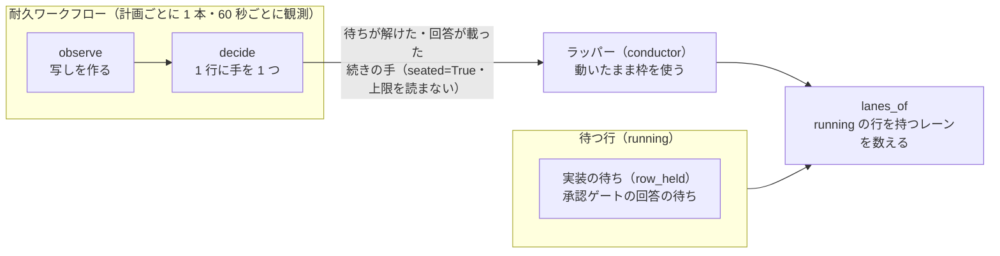
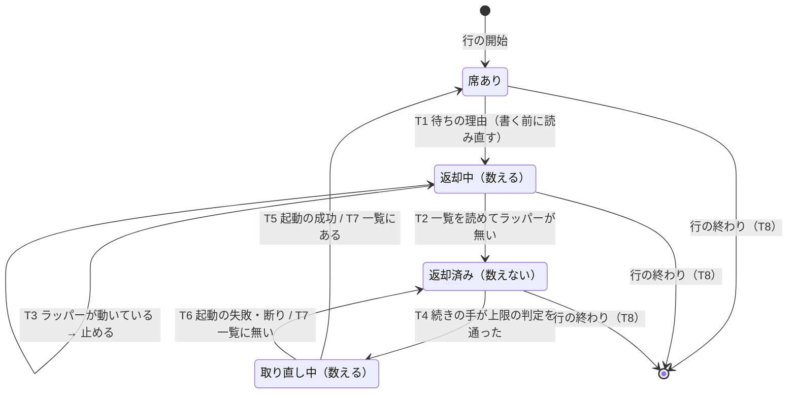
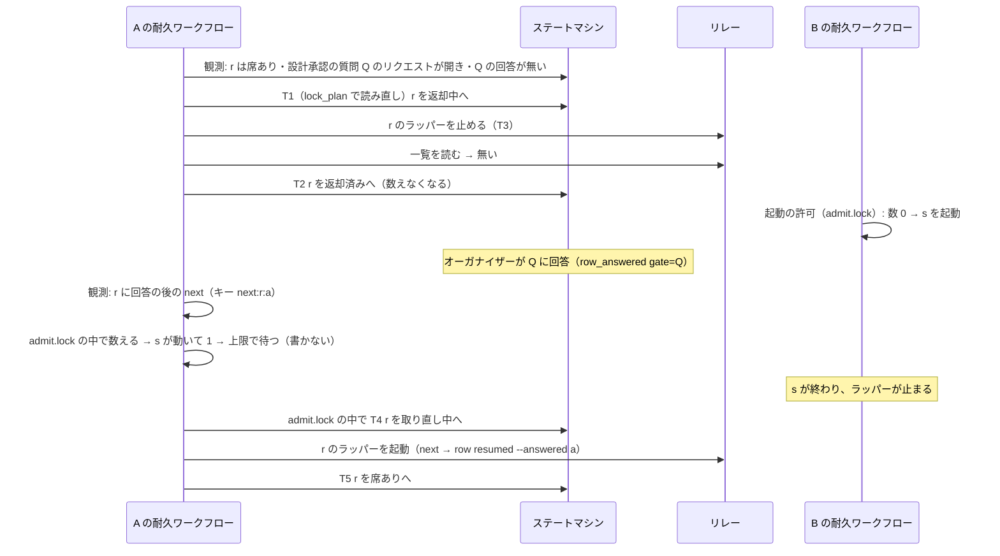

# 並列の計画: 待つ行の席を 4 つの段階で返し・取り直し、どこで落ちても上限を超えない（#4091）

待つ行（実装の待ち・承認ゲートの回答の待ち）のラッパーを止めて席を返す仕組みは、#4050 の設計で 4 ラウンドの cross-review と別の 2 件の起票（#4085・#4088）を経ても、毎回新しい重い穴が出た。席を「席あり・返却中・返却済み・取り直し中」の 4 つの段階を持つ状態にし、マシン全体の数から外すのはラッパーが止まったと確かめた「返却済み」だけにする。段階の移りは 1 種類の事象で記録し、耐久ワークフローの観測が毎回記録と実物（ラッパーの一覧）から次の手を求め直すので、どこで落ちても同じ手の打ち直しで続く。前の設計の形を採らなかった理由は「決定の記録」に、比べた製品は「外部の調査」にある。

## 今の姿

何が起きたか・目的・受け入れ条件は要求仕様（[issue-4091-requirements.md](./issue-4091-requirements.md)、正は #4091 の本文）にある。パスは `plugins/ndf/` からの相対で書く。**#4091・#4085・#4088 を 1 本にまとめたのは、8 つの穴がどれも同じ原因、つまり席の状態を事象の番号の大小の組み合わせ（`parked_seq > max(seated_seq, unparked_seq)` など）で表し、手ごとに別の条件で読み直していたことにあるためである。** 状態そのものを 1 つの値で持てば、穴の出所が無くなる。

この設計は #4050 の実装（待ちの記録・待ちが解けたときの続きの起動・回答の後の next の再開の記録）の上に乗る。#4050 の実装の後の姿は次のとおりで、待つ行は枠を使ったまま動く。

設計に要る今の構造:

| 部品 | 今の振る舞い（#4050 の実装の後） | 場所 |
| --- | --- | --- |
| 数える行の規則 | 実行中の行を持つレーンを数える。起動の許可・ハブへ渡す席（`held_seats`。#4044 の `ndf lanes seats` も）・索引の後始末（#4051）がすべてここを読む | `src/ndf/progress/lane/machine.py` の `lanes_of`・`held_seats`・`count` |
| 起動の許可 | マシンの起動の排他（`admit.lock`）の中で、記録の数と動いているラッパーの和集合を上限と比べ、収まれば `go` でラッパーを置き換えて起動する | `machine.py` の `admitted` |
| 続きの手 | 回答の後の next（キー `next:<スプリント>:<回答の番号>`）・待ちが解けた行の起動し直し（`next:<スプリント>:<待ちの番号>`）・中止（`cancel:<スプリント>`）は、行を始めた起動の席を使い、上限を読まずに置き換えて起動する | `src/ndf/progress/plan/run.py` の `launch_lane`、`plan/run_decide.py` の `_launches` |
| 起動したまま待つ手 | 起動した手のキーを `RunState.launched` に置き、候補に残ったまま期限（`parallel-run.launch` の秒）を越えたら失敗の 1 回として数えて打ち直す。止める手も同じ形で数える | `run_decide.py` の `_expire_launched`・`_fail` |
| 生死の判定 | 実装の待ちの行は `HELD`（止まりにしない）。承認の回答を待つ行は今のとおりラッパーとスプリントの待ちを読む | `src/ndf/progress/lane/liveness.py` の `judge`・`judge_lanes` |
| 承認の回答の届け方 | オーガナイザーはラッパーへ打ち込まず、`ndf answer` か `ndf lanes release` と `ndf lanes answered --gate <質問の id>` で届ける。回答の記録（`row_answered`）は質問の id を持つ | `src/ndf/progress/lane/__init__.py` の `record_answer`、`references/parallel.md` |

## 文脈と制約

- 前の設計（#4050 の決定 4・11・13 と詳細設計の「範囲外（#4091）」の印の部分）は、事象 4 種（`row_parked`・`row_seated`・`row_unparked`・`row_stopped`）と、番号の比べで決まる性質 7 つ（`parked`・`stop_pending`・`seat_progressed` ほか）で席を表した。手ごとに条件を足すたびに別の手との食い違いが出た（要求仕様の「何が起きたか」の表）。この設計は前の設計を出発点にせず、状態を先に決めてから手を当てる
- 計画ごとに耐久ワークフローは 1 本で、手を 1 つずつ打つ（要求仕様の前提 1）。中断した耐久ステップは、回復のときに同じ引数で打ち直される（`src/ndf/core/durable.py` の `step`）
- 別の計画の耐久ワークフローとオーガナイザー・conductor の CLI は同時に書く。計画とレーンのステートマシンへの書き込みは計画の排他（`lock_plan`）を、マシン全体の起動は起動の排他（`admit.lock`）を通る
- ラッパーの一覧（`launch.wrappers()`）は読めないことがある（`None`）。読めない間は「無い」とみなさない。一覧は停止済みの登録行（`registered: true, running: false`）も返すので、ラッパーが動いているかは名前の有無でなく今の `liveness.wrapper_running` で読む（この文書の「載っている」「動いている」「無い」はすべてこの判定）
- ラッパーの起動・置き換え・手動の再起動（`ndf relay spawn`・`restart`）は、どれもハブへの要求になり、ハブがその排他（`hub.lock`）を持ったまま起動の確かめまで処理する。起動の結果は、tmux を作った後の確かめの失敗やハブの応答待ちの切れでも失敗になり、失敗は「起動しなかった」と同じではない
- ハブの排他を取れても、起動の要求が処理済みとは限らない。`hub.submit` は要求のファイルを書いてから `drain` で排他を取りにいくので、頼んだ耐久ステップがその間に中断すると、未処理の要求が残って後から処理される。起動の確かめ（`_confirm`）が期限で失敗しても、作った tmux のセッションは残り、後からラッパーが錠を取りうる。返却済みへ移す前の「不在」は、一覧で動いていないことに加えて、そのラッパーの名前の未処理の起動の要求も、錠を持たない tmux のセッションも無いことである（詳細設計の「生存の判定は 1 つ」）。中断で頼む側を失った要求はほかのリレーの操作が来るまで処理されないので、返却済みを書く手がハブの排他の中で先に処理する。tmux の照会（`has`）は不在と照会の失敗をどちらも偽で返すので、不在と不明を分けて読む
- 手動の `ndf relay restart` の `held`（#4044）は頼む側がハブの排他の前に読むので、読んでから処理されるまでに別のレーンが席を取ると古い値で判定される

## 解き方の全体像

- 実行中のスプリントの行は、席の段階（`LaneRow.seat`）を 1 つ持つ。マシン全体の数（`lanes_of`）から外すのは「返却済み」だけで、それ以外の 3 つはラッパーの有無を問わず数える
- 段階を移すのは耐久ワークフローだけで、事象 `row_seat` を計画の排他の中で、今の段階と段階の番号（最後の `row_seat` の番号）を照らしてから書く。照らして外れたら書かない
- 観測は毎回、記録とラッパーの一覧から次の手を求め直す。返却中なら止めるか返却済みを書き、取り直し中（手の外）なら一覧で席ありか返却済みに決める。中断しても、次の観測か同じ手の打ち直しで続く
- 返却済みの行の続きの手（#4050 の回答の後の next・待ちの解けの起動し直し・中止）は、同じキーのまま、行を始める手と同じく上限の判定を通る。席を取り直した後の打ち直しと失敗の数え方は #4050 の続きの手と同じで、席の世代をキーに入れない
- 返却中と返却済みの行では、`ndf progress next` が実装を始めない。生死の判定は待ちの種類で読み、止まりとして知らせない

## ドメインモデル

### コンテキスト

| コンテキスト | 持つもの | この設計で変えること |
| --- | --- | --- |
| レーン（`progress/lane`） | 行の状態と事象、数える行の規則、生死の判定 | 席の段階（`Seat`）・事象 `row_seat`・待ちの理由（`seat_wait`）・数える規則 |
| 計画の実行（`progress/plan`） | 観測・判断・耐久ステップ | 返却の手（`Vacate`）・確かめの手（`Settle`）・続きの手の分岐 |
| リレー（`domains/relay`） | ラッパーの起動・停止・一覧 | ハブの排他を外から取り溜まった要求を処理する `quiet`、セッションの有無を不在と不明に分ける `probe`、手動の `restart` の頼む側が `admit.lock` を持つことを足す（起動・停止・一覧の振る舞いは変えない） |

### 集約

**席は行の一部である。** レーンは 1 行ずつしか動かず、ラッパーはレーンに 1 本なので、席の段階は実行中の行の値として持つ。書くのはレーンのステートマシン（計画の排他の中）だけである。

| 値 | 意味 |
| --- | --- |
| `phase` | `seated`（席あり）・`vacating`（返却中）・`vacated`（返却済み）・`reseating`（取り直し中） |
| `seq` | 最後の `row_seat` の番号。無ければ行の開始の番号。手はこの値を持ち、書く前に照らす |
| `since` | 今の着席の始まり。最後に `reseating` へ移った `row_seat` の番号、無ければ行の開始の番号（#4050 の `seated_at_seq` を置き換える） |
| `wait` | 返した理由の待ちのキー（`held:<row_held の番号>` か `gate:<質問の id>`） |
| `request` | 承認ゲートで返したときの計画のリクエストのキー |
| `launch` | 取り直し中へ移した続きの手のキー |
| `cause` | 最後の `row_seat` の `cause`。同じ手の打ち直しが、確定した遷移の結果を作り直すときに読む |

### 状態と事象の表

この表が席の振る舞いの正本で、詳細設計の関数はどれもこの表の 1 行を実装する。どの遷移も書き手は耐久ワークフロー（`workflow`）で、計画の排他（`lock_plan`）の中で今の `phase` と `seq` を手の値と照らしてから書く。照らして外れた手は何も書かず `stale`（失敗に数えない）を返す。

| # | 前 | 引き金 | 後 | 手（耐久ステップ） | 排他 | 書く前に照らす条件 | 失敗・中断のとき |
| --- | --- | --- | --- | --- | --- | --- | --- |
| T1 | 席あり | 観測の `seat_wait` が待ちの理由を返した | 返却中 | `Vacate`（`vacate_lane`） | `lock_plan` | `phase == seated`・`seq` が同じ・`seat_wait` を DB だけで読み直して同じ待ちのキー | コミットの前の中断は何も残さず、次の観測が求め直す |
| T2 | 返却中 | ハブの排他の中で一覧を読めて、そのレーンのラッパーが動いていない | 返却済み | `Vacate` の続きか `Settle`（`settle_seat`） | `hub.lock` → `lock_plan` | `phase == vacating`・`seq` が同じ | 排他を取れない・一覧を読めなければ書かない（数え続ける） |
| T3 | 返却中 | 一覧にそのレーンのラッパーが動いている | 返却中のまま（ラッパーを止める） | `Vacate` | なし（止めるのは排他の外） | — | 止める手と同じく手のキーで数え、尽きたら `halt_failed` を 1 回知らせて打ち直さない（`final`）。数え続けるので上限は超えない |
| T4 | 返却済み | 続きの手が当たり、上限の判定を通った | 取り直し中 | `Launch`（`launch_lane` の返却済みの分岐） | `admit.lock` → `lock_plan` | `phase == vacated`・`seq` が同じ | 上限なら書かずに待つ（失敗に数えない） |
| T5 | 取り直し中 | ラッパーの起動が成功した | 席あり | `Launch` | `admit.lock` の中の `lock_plan` | `phase == reseating`・`seq` が同じ | コミットの前に中断したら同じ手の打ち直しが T7 で決める。コミットの後・結果の保存の前なら、打ち直しは起動せずに結果だけを作り直す |
| T6 | 取り直し中 | ハブの上限の断りか起動の失敗の後に、ハブの排他の中で不在（一覧で動いていない・未処理の起動の要求も錠を持たない tmux のセッションも無い）を確かめた | 返却済み | `Launch` | `admit.lock` → `hub.lock` → `lock_plan` | 同上 | 失敗は手のキーで数える。ハブの断りは数えない（断りでも対象が手動で起きていることがあるので、不在を確かめる）。動いていれば T5 と同じく席あり（断りなら書かずに次の観測の T7 に任せる）、起動の途中の要求かセッションが残る・排他を取れない・読めなければ取り直し中のまま（数え続ける） |
| T7 | 取り直し中 | 手の外の観測が見た（中断の後）か、同じ手が打ち直された | ハブの排他の中の一覧でラッパーが動いていれば席あり、不在（T6 と同じ）なら返却済み | `Settle`（`settle_seat`）か `Launch` の打ち直し | `hub.lock` → `lock_plan` | `phase == reseating`・`seq` が同じ（同じ手の打ち直しは、T4 が保存した起動キーで同じ手と確かめてから行の `seq` で照らす） | 起動の途中の要求かセッションが残る・排他を取れない・一覧を読めなければ書かない（数え続ける）。2 回目の起動はしない |
| T8 | どれでも | 行が終わった（完了・中止） | 数えない | 今のまま | 今のまま | — | 今のまま（終わったレーンのラッパーは `_halts` が止める） |

席の段階が引き起こすほかの振る舞い:

| 段階 | 数える | 続きの手 | `/goal` の入れ直し | 実装の開始（`next`） | 生死の判定 |
| --- | --- | --- | --- | --- | --- |
| 席あり | 数える | #4050 のとおり置き換えて起動（上限を読まない） | 今のとおり | 書く | 今のとおり |
| 返却中 | 数える | 出さない（元のラッパーが動いている間に 2 本目を起動しない） | 出さない | 書かない（今の待ちを返す） | 待ちの種類（`HELD`・`WAITING_ANSWER`）。止まりにしない |
| 返却済み | 数えない | T4（上限の判定を通す） | 出さない | 書かない | 同上 |
| 取り直し中 | 数える | 出さない（`Settle` か打ち直しが先） | 出さない | 書く（起動した conductor の `next` が T5 のコミットより先に来ても止めない） | `RESUMING`。止まりにしない |

### 不変条件

| # | 条件 | 守る所 |
| --- | --- | --- |
| S1 | 数えない行（返却済み）は、そのレーンのラッパーが動いていないと、ハブが起動の要求を処理していない間（`hub.lock` の中）に一覧で確かめてから移った行だけである | T2・T6・T7 だけが返却済みへ移し、どれも `hub.lock` の中で、読めた一覧で動いていないことと、そのラッパーの名前の未処理の起動の要求・錠を持たない tmux のセッションが無いことを確かめる（T6 のハブの断りも同じ確かめを通す）。返却済みの後に手動の再起動で起きたラッパーは、起動の許可とハブが動いているラッパーとして数え、手動の再起動の判定も #4044 の `held`（席を持つレーン）と動いているラッパーの和集合で数える。手動の再起動の頼む側は `held` の読み取りから結果まで起動の排他（`admit.lock`）を持ち、T4 と前後に並ぶ（詳細設計の「手動の再起動と起動の許可の直列化」） |
| S2 | 返却済みから出る遷移は、起動の排他の中で上限の判定を通ったものだけである | T4 だけが返却済みから出て、`admitted` の `go` の中で書く |
| S3 | 1 つの行の席の事象は、手が観測した `seq` と今の `seq` が同じときだけ書かれる | 全遷移の「書く前に照らす条件」 |
| S4 | 返却中・返却済みの行に `row_implementing` は書かれない | `begin_implementation` が排他の中で段階を読む |
| S5 | 同じ行に同時に打たれる手は 1 つで、返却中・取り直し中の行に続きの手は出ない | `_launches` が段階で手を選ぶ（#4050 の I10 を広げる） |
| S6 | 取り直し中へ移した手は、打ち直されても 2 本目のラッパーを起動せず、T5 の後の打ち直しでも起動済みの conductor を置き換えない | `launch_lane` が取り直し中の行を見たら T7 だけを行い、席ありの行でも T4 が保存した起動キーと着席の始まりで同じ手の試行と分かれば結果だけを返す |
| S8 | 続きの手は、そのレーンのラッパーが動いている間は期限切れで失敗に数えず、置き換えない。そのまま止まっていれば止まりとして知らせる | `_expire_launched` が期限を越えた続きの手の生存を同じ観測の一覧で読み、残した手のキーを `kept_alive` に置く。`_notice_stalls` はそのレーンの知らせを `/goal` の入れ直し待ちとして抑えない |
| S9 | 取り直し中・返却中の行の確かめ（`Settle`）は打ち切らず、生存か不在が確定するまで観測ごとに打つ | `Settle` の期限切れは `failed`・`final` に置かず、回数が尽きたら知らせを 1 回だけ出す |
| S7 | 今の着席の間（`since` より後）の `row_held` は高々 1 件（#4050 の I2 を、着席の始まりを `since` で読む形にする） | `begin_implementation` の (a)・(c') |

### ドメインイベント

要求仕様の E1〜E4 を事象 `row_seat` の `phase` で表す。E1 は T1（`vacating`）、E2 は T2（`vacated`）、E3 は T4（`reseating`）、E4 は T5・T7（`seated`）。T6・T7 の `vacated` は E3 を取り消して E2 の後へ戻る。

## 構成要素

| 構成要素 | 責務 | 場所 |
| --- | --- | --- |
| `Seat`（新設）・`LaneRow.seat`・`LaneRow.counted` | 席の段階を持ち、数えるかを 1 か所で決める | `lane/types.py`・`lane/fold.py` |
| `seat_wait`（新設） | 席を返す理由を 1 つの純粋な関数で決める。観測と書く前の読み直しが同じ関数を読む | `lane/rules.py` |
| `move_seat`（新設） | 表の遷移を、照らす条件つきで 1 トランザクションで書く | `lane/__init__.py` |
| `lanes_of`・`held_seats` | `LaneRow.counted` の行を持つレーンを数える | `lane/machine.py` |
| `judge`・`judge_lanes` | 席の段階で生死を読む | `lane/liveness.py` |
| `begin_implementation` | 返却中・返却済みの行で実装を始めない。着席の始まりを `seat.since` で読む | `lane/__init__.py` |
| `vacate_lane`・`settle_seat`（新設の耐久ステップ）・`launch_lane` | T1〜T3、T2 と T7、T4〜T6 を行う | `plan/run.py` |
| `quiet`（新設） | ハブの排他（`hub.lock`）の中で溜まった要求を処理してから一覧を読み、返却済みの書き込みを打つ | `lane/launch.py`・`domains/relay/hub.py` |
| `probe`（新設） | tmux のセッションの有無を「ある・無い・不明」で返す | `domains/relay/tmux.py` |
| 手動の `restart` の頼む側 | `held` の読み取りから結果まで `admit.lock` を持つ | `domains/relay/cli.py` |
| `_expire_launched` | 期限を越えた続きの手を、ラッパーが動いている間は失敗に数えない | `plan/run_decide.py` |
| `snapshot_of`・`_launches`・`Vacate`・`Settle` | 写しに席の段階を載せ、段階で手を選ぶ | `plan/run.py`・`plan/run_decide.py` |

## データ構造

- 事象 `row_seat`（レーンのステートマシン、書き手 `workflow`）。中身は `phase`（移った後の段階）・`cause`（`held`・`gate`・`stopped`・`absent`・`admitted`・`launched`・`launch_failed`・`refused`・`present`）・`wait`・`request`・`launch`（どれも無ければ省く）
- `LaneRow.seat`: 上の「集約」の 7 つの値。畳み込みは最後の `row_seat` から `phase`・`seq`・`wait`・`request`・`launch`・`cause` を、最後の `phase: reseating` の番号から `since` を取る。`row_seat` の無い行は `seated`・`seq = since = 行の開始の番号`
- `LaneRow.counted`: `state == running and seat.phase != vacated`
- 写しの項目 `seats`: 実行中のスプリントの行の（レーン, 行, スプリント, `phase`, `seq`）。`vacates`: T1 か T2・T3 を打つ行の（レーン, 行, スプリント, `seq`, `wait`, `request`）。`settles`: 取り直し中の行の（レーン, 行, スプリント, `seq`）。`alive`: 判断が観測の手（`Observe.expiring`）で頼んだ、期限に達する続きの手のレーンのラッパーの生存（`running`・`absent`・`unknown`）
- 新しい定数・上限の値は足さない。止める手と起動の手の回数と期限は今の `parallel-run.launch` を使う

## 入出力のコントラクト

- `contracts/workflow/progress.json` に事象 `row_seat`（書き手 `workflow`）を足す
- `ndf lanes status` の行の項目に `seat`（`phase` と、返却中・返却済みなら `wait`）を足す（`docs/contracts/commands.md`）
- 計画のリクエストの知らせの種類は足さない。止められないときは今の `halt_failed`、取り直しの起動の失敗は今の `launch_failed` を使う
- CLI の引数は変えない

## 処理の流れ

承認ゲートで返し、回答で取り直す流れ（上限 1、計画 A の行 r と計画 B の行 s）:

落ちた場所ごとの続き方（受け入れ条件 3）:

| 落ちた場所 | 残る記録 | 数えるか | 次に起きること |
| --- | --- | --- | --- |
| T1 のコミットの前 | 席あり | 数える | 次の観測が同じ手を求め直す |
| T1 の後・止める前 | 返却中 | 数える | 次の観測が一覧を読み、動いていれば T3、無ければ T2 |
| 止めた後・T2 の前 | 返却中 | 数える | 次の観測か打ち直しが一覧を読み、T2 |
| T4 の後・起動の前 | 取り直し中 | 数える | 打ち直しは保存した起動キーで同じ手と確かめ、`Settle` は番号で照らし、ハブの排他の中で一覧を読み、無ければ T7 で返却済み、次の観測で T4 から |
| 起動の後・T5 の前 | 取り直し中 | 数える | 同上で、動いていれば T7 で席あり |
| T5 の後・耐久ステップの結果の保存の前 | 席あり | 数える | 打ち直しは保存した起動キーと着席の始まりで同じ試行と分かり、起動せずに成功の結果を作り直す |
| 起動の結果が失敗（起動の確かめの失敗・応答待ちの切れ） | 取り直し中 | 数える | 同じ手がハブの排他の中で一覧を読み、動いていれば席あり、無ければ T6 で返却済み。排他を取れなければ取り直し中のまま、次の観測の `Settle` が決める |
| T5 の後・`next` の前に conductor が落ちた | 席あり | 数える | #4050 の続きの手が同じキーで候補に残り、期限の後、一覧でラッパーが無いと確かめてから失敗の 1 回として数えて置き換えで打ち直す。ラッパーが動いている間（準備に時間を要する conductor）は数えず置き換えない |
| ラッパーの一覧を読めない | どの段階でも変わらない | 返却済み以外は数える | 読めた次の観測で続く |

## 決定の記録

### 決定 1: どこで落ちても上限を超えないため、席を 4 つの段階を持つ状態にし、数えないのはラッパーが止まったと確かめた段階だけにする

- **質問**: 席を返した行・返している途中の行・取り直している途中の行を、マシン全体の数にどう入れるか
- **選んだ案**: 席を 1 つの値（`seated`・`vacating`・`vacated`・`reseating`）で持ち、数えないのは `vacated` だけにする。`vacated` へは一覧でラッパーが無いと確かめたときだけ移り（S1）、`vacated` から出るのは起動の排他の中で上限の判定を通ったときだけ（S2）なので、記録と実物のどちらから見ても数え落としが起きない。数える規則は `LaneRow.counted` の 1 か所で、起動の許可・ハブ（#4044）・索引の後始末（#4051）が同じ規則を読む（#4085 の 1）
- 採らなかった案: 前の設計の事象 4 種と番号の比べで表す（`parked`・`stop_pending`・`seat_progressed` ほか 7 つの性質が手ごとに別の組み合わせで読まれ、組み合わせの抜けが穴になった。#4085 の 1 は `holding` を一律に除いた規則と再着席の組み合わせの抜けだった）
- 採らなかった案: 返すと決めた時点（`row_parked`）で数えなくする（止める前・止められないときに動いているラッパーを数え落とし、上限を超えて起動する。前の設計は `row_unparked` で戻す手を足したが、戻す前の中断で同じ穴が残った）
- **代償**: 返却中の間は、待つ行も枠を使う（止まるのを確かめるまでの数十秒）。ラッパーの一覧を読めない間は返却が進まない
- 根拠: Value 8「データ構造は正規化を既定にし、同じ事実を 2 か所に持たない」・Value 11「同じ規則・定数・処理は 1 か所にまとまり、ほかはそこを参照する」（MVV バージョン 11）。PRD1・PRD2

### 決定 2: 中断から同じ手で続けるため、段階の移りは観測が毎回記録と一覧から求め直し、手は書く前に段階の番号を照らす

- **質問**: 返却や取り直しの途中で耐久ステップが中断されたとき、どう続けるか（#4085 の 3）
- **選んだ案**: 次の手を、手の結果ではなく今の記録（段階と番号）とラッパーの一覧から毎回求める。返却中の行は、手の打ち直しでも次の観測でも、一覧で動いていれば止め（`Vacate`）、無ければ返却済みを書く（`Vacate` の続きか `Settle`）。取り直し中の行を手の外で見たら、一覧で席ありか返却済みに決める（`Settle`）。どの手も書く前に計画の排他の中で `phase` と `seq` を照らし、古い手は書かない（S3）
- 採らなかった案: 手の中の順序（書いてから止める）で続きを決め、「既に返した」行を外す（前の設計。コミットの後・停止の前で中断すると、打ち直しも観測も停止を見送った。#4085 の 3）
- 採らなかった案: 止めてから返却を書く（止めた後・書く前の中断で、ラッパーが無いのに数え続ける行が残る。これ自体は安全側だが、止める前に `next` が実装を始める競合を排他で断れない）
- **代償**: 返却中・取り直し中の行がある観測では、ラッパーの一覧を 1 回読む（今の `judge_lanes` の読み取りと共有し、観測あたり高々 1 回のまま）
- 根拠: Value 3「同じ操作を打ち直しても、結果は 1 回打ったときと変わらない」・Value 3「版上げ・再起動・セッションの入れ替えをまたいでも、進行中の作業と人の回答は失われず、止まった所から続く」（MVV バージョン 11）。PRD2

### 決定 3: 同じ待ちを 2 回起動せず失敗を数え続けるため、取り直しは #4050 の続きの手を同じキーのまま上限の判定へ回し、席の世代をキーに入れない

- **質問**: 返却済みの行を起動し直す手のキーと、打ち直しと失敗の数え方をどう決めるか（前の設計の r4-4・#4088 の 2）
- **選んだ案**: 返却済みの行の手は、#4050 が席ありの行に出す続きの手と同じもの（回答の後の next・待ちの解けの起動し直し・中止。キーも同じ）で、違いは起動の経路だけにする（返却済みなら上限の判定を通して T4〜T6、席ありなら今の置き換え）。キーは回答か待ちの記録の番号だけで決まり、席を返したかで変わらないので、取り直した直後の観測で同じ回答の手が別のキーで出ない。失敗の数え方・起動したまま待つ手の期限・打ち切りの知らせは今の `_expire_launched`・`_fail` のまま、キーで数える。取り直した conductor が `next` の前に落ちたときも、続きの手が候補に残り、期限の後に失敗として数えて置き換えで打ち直す（#4088 の 2）。期限を越えた続きの手は、失敗に数える前に同じ観測の一覧でそのレーンのラッパーの生存を読み、動いている間は数えず置き換えない（準備や作業で `next` まで時間を要する conductor を、生きたまま置き換えて失敗の上限に達しない。S8）。一覧で無いと確かめた後だけ同じキーで打ち直し、一覧を読めない観測では期限切れを決めない。取り直しの手の打ち直しは、T4 が行に保存した起動キーと着席の始まりで同じ試行かを見分け、同じ試行なら T7 で確かめるか結果だけを作り直し、2 本目の起動も起動済みの conductor の置き換えもしない（S6）。同じ待ちのまま返し直すことは起きない（T1 は新しい待ちの記録か未回答の質問を要し、続きの手が残る行を返さない）ので、世代が無くてもキーが詰まらない
- 採らなかった案: 起動のキーに席の世代（`parked_seq`）を入れ、失敗のキーを別に持つ（前の設計。式が手順と関数で食い違い、取り直した直後に同じ回答を別のキーで起動して conductor を置き換えた。r4-4）
- 採らなかった案: 取り直した行のラッパーの消失を見て席を返し直す（前の設計の `vacant` と `charge`。起動途上の行と区別するために起動の排他の中の読み直しが要り、対象 1 レーンの計画では一覧が読まれなかった。#4088 の 2）
- **代償**: 取り直した conductor が `next` の前に落ちると、期限（`parallel-run.launch` の秒）の間は席を使ったまま待つ。今の回答の後の next と同じ待ちである。期限を越えた続きの手がある観測では、一覧を 1 回読む（`judge_lanes` の読み取りと共有し、観測あたり高々 1 回のまま）
- 根拠: Value 11「同じ規則・定数・処理は 1 か所にまとまり、ほかはそこを参照する」・Value 3「判断の要らない手順は仕組みが進めるので、結果が実行ごとにばらつかない」（MVV バージョン 11）

### 決定 4: 起動の失敗で席を残さないため、取り直しの失敗は待ちの条件を照らさずに返却済みへ戻す

- **質問**: 取り直し中の行の起動に失敗したとき、席をどう戻すか（#4088 の 1）
- **選んだ案**: T6 で返却済みへ戻す。照らすのは段階と番号だけで、返した理由の条件（承認のリクエストが開いている・待ちが残る）は照らさない。返却済みの間は続きの手が残るので、次の観測が同じキーで T4 から打ち直し、回数が尽きれば今の `launch_failed` で知らせる。ハブの上限の断りは失敗に数えずに戻す。起動の失敗は起動しなかったことと同じではない（tmux を作った後の確かめの失敗・ハブの応答待ちの切れ）ので、断り以外の失敗では、ハブの排他（要求の処理が終わった後でだけ取れる）の中で一覧を読み、ラッパーが動いていないと確かめてから戻す。動いていれば席あり、確かめられなければ取り直し中のまま数え続け、次の観測の `Settle` が同じ確かめで決める
- 採らなかった案: 起動の結果が失敗なら即座に返却済みへ戻す（起動の途中のラッパーが残ったまま予約が外れ、別の計画が枠を使う）
- 採らなかった案: 起動の失敗を通常の返却と同じ再検証で戻す（前の設計。回答の後はリクエストが閉じていて再検証が外れ、席が残った。#4088 の 1）
- **代償**: 無し（戻す先の返却済みは、取り直しの前と同じ記録である）
- 根拠: Value 3「同じ操作を打ち直しても、結果は 1 回打ったときと変わらない」（MVV バージョン 11）

### 決定 5: 続けて承認を待つ行も席を返すため、承認の回答は番号でなく質問の id で結ぶ

- **質問**: 承認ゲートの回答を待つ行が回答済みかを、何で決めるか（#4085 の 2）
- **選んだ案**: `seat_wait` は、スプリントが今待つ承認ゲートの質問の id（Q）について、(1) Q のリクエストが計画に開いている（設計承認は `lane_question` の `metadata` の `gate`・`sprint` が合うもの、リリース承認は `lane-release-<Q>` で `sprint_state` が合うもの） (2) `gate == Q` の `row_answered` が無い (3) 回答の後の next を待っていない、のすべてで `gate:<Q>` を返す。今の質問を読むのは観測も読み直しも DB だけの同じ関数（`gate_now`）にする
- 採らなかった案: 回答の番号と着席の番号を比べる（前の設計。同じ着席で設計承認を受けた後にリリース承認を待つと、前の回答で今のゲートまで回答済みと読んだ）
- 採らなかった案: 止める直前にも質問の id を読み直し、変わっていれば返却を取り消す（前の設計の `gate_changed`。返却中の行に回答が載っても、続きの手は返却済みの後に上限の判定を通して出るので、取り消さなくても 1 本の conductor だけが続ける。前提 2 のとおり、元の conductor は回答を受けない）
- **代償**: `ndf lanes answered` に `--gate` を付けずに回答すると、その回答は今の質問に結ばれず、行は返したままになる。回答の後の next は `--gate` の有無によらず出るので、続きは止まらない
- 根拠: Value 8「業務の規則は、コードだけでなくデータの制約でも守られる」（MVV バージョン 11）

### 決定 6: 止められないラッパーを数え落とさないため、返却の取り消しを持たず、返却中のまま数えて人へ戻す

- **質問**: 返却中の行のラッパーを止められないとき、どうするか
- **選んだ案**: 返却中のまま数え続け、止める手を今の止める手と同じく手のキーで数え、尽きたら `halt_failed` を 1 回知らせて打ち直さない。オーガナイザーがラッパーを止めれば、次の観測が T2 で返却済みにする。T2 はハブの排他の中で不在を確かめてから書くので、確かめた直後にオーガナイザーや別の手の `ndf relay restart` が割り込んで、実物がいるのに返却済みになることはない（再起動の要求はハブが同じ排他の中で処理し、書き込みの前か後に並ぶ）
- 採らなかった案: 返却を取り消して席ありへ戻す（前の設計の `row_unparked`。事象と照らす条件が増え、取り消す前の中断と、取り消した後の返し直しの条件で穴が続いた）
- **代償**: 止められない間、その行は待つのに枠を使い、続きの手も出ない（回答が載っても再開しない）。今の、最後の行が終わったレーンを止められないとき（`halt_failed`）と同じく人の手で解く
- 根拠: Value 1「AI が決められないことは、理由と根拠を添えて人へ戻ってくる」・Value 9「まだ要らない仕組みは先回りして作らず」（MVV バージョン 11）

### 決定 7: 持ち物を重ねないため、#4050 は待ちの記録と続きの手を、この課題は席の段階と数え方と起動の経路を持ち、#4050 の文書の該当節は実装の PR で置き換える

- **質問**: #4050・#4044・#4051・#4049・#4070・#4036 と、どこで分けるか
- **選んだ案**: 次の表で分ける。#4050 の文書のうちこの課題が置き換える節は「#4050 の設計の置き換え」に節ごとに挙げ、この課題の実装の PR で #4050 の文書（確定仕様化が先ならその確定仕様）を合わせる。設計 PR では #4050 の文書を変えない

| 課題 | 持つもの | この課題との境 |
| --- | --- | --- |
| #4050 | 実装の待ちの記録（`row_held`・`row_implementing`）・待ちの解けと回答の後の next の続きの手とキー・回答の記録の質問の id・一覧と割り当て | この課題は続きの手を作らず、段階で経路を分けるだけ。#4050 の `seated_at_seq` を `seat.since` に置き換える |
| #4044 | ハブの数え方・`ndf lanes seats` | `held_seats` の中身が `counted` の規則に従って変わるだけで、ハブは変えない。手動の `ndf relay restart` が `held` と動いているラッパーの和集合で上限を判定する #4044 の変更は、この課題の前提（S1）なので、#4044 の実装の後に実装する。`held` の読み取りから結果までを `admit.lock` の中で行う変更（`domains/relay/cli.py`）は、この課題が #4044 の形の上に足す |
| #4051 | 索引の寿命 | 索引の条件は `lanes_of` を通るので、返却済みの行だけの計画は数える行が無いとして扱われる。取り直しは `admitted` が索引を書き直す |
| #4049・#4070 | 中継のラッパーの背景の作業の待ちとその知らせ | 背景の作業を待つ行は席を返さない（席ありのまま） |
| #4036 | 席ありの行の生死の判定 | 席ありの行の判定は変えない。返却中・返却済み・取り直し中の行の判定だけをこの課題が持つ |

- 採らなかった案: #4050 の文書を設計 PR で直す（起動指示の触ってよいファイルの外。#4050 の実装の前に文書を変えると、#4050 の実装の根拠が動く）
- **代償**: #4050 の実装の後、この課題の実装が入るまで、#4050 の文書の「範囲外（#4091）」の印の部分は使われない材料として残る
- 根拠: Value 9「1 つのモジュール・クラス・関数が 1 つの責務を持ち」・Value 11「文書も正本が 1 か所にあり、写さずに指す」（MVV バージョン 11）

## 影響と危険

- **働く範囲**: 利用先のリポジトリでも働く。並列の計画のスプリントの行を流すすべてのマシンに効く
- **プロジェクトごとに違うもの**: 無し（回数と期限は今の `parallel-run.launch`、上限はマシンの設定のまま）
- **当たるモード**: 並列の計画で流すすべてのモード。開発ループの行（`kind: loop`）と計画の外のスプリントには効かない
- **壊れうる箇所**:
  - 承認の回答から conductor の再開までが、枠が埋まっていると上限で延びる（受け入れ条件 2 の振る舞い）
  - 止めた時点で conductor が応答の途中だと、その応答は失われる（状態はステートマシンにあるので作業は失われない。#4050 の決定 4 の代償と同じ）
  - ラッパーの一覧を読めない時間が続くと、返却中の行が数えられたまま残る（上限を超えない側へ倒れる）
- **同じファイルを触る別の変更と実装の順**:
  - 実装の順: #4050 の実装と #4044 の実装 → この課題の実装。この課題は #4050 の `row_held`・`row_answered.gate`・続きの手（`released`・`answered`）の上に乗り、#4044 の手動の `restart` が `held` を数える変更を S1 の前提にする（#4044 より先に入れると、ラッパーの落ちた席ありのレーンを手動の再起動が数えないまま席の返却が有効になる）。#4044 が入るまでこの課題の実装の PR をマージしない
  - #4050 と同じく `lane/types.py`・`fold.py`・`rules.py`・`__init__.py`・`machine.py`・`liveness.py`・`plan/run.py`・`run_decide.py` を触る。後から入るこの課題が rebase する
  - #4044・#4051 は `machine.py` の索引の関数を触り、`lanes_of`・`held_seats` の中身は触らない。ファイルの衝突の上では順を問わず、この課題は `lanes_of` の 1 行（`counted`）だけを変える。ただし #4044 は上のとおり先に入れる（#4051 は順を問わない）
  - #4044 は `domains/relay/cli.py`・`hub.py` の `restart` を触る。この課題はその上に、頼む側の `admit.lock` と `hub.quiet`・`_drain_held` を足すので、後から入るこの課題が rebase する
  - #4036 は `liveness.py` の席ありの行の判定を触る。この課題は `judge` の先頭に段階の分岐を足すだけで、席ありの行の分岐は #4036 の形のまま通す。後から入る側が rebase する
  - #4049・#4070 は `src/ndf/domains/relay/` を触る。この課題が触る `hub.py`・`tmux.py`・`cli.py` と重なれば、後から入る側が rebase する
  - 確定仕様 `docs/specifications/ndf-parallel-machine-plan-limit.md` の「稼働中の数の数え方」は、#4050・#4044・#4051 とこの課題が書き直す。この課題の節は、数える行の規則（返却済みを数えない）と席の段階の表である

### 代表のリポジトリでの振る舞い

| 代表のリポジトリ | 設定の要点 | 直した後に起きること | この種類で扱えなくなること |
| --- | --- | --- | --- |
| Web サービス（nd-factory） | 並列の計画でスプリントのレーンを流す。上限はマシンの設定 | 承認や実装を待つ行が枠を返し、空いた枠で別の設計が流れる。回答の後は上限の判定を通って再開する | 無し |
| モバイルアプリ | 同上 | 同上 | 無し |
| 業務文書だけ | 同上（文書のスプリントのレーン） | 同上 | 無し |

### このリポジトリだけの事情

- 無し（席の振る舞いは NDF の製品の振る舞いで、ai-plugins の運用の値を持たない）

## 用語

| 語 | 意味 | 反映 |
| --- | --- | --- |
| 席の段階 | 実行中のスプリントの行の席の状態。席あり・返却中・返却済み・取り直し中の 4 つ | 追加（用語集へは実装の PR で足す） |
| 席を返す | 待つ行のラッパーを止め、止まったと確かめた後にマシン全体の数から外すこと | 追加（同上） |
| 席を取り直す | 返却済みの行を、上限の判定を通して起動し直すこと | 追加（同上） |

## テスト設計

| 受け入れ条件 | どの振る舞いで縛るか | どう壊したら落ちるべきか |
| --- | --- | --- |
| 1 | 実装の待ちの行と、設計承認・リリース承認のリクエストが開いた行が T1 → T3 → T2 で返却済みになり、`count` に入らず、`judge` が `HELD`・`WAITING_ANSWER` を返して止まりの知らせを打たない。リクエストが載る前・承認ゲートでない質問・開発ループの行では T1 を打たない | 数える規則で `vacated` 以外を外すと、リクエストを照らさずに返すと落ちる |
| 2 | 上限 1 で、返却済みの行に回答が載り、別の計画の行が動いていると T4 を書かずに待ち、空いたら T4・T5 で起動する。同じ回答で 2 回起動しない。起動が続けて失敗すると `parallel-run.launch` の回数で `launch_failed` を 1 回知らせる | 上限を読まずに起動すると、キーに世代を入れて取り直しの直後に別のキーの手が出ると落ちる |
| 3 | 「落ちた場所ごとの続き方」の 9 行を 1 つずつ、耐久ステップをその位置で止めて打ち直すか次の観測を回して確かめる。どの時点でも、別の計画の起動の許可が数える本数が上限を超えない | 返却を書いた時点で数えなくすると、取り直し中を数えないと、取り直し中の打ち直しで 2 回起動すると、T4 の後の打ち直しを番号で照らすと、T5 の後の打ち直しで置き換えると、起動の失敗ですぐ返却済みにすると落ちる |
| 3 | 一覧に `registered: true, running: false` の行だけが載るレーンで、返却中の行が T2 で返却済みに、取り直し中の行が T7 で返却済みに進む | 名前の有無で生存を読むと落ちる |
| 3 | 返却中の行の不在を確かめた後に `ndf relay restart` の要求を差し込み、返却済みの書き込みと再起動が `hub.lock` で前後に並び、どちらの順でも別の計画の起動の許可が上限を超えない | 排他の外で不在を確かめて書くと落ちる |
| 3 | 返却中・返却済みの行で `ndf progress next` が `row_implementing` を書かず、取り直し中の行では書く | 段階を読まないと、取り直し中まで止めると落ちる |
| 4 | 同じ着席で設計承認の回答（`gate=Q1`）の後にリリース承認 Q2 を待つ行が、Q2 のリクエストが開いた後に返却される | 回答を番号の比べで読むと落ちる |
| 5 | 設計承認・リリース承認の回答の後、リクエストを閉じた状態で取り直しの起動に失敗すると T6 で返却済みに戻り、次の観測で同じキーの手が出る | 失敗の戻しで返した理由を照らすと落ちる |
| 6 | 計画の実行中の行が取り直した 1 行だけで、その conductor が `next` の前に落ちると、期限の後に同じキーの手が置き換えで打ち直される。生きたまま期限を越えた conductor は失敗に数えず置き換えない。同じキーで席ありの行から出た後続の手は、取り直しの回復と取り違えずに置き換えで起動する | 取り直した後の続きの手を候補から外すと、期限だけで失敗に数えると、回復の判定に席ありの行の手まで含めると落ちる |
| 2 | 席ありの行の `released`・`answered`（#4050 の続きの手）は、上限 1 をその行自身が使っていても待たずに置き換えで起動し、上限の判定を通るのは返却済みの行の手だけ | 席ありの行の続きの手に上限を読ませると落ちる |
| 7 | 確定仕様と `parallel.md`・`parallel-checks.md` を `machine.py`・`liveness.py`・`run.py` と読み合わせる（文言のテストは書かない） | — |

詳細設計は [issue-4091-design-detail.md](./issue-4091-design-detail.md) にある（新設の関数が 9 つ・事象が 1 つあり、#4050 の文書の置き換えの対応を節ごとに持つため別ファイル）。

## #4050 の設計の置き換え

この課題の実装の PR で、#4050 の文書の次の箇所をこの設計に合わせる。設計 PR では変えない（決定 7）。

| #4050 の文書の箇所 | 置き換え |
| --- | --- |
| `issue-4050-design.md` の決定 4 | 選んだ案（止めて数えず、起動し直しは上限の判定を通す）は残し、仕組みはこの設計の決定 1〜4 を指す |
| `issue-4050-design.md` の決定 11 | 選んだ案のうち、返す条件（リクエストが計画に開いた行だけ）と回答の届け方は残す。`row_parked`・`row_seated`・番号の比べ・起動のキーの番号の記述は、この設計の決定 1・3・5 に置き換える |
| `issue-4050-design.md` の決定 13 | 全体をこの設計の決定 2〜6 に置き換える |
| `issue-4050-design.md` の決定 15 | 「#4091 へ分けた」記述に、この設計の文書へのリンクを足す |
| `issue-4050-design.md` の不変条件 I2・I3・I8 | I2 の着席の始まりを `seat.since` で読む（S7）。I3・I8 の数え方を `LaneRow.counted` で読む（S1・S2） |
| `issue-4050-design-detail.md` の地図と「#4091 へ分けたもの」 | `row_parked`・`row_seated`・`row_unparked`・`row_stopped` を `row_seat` に、`ParkAct` ほかの印の付いた型と関数を、この課題の詳細設計の関数へ置き換える |
| `issue-4050-design-detail.md` の関数の表の「範囲外（#4091）」の行と、`lanes_of`・`held_seats`・`judge`・`judge_lanes`・`snapshot_of`・`launch_lane`・`_launches`・`_fail`・`decide` の「#4091 の材料」の記述 | この課題の詳細設計の関数の仕様に置き換える |
| `issue-4050-design-detail.md` の節「席を返す手順（`park_lane`）」「`next` との競合」 | この課題の詳細設計の「返却の手順」「`next` との競合」に置き換える |
| `issue-4050-design-detail.md` の節「席を返した行の回答と再開」 | 回答の届け方の表は残す。起動し直しの契機の段落を、この設計の決定 3 に合わせる |
| `issue-4050-design-detail.md` の「単体テストの観点」のうち、席を返した行の起動し直しが上限で待つ試験（「`implementation_wait` が空になった待ちの行の起動し直しが 1 回だけで、上限なら待ちに置かれる」「回答の後の next も、席を返した行なら上限なら待ちに置かれる」「上限 1 で席を返した 2 レーン」ほか `row_parked`・`row_seated`・`vacant`・`charge` を前提にする項） | #4050 の試験は、`released`・`answered` を席ありの行の続きの手として上限を読まずに起動する形（上限 1 をその行自身が使っていても動く）に合わせる。返却の後に枠が要る試験は、この設計のテスト設計の受け入れ条件 2・3 と詳細設計の単体テストの観点へ移す |
| `issue-4050-requirements.md` の受け入れ条件 3・16 の印 | 「#4091 で満たした」に書き換える（#4050 の本文から写し直す） |

## 設計の結果

| 課題 | 扱い | 統合先 | 触るファイル |
| --- | --- | --- | --- |
| #4091 | 実装する | — | `plugins/ndf/contracts/workflow/progress.json`、`plugins/ndf/docs/contracts/commands.md`、`plugins/ndf/src/ndf/progress/lane/types.py`、`plugins/ndf/src/ndf/progress/lane/fold.py`、`plugins/ndf/src/ndf/progress/lane/rules.py`、`plugins/ndf/src/ndf/progress/lane/__init__.py`、`plugins/ndf/src/ndf/progress/lane/machine.py`、`plugins/ndf/src/ndf/progress/lane/liveness.py`、`plugins/ndf/src/ndf/progress/lane/launch.py`、`plugins/ndf/src/ndf/domains/relay/hub.py`、`plugins/ndf/src/ndf/domains/relay/tmux.py`、`plugins/ndf/src/ndf/domains/relay/cli.py`、`plugins/ndf/src/ndf/progress/plan/run.py`、`plugins/ndf/src/ndf/progress/plan/run_decide.py`、`plugins/ndf/src/ndf/progress/plan/__init__.py`、`plugins/ndf/skills/development-workflow/references/parallel.md`、`plugins/ndf/skills/development-workflow/references/parallel-checks.md`、`docs/specifications/ndf-parallel-machine-plan-limit.md`、`issues/issue-4050-design.md`、`issues/issue-4050-design-detail.md`、`issues/issue-4050-requirements.md`、`plugins/ndf/tests/progress/test_lane.py`、`plugins/ndf/tests/progress/test_lane_machine.py`、`plugins/ndf/tests/progress/test_plan_run.py`、`plugins/ndf/tests/progress/test_run_hold.py`、`plugins/ndf/tests/domains/relay/test_relay_hub.py`、`plugins/ndf/tests/domains/relay/test_relay_cli.py` |
| #4085 | 統合する | #4091 | （#4091 の行に含む。1 点目は決定 1、2 点目は決定 5、3 点目は決定 2） |
| #4088 | 一部を統合する（1・2 点） | #4091 | （#4091 の行に含む。1 点目は決定 4、2 点目は決定 3。3〜5 点は #4050 に残る） |

## 未確認のまま残ること

- `gate_now`（スプリントが今待つ承認ゲートの質問の id を DB だけで読む関数）を、今の `gate.asking.waiting` とステップの定義の `gate` から組めるかを、コードで確かめていない。#4050 の前の設計も同じ組み立てを前提にしている。組めなければ実装の PR で `progress wait --timeout 0` の結果を観測でだけ読む形に戻し、書く前の読み直しの不一致を「止める」側でなく「書かない」側へ倒す
- `progress/lane/launch.py` から `domains/relay/hub.py` の `quiet` を import することが、モジュールの依存の検査（import の向きの規則）に当たるかを確かめていない。当たれば、錠のパス（`hub_dir`・`LOCK_FILE`）と取り方をリレーの公開の関数として置き、`launch.py` はそれだけを読む形にする。導入の版が違うハブとも錠のパスが同じことは、`hub.lock` の名前が今の版まで変わっていないことから読んだ。同じく `domains/relay/cli.py` が `progress/lane/machine.py` の `admit_lock` を読むことも確かめていない。当たれば、錠のパス（`machine.LOCK_PATH`）と取り方を共通の場所へ移すか、`ndf lanes seats` に「`admit.lock` を持ったまま渡されたコマンドを打つ」形を足し、頼む側はそれを通す
- 耐久ステップの回復が、中断したステップを同じ引数で打ち直すこと（決定 2 の前提）は `durable.step` の使い方から読んだもので、取り直し中の打ち直しのテスト（テスト設計の 3）で確かめる

## 外部の調査

| 種類 | 調べるか | 理由 |
| --- | --- | --- |
| 標準・仕様 | 調べない | 同じマシンの中の起動の数え方で、公開の仕様が定める領域ではない |
| 主要な製品 | 調べる | 途中で落ちても資源の上限を守り、実物と記録を突き合わせて状態を進める形を、資源を割り当てる製品がどう決めているかを比べる |
| ライブラリとサービス | 調べない | 新しい依存を足さない。耐久ワークフローとステートマシンは今のものを使う |

### 主要な製品

| # | 製品 | どう解いているか | 設計への反映 | 出典 |
| --- | --- | --- | --- | --- |
| PRD1 | Kubernetes の ResourceQuota | 計算資源の上限を「終了していない状態（non-terminal state）のすべての Pod」の和で数える。止めている途中の Pod も、終わるまで数える | 返却中・取り直し中を数え、止まったと確かめた返却済みだけを外す（決定 1） | https://kubernetes.io/docs/concepts/policy/resource-quotas/ （2026-11-22） |
| PRD2 | Kubernetes のコントローラ | 制御ループが、望む状態と今の状態を見比べて、今の状態を望む状態へ近づける変更を行い、結果を記録へ返す。クラスタは途中で変わりうるので、ループが落ちたものを自動で直し続ける | 観測が毎回、記録と一覧から次の手を求め直す（決定 2） | https://kubernetes.io/docs/concepts/architecture/controller/ （2026-11-22） |

調べた量: 候補 2 件・取得の試み 2 回。

### 確かめられなかったこと

- 無し
