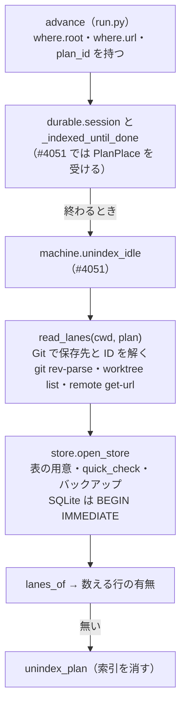
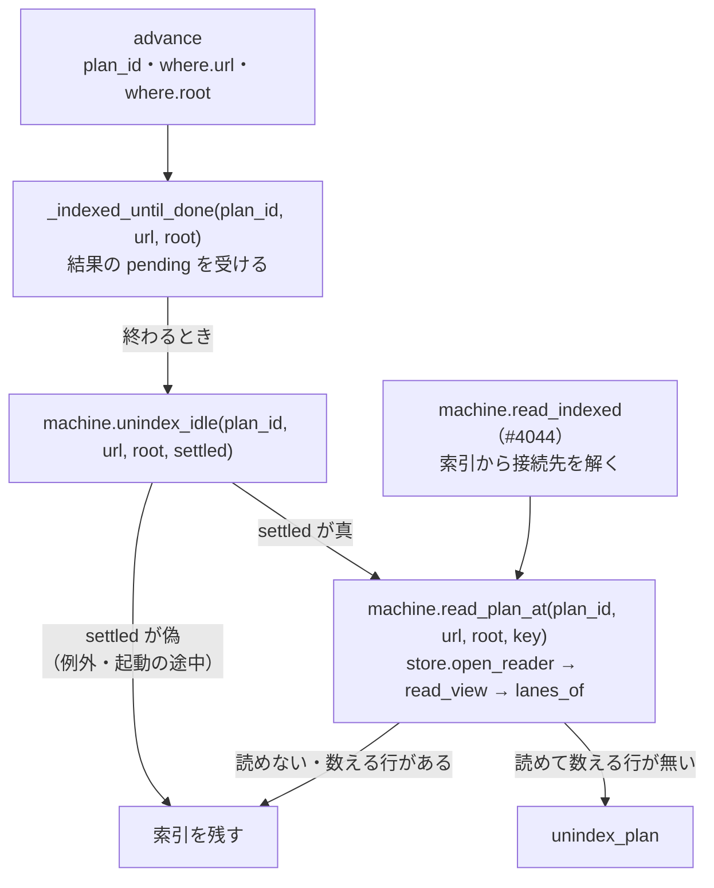

# #4051 の設計: 索引の後始末を、解決済みの所在から読み取りだけで開いて決める（#4092）

#4051 の設計（PR #4083）の後始末 `unindex_idle` は、耐久ワークフローが正常に終わるたびに `read_lanes` で計画の所在を Git で解き直し、書き込み用の開き方（`open_store`）で DB を開くので、子プロセスが増え、ほかのレーンの書き込みを待つ。`advance` が既に持つ計画の ID・接続先・保存先を後始末へ渡し、#4044 の設計が足す読み取りだけの開き方（`store.open_reader`）で計画を読んで、起動の許可と同じ `lanes_of` で数える行の有無を決める。置き換える #4051 の節と決定は「#4051 の文書のどこを置き換えるか」に、`open_reader` を足す実装の順と採らなかった案は「決定の記録」にある。

## 今の姿

何が起きたか・目的・受け入れ条件は要求仕様（[issue-4092-requirements.md](./issue-4092-requirements.md)、正は #4092 の本文）にある。直す対象は #4051 の設計文書 [issue-4051-design.md](./issue-4051-design.md) と詳細設計 [issue-4051-design-detail.md](./issue-4051-design-detail.md) で、使う読み取りの経路は #4044 の詳細設計 [issue-4044-design-detail.md](./issue-4044-design-detail.md) の「関数」の表（`open_reader`・`read_indexed`）にある。パスは `plugins/ndf/` からの相対で書く。

設計に要る今の構造:

| 部品 | 今の振る舞い（#4051・#4044 の設計を含む） | 場所 |
| --- | --- | --- |
| `advance` | 計画を `open_store(where.url, where.root)` で読み、`plan_id = table.plan_id(where.repo, plan)` を持つ。耐久ワークフローを `durable.session` と `_indexed_until_done` の中で流す | `src/ndf/progress/plan/run.py` |
| `read_lanes(cwd, plan)` | `command.store_root_of(cwd)`・`command.repo_id(cwd, root)` で保存先と ID を Git で解き、`open_store` で開いて `lanes_of` を返す。読めなければ `readable` が偽の行 | `src/ndf/progress/lane/machine.py` |
| `store.open_store` | 表の用意・目印が古いときの `quick_check` とバックアップを行い、SQLite は書き込みのトランザクションで開く | `src/ndf/progress/store.py` |
| `store.open_reader(url, root)`（#4044 の設計） | 読み取りだけで開く。表を作らない・検査をしない。SQLite は `mode=ro` と `BEGIN`（DEFERRED）・`busy_timeout` 0 で、書き手を待たない。バックアップからの戻し（`restore`）の最中は `StoreInUse`、表のバージョンが違えば `StoreStopped` | 同上 |
| `machine.read_indexed(place)`（#4044 の設計） | 索引の `store_root`・`db`・`plan_id` から接続先を解き、`open_reader` で開いて `read_view` と `lanes_of` で読む。Git を起こさない | `src/ndf/progress/lane/machine.py` |

## 文脈と制約

- 索引を書く・消す条件（#4051 の決定 1〜3）と、消す担い手がロックの持ち主だけであること（#4051 の決定 2）は変えない
- 数える行の規則（`lanes_of`・`held_seats`）は #4050・#4091 が持つ。この設計はそれを呼ぶだけで中身に触らない
- `store.open_reader` の仕様は #4044 の詳細設計が持つ。この設計は仕様を変えずに使う
- `where.url` はパスワードを含みうる。同じプロセスの中で後始末へ渡すだけで、索引のファイル・結果・ログに書かない
- `issues/issue-4051-*`・`issues/issue-4044-*` はこの PR で書き換えず、それぞれの実装の PR でこの設計に合わせて直す
- 決定の根拠に引く MVV の項目は main の `.ndf/mvv.md`（MVV バージョン 11）にある

## 解き方の全体像

- `advance` は解決済みの計画の ID・接続先・保存先をそのまま後始末へ渡し、後始末は Git を起こさない（決定 1）
- 後始末は、耐久ワークフローが結果を返して終わり、その結果に起動済みで行の開始を待つ起動（`pending`）が無いと確かめられたとき（`settled`）だけ計画を読む。例外で終わった・`pending` が残る・結果に `pending` が無いときは読まずに索引を残す（決定 4）
- 後始末は `store.open_reader` で計画を読み取りだけで開き、ほかのレーンが書いている間も待たずに確定済みの行で決める。読めなければ #4051 の決定 3 のとおり索引を残す（決定 1）
- 「開いて読む」手順は `machine.read_plan_at` の 1 か所に置き、#4044 の `read_indexed` も接続先を解いた後にこれを呼ぶ（決定 2）
- `store.open_reader` は #4051 の実装が #4044 の詳細設計の仕様どおりに足し、#4044 の実装はそれを使う。実装の順は #4044 の設計のとおり #4051 が先である（決定 3）

## 決定の記録

### 決定 1: 後始末が Git を起こさず書き手を待たないよう、`advance` の解決済みの所在を渡して読み取りだけで開く

- **質問**: 耐久ワークフローの終わりに、数える行の有無をどの所在からどう開いて読むか
- **選んだ案**: `advance` の `plan_id`・`where.url`・`where.root` を `_indexed_until_done` から `unindex_idle` へ渡し、`store.open_reader(url, root)` で開いて `plan_id` の計画を `read_view` と `lanes_of` で読む。`read_lanes`・`open_store` は呼ばない
- 採らなかった案: #4051 の設計のまま `read_lanes` で読む（正常に終わるたびに Git の子プロセスが 3 本ほど起き、`open_store` の検査と書き込みのトランザクションで、ほかのレーンの書き込みを待つ）
- 採らなかった案: `read_indexed` に索引の本文を渡して読む（索引の `db` はパスワードと認証情報のクエリを除いた接続先で、パスワードつきの DB は頼む側の環境に同じ `NDF_PROGRESS_DB` が無いと開けない。`advance` は開いた接続先そのものを持っているので、解き直す理由が無い。#4044 より前の形（版 1）の索引は保存先と接続先を持たないので、`read_indexed` では開けない）
- 採らなかった案: `open_store` に解決済みの所在を渡して読む（Git は起きないが、検査と書き込みのトランザクションが残り、受け入れ条件 3 を満たさない）
- **代償**: `_indexed_until_done` と `unindex_idle` の引数が #4051 の設計と変わる。WAL の回復中・戻しの最中は読めない計画として索引が残り、次に耐久ワークフローが終わるときか打ち直しで確かめ直す（#4051 の決定 3 の扱いのまま）
- 根拠: Value 2「役に立たない繰り返し（…）に費用を使わない」・Value 11「同じ規則・定数・処理は 1 か所にまとまり、ほかはそこを参照する」（MVV バージョン 11）

### 決定 2: 開いて読む手順を 1 か所に置くため、`read_plan_at` を足して `unindex_idle` と `read_indexed` の両方から呼ぶ

- **質問**: `open_reader` で開いて `read_view`・`lanes_of` で読み、読めない例外を `readable` の偽にする手順を、どこに置くか
- **選んだ案**: `machine.read_plan_at(plan_id, url, root, key)` を足し、`unindex_idle` が呼ぶ。#4044 の `read_indexed` は、接続先を解いた後の「開いて読む」部分をこの関数の呼び出しにする（`read_indexed` の契約は変えない）。後に実装する側が切り出すのでなく、`read_plan_at` を足す #4051 の実装が先に置き、#4044 の実装がそれを使う
- 採らなかった案: `unindex_idle` の中に `open_reader`・`read_view`・`lanes_of` を直に書く（#4044 の `read_indexed` と同じ 3 段と読めない例外の扱いが 2 か所に分かれ、読めない例外の集合を片方だけ直すと食い違う）
- **代償**: #4044 の実装は、詳細設計の `read_indexed` の中身を `read_plan_at` の呼び出しで書く（`read_indexed` の関数の表の責務の文はそのまま成り立つ）。#4044 の詳細設計の「新設する関数」に `read_plan_at` は入らない
- 根拠: Value 11「同じ規則・定数・処理は 1 か所にまとまり、ほかはそこを参照する」・Value 9「1 つのモジュール・クラス・関数が 1 つの責務を持ち」（MVV バージョン 11）

### 決定 3: 実装の順を #4044 の設計のまま保つため、`store.open_reader` は #4051 の実装が #4044 の仕様どおりに足す

- **質問**: #4051 が使う `store.open_reader` を、#4051 と #4044 のどちらの実装が足し、どちらを先に入れるか
- **選んだ案**: 実装の順は #4044 の設計（影響と危険の「実装の順」）のとおり #4051 が先である。#4051 の実装が `store.open_reader` を #4044 の詳細設計の「関数」の表の仕様どおりに足し、#4044 の詳細設計の「単体テストの観点」の「開き方」の行のテスト（`tests/progress/test_store_sqlite.py`）も同じ PR で足す。仕様の持ち主は #4044 の詳細設計のままとし、#4044 の実装はそれを既にある関数として使う
- 採らなかった案: #4044 を先に実装する（#4044 の設計は #4051 を先にする理由として、索引から外れた後も実行中の行が残る計画を数え落とす期間を縮めることを挙げている。順を入れ替えると、その期間が #4044 の実装の分だけ延びる）
- 採らなかった案: #4051 の実装は `read_lanes` のまま入れ、#4044 の実装の後に後始末を直す（受け入れ条件を満たさない形が 1 度リリースされ、直す PR が 1 本増える）
- 採らなかった案: `open_reader` の仕様をこの課題へ移す（#4044 の `ndf lanes seats` が主な使い手で、仕様と使い手を別の課題に分けると、仕様の直しが 2 つの設計に跨る）
- **代償**: #4051 の実装の PR が `store.py` と `test_store_sqlite.py` を触り、#4044 の実装の PR より大きくなる。#4051 の実装の後に #4044 の詳細設計の `open_reader` の仕様が変わると、#4044 の実装の PR が `open_reader` も直す（仕様の持ち主は #4044 のままなので、直す文書は #4044 の詳細設計の 1 か所である）。#4044 の実装の PR は、自分の詳細設計の `open_reader` を「新設」から「既にある（#4051 が足した）」へ直す
- 根拠: Value 11「同じ規則・定数・処理は 1 か所にまとまり、ほかはそこを参照する」・Value 2「役に立たない繰り返し（…）に費用を使わない」（MVV バージョン 11）

### 決定 4: 起動の許可を通った起動の行が確定する前に索引を消さないため、起動の途中が無いと確かめた終わりだけで計画を読む

- **質問**: 起動の許可（`admitted`）が索引を書いてラッパーを起動した後、別プロセスの conductor が `ndf lanes row start` を確定する前に耐久ワークフローが終わったとき、後始末は何で決めるか。conductor の `row start` は計画の実行のキーのロックを取らず、確定しても `admitted` を通り直さないので、そこで索引を消すと、その行を始めた計画は次の起動の許可まで索引に載らない。その間にラッパーと登録簿の行が消えると、別の計画は実行中の行を数え落とす。後始末の読み取りが待たない（決定 1）ので、`row start` を書き込み中のときも同じである
- **選んだ案**: 耐久ワークフローの結果（`RunState.as_result`）に `pending`（起動できて、まだ行が実行中にならない起動のキー。`launched` のうち `started` にあるもの。止める手を除く）を足す。`advance` は返す結果を `_indexed_until_done` へ渡し、`_indexed_until_done` は結果を受けて `pending` が空の配列のときだけ `settled` を真にして `unindex_idle(plan_id, url, root, settled)` を打つ。`unindex_idle` は `settled` が偽なら計画を読まずに索引を残す。例外で終わったとき・結果に `pending` が無い（この項目を足す前の版で記録した結果）ときも偽である。`pending` のキーは、行が実行中になったと読み直しが確かめるまで外れないので、`row start` が書き込み中か確定前なら必ず残る
- 採らなかった案: `row start` で計画の実行のキーのロックを取り、索引を書き直す（conductor の `row start` が耐久ワークフローの終わりを待つことになり、#4051 の決定 2 の「消すのはその計画の耐久ワークフローだけ」に加えて書く担い手が増える）
- 採らなかった案: 後始末を書き込みのトランザクションで開き、`row start` の確定を待つ（受け入れ条件 3 を満たさない。確定前の `row start`（conductor がまだ打っていない）は待っても見えない）
- 採らなかった案: 例外の終わりでも計画を読み、数える行が無ければ消す（例外の時点の `launched` を後始末が知る手段が無く、起動の途中を確かめられない。#4051 の決定 3 と同じく、確かめられないときは残す）
- **代償**: 例外で終わった計画と、起動の途中で区切り・中止で終わった計画の索引は、数える行が無くても残る。残った索引は数えすぎにならない（数えるのは実行中の行だけ）が、別の計画の起動の許可が読む計画が 1 つ増える。次の耐久ワークフローの終わりか完了済みの計画の打ち直しで消える。起動の期限（`Policy.up`）を過ぎて失敗に数えた起動のキーは `launched` から外れるので、期限の後に遅れて行を始めた conductor の行は守らない（期限の後は起動の失敗として打ち直し、打ち直しの `admitted` が索引を書き直す）
- 根拠: Value 3「判断の要らない手順は仕組みが進めるので、結果が実行ごとにばらつかない」・Value 2「利用者が払う費用（…マシンの資源）が小さい」（MVV バージョン 11）

## 影響と危険

- **働く範囲**: この PR は設計文書だけで、振る舞いは変わらない。#4051 の実装の後は、利用先のリポジトリでも並列の計画（`ndf lanes run`）を流すすべてのマシンで効く
- **プロジェクトごとに違うもの**: 無い（接続先は計画の起動で確定した値を使う）
- **当たるモード**: 並列の計画を流すすべてのモード
- **#4051・#4044 の文書との食い違い**: この PR のマージから各実装の PR までの間、`issues/issue-4051-*` と `issues/issue-4044-*` は直す前の中身のまま残る。#4051 の実装は「#4051 の文書のどこを置き換えるか」の表のとおり #4051 の文書を直してから実装し、#4044 の実装は決定 2・3 の代償のとおり自分の詳細設計を直す
- **同じファイルを触る別の変更と境界**:

| 課題 | 触るもの | この設計との境界 |
| --- | --- | --- |
| #4051 | `machine.py` の `unindex_idle`・`is_indexed`、`run.py` の `_indexed_until_done`・`advance` | この設計は #4051 の後始末の読み方と引数だけを置き換える。#4051 の実装の PR に含めて入れる |
| #4044 | `store.py` の `open_reader`・`index_url`・`indexed_url`、`machine.py` の `PlanPlace`・`index_plan`・`read_indexed`・`machine_seats`、`run.py` の `PlanPlace` を作るところ | `open_reader` は #4051 の実装が先に足し（決定 3）、`read_indexed` は `read_plan_at` を呼ぶ（決定 2）。`advance` が索引を書くための `PlanPlace`（`store_root`・`db`）は #4044 が持ち、後始末はそれを読まない |
| #4091（待つ行の席を返す。設計中） | `lanes_of`・`held_seats` の中身（どの行を数えるか） | 後始末は `lanes_of` を呼ぶだけで、数える行の規則は #4091 の結果に従う。席を返した待ちの行を数えなくなると、その計画の索引は数える行が無くなった時点で消え、席を取り直すときの起動の許可（`admitted` の `index_plan`）が書き直す |
| #4050 | `lanes_of`・`count`・`held_seats` | #4091 と同じ |

- **壊れうる箇所**:
  - 後始末は読んだ時点で確定済みの行だけで決めるので、読んだ直後に別の接続が同じ計画へ実行中の行を確定させると、その行は数えない。同じ計画へ実行中の行を確定させるのは、耐久ワークフローが起動した conductor の `row start` だけで、その起動のキーは行が実行中になったと読み直しが確かめるまで結果の `pending` に残るので、後始末は計画を読まずに索引を残す（決定 4）。`pending` が空なら、耐久ワークフローが起動した conductor はどれも行を始めたか起動の失敗に数えられており、読む瞬間に書き込み中の `row start` は無い。conductor の `row start` は `admitted` を通り直さないので、この判定を落とすと、行を始めた計画が次の起動の許可まで索引に載らない
  - `open_reader` は表のバージョンが自分と違えば・WAL の回復中なら読めない計画にする。プラグインを更新した直後に古い版の耐久ワークフローが終わると、索引が残る。残った索引は、同じ計画の次の耐久ワークフローの終わりか、完了済みの計画の打ち直し（#4051 の詳細設計の `advance` の早期 return）で消える。それまでは起動の許可がその計画を読み、実行中の行があれば数え、無ければ 0 本と数える（#4051 の受け入れ条件 2）ので、数えすぎることはない
- **用語集**: 足す語は無い

### 代表のリポジトリでの振る舞い

| 代表のリポジトリ | 設定の要点 | 直した後に起きること | この種類で扱えなくなること |
| --- | --- | --- | --- |
| Web サービス（nd-factory） | 並列の計画で複数のレーンを流す。進行の DB は SQLite か PostgreSQL | #4051 の実装の後、耐久ワークフローの終わりで Git の子プロセスが起きず、ほかのレーンが書いている間も後始末が待たない | 無し |
| モバイルアプリ | 同上 | 同上 | 無し |
| 業務文書だけ | 並列の計画を使うときだけ同上 | 同上 | 無し |

### ai-plugins だけの事情

- 無し（後始末の読み方は NDF のコードが持ち、このリポジトリの宣言の値を使わない）

## テスト設計

#4051 の実装の PR で縛る。

| 受け入れ条件（#4092） | どの振る舞いで縛るか | どう壊したら落ちるべきか |
| --- | --- | --- |
| 1. 解決済みの所在で読み取りだけで開き、`lanes_of` で決める | 実行中の行を持つ計画で `unindex_idle` が偽を返し索引が残り、行を終えると真を返し消える。`read_lanes`・`open_store` を差し替えて呼ばれたら落とすと、どちらも呼ばれない | 後始末が `read_lanes` か `open_store` を通る |
| 2. 正常終了の後始末で子プロセスが 0 本 | `advance` が完了で終わるとき、`_indexed_until_done` を抜ける間に `subprocess.run`・`subprocess.Popen` が呼ばれない（後始末の間だけ数える） | 後始末が所在を Git で解く |
| 3. 書き手を待たずに確定済みの行で決める | 別の接続が `BEGIN IMMEDIATE` で書き込みを開いたまま（確定済みの行は実行中の行が無い）でも、`unindex_idle` が即座に真を返し索引を消す | 後始末が書き込みのトランザクションで開く・書き手を待つ |
| 4. 読めない計画は残す（#4051 の決定 3） | DB の無い保存先・計画の無い DB・戻しの最中（`db_lock` を排他で持つ）で `unindex_idle` が偽を返し索引が残る | 読めない計画の索引を消す |
| 決定 4（起動の途中は残す） | 起動の許可を通して起動した後、`row start` の前に耐久ワークフローが例外で終わる（結果が無い）・`pending` を持つ結果で終わるとき、`unindex_idle` が計画を読まずに偽を返し索引が残る。その後 conductor が `row start` を確定し、ラッパーと登録簿の行を消した状態で、別の計画の起動の許可（`machine_plans`）がその行を数える。`pending` の無い古い結果でも残る | 起動の途中で索引を消す・例外の終わりで計画を読んで消す |

## どこを変えるか

詳細設計は [issue-4092-design-detail.md](./issue-4092-design-detail.md) にある（新設する関数 1（`read_plan_at`）と、#4051 の実装が足す `open_reader`（仕様は #4044）、シグネチャを変える関数 1（`_indexed_until_done`）と、結果に `pending` を足す `RunState.as_result` のため別ファイル）。

## #4051 の文書のどこを置き換えるか

#4051 の実装の PR は、次の表のとおり `issues/issue-4051-design.md` と `issues/issue-4051-design-detail.md` を直してから実装する。要求仕様（`issues/issue-4051-requirements.md`）は変えない（#4051 の受け入れ条件はどれも索引の寿命の条件で、読み方を縛らない）。

| 文書 | 節・決定 | 今の中身 | 置き換えた後 |
| --- | --- | --- | --- |
| 設計文書 | 解き方の全体像の後始末の箇条と図 | 後始末は計画を起動の許可と同じ読み手（`read_lanes`）で読む | 後始末は `advance` の計画の ID・接続先・保存先で `read_plan_at` を通して読み取りだけで開き、起動の許可と同じ `lanes_of` で決める |
| 設計文書 | 決定 3（読めないときは残す） | 「読めない」は `read_lanes` が `readable` の偽を返すこと | `read_plan_at` が `readable` の偽を返すこと（DB が無い・表のバージョンが違う・戻しの最中・WAL の回復中・計画が無い）。残す扱いは変えない。この文書の決定 4（例外で終わった・起動の途中が残るときは読まずに残す）を足す |
| 設計文書 | 影響と危険の「同じファイルを触る別の変更と実装の順」 | #4044 との重なりは `PlanPlace`・`run.py`・索引の節 | この文書の決定 3 と「影響と危険」の #4044・#4091 の行を足す。`store.py`（`open_reader`）と `tests/progress/test_store_sqlite.py` を触るファイルに足す |
| 設計文書 | 設計の結果の触るファイル | 5 ファイル | `src/ndf/progress/store.py`・`tests/progress/test_store_sqlite.py` を足して 7 ファイル |
| 詳細設計 | 地図・構成要素の表 | `machine.py`・`run.py` とそのテスト | `store.py` の `open_reader`（新設。仕様は #4044）と `machine.py` の `read_plan_at`（新設）を足す |
| 詳細設計 | 「索引を消す条件」の `unindex_idle` | `unindex_idle(where: PlanPlace)`。`read_lanes(Path(where.cwd), where.plan)` で読み、`key` と `where.plan_id` を比べる | [issue-4092-design-detail.md](./issue-4092-design-detail.md) の `unindex_idle` で置き換える。ID の比較と「読んだ計画の ID が索引と違う」の異常系の行は消す（計画の ID で直に開くので食い違わない。その DB に計画が無いときは読めない計画として残す） |
| 詳細設計 | 「耐久ワークフローの終わり」の `_indexed_until_done`・`advance` | `_indexed_until_done(where: machine.PlanPlace)`。`advance` は `machine.PlanPlace(plan_id, str(where.cwd), plan)` を渡す。`PlanPlace` の `cwd` を `launch_lane` と同じ値にそろえる段落がある | 詳細設計の `_indexed_until_done`・`advance` で置き換える。`PlanPlace` を作って渡す記述と `cwd` をそろえる段落は消す（後始末は `cwd` を読まない） |
| 詳細設計 | 単体テストの観点 | 「読んだ計画の ID が索引の `plan_id` と違う」の行 | 消して、詳細設計の「単体テストの観点」の 4 行を足す |

## 設計の結果

| 課題 | 扱い | 統合先 | 触るファイル |
| --- | --- | --- | --- |
| #4092 | 実装する | #4051 の実装の PR | `plugins/ndf/src/ndf/progress/lane/machine.py`、`plugins/ndf/src/ndf/progress/plan/run.py`、`plugins/ndf/src/ndf/progress/plan/run_decide.py`、`plugins/ndf/src/ndf/progress/store.py`、`plugins/ndf/tests/progress/test_lane_machine.py`、`plugins/ndf/tests/progress/test_plan_run.py`、`plugins/ndf/tests/progress/test_store_sqlite.py`、`issues/issue-4051-design.md`、`issues/issue-4051-design-detail.md` |

## 外部の調査

省く: 読み取りだけの開き方は #4044 の設計が SQLite の `mode=ro`・WAL の読み手と PostgreSQL の `READ ONLY` を前提に決めており、この設計はその関数に解決済みの所在を渡すだけで、比べる新しい形が無い
