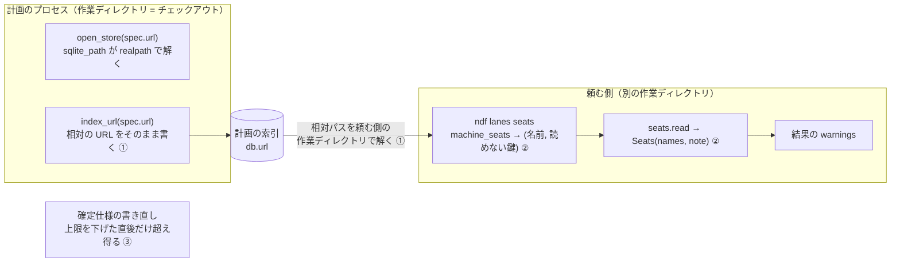
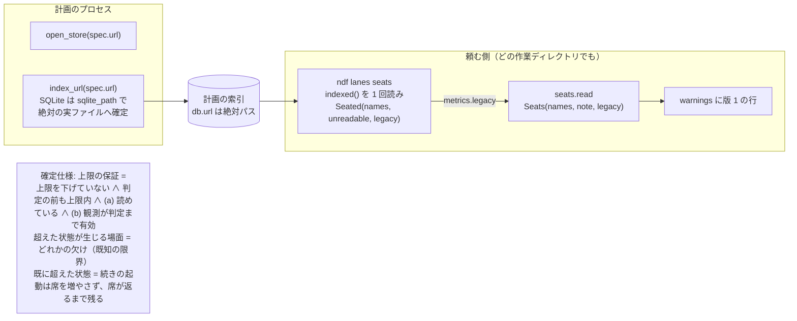

# ndf lanes seats: どの作業ディレクトリからも計画の DB を数え、版 1 の索引の数え落としを知らせ、上限の保証を守れる条件で書く（#4100）

省いた文書: 詳細設計書（別ファイル）（新設する関数 0・シグネチャを変える既存の関数 0。#4044 が新設する `machine_seats` の返り値と `Seats` の項目を変えるが、どちらもコードにまだ無い。「どこを変えるか」に畳む）

#4044 の詳細設計は、索引に相対の SQLite の URL を書き、版 1 の索引の件数を頼む側へ運ぶ道を持たず、確定仕様に条件なしの上限の保証を書くので、そのまま実装すると別の DB を数え、数え落としを知らせず、守れない約束を書く。索引に書く接続先を書いたプロセスが開いた実ファイルの絶対パスに確定し、版 1 の件数を名前と同じ 1 回の索引の読みから作って結果の値として `warnings` まで運び、上限の保証を「読めている」「観測が判定まで有効」の 2 つの条件つきで書いて既知の限界の各行をその欠けとして並べる。直しは #4044 の実装に含め、#4044 の設計文書はその実装の PR で合わせる。採らなかった案は「決定の記録」に、外部の調査を省いた理由は付録にある。

## 今の姿

何が起きたか・目的・受け入れ条件は要求仕様（[issue-4100-requirements.md](./issue-4100-requirements.md)、正は #4100 の本文）にある。直す対象は #4044 の設計文書 [issue-4044-design.md](./issue-4044-design.md) と詳細設計 [issue-4044-design-detail.md](./issue-4044-design-detail.md) で、コードはまだ無い。パスは `plugins/ndf/` からの相対で書く。

設計に要る今の構造（#4044 の設計を含む）:

| 部品 | 今の振る舞い | 場所 |
| --- | --- | --- |
| 接続先の解き方（実装済み） | `default_url` は `NDF_PROGRESS_DB` の値をそのまま返す。`sqlite_path` は SQLite のファイルのパスを `os.path.realpath` で解く（開くプロセスの作業ディレクトリから） | `src/ndf/progress/store.py` |
| 計画のプロセスの作業ディレクトリ（実装済み） | `ndf lanes run` は計画のチェックアウトを作業ディレクトリにして切り離して起動される。DB を開くのも索引を書くのもこのプロセスである | `src/ndf/progress/plan/run.py` の `detach`・`advance` |
| `store.index_url`（#4044 の設計） | URL からパスワードと認証情報のクエリだけを除いた文字列を `url` に、除いたものが無かったかを `exact` に入れる。SQLite の相対パスは相対のまま残す | [issue-4044-design-detail.md](./issue-4044-design-detail.md) の「関数」の表 |
| `store.indexed_url`（#4044 の設計） | `exact` が真なら `db["url"]` をそのまま返す | 同上 |
| `machine_seats`・`_cmd_seats`（#4044 の設計） | `machine_seats` は名前と読めない計画の鍵の 2 つを返す。`_cmd_seats` の結果は `metrics.legacy` を持つと書くが、作る材料が無い | 同上の「関数」の表と「`machine_seats`・`_cmd_seats`」 |
| `Seats`・`seats.read`（#4044 の設計） | `Seats(names, note)`。成功した結果の `metrics` を運ばない | 同上の「`seats.read`」 |
| 確定仕様の書き直し（#4044 の設計） | 「常に成り立つ条件」に、上限を下げない限り続きの起動の後も上限を超えない行を足す。「リレーハブの起動の判定」の最後の段落を「上限を下げた直後だけ超え得る」にする。既知の限界には上限を下げなくても超え得る 6 行を足す | 同上の「確定仕様の書き直し」、[issue-4044-design.md](./issue-4044-design.md) の「解き方の全体像」の最後の項目（「4 つの場面」と書く） |

3 点はどれも #4044 の設計文書の中の欠けで、直す場所も #4044 の実装なので、1 本の設計にまとめる。

## 文脈と制約

- #4044 は実装の前で、索引の版 2 はまだどこにも書かれていない。版 2 の `db.url` の値の決め方を変えても、移す既存の索引は無い
- 頼む側のパッケージ（`ndf.domains.relay`）は計画のパッケージ（`ndf.progress`）を読み込めない（#4044 の要求仕様の前提 2）。頼む側が計画について知れることは、`ndf lanes seats` の結果 JSON だけである
- 接続先の相対パスを開くプロセスの作業ディレクトリから解く今の振る舞い（`default_url`・`sqlite_path`）は変えない。変えると、バックアップ・戻し・検査など `store` を使うすべての呼び手の振る舞いが変わる
- 観測を判定まで有効にする仕組み（手動の `ndf relay restart` の頼む側が `held` の読み取りから結果まで `admit.lock` を持つ）は #4103 が設計している。この課題は保証の条件を書くだけで、排他を足さない

## 解き方の全体像

- `store.index_url` は SQLite の URL を、`open_store` と同じ `sqlite_path` で解いた実ファイルの絶対パスの URL にして返す。索引を書くのは DB を開いたのと同じプロセスなので、索引の `db.url` はそのプロセスが開いた DB を指し、頼む側はどの作業ディレクトリから読んでも同じ DB を開く。`indexed_url` は絶対パスでない SQLite の `db.url` を解けないとする
- `machine_seats` は索引を 1 回読んだ一覧から、名前・読めない計画の鍵・保存先か接続先を持たない（版 1 の）索引の計画の件数を 1 つの型 `Seated` で返す。`_cmd_seats` は件数をいつも `metrics.legacy` に載せ、`seats.read` は `Seats` の `legacy` へ運び、頼む側の CLI が 1 以上なら `warnings` に 1 行を載せる
- 確定仕様は、上限を下げていないこと・判定の前も上限内であることに加えて (a) 判定の時点でラッパーの一覧と、実行中の行を持つ計画をすべて、各計画が実際に使う DB から読めていること、(b) その観測が判定まで有効であることを、上限内を保つ保証の条件として書く。これと分けて、上限を超えた状態が生じる場面（上限を下げたときと、ある判定で (a) か (b) を欠いたとき）と、既に超えた状態では続きの起動（`--seated`）が本数を判定し直さず席も増やさないので、超えた分は席が返るまで残ることを書く。既知の限界の各行は、どの条件を欠く場面かを添えて並べる
- 直しは #4044 の実装に含め（「設計の結果」の扱いは「マージする」）、#4044 の実装の PR が `issues/issue-4044-design.md`・`issues/issue-4044-design-detail.md` を「どこを変えるか」のとおりに直す

## ドメインモデル

| 項目 | 中身 |
| --- | --- |
| コンテキスト | 並列の計画のマシン全体の上限（計画のパッケージ `ndf.progress.lane` と、リレーの頼む側 `ndf.domains.relay`） |
| 変える集約とオーナー | マシンの計画の索引の 1 件（`PlanPlace`。オーナーは `machine.py`。書くのは起動の許可、読むのは起動の許可と `ndf lanes seats`） |
| 不変条件 | I1: 索引の `db.url` が SQLite なら、書いたプロセスが開いた実ファイルの絶対パスを指す。I2: `ndf lanes seats` の `legacy` は、同じ結果の `items` と `metrics.unreadable` を作ったのと同じ 1 回の索引の読みから数える。I3: 確定仕様の上限の保証は、条件 (a)・(b)・上限を下げていないこと・判定の前も上限内であることのすべてが成り立つときだけを約束する。前の判定の欠けで既に超えた状態は、後の判定で (a)・(b) が成り立っても解消を約束しない |
| ドメインイベント | 起動の許可が計画を索引に書いた（I1 が成り立つ）→ 頼む側が `ndf lanes seats` を読んだ（I2 が成り立つ）→ ハブが判定した（I3 の条件の (b) は、読んでから判定までの間に新しく行を始めたレーンが無いときだけ成り立つ。起動済みのラッパーの conductor の `row start` を含み、`admit.lock` を持つ起動の許可でも欠け得る） |

## 決定の記録

### 決定 1: 索引がどの作業ディレクトリからも同じ DB を指すため、`store.index_url` が SQLite の URL を `sqlite_path` で絶対の実ファイルへ確定する

- **質問**: 相対の SQLite の URL を、どこで絶対パスに確定するか
- **選んだ案**: `store.index_url(url)` が、SQLite の URL を `f"{SQLITE_PREFIX}{sqlite_path(url)}"`（`exact` は真）にして返す。`sqlite_path` は `open_store` が開くファイルを決めるのと同じ関数（`os.path.realpath`）なので、同じプロセスで同じ URL を通せば、索引の値は開いた DB の実ファイルと一致する。呼び手（`run.py` の `PlanPlace` を作るところ）は変えない。読む側の `indexed_url` は、SQLite の `db.url` のパスが絶対パスでなければ None を返し、`read_indexed` は開かずに読めない計画にする（頼む側の作業ディレクトリで解かない）
- 採らなかった案: `run.py` が `index_url` へ渡す前に絶対パスへ直す（起票者の推定 S2。索引に書く値を作る関数が 2 か所に分かれ、別の呼び手が直し忘れると相対のまま書く）
- 採らなかった案: `default_url` で `NDF_PROGRESS_DB` を絶対パスへ直す（バックアップ・戻し・検査の呼び手を含む `store` のすべての振る舞いが変わり、この課題の範囲を超える）
- 採らなかった案: 相対の URL と書いたときの作業ディレクトリを索引に並べて書き、読む側で解く（解く規則が書く側と読む側の 2 か所に分かれる。`realpath` のシンボリックリンクの解き方が読む時点の状態に依る）
- 採らなかった案: `os.path.abspath` で直す（`open_store` は `realpath` で解くので、シンボリックリンクを挟むと索引の値と開いたファイルの表記が食い違う）
- **代償**: 計画のプロセスが DB を開いてから索引を書くまでの間に作業ディレクトリを変えると食い違うが、計画のプロセスは作業ディレクトリを変えない（`detach` がチェックアウトを作業ディレクトリにして起動する）
- 根拠: Value 11「同じ規則・定数・処理は 1 か所にまとまり、ほかはそこを参照する」・Value 3「判断の要らない手順は仕組みが進めるので、結果が実行ごとにばらつかない」（MVV バージョン 11）

### 決定 2: 数え落としを結果の値で知らせるため、版 1 の件数を名前と同じ索引の読みから `Seated` で返し、`metrics.legacy` と `Seats.legacy` で頼む側まで運ぶ

- **質問**: 版 1 の索引の件数を、どこで数え、どの形で頼む側の `warnings` まで運ぶか
- **選んだ案**: `machine_seats(listed) -> Seated` の `Seated(names, unreadable, legacy)` を返す。`legacy` は、名前を作るのと同じ 1 回の `indexed()` の一覧のうち、`store_root` か `db` が None（版 1。版 2 でも形が違えば `indexed` が None にする）の計画の数である。版 1 の計画の鍵は #4044 の設計のとおり `unreadable` にも載せ、`legacy` はその部分集合の数とする（`held` には名前を載せず、`warnings` は版 1 の行の 1 行だけで、読めない計画の行を別に出さない）。`_cmd_seats` は `metrics.legacy` を `ok` の結果にいつも載せる（0 を含む）。`seats.read` は `metrics.legacy` を `Seats(names, note, legacy)` の `legacy` へ写す。頼む側の `cli._hub` は、名前を読めたとき、`legacy` が 1 以上なら「版 1 の索引の計画 <数> 件を数えていない（その計画の次の起動の許可で書き直される）」を、`legacy` が None（`metrics.legacy` が 0 以上の整数でない）なら「サブコマンド lanes seats の metrics.legacy を読めない（版 1 の索引の計画を数えたか分からない）」を `warnings` に 1 行載せ、どちらでも `held` には読めた名前を載せる
- 採らなかった案: `_cmd_seats` が自分の結果の `warnings` に文を書き、`seats.read` が `warnings` を丸ごと頼む側へ写す（件数が文の中に入って型で縛れず、テストが文言を照らすことになる。頼む側の結果の文を書く場所が 2 か所になる）
- 採らなかった案: `_cmd_seats` が `indexed()` をもう 1 回読んで数える（名前を作った一覧と件数を数えた一覧の間に索引が書き直されると、件数が名前と食い違う）
- 採らなかった案: `metrics.legacy` を読めないとき名前も捨てて今の数え方へ落とす（読めた名前を捨てると、数えられる席まで数え落とす）
- **代償**: 版 1 以外の読めない計画（登録簿にだけ載る・接続先を解けない）は今の #4044 の設計のまま `warnings` に出さない
- 根拠: Value 3「判断の要らない手順は仕組みが進めるので、結果が実行ごとにばらつかない」・Value 11「同じ規則・定数・処理は 1 か所にまとまり、ほかはそこを参照する」（MVV バージョン 11）

### 決定 3: 確定仕様が守れない約束を書かないため、上限の保証を 2 つの条件つきで書き、既知の限界の各行をその欠けとして並べる

- **質問**: 確定仕様の「常に成り立つ条件」と「リレーハブの起動の判定」の最後の段落で、上限の保証をどう書くか
- **選んだ案**: 次の文に直す。「上限を下げておらず、判定の前に稼働中のレーンとほかの動いている名前つきのラッパーの数が上限以内で、判定の時点で (a) と (b) が成り立つとき、続きの起動の後も、稼働中のレーンとほかの動いている名前つきのラッパーの数は上限を超えない。(a) 読めている: 判定の入力が、ラッパーの一覧と、実行中の行を持つ計画をすべて、各計画が実際に使う DB から読めている（起動の許可は、`machine_plans` に読めない計画が無く、かつ各計画を読んだ DB がその計画の使う DB である。`machine_plans` は版 2 の索引の `db.url` を使わず、`read_lanes` が起動を申請する側の `NDF_PROGRESS_DB` と作業ディレクトリで DB を解くので、読めない計画が無いことだけでは確かめられない。ハブの通常の起動と再起動は、要求に `held` があり、それを作った `ndf lanes seats` の `metrics.unreadable` が空で、ハブが要求の `held` を読む版である）。(b) 観測が判定まで有効: 計画を読んでからハブが判定するまでに、新しく実行中の行を持ったレーンが無い（`admit.lock` が直列にするのは起動の許可どうしだけで、起動済みのラッパーの conductor が行を始める記録（`row start`）はこの錠に従わない。ハブは計画を読んだ後に `hub.lock` の中で動いているラッパーの一覧を読み直して数えるので、計画を読んだ時点ではラッパーだけが動いていたレーンが、判定までに行を始めてすぐラッパーが落ちると、`held` にも一覧にも載らない。この移り目は、起動の許可でも、頼む側の通常の起動と再起動でも、`admit.lock` を持つかどうかによらず (b) を欠く。頼む側の通常の起動と再起動は排他も持たないので、間に新しい起動の許可が行を始めた場合も成り立たない）」。この行の次に、超えた状態の扱いを別の行で書く。「上限を超えた状態が生じるのは、上限を下げたときと、ある判定で (a) か (b) を欠いたときだけである。いったん超えた状態は、後の判定で (a) と (b) が成り立っても解消されない。続きの起動（`--seated`）は登録簿の席が一致すれば本数を判定し直さずに通り、席を増やさないので合計は変わらず、超えた分はレーンが終わって席を返すまで残る。例えば上限 1 で、表の `row start` とラッパーの終了の競合により止まったレーン 1 本を数え落として別のラッパー 1 本を起こすと、その後に両方を読めて新しい `row start` が無くても、止まったレーンの続きの起動の後の合計は 2 のままである」。最後の段落は「上限を超えた状態が生じ得るのは、上限を下げた直後と、(a) か (b) を欠く場面（既知の限界）だけである。既に超えた状態での続きの起動は席を増やさないが、超えた分を減らしもしない」にする。既知の限界の表に「欠ける条件」の列を足し、下の表のとおり各行がどの条件を欠くかを書く
- 採らなかった案: 「上限を下げた直後だけ」のまま、既知の限界を例外として並べる（「だけ」と例外が同じ節の中で食い違い、読み手が保証の範囲を決められない）
- 採らなかった案: 条件を書かずに保証の行を消す（#4044 の受け入れ条件 3 が縛る振る舞い（読めたときは続きの起動の後も超えない）が仕様から消える）

| 上限を超え得る場面 | 欠ける条件 | 確定仕様の置き場 |
| --- | --- | --- |
| 上限を下げた直後 | 上限を下げていない | 常に成り立つ条件の「上限を稼働中の数より下へ下げても」の行（今のまま） |
| 前の判定で (a) か (b) を欠いて既に超えた状態のまま、止まったレーンを続きの起動（`--seated`）で起こす | 判定の前も上限内 | 常に成り立つ条件の超えた状態の扱いの行（この課題が足す）。続きの起動は席を増やさないので、超えた分は前の欠けの行から来る |
| 起動の許可がラッパーの一覧か計画の状態を読めない | (a) | 稼働中の数の数え方（今のまま） |
| 頼む側が `ndf lanes seats` を読めない間 | (a) | 既知の限界（#4044 が足す） |
| 旧い版のハブが要求を処理する間（プラグインの更新の直後） | (a) | 同上 |
| 索引に載らず登録簿の conductor の行にだけ載る計画 | (a) | 同上 |
| 版 1 の索引の計画（次の起動の許可で書き直されるまで） | (a) | 同上。頼む側の `warnings` に 1 行出る（決定 2） |
| パスワードつきの接続先の計画で、頼む側に同じ `NDF_PROGRESS_DB` が無い | (a) | 同上 |
| 起動の許可が、計画の使う DB と別の DB を読めてしまう計画。例えばチェックアウト A と B がそれぞれ `NDF_PROGRESS_DB=sqlite:///progress.db` を使い、B 側の DB に A と同じ `plan_id` の古い行があると、B の起動の許可は A の計画を B 側の DB から読んで読み取りに成功し、A の実行中のレーンを数え落とす。A のラッパーが止まっていれば、上限 1 でも B を起動できる | (a) | 同上。`machine_plans` は版 2 の `db.url` を使わず、`read_lanes` が申請する側の環境と作業ディレクトリで DB を解くので、`machine_plans` に読めない計画が無くても起きる |
| 頼む側が読んでからハブが判定するまでに、新しい起動の許可で行を始め、すぐラッパーが落ちたレーン | (b) | 同上。手動の `ndf relay restart` の分は #4103 が狭める |
| 計画を読んだ時点ではラッパーだけが動き、判定までに conductor が行を始めて（`row start`）すぐラッパーが落ちたレーン（起動済みのラッパーから行の記録へ席が移る間） | (b) | 同上。起動の許可・頼む側の通常の起動と再起動のどれでも起きる。`row start` は `admit.lock` に従わないので、#4103 の再起動側の排他では防げず残る |

- **代償**: 確定仕様の保証の行が長くなる。条件を 2 つの記号で名付け、既知の限界の列から指して長さを抑える
- 根拠: Value 13「確かめたことだけが済んだとされる」・Value 11「同じ規則・定数・処理は 1 か所にまとまり、ほかはそこを参照する」（MVV バージョン 11）

### 決定 4: 持ち物を重ねないため、この課題は #4044 の実装へ含め、#4103・#4091・#4051・#4092 とは保証の条件と索引の値の決め方だけで接する

- **質問**: 同じ部品を触る #4044・#4051・#4092・#4091・#4103 と、どこで分け、どの順で実装するか
- **選んだ案**:

| 課題 | 境界 | 実装の順 |
| --- | --- | --- |
| #4044 | この課題の直しは #4044 の実装の中で行う（「設計の結果」の扱いは「マージする」）。#4044 の設計文書は #4044 の実装の PR で直す | 同じ PR |
| #4051・#4092 | 索引を書く・消す時点と条件、`read_plan_at`・`unindex_idle` には触らない。`unindex_idle` は `advance` の解決済みの `where.url` を使い、索引の `db.url` を読まないので、決定 1 の影響を受けない。#4092 の `read_plan_at` は `read_indexed` が解いた URL（決定 1 で絶対パス）を受けるだけで、契約は変わらない | #4044 の設計のまま（#4051 → #4044） |
| #4091 | 数える行の規則（`LaneRow.counted`）には触らない。返却済みの席を数えないのは「実行中の行を持つ」の定義の内側なので、条件 (a)・(b) の文はそのまま成り立つ | #4044 → #4091 |
| #4103 | 条件 (b) を成り立たせる仕組み（手動の `relay restart` の頼む側が `held` の読み取りから結果まで `admit.lock` を持つ）は #4103 が持つ。この課題は (b) の条件と、それを欠く既知の限界の行を書くだけで、排他を足さない。#4103 の実装は、その行の「手動の `ndf relay restart`」の分を外す。起動済みのラッパーから行の記録へ席が移る間の行は、#4103 の排他が `row start` を直列にしないので残す | #4044 → #4091 → #4103 |

- 採らなかった案: この課題を独立した実装の PR にする（#4044 の未実装の関数の中身を、#4044 の後に別の PR で直すことになり、間に誤った版がリリースされうる）
- 採らなかった案: 条件 (b) を成り立たせる排他もこの課題で足す（#4103 の設計と同じ箇所を 2 つの課題が持つ）
- **代償**: #4044 の実装の PR の差分と受け入れ条件が、この課題の分だけ増える
- 根拠: Value 11「同じ規則・定数・処理は 1 か所にまとまり、ほかはそこを参照する」・Value 5「完璧なものより、小さく「たぶん動く」ものが早く届く」（MVV バージョン 11）

## 影響と危険

- **働く範囲**: 利用先のリポジトリでも働く。相対の `NDF_PROGRESS_DB` を使うマシンで、リレーの通常の起動と再起動が計画の DB を正しく数える
- **プロジェクトごとに違うもの**: 無し（接続先は今のとおり環境変数 `NDF_PROGRESS_DB` で受ける）
- **当たるモード**: リレーを使うすべてのモード
- **壊れうる箇所**:
  - 索引の `db.url` が絶対パスになるので、チェックアウトを別のパスへ移すと、次の起動の許可が書き直すまで `ndf lanes seats` はその計画を読めない計画にする（今の #4044 の設計でも、保存先 `store_root` は絶対パスなので同じ）
  - 版 1 の索引が残るマシンでは、通常の起動と再起動の結果に `warnings` の行が出る。起動の可否は変わらない
- **同じファイルを触る別の変更と実装の順**: 決定 4 の表のとおり。この課題が触るのは #4044 の実装が新設する関数（`index_url`・`indexed_url`・`machine_seats`・`_cmd_seats`・`Seats`・`seats.read`）と `cli._hub` の `warnings` の組み立てだけで、#4051・#4092・#4091・#4103 の関数には触らない
- **書きかけの文書**: #4103 の設計は同じレーンで並行して書かれている。#4103 の設計が既知の限界の (b) の行を書き換えるときは、この課題の「欠ける条件」の列を残す

### 代表のリポジトリでの振る舞い

| 代表のリポジトリ | 設定の要点 | 直した後に起きること | この種類で扱えなくなること |
| --- | --- | --- | --- |
| Web サービス（nd-factory） | 並列の計画をリレーで流す。`NDF_PROGRESS_DB` は使っても使わなくてもよい | 相対の `NDF_PROGRESS_DB` でも、オーガナイザーの起動と再起動が計画の DB を読んで数える。版 1 の索引が残る間は結果に知らせが出る | 無し |
| モバイルアプリ | 同上 | 同上 | 無し |
| 業務文書だけ | 同上（文書のスプリントのレーン） | 同上 | 無し |

### このリポジトリだけの事情

- 無し（索引の値と結果の形は NDF の製品の振る舞いで、ai-plugins の運用の値を持たない）

## テスト設計

| 受け入れ条件 | どの振る舞いで縛るか | どう壊したら落ちるべきか |
| --- | --- | --- |
| 1 | 計画のチェックアウト A を作業ディレクトリにし、`NDF_PROGRESS_DB=sqlite:///progress.db` で起動の許可を通すと、索引の `db.url` が A の `progress.db` の実ファイル（`realpath`）の絶対パスの URL になる。作業ディレクトリを B（同じ相対の値で、同じ `plan_id` の実行中の行を持つ別の `progress.db` がある）に変えて `_cmd_seats` を打つと、A の DB の名前を返し、B の DB の名前を含めない | `index_url` が相対のまま書くと B の DB を読んで落ちる。`abspath` で直すと、シンボリックリンクを挟んだチェックアウトで値が食い違って落ちる |
| 1 | `indexed_url` に相対パスの SQLite の `db.url`（手で書いた版 2 の索引）を渡すと None を返し、`read_indexed` が `open_reader` を呼ばずに読めない計画にする | 頼む側の作業ディレクトリで解いて開くと落ちる |
| 2 | 版 1 の索引の計画 1 件と、読める版 2 の計画 1 件（実行中の行を持つレーン 1 本）がある状態で、`_cmd_seats` が `status: ok`・`items` に版 2 の計画の名前・`metrics.legacy` に 1 を返す。頼む側の通常の `spawn` と `restart` が `held` にその名前を載せ、結果の `warnings` に版 1 の行が 1 行載る（`runner` を差し替える）。版 1 の計画が無ければ `metrics.legacy` は 0 で、`warnings` に版 1 の行は無い | `machine_seats` が件数を返さないと、`seats.read` が `metrics` を捨てると、正常な結果で `warnings` を出さないと落ちる |
| 2 | `ndf lanes seats` の結果の `metrics.legacy` が無い・負・数でないとき、頼む側は `held` に名前を載せ、`warnings` に「読めない」の行を 1 行載せる | 名前を捨てると、または黙って 0 とみなすと落ちる |
| 2 | 件数と名前を同じ 1 回の索引の読みから作る: `indexed` を数える差し替えで、`_cmd_seats` 1 回につき 1 回しか呼ばれない | 件数のためにもう 1 回読むと落ちる |
| 3 | 確定仕様の「常に成り立つ条件」と「リレーハブの起動の判定」の最後の段落、既知の限界の「欠ける条件」の列を、決定 3 の表と読み合わせる（文言のテストは書かない） | — |
| 4 | #4044 の実装の PR の差分に、「どこを変えるか」の各行の `issues/issue-4044-*` の直しがある（読み合わせ） | — |

1・2 のテストは、#4044 の詳細設計の「テスト」の表の「接続先」「版 1 の索引」の行に足す形で、同じテストのファイルに置く。

## どこを変えるか

新設する関数 0・シグネチャを変える既存の関数 0 のため、詳細設計を別ファイルにせずここに畳む。#4044 の実装の PR が、コードと一緒に #4044 の設計文書の次の箇所を置き換える。

| #4044 の文書の箇所 | 置き換える中身 |
| --- | --- |
| 詳細設計の「関数」の表の `index_url` の行 | 責務の文の頭に「SQLite の URL は `sqlite_path(url)` で解いた実ファイルの絶対パスを `SQLITE_PREFIX` に続けた URL にし、`exact` を真にする（相対パスを残さない。決定 1）」を足す。PostgreSQL の扱いは今の文のまま |
| 詳細設計の「関数」の表の `indexed_url` の行 | 「`exact` が真なら `db["url"]`」を「`exact` が真なら `db["url"]`。ただし SQLite でパスが絶対パスでなければ None」に直す |
| 詳細設計の「関数」の表の `PlanPlace` の行 | 「`store.index_url(spec["url"])` の値」に「（SQLite は書いたプロセスが開いた実ファイルの絶対パス）」を添える |
| 詳細設計の「関数」の表の `machine_seats` の行 | シグネチャを `machine_seats(listed: Mapping[str, Mapping[str, Any]]) -> Seated` にし、`Seated(NamedTuple)` の `names: tuple[str, ...]`・`unreadable: tuple[str, ...]`・`legacy: int` を返すと書く。`legacy` は同じ 1 回の `indexed()` の一覧のうち `store_root` か `db` が None の計画の数（その鍵は `unreadable` にも載る） |
| 詳細設計の「関数」の表の `_cmd_seats` の行と「`machine_seats`・`_cmd_seats`」の `metrics` の項目 | `metrics.legacy` は `Seated.legacy` をそのまま載せ、`ok` の結果にいつも置く（0 を含む）と書く |
| 詳細設計の「関数」の表の `read` の行と「`seats.read`」の `Seats` の型 | `Seats` に `legacy: Optional[int]`（`metrics.legacy` が 0 以上の整数（真偽値を除く）ならその値、そうでなければ None。名前を読めないときも None）を足す。`items` の扱いは今のまま |
| 詳細設計の「頼む側（`cli._hub`）」 | 「名前が読めたら」の項目に、決定 2 の 2 つの `warnings` の行（`legacy` が 1 以上・None）を足す |
| 詳細設計の「異常系」の表の `_cmd_seats` の版 1 の行 | 「利用者に見えるもの」を「頼む側の結果の `warnings` に版 1 の行 1 行（`metrics.legacy` を `seats.read` が運ぶ）」に直す。`seats.read` の `metrics.legacy` を読めない行を足す（扱い: 名前を使い `warnings` に 1 行） |
| 詳細設計の「確定仕様の書き直し」の「常に成り立つ条件」の行 | 「上限を下げない限り、続きの起動の後も動くラッパーが上限を超えない行を足す」を、決定 3 の条件 (a)・(b) と判定の前も上限内であることつきの文に直し、その次に超えた状態の扱いの行（超えた状態が生じる場面と、既に超えた状態で続きの起動が席を増やさず、超えた分が席が返るまで残ること）を足す |
| 詳細設計の「確定仕様の書き直し」の「リレーハブの起動の判定」の行 | 最後の段落を決定 3 の文（「上限を超えた状態が生じ得るのは、上限を下げた直後と、(a) か (b) を欠く場面（既知の限界）だけである。既に超えた状態での続きの起動は席を増やさないが、超えた分を減らしもしない」）に直す |
| 詳細設計の「確定仕様の書き直し」の「既知の限界」の行 | 足す 6 行に「欠ける条件」の列（決定 3 の表）を添え、決定 3 の表の、起動の許可が計画の使う DB と別の DB を読めてしまう行（欠ける条件は (a)）と、最後の行（起動済みのラッパーから行の記録へ席が移る間。欠ける条件は (b)）を足して 8 行にする |
| 詳細設計の「テスト」の表の「接続先」「版 1 の索引」の行 | この文書の「テスト設計」の受け入れ条件 1・2 の行を足す |
| 設計文書の「解き方の全体像」の最後の項目 | 「上限を超え得るのは、上限を下げた直後と、既知の限界に書く 4 つの場面…だけになる」を「上限を超え得るのは、上限を下げた直後と、判定の時点で計画を読めていないか観測が判定まで有効でない場面（既知の限界の 8 行）だけになる。既に超えた状態は、続きの起動では増えも減りもせず、席が返るまで残る」に直す |
| 設計文書の決定 3 の「接続先の解き方」 | 「除いたものが無ければ…その値で開く」の前に「SQLite は書いたプロセスが開いた実ファイルの絶対パスで書く（#4100 の決定 1）」を足す |
| 設計文書の「テスト設計」の「接続先」「版 1 の索引」の行 | この文書の「テスト設計」の受け入れ条件 1・2 の行の振る舞いと壊し方を足す |

用語集へ足す語は無い（「版 1 の索引」は #4044 の設計の語のまま使い、用語集の語にしない）。

## 設計の結果

| 課題 | 扱い | 統合先 | 触るファイル |
| --- | --- | --- | --- |
| #4100 | マージする | #4044 | — |

#4044 の実装で触るファイルは #4044 の設計の「設計の結果」のままで、増えない（`store.py`・`machine.py`・`progress/plan/cli.py`・`domains/relay/seats.py`・`domains/relay/cli.py`・確定仕様・テスト 4 本はどれも既に載る）。設計文書 `issues/issue-4044-design.md`・`issues/issue-4044-design-detail.md` の直しが加わる。

## 外部の調査

省く: 外部の判断が要らない変更（索引に書く値の決め方・既にある結果の項目の運び方・確定仕様の条件の書き方で、プロジェクトの中の取り決めと #4044 の設計の外部の調査の範囲だけで形が決まる）
