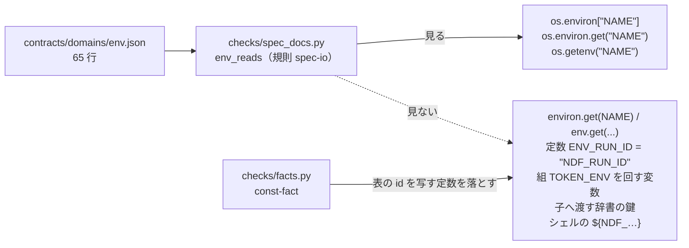
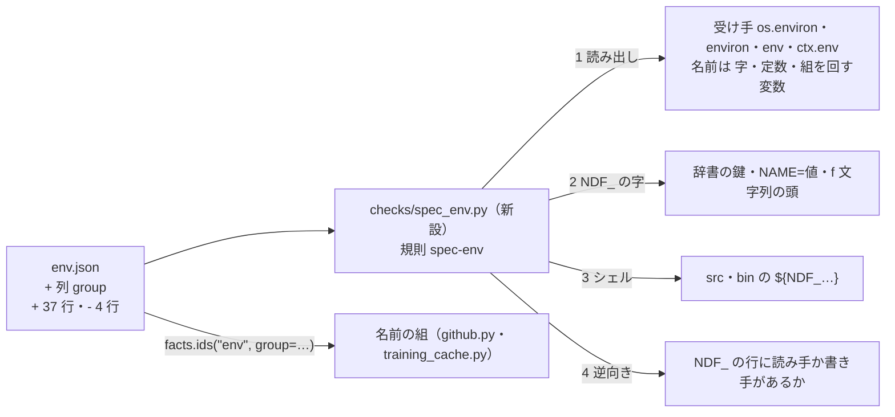
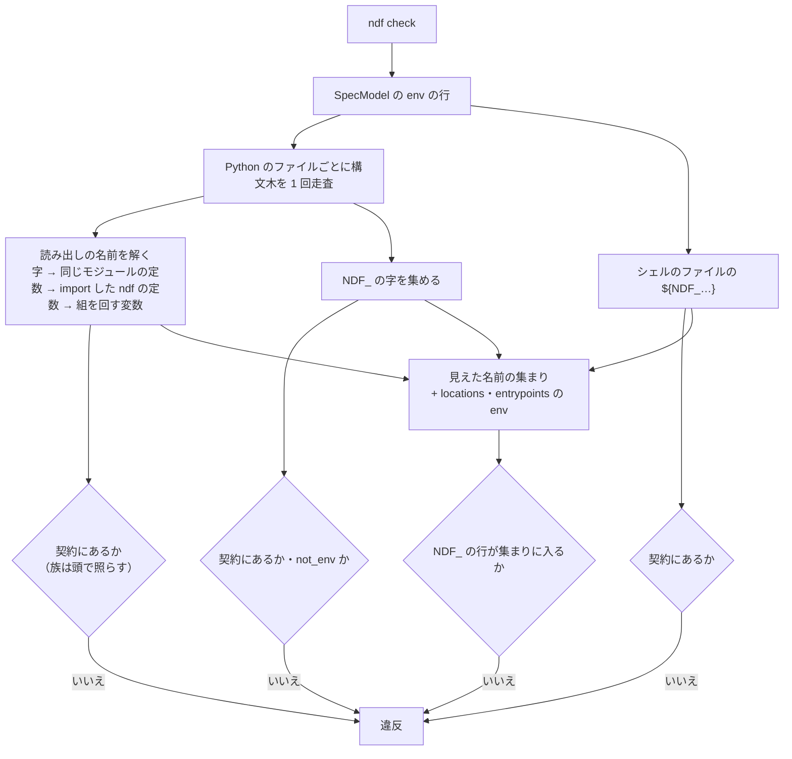

# 環境変数の契約: コードが読み書きする名前がすべて契約に載り、載せ漏れを ndf check が落とす（#4101）

環境変数の契約 `env.json` に無い名前を NDF のコードが 31 件読んでいて、今の検査は名前の字を `os.environ` へ直に渡す読み方しか見ないため気づけない。検査を規則 `spec-env` として広げ、受け手・名前の定数・名前の組・`NDF_` の字・シェル・読み手の無い行まで見るようにし、名前の正本を契約と使う所の字だけにする。名前の分類は[要求仕様](./issue-4101-requirements.md)に、採らなかった案は「決定の記録」に、細部は[詳細設計](./issue-4101-design-detail.md)にある。

## 今の姿

要求と名前の一覧は[要求仕様](./issue-4101-requirements.md)にある。変える所は、契約・検査・名前を持つコードの 3 つである。

| 項目 | 今の姿 | 場所 |
| --- | --- | --- |
| 契約 | 65 行。列は `area`・`set_by`・`type`・`secret`・`meaning`・`child`（任意。`drop`・`set`）。要約は「コードは名前をこの表から引き、表に無い名前を読まない」 | `plugins/ndf/contracts/domains/env.json` |
| 読み出しの検査 | `os.environ` と `os.getenv` へ名前の字を直に渡す読み方だけを、規則 `spec-io` の一部として見る。名前が定数のときは数えない | `plugins/ndf/src/ndf/checks/spec_docs.py` の `env_reads`・`_env_findings` |
| 定数の重複の検査 | 事実の表の `id` と同じ字の最上位の定数（`table-str`）と、`id` を 2 つ以上含む最上位の組（`table-set`）を落とす。`env.json` は `shared_names` でないので当たる | `plugins/ndf/src/ndf/checks/facts.py` |
| 名前の置き方 | 契約に載る名前は使う所に字で書く（`env.get("NDF_RELAY_DIR")`・`os.environ.get("NDF_HOOK_OFF")`）。契約に載らない名前の 14 件は最上位の定数に置く（`ENV_RUN_ID`・`WORKER_KIND_ENV` など） | `relay/signals.py`・`hooks/boot.py`・`adapters/run_log.py` ほか |
| 名前の組を契約から引く例 | 子の環境は `facts.ids("env", child="drop")` で組を引き、名前をコードに書かない | `plugins/ndf/src/ndf/domains/relay/session_env.py` |
| Skill と公開の面 | Skill の読む環境変数と、公開する面の表の `env` が契約にあるかは検査済み | `spec_docs.py` の `_row_errors`・公開の面の検査 |

## 文脈と制約

- 契約に行を足すと、その名前を写した最上位の定数が `const-fact` で落ちる。2026-11-22 に `origin/main`（428f91f9e）の写しのツリーで、候補の行をすべて足して `ndf check --only const-fact` を打つと 18 件（`table-str` 17・`table-set` 1）が落ちた。lracct と #4062 の後は数が変わる（lracct の認証の定数は lracct が直し、`LAUNCH_ENV` は #4062 の側）ので、実装の時に打ち直す
- リレーハブが tmux で起動するラッパーへは、`hub.spawn_env` の返す環境（`session_env.child_env` を通した後の環境）のうち、契約の `secret` が偽の行の値が `-e` で渡る（`relay/tmux.py` の `new_session_args`）。行を足すと、渡る変数も増える。`-e` の値は稼働中の tmux サーバーの上の新しいレーンにも届く（サーバーの起動の時の環境と違い、起動のたびに渡る）ので、契約に載せることと `-e` で渡してよいことは別に決める（決定 4）
- 中継の 3 つの変数（`NDF_RELAY_DIR`・`NDF_RELAY_LAUNCH`・`NDF_RELAY_SESSION`）は #4062 が載せる。接続の提供元と認証の変数は lracct（#3604・#3864）が `provider` の列と 13 行で載せる。どちらも `env.json` と `docs/contracts/env.md` を触る
- hook の経路は起動の速さのために import を絞る（`relay/signals.py` の冒頭）。名前を字で書けば import は増えない
- 名前が式で決まる読み出し（`limits.from_env(environ, name, ...)` など）は、名前を静的に決められない。2026-11-22 に試作の走査で 19 か所あった
- 後方互換は要らない（MVV 版 11 の Value 4）

## 解き方の全体像

- 名前の正本は `env.json` だけで、コードは使う所に名前を字で書くか、組を `facts.ids("env", group=...)` で引く。名前を写した最上位の定数は無い（`const-fact` が今のまま守る）
- 規則 `spec-env` が、4 つの見方で契約とコードを比べる。契約に無い名前を読み書きするコードと、読み手も書き手も無い `NDF_` の行は `ndf check` で落ちる
- 今の `spec-io` の環境変数の部分は `spec-env` へ移り、`spec-io` はサブコマンドの入出力と起動スクリプトだけを見る
- 環境変数でない `NDF_` の字は、検査の規則のデータ（`checks/rules.json`）に理由と一緒に挙げたものだけが通る

## データ構造

### 環境変数の契約（`contracts/domains/env.json`）

列を 1 つ足す。ほかの列の意味は変えない。

| 列 | 型 | 意味 |
| --- | --- | --- |
| `group`（新設・任意） | string | コードが組で引く名前の集まりの名前。コードは `facts.ids("env", group=<名前>)` で引き、返る順（表の行の順）を優先の順として使う |

`area` の語彙に `testing`（テストのスロット）を足す。`child` の語彙に `detach-drop` を足す（決定 4）。`columns.child.summary` は「中継が起動する子のセッションへの渡し方。drop は渡さない、set は NDF が値を入れる、detach-drop は親が待つ直接の子には渡し、リレーハブが tmux で切り離して起動するレーンへは、ハブがレーンに合うと確かめて入れ直すもの（`GH_REPO`）のほかは渡さない。無ければそのまま渡す」にする（lracct の `account-set`・`account-drop` の文はその後に続ける）。足す行・消す行は[要求仕様の「名前の一覧」](./issue-4101-requirements.md#名前の一覧)のとおりで、各行の値は[詳細設計](./issue-4101-design-detail.md#契約の行contractsdomainsenvjson)にある。

`group` の値は 3 つから始める。

| `group` | 行（表の順） | 引くコード |
| --- | --- | --- |
| `github-token` | `GH_TOKEN`・`GITHUB_TOKEN` | `adapters/github.py`（今の `TOKEN_ENV`） |
| `codex-auth` | `OPENAI_API_KEY`・`CODEX_API_KEY` | `adapters/training_cache.py`（今の `CODEX_FOREIGN_AUTH`） |
| `test-isolation` | `CLAUDE_PLUGIN_ROOT`・`NDF_CALLER_PLUGIN_ROOT`・`NDF_STATE_HOME`・`NDF_TEST_SLOT_HELD`・`NDF_LAUNCH_SLOT_PARENT` | `testing/isolation.py`（今の `REMOVED_ENV`。定数を字にすると 5 つの字の組になり `table-set` で落ちる） |

Claude の認証の組（`training_cache.CLAUDE_FOREIGN_AUTH`・`CLAUDE_TOKEN_ENV`）は、lracct が認証の行と `provider` の列から組み立てる（lracct のブランチ）。`group` には入れず、提供元の所属を 2 つの列で持たない。

### 役割ごとの名前（`NDF_PORT_<ROLE>`）

役割ごとに名前が変わる変数は 1 行で持つ。`id` は `NDF_PORT_<ROLE>` で、`<` の前（`NDF_PORT_`）を頭とする。照らし方は決定 3 の 1 つだけで、読み出し・字・シェル・逆向きのどの見方も同じ関数で照らす。頭の後に `[A-Z0-9_]+` が 1 字以上続く字（`NDF_PORT_HTTP`）と、最初の部品が頭と等しい f 文字列（`f"NDF_PORT_{role}"`）だけがこの行の名前で、照らせた名前は見えた名前の集まりへ族の `id`（`NDF_PORT_<ROLE>`）として入る。

### 検査の規則のデータ（`checks/rules.json` の `spec.env`）

| キー | 値 | 意味 |
| --- | --- | --- |
| `receivers` | `["os.environ", "environ", "env", "ctx.env"]` | 読み出しの受け手。`.get`・`.pop`・`.setdefault`・添字・`in` を読み出しとして数える。`os.getenv` は常に数える |
| `not_env` | `{"NDF_PLUGIN_GUIDE_START": "<理由>"}` | 環境変数でない `NDF_` の字と理由 |
| `shell_roots` | `["src", "bin"]` | シェルの `${NDF_…}` を見るディレクトリ（プラグインの根からの相対） |

## 入出力のコントラクト

`ndf check` の引数・結果 JSON・終了コードは変わらない。違反の `rule` に `spec-env` が増え、今の `spec-io` の「環境変数 … が環境変数の表（env）に無い」は `spec-env` から出る。`ndf check --only spec-env` で絞れる。

| 違反（`detail` の頭） | 当たるもの |
| --- | --- |
| `read:` | 契約に無い名前の読み出し |
| `literal:` | 契約に無い `NDF_` の字（`not_env` に無いもの） |
| `shell:` | シェルの契約に無い `${NDF_…}` |
| `unused:` | 読み手も書き手も無い `NDF_` の行（`env.json` の行を指す） |

## 処理の流れ

## 決定の記録

### 決定 1: 載せ漏れを書き方に依らず落とすため、環境変数の検査を規則 `spec-env` へ移し、4 つの見方に広げる

- **質問**: 契約に無い名前をどう落とすか。今の `spec-io` の `env_reads` を直すか、別の規則にするか。何を見るか
- **選んだ案**: `checks/spec_env.py` を新設し、規則 `spec-env` にする。見るのは (1) 受け手 `os.environ`・`environ`・`env`・`ctx.env` と `os.getenv` への読み出し（`.get`・`.pop`・`.setdefault`・添字・`in`・`not in`）で、名前を字・同じモジュールの最上位の定数・import した `ndf` のモジュールの最上位の定数（別名を含む）・組を回す変数（最上位の組とその場に書いた組。1 要素の組も含む）から解く。組を回す変数は、その `for` の本体と内包の中の読み出しに限って組の全要素に解き、これを次の規則より先に当てる。それ以外で、関数の中で同じ名前に束縛し直した変数（引数・代入・ループの外の同名）は解かず、モジュールの定数にも戻さない。(2) 字の全体が `NDF_` で始まる名前の形の文字列（辞書の鍵・`NAME=値` の頭・f 文字列の頭）。(3) `src`・`bin` のシェルのファイル（`.sh` と、起動スクリプトの表 `launchers.json` に載る拡張子の無いファイル）の読み出し `$NDF_…`・`${NDF_…}`・`${#NDF_…}` と書き込み `NDF_…=`（行頭・空白・`;`・`&`・`|`・`(` の後の語の頭。`export A=1 NDF_X=2` の 2 つ目も含む）。コメントは引用の外の語の頭の `#` から行末までで、引用の中の `#`（`printf "# %s\n" "$NDF_X"`）はコメントとみなさない。(4) `NDF_` の行が (1)〜(3) とほかの契約の `env` の欄のどこにも現れないこと。(4) は「名前がどこかに現れる」ことを確かめ、その字が値を読むか書くかまでは確かめない（`claude_args.py` の `Parsed("NDF_RELAY=0")` のような理由の文の字も現れたと数える）。今の `spec_docs.env_reads` と `_env_findings` は `spec_env.py` へ移す
- 採らなかった案: `spec-io` の `env_reads` に受け手を足すだけ（定数と組に置いた名前・子へ渡す辞書の鍵・シェルが残る。今の 14 個の定数はこの形ですり抜けた）
- 採らなかった案: `git grep` の字で照らす（Python の定数の名前 `NDF_SCHEMA` と docstring の例を拾い、除外の表が膨らむ。字で解けない読み出しの見分けもできない）
- 採らなかった案: 実行の時に名前を契約で確かめる関数（`env_get("NDF_RUN_ID")`）を通させる（hook の経路が契約を読むことになり起動が遅くなる。読み出しの書き方を 1 つに強いる移行が全コードに及ぶ）
- **代償**: 名前が式で決まる読み出し（関数の引数で名前を受ける 19 か所）は見ない。シェルは構文を解かずに字で見るので、単一引用の中の `$NDF_X` とエスケープした `\$NDF_X` も読み出しと数える（契約に行を足すか書き方を変えて避ける）。名前の字が現れる呼ぶ側か、ほかの契約の `env` の欄でしか確かめられない。受け手の名前を `env` と付けた別の辞書を読み出しと数える誤りがありうる（試作の走査では 55 個の名前のどれも環境変数だった）
- 根拠: Value 3・Value 13（MVV バージョン 11）。Value 3「判断の要らない手順（検査）は仕組みが進める」。Value 13（載ったと言えるのは検査が確かめたときだけ）

### 決定 2: 名前の正本を 1 つにするため、名前を写した最上位の定数を外し、使う所の字と契約の組だけにする

- **質問**: 契約に行を足すと `const-fact` で落ちる 17 個の定数と 1 つの組をどうするか
- **選んだ案**: `const-fact` は変えない。定数は外し、名前を使う所に字で書く（`NDF_RELAY_DIR`・`NDF_HOOK_OFF` の今の書き方にそろえる）。別のモジュールから定数を引いていた所（`identity.WORKER_KIND_ENV`・`slots.HELD_ENV`・`slot_pool.PARENT_ENV`・`invoke.INPUT_ENV`）と、定数を名前のまま公開し直す所（`adapters/cli.py` の `ENV_RUN_ID` ほか 3 つ）も字にし、公開し直しを外す。2 つ以上の名前の組は契約の新しい列 `group` に置き、`facts.ids("env", group=...)` で引く（`session_env` の `child="drop"` と同じ引き方）
- 採らなかった案: `env.json` を `shared_names` にして定数を許す（`table-set` も外れ、名前の組をコードに写せるようになる。同じ事実を 2 か所に持つ）
- 採らなかった案: `const-fact` に「`_ENV` で終わる定数は許す」という例外を足す（名前の決まりで検査を外すと、決まりの外の名前で同じ写しが戻る）
- 採らなかった案: 名前の定数を `env.json` から生成するモジュールに置く（生成物を import する hook の経路が増え、生成と検査の 2 つを保つことになる）
- **代償**: 同じ名前の字がモジュールの中で数か所に並ぶ（`run_log.py` の `NDF_RUN_LOG` は 3 か所）。打ち間違いは決定 1 の検査が契約に無い名前として落とす
- 根拠: Value 8・Value 11（MVV バージョン 11）。Value 8「同じ事実を 2 か所に持たない」。Value 11「同じ規則・定数は 1 か所にまとまり、ほかはそこを参照する」

### 決定 3: 役割ごとに名前の変わる変数を 1 行で持つため、`id` に `<ROLE>` を含む行を族として照らす

- **質問**: `NDF_PORT_<役割>`（compose の定義が `${NDF_PORT_HTTP}` のように役割ごとに読む）をどう載せるか
- **選んだ案**: `id` を `NDF_PORT_<ROLE>` とする 1 行にし、`meaning` に役割の名前の作り方（大文字にし、英数字の外を `_` にする）を書く。検査は `<` の前を頭として、頭に英大文字・数字・`_` が 1 つ以上続く字（`NDF_PORT_HTTP`）と、最初の部品が頭と等しい f 文字列（`testenv_decide.py` の `f"NDF_PORT_{…}"`）だけをこの行に数える。頭そのものの字（`"NDF_PORT_"`）や、頭の後に別の語が続く f 文字列（`f"NDF_PORT_X_{…}"`）は数えない（契約に無い名前として違反になる）。f 文字列の固定の部品は f 文字列の頭としてだけ照らし、同じ部品を通常の字として二度数えない。逆向きの検査（決定 6）も同じ照らしを使い、照らせた名前を族の `id` として見えた名前の集まりへ入れる（字 `NDF_PORT_HTTP` は `id` と文字列として一致しないため）
- 採らなかった案: 役割ごとに行を足す（役割は利用者の設定で決まり、契約の側で数えられない）
- 採らなかった案: 族の印の列（`pattern: true`）を足す（`id` の形で分かることを列で二重に持つ）
- **代償**: `id` が環境変数の名前そのものでない行が 1 つでき、生成文書にもその形で出る
- 根拠: Value 8（MVV バージョン 11）

### 決定 4: 中継の子のセッションが NDF の実行の内側の印を引き継がないため、実行の記録・作業種別・工程の入力の 5 つの変数を `child: drop` にし、切り離して起動するレーンへはスロットの印・Slack の送信先を渡さず、リポジトリの指定はレーンの clone のリポジトリを指すときだけ渡す

- **質問**: 足す行の `child` を何にするか。契約に載せた行のうち、リレーハブが tmux の `-e` で稼働中のサーバーの上のレーンへ渡してよいのはどれか
- **選んだ案**: NDF が自分の子孫のプロセスへ渡す印のうち、`NDF_RUN_ID`・`NDF_RUN_LOG`・`NDF_WORKER_KIND`・`NDF_STAGE_INPUT`・`NDF_STAGE_NOTES` は `drop` にする。中継の子のセッションは長く動く新しい根で、起動したプロセスの実行の記録・作業種別・工程の入力の内側ではない。`child` に新しい値 `detach-drop` を足し、スロットの印（`NDF_LAUNCH_SLOT_PARENT`・`NDF_TEST_SLOT_HELD`）と Slack の送信先（`NDF_SLACK_API_BASE`）とリポジトリの指定（`GH_REPO`）に付ける。`detach-drop` は、親が子の終わりを待つ直接の起動（`session_env.child_env`・`tool_env` を通るラッパーの子と `claude plugin` のコマンド）では今のとおり受け継ぎ、リレーハブが tmux で切り離して起動するレーン（`hub.spawn_env`）では外す。`spawn_env` は `child_env` の返りから `facts.ids("env", child="detach-drop")` を外し、`-e` にも tmux のプロセスの環境にも載せない。ただし `GH_REPO` だけは、ハブの値がレーンの作業ディレクトリの clone のどれかの remote と同じ `owner/repo` を指すときに入れ直す（下の「リポジトリの指定」）。加えて、稼働中の tmux サーバーが起動の時に持ったグローバル環境からの継承を断つため、`tmux.new_session_args` はレーンのコマンドの頭に `env` と、`child` が `drop`・`detach-drop` の行のうち渡す環境に無い名前ごとの `-u <名前>` を置く（`env -u NDF_RUN_ID … -u GH_REPO <ndf> relay run --name …`）。引数に載るのは名前だけで値は載らない。渡す環境に有る名前（入れ直した `GH_REPO`）は `-u` に入れず、`-e` の値がグローバル環境の値より先に効く。これでラッパーが受け取る環境は、新しく立てたサーバーでも前からあるサーバーでも、`drop`・`detach-drop` の名前を持たないか、ハブが確かめて入れた値だけを持つ（tmux の `new-session` には変数を外す指定が無く、`-e` は値を足すことしかできない）。`NDF_RUN_LOG_SINK` などの利用者の設定と、NDF の外のプログラムへ書く変数（compose・公開のコマンド）は空にする
  - スロットの印: 親がスロットを持ったまま子を待つ経路で外すと、子が同じ枠を取り直して親と待ち合い、枠が尽きると進まない。切り離したレーンは取得元の実行が終わって枠を解いた後も動き続け、印が残ると `launch_slot.py` と `testing/slots.py` が `NDF_TEST_SLOT_HELD` を見て枠の取得を省き、枠の外でテストを動かす
  - Slack の送信先: `adapters/notify.py` はこの値をトークン付きの要求の送り先に使う。ハブを起動した環境にテスト用の送信先があると、稼働中のサーバーの上の新しいレーンからもトークンと通知の本文がその宛先へ送られる。秘密でなくても、送り先を替える値は長く動くレーンへ渡さない
  - リポジトリの指定: `GH_REPO` は `gh` の既定の対象と、strict hook のマージ先の初期値（`domains/hooks/strict.py`）になる。ハブがリポジトリ A を指し、レーンの `--cwd` がリポジトリ B を指すと、レーンの中の `gh pr` は A を見て、`gh pr merge` は strict hook が作業ディレクトリとの不一致で止める。一方で、fork の clone で `GH_REPO` を upstream に向けて置く運用（clone に `origin`（fork）と `upstream` の 2 つの remote がある）では、`GH_REPO` を外すと `gh` が既定のリポジトリを決められず、無人のレーンの `gh pr` が「`gh repo set-default` を打て」で落ちる。そこで `spawn_env` は、ハブの `GH_REPO` の `owner/repo` がレーンの作業ディレクトリの clone の remote（`[remote "*"]` の `url` のすべて）のどれかと等しいときだけ入れ直し、どれとも等しくなければ外す。fork の運用では `GH_REPO` は upstream の remote と等しいので今のとおり届き、ハブと違うリポジトリのレーンでは外れて、レーンの `gh` は自分の clone の remote から対象を決める。clone の設定は git の設定ファイルを読むだけで決め（strict hook の `_remote_slug` と同じ読み方）、プロセスを起こさない。作業ディレクトリが git でない・設定を読めないときは外す（等しいと確かめられないものは渡さない）
  - `-e` で渡る行: `secret` が偽で、`spawn_env` の返りにある名前のうち、契約の行の `id` と字が完全に一致するもの（今の `new_session_args` の選び方のまま）。`detach-drop` の行は `spawn_env` が外すので、渡るのは入れ直した `GH_REPO` だけである。族の行（`NDF_PORT_<ROLE>`）は `id` が環境変数の名前でないので `NDF_PORT_HTTP` などは一致せず、`-e` に載らない。族の照らし（決定 3）は検査（`checks`）の側の関数で、製品のコードは `checks` を読まない（詳細設計の「依存の向き」）ので、`-e` の選び方へは持ち込まない。`NDF_PORT_<ROLE>` は NDF が compose の子へ渡す環境（`testenv_decide.py`）にだけ書く値で、ハブの環境には通常無く、レーンへ渡す要る場面が無い。この課題で足す行で `-e` に新しく載るのは、詳細設計の「契約の行」の `-e` の列が「渡る」の行だけである
  - 起動の境: tmux の `new-session` へは、レーンのコマンド（`env`・`-u <名前>`…・`<ndf>`・`relay`・`run`…）を 1 語ずつ別の引数で渡す。tmux はコマンドが 2 語以上のときシェルを介さず直接起動し（2026-11-22 に tmux 3.6 で確かめた）、`env -u` が最初に動くプロセスになる。1 つの文字列で渡すと、tmux は既定のシェル（`default-shell -c`）を起動し、`env -u` より先にシェルの初期化（zsh の `.zshenv` など）が継承した `GH_REPO`・`NDF_SLACK_API_BASE` のまま動く。tmux は末尾が `;` の引数をコマンドの区切りとして切るので（同日に確かめた。`x;` は `x` と区切りになる）、末尾が `;` の語は最後の `;` の前に `\` を入れて渡す（tmux は `\;` を `;` に戻す。`a\;` は `a\\;` として渡し `a\;` に戻る）。ステータス行を消す `; set-option …` は今のとおり同じ呼び出しの区切りの後に置く
- 採らなかった案: スロットの印も `drop` にする（直接の起動で上の待ち合いが起きうる）
- 採らなかった案: スロットの印と送信先を空にする（切り離したレーンに枠の外の印とテストの送信先が残る）
- 採らなかった案: `spawn_env` で外すだけにする（前からある tmux サーバーがグローバル環境に持つ値が新しいレーンへ継承される。ハブを更新しても、サーバーを止めるまで Slack のトークンと本文がテストの宛先へ送られ、スロットの取得が省かれる）
- 採らなかった案: ラッパー（`relay run`）が起動の頭で自分の環境から外す（ラッパーより前に動く起動スクリプト `bin/ndf` が、継承した `CLAUDE_PLUGIN_ROOT`（`drop`）を `NDF_CALLER_PLUGIN_ROOT` へ写してしまう。外す所が tmux の境から離れ、ラッパーを通らない起動行を足すと漏れる）
- 採らなかった案: `GH_REPO` をハブの値のまま渡す（上のとおり、ハブと違うリポジトリのレーンで `gh` の対象がずれ、マージが止まる）
- 採らなかった案: `GH_REPO` を切り離したレーンへ一律に渡さない（fork の clone で upstream に向けて置く運用で、複数の remote を持つレーンの `gh` が既定のリポジトリを決められず落ちる。利用者ごとに `gh repo set-default` を打たせる移行が要る）
- 採らなかった案: ハブがレーンの宣言の remote（`.ndf/worktree.json` の `remote`）から `GH_REPO` を作って入れる（`GH_REPO` を置いていない利用者のレーンでも、`gh repo set-default` で選んだ既定と違う remote を指しうる。振る舞いを変える範囲がこの課題の要る範囲より広い）
- 採らなかった案: レーンのコマンドを今のまま 1 つの文字列で渡す（シェルの初期化が `env -u` より先に、継承した値のまま動く）
- 採らなかった案: `-e` の選び方にも族の照らしを入れる（製品のコードが検査の関数を読むか、同じ照らしを 2 か所に持つことになる。渡す要る場面も無い）
- 採らなかった案: `tmux.new_session_args` が `-e` で渡す名前の列（`tmux: false` など）を足す（tmux のプロセスの環境からも外す必要があり、`spawn_env` で外せば `-e` と両方に効く。渡し方の正を `child` の 1 列に保つ）
- 採らなかった案: すべて空にする（ラッパーを `ndf plan` の worker の中から起動すると、子のセッションの `ndf` が親の実行の記録へ書き、親のスロットを使っていると読み、worker の中として全体テストを止められる）
- **代償**: 中継の子のセッションの中の `ndf` は、起動したプロセスの実行の記録に `parent_id` でつながらない。`drop` の 5 つは `hub.spawn_env` が `child_env` を通すので、ハブの時点で外れ、`-e` の引数にもプロセスの環境にも値が現れない。ラッパーが Claude を起動するときも `child_env` を通すので同じく外れる。切り離したレーンで Slack の送信先を替えるには、レーンの中で設定し直す。作業ディレクトリの clone の remote に無いリポジトリをレーンで指すときは、レーンの中で `GH_REPO` を設定する。ハブはレーンを起動するたびにレーンの clone の git の設定ファイルを 1 つ読む（プロセスは起こさない）。レーンのコマンドが `env -u` の名前ぶん長くなる（値は載らない）。レーンのコマンドはシェルを通らないので、シェルの構文（`|`・`$VAR` の展開）を起動行に書けない（今の起動行も `shlex.quote` で 1 語ずつ引用していて、シェルの構文を使っていない）。`child` の語彙が 1 つ増え、lracct の `account-set`・`account-drop` と並ぶ
- 根拠: Value 9（MVV バージョン 11）。「責務の分かれた設計」（プロセスの木の内側の印を木の外へ渡さない）

### 決定 5: 環境変数でない `NDF_` の字を通すため、例外を検査の規則のデータに理由と一緒に置く

- **質問**: 古い案内の印 `NDF_PLUGIN_GUIDE_START`（古い NDF が指示書に書いた字を探す）を、決定 1 の (2) でどう通すか
- **選んだ案**: `checks/rules.json` の `spec.env.not_env` に、字と理由を置く。初めの値はこの 1 件だけである。Python の定数の名前（`NDF_SCHEMA` など）は字でないので (2) に当たらず、`NDF_RELEASE_TOKEN` は文の中の語なので当たらない
- 採らなかった案: コードの行の抑止の注釈で通す（理由が散らばり、数が見えない）
- 採らなかった案: 印を改名する（印は利用者のリポジトリに残る古い NDF の字で、変えると探せなくなる）
- **代償**: 印を足すたびに規則のデータを直す
- 根拠: Value 14（MVV バージョン 11）。「判断の理由が残る」

### 決定 6: 契約と振る舞いを食い違わせないため、読み手も書き手も無い `NDF_` の行を消し、逆向きの検査で落とす

- **質問**: コードのどこにも現れない 4 行（`NDF_RUNTIME_SESSION`・`NDF_CLAUDE_API_KEY_NAME`・`NDF_CLAUDE_API_KEY_GENERATION`・`NDF_CLAUDE_KEY_ACCOUNT`）をどうするか。今後の載せ残しをどう防ぐか
- **選んだ案**: 消す。決定 1 の (4) で、`NDF_` の行が (1)〜(3) とほかの契約の `env` の欄（`locations.json`・`entrypoints.json`）に現れなければ落とす。`NDF_` で始まらない行（`HOME`・`GITHUB_EVENT_PATH` など）は、名前が式で決まる読み方（`identity.py` の組）で読まれるので対象にしない
- 採らなかった案: 残して `meaning` に「読み手が無い」と書く（契約が「NDF が読む」と言う名前を NDF が読まない）
- 採らなかった案: `NDF_` で始まらない行も逆向きに見る（`identity.py`・`testing/isolation.py` の引数で名前を受ける読み方を誤って未使用と出す）
- **代償**: `NDF_LOOP_EXCLUDE` は `entrypoints.json` に現れるので通るが、読むコードは無い（範囲の外として列挙する）
- 根拠: Value 8・Value 13（MVV バージョン 11）

### 決定 7: 重なる変更と境を揃えるため、#4062 と lracct が決めた行と列はそのままにし、この課題は残りと検査を持つ

- **質問**: 同じ `env.json` を触る #4062・#4049・lracct・#3995・#4068 と、どちらが何を載せるか
- **選んだ案**: 下の表のとおりにする。列と検査の形は #4062 にそろえ、読み手と書き手は `meaning` に書き（#4062 の「データ構造」と同じ）、新しい列は `group` だけにする

| 変更 | 載せるもの | この課題との境 |
| --- | --- | --- |
| #4062（中継の変数） | `NDF_RELAY_LAUNCH` の行を足し、既存の `NDF_RELAY_DIR` の行と #4049 が足す `NDF_RELAY_SESSION` の行を `child: drop` にする。`signals.launch_env` の名前と契約を結ぶテスト | 3 行はこの課題が載せない。`spec-env` はこの 3 行も見る。#4062 の設計の決定 4 は名前を `signals` の定数に持つと書くが、`NDF_RELAY_LAUNCH` の行を足すと `LAUNCH_ENV` が `const-fact` の `table-str` で落ちる（2026-11-22 に写しで確かめた）。#4062 の実装はこれを解く必要がある。この設計は #4062 の設計を書き換えず、範囲の外の発見として conductor へ渡す |
| #4049（子の会話の ID） | `NDF_RELAY_SESSION` の行 | 同上 |
| lracct（#3604・#3864） | `child` の `account-set`・`account-drop`、`provider` の列と 13 行、`NDF_RELAY_SPIN`（`NDF_RELAY_MAX_STARTS` を消す） | 認証と提供元の選択の 5 件（lracct のブランチの `env.json` にある）は lracct が載せる。lracct のブランチに無い `ANTHROPIC_MODEL`・`AWS_PROFILE`・`AWS_REGION`・`ANTHROPIC_CONFIG_DIR` はこの課題が載せ、`child` は空にする（lracct の `account-drop` は認証の源の 13 変数で、この 4 つは入らない。理由と子ごとの値は詳細設計の「契約の行」）。Claude の認証の組は lracct の組み立てのまま |
| #3995（文脈の上限） | 足さない（`NDF_CONTEXT_GUARD` を作らない）。`context_policy.py` を消す | `f"NDF_CONTEXT_POLICY=..."` の字の置き場が移るだけで、行は変わらない |
| #4068 | 足さない（`env.json` を変えない） | 重ならない |
| 設計中の #4103・#4059・#3702 | `NDF_RELAY_LAUNCH_GEN`・`NDF_GH_GATED`・`NDF_WORK_PROMPT` | `spec-env` が入った後は、行を足さないと実装の PR が落ちる |

- 採らなかった案: この課題が #4062 の 3 行も載せる（#4062 は設計承認済みで、テストと一緒に載せる。二重に載せると rebase で食い違う）
- 採らなかった案: 読み手の列（`read_by`）を足す（#4062 が `meaning` に書くと決めた。列にすると同じ行の 2 か所に読み手が出る）
- **代償**: 読み手と書き手が `meaning` の文に埋まり、機械では引けない
- 根拠: Value 11・Value 2（MVV バージョン 11）。Value 2（rebase と衝突の手直しに費用を使わない）

### 決定 8: 重なるファイルの rebase を減らすため、実装は lracct・#4049・#4062 の後に 1 本の PR で置く

- **質問**: 実装をいつ、何本で出すか
- **選んだ案**: lracct・#4049・#4062 のマージの後に 1 本の PR で出す。行を足すと定数の直しと検査が同時に要る（足しただけでは `const-fact` が落ち、検査だけでは `spec-env` が落ちる）ので分けない。#3995・#4068 とは並べてよい（触るファイルが `env.json`・`env.md` だけ重なり、#4068 は `env.json` を変えない）。実装の前に `gh pr list` の触るファイルで打ち直す
- 採らなかった案: 検査を先、行を後の 2 本にする（1 本目が `main` を落とすか、1 本目に除外の表を置いて 2 本目で消すことになる）
- 採らなかった案: #4062 より前に置く（`NDF_RELAY_LAUNCH` を載せる者が 2 つになり、#4062 の設計の前提が崩れる）
- **代償**: lracct の実装（11 単位のうち途中）の終わりを待つ。待つ間はほかの課題の設計を進める（#4069 の方針）
- 根拠: Value 5・Value 2（MVV バージョン 11）。Value 5「並べられる作業は並べて進め、待つだけで止まらない」

### 決定 9: 利用者の全体の設計方針（#4069）に照らし、この設計は文脈とリソースの方針を変えず、手戻りを減らす側に働く

- **質問**: #4069 の方針（文脈の再利用・最適な文脈量・キャッシュ・リソースを使い切る・処理待ちを作らない）に合うか
- **選んだ案**: 合う。この設計は検査と契約だけを変え、文脈・キャッシュ・レーンの数に触れない。載せ漏れを CI の前に `ndf check` で落とすので、レビューのラウンドで見つけて直す手戻り（#4101 自体が PR #4095 のレビューの中で見つかった）を減らす。#4069 へ足す課題は無い
- 採らなかった案: 検査を手元で打たずに CI だけで見る（落ちてから直すまでの待ちが増える）
- **代償**: `ndf check` の走査が 1 本増える（走査は構文木を 1 回作るだけで、既存の検査と共有する）
- 根拠: Value 2・Value 5（MVV バージョン 11）。#4069 の配慮する事項 5（手戻りの費用）

## 影響と危険

- 働く範囲: NDF の開発（このリポジトリの `ndf check`）。利用先のリポジトリでは、中継の子のセッションの環境から 5 つの変数が外れ、リレーハブが切り離して起動するレーンからスロットの印 2 つと Slack の送信先が外れ、`GH_REPO` はレーンの clone の remote に無いリポジトリを指すときだけ外れる（決定 4。fork の clone で upstream を指す運用は今のとおり届く）。リレーハブが tmux で起動するラッパーへ `-e` で渡る変数が、足した行のうち詳細設計の「契約の行」で `-e` が「渡る」の行（`NDF_RUN_LOG_SINK`・`NDF_WORKTREE_BASE` など）の分だけ増える。ほかは変わらない
- tmux の継承: `-e` は名前を明示で渡すだけで、tmux のサーバーが起動の時に持った環境は新しいセッションへ残る（tmux の `update-environment` の外の変数）。`drop`・`detach-drop` の行は `spawn_env` で外すので、新しく立てるサーバーにも `-e` にも載らない。前からあるサーバー（この変更の前のハブが立て、グローバル環境に `NDF_SLACK_API_BASE` や `GH_REPO` を持つもの）の値は、レーンのコマンドの頭の `env -u` で外れ、ラッパーへ届かない。コマンドは 1 語ずつ別の引数で渡すので、シェルの初期化が外す前の値で動くこともない（決定 4）
- プロジェクトごとに違うものは無い。当たるモードは無い（検査の規則で、工程を変えない）
- 書きかけの文書・同じファイルを触る別の変更: 決定 7 と 8 の表のとおり。lracct の実装（PR #4114 ほか）が `training_cache.py`・`account_metered.py` を触る
- 壊れうる箇所
  - 受け手の名前 `env` の誤認: 環境でない辞書を `env` と名付けて `.get("NAME")` すると違反になる。名前を変えて避ける
  - 族の行: `NDF_PORT_` に大文字の語が続く別の変数を足すと族に吸われる。足すときは頭を変える
  - `const-fact` と組: `group` を引く関数を通さずに組の定数を書き戻すと `table-set` で落ちる（守る側に働く）

### 代表のリポジトリでの振る舞い

| 種類 | 直した後に起きること | この種類で扱えなくなること |
| --- | --- | --- |
| Web サービス | 中継の子のセッションが NDF の内側の印を引き継がない。テスト環境の compose へ渡す変数は今のとおり | 無し |
| モバイルアプリ | 同上 | 無し |
| 業務文書だけ | 同上 | 無し |

### ai-plugins だけの事情

- 無し（検査は NDF のプラグインの中を見るもので、このリポジトリの運用の値を持たない）

## 用語

| 用語 | 意味 | 反映 |
| --- | --- | --- |
| 読み出しの受け手 | 環境変数の名前で値を引く対象（`os.environ`・`environ`・`env`・`ctx.env`） | 追加 |
| 名前の組 | 複数の環境変数の名前の集まり。契約の `group` で持つ | 追加 |
| 族の行 | `id` に `<ROLE>` を含み、頭が同じ名前をまとめて持つ契約の行 | 追加 |

## テスト設計

| 受け入れ条件 | 確かめ方 | 落ちる変更 |
| --- | --- | --- |
| 1 | `ndf check` が通る（`spec-env` の (1)〜(3) が、コードの名前がすべて契約にあることを確かめる） | 行を消す・名前を打ち間違える |
| 2 | `spec-env` の単体テスト: 受け手 4 つ × 名前の出所 4 つ（字・同じモジュールの定数・import した定数・組を回す変数）の写しのソースで違反が出る。契約にある名前・族の名前では出ない | 受け手か出所の解き方を外す |
| 3 | 同: 辞書の鍵・`NAME=値`・f 文字列の頭の `NDF_` の字で違反が出る。`not_env` の字では出ない | 字の集め方を外す・`not_env` を見ない |
| 4 | 同: シェルの写しの `${NDF_X}` と `$NDF_X` で違反が出る | シェルを見ない |
| 5 | 同: どこにも現れない `NDF_` の行で `unused:` が出る。`locations.json` の `env` にだけ現れる行と、字 `NDF_PORT_HTTP` か f 文字列 `f"NDF_PORT_{r}"` だけが現れる族の行 `NDF_PORT_<ROLE>` では出ない | 逆向きを外す・ほかの契約を見ない・逆向きで族を照らさない |
| 6・9 | CI の `ndf check`（`const-fact`・`spec-docs` を含む） | 定数を残す・生成文書を作り直さない |
| 7 | 実装の PR の本文に `git grep` の結果を載せ、レビューで比べる | — |
| 8 | `session_env.child_env` に 5 つの変数を入れた環境を渡すと返りに無く、`detach-drop` の 4 つ（スロットの 2 つと `NDF_SLACK_API_BASE`・`GH_REPO`）は返りに残る。`hub.spawn_env` の返りと、それを渡した `tmux.new_session_args` の引数には、5 つと 4 つのどの値も現れない（`GH_REPO` はレーンの clone の remote に無い値）。実物の tmux の結合テストで、9 つの変数をグローバル環境に持つサーバーを先に立て、その上へ `new_session_args` でレーンを起動すると、ラッパーの位置のコマンドが受け取る環境に 9 つのどれも無い。ハブの環境が `GH_REPO=<リポジトリ A>` で、レーンの作業ディレクトリがリポジトリ B（remote に A が無い）のときも同じく `GH_REPO` が無い。レーンの clone が `origin`（fork）と `upstream`（A）の 2 つの remote を持ち、ハブの環境が `GH_REPO=<A>` のときは、ラッパーが受け取る `GH_REPO` が A で、グローバル環境に別の `GH_REPO` を持つサーバーの上でも A である。`new_session_args` の引数でレーンのコマンドが 1 語ずつ別の要素で、`env` が最初の語であり、末尾が `;` の語（`x;`）が実物の tmux の上でそのまま届く。`NDF_PORT_HTTP` を入れた環境では `-e` に `NDF_PORT_HTTP` が無い。lracct の後は、親と子のアカウントが違う子（登録済みアカウント・従量・API キー）で `AWS_PROFILE`・`AWS_REGION`・`ANTHROPIC_MODEL`・`ANTHROPIC_CONFIG_DIR` の値が詳細設計の「契約の行」の表のとおり | `child` を外す・スロットに `drop` を付ける・`spawn_env` で `detach-drop` を外さない・起動行の `env -u` を外す・`GH_REPO` を `detach-drop` にしない・`GH_REPO` を一律に外す・レーンのコマンドを 1 つの文字列に戻す・末尾の `;` を逃がさない・`-e` の選び方に族の照らしを入れる・4 行に `account-drop` を付ける |

## どこを変えるか

新設する関数が 2 つ以上あるので、関数の粒度は[詳細設計](./issue-4101-design-detail.md)に書く。

## 設計の結果

| 課題 | 扱い | 理由 | 触るファイル |
| --- | --- | --- | --- |
| #4101 | 実装する | — | `plugins/ndf/contracts/domains/env.json`、`plugins/ndf/docs/contracts/env.md`、`plugins/ndf/src/ndf/checks/spec_env.py`（新設）、`plugins/ndf/src/ndf/checks/spec_docs.py`、`plugins/ndf/src/ndf/checks/rules.json`、`plugins/ndf/src/ndf/checks/README.md`、`plugins/ndf/src/ndf/adapters/run_log.py`、`plugins/ndf/src/ndf/adapters/cli.py`、`plugins/ndf/src/ndf/domains/records/cli.py`、`plugins/ndf/src/ndf/domains/release/ndf_settings.py`、`plugins/ndf/src/ndf/testing/isolation.py`、`plugins/ndf/src/ndf/adapters/github.py`、`plugins/ndf/src/ndf/adapters/training_cache.py`、`plugins/ndf/src/ndf/adapters/launch_slot.py`、`plugins/ndf/src/ndf/core/converge/location.py`、`plugins/ndf/src/ndf/core/worker.py`、`plugins/ndf/src/ndf/domains/crossrefactor/allocation.py`、`plugins/ndf/src/ndf/domains/hooks/strict.py`、`plugins/ndf/src/ndf/domains/hooks/guards/full_test.py`、`plugins/ndf/src/ndf/domains/worktree/container.py`、`plugins/ndf/src/ndf/identity.py`、`plugins/ndf/src/ndf/progress/invoke.py`、`plugins/ndf/src/ndf/progress/plan/run.py`、`plugins/ndf/src/ndf/slot_pool.py`、`plugins/ndf/src/ndf/testing/slots.py`、`plugins/ndf/src/ndf/domains/relay/hub.py`、`plugins/ndf/src/ndf/domains/relay/tmux.py`、`plugins/ndf/tests/checks/test_spec_env.py`（新設）、`plugins/ndf/tests/checks/test_spec_docs.py`、`plugins/ndf/tests/domains/relay/test_session_env.py`、`plugins/ndf/tests/domains/relay/test_relay_parts.py`、`plugins/ndf/tests/cli/test_cli.py`、`plugins/ndf/tests/testing/_real_state.py` |

## 人へ残す判断

- 無し（承認ゲートで見る点は、決定 4 の `child: drop` で中継の子の環境が変わることと、決定 8 の実装の時期）

## 未確認のまま残ること

- lracct が載せる 13 行の名前の全部。lracct の詳細設計は 6 つの提供元の選択の変数を挙げるが、残りの 7 行の名前は実装の PR で決まる。実装の時点で `spec-env` を打てば、残りが違反として出る
- 受け手の名前で読み出しを見分ける方式の誤り（環境でない `env` の辞書）。試作では 0 件で、実装の時に `ndf check` で確かめる

## 外部の調査

| 番号 | 対象 | 分かったこと | 取り込んだか |
| --- | --- | --- | --- |
| LIB1 | 設定の読み込みのライブラリ（pydantic-settings・environs） | 環境変数を型つきの宣言で読み、実行の時に値を確かめる。宣言に無い名前を読むコードを静的に落とす機能は無い | 取り込まない。NDF の課題は値でなく、名前が契約に載っているかで、hook の経路に依存を足したくない |
| LIB2 | ruff の規則 | 環境変数の名前を表と照らす規則は無い（`SIM112` は名前を大文字にする規則だけ） | 取り込まない。既存の `ndf check` の構文木の走査に足す |
| PRD1 | 12-factor app の設定の考え方 | 設定は環境変数に置き、コードと分ける。名前の一覧を持つことは求めない | 方針として合う。一覧と検査は NDF の契約の考え方（`env.json` の要約）から来る |

### 確かめられなかったこと

- LIB1・LIB2・PRD1 は、この設計の時点でウェブの一次情報を開いて確かめていない（知っている範囲で書いた）。実装の前に見直す
