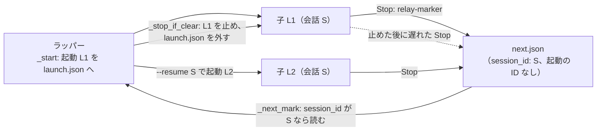
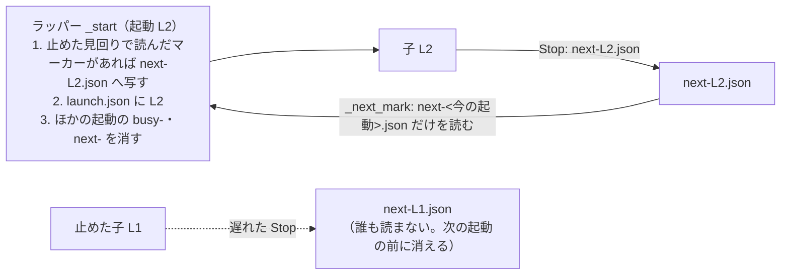
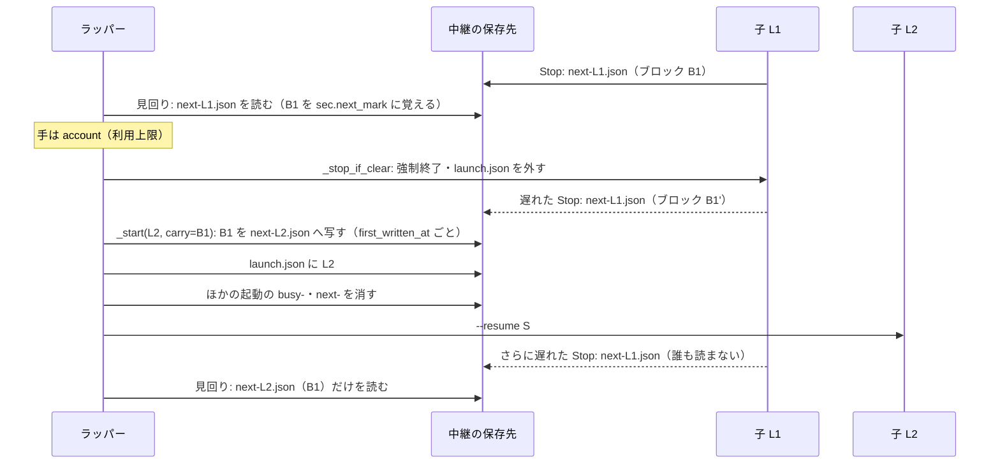

# 中継の次のセグメントのマーカー: 起動ごとのファイルにして、止めた前の起動の遅れた書き込みを読まない（#4102）

次のセグメントのマーカーを、1 つの `next.json` から起動ごとのファイル `next-<起動の ID>.json` に変える。Stop の hook は自分の起動のファイルにだけ書き、ラッパーは今の起動のファイルだけを読むので、止めた前の起動が遅れて書いても今の起動の切り替えに入らず、今の起動のマーカーも上書きしない。止める前にラッパーが読んだマーカーは、同じ会話の起動し直しでラッパーが次の起動のファイルへ写して引き継ぐ。#4049 の背景の作業の記録（`busy-<起動>.json`）と同じ形と同じ消し方にそろえる。

## 今の姿

要求と受け入れ条件は [issue-4102-requirements.md](./issue-4102-requirements.md)（正は #4102 の本文）にある。

| 部品 | 今の振る舞い | 場所（`plugins/ndf/src/ndf/domains/` から） |
| --- | --- | --- |
| マーカーを書く | `relay-marker` が `write_next(directory, session_id, block, goal_active, wait)` で `next.json` を書く。前の中身の `first_written_at` を、書き手に依らず引き継ぐ | `hooks/guards/relay_mark.py`・`relay/signals.py` |
| マーカーを読む | `_next_mark` が `read_next` で読み、`session_id` が今のセグメントと違えば消して `stale_next` を記録する | `relay/wrapper.py` |
| 止めた後 | `switch` だけが止めた後に `next.json` を消す。`account`・`restart`・`handover` は消さず、`--resume` で同じ会話 S を起動し直す | `relay/wrapper.py` の `_on_switch`・`_on_resume`・`_on_handover` |
| ほかの起動の照らし | 質問のファイルはロックの中で `launch.json` と照らす（#3814）。#4049 の背景の作業の記録は起動ごとのファイル `busy-<起動>.json` で、ラッパーが起動の前にほかの起動のものを消す（`drop_other_busy`） | `relay/signals.py`・#4049 の設計 |

`--resume` の前後で会話の ID は同じなので、会話の ID だけを照らす今の読み方は、止めた前の起動 L1 の遅れた書き込みを今の起動 L2 のものと見分けられない（2026-11-22 に `signals.set_launch(d, "L2")` の後の `write_next(d, "S", …)` が真を返し、中身が残ることを確かめた。要求の「事象」）。

## 文脈と制約

- 止めた子の hook は、ラッパーが子を強制終了した後も動きうる（#3814 の前提。実測していない）
- 実装は #4049 の後に置く。#4049 が `busy-<起動>.json`・起動の ID の形の検査 `LAUNCH_ID_RE`・`drop_other_busy` を足す（要求の前提 1）
- 子の会話か入れ子の claude かは #4061 の `signals.relay_role` が決める。この設計は子の会話の hook の中だけを扱う
- 互換の経路を持たない（要求の前提 3）。旧い `next.json` は読まない
- hook の経路は標準ライブラリだけで書く（hook は同じプロセスで `signals` を呼ぶため。`signals.py` の冒頭の決まり）

## 解き方の全体像

- **マーカーは書いた起動のファイルに置く。** `relay-marker` は `NDF_RELAY_LAUNCH` のファイル `next-<起動の ID>.json` へ書き、起動の ID が無い・形が違えば書かない。ラッパーは `next-<今の起動>.json` だけを読む。止めた前の起動の遅れた書き込みは、別の名前のファイルにしか届かない
- **最初に書いた時刻は同じファイルの中だけで引き継ぐ。** ほかの起動のマーカーから時刻を持ち込む経路が無くなる
- **止める前に読んだマーカーはラッパーが引き継ぐ。** ラッパーは見回りごとに読んだマーカー（無ければ None）を今のセグメントに覚え、子を止めた見回りの値を、`account`・`restart`・`handover` の起動の要求（`Launch.carry`）に載せて渡す。`_start` はそれを次の起動のファイルへ中身ごと写す。止めるのを見送った見回りの値・止めた後の読み直し・ラッパーを起動した最初の `--resume` は写さない
- **ほかの起動のマーカーはラッパーが起動の前に消す。** #4049 の `drop_other_busy` を、背景の作業の記録とマーカーの両方を消す関数へ広げる

## データ構造

### 次のセグメントのマーカー（`<中継の保存先>/next-<起動の ID>.json`）

| 項目 | 型 | 意味 | 今との違い |
| --- | --- | --- | --- |
| ファイルの名前 | — | `next-<起動の ID>.json`。起動の ID は `LAUNCH_ID_RE`（#4049。`uuid4().hex` の 32 桁の 16 進）に合うものだけ | `next.json` から変える |
| `launch` | string | ファイルの持ち主の起動の ID（名前と同じ値）。ラッパーが写したときは写した先の起動 | 足す |
| `session_id` | string | 書いた子の会話の ID（記録の読み手のため。判定には使わない） | 判定に使わなくなる |
| `block` | string | 次のセグメントのブロック | 変えない |
| `goal_active` | bool | `/goal` の続きの Stop か | 変えない |
| `first_written_at` | string | 切り替えを待つ静かな時間の起点。同じファイルの前の中身からだけ保つ。ラッパーが写したときは写した元の値で、その後の Stop も保つ | 引き継ぐ元を同じファイルに限る |
| `written_at` | string | 最後に書いた時刻 | 変えない |

書くときに排他を取らない。同じ起動の Stop は応答ごとに 1 回で重ならず、ほかの起動の書き手は名前の違うファイルにしか書かないためである（#4049 の `write_busy` と同じ）。今の `next.json.lock` は無くなり、子を止める排他（`question.json.lock`）も取らない（決定 2）。

### 中継のファイルの契約（`contracts/domains/ndf-files.json`）

`relay-next` の行の `path` を `<名前>/next-<起動>.json` に、`writer` を「子の会話の Stop の hook（M3a）。中継のラッパーは同じ会話の起動し直しで写し、ほかの起動のものを消す」に変える。`docs/contracts/files.md` は `ndf check --write-spec` で作り直す。

## 処理の流れ

- `switch` は覚えたマーカーのブロックを次のセグメントの文にし（今のとおり）、新しいセッションの起動では写さない
- `restart`・`handover` は判定の順で次のセグメントのマーカーが無いときだけ選ばれる（`switch_decide.decide` の順 3 より後）ので、覚えたマーカーは無く、写すものも無い。読んだ後・止める前に子が書いたマーカーは写さない（止める判定に使っていない）
- 写せなければ（ディスク・権限）、子を起動せずに `precondition` で止まる。掃除の前なので、止めた子のファイルも残る
- `spawn` に失敗したら、今のとおり `launch.json` を外して止まる。写したファイルは残るが、次にラッパーを起動したときは新しい起動の ID で読み、掃除で消える

## 決定の記録

### 決定 1: 止めた前の起動の遅れた書き込みが今の起動に届かないため、マーカーを起動ごとのファイルにし、ラッパーは今の起動のファイルだけを読む

- **質問**: `next.json` のどこで起動の ID を照らすか（書く側・読む側・ファイルの名前）
- **選んだ案**: ファイルの名前に起動の ID を入れる（`next-<起動の ID>.json`）。`relay-marker` は `NDF_RELAY_LAUNCH` のファイルへ書き、ラッパーは `Section.launch` のファイルだけを読む。止めた前の起動の書き込みは、名前の違うファイルにしか届かないので、今の起動のマーカーを上書きせず、最初に書いた時刻も持ち込まない。中身にも `launch` を書き、名前と違う中身は壊れたマーカーとして扱う。#4049 の背景の作業の記録（`busy-<起動>.json`）と同じ形にする
- 採らなかった案: 1 つの `next.json` に `launch` を足し、書く側が子を止める排他の中で `launch.json` と照らしてから書き、読む側も照らす（質問のファイルの形）。止めた子が書けないことを排他の順で保つので、Stop の hook が子を止める排他を取り合い、ラッパーが止める間（`relay.child-exit` の秒まで）は今の子の書き込みも失敗する。引き継ぎにも同じ排他が要る。質問のファイルが 1 つなのは「回答待ちの質問は 1 つ」の約束のためで、マーカーには当たらない
- 採らなかった案: 読む側だけで、会話の ID の代わりに `launch` を照らす（書く側は変えない）。遅れた書き込みが今の起動のマーカーと引き継いだマーカーを上書きし、読む側はそれを捨てるので、今の起動のマーカーが失われる（受け入れ条件 2 を満たさない）
- **代償**: 中継の保存先に起動ごとのファイルが残りうる（止めた子が遅れて書いたもの）。次の起動の前に消える（決定 3）。ファイルの名前が変わり、手順書・用語集・中継のファイルの契約を直す
- 根拠: Value 7 / Value 8（MVV 版 11）。Value 7「形を変えて戻ってこない」（書き手の取り違えを名前の構造で閉じ、排他の順に頼らない）・Value 8「同じ事実を 2 か所に持たない」（起動ごとの持ち主をファイルの名前の 1 か所で決める）

### 決定 2: 今の子の書き込みを止める側の都合で失わないため、マーカーを書く hook は子を止める排他を取らず、今の起動の記録とも照らさない

- **質問**: `relay-marker` は書く前に今の起動（`launch.json`）と照らすか
- **選んだ案**: 照らさない。自分の起動のファイルへ書くだけにする。止めた子が書いても読まれないので、照らす利得が無い。照らすと、子を止める排他を取り合うか、照らしと書き込みの間に止められる隙が残る
- 採らなかった案: 照らして、今の起動でなければ書かない（中継の保存先に残るファイルが減るだけで、残ったファイルは決定 3 で消える）
- **代償**: 止めた子が遅れて書いたファイルが次の起動まで残る（中身は 1 つのブロックの写しで、同じ名前のラッパーの起動ごとに 1 本まで）
- 根拠: Value 9 / Value 3（MVV 版 11）。Value 9「1 つの関数が 1 つの責務を持つ」（書く側は書くだけ、どれを読むかは読む側が決める）・Value 3「同じ操作を打ち直しても、結果は 1 回打ったときと変わらない」

### 決定 3: 消し方を 1 つにするため、#4049 の `drop_other_busy` を、ほかの起動の背景の作業の記録とマーカーを消す `drop_other_launches` に広げる

- **質問**: 止めた子が遅れて書いたマーカーと前の実行の残りを、いつ誰が消すか
- **選んだ案**: ラッパーが子を起動する前（`set_launch` の後・`spawn` の前。#4049 の `drop_other_busy` と同じ位置）に、今の起動の ID を渡して、それ以外の `busy-*.json`・`next-*.json` を消す。#4049 の `drop_other_busy` を名前ごと置き換え、消せないものを残して続ける契約も引き継ぐ。消した後に止めた子が書き直したものは残りうるが、名前が違うので判定に入らず、次の起動の前に消える。今の `_on_switch` の止めた後の `next.json` の削除は無くす（`_start` が消す）
- 採らなかった案: マーカーだけを消す関数を別に足す（同じ規則が 2 つになる）
- 採らなかった案: 止めた直後に消す（止めた子がその後に書いたものが残る。起動の前なら、写す前の掃除と 1 回にまとまる）
- **代償**: #4049 の実装が足す関数の名前と中身を、この課題の実装で直す。ラッパーが終わった後に遅れて書かれたマーカーは、同じ名前のラッパーが次に子を起動するまで残る（背景の作業の記録と同じ）
- 根拠: Value 11 / Value 6（MVV 版 11）。Value 11「重複と冗長が無い」・Value 6「NDF が作業で生んだものは役目を終えると自動で片付く」

### 決定 4: 止める前に読んだマーカーを失わないため、ラッパーは見回りで読んだマーカーを覚え、同じ会話の起動し直しで次の起動のファイルへ写す

- **質問**: 止めた前の起動のマーカーのうち、止める前に書かれたもの（利用上限の画面とマーカーが同時にあって `account` を選んだときなど）をどう扱うか
- **選んだ案**: ラッパーは見回りごとに `_state` で読んだマーカー（無ければ None）を `Section.next_mark` に置き直す（質問の `pending` と同じ扱い）。`_on_resume`・`_on_handover` は、子を止められた見回りの `sec.next_mark` を起動の要求 `Launch.carry` に載せ、`_start` は起動の記録を書く前にそれを次の起動の ID のファイルへ中身ごと写す（`launch` だけを次の起動に直し、`first_written_at` を保つ）。今は同じ会話の ID なので読まれ続けており、この振る舞いを保つ。止めるのを見送った（`held`）見回りは起動しないので値を渡さず、次の見回りが読み直す。写すのは止めた見回りの読みだけなので、読んだ後に止めた子が書いたものは入らない。写す先の名前は次の起動の ID で、その ID は `spawn` まで子に渡らないので、写す間にその名前へ書く hook は無い（止めた子は止めた起動の名前にしか書けない）。ラッパーを起動した最初の `--resume`（`_loop` の最初の `_start`）は `carry` を持たない
- 採らなかった案: 止めた前の起動のマーカーをすべて捨てる（課題の本文の字面。利用上限でアカウントを替えた子が、終えたセグメントの引継ぎのブロックを失う。要求の起票者の推定 S2）
- `restart`・`handover` は判定の順でマーカーが無いときだけ選ばれるので、`carry` は今は常に None である。それでも `_on_resume`・`_on_handover` の両方で同じ形に載せるのは、`--resume` で起動し直す経路を 1 つの規則にそろえるためである
- 採らなかった案: 覚えたマーカーをファイルに写さずにラッパーのメモリに持つ（次の起動の Stop が書くと、最初に書いた時刻を同じファイルから引き継げず、今の引き継ぎと変わる。読む場所も 2 つになる）
- 採らなかった案: 利用上限とマーカーが同時にあるときは `account` でなく `switch` を選ぶ（判定の順とアカウントの選び方を変える。利用上限でのアカウントの切り替え（lracct。#3604・#3864）の範囲で、この課題の外）
- **代償**: ラッパーもマーカーを書く（写すときだけ）。起動の要求 `Launch` に項目が 1 つ増える。写せなければ子を起動せずに止まる（今の `set_launch` の書けない失敗と同じ重さ）。引き継いだマーカーの最初に書いた時刻が静かな時間より古いと、起動し直した子は次の見回りで切り替わる（今と同じ振る舞い）
- 根拠: Value 3（MVV 版 11）。Value 3「版上げ・再起動・セッションの入れ替えをまたいでも、進行中の作業と人の回答は失われず、止まった所から続く」

### 決定 5: 起動の ID の無い書き手を残さないため、起動の ID が無い・形が違う子の会話の Stop はマーカーを書かない

- **質問**: `NDF_RELAY_LAUNCH` が無い子の会話の Stop をどう扱うか
- **選んだ案**: マーカーを書く段でだけ照らし、`LAUNCH_ID_RE` に完全に合わなければ書かずに通す（`passing(relay_next=False)`）。その前の #4061 の子の会話の判定・#4049 の件数の書き込みと作業が残るときの変更要求は今のとおり行う。今のラッパーは子を起動するたびに必ず渡すので、無いのは手で起動した会話か旧い版の混在だけである。互換の経路を持たない（Value 4）
- 採らなかった案: 起動の ID が無ければ `next.json` へ書く（読む側が 2 つの名前を読むことになる）
- **代償**: 旧い版のラッパーの下で新しい hook が動くと、次のセグメントへ切り替わらない（文脈の量が上限を超えたときの引継ぎ `handover` で同じ会話を起動し直す振る舞いに落ちる）
- 根拠: Value 4（MVV 版 11）。「普及のフェーズに入るまで、後方互換は求めない」

### 決定 6: 重なる設計と矛盾しないため、#4061・#4049・#3814・#4103 との境界をこう置く

- **質問**: 重なる設計のどこで接し、何を変えるか
- **選んだ案**:

| 重なる設計 | その設計が決めたこと | この設計との境界 |
| --- | --- | --- |
| #4061（`issue-4061-4062-4064-design.md`） | `signals.relay_role` が「中継の外」「子の会話」「入れ子」を決め、`relay-marker` は子の会話だけが書く。`NDF_RELAY_LAUNCH` は止めた前の起動を見分けるために残す。「止めた前の起動への保証」の表で `next.json` を「照らさない。変えない」とし、この課題へ分けた | 役割の判定は変えない。子の会話の中で、どの起動のファイルへ書くかをこの課題が決める。#4061 の表の `next.json` の行は、この課題の実装で「起動ごとのファイル」に変わる（#4061 の設計文書は書き換えない） |
| #4049（`issue-4049-design.md`） | `busy-<起動>.json`・`LAUNCH_ID_RE`・`drop_other_busy`。`relay-marker` が Stop で背景の作業の件数を書いてからマーカーを書く。採らなかった案に「マーカーにも起動の ID を書いて照らす」（範囲の外） | 同じ形にそろえる。`drop_other_busy` を `drop_other_launches` に置き換える（決定 3）。`relay-marker` の件数の書き込みと作業が残るときの変更要求は変えない |
| #3814（確定仕様 `docs/specifications/ndf-relay-pending-question-guard.md`） | 質問のファイルは子を止める排他の中で起動の ID を照らす | 変えない。マーカーは排他を取らない（決定 2） |
| #4103（設計 PR #4112、マージ前） | ハブがラッパーを起動するときの起動の券と印（`NDF_RELAY_LAUNCH_GEN`）。`signals.NAME_RE` を `core/launch_ticket` の検査へ寄せる | ラッパーの起動（ハブの層）とラッパーの中の子の起動（この課題）は別の ID である。`signals.py` で触る関数は重ならない |

- 採らなかった案: #4061 の実装に含める（#4061 は「入れ子か」の見分けで、この課題は「どの起動か」の持ち方。レビューの観点が違い、#4061 の差分が増える）
- **代償**: #4049 の実装が足す `drop_other_busy` を一度書いてから直す
- 根拠: Value 9 / Value 11（MVV 版 11）。Value 9「1 つのモジュール・関数が 1 つの責務を持つ」・Value 11「重複と冗長が無い」

### 決定 7: 重なるファイルの rebase を減らすため、実装は #4061・#4062 の PR の後に 1 本で置き、#4064 と並べる

- **質問**: 実装を #3995 → lracct（#3604・#3864）→ #4049 → #4068 → #4061・#4062 → #4064 の順のどこに置くか
- **選んだ案**: #4061・#4062 の実装の PR のマージの後に 1 本の PR で置く。#4064 とは触るファイルが重ならない（#4064 は `hooks/main.py`・`dispatch.py`・`ask.py`・`relay_busy.py`）ので並べてよい。#4068 とは `relay/signals.py` だけが重なり、関数は別（#4068 は起こす hook の記録）なので、#4068 の後でも前でもよい。実装の前に `gh pr list` の触るファイルで打ち直す

| 順 | 課題 | この課題と重なるファイル |
| --- | --- | --- |
| 3 | #4049 | `relay/signals.py`（`drop_other_busy`・`LAUNCH_ID_RE`）・`hooks/guards/relay_mark.py`・`relay/wrapper.py`（`_start`・`_state`・`_on_resume`・`_on_handover`）・`ndf-files.json`・`relay.md`・用語集・テスト 3 本 |
| 4 | #4068 | `relay/signals.py`（別の関数） |
| 5 | #4061・#4062 の 1 本目 | `relay/signals.py`（`relay_role`）・`hooks/guards/relay_mark.py`（頭の判定）・`relay.md`・用語集・`test_guards.py`・`test_relay_parts.py` |
| 5 の後 | **#4102（この課題）** | 上の 3・4・5 |
| 5 の後（並べる） | #4064 | 無し |

- 採らなかった案: #4049 の直後、#4061 より前に置く（`relay_mark.py` の頭の判定を #4061 が書き換えるので、どちらが先でも 1 回の rebase は要る。#4061 の後なら、子の会話だけが書く前提でテストを組める）
- **代償**: #4061・#4062 のマージを待つ。待つ間はほかのレーンの設計を進める（#4069 の方針）
- 根拠: Value 5 / Value 2（MVV 版 11）。Value 5「並べられる作業は並べて進め、待つだけで止まらない」・Value 2（rebase と衝突の手直しに費用を使わない）

### 決定 8: 利用者の全体の設計方針（#4069）に照らし、この設計は文脈とリソースの方針を変えず、待ちの誤りを減らす側に働く

- **質問**: #4069 の方針（文脈の再利用・最適な文脈量・キャッシュ・リソースを使い切る・処理待ちを作らない・空いた時間にやること）に合うか
- **選んだ案**: 合う。止めた前の起動の古いブロックで今の子が切り替わると、引継ぎの途中の文脈を捨てて古い文で次のセグメントを始め、作業をやり直す（文脈の再利用と token の費用に反する）。この設計はその切り替えを無くす。切り替えの判定・静かな時間・起動し直しの回数は変えないので、待ちの長さとリソースの使い方は変わらない
- 採らなかった案: 無し（方針に反する選択肢が無い）
- **代償**: 無し
- 根拠: Value 5 / Value 2（MVV 版 11）。#4069 の「処理待ちを作らない」「できるだけ低コストで」

## 影響と危険

| 対象 | 影響 |
| --- | --- |
| 中継の下の利用者 | 止めた前の起動の遅れた Stop で今の子が切り替わらない。切り替えの判定・静かな時間・起動し直しの手は変わらない |
| 中継の保存先 | `next.json` と `next.json.lock` の代わりに `next-<起動>.json` が置かれる（錠は無い）。ほかの起動のものは次の子の起動の前に消える。旧い `next.json` は読まれず、消されもせずに残る |
| 記録（`log.jsonl`） | 行の種類 `stale_next` は出なくなる（ほかの起動のマーカーは読まない） |
| 公開インタフェース | 変わらない（`relay-next` は契約の「内部」） |

危険:

- 旧い版のラッパーと新しい hook が混ざると、マーカーの名前が食い違い、切り替わらない（決定 5 の代償）。ラッパーと hook は同じ版の導入先から動くので、混ざるのはラッパーを起動したまま版を上げたときだけで、次のセグメントの起動でそろう
- 範囲の外: 止めた子の hook のプロセスそのものは止めない（質問のファイル・背景の作業の記録と同じく、書いても効かない形で守る）

### 代表のリポジトリでの振る舞い

中継のラッパーはリポジトリの種類（Web サービス・モバイルアプリ・業務文書だけ）に依らず同じに動き、この変更はラッパーの保存先の中だけで閉じる。

## 用語

| 用語 | 意味 |
| --- | --- |
| 次のセグメントのマーカー | Stop の hook が、最後の応答の次のセグメントのブロックを写して中継の保存先へ書くファイル。この設計の後は起動ごとの `next-<起動の ID>.json` |
| 起動の ID | ラッパーが子を起動するたびに作る ID（`NDF_RELAY_LAUNCH`・`launch.json`）。この設計の後は、マーカーのファイルの名前にも入る |
| 止めた前の起動 | ラッパーが強制終了し、今の起動の記録から外した子の起動 |
| 引き継ぎ（マーカーの） | 同じ会話を起動し直すとき、止める判定に使ったマーカーを、ラッパーが次の起動のファイルへ写すこと |
| 見回り | ラッパーが周期ごとに中継の保存先と子の画面を読み、次の手を 1 つ決めること（`switch_decide.decide`） |
| 静かな時間 | 子の出力が止まってから、またはマーカーを最初に書いてから、切り替えの前に待つ秒（`relay.quiet`） |
| 手（`switch`・`account`・`restart`・`handover`） | 見回りが決める子の扱い。`switch` はマーカーがあるときの新しいセッションへの切り替え、`account` は利用上限の画面を見たときのアカウントを替えた起動し直し、`restart` は子が終わったか出力が止まったときの起動し直し、`handover` は文脈の量が上限を超えたときの引継ぎを頼む起動し直し。後の 3 つは `--resume` で同じ会話を続ける |
| 見送った見回り（`held`） | 回答待ちの質問のファイルがあるか質問のロックを取れず、ラッパーが子を止めずに次の見回りで決め直すこと |

## テスト設計

| # | 縛る振る舞い | 落ちるべき壊し方 |
| --- | --- | --- |
| 1 | `write_next` は `next-<起動>.json` だけを書き、同じ起動の 2 回目の書き込みは `first_written_at` を保つ。ほかの起動のファイルがあっても、その時刻を持ち込まない。`carry_next` で写したファイルへ次の起動が書いても、写した時刻を保つ | 1 つの名前に書く・ほかの起動の時刻を引き継ぐ・写した時刻を捨てると落ちる（受け入れ条件 3） |
| 2 | `read_next(directory, launch)` は今の起動のファイルだけを読み、ほかの起動のファイルと旧い `next.json` があっても None。中身の `launch` が名前と違えば `SignalError` | ほかの名前を読む・名前と中身の食い違いを通すと落ちる（受け入れ条件 1） |
| 3 | Stop の hook のエントリポイントから、`NDF_RELAY_LAUNCH` が L1 の子の会話の Stop を流すと `next-L1.json` だけが書かれ、L2 のファイルの中身は変わらない。`/goal` の続きの Stop（`stop_hook_active` が真）も同じで、`goal_active` が真で書かれる。`NDF_RELAY_LAUNCH` が無い・形が違う入力では何も書かないが、背景の作業が残る Stop には今のとおり変更要求を返す | 起動の ID の無い書き手が書く・ほかの起動のファイルに触る・起動の ID の照らしで変更要求を落とすと落ちる（受け入れ条件 2・5） |
| 4 | ラッパーの見回り: `account`・`restart`・`handover`・`switch` のそれぞれで偽の子 L1 を止めて L2 を起動した後に、L1 の ID でマーカーを書き、次の見回りを通す。どの経路でも、そのマーカーで `switch` にならず（起動した引数に新しいセッションが現れない）、L2 の ID で書くと静かな時間の後に `switch` になる | 遅れた書き込みで切り替えると落ちる（受け入れ条件 1） |
| 5 | ラッパーの見回り: L1 のマーカーがある見回りで利用上限の画面を見せて `account` を選ばせると、L2 の起動の後に `next-L2.json` があり、ブロックと `first_written_at` が L1 のものと同じで、差し替えた時計でその時刻から静かな時間を数えて `switch` になる。止めた後に L1 の ID で書いた別のブロックは写されない。止めるのを見送った見回り（質問のファイルを置く）の後に止めた見回りでは、止めた見回りの読みが写される。ラッパーを `--resume` で起動した最初の子は何も写さない | 引き継ぎを失う・止めた後の書き込みや見送った見回りの値を写す・最初の起動で前の実行の残りを写すと落ちる（受け入れ条件 4） |
| 6 | `drop_other_launches(directory, L2)` の後に、L2 のファイルだけが残り、ほかの起動の `busy-`・`next-` が無い。消せないファイル（権限）を置いても例外を出さずにラッパーは起動し、そのファイルで次の見回りが `switch` にならない。写せない（`carry_next` が偽）と子を起動せずに `precondition` で止まる | 今の起動のものを消す・消せないと止まる・残ったものを読む・写せないまま起動すると落ちる（受け入れ条件 4・6） |
| 7 | `switch` の後の新しいセッションは、覚えたマーカーのブロックを文にして起動し、`next-<新しい起動>.json` を持たない | 新しいセッションへ写すと落ちる（受け入れ条件 4） |

時間で区切らず、時計と起動を差し替えて回数と中身で確かめる。.md の文言を照らすテストは書かない（受け入れ条件 7）。

## どこを変えるか

詳細設計は [issue-4102-design-detail.md](./issue-4102-design-detail.md) にある（新設する関数 2（`signals.carry_next`・`_next_path`）・シグネチャを変える関数 2（`signals.write_next`・`read_next`）のため。#4049 の `drop_other_busy` を `drop_other_launches` に置き換え、`signals.drop` と定数 `NEXT_FILE` を消し、`Section` と `Launch` に項目が 1 つずつ増える）。

## 設計の結果

| 課題 | 扱い | 統合先 | 触るファイル |
| --- | --- | --- | --- |
| #4102 | 実装する | — | `plugins/ndf/src/ndf/domains/relay/signals.py`、`plugins/ndf/src/ndf/domains/relay/wrapper.py`、`plugins/ndf/src/ndf/domains/relay/registry.py`（冒頭の表）、`plugins/ndf/src/ndf/domains/hooks/guards/relay_mark.py`、`plugins/ndf/contracts/domains/ndf-files.json`、`plugins/ndf/docs/contracts/files.md`（再生成）、`plugins/ndf/skills/development-workflow/references/relay.md`、`plugins/ndf/skills/development-workflow/references/glossary.md`、`docs/glossary/glossary.json`、`docs/glossary/ndf-relay.md`（再生成）、`plugins/ndf/tests/domains/relay/test_relay_parts.py`、`plugins/ndf/tests/domains/relay/test_relay_wrapper.py`、`plugins/ndf/tests/domains/relay/test_relay_wrapper_question.py`、`plugins/ndf/tests/support/relay_children.py`、`plugins/ndf/tests/domains/hooks/test_guards.py` |

## 未確認のまま残ること

| 項目 | 内容 |
| --- | --- |
| 止めた子の hook が実際に遅れて動くか | ラッパーの強制終了（`ptyprocess` の `terminate(force=True)`）の後に、子の claude が起動した hook のプロセスが残るかは測っていない。この設計は残っても効かない形にするので、測った結果で設計は変わらない |

## 外部の調査

省く: 外部の製品・標準に依らない内部の約束（中継の保存先のファイルの名前と、ラッパーと hook の間の書き手の取り決め）の直しで、同じ形の前例（#4049 の `busy-<起動>.json`）がこのリポジトリにある
