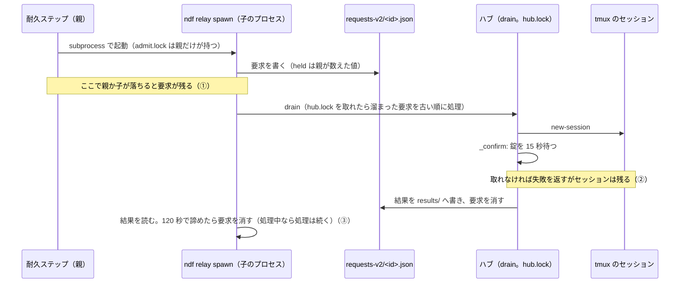
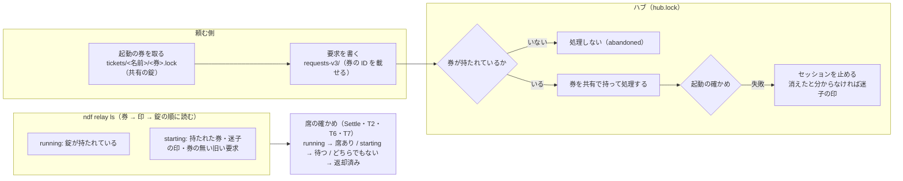
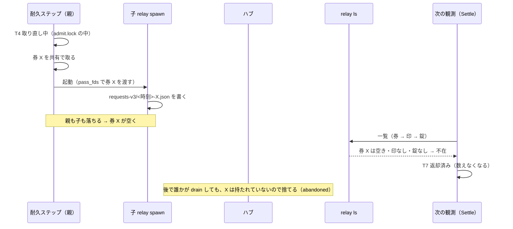

# 並列の計画: 起動の券と迷子のセッションの印で、起動の結果を確定させ、手動の再起動と期限を越えて生きる手でも上限を超えない（#4103）

#4091 の席の返却は、返却済みへ移す前に「そのレーンのラッパーがもう起きない」ことを確かめる必要がある。今のリレーハブは、頼む側が落ちた後の要求も、起動の確かめに失敗したセッションも、後から黙ってラッパーを起こすので、それを確かめられない。この設計は、起動を頼む側が要求を書く前から結果を受け取るまで「起動の券」（名前ごとのファイルの共有の錠）を持ち、ハブは券の持たれていない要求を処理せず、起動の確かめに失敗したセッションは止めるか「迷子」の印を残すと決める。ラッパーの一覧（`ndf relay ls`）が券と印から「起動の途中」を載せるので、席の確かめは一覧を 1 回読むだけで「動いている・起動の途中・不在」を決め、ハブの排他を外から取らない。

## 今の姿

何が起きたか・目的・受け入れ条件は要求仕様（[issue-4103-requirements.md](./issue-4103-requirements.md)、正は #4103 の本文）にある。パスは `plugins/ndf/` からの相対で書く。この設計は #4091 の設計（[issue-4091-design.md](./issue-4091-design.md)・[issue-4091-design-detail.md](./issue-4091-design-detail.md)）の席の 4 つの段階と遷移 T1〜T8 の上に乗り、#4091 の決定 8 が #4103 へ分けた箇所を置き換える（「#4091 の設計の置き換え」）。

**#4091 の版の設計が 3 ラウンド収束しなかった原因は、「もう起きない」をハブの外から、ハブの中の事実（溜まった要求・錠を持たないセッション・tmux の照会）を 1 つずつ読み足して決めていたことにある。** 読み足すたびに、読んだ後に起きる別の経路（頼む側の子のプロセスが親の後で要求を書く、照会の失敗、ハブの排他の外の書き込み）が指摘された。この設計は向きを逆にし、ラッパーを起こしうる経路そのものに目印を持たせる。

今のコードで確かめた、ラッパーが起きる経路と、その起動の結果が分からなくなる所:

| # | 今の振る舞い | 実物 | 席にとっての問題 |
| --- | --- | --- | --- |
| ① | 要求を書いた頼む側が落ちても、要求は残り、次に誰かが `drain` すると処理される。処理を始める時点で頼む側が生きているかを見ない | `hub.py` の `submit`・`drain`・`_handle_file` | 返却済みを書いた後に、書いた時点の古い `held` のままラッパーが起きる（r2-1・r3-1） |
| ② | 起動の確かめが失敗しても、作った tmux のセッションを止めない | `hub.py` の `_launch`・`_confirm` | 失敗と返った後にラッパーが錠を取る（r1-13・r2-1） |
| ③ | 頼む側は応答待ちが切れると要求のファイルを消して失敗を返すが、処理中の要求はそのまま処理される | `hub.py` の `submit`・`drain`（処理の後に `path.is_file()` を見て結果を書かないだけ） | 失敗と返った後にラッパーが起きる（r1-13） |
| ④ | `Tmux.has` は `has-session` の終了コードが 0 かだけを返す。実機（tmux 3.6）では、セッションが無いと終了コード 1 と `can't find session: <名前>`、サーバーが無いと終了コード 1 と `error connecting to <ソケット> (No such file or directory)`。tmux を打てない（`OSError`）・時間切れも偽になる | `tmux.py` の `_run`・`has`（2026-11-22 に `tmux -L <ソケット> has-session -t =<名前>` を打って確かめた） | 照会の失敗を不在と読む（r3-3） |
| ⑤ | 手動の `restart` の上限は、頼む側がハブの排他の前に読んだ `held`（#4044）と、処理の時点の動いているラッパーで判定する | `hub.py` の `restart`、#4044 の設計の決定 2 | 読んでから処理までの間に別のレーンが席を取ってラッパーだけ落ちると、2 本動く（r2-3・r3-4） |
| ⑥ | 期限を越えた続きの手は、ラッパーが生きていても失敗の 1 回に数えて置き換える | `run_decide.py` の `_expire_launched`・`_tick_waits` | 準備に時間を要する conductor を置き換え、失敗の上限で止まる（r1-15・r2-5・r3-5） |

## 文脈と制約

- 起動・置き換え・再起動・停止は、どれもハブへの要求（`hub.submit`）で、ハブは `hub.lock` を持ったまま要求を 1 本ずつ処理する（常駐のプロセスは無く、要求を書いた頼む側の `drain` がハブを兼ねる）。ハブが処理しない限り、名前つきのラッパーは起きない。ラッパーが動いているかは、ラッパーの錠（`wrappers/<名前>/` の錠）を誰かが持つかで決まる（`registry.busy_names`）
- 耐久ワークフローの起動の手は、親のプロセス（耐久ステップ）が子のプロセス（導入の `bin/ndf relay spawn`）を `subprocess` で打つ。親が持つ `admit.lock` は子へ渡らない（Python は記述子を既定で継承させない）。親が落ちても子は動き続ける
- `flock` の錠は open file description に結び付き、`fork` や継承で複製した記述子は同じ錠を共有し、複製がすべて閉じるまで残る。共有の錠（`LOCK_SH`）は複数のプロセスが同時に持てる（外部の調査の STD1）。手元でも、親が共有の錠を取って `pass_fds` で子へ渡し、親が閉じた後も子が生きている間は錠が持たれ、子が終わると空くことを確かめた（2026-11-22）
- 層の向きは `ndf.contracts` → `adapters` → `core` → `progress` → `domains` で、下の層は上の層を読まない（`src/ndf/checks/rules.json` の `layers`）。`progress/lane` は `domains/relay` を import できず、`domains/relay` は `progress/lane/machine` を import できる
- ハブの保存先は `contracts` の `locations` の `relay-hub` で決まり、`progress` の側からも同じパスを得られる
- 受付箱は版ごとに分けてきた（#3909 の `requests-v2`。旧版のハブは新しい受付箱を読まない）
- この課題の実装は #4044 → #4091 の実装の後に入る（#4091 の決定 8）。#4091 の実装は、この境では安全側（取り直しの起動の結果が「起動しなかった」と確定しない限り取り直し中のまま数える）に倒してある

## 解き方の全体像

- **起動の券**: ラッパーを起こしうる要求（起動・置き換え・再起動・停止）を頼む側は、要求を書く前に `relay/hub/tickets/<ラッパーの名前>/<券の ID>.lock` の共有の錠を取り、結果を受け取るか諦めるまで持つ。耐久ステップは親のプロセスで券を取り、記述子を子のプロセスへ渡す（`pass_fds`）ので、親が落ちても子が生きている間は券が持たれる
- **ハブは頼む側の生きている要求だけを処理する**: 券を載せた要求は新しい受付箱 `requests-v3` に置き、ハブは処理を始める前に `hub.lock` の中で券が持たれているかを見る。持たれていなければ処理せずに捨てる（`abandoned`）。持たれていれば、処理の間は自分も券を共有で持つ
- **起動の確かめが失敗したら、ハブがセッションを止める**: 止めて錠が空き、tmux がセッションは無いと答えたときだけ「無い」とする。照会が不明・止められないときは `relay/hub/strays/<名前>` に迷子の印を書き、上限の判定で動いているラッパーと同じに数え、次の `drain` と `stop` で解く
- **一覧が「起動の途中」を載せる**: `ndf relay ls` は名前ごとに、持たれた券・迷子の印・券の無い旧い要求のどれかがあれば `starting: true` を載せる。読む順は券 → 印 → ラッパーの錠で、券が空いたと読めた時点で、その処理が起こしたラッパーと印はもう読める位置にある
- **席の確かめは一覧だけで決める**: 返却済みへ移す手（T2・T6・T7）は、一覧を読めて、そのラッパーが `running` でも `starting` でもないときだけ返却済みを書く。ハブの排他を外から取らず、溜まった要求も処理しない（頼む側が落ちた要求は券が空いているので、誰も処理しない）
- **手動の再起動と通常の起動は、`held` を読んでから結果までを `admit.lock` の中で行う**（⑤）
- **期限を越えた続きの手は、一覧で生存を読み、動いている間は置き換えない**（⑥）。止まっていれば止まりとして知らせる。席の確かめ（`Settle`）は打ち切らない

## ドメインモデル

### コンテキスト

| コンテキスト | 持つもの | この設計で変えること |
| --- | --- | --- |
| リレー（`domains/relay`） | ラッパーの起動・停止・一覧、ハブの排他と受付箱 | 起動の券・迷子の印・受付箱 `requests-v3`・一覧の `starting`・tmux の照会の 3 値・頼む側の `admit.lock` |
| 起動の券（`core/launch_ticket`。新設） | 券のパス・取り方・持たれているかの判定 | 新設。リレーと計画の実行の両方が読む（下の層に置く） |
| レーン（`progress/lane`） | 席の段階・生死の判定・起動の手の呼び出し | 「不在」の判定を 1 つの関数にする。起動の手が券を取って子へ渡す |
| 計画の実行（`progress/plan`） | 観測・判断・耐久ステップ | 取り直しの後の確かめ・`Settle` の打ち切りなし・期限を越えた続きの手の生存 |

### 集約

**起動の券は、ラッパーの名前ごとの要求 1 本の生存を表す。** 持ち主は要求を書いた頼む側で、ハブは処理の間だけ共に持つ。ファイルの中身は持たず、錠だけが意味を持つ。**迷子の印は、ラッパーの名前ごとの「錠は空いているがセッションが残っているか分からない」を表す。** 書くのも消すのもハブだけ（`hub.lock` の中）。

### 状態と事象の表

この表が振る舞いの正本で、詳細設計の関数はどれもこの表の 1 行を実装する。R は起動の券と迷子の印、T は #4091 の席の遷移のうちこの課題が条件を置き換える行である。

| # | 前 | 引き金 | 後 | 書き手 | 排他 | 書く前に照らす条件 | 失敗・中断のとき | 打ち直し |
| --- | --- | --- | --- | --- | --- | --- | --- | --- |
| R1 | 券なし | 頼む側が要求を書こうとする | 券が持たれている | 頼む側（耐久ステップは親、人の CLI は自分） | 券の共有の錠 | — | 取れない（開けない）なら要求を書かずに失敗 | 打ち直すたびに新しい券の ID を作る（券は使い回さない） |
| R2 | 券が持たれている | 要求を `requests-v3/<時刻>-<券の ID>.json` へ書く | 要求あり | 頼む側 | なし（書いてから `drain`） | — | 書いた後に頼む側が落ちれば、券が空いて R4 になる | — |
| R3 | 要求あり | ハブが処理の番に来て、券が持たれている | 処理中（ハブも券を共有で持つ） | ハブ | `hub.lock` → 券の共有の錠 | 券の錠を `lock_held` で見て持たれている | — | — |
| R4 | 要求あり | ハブが処理の番に来て、券が持たれていない | 捨てた（`abandoned`） | ハブ | `hub.lock` | 同上で持たれていない | — | 捨てた要求は二度と処理されない（要求のファイルを消し、記録に `abandoned` を残す） |
| R5 | 処理中 | 起動の確かめ（`_confirm`）が成功 | 結果を書いて券を放す | ハブ | `hub.lock` | — | — | — |
| R6 | 処理中 | 起動の確かめが失敗 | セッションを止め、消えたと確かめれば結果を書いて券を放す。確かめられなければ迷子の印を書いてから結果を書いて券を放す | ハブ | `hub.lock` | 止めた後にラッパーの錠が空き、`probe` が False | — | 印は名前ごとに 1 つで、書き直しても同じ |
| R7 | 迷子の印あり | `drain` の始めか、その名前の `stop` | 印なし（錠が持たれていれば動いているラッパーとして数える。`probe` が False なら消える。True なら止めてから見直す） | ハブ | `hub.lock` | 錠と `probe` | `probe` が不明なら印を残す（数え続ける） | 何度打っても同じ |
| R8 | 券が持たれている | 頼む側が結果を読んだか諦めた | 券なし | 頼む側 | — | — | 頼む側が落ちれば錠は OS が解く | — |
| T2 | 返却中 | 一覧を読めて、ラッパーが `running` でも `starting` でもない | 返却済み | 耐久ワークフロー（`Vacate`・`Settle`） | `lock_plan` | `phase == vacating`・`seq` が同じ | 一覧を読めない・`starting` なら書かない（数え続ける） | 同じ条件で何度でも |
| T5' | 取り直し中 | 起動の結果が成功 | 席あり（`launched`） | `Launch` | `admit.lock` の中の `lock_plan` | `phase == reseating`・`seq` が同じ | #4091 のまま | #4091 の「同じ手の回復」のまま |
| T6 | 取り直し中 | 起動の結果が成功でなく（ハブの断りを含む）、券を放した後の一覧でラッパーが `running` でも `starting` でもない | 返却済み（`launch_failed`、断りなら `refused`） | `Launch` | `lock_plan` | 同上 | `starting`・読めないなら書かない（`Settle` が続ける）。`running` なら T7 と同じく席あり | — |
| T7 | 取り直し中 | 手の外の観測か同じ手の打ち直しが一覧を読んだ | `running` なら席あり（`present`）、`running` でも `starting` でもなければ返却済み（`absent`） | `Settle` か `Launch` の打ち直し | `lock_plan` | 同上（打ち直しは #4091 の「同じ手の回復の判定」のまま） | `starting`・読めないなら書かない | 何度打っても同じ。2 本目を起動しない |

一覧が載せる生存は 3 つで、席の手も期限の判定もこの 3 つだけを読む:

| 生存 | 一覧での形 | 決め方（この順に読む） |
| --- | --- | --- |
| `starting`（起動の途中） | `starting: true` | ① `tickets/<名前>/` に持たれた券がある ② `strays/<名前>` がある ③ 券を載せない旧い受付箱（`requests-v2`）にその名前の起動・置き換え・再起動の要求のファイルがある。①〜③のどれか |
| `running`（動いている） | `running: true` | ① の後に読んだラッパーの錠が持たれている（今の `liveness.wrapper_running`） |
| 不在 | 行が無いか、`running` も `starting` も偽 | 一覧を読めて、上のどちらでもない |

`starting` と `running` が両方真の行（動いているラッパーへ再起動の要求が来ている）は、`running` として読む。返却済みを書かないことは同じである。

### 不変条件

| # | 条件 | 守る所 |
| --- | --- | --- |
| U1 | 名前つきのラッパーが起きるのは、ハブが処理を始めた時点で券が持たれていた要求（か、券を持たない旧い要求か、迷子のセッション）からだけである | R3・R4。旧い要求と迷子は一覧で `starting` に載る |
| U2 | 一覧がある名前を不在と読んだ時点より後にその名前のラッパーが起きるのは、読んだ時点より後に券を取った要求からだけである | 一覧の読む順（券 → 印 → 錠）。券が空いた処理は、起こしたラッパーの錠と印を書き終えている（R5・R6 は券を放す前に印を書き、起動の確かめは錠が取られるまで待つ） |
| U3 | 返却済みの行のレーンの名前に、返却済みを書いた後で券を取るのは、同じ計画の耐久ワークフローの T4 の後の起動（`admit.lock` の中で数える）か、`admit.lock` を `held` の読みから結果まで持つ手動の `restart`・通常の `spawn` だけである | S5（#4091。返却中・取り直し中の行に続きの手を出さない）と、頼む側の `admit.lock`（決定 4） |
| U4 | ハブの上限の判定は、動いているラッパー・迷子の印・要求の `held` の和集合で数える | `_over_cap`・`restart`（迷子を足す） |
| U5 | tmux の照会が不明なら、そのセッションは「ある」として扱う | `probe` の 3 値と、ハブの中で照会を読む所すべて |
| U6 | 続きの手は、そのレーンのラッパーが `running` の間は期限切れで失敗に数えず置き換えない。止まっていれば止まりとして 1 回知らせる | `_expire_launched`・`_notice_stalls`（#4091 の S8 を置き換える） |
| U7 | `Settle` は打ち切らず、`running` か不在が確かめられるまで観測ごとに打つ | `Settle` を `launched`・`failed`・`final` に置かない（#4091 の S9 を置き換える） |

U1〜U4 から、返却済みの行は上限を超える起動の入り口にならない。返却済みを書いた後に手動の再起動で起きたラッパーは、起動の許可とハブが動いているラッパーとして数える（#4091 の S1 のとおり）。

### ドメインイベント

席の事象は #4091 の `row_seat` のまま足さない。リレーの記録（`hub-log.jsonl`）に、捨てた要求の結果 `abandoned` と、迷子の印を書いた・消した記録を足す（`cause` の種類は `contracts/causes.json` に `abandoned` を足す）。

## 構成要素

| 構成要素 | 責務 | 場所 |
| --- | --- | --- |
| 起動の券（新設） | 券のパス・取り方（共有の錠）・持たれているかの判定・古い券のファイルの掃除 | `src/ndf/core/launch_ticket.py` |
| 頼む側（`hub.submit`・`relay` の CLI） | 券が渡されていなければ自分で取り、要求に券の ID を載せて `requests-v3` へ書く。手動の `restart` と通常の `spawn` は `held` の読みから結果まで `admit.lock` を持つ | `src/ndf/domains/relay/hub.py`・`cli.py` |
| ハブの処理（`drain`） | 処理の前に券を見て、持たれていない要求を捨てる。処理の間は券を共に持つ。始めに迷子の印を見直す | `hub.py` |
| 起動の確かめ（`_confirm`） | 失敗したらセッションを止め、確かめられなければ迷子の印を書く | `hub.py` |
| 上限の判定（`_over_cap`・`restart`） | 迷子の印を動いているラッパーと同じに数える | `hub.py` |
| 一覧（`listing`） | 名前ごとに `starting` を載せる。券 → 印 → 錠の順に読む | `hub.py` |
| tmux の照会（`probe`） | セッションの有無を「ある・無い・不明」で返す | `src/ndf/domains/relay/tmux.py` |
| 起動の手（`launch.replace`・`spawn`・`stop`） | 親のプロセスで券を取り、子へ記述子と券の ID を渡す | `src/ndf/progress/lane/launch.py` |
| 生存の判定（`wrapper_presence`。新設） | 一覧の行から `running`・`starting`・不在を 1 か所で決める | `src/ndf/progress/lane/liveness.py` |
| 席の確かめと取り直しの後の確かめ | 一覧だけで T2・T6・T7 を決める | `src/ndf/progress/plan/run.py`（#4091 の `vacate_lane`・`settle_seat`・`launch_lane`） |
| 期限を越えた続きの手 | 生存で数えるかを決め、残した手の止まりを知らせる。`Settle` を打ち切らない | `src/ndf/progress/plan/run_decide.py` |

## データ構造

- 券のファイル: `<状態の保存先>/relay/hub/tickets/<ラッパーの名前>/<券の ID>.lock`。名前の無い `spawn` は `-` の下。券の ID は 32 桁の 16 進（`uuid4().hex`）。中身は空。0o600 で作る
- 要求: 今の中身に `ticket`（券の ID）を足し、`requests-v3/<20 桁の時刻>-<券の ID>.json` に置く。名前の無い `spawn` も `name` の代わりに `-` の下の券を持つ
- 迷子の印: `<状態の保存先>/relay/hub/strays/<名前>`。中身は `{"at": <時刻>, "reason": <確かめられなかった理由>}`（読むのは人だけで、判定は有無だけを読む）
- 一覧の行: 今の項目に `starting: bool` と `stray: bool`（迷子の印がある）を足す。登録簿に無く、券か印だけがある名前も `registered: false`・`running: false`・`starting: true` で載せる
- 計画の実行の状態: `RunState.kept_alive`（期限を越えたが動いているので残した続きの手のキー）・`RunState.settling`（`Settle` のキーと、起動の途中が続いた観測の回数）。写しに `alive`（期限に達する続きの手のレーンの生存。`running`・`starting`・`absent`・`unknown`）、観測の手に `expiring`（期限に達する続きの手のレーンの名前）
- 新しい上限の値は足さない。古い券のファイルを掃除する閾値は `relay.hub-wait` の秒の 2 倍、`Settle` の知らせの閾値は今の `parallel-run.launch` の秒を使う

## 入出力のコントラクト

- `ndf relay spawn`・`restart`・`stop` に `--ticket <券の ID>` を足す。渡されたら、その券の錠を呼び手が持って記述子を渡している前提で、自分では取らない。無ければ自分で取る（人が打つ形は変わらない）
- `ndf relay ls` の行に `starting` を足す（`docs/contracts/commands.md`）
- `contracts/causes.json` に `abandoned`（頼む側がいない要求を処理しなかった）を足す
- `ndf relay restart` と、`--replace`・`--seated` の無い `ndf relay spawn` は、マシンの起動の排他を `parallel-machine.admit-lock` の秒の間に取れなければ要求を書かずに断る（`refused`、「起動の排他を取れない。少し待って打ち直す」）
- 計画のリクエストの知らせの種類は足さない。`Settle` が長く起動の途中に留まるときは、今の `launch_failed`（取り直し中）・`halt_failed`（返却中）で 1 回だけ知らせる

## 処理の流れ

取り直しの起動の途中で耐久ステップが落ち、子のプロセスも落ちた（受け入れ条件 1）:

親だけが落ち、子が生きている間は、券 X は子が持つので一覧は `starting` を返し、`Settle` は書かずに待つ。子は自分の `drain` で要求を処理させ（後続のリレー操作を待たない）、結果を読むか 120 秒で諦めて終わる。処理が終われば、ラッパーが起きていれば `running`、起きていなければ不在になる。

起動の確かめが失敗した（受け入れ条件 5）:

| 時点 | ハブ | 一覧 | 席 |
| --- | --- | --- | --- |
| 確かめの 15 秒が切れた | 券を持ったまま、セッションを止めて錠が空くのを待ち、`probe` を打つ | `starting`（券が持たれている） | 取り直し中（数える） |
| `probe` が False | 結果（失敗）を書いて券を放す | 不在 | T6 で返却済み |
| `probe` が True・不明 | 迷子の印を書いてから結果を書いて券を放す | `starting`（印） | 取り直し中のまま。`Settle` が `stop` を打ち、ハブが印を見直す |

手動の再起動と取り直しが重なった（受け入れ条件 3。上限 1、レーン A は返却済み、レーン B を取り直す）:

| 順 | 起きること | 2 本動くか |
| --- | --- | --- |
| A の `restart` が先 | A の頼む側が `admit.lock` を取り、`held`（B は返却済みなので含まない）を読み、A を起こす。B の T4 は `admit.lock` を待ち、取れた後の `admitted` が A を動いているラッパーとして数えて上限で待つ | 動かない |
| B の T4 が先 | B の取り直しが `admit.lock` を持つ間、A の頼む側は待つ。取れた後に読む `held` に B（取り直し中か席あり。ラッパーが落ちていても数える）が載り、ハブが A を断る | 動かない |

## 決定の記録

### 決定 1: 起動の結果を確定させるため、ラッパーを起こしうる要求に頼む側の生存を表す「起動の券」を持たせ、ハブは券の持たれていない要求を処理しない

- **質問**: 取り直しの起動の結果が分からないとき（頼む側が落ちた・応答待ちが切れた）、「その名前のラッパーがもう起きない」をどう確かめるか（r2-1・r3-1・r1-13）
- **選んだ案**: 頼む側が要求を書く前から結果を受け取るまで、名前ごとのファイルの共有の錠（起動の券）を持つ。耐久ステップは親で券を取って子へ記述子を渡すので、親だけが落ちても子が生きている間は券が残り、両方が落ちれば OS が錠を解く。ハブは処理の番に来た要求の券が持たれていなければ処理しない（`abandoned`）。持たれていれば処理の間は自分も券を共有で持つので、処理中の要求は券が持たれたまま見える。こうすると、券が空いている名前には「処理を待つ生きた要求」も「処理中の要求」も無く、頼む側が落ちた要求は二度と処理されないので、溜まった要求を外から処理する必要も、ハブの排他を外から取る必要も無い
- 採らなかった案: 席の確かめがハブの排他を外から取り、溜まった要求を処理してから不在を読む（#4091 の版の `quiet`・`_drain_held`）。処理の後に書かれる要求（親が落ちた後に子が書く要求）を読み落とし、溜まった要求を処理すると書いた時点の古い `held` のままラッパーを起こす。指摘のたびに読み足す条件が増え、3 ラウンド収束しなかった
- 採らなかった案: 要求に期限を持たせ、期限を過ぎた要求を処理しない。期限までは処理されうるので、席の確かめが期限まで待つ必要があり、処理の途中に期限を過ぎた要求の扱いが時刻の比べになる
- 採らなかった案: 子のプロセスが自分で券を取る。親が子を起動してから子が錠を取るまでの間に親が落ちると、券が見えないまま子が後から要求を書く
- 採らなかった案: 打ち直しの冪等のキーで結果を引けるよう、ハブの記録（`hub-log.jsonl`）を要求の ID で引く。結果は引けるが、まだ処理されていない要求が後で処理されることを止められない
- **代償**: 頼む側の要求ごとに錠のファイルを 1 つ作って消す。旧い版の頼む側の要求（券なし）は `requests-v2` に残り、処理されるまで一覧が `starting` を返す（決定 6）。券の錠を持たずに要求を書く呼び手は、ハブに捨てられる（新しい受付箱へ書くのは券を持つ新しい版だけ）
- 根拠: Value 3「同じ操作を打ち直しても、結果は 1 回打ったときと変わらない」・Value 8「業務の規則は、コードだけでなくデータの制約でも守られる」（MVV バージョン 11）。STD1・PRD1

### 決定 2: 席の確かめが一覧だけで決まるよう、「起動の途中」を一覧に載せ、席の手は一覧の 3 つの生存だけを読む

- **質問**: 返却済みへ移す前の「不在」を、席の手（T2・T6・T7）がどう読むか
- **選んだ案**: `ndf relay ls` が名前ごとに `starting`（持たれた券・迷子の印・券の無い旧い要求）を載せ、読む順を券 → 印 → ラッパーの錠に固定する。席の手は一覧を読めて `running` でも `starting` でもないときだけ返却済みを書く。ハブは券を放す前に印を書き、起動の確かめは錠が取られるまで待つので、券が空いたと読めた後に読む印と錠には、その処理の結果がすでに現れている（U2）。判定は `liveness` の 1 つの関数（`wrapper_presence`）に置き、席の手・期限の判定・観測がすべてそれを読む
- 採らなかった案: 席の手がハブの排他の中で書く（`hub.lock` → `lock_plan`）。`progress` から `domains/relay` を読めない（層の向き）ので錠のパスと取り方を移す必要があり、排他を持つ間ほかの要求を止める。U1〜U3 が成り立てば、読んだ後・書く前にラッパーを起こせるのは `admit.lock` の中の経路だけになり、ハブの排他は要らない
- 採らなかった案: 一覧を錠 → 券の順に読む（錠を読んだ後・券を読む前に処理が終わってラッパーが起きると、券は空き・錠は無しと読んで不在になる）
- **代償**: `ndf relay ls` が、名前ごとに券のディレクトリと印を読む（券のファイルの数は動いている要求の数で、ふつうは数本）。`ndf relay ls` を打つ観測の数は変えない
- 根拠: Value 11「同じ規則・定数・処理は 1 か所にまとまり、ほかはそこを参照する」・Value 9「1 つのモジュール・クラス・関数が 1 つの責務を持ち」（MVV バージョン 11）

### 決定 3: 起動の確かめの失敗で後から起きるラッパーを残さないため、ハブがセッションを止め、止めたと確かめられなければ迷子の印を残して数える

- **質問**: `_confirm` の失敗の後に残る tmux のセッションと、照会の失敗をどう扱うか（r1-13・r2-1・r3-3。受け入れ条件 2・5）
- **選んだ案**: 起動の確かめが失敗したら、ハブは券を持ったまま、そのセッションを止め（`kill-session`）、ラッパーの錠が空くのを `relay.stop-wait` まで待ち、`probe` を打つ。`probe` は終了コード 0 なら「ある」、終了コード 1 で `can't find session`・`no server running`・`error connecting to … (No such file or directory)` なら「無い」、それ以外（tmux を打てない・時間切れ・権限の誤りなど）は「不明」を返す。「無い」でなければ迷子の印を書いてから結果を返す。印のある名前は、ハブの上限の判定で動いているラッパーと同じに数え、一覧は `starting` を載せ、席は返さない。印は次の `drain` の始めと、その名前の `stop` で見直し、錠が持たれていれば印を消して動いているラッパーとして数え、`probe` が「無い」なら消す。ハブの中で tmux の有無を読む所（`spawn` の対象の判定・`stop`）はすべて `probe` を読み、不明を「ある」に倒す
- 採らなかった案: 起動の確かめの失敗の後もセッションを残し、席の確かめが錠を持たないセッションの有無を tmux へ照会する（#4091 の版）。照会の時点の後でラッパーが錠を取りうるので、照会のたびに 1 回ずつ確かめ直す必要があり、上限の判定の側は残ったセッションを数えない
- 採らなかった案: 起動の確かめの待ちを延ばす（どれだけ延ばしても、切れた後に錠を取る起動は残る）
- **代償**: 起動の確かめが失敗した起動は、後から立ち上がっても止められる（今は遅れて動き出すことがあった）。tmux の照会が不明な間は、その名前の席を返さず、上限の判定でも 1 本と数える
- 根拠: Value 1「AI が決められないことは、理由と根拠を添えて人へ戻ってくる」・Value 3「同じ操作を打ち直しても、結果は 1 回打ったときと変わらない」（MVV バージョン 11）。STD2

### 決定 4: 手動の再起動が古い `held` で判定しないため、手動の `restart` と通常の `spawn` の頼む側は `held` の読みから結果までマシンの起動の排他を持つ

- **質問**: 手動の `ndf relay restart` の `held`（#4044）を読んでから処理されるまでに、別のレーンが席を取ってラッパーだけ落ちる順序（r2-3・r3-4。受け入れ条件 3）をどう防ぐか
- **選んだ案**: `ndf relay restart` と `--replace`・`--seated` の無い `ndf relay spawn` の頼む側は、#4044 の `seats.read`（`ndf lanes seats`）を打つ前に `admit.lock`（`machine.admit_lock`、`parallel-machine.admit-lock` の秒）を取り、`hub.submit` が結果を返すまで持つ。席の数が増える遷移（行の開始・T4）はどれも `admit.lock` の中で数えてから起動を頼むので、`held` を読んでから処理されるまでに数える席は増えない。取れなければ要求を書かずに断る。`--replace` と `--seated` は今のまま `admit.lock` を取らない（`--replace` は親の `admitted` が持つ `admit.lock` の中で打たれ、子が取ると親と取り合って止まる。`--seated` は席を数え直さない続きの起動）。`domains/relay/cli.py` から `progress/lane/machine.admit_lock` を読むのは層の向き（上の層が下の層を読む）に合う
- 採らなかった案: ハブが `hub.lock` の中で `ndf lanes seats` を打ち、処理の時点の `held` で判定する（#4044 の決定 2 で採らなかった形。ほかの要求と `admit.lock` を持って待つ耐久ワークフローを待たせ、ハブを兼ねたプロセスの版でサブコマンドを打つ）
- 採らなかった案: 頼む側が読んだ `held` に時刻を付け、ハブが古ければ断る（何秒を古いとするかに根拠が無く、新しくても間に起きた取り直しは防げない）
- **代償**: 手動の再起動と通常の起動の間（ラッパーの停止と起動の確かめを含め、最長で `relay.hub-wait` の 120 秒）、ほかの計画の起動の許可は `admit.lock` を取れずに次の観測まで待つ。手動の再起動は人とプラグインの更新の再起動が打つもので、回数は少ない
- 根拠: Value 3「判断の要らない手順は仕組みが進めるので、結果が実行ごとにばらつかない」・Value 8「業務の規則は、コードだけでなくデータの制約でも守られる」（MVV バージョン 11）

### 決定 5: 生きている conductor を置き換えず止まりも見落とさないため、期限を越えた続きの手は一覧の生存で扱いを分け、`Settle` は打ち切らない

- **質問**: 起動したまま待つ続きの手が期限を越えたが、ラッパーが生きているとき（r1-15・r2-5・r3-5）と、席の確かめが起動の途中に長く留まるとき（r3-2）、どうするか（受け入れ条件 4）
- **選んだ案**: 観測の手（`Observe`）に、この観測の後に期限に達する続きの手のレーン（`expiring`）を載せ、観測はそのレーンの生存を一覧から写しの `alive` に載せる（一覧は観測あたり高々 1 回のまま）。`_expire_launched` は、`running` なら失敗に数えず置き換えず `launched` に残し、キーを `kept_alive` に積む。`absent` なら今のとおり失敗の 1 回として同じキーで打ち直す。`starting`・`unknown`・載っていないときは期限切れを決めず回数を据え置く。`_notice_stalls` は `kept_alive` のキーを持つレーンを `/goal` の入れ直し待ち（`relaunching`）から外すので、ラッパーが生きたまま止まっていれば止まりとして 1 回知らせる（置き換えは人が止めた後の `absent` で起きる）。`Settle` は `launched`・`failed`・`final` に置かず、写しに `settles` として載る限り観測ごとに打ち、起動の途中が続いた回数を `settling` に数え、`parallel-run.launch` の秒を越えたら今の知らせ（取り直し中は `launch_failed`、返却中は `halt_failed`）を 1 回だけ出す。行を始める手と止める手の期限は変えない
- 採らなかった案: 期限だけで失敗に数える（今。生きている conductor を置き換えて失敗の上限に達する）
- 採らなかった案: `Settle` も止める手と同じく回数で打ち切る（打ち切った後にラッパーが錠を取る・券が空いても、同じ `seq` のキーが除かれたままで、取り直し中のまま止まる。r3-2）
- **代償**: 期限に達する続きの手がある観測では、一覧を 1 回読む（`judge_lanes` の読み取りと共有する）。生きたまま止まった conductor は、人が止めるまで席を使う
- 根拠: Value 1「AI が決められないことは、理由と根拠を添えて人へ戻ってくる」・Value 3「版上げ・再起動・セッションの入れ替えをまたいでも、進行中の作業と人の回答は失われず、止まった所から続く」（MVV バージョン 11）

### 決定 6: 版の混在で古い経路に券を無視させないため、券を持つ要求は新しい受付箱 `requests-v3` に置き、旧い受付箱の要求は処理されるまで起動の途中として数える

- **質問**: 券を知らない旧い版のプロセスがハブを兼ねたとき・旧い版の頼む側が要求を書いたとき、どうするか
- **選んだ案**: 券を持つ要求は `requests-v3` に書く。旧い版のハブは `requests-v3` を読まないので、券の持たれていない要求を処理することがない（#3909 で `requests-v2` を分けたのと同じ形）。新しい版の `drain` は `requests-v3` と `requests-v2` を古い順に合わせて処理し、`requests-v2` の要求は券の判定をせず今のとおり処理する。一覧は `requests-v2` にその名前の起動・置き換え・再起動の要求のファイルがある間、その名前を `starting` にする（旧い頼む側が落ちて残った要求も、処理されるまで起きうるため）。新しい版の耐久ステップが古い導入の `bin/ndf relay spawn` を子として打つと、`--ticket` を知らずに引数の誤りで要求を書かずに終わるので、起動の失敗（不在）になる
- 採らなかった案: 受付箱を分けずに要求の項目で区別する（旧い版のハブが `requests-v2` の券つきの要求を券を見ずに処理し、U1 が崩れる）
- **代償**: 旧い版の頼む側が要求を書いて落ちると、誰かが `drain` するまでその名前は `starting` のままで、席を返さない（`Settle` の知らせで人が気付く）。旧い版のハブが動く間は、旧い版の頼む側の要求で迷子の印が書かれない（今の振る舞いのまま）
- 根拠: Value 3「版上げ・再起動・セッションの入れ替えをまたいでも、進行中の作業と人の回答は失われず、止まった所から続く」（MVV バージョン 11）。#3909 の前例

### 決定 7: 持ち物を重ねないため、#4091 の決定 8 で分けた箇所をこの設計で置き換え、`held` の中身は #4044・#4100 が持つ

- **質問**: #4091・#4044・#4100・#4050 と、どこで分けるか
- **選んだ案**: 次の表で分ける。この課題の実装の PR で、#4091 の文書の置き換えの箇所（「#4091 の設計の置き換え」）を合わせる。設計 PR では他の課題の文書を変えない

| 課題 | 持つもの | この課題との境 |
| --- | --- | --- |
| #4091 | 席の 4 つの段階・数える規則・遷移 T1〜T8・続きの手のキー・同じ手の回復の判定 | この課題は T2・T6・T7 の「不在」の条件と、取り直しの手順の 4・5（起動の後の確かめ）、`Settle` の打ち切りなし、期限を越えた続きの手を置き換える。段階・遷移・キーは変えない |
| #4044 | 頼む側が `ndf lanes seats` で `held` を読んで要求に載せ、ハブがどの判定でも動いているラッパーと `held` の和集合で数えること | この課題は、`held` の読みから結果までを `admit.lock` の中に入れ（決定 4）、和集合に迷子の印を足す（決定 3）。`held` の読み方と載せ方は変えない |
| #4100（#4044 の設計の 3 点） | `ndf lanes seats` の DB の開き方・版 1 の索引の件数の受け渡し・確定仕様の上限の保証の条件の書き方 | 重なるのは `held` と席の数え方の 2 つで、どちらも中身は #4100・#4044 が持つ。#4100 が確定仕様に書く上限の保証の条件のうち「読んだ `held` が判定まで有効」は、この課題の決定 4 が成り立たせる。確定仕様の「既知の限界」から「読んでから判定するまでに行を始めてすぐ落ちたレーン」を消すのは、この課題の実装の PR が行う（#4100 の実装が先なら、その上へこの課題が rebase して消す） |
| #4050 | 待ちの記録・続きの手とキー | 変えない |

- 採らなかった案: #4044 の頼む側の読みをこの課題の中で書き直す（#4100 が同じ節を直している。`held` の読み方を 2 つの課題で持つと食い違う）
- **代償**: #4044・#4091・#4100 の実装の後、この課題の実装が入るまで、#4091 は安全側（取り直しの起動の結果が「起動しなかった」と確定しない限り取り直し中のまま数える）で動き、手動の再起動は #4044 の数え方の範囲でしか守られない
- 根拠: Value 9「1 つのモジュール・クラス・関数が 1 つの責務を持ち」・Value 11「文書も正本が 1 か所にあり、写さずに指す」（MVV バージョン 11）

## 影響と危険

- **働く範囲**: 利用先のリポジトリでも働く。リレーハブを通るすべての起動・再起動・停止（並列の計画の耐久ワークフロー、人が打つ `ndf relay` の CLI、プラグインの更新の再起動）に効く
- **プロジェクトごとに違うもの**: 無し（保存先は状態の保存先の下、秒は今の上限の設定）
- **当たるモード**: 並列の計画で流すすべてのモードと、`ndf relay` を直接使うすべての利用者
- **壊れうる箇所**:
  - 起動の確かめが失敗した起動は、後から立ち上がっても止められる。今それで動いていたラッパーは、打ち直しが要る
  - 手動の `ndf relay restart` の間、ほかの計画の起動は次の観測まで待つ（決定 4 の代償）。`admit.lock` を取れないときの断りの文で打ち直しを案内する
  - 頼む側が券を作れない保存先（読み取りだけ・容量切れ）では、起動・再起動・停止がすべて失敗になる。今も同じ保存先へ要求を書くので、新しく壊れる条件ではない
  - tmux が不調の間は迷子の印が残り、その名前は 1 本と数え続ける（上限を超えない側へ倒れる）
- **同じファイルを触る別の変更と実装の順**:
  - 実装の順: #4044 → #4091 → この課題。#4100 は #4044 の実装に含まれる。この課題は #4091 の `vacate_lane`・`settle_seat`・`launch_lane`・`Settle` と、#4044 の頼む側（`cli._hub`・`seats.read`）の上に乗るので、両方が入るまでこの課題の実装の PR をマージしない
  - #4049・#4070 は `src/ndf/domains/relay/` を触る。`hub.py`・`tmux.py`・`cli.py` で重なれば後から入る側が rebase する
  - #4036 は `liveness.py` の席ありの行の判定を触る。この課題は `wrapper_presence` を足すだけで、判定の分岐は変えない
  - 確定仕様 `docs/specifications/ndf-parallel-machine-plan-limit.md` の「リレーハブの起動の判定」と既知の限界、手順書 `references/relay.md` の上限の段落は、#4044・#4091 の後にこの課題が書き足す（起動の券・迷子の印・`starting`・手動の再起動が起動の排他を持つこと）

### 代表のリポジトリでの振る舞い

| 代表のリポジトリ | 設定の要点 | 直した後に起きること | この種類で扱えなくなること |
| --- | --- | --- | --- |
| Web サービス（nd-factory） | 並列の計画でスプリントのレーンを流し、プラグインの更新で `relay restart` を打つ | 待つ行の席の返却と取り直しが、起動の途中で落ちても止まらずに確定する。更新の再起動の間、ほかの計画の起動は次の観測まで待つ | 無し |
| モバイルアプリ | 同上 | 同上 | 無し |
| 業務文書だけ | 同上（文書のスプリントのレーン） | 同上 | 無し |

### このリポジトリだけの事情

- 無し（リレーハブと席の振る舞いは NDF の製品の振る舞いで、ai-plugins の運用の値を持たない）

## 用語

| 語 | 意味 | 反映 |
| --- | --- | --- |
| 起動の券 | ラッパーを起こしうる要求を頼む側が、要求を書く前から結果を受け取るまで持つ、名前ごとのファイルの共有の錠。ハブは券の持たれていない要求を処理しない | 追加（用語集へは実装の PR で足す） |
| 迷子のセッション | 起動の確かめが失敗した後、止めたと確かめられずに残った tmux のセッション。印を残し、動いているラッパーと同じに数える | 追加（同上） |
| 起動の途中 | ラッパーの一覧の `starting`。その名前に持たれた券・迷子の印・券の無い旧い要求のどれかがあること | 追加（同上） |

## テスト設計

| 受け入れ条件 | どの振る舞いで縛るか | どう壊したら落ちるべきか |
| --- | --- | --- |
| 1 | 取り直し中の行で、要求を書いた後・`drain` の前に親と子を止め（券が空く）、ほかのリレーの操作を 1 回も打たずに観測だけを回すと、次の `Settle` が一覧の不在で返却済みにする。その後に `drain` を打っても要求は `abandoned` で捨てられ、ラッパーは起きない。親だけを止めて子を生かすと、子が結果を受け取るまで一覧が `starting` を返し、`Settle` は書かず、子の処理が起動に成功すれば次の `Settle` が席ありにする。確定までの間、別の計画の起動の許可は取り直し中の行を数える | 券を見ずに処理すると、子が自分で券を取ると（親の起動から子の取得までに止める試験で）、一覧を錠 → 券の順に読むと落ちる |
| 2 | `probe` が、終了コード 1 と `can't find session`・`no server running`・`error connecting to … (No such file or directory)` で「無い」、終了コード 0 で「ある」、`OSError`・時間切れ・`error connecting to … (Permission denied)`・知らない出力で「不明」を返す。起動の確かめの失敗の後に `probe` が不明なら迷子の印が書かれ、一覧が `starting` を返し、`Settle` も T2 も返却済みを書かない | 照会の失敗を「無い」と読むと落ちる |
| 3 | 上限 1 で、A の `relay restart` の頼む側が `held` を読んだ直後に、別のスレッドで B の T4・T5 を走らせ、B のラッパーだけを落としてから A の要求を処理させる試験と、逆の順の試験。どちらの順でも、B の続きの手（`--seated`）の後に動くラッパーは 1 本である。頼む側が `admit.lock` を取れなければ要求を書かずに断る | 頼む側が `admit.lock` を持たずに `held` を読むと落ちる |
| 4 | 期限を越えた続きの手で、一覧が `running` なら失敗に数えず置き換えず `kept_alive` に載り、写しの `stalls` にその行があれば止まりの知らせが 1 回出る。`absent` で 1 回数えて同じキーで打ち直し、`kept_alive` から外れる。`starting`・`unknown` で回数を据え置く。`Settle` が起動の途中に `parallel-run.launch` の秒を越えて留まると知らせが 1 回だけ出て、その後に券が空けば次の `Settle` が書く | 期限だけで数えると、`kept_alive` のレーンの知らせを抑えると、`Settle` を打ち切ると落ちる |
| 5 | 起動の確かめの 15 秒を越えてから錠を取るラッパーで、ハブがセッションを止めて錠が空くのを待ち、`probe` が「無い」なら失敗を返す。止められなかったときは迷子の印を書き、上限 1 で別の名前の起動を断る。次の `drain` で印の名前の錠が持たれていれば印を消して動いているラッパーとして数え、`probe` が「無い」なら消す | 確かめの失敗でセッションを残すと、印を上限で数えないと落ちる |
| 1・3・5 | 状態と事象の表の R1〜R8 と T2・T6・T7 を 1 本ずつ通し、どの時点でも、ハブの上限の判定と別の計画の起動の許可が数える本数と、実際に錠を持つラッパーの数が上限を超えない | — |

詳細設計は [issue-4103-design-detail.md](./issue-4103-design-detail.md) にある（新設の関数が 2 つ以上あり、`hub.submit`・`launch.replace`・`observe`・`snapshot_of` のシグネチャを変えるため別ファイル）。

## #4091 の設計の置き換え

この課題の実装の PR で、#4091 の文書（確定仕様化が先ならその確定仕様）の次の箇所をこの設計に合わせる。設計 PR では変えない（決定 7）。

| #4091 の文書の箇所 | 置き換え |
| --- | --- |
| `issue-4091-design.md` の「文脈と制約」のハブの要求と手動の `restart` の 3 段落 | この設計の「文脈と制約」と決定 1・4 を指す |
| 同 コンテキストの表のリレーの行・構成要素の `quiet`・`probe`・手動の `restart` の頼む側の行 | この設計の構成要素の表を指す（`quiet` と `_drain_held` は作らない） |
| 同 状態と事象の表の T2・T6・T7 の「ハブの排他の中で」「未処理の起動の要求も錠を持たない tmux のセッションも無い」 | 「一覧でラッパーが `running` でも `starting` でもない」に置き換え、排他を `lock_plan` だけにする（この設計の T2・T6・T7） |
| 同 不変条件 S1 の守る所 | U1〜U4 を指す。「`hub.lock` の中で」を外す |
| 同 不変条件 S8・S9 | この設計の U6・U7 を指す |
| 同 決定 4 の「ハブの排他の中で一覧を読み」・決定 6 の「T2 はハブの排他の中で」 | 一覧の 3 つの生存で読む形にする（この設計の決定 2） |
| 同 決定 8 | 「#4103 の設計で置き換えた」と書き、この文書へのリンクを足す |
| `issue-4091-design-detail.md` の地図の `launch.py` の `quiet`・`hub.py`・`tmux.py`・`cli.py` の行と、「生存の判定は 1 つ」「返却済みはハブの排他の中でだけ書く」の段落 | この課題の詳細設計の地図と「生存の判定」を指す |
| 同 関数の表の `quiet`（リレー・レーン）・`probe` の行 | 削る（`probe` はこの課題の詳細設計） |
| 同 返却の手順の 4、確かめの手順の 2・3、取り直しの手順の 4・5 | この課題の詳細設計の「席の手の確かめ」に置き換える |
| 同 失敗の数え方の `Settle`・続きの手の期限の記述と、`RunState.kept_alive`・`_notice_stalls`・`Observe.expiring`・`observe`・`snapshot_of` の行 | この課題の詳細設計の「期限を越えた続きの手と `Settle`」に置き換える |
| 同 「手動の再起動と起動の許可の直列化」 | この課題の詳細設計の「頼む側の起動の排他」に置き換える |
| 同 並行と排他の表の返却済みの書き込みの行・単体テストの観点の起動の途中・`Settle` の打ち切りなし・生存を理由に残した手・手動の再起動の直列化・ハブの排他の行 | この課題の詳細設計の並行と排他の表と単体テストの観点に置き換える |

## 設計の結果

| 課題 | 扱い | 統合先 | 触るファイル |
| --- | --- | --- | --- |
| #4103 | 実装する | — | `plugins/ndf/src/ndf/core/launch_ticket.py`、`plugins/ndf/src/ndf/domains/relay/hub.py`、`plugins/ndf/src/ndf/domains/relay/tmux.py`、`plugins/ndf/src/ndf/domains/relay/cli.py`、`plugins/ndf/src/ndf/progress/lane/launch.py`、`plugins/ndf/src/ndf/progress/lane/liveness.py`、`plugins/ndf/src/ndf/progress/plan/run.py`、`plugins/ndf/src/ndf/progress/plan/run_decide.py`、`plugins/ndf/contracts/causes.json`、`plugins/ndf/docs/contracts/commands.md`、`plugins/ndf/skills/development-workflow/references/relay.md`、`plugins/ndf/skills/development-workflow/references/parallel.md`、`docs/specifications/ndf-parallel-machine-plan-limit.md`、`issues/issue-4091-design.md`、`issues/issue-4091-design-detail.md`、`plugins/ndf/tests/core/test_launch_ticket.py`、`plugins/ndf/tests/domains/relay/test_relay_hub.py`、`plugins/ndf/tests/domains/relay/test_relay_cli.py`、`plugins/ndf/tests/progress/test_lane_launch.py`、`plugins/ndf/tests/progress/test_lane_liveness.py`、`plugins/ndf/tests/progress/test_plan_run.py` |

## 未確認のまま残ること

- 耐久ステップの中の `subprocess.run(..., pass_fds=…)` が、DBOS のステップの実行の形（同じプロセスのスレッド）で記述子を子へ渡せることを、DBOS の上で打って確かめていない。手元の素の Python では確かめた（文脈と制約）。渡せなければ、券の取得と子の起動を 1 つの小さな補助のプロセス（券を取ってから `exec` で `ndf relay spawn` になる）に寄せる
- `Settle` の知らせの閾値に `parallel-run.launch` の秒（600 秒）を使うのが、取り直しの起動の処理（停止の 30 秒・確かめの 15 秒・応答待ちの 120 秒）に対して長すぎないかを測っていない。実装の PR の試験で、券が空くまでの秒を 1 回測って PR に残す

## 外部の調査

| 種類 | 調べるか | 理由 |
| --- | --- | --- |
| 標準・仕様 | 調べる | 起動の券は OS のファイルの錠の継承と共有の振る舞いに乗るので、一次の仕様（Linux の man ページ）で確かめる。tmux の終了コードと出力は手元の実物で確かめる |
| 主要な製品 | 調べる | 錠の持ち主が落ちた後に古い操作が届く問題を、分散の錠の実装がどう断っているかを比べる |
| ライブラリとサービス | 調べない | 新しい依存を足さない。錠は今の `fcntl.flock`（`identity`・`signals`・`locks`）を使う |

### 標準・仕様

| # | 対象 | 定めていること | 設計への反映 | 出典 |
| --- | --- | --- | --- | --- |
| STD1 | Linux の `flock(2)` | 錠は open file description に結び付き、`fork(2)`・`dup(2)` で作った複製は同じ錠を指し、複製がすべて閉じるまで残る。共有の錠は複数のプロセスが同時に持てる | 親が券を取って子へ記述子を渡し、親だけが落ちても子が持ち続ける。頼む側とハブが同じ券を共有で持つ（決定 1） | https://man7.org/linux/man-pages/man2/flock.2.html （2026-11-22） |
| STD2 | tmux 3.6 の `has-session` | セッションが無いと終了コード 1 と `can't find session: <名前>`、サーバーが無いと終了コード 1 と `error connecting to <ソケット> (No such file or directory)`、あると終了コード 0 | `probe` の「無い」と「不明」の分け方（決定 3） | `tmux -L ndf4103probe has-session -t =nosuch` ほかを手元で打った（2026-11-22） |

### 主要な製品

| # | 製品 | どう解いているか | 設計への反映 | 出典 |
| --- | --- | --- | --- | --- |
| PRD1 | 分散の錠と fencing token（Kleppmann の分析、ZooKeeper の zxid） | 錠の持ち主が止まっている間に錠が切れ、再開した持ち主が古い書き込みを送る問題を、期限の確認では防げないとし、書き込みを受ける側が古い番号の操作を断ることで防ぐ | 落ちた頼む側の要求を、受ける側（ハブ）が処理の時点で券を見て断る（決定 1）。時刻の期限で断る案を採らなかった理由（決定 1 の採らなかった案） | https://martin.kleppmann.com/2016/02/08/how-to-do-distributed-locking.html （2026-11-22） |

調べた量: 候補 3 件・取得の試み 2 回（tmux は手元の実物）。

### 確かめられなかったこと

- 無し
