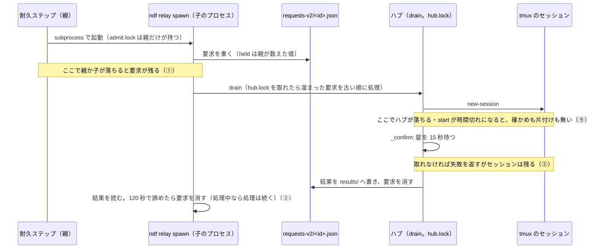
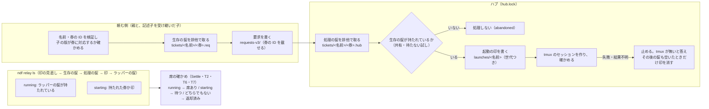
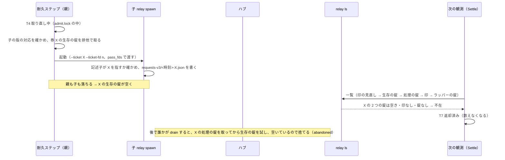

# 並列の計画: 起動の券と起動の印で、起動の結果を確定させ、手動の再起動と期限を越えて生きる手でも上限を超えない（#4103）

#4091 の席の返却では、返却済みへ移す前に「そのレーンのラッパーがもう起きない」ことを確かめる必要がある。今のリレーハブは、頼む側が落ちた後の要求も、起動の確かめに失敗したセッションも、後から黙ってラッパーを起こす。このため、それを確かめられない。この設計は 4 つを決める。1 つ目に、起動を頼む側は、要求を書く前から結果を受け取るまで「起動の券」の生存の錠を持つ。2 つ目に、ハブは券の処理の錠を先に取ってから生存の錠を確かめ、生存の錠が空いた要求を処理しない。3 つ目に、ハブは tmux のセッションを作る前に「起動の印」を書き、セッションの不在かラッパーの正常な終了を確かめるまで残す。4 つ目に、ハブが起こしたラッパーは、錠を取った後に印の世代が自分の世代と同じときだけ動く。そのため、印を消した後に遅れて作られたセッションはラッパーを起こさない。ラッパーの一覧（`ndf relay ls`）は券と印から「起動の途中」を載せる。そのため席の確かめは、一覧を 1 回読むだけで「動いている・起動の途中・不在」を決められ、ハブの排他を外から取らない。

## 今の姿

何が起きたか・目的・受け入れ条件は要求仕様（[issue-4103-requirements.md](./issue-4103-requirements.md)、正は #4103 の本文）にある。パスは `plugins/ndf/` からの相対で書く。この設計は #4091 の設計（[issue-4091-design.md](./issue-4091-design.md)・[issue-4091-design-detail.md](./issue-4091-design-detail.md)）の席の 4 つの段階と遷移 T1〜T8 の上に乗り、#4091 の決定 8 が #4103 へ分けた箇所を置き換える（「#4091 の設計の置き換え」）。

**#4091 の版の設計は 3 ラウンドで収束しなかった。原因は、「もう起きない」をハブの外から決めていたことにある。** ハブの中の事実（溜まった要求・錠を持たないセッション・tmux の照会）を 1 つずつ読み足すたびに、読んだ後に起きる別の経路を指摘された（頼む側の子のプロセスが親の後で要求を書く、照会の失敗、ハブの排他の外の書き込み）。この設計は向きを逆にし、ラッパーを起こしうる経路そのものに目印を持たせる。目印は、それを持つ者が自分で消すか、消してよいことを排他で確かめた者だけが消す。

今のコードで確かめた、ラッパーが起きる経路と、その起動の結果が分からなくなる所:

| # | 今の振る舞い | 実物 | 席にとっての問題 |
| --- | --- | --- | --- |
| ① | 要求を書いた頼む側が落ちても、要求は残り、次に誰かが `drain` すると処理される。処理を始める時点で頼む側が生きているかを見ない | `hub.py` の `submit`・`drain`・`_handle_file` | 返却済みを書いた後に、書いた時点の古い `held` のままラッパーが起きる（r2-1・r3-1） |
| ② | 起動の確かめが失敗しても、作った tmux のセッションを止めない | `hub.py` の `_launch`・`_confirm` | 失敗と返った後にラッパーが錠を取る（r1-13・r2-1） |
| ③ | 頼む側は応答待ちが切れると要求のファイルを消して失敗を返すが、処理中の要求はそのまま処理される | `hub.py` の `submit`・`drain`（処理の後に `path.is_file()` を見て結果を書かないだけ） | 失敗と返った後にラッパーが起きる（r1-13） |
| ④ | `Tmux.has` は `has-session` の終了コードが 0 かだけを返す。実機（tmux 3.6）では、セッションが無いと終了コード 1 と `can't find session: <名前>`、サーバーが無いと終了コード 1 と `error connecting to <ソケット> (No such file or directory)`。tmux を打てない（`OSError`）・時間切れも偽になる | `tmux.py` の `_run`・`has`（2026-11-22 に `tmux -L <ソケット> has-session -t =<名前>` を打って確かめた） | 照会の失敗を不在と読む（r3-3） |
| ⑤ | 手動の `restart` の上限は、頼む側がハブの排他の前に読んだ `held`（#4044）と、処理の時点の動いているラッパーで判定する | `hub.py` の `restart`、#4044 の設計の決定 2 | 読んでから処理までの間に別のレーンが席を取ってラッパーだけ落ちると、2 本動く（r2-3・r3-4） |
| ⑥ | 期限を越えた続きの手は、ラッパーが生きていても失敗の 1 回に数えて置き換える | `run_decide.py` の `_expire_launched`・`_tick_waits` | 準備に時間を要する conductor を置き換え、失敗の上限で止まる（r1-15・r2-5・r3-5） |
| ⑦ | `spawn` は、自分のオプションの後の知らない語から先を Claude の引数として受ける。`--ticket` を前に置いても後に置いても、解析に成功して `rest` に入る | `cli.py` の `OWN_OPTIONS`・`_split_claude_args`・`_parse` | 新しい親が古い子へ券を渡すと、券なしの要求が書かれ、券の ID が Claude へ渡る |
| ⑧ | `stop` は、錠が空いて `has` が偽なら「動いていない」、`kill` の後に錠が空けばセッションの有無を見ずに成功を返す。`_await_exit` はその成功で置き換え・再起動へ進む | `hub.py` の `stop`・`_await_exit` | セッションが残る・照会が不明でも、止めたとして次の起動へ進む |
| ⑨ | `Tmux.start` が失敗（時間切れを含む）を返すと、`_launch` は確かめに入らずに断りを返す。サーバー側でセッションが作られていても止めない。ハブが `new-session` の後・確かめの前に落ちても、何も残らない | `hub.py` の `_launch` | 券も印も錠も無いまま、セッションの中のラッパーが後から起きうる |
| ⑩ | ラッパーの名前の検証（`NAME_RE` は `^[A-Za-z0-9._-]{1,64}$`）は、ハブの `spawn` が `registry.wrapper_dir` を呼ぶ時点で初めて走る。`.`・`..` も通る | `registry.py` の `wrapper_dir`、`signals.py` の `NAME_RE` | 名前や券の ID からパスを作る新しい入口が、検証の前にパスを作る |
| ⑪ | `_await_exit` は、ラッパーの錠が持たれていない対象では `stop` を呼ばない。`restart` は錠だけで対象が動いているかを決める | `hub.py` の `_await_exit`・`restart` | 錠を取る前のセッションが残る名前に、止めずに新しい起動を重ねる |

## 文脈と制約

- 起動・置き換え・再起動・停止は、どれもハブへの要求（`hub.submit`）として出す。ハブは `hub.lock` を持ったまま要求を 1 本ずつ処理する。常駐のプロセスは無く、要求を書いた頼む側の `drain` がハブを兼ねる。名前つきのラッパーは tmux のセッションの中で起き、そのセッションを作るのはハブだけである。ラッパーが動いているかは、ラッパーの錠（`wrappers/<名前>/` の錠）を誰かが持つかで決まる（`registry.busy_names`）
- 耐久ワークフローの起動の手では、親のプロセス（耐久ステップ）が子のプロセス（導入の `bin/ndf relay spawn`）を `subprocess` で打つ。親が持つ `admit.lock` は子へ渡らない（Python は記述子を既定で継承させない）。親が落ちても子は動き続ける。子の `bin/ndf` は `installed_entry` が選んだ導入のもので、親と版が違いうる
- `flock` の錠は open file description に結び付く。`fork` や継承で複製した記述子は同じ錠を共有し、複製がすべて閉じるまで錠が残る。一方、複製のどれか 1 つで `LOCK_UN` を打つと、共有するすべての複製で錠が解ける。共有の錠（`LOCK_SH`）は複数のプロセスが同時に持てる。排他の錠（`LOCK_EX`）が持たれている間は、ほかの記述子の `LOCK_SH|LOCK_NB` が `EWOULDBLOCK` で失敗する（外部の調査の STD1）。手元でも、親が錠を取って `pass_fds` で子へ渡すと、親が閉じた後も子が生きている間は錠が持たれ、子が終わると空くことを確かめた（2026-11-22）
- `identity.lock_held` は `LOCK_EX|LOCK_NB` を一瞬取って判定する。観測者どうしが同時に打つと、互いの一瞬の排他を「持たれている」と読む
- 層の向きは `ndf.contracts` → `adapters` → `core` → `progress` → `domains` で、下の層は上の層を読まない（`src/ndf/checks/rules.json` の `layers`）。`progress/lane` は `domains/relay` を import できない。`domains/relay` は `progress/lane/machine` と `core` を import できる
- ハブの保存先は `contracts` の `locations` の `relay-hub` で決まり、`progress` の側からも同じパスを得られる
- 受付箱は版ごとに分けてきた（#3909 の `requests-v2`。旧版のハブは新しい受付箱を読まない）。旧版の頼む側は `admit.lock` を取らずに `held` を読み、旧版のハブは券も印も知らない
- **この設計は、新しい版のハブと頼む側だけが同じ状態の保存先を使う前提で、受け入れ条件 1〜5 を満たす。** リレーの版が混在する間の、旧版のハブ・頼む側の検出と照合は #4118 が決める（決定 6）
- 名前つきのラッパーの環境は、`Tmux.start` が `new-session` へ渡す。`new_session_args` が `-e` に載せるのは、環境変数の表（`contracts/domains/env.json`）で `secret` が偽の名前だけで、ほかはプロセスの環境として渡る。プロセスの環境を引き継ぐのは、その呼び出しで初めて立つ tmux のサーバーだけである（`tmux.py` の docstring）。既に動いているサーバーへは、表に無い名前の値は届かない
- `Tmux._run` は `subprocess.run(…, timeout=…)` で tmux のクライアントを打つ。時間切れのときクライアントは kill されるが、クライアントがサーバーへ送った作成の要求をサーバーが処理し終えたかは、外から確かめる手段が無い。ハブのプロセスが `start` の途中で落ちたときも同じで、クライアントが生き残れば、後からセッションを作りうる
- ラッパーの `run` は、錠の中で `_loop` が返した `Ended` をそのまま返す。子を止められずに終わる経路（`_child_alive`）も、例外を上げずに `Ended("refused", …)` を返す（`wrapper.py`）。戻った時点で子が終わったとは限らない
- この課題の実装は #4044 → #4091 の実装の後に入る（#4091 の決定 8）。#4091 の実装は、この境では安全側に倒してある（取り直しの起動の結果が「起動しなかった」と確定しない限り、取り直し中のまま数える）

## 解き方の全体像

- **起動の券は 2 つの錠からなる**: ラッパーを起こしうる要求（起動・置き換え・再起動・停止）を頼む側は、要求を書く前に `relay/hub/tickets/<名前>/<券の ID>.req`（生存の錠）を排他で取り、結果を受け取るか諦めるまで持つ。耐久ステップは親のプロセスで券を取り、記述子を子のプロセスへ渡す（`pass_fds`）。そのため、親が落ちても子が生きている間は券が持たれる。ハブは処理の間、`<券の ID>.hub`（処理の錠）を排他で持つ。観測者（一覧・ハブの確かめ・起動の許可）は、どちらの錠も共有の待たない試しでだけ読む。排他を取るのは持ち主だけなので、観測者の一瞬の試しを持ち主と取り違えない
- **錠を解かずに閉じる・消すのは排他で確かめた者だけ**: 頼む側もハブも、自分の記述子を閉じるだけで `LOCK_UN` を打たない。券のファイルを消すのは、消す本人がそのファイルの錠を排他で取れた（ほかに持つ者がいない）ときだけである。ハブは自分の処理の錠を、持ったまま消してから閉じる。生存の錠は、ハブの掃除が古いものに排他を取れたときだけ消す
- **ハブは処理の錠を先に取ってから、頼む側の生存を確かめる**: 新しい受付箱 `requests-v3` の要求は、`hub.lock` の中で、まず処理の錠を取り、その後に生存の錠を試す。持たれていなければ処理せずに捨てる（`abandoned`）。こうすると、生存の錠が空いた時点で処理の錠がまだ無ければ、その要求は二度と処理されない。処理の錠があれば、一覧はそれを読む
- **起動の副作用より前に起動の印を書く**: ハブは tmux のセッションを作る前に `relay/hub/launches/<名前>` へ世代つきの印を書く。印を消すのは 2 通りだけである。1 つは、`hub.lock` の持ち主（ハブの処理か一覧）が、tmux がセッションは無いと答えた後に読んだラッパーの錠が空いているのを確かめたとき。もう 1 つは、ラッパーが錠を持ったまま、子の終わりを確かめて正常に終わる直前に、自分の世代の印を消すときである。ハブが落ちても、`start` が時間切れでも、確かめが失敗しても印は残り、上限の判定でも一覧でも 1 本と数える
- **ハブが起こしたラッパーは、印の世代を照らしてから動く**: ハブはラッパーへ世代（`NDF_RELAY_LAUNCH_GEN`）を `new-session -e` で渡す（環境変数の表で秘密でない名前として宣言する）。ラッパーは錠を取った後に印を読み、世代が自分の世代と違う・印が無ければ、Claude を起動せずに終わる。印を消した後に遅れて作られたセッション（落ちたハブや時間切れの tmux のクライアントが送った作成の要求）は、ラッパーを起こさない
- **`stop` の成功は、錠が空き、セッションが無いと確かめたときだけ**: 確かめられなければ印を残して失敗を返す。置き換えと再起動は、新しい世代を書く前に、対象が動いていなくても `stop` を通し、失敗なら止まる
- **一覧が「起動の途中」を載せる**: `ndf relay ls` は名前ごとに、持たれた券か起動の印があれば `starting: true` と、その出所（`starting_by`）と印の世代を載せる。名前の無い起動の券も、予約の行として載せる。読む前に、`hub.lock` が空いていれば印を見直す（tmux を打つのは高々 1 回）
- **席の確かめは一覧だけで決める**: 返却済みへ移す手（T2・T6・T7）は、一覧を読めて、そのラッパーが `running` でも `starting` でもないときだけ返却済みを書く。ハブの排他は外から取らず、溜まった要求も処理しない。同じ観測の中で読んだ一覧は、席の手が再利用する
- **手動の再起動と通常の起動は、`held` を読んでから結果までを `admit.lock` の中で行う**（⑤）。頼む側が待ち切れで錠を放した後も、起動の許可の側は、未確定の起動（券と印）を予約として数える
- **期限を越えた続きの手は、一覧で生存を読み、動いている間・生存が未確定の間は置き換えない**（⑥）。止まっていれば止まりとして知らせる。席の確かめ（`Settle`）は打ち切らない

## ドメインモデル

### コンテキスト

| コンテキスト | 持つもの | この設計で変えること |
| --- | --- | --- |
| リレー（`domains/relay`） | ラッパーの起動・停止・一覧、ハブの排他と受付箱 | 受付箱 `requests-v3`・処理の錠を先に取る処理・起動の印の書き込みと見直し・ラッパーの世代の照合・一覧の `starting`・tmux の照会の 3 値・`stop` の成功の条件・頼む側の `admit.lock` |
| 起動の券と起動の印（`core/launch_ticket`。新設） | 券と印のパス・名前と券の ID の検証・錠の取り方と試し方・印の読み方・掃除 | 新設。リレー・レーン・計画の実行が読む（下の層に置く） |
| レーン（`progress/lane`） | 席の段階・生死の判定・起動の手の呼び出し・起動の許可 | 「不在」の判定を 1 つの関数にする。起動の手が子の版を確かめ、券を取って子へ渡す。起動の許可が未確定の起動を数える |
| 計画の実行（`progress/plan`） | 観測・判断・耐久ステップ | 取り直しの後の確かめ・`Settle` の打ち切りなしと一覧の再利用・期限を越えた続きの手の生存とレーン単位の抑え |

### 集約

**起動の券は、ラッパーの名前ごとの要求 1 本の生存と処理を表す。** 生存の錠（`.req`）の持ち主は要求を書いた頼む側とその子で、排他で持つ（親と子は同じ open file description を共有する）。処理の錠（`.hub`）の持ち主はハブだけで、処理の間だけ排他で持つ。ファイルの中身は持たず、錠だけが意味を持つ。

**起動の印は、ラッパーの名前ごとに「ハブがその名前でセッションを作りうる処理に入ってから、セッションの不在かラッパーの正常な終了が確かめられるまで」を表す。** 書くのはハブだけ（`hub.lock` の中）。消すのは、不在を確かめた `hub.lock` の持ち主（ハブの処理か一覧）か、子の終わりを確かめて錠を持ったまま正常に終わる自分の世代のラッパーである。ハブが起こしたラッパーは、印がある間でも、印の世代が自分の世代と同じときだけ動く。印は、そのセッションが動いてよいことを示す世代の番号（fencing token）でもある。印が残ったままラッパーの錠が空いたセッションを「迷子のセッション」と呼ぶ。

### 状態と事象の表

この表が振る舞いの正本で、詳細設計の関数はどれもこの表の 1 行を実装する。R は起動の券と起動の印の行、T は #4091 の席の遷移のうち、この課題が条件を置き換える行である。

| # | 前 | 引き金 | 後 | 書き手 | 排他 | 書く前に照らす条件 | 失敗・中断のとき | 打ち直し |
| --- | --- | --- | --- | --- | --- | --- | --- | --- |
| R1 | 券なし | 頼む側が要求を書こうとする | 生存の錠が持たれている | 頼む側（耐久ステップは親、人の CLI は自分） | 生存の錠（排他） | 名前と券の ID の形（パスを作る前）。耐久ステップは子の版が券に対応すること（決定 6） | 検証に落ちる・版が対応しない・作れないなら、要求を書かずに失敗する。取った後にパスが別のファイルに置き換わっていれば閉じて新しい ID で取り直す | 打ち直すたびに新しい券の ID を作る（券は使い回さない） |
| R2 | 生存の錠が持たれている | 要求を `requests-v3/<時刻>-<券の ID>.json` へ書く | 要求あり | 頼む側 | なし（書いてから `drain`） | — | 書いた後に頼む側の家族が全員落ちれば、生存の錠が空いて R4 になる | — |
| R3 | 要求あり | ハブが処理の番に来て、処理の錠を取った後に生存の錠を試すと持たれている | 処理中 | ハブ | `hub.lock` → 処理の錠（排他） → 生存の錠の試し（共有・待たない） | 要求の名前と券の ID の形 | — | — |
| R4 | 要求あり | 同上で、生存の錠が持たれていない（ファイルが無いを含む） | 捨てた（`abandoned`） | ハブ | 同上 | 同上。形が違えば試さずに捨てる | — | 捨てた要求は二度と処理されない（要求のファイルを消し、記録に `abandoned` を残し、処理の錠を持ったまま消して閉じる） |
| R5 | 処理中 | 起動・置き換え・再起動で、tmux のセッションを作る直前 | 起動の印あり（新しい世代。券の ID を載せる） | ハブ | `hub.lock` | 置き換えと再起動は、対象が動いていなくても `stop` が成功している（⑪） | 印を書けなければセッションを作らずに失敗を返す。`stop` が失敗なら新しい世代を書かずにその結果を返す | 同じ名前の印は書き直すたびに世代が変わる |
| R6 | 処理中・印あり | 起動の確かめ（`_confirm`）が成功 | 結果を書き、処理の錠を消して閉じる。印は残す（ラッパーが動いている間は `running` が勝つ） | ハブ | `hub.lock` | — | — | — |
| R7 | 処理中・印あり | `start` の失敗（時間切れを含む）か、確かめの失敗 | `stop` を打つ。`probe` が False で、その後に読んだ錠が空いていれば印を消し、そうでなければ印を残して、失敗の結果を書き、処理の錠を消して閉じる | ハブ | `hub.lock` | 止めた後の `probe` と、その後に読んだ錠 | 印を消した後に作成の要求が遅れて実行されても、そのラッパーは R13 で起動を断る | — |
| R8 | 処理中 | ハブのプロセスが落ちる | 処理の錠は OS が解く。R5 の後なら印が残る。`start` の途中なら、生き残った tmux のクライアントが後からセッションを作りうる | — | — | — | 次の `drain` か一覧が R9 で印を見直し、`drain` が R12 で古い処理の錠のファイルを掃除する。印を消した後に作られたセッションのラッパーは R13 で起動を断る | — |
| R9 | 印あり | `drain` の始め・一覧（`hub.lock` を待たずに取れたとき）・その名前の `stop` | tmux の照会がセッションは無いと答え、その後に読んだ錠が空いていれば消す。錠が持たれていれば何もしない（動いているラッパー）。セッションがあれば、`stop` は止めてから見直し、`drain` と一覧は残す。照会が不明なら残す | `hub.lock` の持ち主（ハブか一覧） | `hub.lock` | 照会の後に読んだ錠。`drain` と一覧は tmux の一覧（`list-sessions`）を 1 回だけ打ち、すべての印で共有する。`stop` はその名前の `probe` を打つ | 不明なら印を残す（数え続ける） | `drain` と一覧は、錠の空いた印のうち最後の照会から `relay.stop-wait` の秒を過ぎたものがあるときだけ tmux を打つ（1 回の処理で高々 1 回） |
| R10 | 印あり・ラッパーが錠を持つ | ラッパーが子の終わりを確かめて終わる | 印なし | ラッパー | ラッパーの錠を持ったまま | 印の世代が自分の世代と同じ。今の子が無いか、`isalive()` が偽 | 落ちたとき・例外で抜けるとき・子を止められずに終わるとき（`_child_alive` の `refused`）は消さない（R9 が見直す） | — |
| R11 | 生存の錠が持たれている | 頼む側が結果を読んだか諦めた | 自分の記述子を閉じる（`LOCK_UN` を打たない）。子が持っていれば錠は残る | 頼む側の親と子のそれぞれ | — | — | 落ちれば OS が閉じる | — |
| R12 | 券のファイルが残る | `drain` の掃除 | 券のファイルを消す | ハブ | `hub.lock` → そのファイルの排他（待たない） | 更新の時刻が閾値より古く、排他を取れた（ほかに持つ者がいない） | 取れなければ消さない | 何度打っても同じ |
| R13 | 印あり（世代 g）か印なし | ハブが起こしたラッパー（環境に世代 h を持つ）が錠を取った | g と h が同じなら動く。違う・印が無いなら、Claude を起動せずに終わる（印は消さない） | ラッパー | ラッパーの錠を持ったまま印を読む | 印の世代と自分の世代 | 印を読めない・壊れている（世代が空）なら起動せずに終わる | 遅れて作られたセッションは何度起きても動かない |
| T2 | 返却中 | 一覧を読めて、ラッパーが `running` でも `starting` でもない | 返却済み | 耐久ワークフロー（`Vacate`・`Settle`） | `lock_plan` | `phase == vacating`・`seq` が同じ | 一覧を読めない・`starting` なら書かない（数え続ける）。`Vacate` が止めるときは、一覧で読んだ印の世代を添える（決定 3） | 同じ条件で何度でも |
| T5' | 取り直し中 | 起動の結果が成功 | 席あり（`launched`） | `Launch` | `admit.lock` の中の `lock_plan` | `phase == reseating`・`seq` が同じ | #4091 のまま | #4091 の「同じ手の回復」のまま |
| T6 | 取り直し中 | 起動の結果が成功でなく（ハブの断りを含む）、券を閉じた後の一覧でラッパーが `running` でも `starting` でもない | 返却済み（`launch_failed`、断りなら `refused`） | `Launch` | `lock_plan` | 同上 | `starting`・読めないなら書かない（`Settle` が続ける）。`running` なら T7 と同じく席あり | — |
| T7 | 取り直し中 | 手の外の観測か、同じ手の打ち直しが一覧を読んだ | `running` なら席あり（`present`）、`running` でも `starting` でもなければ返却済み（`absent`） | `Settle` か `Launch` の打ち直し | `lock_plan` | 同上（打ち直しは #4091 の「同じ手の回復の判定」のまま） | `starting`・読めないなら書かない。`starting` の出所が印だけなら、印の世代を添えて `stop` を頼む（決定 3） | 何度打っても同じ。2 本目を起動しない |

一覧が載せる生存は 3 つで、席の手も期限の判定もこの 3 つだけを読む:

| 生存 | 一覧での形 | 決め方（この順に読む） |
| --- | --- | --- |
| `starting`（起動の途中） | `starting: true`・`starting_by`（`ticket`・`launch` のうち当たるもの）・`launch_gen`（印の世代。無ければ null） | ① `tickets/<名前>/` の券ごとに、生存の錠、続けて処理の錠を試し、どちらかが持たれている ② `launches/<名前>` がある。①か②のどちらか |
| `running`（動いている） | 行の `running: true` | ①・②の後に読んだラッパーの錠が持たれている（今の `liveness.wrapper_running` が読む欄） |
| 不在 | 行が無いか、`running` も `starting` も偽 | 一覧を読めて、上のどちらでもない |

`starting` と `running` が両方真の行は、`running` として読む（動いているラッパーへ再起動の要求が来ている、または動いているラッパーが印を持っている）。返却済みを書かないことは同じである。一覧を読めない（`relay ls` の失敗）とき、`launch.wrappers()` は None を返し、生存は 4 つ目の値 `unknown` になる。席の手・期限の判定・起動の許可は `unknown` を「数え続ける・書かない」側で扱う。

**名前の無い起動の予約の行**: 名前を省いた `spawn` の券（`tickets/@unnamed/<券の ID>`）は、名前がハブの中で決まるまでどのラッパーの名前にも結び付かない。一覧は、持たれた券ごとに `@unnamed:<券の ID>` の行（`registered: false`・`running: false`・`starting: true`・`starting_by: ["ticket"]`）を載せ、起動の許可はそれを 1 本と数える。ハブは名前を決めた後に書く印へ券の ID を載せる。一覧は、券を読んだ後に読んだ印のどれかがその券の ID を持てば、予約の行を載せない（印の名前の行が同じ 1 本を数える）。券を読む → 印を読む の順なので、予約の行と印の行のどちらも載らない時点は無い。

### 不変条件

| # | 条件 | 守る所 |
| --- | --- | --- |
| U1 | ハブが起こしたラッパーが動くのは、次の 2 つからだけである。(a) ハブが処理の錠を取った後に生存の錠を試し、持たれていた要求。(b) 起動の印が残り、その世代がラッパーの世代と同じセッション。券を持たない旧い要求は、新しい版だけが同じ状態の保存先を使う前提で無い（版の混在の間は #4118） | R3・R4・R5・R13。印は一覧で `starting` に載る |
| U2 | 一覧がある名前を不在と読んだ時点より後に、その名前のラッパーが動くのは、読んだ時点より後に生存の錠を取った要求からだけである | 一覧の読む順（生存の錠 → 処理の錠 → 印 → ラッパーの錠）と、ハブの処理の順（処理の錠 → 生存の錠の試し → 印 → セッション）。処理の錠を消すのは結果と印を書いた後。印を消した後に遅れて作られたセッションは U10 で動かない |
| U3 | 返却済みの行のレーンの名前に、返却済みを書いた後で券を取れるのは、次の 2 つだけである。(a) 同じ計画の耐久ワークフローの T4 の後の起動（`admit.lock` の中で数える）。(b) `admit.lock` を `held` の読みから結果まで持つ手動の `restart`・通常の `spawn` | S5（#4091。返却中・取り直し中の行に続きの手を出さない）と、頼む側の `admit.lock`（決定 4） |
| U4 | ハブの上限の判定は、動いているラッパー・起動の印・要求の `held` の和集合で数える。起動の許可は、一覧の生存が `starting` の行（持たれた券・名前の無い起動の予約を含む）を足して数える | `_over_cap`・`restart`・`machine.count`（決定 3・4） |
| U5 | tmux の照会が不明なら、そのセッションは「ある」として扱う | `probe` の 3 値と、ハブの中で照会を読む所すべて |
| U6 | 続きの手は、そのレーンのラッパーが `running` の間も、期限を越えて生存が未確定の間も、置き換えない。止まっていれば止まりとして 1 回知らせる | `_expire_launched`・`_candidates`・`_notice_stalls`（#4091 の S8 を置き換える） |
| U7 | `Settle` は打ち切らず、`running` か不在が確かめられるまで観測ごとに打つ | `Settle` を `launched`・`failed`・`final` に置かない（#4091 の S9 を置き換える） |
| U8 | `stop` が成功を返したとき、そのラッパーの錠は空き、tmux はセッションが無いと答えている | `stop`（決定 3） |
| U9 | 名前と券の ID は、どの入口でもパスを作る前に検証され、受け継いだ記述子は対象の券のファイルを指す | `launch_ticket.check_name`・`check_id`・`adopt`（決定 1） |
| U10 | ハブが起こしたラッパーは、錠を取った後に読んだ印の世代が自分の世代と同じときだけ動く。印を消す者は、tmux の不在を読んだ後に読んだラッパーの錠が空いているときだけ消す。そのため、印を消す前に印を読んだラッパーは錠を持ち `running` と数えられ、消した後に起きたラッパーは動かない | R7・R9・R13、`wrapper.run`（決定 3） |

U1〜U4 と U10 から、返却済みの行は上限を超える起動の入り口にならない。返却済みを書いた後に手動の再起動で起きたラッパーは、起動の許可とハブが動いているラッパーとして数える（#4091 の S1 のとおり）。

### ドメインイベント

席の事象は #4091 の `row_seat` のまま足さない。リレーの記録（`hub-log.jsonl`）に、次を足す。

- 捨てた要求の結果 `abandoned`
- 起動の印を書いた・消した記録
- 印が残ったまま止められない停止の結果 `stray`

`cause` の種類は `contracts/causes.json` に `abandoned` と `stray` を足す。ラッパーが印の世代の違いで起動を断った終わりは、今の `refused` で書く（文は「<名前> の起動の印が別の世代を指す。起動しない」）。

## 構成要素

| 構成要素 | 責務 | 場所 |
| --- | --- | --- |
| 起動の券と起動の印（新設） | 名前と券の ID の検証、券のパス、生存の錠の取り方と受け継ぎ、錠の試し方、印の読み書きの形、古い券の掃除 | `src/ndf/core/launch_ticket.py` |
| 頼む側（`hub.submit`・`relay` の CLI） | 名前と券を検証し、券が渡されていなければ自分で取る。要求に券の ID を載せて `requests-v3` へ書き、終われば自分の記述子を閉じる。手動の `restart` と通常の `spawn` は `held` の読みから結果まで `admit.lock` を持つ | `src/ndf/domains/relay/hub.py`・`cli.py` |
| ハブの処理（`drain`） | 印を見直し（tmux を高々 1 回）、券を掃除する。処理の錠を取ってから生存の錠を試し、生存の錠が空いた要求を捨てる | `hub.py` |
| 起動（`_launch`・`_confirm`・`_await_exit`） | 置き換えと再起動は、対象が動いていなくても `stop` を通してから新しい世代を書く。セッションを作る前に印を書き、世代を `-e` で渡す。`start` の失敗と確かめの失敗ではセッションを止めて印を見直す | `hub.py` |
| 停止（`stop`） | 錠が空きセッションが無いと確かめたときだけ成功を返す。印の世代を指定されたら、ハブの排他の中で照らしてから止める。世代の無い停止は今の手順のまま | `hub.py` |
| 上限の判定（`_over_cap`・`restart`） | 起動の印を動いているラッパーと同じに数える | `hub.py` |
| 一覧（`listing`） | `hub.lock` を待たずに取れたら印を見直してから、名前ごとに `starting`・`starting_by`・`launch_gen` と、名前の無い起動の予約の行を載せる。決まった順に読む | `hub.py` |
| tmux の照会（`probe`・`sessions`） | セッションの有無を「ある・無い・不明」で返す。印の見直しでは、セッションの名前の一覧（読めなければ不明）を 1 回で返す | `src/ndf/domains/relay/tmux.py` |
| 環境変数の表 | `NDF_RELAY_LAUNCH_GEN` を秘密でない名前として宣言し、`new-session -e` に載せる | `contracts/domains/env.json` |
| ラッパーの始まりと終わり | 錠を取った後に印の世代を照らし、違えば起動せずに終わる。子の終わりを確かめて終わるときだけ、錠を持ったまま自分の世代の印を消す | `src/ndf/domains/relay/wrapper.py` |
| 起動の手（`launch.replace`・`spawn`・`stop`） | 子の版が券に対応するかを確かめ、親のプロセスで券を取り、子へ記述子と券の ID を渡す。計画の `stop` には一覧で読んだ印の世代を添える | `src/ndf/progress/lane/launch.py` |
| 起動の許可（`machine.count`） | 一覧の行の生存が `starting` の行（持たれた券・起動の印・名前の無い起動の予約）を、未確定の起動として数える | `src/ndf/progress/lane/machine.py` |
| 生存の判定（`wrapper_seen`・`wrapper_presence`。新設） | 一覧から `running`・`starting`・不在・不明と、`starting` の出所・印の世代を 1 か所で決める | `src/ndf/progress/lane/liveness.py` |
| 席の確かめと取り直しの後の確かめ | 一覧の生存だけで T2・T6・T7 を決める。`Settle` は同じ観測の写しの生存を使い、自分では一覧を読まない | `src/ndf/progress/plan/run.py`（#4091 の `vacate_lane`・`settle_seat`・`launch_lane`） |
| 期限を越えた続きの手 | 生存で数えるかを決め、生存が未確定のレーンの続きの手を抑え、止まりを知らせる。`Settle` を打ち切らない | `src/ndf/progress/plan/run_decide.py` |

## データ構造

- 名前と券の ID の形: 名前は今の `NAME_RE`（`^[A-Za-z0-9._-]{1,64}$`）で、`.` と `..` を除く。券の ID は `^[0-9a-f]{32}$`（`uuid4().hex`）。どちらも `core/launch_ticket` に置き、`signals.NAME_RE` と `registry.wrapper_dir` はそれを参照する（今の `wrapper_dir` も `.`・`..` を断るようになる）
- 券のファイル: `<状態の保存先>/relay/hub/tickets/<名前>/<券の ID>.req`（生存の錠）と `<券の ID>.hub`（処理の錠）。名前の無い `spawn` は `tickets/@unnamed/` の下（`@` は名前の形に無いので、ラッパーの名前と衝突しない）。一覧はそれを予約の行 `@unnamed:<券の ID>` で載せる（「名前の無い起動の予約の行」）。中身は空。0o600 で作る
- 要求: 今の中身に `ticket`（券の ID）を足し、`requests-v3/<20 桁の時刻>-<券の ID>.json` に置く
- 起動の印: `<状態の保存先>/relay/hub/launches/<名前>`。中身は `{"gen": <32 桁の 16 進>, "ticket": <処理した要求の券の ID か null>, "at": <時刻>, "reason": <書いた理由>, "checked": <最後に照会した時刻>}`。判定は有無・`gen`・`ticket` だけを読む。ハブはラッパーの環境に `NDF_RELAY_LAUNCH_GEN=<gen>` を渡す。渡す経路は `new-session -e` で、`contracts/domains/env.json` に `secret: false` の行として宣言する（既に動いている tmux のサーバーにも、起動ごとの世代が届く）
- 対応の宣言: `contracts/relay-protocol.json`（`{"inbox": 3}`）。耐久ステップは、子の `bin/ndf` の導入の根にあるこのファイルを読んで対応を確かめる
- 一覧の行: 今の項目に `starting: bool`・`starting_by: list[str]`・`launch_gen: Optional[str]` を足す。登録簿に無く、券か印だけがある名前も `registered: false`・`running: false`・`starting: true` で載せる。名前の無い起動の予約の行も同じ形で載せる
- 計画の実行の状態:
  - `RunState.kept_alive`: 期限を越えたが動いているので残した続きの手のキー
  - `RunState.settling`: `Settle` のキーと、起動の途中が続いた観測の回数と、最後に `stop` を頼んだ印の世代と観測の回数
  - 写しの `alive`: 期限に達する続きの手のレーンの生存（`running`・`starting`・`absent`・`unknown`）
  - 写しの `settles` の各行: 同じ観測で読んだ生存（`presence`。`running`・`starting`・`absent`・`unknown`）・`starting_by`・`launch_gen`。一覧を読めなかった観測では `presence: "unknown"` を明示して載せる（欄が無い・値が違う行も `unknown` と読む）
  - `RunState.waits`: 期限に達した続きの手を `launched` に残すときは、期限に達した観測の回数（`n * poll >= up` を満たす値）を保存する
  - 観測の手の `expiring`: 期限に達する続きの手のレーンの名前
- 新しい上限の値は足さない。次の値は今の設定を使う
  - 古い券のファイルを掃除する閾値: `relay.hub-wait` の秒の 2 倍
  - 印の照会と `Settle` の `stop` の間隔: `relay.stop-wait` の秒
  - `Settle` の知らせの閾値: `parallel-run.launch` の秒

## 入出力のコントラクト

- `ndf relay spawn`・`restart`・`stop` に `--ticket <券の ID>` と `--ticket-fd <記述子の番号>` を足す。2 つはそろえて渡す。渡されたら、その記述子が対象の券の生存の錠を指すかを確かめ（`adopt`）、自分では取らない。無ければ自分で取る（人が打つ形は変わらない）。`spawn` では `OWN_OPTIONS` に登録し、耐久ステップは `--name` の直後（プロンプトと `--` より前）に置く
- `ndf relay stop` に `--launch-gen <世代か none>` と `--stray` を足す。`--launch-gen` を渡されたら、ハブは `hub.lock` の中で次の 2 つを照らし、どちらかが違えば止めずに `stale` を返す。`none` は「一覧で読んだ時点で印が無かった」を表す
  - その名前の印の世代が添えた値と同じ（`none` なら印が無い）
  - この停止の要求の券のほかに、その名前の持たれた券が無い
- `--stray` を添えたら、加えてラッパーの錠が空いているときだけ止める（`Settle` が迷子のセッションだけを片付ける）。計画の停止（`Vacate` と `Settle`）は、いつも `--launch-gen` を添える。人が打つ `ndf relay stop <名前>`・`--all` とハブの中の停止は世代を添えず、停止の手順（`--all` の停止シグナルファイル、`kill-session`）を変えない
- `ndf relay stop` は、錠が空きセッションが無いと確かめたときだけ成功を返す。セッションが残る・照会が不明なら、印を残して `stray`（「<名前> のセッションが残る・有無が分からない。上限で 1 本と数え続ける」）を返し、終了コード 1 にする
- `ndf relay ls` の行に `starting`・`starting_by`・`launch_gen` を足し、名前の無い起動の予約の行を載せる（`docs/contracts/commands.md`）
- `contracts/domains/env.json` に `NDF_RELAY_LAUNCH_GEN`（`area: relay`・`set_by: ndf`・`secret: false`、「リレーハブが起こしたラッパーの起動の印の世代」）を足す
- `contracts/causes.json` に `abandoned`（頼む側がいない要求を処理しなかった）と `stray`（止めたと確かめられず、印を残した）を足す
- `ndf relay restart` と、`--replace`・`--seated` の無い `ndf relay spawn` は、マシンの起動の排他を `parallel-machine.admit-lock` の秒の間に取れなければ、要求を書かずに断る（`refused`、「起動の排他を取れない。少し待って打ち直す」）
- `requests-v2` の要求の扱い（版の混在の間の断りと照合）は #4118 が決める
- 計画のリクエストの知らせの種類は足さない。`Settle` が長く起動の途中に留まるときは、今の `launch_failed`（取り直し中）・`halt_failed`（返却中）で 1 回だけ知らせる

## 処理の流れ

取り直しの起動の途中で耐久ステップが落ち、子のプロセスも落ちた（受け入れ条件 1）:

親だけが落ちて子が生きている間は、子が X の生存の錠を持つので、一覧は `starting` を返し、`Settle` は書かずに待つ。子は自分の `drain` で要求を処理させ（後続のリレー操作を待たない）、結果を読むか 120 秒で諦めて、自分の記述子を閉じて終わる。処理が終われば、ラッパーが起きていれば `running`、起きていなければ不在になる。

ハブが生存の錠を試す前後で頼む側が落ちた（r1-13 の隙間が無いこと）:

| ハブの順 | 頼む側が落ちた時点 | 一覧が読むもの | 結果 |
| --- | --- | --- | --- |
| 処理の錠を取る前 | 生存の錠が空く | 生存の錠も処理の錠も空き → 不在 | ハブは処理の錠を取った後の試しで空きを読み、捨てる |
| 処理の錠を取った後・試しの前 | 同上 | 生存の錠は空き、処理の錠が持たれている → `starting` | ハブは試しで空きを読み、捨てる。処理の錠を消して閉じた後は不在 |
| 試しで持たれていると読んだ後 | 同上 | 処理の錠が持たれている → `starting` | ハブは処理を続け、印と結果を書いてから処理の錠を消す |

起動の確かめが失敗した（受け入れ条件 5）:

| 時点 | ハブ | 一覧 | 席 |
| --- | --- | --- | --- |
| セッションを作る前 | 印（世代 g）を書く | `starting`（処理の錠・印） | 取り直し中（数える） |
| 確かめの 15 秒が切れた | 処理の錠を持ったまま `stop` を打ち、錠が空くのを待ち、`probe` を打つ | `starting` | 取り直し中（数える） |
| `probe` が False | 印を消し、結果（失敗）を書いて処理の錠を消す | 不在 | T6 で返却済み |
| `probe` が True・不明 | 印 g を残し、結果（失敗）を書いて処理の錠を消す | `starting`（`starting_by: ["launch"]`・`launch_gen: g`） | 取り直し中のまま。`Settle` が `stop --launch-gen g --stray` を頼み、ハブが印を見直す |

ハブが `start` の途中で落ちた・`start` が時間切れになった後に、tmux のサーバーが作成の要求を遅れて実行した（受け入れ条件 5）:

| 時点 | 印 | 一覧 | 遅れて作られたセッションのラッパー |
| --- | --- | --- | --- |
| 次の `drain` か一覧が tmux の一覧を読み、セッションが無く、その後に読んだ錠も空いている | 印 g を消す | 不在（席は返却済みになりうる） | — |
| その後にサーバーがセッションを作る | 無い | ラッパーが錠を取る一瞬だけ `running` | 錠を取った後に印を読み、無いので Claude を起動せずに終わる（R13） |
| 次のハブが同じ名前で新しい世代 g2 の印を書いた後に、g のセッションが作られる | g2 | `starting` | 世代が違うので起動せずに終わる。g2 の `new-session` が名前の重複で失敗すれば、R7 がそのセッションを止める |

手動の再起動と取り直しが重なった（受け入れ条件 3。上限 1、レーン A は返却済み、レーン B を取り直す）:

| 順 | 起きること | 2 本動くか |
| --- | --- | --- |
| A の `restart` が先 | A の頼む側が `admit.lock` を取り、`held`（B は返却済みなので含まない）を読み、A を起こす。B の T4 は `admit.lock` を待ち、取れた後の `admitted` が A を数えて上限で待つ。A が動いていれば錠で、A の頼む側が待ち切れで先に終わっていれば A の処理の錠と印で数える | 動かない |
| B の T4 が先 | B の取り直しが `admit.lock` を持つ間、A の頼む側は待つ。取れた後に読む `held` に B（取り直し中か席あり。ラッパーが落ちていても数える）が載り、ハブが A を断る | 動かない |

## 決定の記録

### 決定 1: 起動の結果を確定させるため、ラッパーを起こしうる要求に「起動の券」を持たせる。券は頼む側の生存の錠とハブの処理の錠の 2 つに分け、ハブは処理の錠を取ってから生存を確かめる

- **質問**: 取り直しの起動の結果が分からないとき（頼む側が落ちた・応答待ちが切れた）、「その名前のラッパーがもう起きない」をどう確かめるか（r2-1・r3-1・r1-13）
- **選んだ案**: 要求ごとに 2 つの錠のファイルを使う。
  - 生存の錠（`.req`）: 頼む側が要求を書く前に排他で取り、結果を受け取るか諦めるまで持つ。耐久ステップは親で券を取り、記述子を子へ渡す。親と子は同じ open file description を共有するので、どちらか一方でも生きていれば錠が残り、両方が落ちれば OS が錠を解く。
  - 処理の錠（`.hub`）: ハブだけが処理の間、排他で持つ。
  - 処理の順: ハブは `hub.lock` の中で、処理の錠を取ってから生存の錠を試す。観測者は、どちらの錠も共有の待たない試し（`LOCK_SH|LOCK_NB`）でだけ読む。

  排他を取るのは持ち主だけなので、観測者どうしの一瞬の試しは互いを「持たれている」と読ませない。ハブは、一覧が試している最中でも頼む側の生存を正しく読む。

  こうすると、生存の錠が空いた時点でまだ処理の錠が取られていない要求は、二度と処理されない。処理の錠が取られていれば、一覧はそれを `starting` と読む。「一覧が `starting` を返さず、後でハブが処理する」時点が無くなる。

  抜け方では、誰も `LOCK_UN` を打たず自分の記述子を閉じる（`LOCK_UN` は子と共有する錠も解くため）。ファイルを消すのは、そのファイルの錠を排他で取れた者だけである。ハブは自分の処理の錠を持ったまま消し、生存の錠は掃除が古いものに排他を取れたときだけ消す。

  名前と券の ID は、どの入口でもパスを作る前に `core/launch_ticket` の形で検証する。入口は CLI の `--name`・`--ticket`、受付箱の `name`・`ticket`、一覧と掃除が読むディレクトリの名前である。`.`・`..`・区切りを含む値は、ファイルに触れずに断る。受け継いだ記述子は、`fstat` の装置と inode が券のパスの `stat` と同じで、その券の生存の錠が持たれていることを確かめてから使う（U9）
- 採らなかった案: 券を 1 つのファイルの共有の錠にし、ハブが「持たれている」と読んでから自分も共有の錠を取る（前の版）。「ほかの誰かが持っているときだけ自分も取る」は 1 つのファイルの錠では原子的にできない。読んでから取るまでの間に頼む側が放すと、ハブは頼む側のいない要求を処理し、その間の一覧は不在を返す（r1-2・r1-13）。また `take` の抜け方の `LOCK_UN` が子と共有する錠を解き、親がファイルを消すと、子が持っていても一覧から券が消える（r1-1）
- 採らなかった案: 席の確かめがハブの排他を外から取り、溜まった要求を処理してから不在を読む（#4091 の版の `quiet`・`_drain_held`）。処理の後に書かれる要求（親が落ちた後に子が書く要求）を読み落とし、溜まった要求を処理すると書いた時点の古い `held` のままラッパーを起こす。指摘のたびに読み足す条件が増え、3 ラウンド収束しなかった
- 採らなかった案: 要求に期限を持たせ、期限を過ぎた要求を処理しない。期限までは処理されうるので、席の確かめが期限まで待つ必要があり、処理の途中に期限を過ぎた要求の扱いが時刻の比べになる
- 採らなかった案: 子のプロセスが自分で券を取る。親が子を起動してから子が錠を取るまでの間に親が落ちると、券が見えないまま子が後から要求を書く
- 採らなかった案: 観測に OFD の錠の照会（`F_OFD_GETLK`）を使う。取らずに読めるが、今の錠の部品（`identity`・`signals`・`locks`）がすべて `flock` で、錠の種類が 2 つに分かれる
- **代償**: 要求ごとに錠のファイルを 2 つ作って消す。券の錠を持たずに要求を書く呼び手は、ハブに捨てられる（新しい受付箱へ書くのは券を持つ新しい版だけ）。名前を省いた起動は、ハブが名前を決めるまで予約の行として一覧に載り、起動の許可で 1 本と数える（印が券の ID を持てば予約の行は消える）
- 根拠: Value 3「同じ操作を打ち直しても、結果は 1 回打ったときと変わらない」・Value 8「業務の規則は、コードだけでなくデータの制約でも守られる」（MVV 版 11）。STD1・PRD1

### 決定 2: 席の確かめが一覧だけで決まるよう、「起動の途中」を一覧に載せ、席の手は一覧の 3 つの生存だけを読む

- **質問**: 返却済みへ移す前の「不在」を、席の手（T2・T6・T7）がどう読むか
- **選んだ案**: `ndf relay ls` が名前ごとに `starting`（持たれた券・起動の印）と、その出所・印の世代を載せる。名前を省いた起動の券は、予約の行として載せる。読む順は「生存の錠 → 処理の錠 → 印 → ラッパーの錠」に固定する。ハブの処理は「処理の錠 → 生存の錠の試し → 印 → セッション → 結果 → 処理の錠を消す」の順に進み、ラッパーの正常な終わりは錠を持ったまま印を消す。そのため、一覧が券の空きを読めた後に読む印と錠には、その処理の結果がすでに現れている（U2）。席の手は、一覧を読めて `running` でも `starting` でもないときだけ返却済みを書く。判定は `liveness` の 1 つの関数（`wrapper_seen`。生存の値だけを返す `wrapper_presence` はその薄い包み）に置き、席の手・期限の判定・観測・起動の許可がすべてそれを読む。一覧の行の `running` の欄（今の `wrapper_running` が読む欄）を、そのまま読む
- 採らなかった案: 名前を省いた起動の券を一覧から外す。ハブが名前を決めて印を書くまでの間、処理中の 1 本が一覧に現れず、その間に頼む側が落ちると、別の計画の起動の許可がその 1 本を数え落とす（r2-1）。頼む側が名前を先に決める形は、名前の採番が動いているラッパーと登録簿を読むハブの中でしか一意にならないので採らない
- 採らなかった案: 席の手がハブの排他の中で書く（`hub.lock` → `lock_plan`）。`progress` から `domains/relay` を読めない（層の向き）ので、錠のパスと取り方を移す必要がある。また排他を持つ間、ほかの要求を止める。U1〜U3 が成り立てば、読んだ後・書く前にラッパーを起こせるのは `admit.lock` の中の経路だけになり、ハブの排他は要らない
- 採らなかった案: 一覧を錠 → 券の順に読む、または処理の錠 → 生存の錠の順に読む。錠を読んだ後・券を読む前に処理が終わってラッパーが起きると、券は空き・錠は無しと読んで不在になる。処理の錠を先に読むと、空きを読んだ直後にハブが処理の錠を取り、続けて頼む側が落ちれば、2 つとも空きと読む
- **代償**: `ndf relay ls` が、名前ごとに券のディレクトリと印を読む（券のファイルの数は動いている要求の数で、ふつうは数本）。`ndf relay ls` を打つ観測の数は変えない。印の見直し（決定 3）のため、`relay ls` は錠の空いた古い印があるときだけ、tmux の一覧を 1 回打つ
- 根拠: Value 11「同じ規則・定数・処理は 1 か所にまとまり、ほかはそこを参照する」・Value 9「1 つのモジュール・クラス・関数が 1 つの責務を持ち」（MVV 版 11）

### 決定 3: 起動の結果が確定しないままのセッションを数え落とさないため、ハブはセッションを作る前に起動の印を書き、不在を確かめるまで消さない。`stop` の成功は不在の確かめを要する

- **質問**: 次の 4 つをどう扱うか（r1-13・r2-1・r3-3。受け入れ条件 2・5）
  - `_confirm` の失敗の後に残る tmux のセッション
  - `start` の時間切れや、ハブの中断で確かめに入らないセッション。tmux のクライアントが送った作成の要求が、印を消した後に遅れて実行される場合を含む
  - 照会の失敗
  - 異常終了したラッパーの印が、誰も `drain` を打たない間に残り続けること
- **選んだ案**:
  - **印を書く時点と消す条件**: ハブは `new-session` を打つ前に、その名前の起動の印を新しい世代で書く。`start` の失敗（時間切れを含む）と確かめの失敗では、処理の錠を持ったまま `stop` を打つ。ハブが落ちても印は残る。印を消すのは次の 2 つのときだけで、ラッパーの錠を一度見ただけでは消さない（錠を見た直後にラッパーが落ちて、セッションが残るのを追えなくなるため）
    - `hub.lock` の持ち主が、tmux が「無い」と答えた後に読んだラッパーの錠が空いていると確かめたとき（照会 → 錠の順。逆にすると、錠を読んだ後・照会の前に作られたセッションを読み落とす）
    - ラッパーが錠を持ったまま、子の終わりを確かめて終わる直前に、自分の世代の印を消すとき。子を止められずに終わる経路（`_child_alive` の `refused`）と例外では消さない
  - **遅れて作られたセッションを動かさない（世代の照合）**: 作成の要求が後から実行されないことを、tmux の外から確定する手段は無い（文脈と制約）。そこで、確定を待たずに、遅れて作られたセッションが動けないようにする。ハブは世代を `NDF_RELAY_LAUNCH_GEN` として `new-session -e` で渡し、ラッパーは錠を取った後に印を読む。印が無い・世代が違えば、Claude を起動せずに終わる（R13）。印を消す者は照会 → 錠の順に読むので、消す前に印を読んだラッパーは錠を持ち `running` と数えられ、消した後に起きたラッパーは動かない（U10）。世代を `-e` で渡すため、環境変数の表に `NDF_RELAY_LAUNCH_GEN` を秘密でない名前として足す（既に動いている tmux のサーバーには、プロセスの環境が届かない）
  - **`probe` の 3 値**: 終了コード 0 なら「ある」。終了コード 1 で `can't find session`・`no server running`・`error connecting to … (No such file or directory)` なら「無い」。それ以外（tmux を打てない・時間切れ・権限の誤りなど）は「不明」。`sessions`（`list-sessions`）も同じ分け方で、名前の集合・空・不明を返す
  - **印の数え方**: 印のある名前は、ハブの上限の判定と起動の許可で 1 本と数え、一覧は `starting` を載せ、席は返さない（ラッパーが錠を持つ間は `running` が勝つので、二重には数えない）
  - **見直す所と照会の回数**: 印は `drain` の始め・一覧・その名前の `stop` で見直す
    - `drain` と一覧は、錠の空いた印のうち最後の照会から `relay.stop-wait` の秒を過ぎたものがあるときだけ、`sessions` を 1 回打ち、その結果をすべての印で共有する。1 回の処理で tmux を打つのは高々 1 回で、所要の上限は tmux の時間切れ（`relay.tmux`）1 回分である。不明なら全部の印を残し、`checked` を進める
    - 一覧は `hub.lock` を待たずに試し、取れたときだけ見直してから放し、その後で決まった順に読む（取れなければ見直さずに読む。そのときはハブが処理中で、その `drain` が見直す）。これで、誰も `relay spawn` を打たない間も、観測と起動の許可が打つ一覧が、異常終了したラッパーの印を片付ける
    - `drain` と一覧は照会だけで止めない（ほかのレーンの要求の処理を、停止の待ちで遅らせない）。止めるのは `stop` だけである
  - **`stop` の成功の条件**: 錠が空き、`probe` が「無い」の両方を要する。確かめられなければ印を残して `stray` を返す
  - **置き換えと再起動は、新しい世代を書く前に必ず `stop` を通す**: `_await_exit` は、錠が持たれていない対象にも `stop` を打つ（⑪）。印だけが残る名前・錠を取る前のセッションが残る名前も、不在を確かめてから新しい世代を書く。`stop` が失敗なら置き換え・再起動を止める。費用は、動いていない対象への `has-session` 1 回である
  - **印の世代を添えた `stop`**: 計画が頼む停止（`Vacate` と `Settle`）は、一覧で読んだ印の世代（印が無ければ `none`）を添える。ハブは `hub.lock` の中で次の 2 つを照らし、どちらかが違えば止めずに `stale` を返す。これにより、一覧を読んだ後に手動の再起動が成功しても、新しいセッションを止めない
    - 印の世代が添えた値と同じ（`none` なら印が無い）
    - この停止の要求の券のほかに、その名前の持たれた券が無い
  - **`Settle` の停止は迷子だけ**: `Settle` は出所が印だけのときに `--stray` を添え、ハブはラッパーの錠が空いているときだけ止める（一覧を読んだ後に同じ世代のラッパーが錠を取っていれば、止めずに `stale`）
  - **世代の無い停止**: 人が打つ `ndf relay stop <名前>`・`--all` とハブの中の停止は、今の手順（`--all` の停止シグナルファイル、`kill-session`）を変えず、成功の条件だけを上のとおりにする
  - **ハブの中で tmux の有無を読む所**: `spawn` の対象の判定・`stop`・印の見直しは、すべて 3 値の照会を読み、不明を「ある」に倒す
- 採らなかった案: 確かめの失敗の後にだけ印を書く（前の版）。`new-session` の後・確かめの前にハブが落ちる、`start` が時間切れでもサーバー側で作られていると、券も印も錠も無いまま起動が続く（r1-6）
- 採らなかった案: 錠が持たれていれば印を消し、動いているラッパーとして数える（前の版）。直後にラッパーが落ちても、tmux に残った同じセッションを追えない（r1-9）
- 採らなかった案: 起動の確かめの失敗の後もセッションを残し、席の確かめが錠を持たないセッションの有無を tmux へ照会する（#4091 の版）。照会の時点の後でラッパーが錠を取りうるので、照会のたびに 1 回ずつ確かめ直す必要がある。上限の判定の側は残ったセッションを数えない
- 採らなかった案: 起動の確かめの待ちを延ばす（どれだけ延ばしても、切れた後に錠を取る起動は残る）
- 採らなかった案: tmux のクライアントのプロセスが終わったのを確かめるまで印を残す。クライアントが終わっても、送った作成の要求をサーバーが処理し終えたかは分からない（r2-2）。印の世代をラッパーが照らせば、確定を待たずに遅れたセッションを動けなくできる（PRD1 の fencing token と同じ形）
- 採らなかった案: `drain` が印ごとに `probe` を打つ。異常終了したレーンが n 本あると、tmux が応答しない間に時間切れを n 回待ち、その間ハブの排他を持つ（r2-5）
- 採らなかった案: 一覧が `hub.lock` を取らずに「錠が空き tmux が無いと答えた」印を `starting` から外す。外した後も印は残るので、遅れて作られたセッションのラッパーが世代の照合を通って動く。印を消すのと同じ排他（`hub.lock`）の中で消す形にする（r2-16）
- **代償**: 起動ごとに印のファイルを 1 つ書く。ラッパーが落ちた（正常に終わらなかった）名前は、次の `drain` か一覧か `stop` が不在を確かめるまで 1 本と数える（一覧が打たれる観測ごと、`relay.stop-wait` の秒の後）。起動の確かめが失敗した起動は、後から立ち上がっても止められるか、世代の照合で動かない。tmux の照会が不明な間は、その名前の席を返さず、上限の判定でも 1 本と数える。`relay ls` は、錠の空いた古い印があるときだけ tmux の一覧を 1 回打つ（`relay.stop-wait` の秒に 1 回まで）。置き換えと再起動は、動いていない対象にも `has-session` を 1 回打つ。どちらも CLI の起動の回数は変えない
- 根拠: Value 1「AI が決められないことは、理由と根拠を添えて人へ戻ってくる」・Value 3「同じ操作を打ち直しても、結果は 1 回打ったときと変わらない」・Value 2「費用が増える仕組みを足すときは、その理由と代わりの案が示される」（MVV 版 11）。STD2・PRD1

### 決定 4: 手動の再起動が古い `held` で判定しないため、手動の `restart` と通常の `spawn` の頼む側は `held` の読みから結果まで起動の排他を持つ。起動の許可は未確定の起動を予約として数える

- **質問**: 手動の `ndf relay restart` の `held`（#4044）を読んでから処理されるまでに、別のレーンが席を取ってラッパーだけ落ちる順序（r2-3・r3-4。受け入れ条件 3）をどう防ぐか。頼む側が待ち切れで `admit.lock` を放した後も、ハブの処理が続く順序（r1-7）をどう防ぐか
- **選んだ案**:
  - **頼む側が排他を持つ範囲**: `ndf relay restart` と、`--replace`・`--seated` の無い `ndf relay spawn` の頼む側は、#4044 の `seats.read`（`ndf lanes seats`）を打つ前に `admit.lock`（`machine.admit_lock`、`parallel-machine.admit-lock` の秒）を取り、`hub.submit` が戻るまで持つ。席の数が増える遷移（行の開始・T4）はどれも `admit.lock` の中で数えてから起動を頼む。そのため、頼む側が排他を持つ間は、`held` を読んでから処理されるまでに数える席は増えない
  - **頼む側が先に終わったとき**: 待ち切れで先に終わると `admit.lock` は空くが、ハブの処理は続く。その処理は、処理の錠（`.hub`）と起動の印で一覧と同じ形に見える。そこで起動の許可（`machine.count`）は、#4044・#4091 の数え方に、今も読んでいる一覧（`listed`）の行の生存が `starting` の名前を足す（`wrapper_presence` が `running` か `starting` の行を数える）。対象の名前が計画のレーンでなくても、名前の無い起動の予約の行でも 1 本と数える。こうすると、A の手動の再起動の処理が続く間に B の T4 が `admit.lock` を取っても、A の券か印で A を数えるので、B は席を取れない
  - **排他を取れないとき**: 要求を書かずに断る
  - **`--replace` と `--seated`**: 今のまま `admit.lock` を取らない。`--replace` は親の `admitted` が持つ `admit.lock` の中で打たれ、子が取ると親と取り合って止まる。`--seated` は席を数え直さない続きの起動である
  - **層の向き**: `domains/relay/cli.py` から `progress/lane/machine.admit_lock` を読むのは、上の層が下の層を読む形で合う
- 採らなかった案: ハブが処理の間 `admit.lock` を取る。頼む側が `admit.lock` を持ったまま `drain` するので、別のプロセスのハブは取れない。待てば頼む側と止め合う
- 採らなかった案: ハブが `hub.lock` の中で `ndf lanes seats` を打ち、処理の時点の `held` で判定する（#4044 の決定 2 で採らなかった形）。ほかの要求と、`admit.lock` を持って待つ耐久ワークフローを待たせる。また、ハブを兼ねたプロセスの版でサブコマンドを打つことになる
- 採らなかった案: 頼む側が読んだ `held` に時刻を付け、ハブが古ければ断る（何秒を古いとするかに根拠が無く、新しくても間に起きた取り直しは防げない）
- **代償**: 手動の再起動と通常の起動の間、ほかの計画の起動の許可は `admit.lock` を取れずに次の観測まで待つ。この間はラッパーの停止と起動の確かめを含み、最長で `relay.hub-wait` の 120 秒である。手動の再起動は人とプラグインの更新の再起動が打つもので、回数は少ない。起動の許可は今も読む一覧の `starting` を数えるだけで、CLI の起動は増えない
- 根拠: Value 3「判断の要らない手順は仕組みが進めるので、結果が実行ごとにばらつかない」・Value 8「業務の規則は、コードだけでなくデータの制約でも守られる」（MVV 版 11）

### 決定 5: 生きている conductor を置き換えず止まりも見落とさないため、期限を越えた続きの手は一覧の生存で扱いを分け、生存が未確定のレーンでは続きの手をレーン単位で抑える。`Settle` は打ち切らず、同じ観測の一覧を再利用する

- **質問**: 次の 2 つの場合にどうするか（受け入れ条件 4）
  - 起動したまま待つ続きの手が期限を越えたが、ラッパーが生きているとき（r1-15・r2-5・r3-5）
  - 席の確かめが起動の途中に長く留まるとき（r3-2）
- **選んだ案**:
  - **生存の読み方**: 観測の手（`Observe`）に、この観測の後に期限に達する続きの手のレーン（`expiring`）を載せる。観測はそのレーンの生存を一覧から写しの `alive` に載せる。一覧は観測あたり高々 1 回のままにする
  - **`_expire_launched` の分け方**:
    - `running`: 失敗に数えず、置き換えずに `launched` に残し、キーを `kept_alive` に積む
    - `absent`: 今のとおり失敗の 1 回として、同じキーで打ち直す
    - `starting`・`unknown`・載っていない: 期限切れを決めず、`launched` に残す。回数は、期限に達したこの観測の値を保存する（`n * poll >= up` を満たす値。1 つ前の値に戻さない）
  - **レーン単位の抑え**: 期限を越えても `launched` に残る続きの手（`kept_alive` と、据え置いた手）のレーンでは、`_held_lanes` が保存した回数で期限の式を読む（`running` の手も同じく期限に達した回数を保存する）。そのレーンでは、`_candidates` が続きの手（`next`・`/goal` の入れ直し・行を始める手）を別のキーでも出さない。止める手（`halt`）と中止させる手（`cancel`）は通す（人や計画の停止を妨げない）。抑えは、そのキーが `launched` から外れた時点で解ける（`absent` で失敗に数えたか、行が動き出して待ちが消えたとき）
  - **止まりの知らせ**: `_notice_stalls` は、`kept_alive` のキーを持つレーンを `/goal` の入れ直し待ち（`relaunching`）から外す。そのため、ラッパーが生きたまま止まっていれば止まりとして 1 回知らせる（置き換えは、人が止めた後の `absent` で起きる）
  - **`Settle` の続け方**: `Settle` は `launched`・`failed`・`final` に置かず、写しに `settles` として載る限り観測ごとに打つ。起動の途中が続いた回数を `settling` に数え、`parallel-run.launch` の秒を越えたら今の知らせを 1 回だけ出す（取り直し中は `launch_failed`、返却中は `halt_failed`）
  - **一覧の再利用**: `Settle` は、同じ観測の写しに載った生存を使い、自分では `relay ls` を打たない。観測が一覧を読めなかったときは、写しの `settles` の行に `unknown` を明示して載せ、`Settle` は書かずに保留にする（取得済みの `unknown` と未取得を区別し、未取得の行は作らない）。一覧の取得が続けて失敗しても、`relay ls` の起動は観測あたり 1 回のままである。席の確かめ（`_confirm_seat`）は一覧の表ではなく生存の値（`Seen`）を受け、None を不在と読む余地を残さない。再利用してよいのは、その観測から `Settle` までの間に同じ計画がそのレーンに起動の手を打っていないときで、S5（返却中・取り直し中の行に続きの手を出さない）がそれを保証する。書く前に `lock_plan` の中で `seq` を照らすことは変えない
  - **停止の頼み方**: 出所が印だけ（`starting_by == ["launch"]`）のときだけ、`stop --launch-gen <世代> --stray` を頼む。同じ (レーン, 世代) へ頼むのは `relay.stop-wait` の秒に 1 回までにする
  - 行を始める手と止める手の期限は変えない
- 採らなかった案: 期限だけで失敗に数える（今の振る舞い。生きている conductor を置き換え、失敗の上限に達する）
- 採らなかった案: 期限切れで残す手のキーだけを保持し、`_notice_stalls` からレーンを外す（前の版）。同じレーンに別のキーで `/goal` の入れ直しが出ると、`_candidates` がそれを選び、生きている conductor を置き換える（r1-11）
- 採らなかった案: `Settle` も止める手と同じく回数で打ち切る（打ち切った後に、ラッパーが錠を取っても券が空いても、同じ `seq` のキーが除かれたままになり、取り直し中のまま止まる。r3-2）
- 採らなかった案: `Settle` が保留のレーンごとに `relay ls` を打ち、迷子ならハブが全部の印を見直して止める（前の版）。保留のレーンが n 本あると、同じ観測で `relay ls` を n 回打ち、`drain` のたびに全部の印への照会と停止の待ちが繰り返される（r1-12）。一覧を読めなかった観測で `Settle` が読み直す形も、同じく n 回になる（r2-15）
- 採らなかった案: 期限に達した手の回数を 1 つ前の値に据え置く。`_held_lanes` が保存値で期限の式を読むと、そのレーンを抑えに入れず、別のキーの `/goal` の入れ直しが生きている conductor を置き換える（r2-14）
- **代償**: 期限に達する続きの手か保留の `Settle` がある観測では、一覧を 1 回読む（`judge_lanes` の読み取りと共有する）。生きたまま止まった conductor は、人が止めるまで席を使い、そのレーンの続きの手も出ない
- 根拠: Value 1「AI が決められないことは、理由と根拠を添えて人へ戻ってくる」・Value 2「役に立たない繰り返しに費用を使わない」・Value 3「版上げ・再起動・セッションの入れ替えをまたいでも、進行中の作業と人の回答は失われず、止まった所から続く」（MVV 版 11）

### 決定 6: 版の混在で古い経路に券を無視させないため、子の版の対応を券を取る前に確かめ、券つきの要求を新しい受付箱へ分ける。版が混在する間の検出と照合は #4118 が決める

- **質問**: 新しい版の耐久ステップが旧い導入の `bin/ndf` を子として打つとき、旧い版のハブが券つきの要求を読むとき、どうするか
- **選んだ案**:
  - **子の版の対応（r1-4）**: 耐久ステップの起動の手は、券を取る前に、子の `bin/ndf` の導入の根の `contracts/relay-protocol.json` の `inbox` が 3 以上かを読む。読めない・足りなければ、券を取らず子も打たず、起動の失敗を返す。要求は書かれていないので、結果は不在と確定する。ファイルを読むだけで、CLI の起動は増えない。旧版の `spawn` は知らない引数を Claude の引数として受けるので、引数の誤りでは止まらない（⑦）。新しい版は `--ticket`・`--ticket-fd` を `spawn` の `OWN_OPTIONS` に登録し、耐久ステップはプロンプトと `--` より前に置く
  - **受付箱を分ける**: 券を持つ要求は `requests-v3` に書く。旧い版のハブは `requests-v3` を読まないので、券を照らさずに処理することがない（#3909 で `requests-v2` を分けたのと同じ形）
  - **版が混在する間の扱いは #4118 へ分ける**: 次の詳細は #4118 が決める。この設計は、新しい版のハブと頼む側だけが同じ状態の保存先を使う前提で、受け入れ条件 1〜5 を満たす
    - 旧版のハブが処理中か・処理した痕跡があるかの検出と、その間の一覧の扱い
    - 旧版のハブが残したセッションの照合と、新しい版の判定へ戻る条件
    - `requests-v2` に残る旧版の頼む側の要求（手動の再起動・通常の起動・置き換え・停止）の扱い
- 採らなかった案: 子が `--ticket` を知らなければ引数の誤りで止まると見なす。旧版の `spawn` は知らない語を Claude の引数として受け、券なしの `requests-v2` を書く（r1-4）
- 採らなかった案: 子の版を `bin/ndf --version` のような CLI で問う（起動の手ごとに CLI の起動が 1 回増える）。版の番号を比べる（開発版の番号 `-dev.<n>` が基底の版より小さく並び、対応を表さない）
- 採らなかった案: 受付箱を分けずに要求の項目で区別する（旧い版のハブが `requests-v2` の券つきの要求を券を照らさずに処理し、U1 が崩れる）
- **代償**: #4118 が入るまで、版を上げた直後に旧版のハブ（旧版の `ndf` を打った頼む側が兼ねる）が動くと、その間の上限は旧版の判定（`hub_decide.mixed` の版の混在の断りを含む）の範囲でしか守られない。旧版のハブが処理した起動は券も印も持たないので、新しい版の一覧はその起動の途中を `starting` と読めない
- 根拠: Value 3「版上げ・再起動・セッションの入れ替えをまたいでも、進行中の作業と人の回答は失われず、止まった所から続く」・Value 5「完璧なものより、小さく「たぶん動く」ものが早く届く」（MVV 版 11）。#3909 の前例

### 決定 7: 持ち物を重ねないため、#4091 の決定 8 で分けた箇所をこの設計で置き換え、`held` の中身は #4044・#4100 が持つ

- **質問**: #4091・#4044・#4100・#4050 と、どこで分けるか
- **選んだ案**: 次の表で分ける。この課題の実装の PR で、#4091 の文書の置き換えの箇所（「#4091 の設計の置き換え」）を合わせる。設計 PR では他の課題の文書を変えない

| 課題 | 持つもの | この課題との境 |
| --- | --- | --- |
| #4091 | 席の 4 つの段階・数える規則・遷移 T1〜T8・続きの手のキー・同じ手の回復の判定 | この課題は次を置き換える。段階・遷移・キーは変えない。 ・T2・T6・T7 の「不在」の条件 ・取り直しの手順の 4・5（起動の後の確かめ） ・`Settle` の打ち切りなし ・期限を越えた続きの手 |
| #4044 | 頼む側が `ndf lanes seats` で `held` を読んで要求に載せ、ハブがどの判定でも動いているラッパーと `held` の和集合で数えること | この課題は、`held` の読みから結果までを `admit.lock` の中に入れる（決定 4）。和集合に起動の印を足し、起動の許可に券と印を足す（決定 3・4）。`held` の読み方と載せ方は変えない |
| #4100（#4044 の設計の 3 点） | `ndf lanes seats` の DB の開き方・版 1 の索引の件数の受け渡し・確定仕様の上限の保証の条件の書き方 | 重なるのは `held` と席の数え方の 2 つで、どちらも中身は #4100・#4044 が持つ。 ・#4100 が確定仕様に書く上限の保証の条件のうち「読んだ `held` が判定まで有効」は、この課題の決定 4 が成り立たせる ・確定仕様の「既知の限界」から「読んでから判定するまでに行を始めてすぐ落ちたレーン」を消すのは、この課題の実装の PR が行う（#4100 の実装が先なら、その上へこの課題が rebase して消す） |
| #4050 | 待ちの記録・続きの手とキー | 変えない |

- 採らなかった案: #4044 の頼む側の読みをこの課題の中で書き直す（#4100 が同じ節を直している。`held` の読み方を 2 つの課題で持つと食い違う）
- **代償**: #4044・#4091・#4100 の実装の後、この課題の実装が入るまでは、次の 2 つが残る
  - #4091 は安全側で動く（取り直しの起動の結果が「起動しなかった」と確定しない限り、取り直し中のまま数える）
  - 手動の再起動は、#4044 の数え方の範囲でしか守られない
- 根拠: Value 9「1 つのモジュール・クラス・関数が 1 つの責務を持ち」・Value 11「文書も正本が 1 か所にあり、写さずに指す」（MVV 版 11）

## 影響と危険

- **働く範囲**: 利用先のリポジトリでも働く。リレーハブを通るすべての起動・再起動・停止に効く（並列の計画の耐久ワークフロー、人が打つ `ndf relay` の CLI、プラグインの更新の再起動）
- **プロジェクトごとに違うもの**: 無し（保存先は状態の保存先の下、秒は今の上限の設定）
- **当たるモード**: 並列の計画で流すすべてのモードと、`ndf relay` を直接使うすべての利用者
- **壊れうる箇所**:
  - 起動の確かめが失敗した起動は、後から立ち上がっても止められる。今それで動いていたラッパーは、打ち直しが要る
  - `ndf relay stop` は、セッションが残る・照会が不明なときに失敗を返す（今は成功を返していた）。置き換えと再起動も、そのとき止まる。断りの文で状態を知らせる
  - 落ちたラッパーの名前は、次の `drain`・一覧・`stop` が不在を確かめるまで上限で 1 本と数える
  - ハブが起こしたラッパーは、印が無い・世代が違うと Claude を起動せずに終わる。印のファイルを手で消すと、そのとき起動の途中のラッパーは動かない
  - 手動の `ndf relay restart` の間、ほかの計画の起動は次の観測まで待つ（決定 4 の代償）。`admit.lock` を取れないときの断りの文で打ち直しを案内する
  - 版を上げた直後に旧版のハブが動く間は、上限は旧版の判定の範囲でしか守られない（決定 6 の代償。検出と照合は #4118）
  - 名前に `.`・`..` を使った既存のラッパーは、起動も一覧への登録もできなくなる（今もパスの外を指しうる名前で、正しく動いていない）
  - 頼む側が券を作れない保存先（読み取りだけ・容量切れ）では、起動・再起動・停止がすべて失敗になる。今も同じ保存先へ要求を書くので、新しく壊れる条件ではない
  - tmux が不調の間は起動の印が残り、その名前は 1 本と数え続ける（上限を超えない側へ倒れる）
- **同じファイルを触る別の変更と実装の順**:
  - 実装の順: #4044 → #4091 → この課題。#4100 は #4044 の実装に含まれる。この課題は、#4091 の `vacate_lane`・`settle_seat`・`launch_lane`・`Settle` と、#4044 の頼む側（`cli._hub`・`seats.read`）の上に乗る。両方が入るまで、この課題の実装の PR をマージしない
  - #4049・#4070 は `src/ndf/domains/relay/` を触る。`hub.py`・`tmux.py`・`cli.py`・`wrapper.py` で重なれば後から入る側が rebase する
  - #4036 は `liveness.py` の席ありの行の判定を触る。この課題は `wrapper_presence` を足すだけで、判定の分岐は変えない
  - 確定仕様 `docs/specifications/ndf-parallel-machine-plan-limit.md` の「リレーハブの起動の判定」と既知の限界、手順書 `references/relay.md` の上限の段落は、#4044・#4091 の後にこの課題が書き足す（起動の券・起動の印・`starting`・`stop` の成功の条件・手動の再起動が起動の排他を持つこと・旧版との混在）

### 代表のリポジトリでの振る舞い

| 代表のリポジトリ | 設定の要点 | 直した後に起きること | この種類で扱えなくなること |
| --- | --- | --- | --- |
| Web サービス（nd-factory） | 並列の計画でスプリントのレーンを流し、プラグインの更新で `relay restart` を打つ | 待つ行の席の返却と取り直しが、起動の途中で落ちても止まらずに確定する。更新の再起動の間、ほかの計画の起動は次の観測まで待つ | 無し |
| モバイルアプリ | 同上 | 同上 | 無し |
| 業務文書だけ | 同上（文書のスプリントのレーン） | 同上 | 無し |

### このリポジトリだけの事情

- 無し（リレーハブと席の振る舞いは NDF の製品の振る舞いで、ai-plugins の運用の値を持たない）

## 用語

| 語 | 意味 | 反映 |
| --- | --- | --- |
| 起動の券 | ラッパーを起こしうる要求 1 本に付く、2 つの錠のファイル。生存の錠は、頼む側が要求を書く前から結果を受け取るまで排他で持つ。処理の錠は、ハブが処理の間だけ排他で持つ。ハブは処理の錠を取った後に生存の錠が空いていれば処理しない | 追加（用語集へは実装の PR で足す） |
| 起動の印 | ハブがセッションを作る前に書き、セッションの不在かラッパーの正常な終了を確かめるまで残す、名前ごとの世代つきの印。動いているラッパーと同じに数える | 追加（同上） |
| 迷子のセッション | 起動の印が残ったまま、ラッパーの錠が空いているセッション | 追加（同上） |
| 起動の途中 | ラッパーの一覧の `starting`。その名前に持たれた券か起動の印があること。名前の無い起動の券は予約の行として載る | 追加（同上） |
| 印の世代 | 起動の印の `gen`。ハブがラッパーへ渡し、ラッパーは錠を取った後に印の世代と照らして、同じときだけ動く | 追加（同上） |

## テスト設計

| 受け入れ条件 | どの振る舞いで縛るか | どう壊したら落ちるべきか |
| --- | --- | --- |
| 1 | 次の 4 つを縛る。 ・**親と子が落ちる**: 取り直し中の行で、要求を書いた後・`drain` の前に親と子を止める（生存の錠が空く）。ほかのリレーの操作を 1 回も打たずに観測だけを回すと、次の `Settle` が一覧の不在で返却済みにする。その後に `drain` を打っても要求は `abandoned` で捨てられ、ラッパーは起きない ・**親だけが落ちる**: 子を生かすと、子が結果を受け取るまで一覧が `starting` を返し、`Settle` は書かない。子の処理が起動に成功すれば、次の `Settle` が席ありにする。親が先に抜けても子の錠が残り、券のファイルも消えない ・**ハブの試しの隙間**: ハブが処理の錠を取った後・生存の錠を試す前に頼む側を止めると、その間の一覧は `starting` を返し、ハブは捨てる。試しの後に止めると、ハブは処理を終えるまで一覧に `starting` を出す。観測者が生存の錠を試している最中にハブが試しても、頼む側のいない要求を生きていると読まない ・**別の計画の数え方**: 確定までの間、別の計画の起動の許可は取り直し中の行を数える ・**名前の無い起動**: 名前を省いた `spawn` の頼む側を、ハブが生存の錠を試した後・印を書く前に止めても、一覧は予約の行を載せ、起動の許可はそれを 1 本と数える。印を書いた後は予約の行が消え、印の名前の行だけが 1 本と数える | 次のどれかで落ちる。 ・生存の錠を照らさずに処理する ・ハブが生存の錠を試してから処理の錠を取る ・観測者が排他で試す ・抜け方で `LOCK_UN` を打つ・持ち主が券のファイルを消す ・子が自分で券を取る（親の起動から子の取得までに止める試験で） ・一覧を錠 → 券の順、処理の錠 → 生存の錠の順に読む |
| 1 | 名前と券の ID に、次の値を CLI・受付箱の両方から渡すと、券の保存先の外にファイルが作られず、照会もされずに断られる。 ・絶対パス ・`..` ・`.` ・区切りを含む値 ・32 桁の 16 進でない ID 別の券のファイルを指す記述子を `--ticket-fd` に渡すと断られる | パスを作ってから検証すると落ちる |
| 1 | 新しい版の起動の手が、`relay-protocol.json` の無い導入を子に選ぶと、券を取らず子も打たずに起動の失敗を返し、`requests-v2` にも `requests-v3` にも要求が無い。新しい版の `spawn` は、`--ticket` をプロンプトの前に置いても `rest` へ入れない | 子の版を確かめずに打つと、`--ticket` を `OWN_OPTIONS` に入れないと落ちる |
| 2 | `probe` が次のとおりに返す。 ・「無い」: 終了コード 1 と `can't find session`・`no server running`・`error connecting to … (No such file or directory)` ・「ある」: 終了コード 0 ・「不明」: `OSError`・時間切れ・`error connecting to … (Permission denied)`・知らない出力 起動の確かめの失敗の後に `probe` が不明なら、印が残り、一覧が `starting` を返し、`Settle` も T2 も返却済みを書かない。`stop` は錠が空いても `probe` が不明なら `stray` を返し、置き換えと再起動は止まる。観測が一覧を読めないとき、写しの `settles` の行は `unknown` を持ち、`Settle` は `relay ls` を打たずに書かない | 次のどれかで落ちる。 ・照会の失敗を「無い」と読む ・`stop` が錠だけで成功を返す ・`_confirm_seat` が一覧の None を不在と読む |
| 3 | 上限 1 で、次の 2 つの試験を行う。どちらの順でも、B の続きの手（`--seated`）の後に動くラッパーは 1 本である。 ・A の `relay restart` の頼む側が `held` を読んだ直後に、別のスレッドで B の T4・T5 を走らせ、B のラッパーだけを落としてから A の要求を処理させる ・逆の順 A の頼む側を、処理の途中で待ち切れにして `admit.lock` を放させても、B の T4 は A の処理の錠か印で A を数え、席を取らない。頼む側が `admit.lock` を取れなければ要求を書かずに断る | 次のどれかで落ちる。 ・頼む側が `admit.lock` を持たずに `held` を読む ・起動の許可が券と印を数えない |
| 4 | 期限を越えた続きの手について、次を縛る。 ・一覧が `running` なら、失敗に数えず置き換えず `kept_alive` に載る。写しの `stalls` にその行があれば、止まりの知らせが 1 回出る。同じレーンに別のキーの `/goal` の入れ直しが写しに載っても、候補に出ない。止める手と中止させる手は出る ・`absent` なら 1 回数えて同じキーで打ち直し、`kept_alive` から外れて抑えが解ける ・`starting`・`unknown` なら回数を据え置き、同じレーンの続きの手も出ない `Settle` について、次を縛る。 ・起動の途中に `parallel-run.launch` の秒を越えて留まると、知らせが 1 回だけ出る。その後に券が空けば、次の `Settle` が書く ・保留のレーンが 3 本ある観測で、`relay ls` は 1 回だけ打たれる。一覧を読めない観測でも、`relay ls` は 1 回だけ打たれる。`stop` は出所が印だけのレーンにだけ、同じ世代へ `relay.stop-wait` の秒に 1 回まで打たれる ・`starting` の期限に 3 回目で達したレーンは、保存された回数が 3 で、次の観測で別のキーの `/goal` の入れ直しが候補に出ない ・ラッパーを SIGKILL で落とし、`relay spawn` を打たずに観測だけを回すと、観測の一覧が印を片付け、期限の手は `absent` で数えられ、起動の許可の数が減る | 次のどれかで落ちる。 ・期限だけで数える ・キーだけで抑える ・期限に達した回数を 1 つ前の値で保存する ・`kept_alive` のレーンの知らせを抑える ・`Settle` を打ち切る ・`Settle` がレーンごとに一覧を読む ・一覧が印を見直さない |
| 5 | 次を縛る。 ・**確かめの失敗**: 起動の確かめの 15 秒を越えてから錠を取るラッパーで、ハブがセッションを止めて錠が空くのを待ち、`probe` が「無い」なら印を消して失敗を返す ・**止められない**: 印が残り、上限 1 で別の名前の起動を断る ・**作った後の結果不明**: `new-session` の直後にハブを止めたときと、`start` が時間切れを返したがセッションは作られていたとき。どちらも印が残り、一覧が `starting`、上限で 1 本と数える ・**錠を見た直後に落ちる**: 次の `drain` で印の名前の錠が持たれていれば印を残し、その直後にラッパーを落とすと、印が残ったまま `starting` を返す。`probe` が「無い」と答えた後に印が消える ・**世代の照合**: 一覧を読んだ後に手動の再起動が成功すると、古い世代を添えた `stop` は止めずに `stale` を返す。`Vacate` の停止も、一覧で読んだ世代（無ければ `none`）を添え、その後に同じ名前の手動の再起動が成功すると止めない ・**遅れて作られたセッション**: ハブを `start` の途中で止め、印を一覧の見直しで消させた後に同じ名前のセッションを作ると、ラッパーは Claude を起動せずに終わる。印が別の世代を指すときも同じ ・**既に動いている tmux のサーバー**: サーバーを先に立てておき、2 本の起動を続けて打つと、それぞれのラッパーの環境に自分の世代が届く（`-e` で渡る） ・**置き換え・再起動の前の停止**: 印と錠を取る前のセッションだけが残る名前へ `restart` を打つと、新しい世代を書く前に `stop` が通り、`stop` が失敗なら新しい世代を書かない ・**子を止められない終わり**: ラッパーが `_child_alive` の `refused` で終わると、印が残る ・**照会の回数**: 錠の空いた印が 5 つある `drain` で、tmux は 1 回だけ打たれる。tmux が時間切れでも、`drain` の所要は時間切れ 1 回分で、全部の印が残る | 次のどれかで落ちる。 ・確かめの失敗でセッションを残す ・印を上限で数えない ・印を確かめの失敗の後にだけ書く ・錠を見て印を消す・錠を照会より先に読む ・`stop` が世代を照らさない ・ラッパーが世代を照らさない ・世代を `-e` に載せない ・`_await_exit` が錠の空いた対象で `stop` を打たない ・例外の無い戻りだけで印を消す ・印ごとに tmux を打つ |
| 1・3・5 | 状態と事象の表の R1〜R13 と T2・T6・T7 を 1 本ずつ通す。どの時点でも、ハブの上限の判定と別の計画の起動の許可が数える本数と、実際に錠を持つラッパーの数が上限を超えない | — |

詳細設計は [issue-4103-design-detail.md](./issue-4103-design-detail.md) にある（新設の関数が 2 つ以上あり、`hub.submit`・`launch.replace`・`observe`・`snapshot_of` のシグネチャを変えるため別ファイル）。

## #4091 の設計の置き換え

この課題の実装の PR で、#4091 の文書（確定仕様化が先ならその確定仕様）の次の箇所をこの設計に合わせる。設計 PR では変えない（決定 7）。

| #4091 の文書の箇所 | 置き換え |
| --- | --- |
| `issue-4091-design.md` の「文脈と制約」のハブの要求と手動の `restart` の 3 段落 | この設計の「文脈と制約」と決定 1・4 を指す |
| 同 コンテキストの表のリレーの行・構成要素の `quiet`・`probe`・手動の `restart` の頼む側の行 | この設計の構成要素の表を指す（`quiet` と `_drain_held` は作らない） |
| 同 状態と事象の表の T2・T6・T7 の「ハブの排他の中で」「未処理の起動の要求も錠を持たない tmux のセッションも無い」 | 「一覧でラッパーが `running` でも `starting` でもない」に置き換え、排他を `lock_plan` だけにする（この設計の T2・T6・T7） |
| 同 不変条件 S1 の守る所 | U1〜U4 を指す。「`hub.lock` の中で」を外す |
| 同 不変条件 S8・S9 | この設計の U6・U7 を指す |
| 同 決定 4 の「ハブの排他の中で一覧を読み」・決定 6 の「T2 はハブの排他の中で」 | 一覧の 3 つの生存で読む形にする（この設計の決定 2） |
| 同 決定 8 | 「#4103 の設計で置き換えた」と書き、この文書へのリンクを足す |
| `issue-4091-design-detail.md` の地図の `launch.py` の `quiet`・`hub.py`・`tmux.py`・`cli.py` の行と、「生存の判定は 1 つ」「返却済みはハブの排他の中でだけ書く」の段落 | この課題の詳細設計の地図と「生存の判定」を指す |
| 同 関数の表の `quiet`（リレー・レーン）・`probe` の行 | 削る（`probe` はこの課題の詳細設計） |
| 同 返却の手順の 4、確かめの手順の 2・3、取り直しの手順の 4・5 | この課題の詳細設計の「席の手の確かめ」に置き換える |
| 同 失敗の数え方の `Settle`・続きの手の期限の記述と、`RunState.kept_alive`・`_notice_stalls`・`Observe.expiring`・`observe`・`snapshot_of` の行 | この課題の詳細設計の「期限を越えた続きの手と `Settle`」に置き換える |
| 同 「手動の再起動と起動の許可の直列化」 | この課題の詳細設計の「頼む側の起動の排他」に置き換える |
| 同 並行と排他の表の返却済みの書き込みの行・単体テストの観点の起動の途中・`Settle` の打ち切りなし・生存を理由に残した手・手動の再起動の直列化・ハブの排他の行 | この課題の詳細設計の並行と排他の表と単体テストの観点に置き換える |

## 設計の結果

| 課題 | 扱い | 統合先 | 触るファイル |
| --- | --- | --- | --- |
| #4103 | 実装する | — | `plugins/ndf/src/ndf/core/launch_ticket.py`、`plugins/ndf/src/ndf/domains/relay/hub.py`、`plugins/ndf/src/ndf/domains/relay/tmux.py`、`plugins/ndf/src/ndf/domains/relay/cli.py`、`plugins/ndf/src/ndf/domains/relay/wrapper.py`、`plugins/ndf/src/ndf/domains/relay/signals.py`、`plugins/ndf/src/ndf/domains/relay/registry.py`、`plugins/ndf/src/ndf/progress/lane/launch.py`、`plugins/ndf/src/ndf/progress/lane/machine.py`、`plugins/ndf/src/ndf/progress/lane/liveness.py`、`plugins/ndf/src/ndf/progress/plan/run.py`、`plugins/ndf/src/ndf/progress/plan/run_decide.py`、`plugins/ndf/contracts/causes.json`、`plugins/ndf/contracts/relay-protocol.json`、`plugins/ndf/contracts/domains/env.json`、`plugins/ndf/docs/contracts/commands.md`、`plugins/ndf/skills/development-workflow/references/relay.md`、`plugins/ndf/skills/development-workflow/references/parallel.md`、`docs/specifications/ndf-parallel-machine-plan-limit.md`、`issues/issue-4091-design.md`、`issues/issue-4091-design-detail.md`、`plugins/ndf/tests/core/test_launch_ticket.py`、`plugins/ndf/tests/domains/relay/test_relay_hub.py`、`plugins/ndf/tests/domains/relay/test_relay_cli.py`、`plugins/ndf/tests/domains/relay/test_relay_wrapper.py`、`plugins/ndf/tests/progress/test_lane_launch.py`、`plugins/ndf/tests/progress/test_lane_machine.py`、`plugins/ndf/tests/progress/test_lane_liveness.py`、`plugins/ndf/tests/progress/test_plan_run.py` |

## 未確認のまま残ること

- 耐久ステップの中の `subprocess.run(..., pass_fds=…)` が、DBOS のステップの実行の形（同じプロセスのスレッド）で記述子を子へ渡せることを、DBOS の上で打って確かめていない。手元の素の Python では確かめた（文脈と制約）。渡せなければ、券の取得と子の起動を 1 つの小さな補助のプロセスに寄せる（券を取ってから `exec` で `ndf relay spawn` になる。記述子の番号は `--ticket-fd` で同じく渡す）
- #4118 が入るまで、版を上げた直後に旧版のハブが動くと、その間の上限は旧版の判定の範囲でしか守られない（決定 6 の代償）。この設計は新しい版だけが同じ状態の保存先を使う前提で受け入れ条件を満たし、版の混在の間の振る舞いを試験で縛らない
- tmux の `new-session -e` で渡した値が、既に動いているサーバーの新しいセッションへ届くことを、実装の PR の試験（テスト設計の受け入れ条件 5）で確かめる。設計の時点では、`tmux.py` の docstring と `new_session_args` の実装を読んで確かめた
- `Settle` の知らせの閾値に `parallel-run.launch` の秒（600 秒）を使うのが、取り直しの起動の処理（停止の 30 秒・確かめの 15 秒・応答待ちの 120 秒）に対して長すぎないかを測っていない。実装の PR の試験で、券が空くまでの秒を 1 回測って PR に残す

## 外部の調査

| 種類 | 調べるか | 理由 |
| --- | --- | --- |
| 標準・仕様 | 調べる | 起動の券は OS のファイルの錠の継承と共有の振る舞いに乗るので、一次の仕様（Linux の man ページ）で確かめる。tmux の終了コードと出力は手元の実物で確かめる |
| 主要な製品 | 調べる | 錠の持ち主が落ちた後に古い操作が届く問題を、分散の錠の実装がどう断っているかを比べる |
| ライブラリとサービス | 調べない | 新しい依存を足さない。錠は今の `fcntl.flock`（`identity`・`signals`・`locks`）を使う |

### 標準・仕様

| # | 対象 | 定めていること | 設計への反映 | 出典 |
| --- | --- | --- | --- | --- |
| STD1 | Linux の `flock(2)` | 次の 3 点を定めている。 ・錠は open file description に結び付き、`fork(2)`・`dup(2)` で作った複製は同じ錠を指す。複製がすべて閉じるまで錠が残り、どれか 1 つの `LOCK_UN` で解ける ・共有の錠は複数のプロセスが同時に持てる ・排他の錠があると、ほかの記述子の `LOCK_NB` の要求は `EWOULDBLOCK` で失敗する | 次の 3 点に反映した（決定 1）。 ・親が券を取って子へ記述子を渡し、親だけが落ちても子が持ち続ける ・抜け方で `LOCK_UN` を打たず閉じるだけにする ・観測者は共有の待たない試しで、排他の持ち主だけを読む | https://man7.org/linux/man-pages/man2/flock.2.html （2026-11-22） |
| STD2 | tmux 3.6 の `has-session` | 次の 3 つを返す。 ・セッションが無い: 終了コード 1 と `can't find session: <名前>` ・サーバーが無い: 終了コード 1 と `error connecting to <ソケット> (No such file or directory)` ・ある: 終了コード 0 | `probe` の「無い」と「不明」の分け方（決定 3） | `tmux -L ndf4103probe has-session -t =nosuch` ほかを手元で打った（2026-11-22） |

### 主要な製品

| # | 製品 | どう解いているか | 設計への反映 | 出典 |
| --- | --- | --- | --- | --- |
| PRD1 | 分散の錠と fencing token（Kleppmann の分析、ZooKeeper の zxid） | 錠の持ち主が止まっている間に錠が切れ、再開した持ち主が古い書き込みを送る問題がある。これを期限の確認では防げないとし、書き込みを受ける側が古い番号の操作を断ることで防ぐ | 次の 2 点に反映した。 ・落ちた頼む側の要求を、受ける側（ハブ）が処理の時点で券を照らして断る（決定 1）。時刻の期限で断る案を採らなかった理由（決定 1 の採らなかった案） ・印の世代を添えた `stop` を、ハブが今の世代と照らして断る（決定 3） ・遅れて作られたセッションのラッパーが、錠を取った後に印の世代と自分の世代を照らし、違えば動かない（決定 3） | https://martin.kleppmann.com/2016/02/08/how-to-do-distributed-locking.html （2026-11-22） |

調べた量: 候補 3 件・取得の試み 2 回（tmux は手元の実物）。

### 確かめられなかったこと

- 無し
