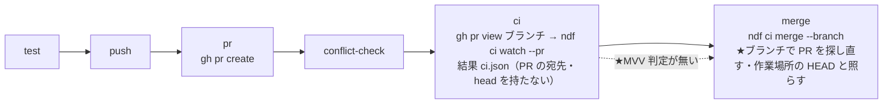
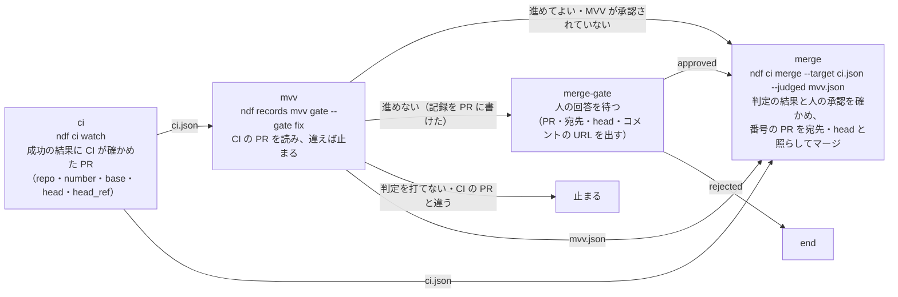
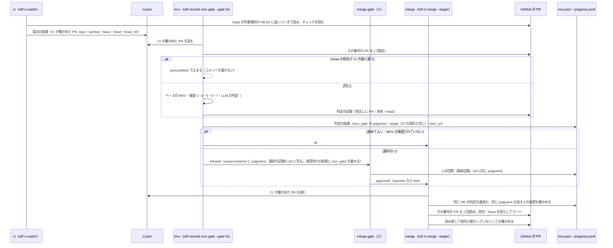

# 即時修正の MVV 判定: CI が確かめた PR だけを判定し、同じ PR をその head のままマージする（#4104）

今の即時修正のプランは MVV 判定を通らずに main へマージし、CI・マージのステップはそれぞれブランチ名から PR を探し直す。CI の成功の結果に「CI が確かめた PR」（リポジトリ・番号・宛先・head・head のブランチ）を 1 つ書き、判定とマージは同じその値を受け取って今の PR と照らし、違えば止まる。判定がマージへ進めないときは、判定の記録を PR に書いたうえで既存の部品 `merge-gate` で人の回答を待つ。マージは CI の結果だけでなく、同じ PR に対する判定の結果（`{state_dir}/mvv.json`）と、進めない判定ならその判定の識別子を指す人の承認も確かめてから打つ。#3959 から移した設計（判定の側に記録のファイルと返り値の型を足し、`ndf ci watch` に PR の選び方を足す形）を採らなかった理由は決定 2〜4 に、外部の調査は末尾にある。

## 今の姿

何が起きたか・目的・受け入れ条件は要求仕様（[issue-4104-requirements.md](./issue-4104-requirements.md)、正は #4104 の本文）にある。この文書は「どう解くか」と「なぜその解き方か」だけを書く。



★ が変わる位置である。設計に要る今の構造（`main` のコミット `3d5279f9f`）:

| 部品 | 今の振る舞い | 置き場 |
| --- | --- | --- |
| 即時修正のプラン | test → push → pr → conflict-check → ci → merge。conductor が `ndf route run immediate_fix` で流し、ステートマシンの外で動く | `plugins/ndf/contracts/templates/fix.json` |
| CI の待ち | 部品 `ci` が `gh pr view <ブランチ>` で選んだ番号を `ndf ci watch --pr` に渡し、出力を `{state_dir}/ci.json` に書く。`HeadReader` は PR の head が作業場所の HEAD に追いつくまで PR を読み直し、読み終えた head のチェックを読む。成功の結果の `items` はチェックだけ | `contracts/templates/parts/steps.json` の `ci`・`src/ndf/ci_cli.py` の `_watch`・`HeadReader`・`_report` |
| マージ | `ndf ci merge --branch` がブランチの開いた PR の先頭を選び、作業場所の HEAD を `expect_head` にして `GitHub.merge` を呼ぶ。済んだかの確かめ（`probe`）は `gh pr view <ブランチ>` の状態 | 部品 `merge`・`ci_cli._merge` |
| マージの前の検査 | `_merge_with` が PR を 1 回読み、`_preflight` がマージ済み・head の食い違い・残リスクを見る。宛先は照らさず、読んだ宛先でマージの方式とキューを選ぶ | `src/ndf/adapters/github.py` の `_merge_with`・`_preflight` |
| 人の回答を待つ部品 | `merge-gate` が `{{gate}}`（既定 `ndf answer ask`）で回答を待ち、`approved` は `merge`、`rejected` は `end` へ進む。設計のマージのプランが使う | 部品 `merge-gate`・`design-merge.json` |
| MVV 判定 | `ndf records mvv gate` は区分 `design`・`release` だけを受ける | `src/ndf/domains/records/mvv_gate.py`・`records/cli.py` |

#3959 の実装（前提 1）の後には、判定の手順 (1) が PR を最初に 1 回読み、(2) がベースの MVV を `snapshot_facts` で読み、区分ごとの検査の表 `CHECKS_BY_GATE` がある。この設計はその形に区分 `fix` を足す。

## 文脈と制約

- **#3959 の実装が先に main へ入る。** 判定を打つ条件と省く条件の分離・ベースの MVV から事実を作る形・`CHECKS_BY_GATE`・レビューの保留はどれも #3959 が作る（#3959 の設計の決定 8）
- **隣の未マージの設計と食い違わない。** #4106（[PR 4134](https://github.com/devbasex/ai-plugins/pull/4134)）は判定の出力 `mvv_gate` に `pr`・`base_ref`・`base_sha` を足す。省いた回答はその値で消費の直前に突き合わせる。#4105（[PR 4132](https://github.com/devbasex/ai-plugins/pull/4132)）は「#4104 と重なるものは無い」と書く。#4090 #4099（[PR 4121](https://github.com/devbasex/ai-plugins/pull/4121)）は #4076 の写しと根拠の行の確かめを直し、判定の区分に触れない。境は決定 6
- **即時修正のプランはステートマシンの外で動く。** 工程の入力（`NDF_STAGE_INPUT`）もステートマシンの ID も無い。判定の入力はプランの値と前のステップのファイルから渡す
- **GitHub のマージの API は head の SHA しか条件にできない**（外部の調査 STD1）。宛先は PR を読んだ値と照らすほかない
- **このリポジトリはテストを CI に寄せる**（`.ndf/project.json` の `test.ci.only`）。LLM の判定の中身に依る条件は、判定の関数のスタブで確かめる
- 後方互換は要らない（MVV Value 4、利用者の方針 2026-11-16）。書くのは `issues/issue-4104-*` だけ

## 解き方の全体像



- 即時修正のプランは ci → mvv → merge の順に流れ、ci が書いた「CI が確かめた PR」の 1 つの値を、判定とマージの両方が読む。判定もマージもブランチで PR を探し直さない
- 判定は、その PR を読んで head と宛先が CI の値と同じときだけ MVV に照らし、マージは同じ番号の PR を、マージの前の検査で宛先と head を照らしてからマージする。判定の後に push か宛先の変更があれば、マージの前の検査が止める
- マージは、判定の結果のファイル `mvv.json` の `mvv_gate.target` が CI の項目（repo・number・base・head・head_ref）と完全に一致する PR について「進めてよい」か、「進めない」の判定の識別子（`mvv_gate.judgment`）を指す `merge-gate` の人の承認の記録（プランの進捗記録 `progress.jsonl`）があるときだけ打つ。判定が `precondition` で止まった後・人が却下した後・再判定の途中で中断した後に `--from merge` で打ち直しても、マージは断る（決定 2）
- 判定が「従う」・レッドライン空・機械の検査（1・4・5・6・7）が外れていなければ人を待たずにマージへ進み、承認済みの MVV が無いリポジトリでは判定せずに進む。進めない判定は PR のコメントに記録を残して人の回答を待ち、承認すれば同じ PR を同じ head でマージする

## 構成要素

| 要素 | 責務 |
| --- | --- |
| CI が確かめた PR（`contracts/result.py` の `PrTarget`・`read_pr_target`） | 結果 JSON の項目 `{"kind": "pr", "repo", "number", "base", "head", "head_ref"}` の形と、ファイルからの読み取りを 1 か所に持つ |
| CI の待ち（部品 `ci`・`ci_cli._report`） | 部品 `ci` は試行の始めに前回の結果のファイルを空にする。成功の結果の `items` の先頭に、読み終えた PR の `PrTarget` を置く |
| 判定の入口（`records/cli.py` の `_mvv_gate`） | `--gate fix --base --branch --ci-result` を受け、判定の識別子を作り、CI の PR を読んで判定の本体へ渡し、結果を `ok`・`refused`・`precondition` に分ける |
| 判定の本体（`records/mvv_gate.py`） | 区分 `fix` で、CI の PR の番号を使い、項目の head のブランチをプランのブランチと照らし、読んだ PR と照らし、モードと進め方を読まずに「進めてよいか」を決める。記録の見出しと出力に判定した PR・宛先・head と、書いたコメントの URL を載せる |
| 機械の検査（`progress/gate/checks.py`） | `CHECKS_BY_GATE` に `fix`（検査 1・4・5・6・7）を足す。記録の見出しの区分名と判定した PR・宛先・head |
| マージ（`ci_cli._merge`） | `--target` で CI の PR を、`--judged` で判定の結果と人の承認を確かめ、その番号の PR を宛先と head を添えてマージする |
| 選択の記録の参照（`contracts/chosen.py`・`contracts/schemas/route-chosen.schema.json`・`core/plan/transition_decide.py`・`core/plan/steps.py`） | 選択の記録に任意の `ref`（選択のもとになったステップの結果の `cause.instance`）を足す。承認のステップの人の選択は、そのステップへ入った選択の `ref` を引き継ぐ |
| 判定の後の人の承認の読み取り（`core/plan/records.py` の `approved_after`） | プランの進捗記録から、判定のステップの最後の選択とその後の承認のステップの人の承認が、どちらも今回の判定の識別子を `ref` に持つかを読む |
| マージの前の検査（`adapters/github.py` の `merge`・`_merge_with`・`_preflight`・`_enqueue`） | 期待する宛先を受け、要求の直前の 1 回の読み取りで宛先・head を照らしてから要求を送り、送った後に PR を読み直して宛先が変わっていれば成功にしない（決定 4） |
| 承認待ちの結果（`core/plan/runner.py` の `gate_result`） | それまでのステップの `outputs`（判定の `mvv_gate`）を載せ、人がどの判定に答えるかを特定できるようにする |
| 即時修正のプラン（`fix.json`・部品 `fix-mvv`・`fix-merge`） | ci → mvv → merge-gate → merge の順とルート |
| 手順書（`pace.md`・`conductor-entrypoints.md`） | 即時修正も MVV に照らし、進めない判定で人の回答を待つことを書く |

## 入出力のコントラクト

### CI が確かめた PR（結果 JSON の項目）

```json
{"kind": "pr", "repo": "<所有者>/<リポジトリ>", "number": 123, "base": "main", "head": "<40 桁の SHA>", "head_ref": "<PR の head のブランチ>"}
```

`ndf ci watch` の成功の結果の `items` の先頭に置く。`head_ref` は `ndf ci watch` が GitHub から読んだ PR の head のブランチで、PR を作った後に変わらない。既存の `{"kind": "pr", "number": …}` を拾う読み手（プランの結果とキューの `queue_prs`）は番号だけを読むので、そのまま動く。

部品 `ci` は試行の始め（`gh pr view` より前）に、シェルの組み込み `: > "$out" || exit 1` で `{state_dir}/ci.json` を空にする。PR を探せずに `tee` の前で終わった試行の後に、前回の成功の結果が残って判定とマージの根拠にならないためである（決定 2）。外部コマンドを起動しないので、部品 `ci` を使う全プランで CI の試行ごとの起動の回数は増えない。空にできなければ PR を探さずに失敗で終わる。`read_pr_target` は空のファイルを `ValueError` で拒むので、空の `ci.json` では判定もマージも進まない。


### `ndf records mvv gate --gate fix`

| 引数 | 内容 |
| --- | --- |
| `--gate fix` | 区分（新設）。`--base`・`--branch`・`--ci-result` が必須で、`NDF_STAGE_INPUT` と `--machine` は読まない（渡せば `invalid`） |
| `--base <ブランチ>` | プランの宛先。CI の PR の `base` と違えば止まる |
| `--branch <ブランチ>` | プランのブランチ（push した先）。CI の PR の `head_ref` と違えば止まる（決定 3） |
| `--ci-result <パス>` | `ndf ci watch` の結果のファイル（プランの `{state_dir}/ci.json`） |

| 終わり方 | 結果 | プランの次 |
| --- | --- | --- |
| 判定が「従う」・レッドライン空・検査 1（ベースの MVV が承認済み）・4（レッドラインのパス）・5（MVV の設定の変更）・6（出し直しの指摘への対応表）・7（レビューの保留）の理由が空 | `ok`（`summary`: 「MVV 判定: マージへ進める」） | `merge` |
| ベースの MVV が承認されていない（`absent`・`unapproved`） | `ok`（`summary`: 「MVV が承認されていないので判定しない」）。コメントは書かない | `merge` |
| 進めない判定で、判定の記録を PR に書けた。判定が無い（`verdict: null`）のに記録を書く止まり方を含む: LLM が回答しない（#3959 の手順 (7) が `GateError` を受け、(1) で読んだ `head` を保ったまま (9) で記録を書く）・ベースの MVV を読めない・差分を読めない・差分の全体が材料に載らない | `stopped`・`refused`（「MVV 判定でマージへ進めない: <理由>」） | `merge-gate` |
| CI の PR が無い・形が違う・リポジトリか宛先が違う・head のブランチがプランのブランチと違う・読んだ PR の head か宛先が CI の値と違う・PR を読めない・差分を読む間に head か宛先が動いた・差分の後に PR を読み直せない・ベースの MVV のハッシュが承認の記録と違う・判定の記録を PR に書けない。どれも今回の判定の記録が PR に無い | `stopped`・`precondition`（「MVV 判定を打てない: <理由>」） | 止まる |

どの終わり方も `outputs.mvv_gate` を添える（`gate` は `fix`。`skip` が真のときだけ人を待たずにマージへ進む）。区分 `fix` の `mvv_gate` は、どの終わり方でも `judgment`（判定ごとの識別子。入口が打つたびに新しく作る 32 桁の 16 進）を、判定の本体を呼んだ終わり方で `target`（判定した PR の `PrTarget.item()` をそのまま。`kind`・`repo`・`number`・`base`・`head`・`head_ref` の 6 つのキーで、CI の項目と同じ値）を、記録を書けたときは `note_url`（今回書いたコメントの URL）を持つ。`refused` の結果は `cause.instance` に同じ `judgment` を置き、プランの選択の記録がそれを `ref` に写す（決定 2）。判定の記録の見出しにも同じ PR・宛先・head を書く（決定 1）。

### `ndf ci merge --target <パス> --judged <パス>`

| 引数 | 内容 |
| --- | --- |
| `--target <パス>`（新設） | CI の結果のファイル。`--branch` と排他でどちらか必須。`--reviewed` とは同時に渡せない（`invalid`） |
| `--judged <パス>`（新設） | 判定のステップの結果のファイル（プランの `{state_dir}/mvv.json`）。`--target` と組で必須（片方だけは `invalid`）。人の承認は同じディレクトリの進捗記録 `progress.jsonl` から読む |
| `--method`・`--repo` | 今のまま |

| 条件 | 結果 |
| --- | --- |
| ファイルが無いか空・CI が確かめた PR の項目が無いか形が違う | `stopped`・`precondition`（マージしない） |
| 項目の `repo` が `--repo`（省けば作業場所の origin）と違う | `stopped`・`refused` |
| 判定の結果が無い・`mvv_gate.target` が CI の項目（`PrTarget.item()`）と完全には一致しない（別の PR・宛先・head・head のブランチの判定、キーの欠け）・判定が `precondition` で止まった | `stopped`・`refused`（「この PR・宛先・head に対する MVV 判定の通過が無い」。要求を送らない） |
| 判定が `refused` で、進捗記録の判定のステップ（`mvv`）の最後の選択が `ref` に `mvv_gate.judgment` を持つ `merge-gate` への選択でない、またはその後に同じ `ref` を持つ `merge-gate` → `merge` の人の承認が無い（却下した・回答していない・再判定の結果を書いた後に記録の追記の前で中断した） | `stopped`・`refused`（「MVV 判定の承認が無い」。要求を送らない） |
| 番号の PR の宛先が項目の `base` と違う | `stopped`・`refused`（マージ済みでも。要求を送らない） |
| 番号の PR の head が項目の `head` と違う | `stopped`・`refused`（マージ済みでも。別の head がマージされたことを成功にしない） |
| 番号の PR がマージ済み（宛先と head が同じ） | `ok`（「既にマージ済み」。打ち直しで済んだ操作を繰り返さない） |
| 要求を送った後の読み直しで、宛先が項目の `base` と違う | `stopped`・`refused`（「マージの要求の間に宛先が変わった」。キューに入れたときは外す。決定 4） |
| ほか | 今の `merge` と同じ（残リスク・方式・キュー） |

## 処理の流れ



図は型の定義（`PrTarget`）・機械の検査の表・手順書を描かない。どれもステップの間の受け渡しに現れないためである。

## 決定の記録

### 決定 1: 即時修正も MVV に照らすため、プランの CI とマージの間に判定を置き、進めない判定は既存の `merge-gate` で人の回答を待つ

- **質問**: 即時修正のプランのどこで判定し、進めない判定の後をどう扱うか
- **選んだ案**: #3959 から移した決定 3 を引き継ぐ。`ci` と `merge` の間にステップ `mvv`（`ndf records mvv gate --gate fix`）を置く。進めてよいときと承認済みの MVV が無いときは `ok` でマージへ進む。判定の記録を PR に書けた進めない判定は既存の原因 `refused` で `merge-gate` へ進み、人が記録を読んで承認すれば同じ PR をマージし、却下すれば終える。記録の無い止まり方（`precondition`）は人の回答を待たずに止まり、プランを `ci` から打ち直す（`ndf plan next <プラン> --from ci`）。「記録のある」は今回の判定の記録が PR にあることで、#3959 が記録を書かずに返す終わり方（差分を読む間に head・宛先が動いた・差分の後に PR を読み直せない）は区分 `fix` では `noted: false` を明示して `precondition` にする。LLM が回答しないときは #3959 の手順 (7) が受けて記録を書くので、記録のある進めない判定として人の回答を待つ。人がどの判定に答えるかを取り違えないよう、判定の記録の見出しに判定した PR・宛先・head を書き、判定の出力 `mvv_gate` に `target`（同じ PR・宛先・head）と `note_url`（今回書いたコメントの URL）を置き、承認待ちの結果（プランの `gate_result`）にそれまでの `outputs` を載せる。再判定で古いコメントが PR に残っても、承認待ちの結果が今回のコメントを指す。CI の後に置くのは、CI の直し（`repeat-check`）で head が進むので、マージする head で判定するためである
- 採らなかった案: PR を出した直後（`pr` の後）に置く（CI の直しで head が進むと、判定した head とマージする head が違う）
- 採らなかった案: 進めない判定で止めたまま行き先を持たない（同じ PR は打ち直しても同じ理由で外れ、人は判定を通らずに手でマージするしかない。#4093 の指摘 r1-16）
- 採らなかった案: 検査 4・5 を即時修正では注意に下げる（レッドラインのパスや MVV の設定を変える即時修正が人を通らずに main へ入る。受け入れ条件 1 に反する）
- 採らなかった案: 新しい原因の種類（`mvv_hold`）を足す（行き先は既存の `refused` と同じ人で、原因の表が増えるだけになる）
- **代償**: 承認済みの MVV を持つリポジトリでは、即時修正の 1 回につき LLM の 1 回の費用と PR のコメント 1 件が増え、進めない判定では即時修正が人を待つ
- 根拠: Value 1 / Value 3（MVV バージョン 11）

### 決定 2: 同じ事実を 2 か所に持たないため、CI・判定・マージが受け渡す PR を CI の結果の 1 つの項目にし、判定の側に記録のファイルと返り値の型を足さない

- **質問**: CI が確かめた PR・判定した PR・マージする PR を同じにするために、どの値をどこに書いて受け渡すか
- **選んだ案**: `ndf ci watch` の成功の結果に「CI が確かめた PR」の項目（`repo`・`number`・`base`・`head`・`head_ref`）を 1 つ書く。判定はその項目を期待の値として受け取り、その番号の PR を読んで head と宛先が同じときだけ判定する（違えば止まる）。マージも同じ項目を読み、その番号の PR を宛先と head で照らしてからマージする。項目の形と読み取りは `contracts/result.py` の `PrTarget`・`read_pr_target` の 1 か所に置く。CI の結果は対象の識別にだけ使い、マージしてよい根拠にしない。マージの根拠は、判定のステップの結果のファイル（`{state_dir}/mvv.json`。部品 `fix-mvv` が `tee` で書く）の `mvv_gate.target` が CI の項目と同じで、かつ判定が `ok` か、`refused` の後に `merge-gate` で人が今回の判定を承認したこと（プランの進捗記録 `progress.jsonl` で、判定のステップの最後の選択と、その後の `merge-gate` → `merge` の人の選択が、どちらも `ref` に `mvv.json` の `mvv_gate.judgment` を持つこと）にする。判定の識別子は入口が打つたびに新しく作り、`refused` の結果の `cause.instance` に置く。プランの実行は、ステップの結果から選んだ選択の記録に `cause.instance` を `ref` として写し、承認のステップの人の選択にはそのステップへ入った選択の `ref` を写す（`contracts/chosen.py` に任意の `ref`。判定に固有の知識はプランの実行に入れない）。`mvv.json` の上書き（ステップの中の `tee`）と進捗記録の追記（ステップの後）は別の操作なので、同じ PR・宛先・head を再判定して新しい `refused` を書いた直後に中断すると、進捗記録には前回の `mvv` → `merge-gate` と承認が最後の選択として残る。選択の順だけでなく `ref` を照らすので、前回の承認は今回の識別子を指さず、マージは断る。判定のステップは毎回 `mvv.json` を書き直すので、`precondition` で止まった後・却下した後・CI を新しい head で打ち直した後に `--from merge` で打ち直しても、根拠が無くマージは断る。共有の部品 `ci` は試行の始めに `ci.json` をシェルの組み込みで空にする（今の部品は `gh pr view` が失敗すると `tee` の前に終わり、前回の成功の `ci.json` が残る）。CI の打ち直しが PR を探せずに落ちた後の `--from merge` は、CI が確かめた PR が無いので要求を送らずに止まる。`ci.json` を読むほかの部品（`repeat-check`・`test --failed-from`）は `ci` の試行が結果を書いた後にだけ動くので変わらない
- 採らなかった案: 判定が判定した PR を別のファイル（`--judged-out`）に書き、`gate` の返り値を `Gated(outcome, target)` に変える（#3959 から移した形。CI の項目と同じ値をもう 1 か所に持ち、2 つの記録の食い違いを照らす手順が要る。#4093 の指摘 r3-7 はこの 2 つ目の記録の作り方から出た）
- 採らなかった案: #4106 が判定の出力 `mvv_gate` に足す `pr`・`base_ref`・`base_sha` からマージの対象を組む（`repo` を持たず、#4106 は承認済みの MVV が無い終わり方に 3 つを置かないと決めている。即時修正はその終わり方でもマージへ進むので、マージの対象が組めない）
- 採らなかった案: マージは CI の結果だけを根拠にし、ステップの順をプランが保つことに頼る（判定が `precondition` で止まった後や人が却下した後に、通常の打ち直し `ndf plan next --from merge` で判定と回答を飛ばせる。うっかりの打ち直しで戻せないマージが起きる）
- 採らなかった案: 判定のステップが「通過」の印のファイルを別に書く（`mvv.json` と同じ事実の 2 つ目の記録になる。人の承認はプランの進捗記録に既にある）
- 採らなかった案: 進捗記録の選択の順だけで「判定の後の承認」を決める（`mvv.json` の上書きと進捗記録の追記の間で中断すると、前回の判定への承認が今回の判定への承認に見える。指摘 r2-1）
- 採らなかった案: 判定の識別子を CI の項目（repo・number・base・head）で代える（同じ PR・宛先・head の再判定で識別子が同じになり、上の中断で前回の承認を取り違える）
- **代償**: `ndf ci merge --target` がプランの進捗記録の形（`core/plan/records.py` の選択の記録）に依る。読み取りは `records.py` の関数 1 つに閉じ、`ci_cli` は形を読まない。選択の記録の形に任意の `ref` が 1 つ増える（`cause.instance` を持たない結果からの選択と、それを引き継ぐ承認には付かない）
- 根拠: Value 8 / Value 11（MVV バージョン 11）

### 決定 3: 範囲を広げないため、CI の PR の選び方は変えず、選んだ PR の宛先が違えば判定で止める

- **質問**: 同じブランチから別の宛先にも PR があるとき、CI が別の宛先の PR を確かめることをどこで防ぐか（#4093 の指摘 r3-2）
- **選んだ案**: 部品 `ci` の PR の選び方（`gh pr view <ブランチ>`）は変えない。CI が確かめた PR の項目は `base` と `head_ref`（`ndf ci watch` が GitHub から読んだ PR の head のブランチ）を持つので、判定の入口が `--base`（プランの宛先）・`--branch`（プランのブランチ）と照らし、どちらかが違えば `precondition` で止める。マージも同じ項目の番号の PR だけを扱い、根拠の `mvv.json` の `target` は照らしを通った項目と同じでなければならない。別の宛先の PR の CI の成功でも、別のブランチの PR の CI の成功でも、判定とマージは進まない
- ブランチを照らす理由: 部品 `ci` は `gh pr view` の既定のリポジトリ（`gh repo set-default`）で番号を取り、`ndf ci watch` は作業場所の origin のリポジトリでその番号を読み直す。2 つのリポジトリが違い同じ番号の PR が両方にあると、`ndf ci watch` は別のブランチの PR を読み（作業場所のブランチと違うので head の追いつきも待たない）、その番号で成功を書く。今のマージは `--branch` で PR を探し直すのでこの PR をマージしないが、番号で受け渡す形ではそのままマージに届く。`head_ref` をプランのブランチと照らせば、判定とマージが扱えるのは origin のリポジトリでプランのブランチを head にした PR だけになり、今の `ndf ci merge --branch` が選ぶ PR と同じ範囲に収まる。追加の API の呼び出しは無い（`ndf ci watch` が既に読んだ PR の値を書くだけ）。PR の作成からマージまでを 1 つの明示したリポジトリにそろえることは #4167 で扱う
- 採らなかった案: `ndf ci watch` に `--branch --base` を足し、CI の前に宛先で PR を 1 件に決める（#3959 から移した形。CI の入口の引数と排他の規則が増え、即時修正のブランチは部品 `pr` が宛先を指定して作る 1 本なので、選び違いは稀である。止める位置が判定へ移っても、別の宛先の PR を進めない約束は同じ）
- 採らなかった案: CI の成功を、必須のチェックごとに起こしたイベントの出所（付け替えの時刻・スイートの作成時刻・イベントの種類・同じブランチのほかの PR が開いていた期間）で今の PR・宛先に結び付ける（ラウンド 1〜3 の修正で決定 8 として足した形。今の `ndf ci watch` がチェックを SHA で読むことにもともとある隙で、この Issue が持ち込んだものではない。直すと部品 `ci` を使う全プランの CI の成功の決め方が変わり、3 ラウンド続けて新しい抜け道を指摘されて収まらなかった。conductor の範囲の判断で削り、#4166 へ移した）
- 採らなかった案: 即時修正のプランの PR 操作（作成・探査・衝突の確かめ・CI・判定・マージ）をすべてプランの値 `remote` のリポジトリにそろえる（ラウンド 1〜3 の修正で決定 7 として足した形。今の即時修正のプランが push だけに `remote` を使うことにもともとある隙で、この Issue が持ち込んだものではない。conductor の範囲の判断で削り、#4167 へ移した）
- **代償**: 同じブランチから別の宛先にも開いた PR があると、CI を待った後に判定で止まる（打ち直しても同じ PR を選ぶので、人が余分な PR を閉じてから打ち直す）
- 根拠: Value 9 / Value 2（MVV バージョン 11）

### 決定 4: 照らした宛先とマージの方式を選ぶ宛先を分けないため、宛先の突き合わせを既存のマージの前の検査に足し、マージは番号で行う

- **質問**: マージの直前に、宛先と head をどこで照らすか（#4093 の指摘 r1-2・r2-3・r3-3・r3-4）
- **選んだ案**: `GitHub.merge`・`_merge_with`・`_preflight`・`_enqueue` に `expect_base` を足す。`expect_base` があるとき `_preflight` は、宛先 → head → マージ済み → 残リスクの順に見る。宛先か head が違えば、マージ済みでも要求を送らずに断る（判定の後に別の head が push され、人か別の自動処理が先にマージしたものを、判定した head のマージとして成功にしない）。宛先と head が同じでマージ済みのときだけ `ok` を返す。`expect_base` が無い今の呼び手は今の順のまま。宛先は次の実行条件で固定する（GitHub の API は宛先を要求の条件にできない。STD1）:
  - 直接のマージ: マージの方式は `expect_base` で先に選び（`allowed_merge_methods(expect_base)`）、その後に PR を 1 回読んで宛先・head を照らし、間に API を挟まずにマージの要求を送る。照らす読み取りと要求の間は 1 往復だけになる
  - キューへの投入: 直接のマージを 405 で断られた後のキューの状態の読み取り（`_MERGE_QUEUE_STATE`）で、同じ GraphQL の 1 回で PR の `baseRefName`・`headRefOid` も読み、`expect_base`・照らした head と違えば投入せずに断る。投入は `expectedHeadOid` を添える
  - 要求の後: 直接のマージもキューへの投入も、要求の後に PR を 1 回読み直し、宛先が `expect_base` と違えば `refused`（「マージの要求の間に宛先が <今> へ変わった」）を返して成功にしない。キューに入れていれば外す（`dequeue`）
  - 固定できない残り: 照らした読み取りから要求までの 1 往復の間に、書き込みの権限を持つ人が宛先を変える操作は防げない。この間に変わったときは、要求の後の読み直しで検出してプランを止め人へ戻す（直接のマージは戻せないので、成功にせずに知らせる）。受け入れ条件 2 の「判定の後に宛先が動けばマージは止まる」は、要求の直前の読み取りまでに動いたものは要求を送らずに止め、残りの 1 往復の間に動いたものは要求の後に止めて成功にしない、と読む。この読みは実装の PR で #4104 の本文の受け入れ条件 2 に書き足す
  - マージの方式とキューの選択は、突き合わせを通った宛先で行う。`ndf ci merge --target` は項目の番号の PR に `expect_head`（項目の head）・`expect_base`（項目の宛先）・`--method` を渡す。作業場所の HEAD とは照らさない（マージするのは PR の head で、PR の head を項目の head と照らせば、判定の後に push したコミットは断られる）。済んだかの確かめ（`probe`）は持たない。番号の PR がマージ済みで宛先と head が同じなら本体が `ok` を返すので、打ち直しても済んだ操作を繰り返さない
- 採らなかった案: `ndf ci merge` が `hub.pull` で照らしてから `hub.merge` を呼ぶ（`_merge_with` が PR を読み直し、照らした宛先と方式を選ぶ宛先が分かれる。読む回数も増える。指摘 r3-4）
- 採らなかった案: 宛先を固定できない構成ではマージしない（GitHub の API はどの構成でも宛先を要求の条件にできず、即時修正がすべて止まる）
- 採らなかった案: 済んだかの確かめに `ndf ci merged --judged` のサブコマンドを足す（#3959 から移した形。本体が冪等なら要らない部品で、サブコマンドが 1 つ増える）
- 採らなかった案: 今の `--reviewed` と同じく作業場所の HEAD と照らす（PR の head の突き合わせと同じことを確かめ、マージの後に作業場所が消えた打ち直しで、マージ済みの PR を断る）
- **代償**: 照らした読み取りからマージの要求までの 1 往復の間に宛先を変える操作は、要求の前には防げず、直接のマージでは要求の後に検出して止めるだけになる（GitHub の API は head の SHA しか条件にできない。STD1）。マージ 1 回につき要求の後の PR の読み取りが 1 回増える
- 根拠: Value 3 / Value 9（MVV バージョン 11）。STD1

### 決定 5: 即時修正を速く届けるため、判定の後に宛先の先端が進んだかは照らさない

- **質問**: #4106 は省いた回答を消費する直前に宛先の先端（判定が規則を読んだベースのコミット）を照らす。即時修正のマージの前にも同じ突き合わせを置くか
- **選んだ案**: 置かない。マージの前に照らすのは PR の番号・宛先・head だけにする。人を待たない経路は判定からマージまで同じプランの続きのステップで、間は LLM の判定の後の 1 ステップである。人を待つ経路は、人が PR の判定の記録を読んで承認し、その承認が判定の代わりになる。マージキューを持つ宛先では、GitHub が最新の宛先と合わせた変更でチェックを打ち直す（PRD1）
- 採らなかった案: #4106 の突き合わせ関数（`mvv_vouch`）を即時修正のマージの前に呼ぶ（ステートマシンの事象（`view`・`move`）と承認ゲートの質問に結び付いた関数で、ステートマシンの外の即時修正からは呼べない。PR を読む回数も `_merge_with` の 1 回に足される）
- 採らなかった案: 宛先の先端を `git ls-remote` で読み、判定が読んだベースのコミットと違えば止める（他の PR が宛先へ入るたびに即時修正が止まり、判定から打ち直す。判定とマージの間に MVV の設定が変わることは稀で、費用と待ちが釣り合わない）
- **代償**: 判定とマージの間に宛先へ MVV の取り消しやレッドラインの追加が入ると、古い MVV で判定した即時修正がそのままマージされる
- 根拠: Value 5 / Value 2（MVV バージョン 11）。PRD1

### 決定 6: 隣の設計と重ねないため、#3959・#4105・#4106・#4090 #4099 との境をこの設計で決める

- **質問**: 判定の本体・判定の出力・省いた回答の突き合わせを持つ隣の設計と、この設計の重なりをどう分けるか
- **選んだ案**: 次の表のとおりにする

  | 隣の課題 | その課題が持つもの | この設計が持つもの |
  | --- | --- | --- |
  | #3959 | 判定を打つ条件と省く条件の分離・`snapshot_facts`・判定の手順 (1)〜(9)・`CHECKS_BY_GATE`・レビューの保留・`--machine` | 区分 `fix` の分岐（PR の番号・手順 (1) の突き合わせ・検査の組・進めてよいかの決め方）。#3959 の `design`・`release` の振る舞いは変えない |
  | #4106 | 判定の出力の `pr`・`base_ref`・`base_sha`、省いた回答の消費の直前の突き合わせ（`mvv_vouch`） | 判定の出力には区分 `fix` だけで `target`（判定した PR の識別。マージの根拠の照合と承認待ちの表示に使う）と `note_url` を足す。#4106 の `pr`・`base_ref`・`base_sha`（省いた回答を消費する直前の照合の値）は足さず、#4106 の欄は区分 `fix` の出力にも同じ規則で載る。即時修正の突き合わせは `_preflight` に置く（決定 4・5） |
  | #4105 | リリース承認ゲートで保留を読む PR の範囲・`mvv_answer_void` | 無し（即時修正はリリース承認ゲートを通らない） |
  | #4090 #4099 | #4076 の写し・根拠の行の確かめの直し | 無し（判定の区分に触れない） |

- 採らなかった案: 隣の課題の論点をこの設計に取り込む（#4093 で範囲を分けた理由と同じく、ラウンドが収まらない）
- **代償**: 実装の順が #3959 の後に縛られる
- 根拠: Value 5 / Value 9（MVV バージョン 11）

## 影響と危険

- **働く範囲**: 利用先のリポジトリでも働く。判定が現れるのは承認済みの MVV を持つリポジトリの即時修正だけで、持たないリポジトリでは判定の LLM もコメントも無く、マージの突き合わせ（宛先・head）だけが増える
- **プロジェクトごとに違うもの**: 宛先はプランの値 `base`、人の回答を待つ起動はプランの値 `gate`（既定 `ndf answer ask`）から受ける。新しい設定のキーは足さない
- **当たるモード**: 即時修正のプラン（`immediate_fix`）を使うすべて。承認ゲートを持つモードの工程には触れない
- **同じファイルを触る別の変更**: #3959・#4105・#4106 の実装が `mvv_gate.py`・`checks.py`・`records/cli.py`・`context.schema.json` を変える。この Issue の実装は #3959 の実装が main へ入った後の main から切る（前提 1）
- **壊れうる箇所**: 部品 `ci` を使うほかのプラン（実装・検査・設計・マージ・後始末・確定仕様化）でも、CI の成功の結果の `items` の先頭に PR の項目が増える。選択の記録に任意の `ref` が増える（読み手は `approved_after` だけ。決定 2）。項目を読む `queue_prs`・`steps.prs` は番号だけを読むので振る舞いは変わらない。`ndf ci merge --branch` の今の呼び手は今のまま動く（`expect_base` を渡さなければ突き合わせず、照合の順も今のまま）。承認待ちの結果に `outputs` が載るのは、`outputs` を書いたステップのあるすべてのプランに当たる（読み手が増えるだけで、ルートは変わらない）
- **費用**: 承認済みの MVV を持つリポジトリで、即時修正 1 回につき LLM の判定 1 回・PR のコメント 1 件・PR の読み取り（判定の手順 (1) と #3959 の読み直し）とベースの `git fetch` が増える。`expect_base` を渡すマージで、要求の後の PR の読み取りが 1 回増える（決定 4）

### 代表のリポジトリでの振る舞い

| 代表のリポジトリ | 設定の要点 | 直した後に起きること | この種類で扱えなくなること |
| --- | --- | --- | --- |
| Web サービス | 承認済みの MVV があり、即時修正を `immediate_fix` で流す | 即時修正が CI の後に判定を通り、進めない判定では人の回答を待つ。マージは CI が確かめた PR だけ | 無し |
| モバイルアプリ | 同上。配布の手段が違うだけ | 同上 | 無し |
| 業務文書だけ | 文書の PR。MVV が無いことが多い | MVV が無ければ判定せずに今どおりマージへ進む。マージの突き合わせだけが増える | 無し |

### このリポジトリだけの事情

- 無し（新しい値を足さない。ai-plugins の MVV の版 11 は例として使うだけで、仕組みはどのプロジェクトの MVV も読む）

## 用語

設計文書の本文で使う新しい語を、実装の PR で用語集へ足す（この設計 PR は `issues/issue-4104-*` だけを触る）。

| 用語 | 意味 | 用語集への反映 |
| --- | --- | --- |
| CI が確かめた PR | `ndf ci watch` が必須のチェックの成功を確かめた PR のリポジトリ・番号・宛先・head・head のブランチ。成功の結果の項目に書き、即時修正の判定とマージが読む | 追加 |

## テスト設計

| 受け入れ条件・不変条件 | どの振る舞いで縛るか | どう壊したら落ちるべきか |
| --- | --- | --- |
| 1 | `fix.json` を読み込んだプランのステップの順が test・push・pr・conflict-check・ci・mvv・merge-gate・merge で、`mvv` の成功は `merge`、`refused` は `merge-gate` へ進む | 判定のステップが無い・成功が `merge-gate` へ進む |
| 1 | 区分 `fix` で、判定のスタブが「従う」・レッドライン空・保留無しなら `ok`、レッドラインのパス・MVV の設定の変更・保留・「従わない」なら `refused`。進め方とモードの入力が無くても判定する | 検査 4・5・7 が外れても `ok`・進め方で判定を省く |
| 1 | ベースの MVV が `absent` なら判定のスタブを呼ばず `ok`、`mismatch` なら `precondition` | MVV の無いリポジトリで止まる・ハッシュの違う MVV で進む |
| 2 | CI の成功の結果の先頭の項目が、`HeadReader` が読み終えた PR の repo・番号・宛先・head・head のブランチ | 前のコミットの head を書く・宛先かブランチを書かない |
| 2 | 部品 `ci` の `gh pr view` が失敗すると `ci.json` が空のまま残り、前回の判定が `ok` の `mvv.json` があっても、その後の `--from merge` は要求を送らずに止まる | 前回の成功の `ci.json` でマージする・空の `ci.json` を読めたとみなす |
| 2 | CI の項目の `head_ref` が `--branch` と違う（`gh` の既定のリポジトリと origin で同じ番号の別の PR を読んだ）と、判定は `precondition` で LLM を呼ばずコメントを書かず、マージは要求を送らない | 別のブランチの PR を判定してマージする |
| 2 | CI の項目の宛先が `--base` と違う・読んだ PR の head か宛先が項目と違うと、判定は `precondition` で LLM を呼ばずコメントを書かない | 別の宛先の PR・判定の後の head を判定する |
| 2 | `ci merge --target` が、項目の番号の PR に項目の head と宛先を渡してマージする。ブランチで PR を探さない | 同じブランチの別の PR をマージする |
| 2 | 判定の後に PR の head が進んだ・宛先が変わった PR を `_preflight` が要求を送らずに断る。宛先か head の違う PR はマージ済みでも成功にしない（同じ宛先へ別の head がマージ済みのとき `refused`） | 宛先を照らさない・別の宛先か別の head でマージ済みの PR を済んだとみなす |
| 2 | 直接のマージは方式を選んだ後に PR を読み、間に API を挟まずに要求を送る。キューへの投入は状態の読み取りで宛先・head を照らす。要求の後の読み直しで宛先が変わっていれば `refused`（キューからは外す） | 照らした後に方式やキューの状態の読み取りを挟む・宛先が変わったマージを成功にする |
| 2 | `_preflight` の突き合わせを通った宛先でマージの方式を選び、`--method` が渡る | 突き合わせと別に PR を読み直す・方式を落とす |
| 3 | `refused` の後に `approved` の回答で、CI の項目の PR がその head でマージされ、`rejected` ではマージを呼ばない。承認の後に head が進むとマージが断る | 却下でマージする・承認の後の head をマージする |
| 3 | 通常のマージの打ち直し（判定が `ok` の後にマージが落ち、`--from merge`）はマージする。判定が `precondition` で止まった後・却下した後・判定の前の `--from merge` は、判定の結果か承認が無いので要求を送らずに `refused` | 判定と回答を飛ばしてマージする・正しい打ち直しを断る |
| 3 | 前回の判定が承認された後に同じ PR・宛先・head を再判定し、新しい `refused` の `mvv.json` を書いて進捗記録の追記の前に中断した状態で `--from merge` を打つと、前回の承認の `ref` が今回の `judgment` と違うので要求を送らずに `refused` | 前回の承認で今回の判定を通す |
| 3 | `precondition` の終わり方では `merge-gate` へ進まない。#3959 が記録を書かずに返す、差分を読む間に head・宛先が動いた・差分の後に PR を読み直せないも `noted: false` で `precondition`。LLM が回答しないときは記録を書いて `refused` | コメントの無い理由で人に承認させる・LLM の無回答で止める |
| 3 | 判定の記録の見出し・判定の出力 `mvv_gate.target` と `note_url`・承認待ちの結果が、同じ PR・宛先・head と今回のコメントの URL を持つ | 人がどの判定に答えるか特定できない |

## 設計の結果

詳細設計は [issue-4104-design-detail.md](./issue-4104-design-detail.md) にある（新設する関数 4 つ・シグネチャを変える関数と型 11 個）。

| 課題 | 扱い | 統合先 | 触るファイル |
| --- | --- | --- | --- |
| #4104 | 実装する | — | `plugins/ndf/contracts/templates/fix.json`、`plugins/ndf/contracts/templates/parts/steps.json`、`plugins/ndf/contracts/workflow/context.schema.json`、`plugins/ndf/contracts/schemas/io/records.args.schema.json`、`plugins/ndf/contracts/schemas/io/ci.args.schema.json`、`plugins/ndf/contracts/schemas/io/ci.result.schema.json`、`plugins/ndf/docs/contracts/commands.md`、`plugins/ndf/src/ndf/contracts/result.py`、`plugins/ndf/src/ndf/ci_cli.py`、`plugins/ndf/src/ndf/adapters/github.py`、`plugins/ndf/src/ndf/domains/records/mvv_gate.py`、`plugins/ndf/src/ndf/domains/records/cli.py`、`plugins/ndf/src/ndf/progress/gate/checks.py`、`plugins/ndf/src/ndf/core/plan/records.py`、`plugins/ndf/src/ndf/core/plan/runner.py`、`plugins/ndf/src/ndf/core/plan/steps.py`、`plugins/ndf/src/ndf/core/plan/transition_decide.py`、`plugins/ndf/src/ndf/contracts/chosen.py`、`plugins/ndf/contracts/schemas/route-chosen.schema.json`、`plugins/ndf/skills/development-workflow/references/pace.md`、`plugins/ndf/skills/development-workflow/references/conductor-entrypoints.md`、`docs/glossary/glossary.json`、`plugins/ndf/tests/adapters/test_ci_cli.py`、`plugins/ndf/tests/adapters/test_github.py`、`plugins/ndf/tests/domains/records/test_mvv_gate.py`、`plugins/ndf/tests/route/test_templates.py`、`plugins/ndf/tests/core/plan/`（承認の読み取りと承認待ちの結果） |

## 未確認のまま残ること

| 項目 | 内容 |
| --- | --- |
| 用語集から作る文書 | 「CI が確かめた PR」を `docs/glossary/glossary.json` に足した後に `ndf records glossary render` が書き直す文書（`docs/glossary/` の下のどれか）は、語のコンテキストを実装で決めるまで決まらない。書き直された文書は実装の PR に含める |

## 外部の調査

| 種類 | 調べるか | 理由 |
| --- | --- | --- |
| 標準・仕様 | 調べる | マージの API が条件にできる値で、宛先の突き合わせをどこに置けるかが決まる |
| 主要な製品 | 調べる | 「確かめたものをマージする」ことを GitHub のマージキューがどう保つかで、宛先の先端の突き合わせの要否が決まる |
| ライブラリとサービス | 調べない | 新しい依存を足さない。GitHub との接続は既存の adapter（githubkit）を使う |

### 標準・仕様

| # | 標準・仕様 | 何を定めているか | 設計への反映 | 出典 |
| --- | --- | --- | --- | --- |
| STD1 | GitHub REST API「Merge a pull request」「Update a pull request」 | マージの要求の `sha` は PR の head が一致しなければ 409 で断る。宛先を条件にする引数は無い。宛先は PR の更新（`base`）で同じリポジトリの別のブランチへ変えられる | 宛先は読んだ PR と照らすほかなく、突き合わせを `_merge_with` の 1 回の読み取りに置く。読んでから要求までの宛先の変更は代償に残す（決定 4） | https://docs.github.com/en/rest/pulls/pulls#merge-a-pull-request （2026-11-22） |

### 主要な製品

| # | 製品 | どう解いているか | 設計への反映 | 出典 |
| --- | --- | --- | --- | --- |
| PRD1 | GitHub のマージキュー | キューに入れた PR を最新の宛先と前に並んだ PR に合わせた一時のブランチで必須のチェックに通し、通った組み合わせだけをマージする。宛先が進むことを前提に、マージの時点で確かめ直す | 宛先の先端の固定を求めず、宛先が進んでもマージの側で確かめ直す形を採る（決定 5） | https://docs.github.com/en/repositories/configuring-branches-and-merges-in-your-repository/configuring-pull-request-merges/managing-a-merge-queue （2026-11-22） |

調べた量: 候補 2 件・取得の試み 2 回。
