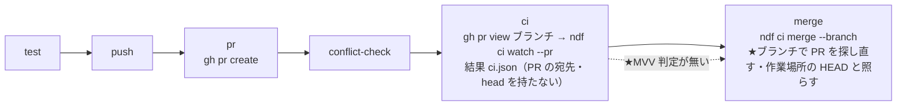
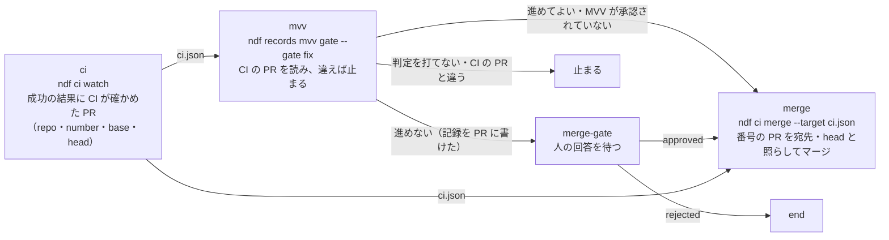
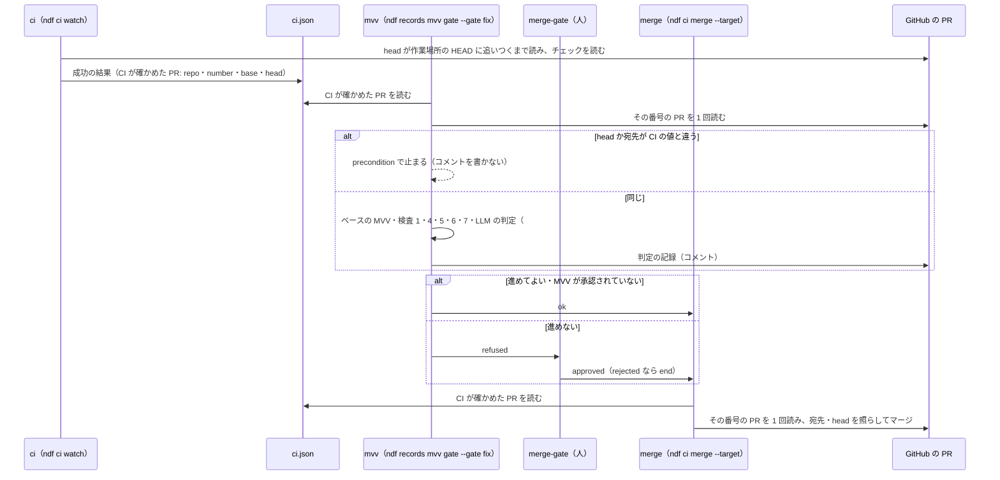

# 即時修正の MVV 判定: CI が確かめた PR だけを判定し、同じ PR をその head のままマージする（#4104）

今の即時修正のプランは MVV 判定を通らずに main へマージし、CI・マージのステップはそれぞれブランチ名から PR を探し直す。CI の成功の結果に「CI が確かめた PR」（リポジトリ・番号・宛先・head）を 1 つ書き、判定とマージは同じその値を受け取って今の PR と照らし、違えば止まる。判定がマージへ進めないときは、判定の記録を PR に書いたうえで既存の部品 `merge-gate` で人の回答を待つ。#3959 から移した設計（判定の側に記録のファイルと返り値の型を足し、`ndf ci watch` に PR の選び方を足す形）を採らなかった理由は決定 2〜4 に、外部の調査は末尾にある。

## 今の姿

何が起きたか・目的・受け入れ条件は要求仕様（[issue-4104-requirements.md](./issue-4104-requirements.md)、正は #4104 の本文）にある。この文書は「どう解くか」と「なぜその解き方か」だけを書く。



★ が変わる位置である。設計に要る今の構造（`main` のコミット `3d5279f9f`）:

| 部品 | 今の振る舞い | 置き場 |
| --- | --- | --- |
| 即時修正のプラン | test → push → pr → conflict-check → ci → merge。conductor が `ndf route run immediate_fix` で流し、ステートマシンの外で動く | `plugins/ndf/contracts/templates/fix.json` |
| CI の待ち | 部品 `ci` が `gh pr view <ブランチ>` で選んだ番号を `ndf ci watch --pr` に渡し、出力を `{state_dir}/ci.json` に書く。`HeadReader` は PR の head が作業場所の HEAD に追いつくまで PR を読み直し、読み終えた head のチェックを読む。成功の結果の `items` はチェックだけ | `contracts/templates/parts/steps.json` の `ci`・`src/ndf/ci_cli.py` の `_watch`・`HeadReader`・`_report` |
| マージ | `ndf ci merge --branch` がブランチの開いた PR の先頭を選び、作業場所の HEAD を `expect_head` にして `GitHub.merge` を呼ぶ。済んだかの確かめ（`probe`）は `gh pr view <ブランチ>` の状態 | 部品 `merge`・`ci_cli._merge` |
| マージの前の検査 | `_merge_with` が PR を 1 回読み、`_preflight` がマージ済み・head の食い違い・残リスクを見る。宛先は照らさず、読んだ宛先でマージの方式とキューを選ぶ | `src/ndf/adapters/github.py` の `_merge_with`・`_preflight` |
| 人の回答を待つ部品 | `merge-gate` が `{{gate}}`（既定 `ndf answer ask`）で回答を待ち、`approved` は `merge`、`rejected` は `end` へ進む。設計のマージのプランが使う | 部品 `merge-gate`・`design-merge.json` |
| MVV 判定 | `ndf records mvv gate` は区分 `design`・`release` だけを受ける | `src/ndf/domains/records/mvv_gate.py`・`records/cli.py` |

#3959 の実装（前提 1）の後には、判定の手順 (1) が PR を最初に 1 回読み、(2) がベースの MVV を `snapshot_facts` で読み、区分ごとの検査の表 `CHECKS_BY_GATE` がある。この設計はその形に区分 `fix` を足す。

## 文脈と制約

- **#3959 の実装が先に main へ入る。** 判定を打つ条件と省く条件の分離・ベースの MVV から事実を作る形・`CHECKS_BY_GATE`・レビューの保留はどれも #3959 が作る（#3959 の設計の決定 8）
- **隣の未マージの設計と食い違わない。** #4106（[PR 4134](https://github.com/devbasex/ai-plugins/pull/4134)）は判定の出力 `mvv_gate` に `pr`・`base_ref`・`base_sha` を足す。省いた回答はその値で消費の直前に突き合わせる。#4105（[PR 4132](https://github.com/devbasex/ai-plugins/pull/4132)）は「#4104 と重なるものは無い」と書く。#4090 #4099（[PR 4121](https://github.com/devbasex/ai-plugins/pull/4121)）は #4076 の写しと根拠の行の確かめを直し、判定の区分に触れない。境は決定 6
- **即時修正のプランはステートマシンの外で動く。** 工程の入力（`NDF_STAGE_INPUT`）もステートマシンの ID も無い。判定の入力はプランの値と前のステップのファイルから渡す
- **GitHub のマージの API は head の SHA しか条件にできない**（外部の調査 STD1）。宛先は PR を読んだ値と照らすほかない
- **このリポジトリはテストを CI に寄せる**（`.ndf/project.json` の `test.ci.only`）。LLM の判定の中身に依る条件は、判定の関数のスタブで確かめる
- 後方互換は要らない（MVV Value 4、利用者の方針 2026-11-16）。書くのは `issues/issue-4104-*` だけ

## 解き方の全体像



- 即時修正のプランは ci → mvv → merge の順に流れ、ci が書いた「CI が確かめた PR」の 1 つの値を、判定とマージの両方が読む。判定もマージもブランチで PR を探し直さない
- 判定は、その PR を読んで head と宛先が CI の値と同じときだけ MVV に照らし、マージは同じ番号の PR を、マージの前の検査で宛先と head を照らしてからマージする。判定の後に push か宛先の変更があれば、マージの前の検査が止める
- 判定が「従う」・レッドライン空・機械の検査（1・4・5・6・7）が外れていなければ人を待たずにマージへ進み、承認済みの MVV が無いリポジトリでは判定せずに進む。進めない判定は PR のコメントに記録を残して人の回答を待ち、承認すれば同じ PR を同じ head でマージする

## 構成要素

| 要素 | 責務 |
| --- | --- |
| CI が確かめた PR（`contracts/result.py` の `PrTarget`・`read_pr_target`） | 結果 JSON の項目 `{"kind": "pr", "repo", "number", "base", "head"}` の形と、ファイルからの読み取りを 1 か所に持つ |
| CI の待ち（`ci_cli._report`） | 成功の結果の `items` の先頭に、読み終えた PR の `PrTarget` を置く |
| 判定の入口（`records/cli.py` の `_mvv_gate`） | `--gate fix --base --ci-result` を受け、CI の PR を読んで判定の本体へ渡し、結果を `ok`・`refused`・`precondition` に分ける |
| 判定の本体（`records/mvv_gate.py`） | 区分 `fix` で、CI の PR の番号を使い、読んだ PR と照らし、モードと進め方を読まずに「進めてよいか」を決める |
| 機械の検査（`progress/gate/checks.py`） | `CHECKS_BY_GATE` に `fix`（検査 1・4・5・6・7）を足す。記録の見出しの区分名 |
| マージ（`ci_cli._merge`） | `--target` で CI の PR を読み、その番号の PR を宛先と head を添えてマージする |
| マージの前の検査（`adapters/github.py` の `merge`・`_merge_with`・`_preflight`） | 期待する宛先を受け、読んだ 1 回の PR の宛先と違えば要求を送らずに断る |
| 即時修正のプラン（`fix.json`・部品 `fix-mvv`・`fix-merge`） | ci → mvv → merge-gate → merge の順とルート |
| 手順書（`pace.md`・`conductor-entrypoints.md`） | 即時修正も MVV に照らし、進めない判定で人の回答を待つことを書く |

## 入出力のコントラクト

### CI が確かめた PR（結果 JSON の項目）

```json
{"kind": "pr", "repo": "<所有者>/<リポジトリ>", "number": 123, "base": "main", "head": "<40 桁の SHA>"}
```

`ndf ci watch` の成功の結果の `items` の先頭に置く。既存の `{"kind": "pr", "number": …}` を拾う読み手（プランの結果とキューの `queue_prs`）は番号だけを読むので、そのまま動く。

### `ndf records mvv gate --gate fix`

| 引数 | 内容 |
| --- | --- |
| `--gate fix` | 区分（新設）。`--base`・`--ci-result` が必須で、`NDF_STAGE_INPUT` と `--machine` は読まない（渡せば `invalid`） |
| `--base <ブランチ>` | プランの宛先。CI の PR の `base` と違えば止まる |
| `--ci-result <パス>` | `ndf ci watch` の結果のファイル（プランの `{state_dir}/ci.json`） |

| 終わり方 | 結果 | プランの次 |
| --- | --- | --- |
| 判定が「従う」・レッドライン空・検査 1（ベースの MVV が承認済み）・4（レッドラインのパス）・5（MVV の設定の変更）・6（出し直しの指摘への対応表）・7（レビューの保留）の理由が空 | `ok`（`summary`: 「MVV 判定: マージへ進める」） | `merge` |
| ベースの MVV が承認されていない（`absent`・`unapproved`） | `ok`（`summary`: 「MVV が承認されていないので判定しない」）。コメントは書かない | `merge` |
| 進めない判定（LLM が回答せず判定が無いときを含む）で、判定の記録を PR に書けた | `stopped`・`refused`（「MVV 判定でマージへ進めない: <理由>」） | `merge-gate` |
| CI の PR が無い・形が違う・リポジトリか宛先が違う・読んだ PR の head か宛先が CI の値と違う・PR を読めない・ベースの MVV のハッシュが承認の記録と違う・判定の記録を PR に書けない | `stopped`・`precondition`（「MVV 判定を打てない: <理由>」） | 止まる |

どの終わり方も `outputs.mvv_gate` を添える（`gate` は `fix`。`skip` が真のときだけ人を待たずにマージへ進む）。

### `ndf ci merge --target <パス>`

| 引数 | 内容 |
| --- | --- |
| `--target <パス>`（新設） | CI の結果のファイル。`--branch` と排他でどちらか必須。`--reviewed` とは同時に渡せない（`invalid`） |
| `--method`・`--repo` | 今のまま |

| 条件 | 結果 |
| --- | --- |
| ファイルが無い・CI が確かめた PR の項目が無いか形が違う | `stopped`・`precondition`（マージしない） |
| 項目の `repo` が `--repo`（省けば作業場所の origin）と違う | `stopped`・`refused` |
| 番号の PR の宛先が項目の `base` と違う | `stopped`・`refused`（マージ済みでも。要求を送らない） |
| 番号の PR がマージ済み（宛先が同じ） | `ok`（「既にマージ済み」。打ち直しで済んだ操作を繰り返さない） |
| 番号の PR の head が項目の `head` と違う | `stopped`・`refused` |
| ほか | 今の `merge` と同じ（残リスク・方式・キュー） |

## 処理の流れ



図は型の定義（`PrTarget`）・機械の検査の表・手順書を描かない。どれもステップの間の受け渡しに現れないためである。

## 決定の記録

### 決定 1: 即時修正も MVV に照らすため、プランの CI とマージの間に判定を置き、進めない判定は既存の `merge-gate` で人の回答を待つ

- **質問**: 即時修正のプランのどこで判定し、進めない判定の後をどう扱うか
- **選んだ案**: #3959 から移した決定 3 を引き継ぐ。`ci` と `merge` の間にステップ `mvv`（`ndf records mvv gate --gate fix`）を置く。進めてよいときと承認済みの MVV が無いときは `ok` でマージへ進む。判定の記録を PR に書けた進めない判定は既存の原因 `refused` で `merge-gate` へ進み、人が記録を読んで承認すれば同じ PR をマージし、却下すれば終える。記録の無い止まり方（`precondition`）は人の回答を待たずに止まり、プランを `ci` から打ち直す（`ndf plan next <プラン> --from ci`）。CI の後に置くのは、CI の直し（`repeat-check`）で head が進むので、マージする head で判定するためである
- 採らなかった案: PR を出した直後（`pr` の後）に置く（CI の直しで head が進むと、判定した head とマージする head が違う）
- 採らなかった案: 進めない判定で止めたまま行き先を持たない（同じ PR は打ち直しても同じ理由で外れ、人は判定を通らずに手でマージするしかない。#4093 の指摘 r1-16）
- 採らなかった案: 検査 4・5 を即時修正では注意に下げる（レッドラインのパスや MVV の設定を変える即時修正が人を通らずに main へ入る。受け入れ条件 1 に反する）
- 採らなかった案: 新しい原因の種類（`mvv_hold`）を足す（行き先は既存の `refused` と同じ人で、原因の表が増えるだけになる）
- **代償**: 承認済みの MVV を持つリポジトリでは、即時修正の 1 回につき LLM の 1 回の費用と PR のコメント 1 件が増え、進めない判定では即時修正が人を待つ
- 根拠: Value 1 / Value 3（MVV バージョン 11）

### 決定 2: 同じ事実を 2 か所に持たないため、CI・判定・マージが受け渡す PR を CI の結果の 1 つの項目にし、判定の側に記録のファイルと返り値の型を足さない

- **質問**: CI が確かめた PR・判定した PR・マージする PR を同じにするために、どの値をどこに書いて受け渡すか
- **選んだ案**: `ndf ci watch` の成功の結果に「CI が確かめた PR」の項目（`repo`・`number`・`base`・`head`）を 1 つ書く。判定はその項目を期待の値として受け取り、その番号の PR を読んで head と宛先が同じときだけ判定する（違えば止まる）。マージも同じ項目を読み、その番号の PR を宛先と head で照らしてからマージする。判定を通った PR は CI の項目と一致することが判定の手順 (1) で確かめられているので、判定した PR を別に書き出さない。項目の形と読み取りは `contracts/result.py` の `PrTarget`・`read_pr_target` の 1 か所に置く
- 採らなかった案: 判定が判定した PR を別のファイル（`--judged-out`）に書き、`gate` の返り値を `Gated(outcome, target)` に変える（#3959 から移した形。CI の項目と同じ値をもう 1 か所に持ち、2 つの記録の食い違いを照らす手順が要る。#4093 の指摘 r3-7 はこの 2 つ目の記録の作り方から出た）
- 採らなかった案: #4106 が判定の出力 `mvv_gate` に足す `pr`・`base_ref`・`base_sha` からマージの対象を組む（`repo` を持たず、#4106 は承認済みの MVV が無い終わり方に 3 つを置かないと決めている。即時修正はその終わり方でもマージへ進むので、マージの対象が組めない）
- **代償**: マージのステップが前の前のステップ（`ci`）のファイルを読むので、ステップの順（ci → mvv → merge）をプランが保つことに頼る。プランを `--from merge` で人が打ち直すと判定を通らずにマージできる（脅威の前提はうっかりと権限の無い人で、AI が判定を飛ばして打ち直すことも承認の偽装と同じく前提の外である。2026-11-08 の利用者の方針、#2773）
- 根拠: Value 8 / Value 11（MVV バージョン 11）

### 決定 3: 範囲を広げないため、CI の PR の選び方は変えず、選んだ PR の宛先が違えば判定で止める

- **質問**: 同じブランチから別の宛先にも PR があるとき、CI が別の宛先の PR を確かめることをどこで防ぐか（#4093 の指摘 r3-2）
- **選んだ案**: 部品 `ci` の PR の選び方（`gh pr view <ブランチ>`）は変えない。CI が確かめた PR の項目は `base` を持つので、判定の入口が `--base`（プランの宛先）と照らし、違えば `precondition` で止める。マージも同じ項目の番号の PR だけを扱う。別の宛先の PR の CI の成功で、判定とマージは進まない
- 採らなかった案: `ndf ci watch` に `--branch --base` を足し、CI の前に宛先で PR を 1 件に決める（#3959 から移した形。CI の入口の引数と排他の規則が増え、即時修正のブランチは部品 `pr` が宛先を指定して作る 1 本なので、選び違いは稀である。止める位置が判定へ移っても、別の宛先の PR を進めない約束は同じ）
- **代償**: 同じブランチから別の宛先にも開いた PR があると、CI を待った後に判定で止まる（打ち直しても同じ PR を選ぶので、人が余分な PR を閉じてから打ち直す）
- 根拠: Value 9 / Value 2（MVV バージョン 11）

### 決定 4: 照らした宛先とマージの方式を選ぶ宛先を分けないため、宛先の突き合わせを既存のマージの前の検査に足し、マージは番号で行う

- **質問**: マージの直前に、宛先と head をどこで照らすか（#4093 の指摘 r1-2・r2-3・r3-3・r3-4）
- **選んだ案**: `GitHub.merge`・`_merge_with`・`_preflight` に `expect_base` を足す。`_preflight` は、`_merge_with` が読んだ 1 回の PR の `base_ref` が `expect_base` と違えば、マージ済みかを見る前に要求を送らずに断る。マージの方式とキューの選択は、突き合わせを通ったその PR の宛先で行う。`ndf ci merge --target` は項目の番号の PR に `expect_head`（項目の head）・`expect_base`（項目の宛先）・`--method` を渡す。作業場所の HEAD とは照らさない（マージするのは PR の head で、PR の head を項目の head と照らせば、判定の後に push したコミットは断られる）。済んだかの確かめ（`probe`）は持たない。番号の PR がマージ済みで宛先が同じなら本体が `ok` を返すので、打ち直しても済んだ操作を繰り返さない
- 採らなかった案: `ndf ci merge` が `hub.pull` で照らしてから `hub.merge` を呼ぶ（`_merge_with` が PR を読み直し、照らした宛先と方式を選ぶ宛先が分かれる。読む回数も増える。指摘 r3-4）
- 採らなかった案: 済んだかの確かめに `ndf ci merged --judged` のサブコマンドを足す（#3959 から移した形。本体が冪等なら要らない部品で、サブコマンドが 1 つ増える）
- 採らなかった案: 今の `--reviewed` と同じく作業場所の HEAD と照らす（PR の head の突き合わせと同じことを確かめ、マージの後に作業場所が消えた打ち直しで、マージ済みの PR を断る）
- **代償**: PR を読んでからマージの要求までの間に宛先を変える操作は防げない（GitHub の API は head の SHA しか条件にできない。STD1。宛先の変更には書き込みの権限が要り、脅威の前提はうっかりと権限の無い人である）
- 根拠: Value 3 / Value 9（MVV バージョン 11）。STD1

### 決定 5: 即時修正を速く届けるため、判定の後に宛先の先端が進んだかは照らさない

- **質問**: #4106 は省いた回答を消費する直前に宛先の先端（判定が規則を読んだベースのコミット）を照らす。即時修正のマージの前にも同じ突き合わせを置くか
- **選んだ案**: 置かない。マージの前に照らすのは PR の番号・宛先・head だけにする。人を待たない経路は判定からマージまで同じプランの続きのステップで、間は LLM の判定の後の 1 ステップである。人を待つ経路は、人が PR の判定の記録を読んで承認し、その承認が判定の代わりになる。マージキューを持つ宛先では、GitHub が最新の宛先と合わせた変更でチェックを打ち直す（PRD1）
- 採らなかった案: #4106 の突き合わせ関数（`mvv_vouch`）を即時修正のマージの前に呼ぶ（ステートマシンの事象（`view`・`move`）と承認ゲートの質問に結び付いた関数で、ステートマシンの外の即時修正からは呼べない。PR を読む回数も `_merge_with` の 1 回に足される）
- 採らなかった案: 宛先の先端を `git ls-remote` で読み、判定が読んだベースのコミットと違えば止める（他の PR が宛先へ入るたびに即時修正が止まり、判定から打ち直す。判定とマージの間に MVV の設定が変わることは稀で、費用と待ちが釣り合わない）
- **代償**: 判定とマージの間に宛先へ MVV の取り消しやレッドラインの追加が入ると、古い MVV で判定した即時修正がそのままマージされる
- 根拠: Value 5 / Value 2（MVV バージョン 11）。PRD1

### 決定 6: 隣の設計と重ねないため、#3959・#4105・#4106・#4090 #4099 との境をこの設計で決める

- **質問**: 判定の本体・判定の出力・省いた回答の突き合わせを持つ隣の設計と、この設計の重なりをどう分けるか
- **選んだ案**: 次の表のとおりにする

  | 隣の課題 | その課題が持つもの | この設計が持つもの |
  | --- | --- | --- |
  | #3959 | 判定を打つ条件と省く条件の分離・`snapshot_facts`・判定の手順 (1)〜(9)・`CHECKS_BY_GATE`・レビューの保留・`--machine` | 区分 `fix` の分岐（PR の番号・手順 (1) の突き合わせ・検査の組・進めてよいかの決め方）。#3959 の `design`・`release` の振る舞いは変えない |
  | #4106 | 判定の出力の `pr`・`base_ref`・`base_sha`、省いた回答の消費の直前の突き合わせ（`mvv_vouch`） | 判定の出力の欄は足さない（#4106 の欄は区分 `fix` の出力にも同じ規則で載る）。即時修正の突き合わせは `_preflight` に置く（決定 4・5） |
  | #4105 | リリース承認ゲートで保留を読む PR の範囲・`mvv_answer_void` | 無し（即時修正はリリース承認ゲートを通らない） |
  | #4090 #4099 | #4076 の写し・根拠の行の確かめの直し | 無し（判定の区分に触れない） |

- 採らなかった案: 隣の課題の論点をこの設計に取り込む（#4093 で範囲を分けた理由と同じく、ラウンドが収まらない）
- **代償**: 実装の順が #3959 の後に縛られる
- 根拠: Value 5 / Value 9（MVV バージョン 11）

## 影響と危険

- **働く範囲**: 利用先のリポジトリでも働く。判定が現れるのは承認済みの MVV を持つリポジトリの即時修正だけで、持たないリポジトリでは判定の LLM もコメントも無く、マージの突き合わせ（宛先・head）だけが増える
- **プロジェクトごとに違うもの**: 宛先はプランの値 `base`、人の回答を待つ起動はプランの値 `gate`（既定 `ndf answer ask`）から受ける。新しい設定のキーは足さない
- **当たるモード**: 即時修正のプラン（`immediate_fix`）を使うすべて。承認ゲートを持つモードの工程には触れない
- **同じファイルを触る別の変更**: #3959・#4105・#4106 の実装が `mvv_gate.py`・`checks.py`・`records/cli.py`・`context.schema.json` を変える。この Issue の実装は #3959 の実装が main へ入った後の main から切る（前提 1）
- **壊れうる箇所**: 部品 `ci` を使うほかのプラン（実装・検査）でも、CI の成功の結果の `items` の先頭に PR の項目が増える。項目を読む `queue_prs`・`steps.prs` は番号だけを読むので振る舞いは変わらない。`ndf ci merge --branch` の今の呼び手は今のまま動く（`expect_base` を渡さなければ突き合わせない）
- **費用**: 承認済みの MVV を持つリポジトリで、即時修正 1 回につき LLM の判定 1 回・PR のコメント 1 件・PR の読み取り（判定の手順 (1) と #3959 の読み直し）とベースの `git fetch` が増える。マージの側の読み取りは増えない（`_merge_with` の 1 回のまま）

### 代表のリポジトリでの振る舞い

| 代表のリポジトリ | 設定の要点 | 直した後に起きること | この種類で扱えなくなること |
| --- | --- | --- | --- |
| Web サービス | 承認済みの MVV があり、即時修正を `immediate_fix` で流す | 即時修正が CI の後に判定を通り、進めない判定では人の回答を待つ。マージは CI が確かめた PR だけ | 無し |
| モバイルアプリ | 同上。配布の手段が違うだけ | 同上 | 無し |
| 業務文書だけ | 文書の PR。MVV が無いことが多い | MVV が無ければ判定せずに今どおりマージへ進む。マージの突き合わせだけが増える | 無し |

### このリポジトリだけの事情

- 無し（新しい値を足さない。ai-plugins の MVV の版 11 は例として使うだけで、仕組みはどのプロジェクトの MVV も読む）

## 用語

設計文書の本文で使う新しい語を、実装の PR で用語集へ足す（この設計 PR は `issues/issue-4104-*` だけを触る）。

| 用語 | 意味 | 用語集への反映 |
| --- | --- | --- |
| CI が確かめた PR | `ndf ci watch` が必須のチェックの成功を確かめた PR のリポジトリ・番号・宛先・head。成功の結果の項目に書き、即時修正の判定とマージが読む | 追加 |

## テスト設計

| 受け入れ条件・不変条件 | どの振る舞いで縛るか | どう壊したら落ちるべきか |
| --- | --- | --- |
| 1 | `fix.json` を読み込んだプランのステップの順が test・push・pr・conflict-check・ci・mvv・merge-gate・merge で、`mvv` の成功は `merge`、`refused` は `merge-gate` へ進む | 判定のステップが無い・成功が `merge-gate` へ進む |
| 1 | 区分 `fix` で、判定のスタブが「従う」・レッドライン空・保留無しなら `ok`、レッドラインのパス・MVV の設定の変更・保留・「従わない」なら `refused`。進め方とモードの入力が無くても判定する | 検査 4・5・7 が外れても `ok`・進め方で判定を省く |
| 1 | ベースの MVV が `absent` なら判定のスタブを呼ばず `ok`、`mismatch` なら `precondition` | MVV の無いリポジトリで止まる・ハッシュの違う MVV で進む |
| 2 | CI の成功の結果の先頭の項目が、`HeadReader` が読み終えた PR の repo・番号・宛先・head | 前のコミットの head を書く・宛先を書かない |
| 2 | CI の項目の宛先が `--base` と違う・読んだ PR の head か宛先が項目と違うと、判定は `precondition` で LLM を呼ばずコメントを書かない | 別の宛先の PR・判定の後の head を判定する |
| 2 | `ci merge --target` が、項目の番号の PR に項目の head と宛先を渡してマージする。ブランチで PR を探さない | 同じブランチの別の PR をマージする |
| 2 | 判定の後に PR の head が進んだ・宛先が変わった PR を `_preflight` が要求を送らずに断る。宛先の違う PR はマージ済みでも成功にしない | 宛先を照らさない・別の宛先でマージ済みの PR を済んだとみなす |
| 2 | `_preflight` の突き合わせを通った PR の宛先でマージの方式を選び、`--method` が渡る | 突き合わせと別に PR を読み直す・方式を落とす |
| 3 | `refused` の後に `approved` の回答で、CI の項目の PR がその head でマージされ、`rejected` ではマージを呼ばない。承認の後に head が進むとマージが断る | 却下でマージする・承認の後の head をマージする |
| 3 | `precondition` の終わり方では `merge-gate` へ進まない | コメントの無い理由で人に承認させる |

## 設計の結果

詳細設計は [issue-4104-design-detail.md](./issue-4104-design-detail.md) にある（新設する関数 3 つ・シグネチャを変える関数 6 つ）。

| 課題 | 扱い | 統合先 | 触るファイル |
| --- | --- | --- | --- |
| #4104 | 実装する | — | `plugins/ndf/contracts/templates/fix.json`、`plugins/ndf/contracts/templates/parts/steps.json`、`plugins/ndf/contracts/workflow/context.schema.json`、`plugins/ndf/contracts/schemas/io/records.args.schema.json`、`plugins/ndf/contracts/schemas/io/ci.args.schema.json`、`plugins/ndf/contracts/schemas/io/ci.result.schema.json`、`plugins/ndf/docs/contracts/commands.md`、`plugins/ndf/src/ndf/contracts/result.py`、`plugins/ndf/src/ndf/ci_cli.py`、`plugins/ndf/src/ndf/adapters/github.py`、`plugins/ndf/src/ndf/domains/records/mvv_gate.py`、`plugins/ndf/src/ndf/domains/records/cli.py`、`plugins/ndf/src/ndf/progress/gate/checks.py`、`plugins/ndf/skills/development-workflow/references/pace.md`、`plugins/ndf/skills/development-workflow/references/conductor-entrypoints.md`、`docs/glossary/glossary.json`、`plugins/ndf/tests/adapters/test_ci_cli.py`、`plugins/ndf/tests/adapters/test_github.py`、`plugins/ndf/tests/domains/records/test_mvv_gate.py`、`plugins/ndf/tests/route/test_templates.py` |

## 未確認のまま残ること

| 項目 | 内容 |
| --- | --- |
| 用語集から作る文書 | 「CI が確かめた PR」を `docs/glossary/glossary.json` に足した後に `ndf records glossary render` が書き直す文書（`docs/glossary/` の下のどれか）は、語のコンテキストを実装で決めるまで決まらない。書き直された文書は実装の PR に含める |

## 外部の調査

| 種類 | 調べるか | 理由 |
| --- | --- | --- |
| 標準・仕様 | 調べる | マージの API が条件にできる値で、宛先の突き合わせをどこに置けるかが決まる |
| 主要な製品 | 調べる | 「確かめたものをマージする」ことを GitHub のマージキューがどう保つかで、宛先の先端の突き合わせの要否が決まる |
| ライブラリとサービス | 調べない | 新しい依存を足さない。GitHub との接続は既存の adapter（githubkit）を使う |

### 標準・仕様

| # | 標準・仕様 | 何を定めているか | 設計への反映 | 出典 |
| --- | --- | --- | --- | --- |
| STD1 | GitHub REST API「Merge a pull request」「Update a pull request」 | マージの要求の `sha` は PR の head が一致しなければ 409 で断る。宛先を条件にする引数は無い。宛先は PR の更新（`base`）で同じリポジトリの別のブランチへ変えられる | 宛先は読んだ PR と照らすほかなく、突き合わせを `_merge_with` の 1 回の読み取りに置く。読んでから要求までの宛先の変更は代償に残す（決定 4） | https://docs.github.com/en/rest/pulls/pulls#merge-a-pull-request （2026-11-22） |

### 主要な製品

| # | 製品 | どう解いているか | 設計への反映 | 出典 |
| --- | --- | --- | --- | --- |
| PRD1 | GitHub のマージキュー | キューに入れた PR を最新の宛先と前に並んだ PR に合わせた一時のブランチで必須のチェックに通し、通った組み合わせだけをマージする。宛先が進むことを前提に、マージの時点で確かめ直す | 宛先の先端の固定を求めず、宛先が進んでもマージの側で確かめ直す形を採る（決定 5） | https://docs.github.com/en/repositories/configuring-branches-and-merges-in-your-repository/configuring-pull-request-merges/managing-a-merge-queue （2026-11-22） |

調べた量: 候補 2 件・取得の試み 2 回。
