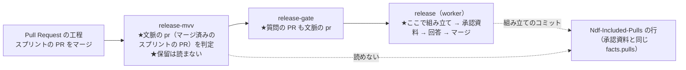
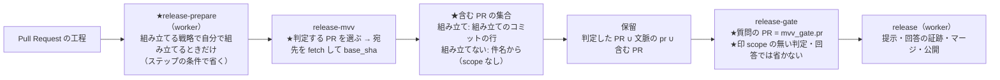
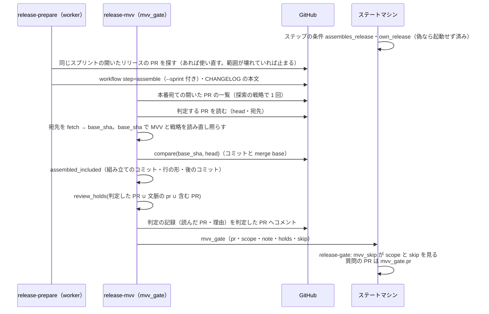

# MVV 判定: リリース承認ゲートで、承認資料と同じ「含む PR」の集合からレビューの保留を読み、保留が無ければ省ける（#4105）

リリース承認ゲートの直前の判定は、承認資料（リリースの PR）ができる前に、マージ済みのスプリントの PR だけを読んでいる。そのため、今回のリリースに含まれる PR のレビューの保留を読めず、#3959 は暫定としてリリース承認ゲートを `fast`・`auto` でも省かない。組み立てを判定の前へ移し、組み立てる戦略では、判定は承認資料が確定した集合（組み立てのコミットの「含む PR」の行）を固定した SHA で読み、その全体の保留を見てから省くかを決める。組み立てない戦略は承認資料の集合が記録に残らないので範囲を確定せず、承認ゲートを省かない。判定は判定した PR を `mvv_gate.pr` に、保留を読んだ範囲を `mvv_gate.scope` に残し、承認ゲートの質問と回答の検証は判定した PR を見る。印 `scope` の無い旧版の判定・回答では省かない。採らなかった案は「決定の記録」にある。

## 今の姿

何が起きたか・目的・受け入れ条件は要求仕様（[issue-4105-requirements.md](./issue-4105-requirements.md)、正は #4105 の本文）にある。この設計は #3959 の設計（[issue-3959-4055-design.md](./issue-3959-4055-design.md)・[issue-3959-4055-design-detail.md](./issue-3959-4055-design-detail.md)）の実装の後の形を前提にし、#3959 の「レビューの保留」（`validation_rows`・`review_rows`・`review_holds`・検査 7）をそのまま使う。

★ が変わる位置である。設計に要る今の構造（2026-11-22 の main `428f91f9e` をコードで確かめた）:

| 部品 | 今の振る舞い | 場所 |
| --- | --- | --- |
| デプロイの工程の並び | `release-mvv` → `release-gate` → `release` | `plugins/ndf/contracts/workflow/stages/deploy.json` |
| ステップの条件 | 工程の条件 `metadata.ndf.when` は工程（ステージ）にだけ書ける。ステップは `modes` だけ | `contracts/workflow/ndf.schema.json`、`progress/run.py` の `_when_off` |
| 判定する PR | 文脈の `pr`（Pull Request の工程の `pr` ステップが書くスプリントの PR。判定の時点でマージ済み） | `records/mvv_gate.py` の `pr_number` |
| 承認ゲートの質問の PR | 文脈の `pr`（設計承認ゲートだけ `design_pr`）。回答を読む前の検証はこの PR の head を見る | `progress/gate/asking.py` の `question`、`answering.py` の `recheck` |
| 回答の後の文書だけの追加 | リリース承認ゲートで、見た head から今の head までが文書だけなら、出し直さずに今の head を承認済みにする（回答した者を問わない） | `answering.py` の `_docs_only_after`・`_accept` |
| 変更要求 | 承認ゲートの変更要求は世代を上げ、工程のステップを初めから流し直す（済んだステップの結果を空にする） | `progress/run.py` の `StepProgress._answered` |
| レーンのリリース | 計画のレーンか外のオーガナイザーの下のスプリントは、リリース承認ゲートの待ちで `request_release` がリクエスト（`prs` は質問の PR）を出し、オーガナイザーがまとめて組み立て、人の承認を得て回答する | `progress/gate/release.py` |
| 組み立て | リリースのプランの worker が workflow（`step=assemble`）を起動し、リリースの PR の本文に承認資料、リリースのコミットに「含む PR」の行を `facts.pulls` から書く | `skills/release/SKILL.md` の「公開する」、`domains/release/assemble.py` の `assemble` |
| 組み立てない戦略の承認資料 | `ndf release materials`（`assemble.collect`）が前回のタグからの範囲で集めて描く。ブランチを作らない | `domains/release/cli.py` の `cmd_materials` |
| 本番宛ての開いたリリースの PR | head がリリースブランチの書式に合うかベースブランチの、本番宛ての開いた PR。組み立ては 1 つでも開いていれば止まる（`ReleaseOpen`） | `assemble.py` の `open_releases` |
| 「含む PR」の行の選び方 | first-parent で辿り、行を持つ最も新しいコミットを採る。件名を見ない。行の無いものと形の違うものを区別しない（どちらも None） | `release/record_decide.py` の `_approved_message`・`included_from_message` |
| 承認の証跡 | `approval.via: review` は GitHub のレビューを読み、NDF の証跡を数えない。`merge.admin` の迂回は担い手が利用者の証跡だけを数え、`--by mvv` を数えない | `domains/release/trail.py` の `trail_writer`・`_counts`、`land.py` |
| 省いてよい区分 | `MVV_SKIP_GATES = ("design",)`（#3959） | `progress/model.py` |

**判定の時点に、承認資料が確定した集合はどの戦略でも無い。** 組み立ては承認ゲートの後のリリースのプランか工程の外でしか走らない。`trunk` の `production_pr` と版を持たない `merge_base_branch` は組み立てず（`NoReleasePr`）、承認資料は提示の直前に `materials` が集める。

## 文脈と制約

- **#3959 の実装が先に main へ入る。** 保留の読み取り・検査 7・`MVV_SKIP_GATES`・`Snapshot.commit`（判定する PR の宛先を fetch した先端）は #3959 が作る。同じ読み取りを 2 か所に作らない
- **#4090・#4099 の設計（PR #4121、未マージ）は `mvv-review` の行の書き方（今回の識別子で判定した行だけ・自由記述は `clean` を通す）を変える。** この設計は行を読むだけで、行の形を変えない
- **承認ゲートを省いてよいのは今どおり `fast`・`auto` だけである**（利用者の方針、2026-11-21）
- **普及の段階に入るまで後方互換は要らない**（利用者の方針、2026-11-16）。ただし受け入れ条件 4 は、印の無い旧版の判定・回答で省かないことを求める
- **このリポジトリはテストを CI に寄せる**（`.ndf/project.json` の `test.ci.only` が真）

## 解き方の全体像

デプロイの工程は「組み立て → 判定 → 承認ゲート → 回答とマージ」の順になる。

1. **組み立て**（`release-prepare`）は、ブランチ戦略が組み立て、かつスプリントがリリースをオーガナイザーに委ねていないときだけ worker を起動する（ステップの条件。偽なら CLI を起動しない）。同じスプリントが前に組み立てた PR が開いていれば、組み立て直さずに使い直す。使い直しでも CHANGELOG の本文が仕上がっていなければ（印 `Ndf-Changelog` のコミットが無ければ）仕上げてから済みとする。範囲が壊れていれば（後から別の PR が入ったなど）止まり、人が手直しを退避し、閉じる前に PR の状態・head のリポジトリ・ref・SHA を確かめ直してから PR を閉じ、検査した SHA を lease にしてリリースブランチを消してから流し直す（自動の組み直しは `#4157` へ分けた）
2. **判定**（`release-mvv`）は判定する PR を選ぶ。組み立てる戦略で自分で組み立てたなら本番宛ての開いたリリースの PR（1 つ）で、その組み立てのコミットが今のスプリントの印を持つものだけ。委ねたスプリントと組み立てない戦略は文脈の `pr`。選べなければ判定のステップが止まる（人へ問う PR が無いため）。選んだ PR の宛先を fetch した先端を `base_sha` にし、MVV とブランチ戦略をその SHA で読む
3. **含む PR** は承認資料が確定した集合を読む。組み立てる戦略は組み立てのコミット（1 つ・形の正しい行）の行である。組み立てない戦略は承認資料の集合が記録に残らないので、first-parent の件名から決めた PR の保留を読んで載せるが、範囲を確定しない（`scope` を付けない）。`release` の worker は今どおり `ndf release materials` で承認資料を集めて提示する
4. **保留**は判定した PR・文脈の `pr`・含む PR の全体から読む。出力の `mvv_gate.pr` に判定した PR、`mvv_gate.scope` に読んだ範囲を残す
5. **承認ゲート**は、`scope` を持ち、承認の受け方が MVV の回答を証跡に数える（`approval.via: gate` で `merge.admin` が偽）ときだけ省く。質問・回答の検証・リクエスト・公開側は `mvv_gate.pr` を見る

範囲を 1 つに決められなければ（組み立てない戦略・組み立てのコミットが 1 つでない・行が無いか形が違う・組み立ての後にほかの PR が入った・リリースの PR がベースの先端を含まない・読めない）判定は `scope` を付けず、人の承認を待つ。そのうちリリース記録を書けない形（組み立ての後に本番以外からマージした・行に無い PR のコミット・組み立てのコミットが 2 つ以上・行の欠けか形の違い）は、人が承認してもマージの前の検査（`release-steps merge`）が止め、準備と同じ復旧の順（閉じる前の確かめ・lease 付きの削除）で組み直す手順へ戻す（公開の後に記録だけが止まる形を作らない）。本番の先端をリリースの PR へ取り込んだだけのマージ（GitHub のブランチの更新）は、別の変更の取り込みと区別して許す。

## 構成要素

| 構成要素 | 変える | 役割 |
| --- | --- | --- |
| デプロイの工程（`deploy.json`）・ステップの条件（`ndf.schema.json`・`run.py`・`command.py`）・組み立てのテンプレート（`templates/release-prepare.json`） | 変更・新設 | 判定の前に組み立てを済ませるステップ `release-prepare` を、条件 `assembles_release`・`own_release` が真のときだけ流す |
| リリースを委ねるか（`progress/lane`）と判定の入口（`progress/invoke.py`・`records/cli.py`） | 新設・変更 | 計画のレーンか外のオーガナイザーの下かを 1 つの関数で決め、ステップの条件と判定の両方の入口（`NDF_STAGE_INPUT` と `--machine`）が同じ値とステートマシンの ID を判定の入力に入れる。worker へはステートマシンの ID を環境変数で渡す |
| 判定（`records/mvv_gate.py`） | 変更 | 判定する PR を選び、その宛先から `base_sha` を決め、含む PR の集合と保留を読み、`pr` と `scope` を出力に足す |
| 含む PR の読み取り（`release/record.py`・`record_decide.py`） | 変更 | 「含む PR」の行を持つ組み立てのコミットを 1 つに決め、行の欠けと形の違いを区別する規則を、判定とリリース記録で共有する |
| 組み立て（`release/assemble.py`・`cli.py`） | 変更 | 本番宛ての開いたリリースの PR の探し方と組み立てるかの条件を判定と共有する。組み立てのコミットにスプリントの印を書き、同じスプリントの PR を使い直す（持ち主の確かめと範囲の検証を分け、範囲が壊れていれば止まる）。マージの前に記録を書ける形かを確かめる |
| リリースの workflow（`.github/workflows/release-cd.yml`・`ndf-release-reusable.yml`・利用先の雛形 `ndf-release.yml`） | 変更 | dispatch の入力 `sprint` を宣言し、再利用 workflow から `release-steps assemble --sprint` へ渡す。入力を持たない利用先の workflow は準備の前に検出して止める |
| compare（`adapters/github.py`） | 変更 | コミットと一緒に `merge_base_commit.sha` を返す |
| 承認の受け方（`release/trail.py`） | 変更 | MVV の回答を証跡に数える戦略か（`mvv_counts`）を、判定と公開側で 1 つにする |
| 省略の条件（`progress/model.py`）と回答の読み口（`progress/run.py`・`progress/gate/records.py`・`answering.py`） | 変更 | `release` を省いてよい区分に足し、印 `scope` の無い判定と `service:mvv` の回答を採らない。MVV の回答に文書だけの例外を当てない |
| 承認ゲートの質問（`progress/gate/asking.py`） | 変更 | リリース承認ゲートの質問の PR を、判定した PR（`mvv_gate.pr`）にする |
| 文脈の型（`context.schema.json`）と手順書 | 変更 | `mvv_gate.pr`・`mvv_gate.scope`・`mvv_gate.note` を足し、組み立ての時点と承認資料の「MVV 判定」の欄の出所を書き換える |

## 入出力のコントラクト

### `mvv_gate`（文脈と工程の出力の型）に足すキー

| キー | 型 | 意味 |
| --- | --- | --- |
| `pr` | 整数（`release` の判定で必ず。`design` は持たない） | 判定した PR。リリース承認ゲートの質問・回答の検証・リクエスト・公開側が見る PR。`scope` の有無によらない |
| `scope` | オブジェクト（`release` の判定で、含む PR の集合を確定して保留を読んだときだけ） | 保留を読んだ範囲。リリース承認ゲートを省く印 |
| `scope.base` | 40 桁の SHA | `base_sha`（判定した PR の宛先を fetch した先端。MVV・ブランチ戦略・含む PR を読んだコミット） |
| `scope.head` | 40 桁の SHA | 含む PR を読んだ判定した PR の head（出力の `head` と同じ値） |
| `scope.pulls` | 整数の配列（小さい順・重複なし） | 保留を読んだ PR（判定した PR・文脈の `pr`・含む PR の和） |
| `note` | 整数（判定の記録のコメントを書けたときだけ） | 今回の判定が判定した PR へ書いたコメントの ID。`release` の worker と承認の依頼は PR の番号でなくこの ID でコメントを読む |

`design` の判定と、範囲を確定できなかった `release` の判定（組み立てない戦略の判定を含む）は `scope` を持たない。`head` は今どおり判定した PR の head である。

### `ndf records mvv gate --gate release`

判定する PR を選ぶ段と、範囲を確定する段を分ける。

| 場面 | 判定のステップ | `pr`・`head` | `verdict` | `scope` | コメント |
| --- | --- | --- | --- | --- | --- |
| 選べた・範囲を確定した | `ok` | 判定した PR とその head | 判定のとおり | あり。保留があれば `why` と `holds` に載り `skip` は偽 | 判定した PR へ書く（読んだ PR を載せる） |
| 選べた・範囲を確定できない（組み立てない戦略・行の欠けか形の違い・組み立てのコミットが 2 つ以上・組み立ての後にほかの PR・ベースの先端を含まない・compare の失敗） | `ok` | 判定した PR とその head | 判定のとおり（判定が済んでいれば） | なし。`skip` 偽、`why` に理由 | 判定した PR へ書く（理由を載せる） |
| 選べた・承認の受け方が MVV の回答を数えない | `ok` | 同上 | 判定のとおり | 範囲を確定すればあり | `skip` 偽、`why` に「承認の受け方が MVV の回答を数えない」 |
| 選べた・判定の前の失敗（MVV やブランチ戦略を読めない） | `ok` | 判定した PR とその head | `null` | なし。`skip` 偽 | 判定した PR へ書く |
| 選べない（自分で組み立てる戦略で開いたリリースの PR が 0 か 2 つ以上・1 つでも組み立てのコミットが今のスプリントの印を持たない・一覧を読み切れない・文脈の `pr` が無い・GitHub の失敗） | `stopped`（`precondition`、GitHub の不達と 5xx は `transient`） | 出力しない | — | — | 書かない。工程は承認ゲートへ進まない |

組み立てない戦略・リリースを委ねたスプリントは、判定する PR が文脈の `pr` になる（上の「選べた」の行のどれか）。組み立てない戦略は承認資料の集合の記録が無く（決定 3）、委ねたスプリントは組み立てを持たない（決定 7）ので、どちらも範囲を確定できず `scope` なし。

## 処理の流れ

1. ステップの条件 `assembles_release`（作業場所のブランチ戦略が組み立てる）と `own_release`（スプリントがリリースをオーガナイザーに委ねていない）が両方真のときだけ、`release-prepare` の worker を起動する。偽なら起動せずに済みとする。worker は環境変数 `NDF_MACHINE_ID` でステートマシンの ID を受け取る
2. `release-prepare` の worker は、まず `ndf release prepared --sprint <ステートマシンの ID>` を打つ。これは dispatch の workflow が入力 `sprint` を宣言し、組み立てを打つジョブまで渡すかを確かめ（どちらかが欠ければ欠けた箇所と移行の手順を名指して止まる）、同じスプリントの印を持つ開いたリリースの PR を探す。あれば番号・head・ブランチ名・範囲が壊れた理由（壊れていなければ空）・CHANGELOG を仕上げたか（印 `Ndf-Changelog` のコミットの有無）を返す。範囲が壊れていないなら組み立て直さずに使い直す。範囲・版・単位を変える指摘は、まず戦略ごとの組み直しの入力（`level`、`release_branch` では `units` も。`pr` は組み立ての入力でない）で当てられるかを決め、当てられなければ PR の有無によらず復旧を案内せずに止まる。範囲が壊れているか、当てられる指摘で自分の PR が開いているなら、worker は `precondition` で止まり、理由に復旧の順（手直しの退避 → 閉じる前に PR の状態・head のリポジトリ・ref・SHA を確かめ直す → PR を閉じる → 対象のリポジトリの URL へ検査した SHA を lease にしてブランチを消す → 流し直す。マージの前の検査と同じ文）を載せる（今の `ReleaseOpen` と同じく人が片付ける。自動の組み直しは `#4157`）。開いた PR が無ければ `-f sprint=<ID>`（と当てた入力）付きで組み立てる。組み立てた直後と、使い直しで CHANGELOG が仕上がっていないとき（PR の作成の後・CHANGELOG の push の前に中断した再実行）は、CHANGELOG の本文を書き、行 `Ndf-Changelog: <ID>` のコミットで push する。その後に変更要求の指摘を直しのコミットか本文の編集で当てる。コミットを push したときだけ `prepared` を打ち直して仕上げが届いたことを確かめてから済みとし、push していない（指摘が無いか本文の編集だけ）なら最初の `prepared` の結果で済みとする
3. `release-mvv` が判定する PR を選ぶ（探索には作業場所のブランチ戦略を使う）。選べなければステップが止まる
4. 選んだ PR を読み、その宛先を fetch した先端を `base_sha` にする（#3959 の `Snapshot.commit`）。MVV とブランチ戦略を `base_sha` で読み直し、探索の戦略と本番ブランチ・ベースブランチ・書式・組み立てるか（`assemble.assembles`）が同じで、PR の宛先が本番ブランチのときだけ範囲を確定へ進む。違えば理由を範囲を確定できない理由の並びに足す
5. 含む PR を決める（組み立てる戦略は組み立てのコミットの行）。組み立てない戦略は first-parent の件名から番号を決め、理由「組み立てない戦略は承認資料の集合の記録が無い」を足す。決められなければ理由を同じ並びに足す（上書きしない）
6. 保留を判定した PR・文脈の `pr`・含む PR の和で読み（#3959 の `review_holds`）、判定と保留と承認の受け方から `skip` を決める（#3959 の `may_skip` と検査 7、`trail.mvv_counts(strategy) is None`）。理由の並びが空のときだけ `scope` を付ける
7. 承認ゲートのステップは、直前の判定が `release` で `scope` を持ち `skip` が真のときだけ省く。省いた回答の事象の `mvv_gate` にも `pr` と `scope` が載る

## 決定の記録

### 決定 1: 承認資料が確定した集合を判定が読めるようにするため、組み立てをデプロイの工程の判定の前のステップへ移し、要るときだけ worker を起動する

- **質問**: 判定の時点に承認資料（含む PR の集合）がどの戦略でも無いとき、判定が承認資料と同じ集合を読むには何を変えるか。そのとき組み立てない戦略で起動を増やさないには
- **選んだ案**: デプロイの工程の先頭にステップ `release-prepare`（`ndf.plan`、テンプレート `release-prepare`、worker が組み立てと CHANGELOG の本文を済ませる）を置き、`release-mvv` → `release-gate` → `release` を続ける。ステップにも工程と同じ条件 `metadata.ndf.when` を書けるようにし、`release-prepare` に `["assembles_release", "own_release"]` を付ける。偽ならステートマシンが worker を起動せずにステップを済みにする（CLI の起動 0 回）。`release` のプランは組み立てを打たず、承認資料の提示・回答の証跡・マージ・公開だけを行う。`release_branch` の手順書（`production-merge.md`）が既に「承認資料の前に組み立てる」順であり、その順をどの戦略にもそろえる
- 採らなかった案: `release-prepare` をどの戦略でも起動し、worker が「何もせずに終える」（組み立てない戦略は代表のリポジトリで多く、全スプリントで LLM の起動 1 回とトークンが増える）
- 採らなかった案: 判定が `assemble._facts` を呼んで組み立てる戦略の集合を計算する（判定と承認資料の 2 回の計算が、間にマージやタグが入ると食い違う。#4093 の指摘 r2-6・r2-7）
- 採らなかった案: 判定は今のまま範囲を計算して記録し、承認の後の `release-steps answer --by mvv` で承認資料の集合と照らす（同じ集合を 2 か所で作って比べることになり、照らす側がステートマシンの判定を読む新しい経路が要る）
- 採らなかった案: デプロイの前に新しい工程（ステージ）を足し、リリースの PR の番号を文脈へ書く（5 つのモードの定義・工程の表・手順書の工程表が変わる。同じ工程の中のステップの並びで足りる）
- **代償**: リリース承認ゲートで人が「出さない」と答えても、リリースの PR とブランチは作られた後になる（閉じて片付ける）。ステップの条件の仕組み（スキーマと評価）が増える
- 根拠: Value 1 / Value 8 / Value 11（MVV バージョン 11）

### 決定 2: 人が承認する PR と判定する PR を同じにするため、判定する PR を選んで `mvv_gate.pr` に出し、質問・検証・リクエスト・公開側をそれにそろえる

- **質問**: 判定する PR と承認ゲートの質問の PR を、文脈の `pr`（スプリントの PR）のままにするか。範囲を確定できないときの質問の PR はどれか
- **選んだ案**: `release` の判定は判定する PR を選ぶ（`release_target`）。自分で組み立てる戦略（`assembles_release` と `own_release` が真）は、組み立てと同じ関数（`assemble.open_releases` の中身を `open_release_numbers` に切り出す）で本番宛ての開いたリリースの PR を探し、1 つで、その組み立てのコミットが今のスプリントの印（`Ndf-Sprint: <ステートマシンの ID>`。決定 9）を持つならそれ。印は、判定が PR を 1 回読んで固定した head と `base_sha` の 1 回の compare の応答で確かめ、同じ応答を範囲の判定（決定 3・4）にも使う（一覧の後にリリースブランチが更新されても、古い head の印で新しい head の組み立てを承認に結び付けない。compare も 1 回で済む）。0 か 2 つ以上、または 1 つでも印が違うか無い（準備の後に自分の PR が閉じられ、別のスプリントの PR やベースブランチからの PR が残った）なら判定のステップを止める（人が承認する PR が決まらないので、文脈の `pr` へ戻さず、他人の PR へ判定と承認を結び付けない）。印の確かめは準備（`prepared`）と同じ関数で行う。組み立てない戦略とリリースを委ねたスプリントは文脈の `pr`。選んだ PR は `scope` と独立に `mvv_gate.pr` に出す。リリース承認ゲートの質問の PR・回答を読む前の検証（`recheck`）の head・`request_release` のリクエストの `prs`・公開側の `--expect-head` は、すべて `mvv_gate.pr` の PR を見る。範囲を確定できず `scope` が無くても同じ PR を見る
- 採らなかった案: `mvv_gate.scope.pr` を質問の PR にし、`scope` が無ければ文脈の `pr` に戻す（範囲を確定できないときにマージ済みのスプリントの PR を問い、動かない head と比べるので、承認の後にリリースの PR へ積まれたコミットを検出できない。回答の head が公開側の `--expect-head` と合わない）
- 採らなかった案: 文脈に新しいキー（リリースの PR の番号）を足し、`release-prepare` の出力から渡す（工程のステップの入力は文脈からしか組まれず、同じ工程の前のステップの出力を渡す仕組みが要る。文脈の `release_pr` は既に別の意味（リリース記録を書いた PR）で使われている）
- 採らなかった案: 文脈の `pr` を判定し続ける（マージ済みのスプリントの PR の head は動かないので、判定の後にリリースの PR へ積んだコミットを回答の検証が見ない）
- **代償**: 判定ごとに本番宛ての開いた PR の一覧を 1 回読む（REST 1 回）。選べないときはデプロイの工程が承認ゲートの前で止まる（今は文脈の `pr` で人へ問えていた形）
- 根拠: Value 1 / Value 3（MVV バージョン 11）

### 決定 3: 承認資料と同じ集合を読むため、判定する PR の宛先の先端 `base_sha` を固定し、組み立てる戦略は組み立てのコミットの行を読み、組み立てない戦略は範囲を確定しない

- **質問**: 判定する PR から、含む PR の集合をどこから、どの SHA で読むか
- **選んだ案**: #3959 から移した設計（#4105 の本文の「移した設計」）を土台にする。判定する PR は作業場所のブランチ戦略（探索用）で選び、選んだ PR の宛先（`release_branch`・`trunk` の `release_pr` では本番ブランチ、組み立てない戦略では文脈の `pr` の宛先）を fetch した先端を `base_sha` とする（#3959 の `Snapshot.commit` と同じ取り方で、判定する PR だけを差し替える）。MVV とブランチ戦略（`branch_strategy.load_at_ref(root, base_sha)`）を `base_sha` で読み、探索の戦略と本番ブランチ・ベースブランチ・書式が違うか、PR の宛先が本番ブランチでなければ範囲を確定しない。PR のコミットは `hub.compare(base_sha, head_sha)` で読み、可変のブランチ名を渡さない（指摘 r3-5）。compare の `merge_base_commit.sha` が `base_sha` でない（リリースの PR がベースの先端を含まない）なら範囲を確定しない。祖先の判定は first-parent でなく merge base で行う（本番からベースへの同期のマージのコミットでは本番の先端が第 2 親にある）。マージ済みの PR は、マージのコミットの第 1 親から head までを読む（リリース記録の今の `_release_commits` と同じ）。
  - 組み立てる戦略: 組み立てのコミットの行（`facts.pulls`、承認資料と CHANGELOG を作った集合）を読む。`release_branch` で複数のスプリントを集めた PR も、一時の作業場所で組んだ範囲の番号が行に入るので、元のスプリントのブランチを読み直さない（指摘 r2-5）。`assemble._facts`・`_span`・`_since_by_unit` は呼ばない（指摘 r2-7）
  - 組み立てない戦略（`trunk` の `production_pr`・版を持たない `merge_base_branch`）: 行が無く、承認資料（`materials`）の集合も記録に残らないので、first-parent の件名から決めた PR の保留を読んで `holds` に載せるが、`scope` を付けない（受け入れ条件 2 の「記録が読めない」に当たり、省かない）。受け入れ条件 1・2 は、この戦略では範囲を確定できないので省かない側で満たす。`release` の worker は今どおり `ndf release materials` で承認資料を集めて提示する
  - 判定した PR と文脈の `pr` を必ず足す
- 採らなかった案: `_facts` を固定の範囲と単位で呼べる形に分け、組み立てる戦略の判定と CHANGELOG で共有する（指摘 r2-6 の提案。タグ・出し済みのバージョン・PR の題をその時点のリモートから読むので、同じ SHA を渡しても集合が変わりうる。組み立てる戦略では組み立てが書いた記録を共有する）
- 採らなかった案: 組み立てない戦略でも first-parent の件名の集合で `scope` を付けて省く（承認資料は前のタグからの範囲を `materials` で読むので、件名の範囲と一致すると確かめられない。一致しなければ保留を読まない PR を省いて通す）
- 採らなかった案: 組み立てない戦略では、判定が `materials` と同じ計算を固定した SHA で 1 回呼び、承認資料と保留の出所にする（`#4158` へ分けた。2 ラウンド続けて指摘が出た）
- 採らなかった案: PR の本文の承認資料の「含む PR」を読む（本文は後から編集でき、読むコードも無い）
- 採らなかった案: first-parent を抜けた親を分岐点とし、`base_sha` と比べる（同期のマージのコミットでは古い親に出て、最新の本番を含む組み立てでも常に省かれない）
- **代償**: 組み立てない戦略では、リリース承認ゲートは `fast`・`auto` でも省かれない（`#4158` で承認資料と同じ集合を判定が得るまで）。組み立ての後に本番へ別の PR が入ると、組み立て直すまで省かれない
- 根拠: Value 8 / Value 11 / Value 2（MVV バージョン 11）

### 決定 4: 後から足した行や後から入った PR で保留を落とさないため、行を持つ組み立てのコミットを 1 つに決め、行の欠け・形の違い・後のマージを区別し、決められなければ省かない規則を判定とリリース記録で 1 つにする

- **質問**: 組み立ての後の直しのコミットが「含む PR」の行（`Ndf-Included-Pulls: none` など）を持つとき・組み立てのコミットの行が無いか形が違うとき・組み立ての後に別のスプリントがリリースの PR へマージされたとき、どの行を採るか（指摘 r3-1）
- **選んだ案**: `record_decide.assembled_message` を足し、first-parent で辿った PR のコミットのうち、件名が `included_decide.RELEASE_TITLE` の形（組み立てが書く件名）のものを組み立てのコミットとする。1 つでその行が形どおり（`#<番号>` の並びか `none`）ならそのメッセージ、2 つ以上なら `ValueError`、組み立ての件名のコミットの行が無いか形が違えば `ValueError`、どのコミットにも行も組み立ての件名も無ければ None、件名の違うコミットだけが行を持てば `ValueError`。行の解析は「無い」「形が違う」「番号（`none` は空）」の 3 つを返す `included_line` に分ける（今の `included_from_message` は前の 2 つを区別しない）。件名の違う直しのコミットの行は読まない。組み立てのコミットより上の first-parent のコミットに、件名から PR の番号が出て行に無いコミットか、親が 2 つ以上で第 2 親以降が本番の先端の祖先でないコミットがあれば `ValueError`（組み立ての後にほかの変更が入った）。親が 2 つ以上でも、第 2 親以降がすべて本番の先端（判定は `base_sha`、リリース記録はマージのコミットの第 1 親）の祖先なら、GitHub のブランチの更新で本番を取り込んだだけのマージとして許す（本番に既に入った変更なので、今回のリリースの含む PR は増えない）。祖先かは呼び手が渡す関数（第 2 親が本番の先端と同じ SHA なら通信せずに真、違えば merge base だけを 1 回取って第 2 親と同じか。コミットの全ページを読まない）で決め、`assembled_message` は純粋なまま保つ。判定は、組み立てる戦略で None（組み立てのコミットが無い）も範囲を確定できないとする（件名へ戻さない）。`approved_included`・`approved_units`（リリース記録）もこの関数を通し、`record._included` は `ValueError` を `RecordError` にする。判定は `RecordError` を受けたら `scope` を付けない。リリース記録を書けない形を公開まで進めないため、`release-steps merge`（`land.Lander.land`）は、リリース記録を書く設定（`cmd_merge` の `records` が真。版上げの PR を作る設定）のとき、マージキューへ入れる前に、開いたリリースの PR のコミット（compare(本番の先端, head)）へ同じ `assembled_included` を、組み立てる設定では `require=True` で当て、`RecordError` なら `precondition` で止める（理由に「リリース記録を書けない形」と、準備と同じ関数が組む復旧の順。閉じる前に PR の状態・head のリポジトリ・ref・SHA を確かめ直し、対象のリポジトリの URL へ検査した SHA を lease にしてリリースブランチを消して組み直す（`#4157` まで人が片付ける））。人が承認していても止める。組み立ての根拠（組み立てのコミットと行）が無い PR を件名の集計へ戻して通さない（判定が `scope` を付けなかった PR を承認だけでマージさせない）。普及の前なので互換の経路は置かない。compare は、マージキューの経路の `_gate` が `_bump_facts` で同じ本番の先端と head について既に読む 1 ページ目の応答を共有し、追加は 2 ページ目から（`hub.compare(…, first=)`）
- 採らなかった案: 判定だけが新しい規則を使い、リリース記録は最も新しい行を読むまま（#3959 の設計の案。同じ記録の読み方が 2 つになり、承認資料に載らない行でリリース記録を書きうる）
- 採らなかった案: 行が無いか形が違えば first-parent の件名に戻す（`trunk` の `release_pr` では版上げの PR の件名から過去の単位の PR を復元できず、レッドラインの保留を落として省く）
- 採らなかった案: 行を持つコミットが 2 つ以上なら件名によらず止める（#4105 の本文の「移した設計」の案。直しのコミットに行が紛れただけで、人が承認したリリースのマージの後のリリース記録まで止まる）
- 採らなかった案: 組み立ての完了時の head を別の記録に残し、判定で照らす（同じ工程の中で前のステップの出力を渡す仕組みが要る。組み立てのコミットより上のコミットの形で、後から入った PR を同じ精度で見分けられる）
- 採らなかった案: 親が 2 つのコミットをすべて別の変更の取り込みとして扱う（本番の進みを GitHub のブランチの更新で取り込む通常の経路まで省かれず、人が承認すると公開の後にリリース記録だけが止まる）
- 採らなかった案: 記録を書けない形でも人の承認で公開へ進め、記録の失敗は後で手で直す（マージと公開は戻せない操作で、その後に記録だけが欠ける）
- **代償**: 組み立てを 2 回打ったブランチ・組み立ての後に本番以外から別の変更をマージしたブランチでは、判定は省かず、人が承認してもマージの前の検査で止まり、組み直しが要る。組み立ては開いたリリースの PR があれば止まり（同じスプリントの PR は使い直す）、リリースブランチが既にあれば止まるので、この形は手で組み立てのコミットを積むかマージしたときだけ起きる。マージの前の検査は、マージキューの経路では `_bump_facts` の 1 ページ目を共有し、足すのは 2 ページ目からの compare だけ（`direct` の経路は全ページ）
- 根拠: Value 7 / Value 11（MVV バージョン 11）

### 決定 5: 旧版の判定と回答でリリース承認ゲートを省かないため、保留を読んだ範囲 `scope` を印にし、省略と回答の読み口の両方で求める

- **質問**: `MVV_SKIP_GATES` に `release` を足したとき、#3959 より前の版が書いた判定の `skip: true` と未消費の `service:mvv` の回答をどう扱うか（#4093 の指摘 r8-3。#4105 の本文の「#3959 から引き継ぐ条件」）
- **選んだ案**: 印を判定の出力の `scope` にする（保留を読んだ範囲そのものなので、別の版数の欄を足さない）。`model.mvv_marked(held)` が「区分が `release` なら `pr` が整数で、`scope` が形どおり（`base`・`head` が 40 桁・`pulls` が整数の配列）」を返し、`mvv_skip` はこれを足して省く。`model.mvv_answer_void(payload)` は、回答した者が `service:mvv` で区分が `release` の回答の `mvv_gate` が印を持たなければ理由を返し、回答の畳み込み（`StepProgress._answered`）はその回答を読まず（承認ゲートは人を待つ）、承認済みの head（`records.answers`）からも外す。回答の検証（`recheck`）の文書だけの例外（`_docs_only_after`）は、回答した者が `service:mvv` なら当てない（判定の後に加わった PR の保留を読まずに新しい head へ自動の承認を引き継がない）。`recheck` は承認ゲートのステップを待ちへ戻すだけで、`release-mvv` も `release-prepare` も流し直さない。待ちの間は `mvv_skip` が当たらない（今の `run.py` の `prog.waiting is None` の条件）ので、同じ判定で再び省かれず、人の回答を待つ。人へ見せる「MVV 判定」の欄は、判定の head（`scope.head`）と今の head が違うことを添える
- 採らなかった案: 今どおり移行の手順（`ndf progress cancel` で作り直す）だけで扱う（#3959 の決定 3 の扱い。#3959 の版で人の承認待ちを挟んだスプリントは、更新の後に旧版の `skip: true` で省かれる。受け入れ条件 4 を満たさない）
- 採らなかった案: 判定の出力に版数の欄を足す（保留を読んだかを表さず、版を上げるたびに照らす値が変わる）
- 採らなかった案: 回答を消費の時点で判定の対象（PR・宛先・宛先の先端・head）と照合する仕組みもこの Issue で作る（#4106 の範囲。この Issue は印の有無だけを見る。#4106 は同じ `mvv_answer_void` に照合を足す）
- 採らなかった案: `service:mvv` の回答の後に head が進めば、変更要求と同じく世代を上げて判定から流し直す（`release-prepare` の worker の起動と LLM の判定が 1 回ずつ増え、ステップの途中から流し直す新しい遷移も要る。省いた直後の head の進みは稀で、人が見れば足りる）
- **代償**: 印の無い `service:mvv` の回答は事象の表に残ったまま読まれない（表から消さない）。MVV で省いた後に文書だけのコミットが積まれても、人の承認を待つ（判定は流し直さないので、人は古い head の判定を見て答える）
- 根拠: Value 1 / Value 3 / Value 4（MVV バージョン 11）

### 決定 6: #3959 の暫定を外すため、`release` を省いてよい区分に足し、MVV の回答を証跡に数える承認の受け方だけで省く

- **質問**: #3959 が置いた暫定（`MVV_SKIP_GATES` の `("design",)`、`why` の「#4105 まで省かない」、承認資料の「リリースの保留は #4105 まで読まない」）をどう外すか。公開側が MVV の回答を証跡に数えない承認の受け方ではどうするか
- **選んだ案**: `MVV_SKIP_GATES` を `("design", "release")` にし、`_judged` の `release` の暫定の理由を消す。省くのは、`base_sha` のブランチ戦略で `trail.mvv_counts(strategy) is None`（数えない理由が無い。`approval.via` が `gate` で `merge.admin` が真でない）のときだけにする。`mvv_counts` は数えない理由の文か None を返すので、真偽値として読まない（理由の文が真になり、逆の向きで省く）。`approval.via: review`（公開側は write 以上の人の GitHub のレビューを求める）と `merge.admin`（迂回は担い手が利用者の証跡だけを数える）では、判定は `skip` 偽・`why` に理由を入れ、人の承認を待つ。`pace.md`・`approval-request.md`・`agent-layers.md` の #4105 の断りを、この設計の順（組み立て → 判定 → 承認ゲート）と `pr`・`scope` の説明に書き換える
- 採らなかった案: 区分の表をやめ、`mvv_marked` だけで省くかを決める（区分の表は省いてよい承認ゲートを 1 か所で示す。新しい区分を足すときに省略が自動で有効にならない）
- 採らなかった案: 承認の受け方を見ずに省く（ステートマシンは承認済みになるが、公開側が MVV の証跡を数えずに止まり、人に必要な承認を求めない）
- **代償**: `approval.via: review`・`merge.admin` のプロジェクトではリリース承認ゲートは `fast`・`auto` でも省かれない（公開側の承認の要件どおり）
- 根拠: Value 1 / Value 5（MVV バージョン 11）

### 決定 7: 並行するレーンのまとめたリリースを止めないため、リリースを委ねたスプリントは組み立てず、元のスプリントの PR で判定とリクエストを出す

- **質問**: 計画のレーンか外のオーガナイザーの下のスプリントで、`release-prepare` が組み立てると何が起きるか。そのときの判定する PR・質問の PR・リクエストの `prs` はどれか
- **選んだ案**: スプリントがリリースを委ねているか（計画のレーンの行を持つか、`NDF_ORGANIZER_DIR` の下か）を `progress.lane.delegates_release` の 1 つで決め、ステップの条件 `own_release` と判定（`release_target` の入力 `release_delegated`）が同じ値を読む。判定の入力は、通常の実行（`invoke` が `NDF_STAGE_INPUT` を組む）と #3959 の手動の経路（`ndf records mvv gate --gate release --machine <ID>`）の両方の入口で、同じ関数 `lane.release_inputs(conn, machine_id, env)` が `release_delegated` とステートマシンの ID（`machine_id`。決定 2 の印の照合に使う）を組んで足す。どちらかの入口だけが注入すると、手動の経路では値が欠けて止まるか、偽として扱い別のリリースの PR を選ぶ。`release_target` は 2 つのキーが無ければ `TargetError` で止まる（既定値で補わない）。委ねたスプリントは `release-prepare` を流さず（組み立てはオーガナイザーが持つ）、判定する PR と `mvv_gate.pr` は文脈の `pr`（スプリントの PR）、`scope` は付けない（組み立てのコミットがまだ無いので範囲を確定できない）。リリース承認ゲートは省かれず、今どおり `request_release` がスプリントの PR を `prs` に載せたリクエストを出し、オーガナイザーがまとめて組み立て、まとめた PR で人の承認を得て回答する
- 採らなかった案: レーンも先に組み立てる（先着のレーンが単独のリリースの PR を開き、後続のレーンの組み立てが `ReleaseOpen` で止まる。リクエストの `prs` が質問の PR から作られるので、元のスプリントの PR がリクエストから消える）
- 採らなかった案: オーガナイザーがまとめた PR を判定し、まとめたリリースの承認も MVV で省く（オーガナイザーの回答の経路に判定と印を足す別の設計になる。この Issue はスプリント単位の承認ゲートを持つ）
- **代償**: レーンのスプリントでは、リリース承認ゲートは `fast`・`auto` でも省かれない（今のまま）
- 根拠: Value 5 / Value 9（MVV バージョン 11）

### 決定 8: 承認資料の「MVV 判定」の欄を書く担当を 1 つにするため、判定の記録のコメントを欄の出所にし、PR の本文を判定の後に書き換えない

- **質問**: 承認資料の「MVV 判定」の欄（保留を読んだ範囲）を、判定より前に走る `release-prepare` の本文に書くか、判定の後に誰かが本文へ書き足すか
- **選んだ案**: リリースの PR の本文（承認資料）には「MVV 判定」の欄を書かない。判定（`release-mvv`）が判定した PR へ書く記録のコメント（`checks.note`）に、判定・理由・保留を読んだ PR（`scope.pulls`）か範囲を確定できない理由を載せ、書けたコメントの ID を出力の `mvv_gate.note` に残す。リリース承認ゲートの承認の依頼（`approval-request.md`）の「MVV 判定」の欄の出所は、#3959 と同じく今回の判定の出力 `outputs.mvv_gate` だけにする（プランの経路は `release-mvv` の済んだ出力、手動の経路は `--machine` の結果）。PR の番号でコメントを探さない（今回の投稿に失敗したときや変更要求の後の判定で、前回の判定や別の head の承認資料を見せるため）。`release` の worker は本文を編集しない
- 承認資料の取り方（`release` の worker）: 組み立てる戦略はリリースの PR の本文。組み立てない戦略は今どおり `ndf release materials --pr <mvv_gate.pr>` で集めて提示する（この戦略では `scope` が無く承認ゲートは省かれないので、人が資料を見て答える）。判定欄が欠けた（出力が無い・`noted: false`）ときは #3959 の写し方のとおり「判定できない: <理由>」か「記録を PR に書けなかった」を写す
- 採らなかった案: `release-prepare` が欄を空で作り、`release` の worker が判定の後に本文へ書き足す（本文の sha256 が承認資料の見た対象になっており、書き足しが回答の検証の違いになる。書く担当が 2 つになる）
- 採らなかった案: 判定した PR の最新の MVV 判定のコメントを出所にする（#3959 が出所を今回の出力にした理由と同じく、今回の投稿の失敗や再判定の後に前回のコメントを見せる）
- **代償**: 承認資料の本文だけを読む人は MVV 判定を見ない（承認の依頼とコメントで見る）
- 根拠: Value 3 / Value 7（MVV バージョン 11）

### 決定 9: 変更要求と中断から組み立てを流し直しても止まらないため、組み立てのコミットにスプリントの印を書き、同じスプリントの開いたリリースの PR を使い直す。範囲が壊れていれば止まり、人が閉じる

- **質問**: リリース承認ゲートで変更要求を返すと工程が初めから流れ、`release-prepare` が組み立てを打ち直して `ReleaseOpen` で止まる。準備の成功の後の中断からの再実行も同じになる。どう扱うか。範囲が壊れた自分の PR はどうするか
- **選んだ案**: 組み立て（`assemble`・workflow の `step=assemble`）に任意の入力 `sprint` を足し、組み立てのコミットに行 `Ndf-Sprint: <ステートマシンの ID>` を書く。
  - **workflow の入力と移行の順**: 再利用 workflow（`ndf-release-reusable.yml`）の `workflow_call` に任意の入力 `sprint`（既定は空）を足し、空でなければ `release-steps assemble --sprint "$SPRINT"` を足す（空なら今の引数のまま。入力を渡さない旧版の呼び出し側もそのまま動く）。このリポジトリの `release-cd.yml` と利用先の雛形 `ndf-release.yml` は `workflow_dispatch` に `sprint`（任意・既定は空）を宣言し、前者は `release-steps assemble` へ、後者は再利用 workflow の `with: sprint` へ渡す。この 3 つは同じ版で出す。既存の利用先は `ndf-release.yml` が `sprint` を宣言していないので、`gh workflow run -f sprint=…` は GitHub が入力の不一致で拒む。宣言だけを足して `with: sprint` を足し忘れた移行の途中の形では、dispatch も組み立ても成功し、印の無い PR ができてから判定が止まる。そこで `ndf release prepared` は最初に、設定の `cd.workflow` の workflow のファイルをリポジトリの既定ブランチから読み（contents API 1 回）、NDF の宣言済みの依存 `ruamel-yaml` の安全な読み込み（`manifests.front_matter` と同じ `YAML(typ="safe")`。YAML 1.2 の規則で `on:` を文字列のキーとして読む）で解き、`on.workflow_dispatch.inputs` に `sprint` が無いか、組み立てを打つジョブ（再利用 workflow を `uses` するジョブ、または `release-steps assemble` を `run` するステップのジョブ）のどれかが `inputs.sprint` を渡さない（`with.sprint`、または `--sprint` とその値の `env`）なら `precondition` で止まる。再利用 workflow を `uses` するジョブは、実行する CLI の参照 `with.ndf_ref` が検査した `uses` の参照と同じかも確かめる。組み立てのステップの `--sprint` は、直後の実引数か、別の行で組んだ配列の展開（配布する 2 つの実行 workflow はこの形にそろえ、空なら引数を足さない）で渡っていればよい（理由に欠けた箇所と「`ndf-release.yml` に入力 `sprint` の宣言と `with: sprint` を足し、`NDF_TAG` を `uses:` と `ndf_ref` の 2 か所ともこの版へ上げる（雛形の該当行）」）。dispatch の前に何も作らずに止まるので、利用先は workflow を更新して流し直せばよい。移行の手順書（リリースノートと `release-workflow.md`）に同じ順を書く
  - **ステートマシンの ID の受け取り**: `invoke` はプランの子プロセスの環境変数に `NDF_MACHINE_ID`（今のステートマシンの ID）を足す（`NDF_STAGE_NOTES` と同じ経路）。`release-prepare` の worker はこれを `--sprint` と `-f sprint=` に使い、無ければ `precondition` で止まる
  - **使い直しの判定（持ち主と範囲を分ける）**: `ndf release prepared --sprint <ID>` は本番宛ての開いたリリースの PR（`open_release_numbers`）が 1 つで、その組み立てのコミット（件名が組み立ての形のコミット。範囲を検証しない `assembled_commits`）がすべて同じ印を持てば、その PR の番号・head・ブランチ名・範囲が壊れた理由（`assembled_message` の `ValueError` の文。壊れていなければ None）・CHANGELOG の仕上げの印（組み立てのコミットより上の行 `Ndf-Changelog: <ID>`）の有無を、同じ compare の応答から返す。0 なら None。印が違うか無い・2 つ以上なら今どおり `ReleaseOpen`
  - **使い直しと止まり方**: PR を作り直すかと準備が済んだかを分ける。`release-prepare` の worker は範囲が壊れていない自分の PR があれば組み立てを打たない（PR を作り直さない）。CHANGELOG の仕上げの印が無ければ（組み立ての直後と、PR の作成の後・CHANGELOG の push の前の中断からの再実行）、使い直しの分岐でも CHANGELOG の本文を書いて印のコミットで push する。その後に変更要求の指摘（`NDF_STAGE_NOTES`）を直しのコミットか本文の編集で当てる。コミットを push したときだけ最後に `prepared` を push した SHA で打ち直して印が届いたときだけ済みとし、push していない（本文の編集だけを含む）なら最初の `prepared` の結果で済みとする。`prepared` は PR を読んだ同じ応答で、開いている・本番宛て・対象のリポジトリのリリースブランチであることも確かめ直す（一覧の後や `--pr` で渡した PR が閉じられたか宛先が変わったら止まる）。範囲・版・単位を変える指摘は、戦略ごとの組み直しの入力（今ある dispatch の入力 `level`、`release_branch` では `units` も。新しい入力は足さない。`pr` は merge の PR の番号で組み立ての入力でない）でだけ当て、当てられなければ PR の有無によらず復旧を案内せずに止まる。範囲が壊れている（`prepared` の結果に理由がある）か、当てられる指摘で自分の PR が開いているなら、`precondition` で止まり、理由に壊れた理由（または指摘と当てる入力の値）と、人が打つ順（残したい手直しを退避する → 閉じる前に PR が開いていて head のリポジトリ・ref・SHA が検査のときのままかを確かめ、違えば閉じない → PR を閉じる → 対象のリポジトリの URL を名指し、検査した SHA を lease にしてリリースブランチを消す → 流し直す。マージの前の検査と同じ関数が組む）を載せる。`assemble` は同じ名前のリリースブランチが残っていると止まるので、PR を閉じるだけでは組み直せない。人がこの順で片付けて流し直すと、開いた PR もブランチも無いので組み立てから進む。自分で閉じて組み直す手順（`ndf release discard`・手直しの退避と戻し・push の後・PR の作成の前の中断からの回復）は `#4157` へ分けた
  - 印が違う開いた PR は今どおり `ReleaseOpen`
- 採らなかった案: 変更要求のときに `release-prepare` を流し直さない（変更要求の世代を上げて初めから流す今の規則に、ステップごとの例外が要る。中断からの再実行は救えない）
- 採らなかった案: 開いたリリースの PR があれば何でも使い直す（ほかのスプリントや手で開いた PR を自分の承認資料として使う）
- 採らなかった案: 入力を持たない旧版の利用先の workflow では `sprint` を渡さずに組み立てる（印の無い PR は使い直せず、変更要求の後に `ReleaseOpen` で止まり、判定も自分の PR を選べない。止まる場所が後ろへずれるだけ）
- 採らなかった案: 範囲が壊れた自分の PR を、準備が閉じて組み直す（手直しの退避と戻し・組み立ての後に入った別のスプリントの変更の扱い・各操作の中断からの再開が要る。#4105 の課題（保留を読む PR の範囲）から最も遠いので `#4157` へ分けた）
- **代償**: 組み立てのコミットの行が 1 つ増える。workflow の入力が 1 つ増え、既存の利用先は NDF の更新と同時に `ndf-release.yml` を更新する。準備ごとに workflow のファイルを 1 回読む（REST 1 回）。CLI の `prepared` が増える。範囲が壊れた自分の PR は `#4157` が入るまで人が手直しを退避し、PR の状態と head を確かめ直してから閉じ、検査した SHA を lease にしてリリースブランチを消す。push の後・PR の作成の前に止まって残ったリリースブランチも人が消す（組み立てが「ブランチが既にある」で止まる）。CHANGELOG の仕上げのコミットに行が 1 つ増える
- 根拠: Value 7 / Value 11（MVV バージョン 11）

### 決定 10: 隣の設計と重ねないため、#4104・#4106・#4128・#4090 #4099 との境をこの設計で決める

- **質問**: 判定と回答の照合・即時修正・本番の PR のマージの順序・cross-review の記録の形と、この設計の重なりをどう分けるか
- **選んだ案**: 次の表のとおりにする

  | 隣の課題 | その課題が持つもの | この設計が持つもの |
  | --- | --- | --- |
  | #4106 | 省いた回答を消費の時点で PR・宛先・宛先の先端・head と照合する。旧版の判定の対象の欄の扱い | 印 `scope` の有無の検査（`mvv_answer_void` を作る。#4106 は同じ関数に照合を足す）。`mvv_gate.pr`・`scope.base`・`scope.head` は照合の材料になる |
  | #4104 | 即時修正のマージの前の判定 | 無し（即時修正はリリース承認ゲートを通らない） |
  | #4128 | `trunk` の `production_pr` で本番の PR が `pr-merge` で承認の前に入りうる点 | マージ済みの文脈の `pr` でも保留を読む PR が空にならない（マージのコミットの第 1 親から head を読む）。複数コミットの rebase merge では第 1 親が本番の先端でなく PR の中のコミットになるが、組み立てない戦略は `scope` を付けないので省略には効かない（保留の表示の範囲だけに効く） |
  | #4090 #4099 | `mvv-review` の行の書き方 | 行を読むだけ（#3959 の `review_holds`） |

- 採らなかった案: 隣の課題の論点をこの設計に取り込む（#4093 で範囲を分けた理由と同じく、ラウンドが収まらない）
- **代償**: #4106 が入るまで、省いた回答は head だけで照らされる（今と同じ）
- 根拠: Value 5 / Value 9（MVV バージョン 11）

**範囲の判断**: cross-review で同じ仕組みへの指摘が続いたため、組み直しを `#4157` へ分け、組み立てない戦略の省略を `#4158` へ分けて初版の形へ戻した（conductor の判断、2026-11-22）。

## 影響と危険

- **働く範囲**: 利用先のリポジトリでも働く。リリース承認ゲートを省けるのは承認済みの MVV を持ち `fast`・`auto` で、承認の受け方が MVV の回答を数え、リリースを委ねていないスプリントだけで、ほかは判定の置き場（判定した PR）と組み立ての時点だけが変わる
- **プロジェクトごとに違うもの**: ブランチ戦略（本番・ベースブランチ・名前の書式・`approval.via`・`merge.admin`）は今どおり `.ndf/project.json` から読む（判定は `base_sha` で読む）。新しい設定のキーは足さない
- **当たるモード**: デプロイの工程を持つ 5 つのモードすべて。進め方はすべて（組み立ての時点が変わる）
- **同じファイルを触る別の変更**: #3959 の実装が `mvv_gate.py`・`model.py`・`checks.py`・`context.schema.json`・`pace.md`・`approval-request.md`・`agent-layers.md` を変える。この Issue の実装は #3959 の実装が main へ入った後の main から切る。#4106 の実装は `model.py` の `mvv_answer_void` と回答の読み口を変えるので、先に入った方に合わせる
- **壊れうる箇所**: 組み立てが承認ゲートの前に走るので、人が「出さない」と答えたリリースの PR とブランチが残る。閉じるまで次の組み立ては `ReleaseOpen` で止まり、その結果が閉じる PR を名指す（同じスプリントの PR は範囲が壊れていなければ使い直し、壊れていれば止まって閉じる PR と消すリリースブランチを名指す）。片付ける手順（退避 → 閉じる前に PR の状態・head のリポジトリ・ref・SHA を確かめ直す → 閉じる → 対象のリポジトリの URL へ検査した SHA を lease にしてブランチを消す）は準備とマージの前の検査が止まる理由に同じ文で載り、リリースの Skill にも置く。リリースの Skill の手順（組み立ての位置）を書き換え忘れると、`release` のプランが組み立てを 2 回打って `ReleaseOpen` で止まる。判定する PR を選べないとデプロイの工程が承認ゲートの前で止まる（結果に理由と開いた PR の番号を載せる）
- **費用**:
  - CLI の起動: `release-prepare` の worker は組み立てる戦略で自分で組み立てるときだけ 1 回起動する。今は同じ組み立てを `release` の worker が打っていたので、その戦略でも合計の起動回数は増えない（組み立てと公開を 2 つのプランに分けるので worker の起動が 1 回増える）。組み立てない戦略とリリースを委ねたスプリントはステップの条件で起動しない（0 回）
  - API: リリースの判定 1 回につき、本番宛ての開いた PR の一覧（REST 1 回）・判定する PR（REST 1 回。#3959 で既に読む）・compare（`github.list-pages` ページまで）が増える。組み立てる戦略では `_facts` を呼ばないので、タグの取得・本番の fetch・GraphQL は増えない。組み立てない戦略では件名を読むだけで、承認資料の材料は今どおり `release` の worker が `materials` で読む。保留の読み取りは #3959 の記録の 1 回の読み取りを共有する。準備（`prepared`）は workflow のファイルを 1 回（REST 1 回）読む。worker はコミットを push したときだけ、準備の終わりに仕上げが届いたかを `prepared --head --pr` でもう 1 回確かめる（PR・本番の先端・compare の REST が 1 組増える。workflow のファイルと PR の一覧は読まない。CHANGELOG の仕上げを飛ばして判定へ進む形を防ぐ代わり）。組み立ての後に親が 2 つのコミットがあり、第 2 親が本番の先端と違う SHA のときだけ、第 2 親が本番の祖先かを merge base の取得（compare の 1 ページ目を 1 件だけ、REST 1 回）で確かめる。同じ SHA なら通信しない。本番が先に進んでも、使わないコミットのページを読まない。`release-steps merge` は記録を書く設定でマージの前に PR のコミットの compare を読むが、マージキューの経路では `_bump_facts` が読む同じ 1 ページ目を共有し、足すのは 2 ページ目から（`direct` の経路は全ページ）。判定は持ち主の確かめと範囲を同じ compare の応答で決め、PR も 1 回だけ読む（二重に取得しない）

### 代表のリポジトリでの振る舞い

| 代表のリポジトリ | 設定の要点 | 直した後に起きること | この種類で扱えなくなること |
| --- | --- | --- | --- |
| Web サービス | 承認済みの MVV があり、リリースの PR が承認ゲートを通る（`release_branch`・`merge_base_branch` が多い） | 組み立てが承認ゲートの前に走り、判定がリリースの PR に載る。`fast`・`auto` で含む PR に保留が無く、`approval.via: gate` ならリリース承認ゲートが省かれる | 無し |
| モバイルアプリ | 同上。配布の手段が違うだけ | 同上 | 無し |
| 業務文書だけ | 文書の PR。版を持たない `merge_base_branch` か `trunk` が多く、MVV が無いことが多い | `release-prepare` は条件で起動しない。MVV が無ければ判定の形は今と同じ（`pr` が足される）。MVV があれば件名から決めた PR の保留を読んで載せるが、範囲を確定しないのでリリース承認ゲートは省かれない（省けるようにするのは `#4158`） | 無し |

### このリポジトリだけの事情

- 無し（ai-plugins の `trunk`・`release_pr` は例として使うだけで、仕組みはブランチ戦略の宣言から読む）

## 用語

設計文書の本文で使う新しい語を、実装の PR で用語集へ足す（この設計 PR は `issues/issue-4105-*` だけを触る）。MVV・レッドライン・進め方（`normal`・`auto`・`fast`）などの既存の語は用語集（[docs/glossary.md](../docs/glossary.md)）にあり、決定の根拠の Value の本文は `.ndf/mvv.md`（MVV 版 11）にある。

| 語 | 意味 | 反映 |
| --- | --- | --- |
| 含む PR | 今回のリリースに含まれる PR の集合。組み立てる戦略は組み立てのコミットの行（`Ndf-Included-Pulls`）。組み立てない戦略は承認資料の集合が記録に残らないので確定しない（保留の表示には first-parent の件名から決めた PR を使う） | 追加 |
| 保留を読んだ範囲 | リリースの判定が保留を読んだ PR（判定した PR・文脈の `pr`・含む PR）と、読んだベースと head のコミット。判定の出力 `mvv_gate.scope` に残り、リリース承認ゲートを省く印になる | 追加 |
| リリースを委ねる | 計画のレーンか外のオーガナイザーの下のスプリントが、組み立てと承認をオーガナイザーに任せること | 追加 |

## テスト設計

| 受け入れ条件・決定 | どの振る舞いで縛るか | どう壊したら落ちるべきか |
| --- | --- | --- |
| 1（`trunk`・`release_pr`） | 組み立てのコミットの行に、リリースの PR の差分に現れない単位の PR の番号があり、その PR に `redline` の行がある → `fast` で判定が「従う」でも `skip` 偽、`holds` にその PR | 判定した PR だけの保留を読む・行の番号を落とす |
| 1（`release_branch`） | 2 つのスプリントを集めた組み立てのコミットの行の番号が、承認資料（組み立ての `facts.pulls`）の番号と同じで、両方の保留を読む | スプリントのブランチを読み直す・片方のスプリントを落とす |
| 1（組み立てない戦略） | `production_pr`・版を持たない `merge_base_branch` で、判定が first-parent の件名から決めた PR と文脈の `pr` の保留を `holds` に載せ、`scope` なし・`skip` 偽・`why` に「承認資料の集合の記録が無い」。`release` の worker が `materials` で集めて提示する | 件名の集合に `scope` を付けて省く |
| 1（マージ済みの `production_pr`） | マージ済みの本番の PR を文脈の `pr` として判定 → マージのコミットの第 1 親から head のコミットで、保留を読む PR が空にならない。`scope` なし | マージの後の本番の先端と head で compare して範囲が空になる |
| 決定 2（持ち主と範囲を同じスナップショットで） | 一覧を読んだ後にリリースブランチが別の組み立てへ差し替わる → 判定が固定した head の印で持ち主を決め、違えば止まる。compare は 1 回で、持ち主の確かめ（`owned`）と範囲の判定（`review_prs`）が同じ応答（`Span`）を受け取る。compare の失敗も `Span` で `review_prs` へ渡し、打ち直さない | 古い head の印で新しい head の組み立てに `scope` を付ける・`review_prs` が compare を打ち直して別の応答で範囲を決める |
| 2（組み立ての根拠の無い PR） | 組み立てる設定で組み立てのコミットの無いリリースの PR を人が承認する → `release-steps merge` が `precondition` で止まる | 件名の集計に戻ってマージする |
| 1（本番の取り込み） | 組み立ての後に GitHub のブランチの更新で本番の先端をリリースの PR へマージした（第 2 親が `base_sha` の祖先）→ `scope` あり、リリース記録も同じ番号。マージの前の検査も通る。祖先の確かめは同じ SHA なら GitHub を呼ばず、違えば merge base の取得 1 回だけ（本番が数ページ先へ進んでもコミットのページを読まない） | 本番の取り込みを別のスプリントの混入と同じに扱って省かない・記録で止まる |
| 2（記録できない形は公開の前に止める） | 組み立ての後に本番以外からマージしたリリースの PR を人が承認する → `release-steps merge` がマージキューへ入れる前に `precondition` で止まり、マージも公開も起きない | 承認で公開まで進み、リリース記録だけが `RecordError` で止まる |
| 1（`base_sha`） | 判定する PR の宛先を fetch した先端が `base_sha` で、MVV・戦略・compare がその SHA を使う。`base_sha` の戦略が探索の戦略と違う・PR の宛先が本番ブランチでない → `scope` なし | スプリントの PR の宛先で比べる・可変のブランチ名で読む |
| 1（同期の後） | `merge_base_branch` で本番からベースへの同期のマージ（本番の先端が第 2 親）の後に組み立てた PR → compare の merge base が `base_sha` で `scope` あり | first-parent の親で比べて省かない |
| 2（遅れ） | compare の `merge_base_commit.sha` が `base_sha` でない → `scope` なし・`skip` 偽 | 遅れたリリースの PR で省く |
| 1（直しの行） | 組み立てのコミットの上に `Ndf-Included-Pulls: none` を持つ直しのコミット → 組み立てのコミットの行の番号を読み、保留を落とさない。リリース記録も同じ番号 | 最も新しい行を採る |
| 2（行の欠けと形） | 組み立てる戦略で組み立てのコミットが無い・行が無い・行の形が違う → `scope` なし（件名へ戻らない）。行が `none` → 有効（判定した PR と文脈の `pr` だけ） | 欠けで件名へ戻って省く・`none` と欠けを同じに扱う |
| 2（後から入った PR） | 組み立てのコミットの上に別のスプリントのマージのコミット（親 2 つ）か、行に無い PR の件名のコミット → `scope` なし | 組み立てのコミットの行だけで省く |
| 2 | 組み立ての件名で行を持つコミットが 2 つ・件名の違うコミットだけが行を持つ・compare の `GitHubError` → `skip` 偽・`scope` なし、`pr` は判定した PR | 読めないのに省く |
| 2（リリース記録） | 組み立ての件名で行を持つコミットが 2 つの PR で `record` が `RecordError` | どちらかの行で記録を書く |
| 決定 2（選べない） | 自分で組み立てる戦略で開いたリリースの PR が 0 か 2 → 判定のステップが `stopped`、承認ゲートへ進まない。準備の後に自分の PR が閉じられ、印の違う別のスプリントの PR かベースブランチからの PR だけが開いている → `stopped` | 文脈の `pr` で判定して人へ問う・唯一開いた他人の PR に判定と承認を結び付ける |
| 決定 2・4（理由を上書きしない） | `base_sha` の戦略が探索の戦略と違う（組み立てるかが違うものも）うえに、コミットの範囲は読める → `scope` なし・`why` に設定の不一致の理由 | 後の手順の戻り値で先の理由を消して `scope` を出す |
| 3 | `MVV_SKIP_GATES` が `release` を持ち、`scope` を持つ `skip: true` の判定でリリース承認ゲートが `service:mvv` の回答で通る | 暫定のまま省かない |
| 決定 6 | 承認の受け方ごとに判定から承認ゲートまで通す: `approval.via: gate`・`merge.admin` が偽 → `skip` 真で承認ゲートが `service:mvv` の回答で通る。`approval.via: review`・`merge.admin` が真 → 保留が無くても `skip` 偽・`why` に理由・承認ゲートが人を待つ | 公開側が数えない証跡で省く・`mvv_counts` の戻り値を真偽値として読む |
| 4 | 印の無い `release` の `skip: true` の判定（#3959 より前の版の形）で `mvv_skip` が None。印の無い判定を添えた未消費の `service:mvv` の回答から `decide` すると承認ゲートが人を待ち（#3959 より前の版から直接更新）、人の承認待ちを挟んだ後に更新しても省かれない。`ndf answer head` がその回答の head を返さない | 印を見ずに省く・回答の読み口だけで止める |
| 決定 5（文書だけ） | `service:mvv` の回答の後に文書だけのコミットが加わる → `recheck` が `_accept` せず待ちへ戻し、`release-mvv` を流し直さず、同じ判定で再び省かずに人の回答を待つ。人の回答では今どおり進める | MVV の回答に文書だけの例外を当てる・待ちへ戻した後に同じ判定で再び省く |
| 決定 2 | リリース承認ゲートの質問の PR が `mvv_gate.pr`。`scope` が無くても `mvv_gate.pr`。判定の後にその PR へコミットを積むと回答の検証が待ちへ戻す。公開側の `--expect-head` が回答の head と合う | スプリントの PR の head と比べる |
| 決定 7 | 計画のレーンのスプリントで `release-prepare` が条件で起動されず、`mvv_gate.pr` が文脈の `pr`・`scope` なし、リクエストの `prs` がスプリントの PR。2 つのレーンが並んでもどちらも `ReleaseOpen` で止まらない。同じレーンで手動の経路（`--machine`）から判定しても、`release_delegated` が真で `mvv_gate.pr` が文脈の `pr`（開いた別のリリースの PR を選ばない） | レーンが単独で組み立てる・リクエストからスプリントの PR が消える・手動の経路だけが委譲の値を欠く |
| 決定 8 | 判定のコメントの投稿に失敗した（`noted: false`）・変更要求の後の再判定で前回のコメントが PR に残る → 承認の依頼と `release` の worker は今回の出力から写し、前回のコメントを見せない。組み立てない戦略 → `release` の worker が `materials` を 1 回打って提示し、承認ゲートは省かれない | PR の番号で最新のコメントを読む・資料が無く提示できない |
| 決定 9（workflow） | `release-cd.yml` と雛形が `sprint` を宣言し、再利用 workflow が空でなければ `--sprint` を渡す。`sprint` を宣言しない旧版の `ndf-release.yml` と、宣言だけを足して `with: sprint` を足していない移行の途中の `ndf-release.yml` では、`prepared` が dispatch の前に `precondition` で止まり、理由が欠けた箇所と workflow の更新を名指す。`on:` のまま宣言と引き渡しを持つ workflow を ruamel で読んで通る。`uses` だけを新版にして `ndf_ref` を旧版に残した雛形も止まる。配布する 2 つの実行 workflow の実ファイルは、空の `sprint` で `--sprint` を足さず、値があれば渡す。再利用 workflow は `sprint` を渡さない旧版の呼び出しでも今どおり組み立てる | 準備の初回に `gh workflow run` が入力の不一致で失敗する・宣言だけで印の無い PR を作る・旧版の呼び出しが壊れる・`on:` が真偽値のキーで読まれて宣言を見落とす・PyYAML を import する・dispatch の後に旧版の CLI が `--sprint` を拒む・配列の形で正しく渡す workflow を拒む・空の `sprint` で `--sprint ""` を渡す |
| 決定 9（使い直し） | 変更要求の後に `release-prepare` が流れ直すと、同じ印の開いた PR を使い直して組み立てを打たない。準備の成功の後の中断から流し直しても同じ。PR の作成の後・CHANGELOG の push の前に中断して流し直すと、組み立てを打たずに CHANGELOG を仕上げてから済みとする。印の違う開いた PR は `ReleaseOpen` | 変更要求の後に `ReleaseOpen` で止まる・使い直しで CHANGELOG の仕上げを飛ばして判定へ進む |
| 決定 9（範囲の壊れた自分の PR） | 同じ印の PR の上に別のスプリントのマージがある → `prepared` が番号・ブランチ名と壊れた理由を返し、`release-prepare` が組み立てを打たずに `precondition` で止まり、理由が閉じる PR・消すリリースブランチ・退避 → 閉じる前の確かめ（状態・head のリポジトリ・ref・SHA）→ 閉じる → 対象のリポジトリの URL へ lease 付きで消す の順を名指す（マージの前の検査と同じ文）。組み直しの入力で当てられない指摘 → PR の有無によらず復旧を案内せずに止まる | 壊れた範囲の PR を使い直す・持ち主の確かめが範囲の検証で失敗して `ReleaseOpen` になる・閉じてから head を確かめる・`origin` へ消す・当てられない指摘で PR を消させる |
| 決定 1 | `deploy.json` のステップの並びが `release-prepare` → `release-mvv` → `release-gate` → `release`。ステップの条件が偽なら worker を起動せずにステップが済む | 判定が組み立ての前に走る・組み立てない戦略で worker を起動する |
| 費用 | 組み立てる戦略のリリースの判定が `assemble._facts`・`_span`・`_since_by_unit` を呼ばない | タグの取得と本番の fetch が増える |

## どこを変えるか

詳細設計は別ファイル [issue-4105-design-detail.md](./issue-4105-design-detail.md) にした。新設する関数が 2 つ以上あり、既存の関数のシグネチャを変えるためである。

## 設計の結果

| 課題 | 扱い | 統合先 | 触るファイル |
| --- | --- | --- | --- |
| #4105 | 実装する | — | `.github/workflows/release-cd.yml`、`.github/workflows/ndf-release-reusable.yml`、`plugins/ndf/skills/release/assets/workflows/ndf-release.yml`、`plugins/ndf/src/ndf/domains/records/cli.py`、`plugins/ndf/src/ndf/domains/release/land.py`（`release-steps merge` の `Lander.land` のマージの前の検査）、`plugins/ndf/contracts/workflow/stages/deploy.json`、`plugins/ndf/contracts/workflow/ndf.schema.json`、`plugins/ndf/contracts/templates/release-prepare.json`、`plugins/ndf/contracts/workflow/context.schema.json`、`plugins/ndf/src/ndf/progress/run.py`、`plugins/ndf/src/ndf/progress/command.py`、`plugins/ndf/src/ndf/progress/definition.py`、`plugins/ndf/src/ndf/progress/invoke.py`、`plugins/ndf/src/ndf/progress/lane/__init__.py`、`plugins/ndf/src/ndf/domains/records/mvv_gate.py`、`plugins/ndf/src/ndf/domains/records/mvv_material_decide.py`、`plugins/ndf/src/ndf/progress/gate/checks.py`、`plugins/ndf/src/ndf/domains/release/record.py`、`plugins/ndf/src/ndf/domains/release/record_decide.py`、`plugins/ndf/src/ndf/domains/release/assemble.py`、`plugins/ndf/src/ndf/domains/release/cli.py`、`plugins/ndf/src/ndf/domains/release/trail.py`、`plugins/ndf/src/ndf/adapters/github.py`、`plugins/ndf/src/ndf/progress/model.py`、`plugins/ndf/src/ndf/progress/gate/records.py`、`plugins/ndf/src/ndf/progress/gate/asking.py`、`plugins/ndf/src/ndf/progress/gate/answering.py`、`plugins/ndf/src/ndf/progress/gate/release.py`、`plugins/ndf/skills/release/SKILL.md`、`plugins/ndf/skills/release/references/release-workflow.md`、`plugins/ndf/skills/development-workflow/references/pace.md`、`plugins/ndf/skills/development-workflow/references/approval-request.md`、`plugins/ndf/skills/development-workflow/references/agent-layers.md`、`plugins/ndf/skills/development-workflow/references/production-merge.md`、`docs/glossary/glossary.json`、`docs/glossary.md`、`plugins/ndf/tests/domains/records/test_mvv_gate.py`、`plugins/ndf/tests/domains/release/test_release_record.py`、`plugins/ndf/tests/domains/release/test_release_assemble.py`、`plugins/ndf/tests/progress/test_model.py`、`plugins/ndf/tests/progress/test_run.py`、`plugins/ndf/tests/progress/gate/test_gate_answer.py`、`plugins/ndf/tests/progress/test_definition.py`、`plugins/ndf/tests/domains/release/test_release_approval.py`（`Lander.land` のマージの前の検査）、`plugins/ndf/tests/domains/records/test_cli.py`（`--machine` の入力）、`plugins/ndf/tests/progress/test_invoke.py`（`NDF_MACHINE_ID` と判定の入力）、`plugins/ndf/tests/progress/test_lane.py`（`release_inputs`） |

## 未確認のまま残ること

| 項目 | 内容 |
| --- | --- |
| 判定の後に本番へ入った PR | 判定の後、マージまでの間に本番へ入った PR がリリースの PR のマージで同じタグに入るかを確かめていない。判定の後のベースの進みは #4106 の照合が持つ |
| オーガナイザーのまとめたリリースの省略 | 委ねたスプリントの承認は省かない（決定 7）。オーガナイザーがまとめた PR を判定して省けるようにするかは、使う利用者が出たときに別の Issue で扱う |
| 旧版からの再開 | `mvv_gate.pr` を持たない旧版の判定の上でリリース承認ゲートを待つスプリントは、質問の PR が今どおり文脈の `pr` になり、`release` の worker は開いたリリースの PR を見つけられない。デプロイの工程を作り直す（#3959 の移行の手順と同じ）ことを移行の手順書に書く |
| 組み立てない戦略の省略 | 省かない（決定 3）。省けるようにするか（使う利用者がいるか）は `#4158` で扱う |
| 範囲が壊れた PR の自動の組み直し | 人が手直しを退避し、PR の状態と head を確かめ直してから閉じ、検査した SHA を lease にしてリリースブランチを消す（決定 9）。準備が閉じて組み直す仕組みは `#4157` で扱う |

## 外部の調査

省く: 既存の組み立ての記録（`Ndf-Included-Pulls`）・判定・工程のステップの並びの延長で、外部の判断が要る形が無い
