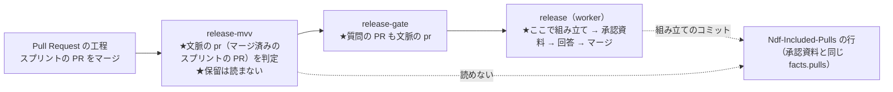
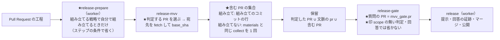
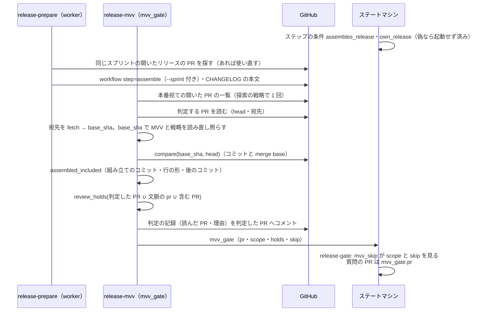

# MVV 判定: リリース承認ゲートで、承認資料と同じ「含む PR」の集合からレビューの保留を読み、保留が無ければ省ける（#4105）

リリース承認ゲートの直前の判定は、承認資料（リリースの PR）ができる前に、マージ済みのスプリントの PR だけを読んでいる。そのため、今回のリリースに含まれる PR のレビューの保留を読めず、#3959 は暫定としてリリース承認ゲートを `fast`・`auto` でも省かない。組み立てを判定の前へ移し、判定は承認資料が確定した集合（組み立てる戦略は組み立てのコミットの「含む PR」の行、組み立てない戦略は判定が `materials` と同じ関数で 1 回だけ集めて承認資料にも使う集合）を固定した SHA で読み、その全体の保留を見てから省くかを決める。判定は判定した PR を `mvv_gate.pr` に、保留を読んだ範囲を `mvv_gate.scope` に残し、承認ゲートの質問と回答の検証は判定した PR を見る。印 `scope` の無い旧版の判定・回答では省かない。採らなかった案は「決定の記録」にある。

## 今の姿

何が起きたか・目的・受け入れ条件は要求仕様（[issue-4105-requirements.md](./issue-4105-requirements.md)、正は #4105 の本文）にある。この設計は #3959 の設計（[issue-3959-4055-design.md](./issue-3959-4055-design.md)・[issue-3959-4055-design-detail.md](./issue-3959-4055-design-detail.md)）の実装の後の形を前提にし、#3959 の「レビューの保留」（`validation_rows`・`review_rows`・`review_holds`・検査 7）をそのまま使う。

★ が変わる位置である。設計に要る今の構造（2026-11-22 の main `428f91f9e` をコードで確かめた）:

| 部品 | 今の振る舞い | 場所 |
| --- | --- | --- |
| デプロイの工程の並び | `release-mvv` → `release-gate` → `release` | `plugins/ndf/contracts/workflow/stages/deploy.json` |
| ステップの条件 | 工程の条件 `metadata.ndf.when` は工程（ステージ）にだけ書ける。ステップは `modes` だけ | `contracts/workflow/ndf.schema.json`、`progress/run.py` の `_when_off` |
| 判定する PR | 文脈の `pr`（Pull Request の工程の `pr` ステップが書くスプリントの PR。判定の時点でマージ済み） | `records/mvv_gate.py` の `pr_number` |
| 承認ゲートの質問の PR | 文脈の `pr`（設計承認ゲートだけ `design_pr`）。回答を読む前の検証はこの PR の head を見る | `progress/gate/asking.py` の `question`、`answering.py` の `recheck` |
| 回答の後の文書だけの追加 | リリース承認ゲートで、見た head から今の head までが文書だけなら、出し直さずに今の head を承認済みにする（回答した者を問わない） | `answering.py` の `_docs_only_after`・`_accept` |
| 変更要求 | 承認ゲートの変更要求は世代を上げ、工程のステップを初めから流し直す（済んだステップの結果を空にする） | `progress/run.py` の `StepProgress._answered` |
| レーンのリリース | 計画のレーンか外のオーガナイザーの下のスプリントは、リリース承認ゲートの待ちで `request_release` がリクエスト（`prs` は質問の PR）を出し、オーガナイザーがまとめて組み立て、人の承認を得て回答する | `progress/gate/release.py` |
| 組み立て | リリースのプランの worker が workflow（`step=assemble`）を起動し、リリースの PR の本文に承認資料、リリースのコミットに「含む PR」の行を `facts.pulls` から書く | `skills/release/SKILL.md` の「公開する」、`domains/release/assemble.py` の `assemble` |
| 組み立てない戦略の承認資料 | `ndf release materials`（`assemble.collect`）が前回のタグからの範囲で集めて描く。ブランチを作らない | `domains/release/cli.py` の `cmd_materials` |
| 本番宛ての開いたリリースの PR | head がリリースブランチの書式に合うかベースブランチの、本番宛ての開いた PR。組み立ては 1 つでも開いていれば止まる（`ReleaseOpen`） | `assemble.py` の `open_releases` |
| 「含む PR」の行の選び方 | first-parent で辿り、行を持つ最も新しいコミットを採る。件名を見ない。行の無いものと形の違うものを区別しない（どちらも None） | `release/record_decide.py` の `_approved_message`・`included_from_message` |
| 承認の証跡 | `approval.via: review` は GitHub のレビューを読み、NDF の証跡を数えない。`merge.admin` の迂回は担い手が利用者の証跡だけを数え、`--by mvv` を数えない | `domains/release/trail.py` の `trail_writer`・`_counts`、`land.py` |
| 省いてよい区分 | `MVV_SKIP_GATES = ("design",)`（#3959） | `progress/model.py` |

**判定の時点に、承認資料が確定した集合はどの戦略でも無い。** 組み立ては承認ゲートの後のリリースのプランか工程の外でしか走らない。`trunk` の `production_pr` と版を持たない `merge_base_branch` は組み立てず（`NoReleasePr`）、承認資料は提示の直前に `materials` が集める。

## 文脈と制約

- **#3959 の実装が先に main へ入る。** 保留の読み取り・検査 7・`MVV_SKIP_GATES`・`Snapshot.commit`（判定する PR の宛先を fetch した先端）は #3959 が作る。同じ読み取りを 2 か所に作らない
- **#4090・#4099 の設計（PR #4121、未マージ）は `mvv-review` の行の書き方（今回の識別子で判定した行だけ・自由記述は `clean` を通す）を変える。** この設計は行を読むだけで、行の形を変えない
- **承認ゲートを省いてよいのは今どおり `fast`・`auto` だけである**（利用者の方針、2026-11-21）
- **普及の段階に入るまで後方互換は要らない**（利用者の方針、2026-11-16）。ただし受け入れ条件 4 は、印の無い旧版の判定・回答で省かないことを求める
- **このリポジトリはテストを CI に寄せる**（`.ndf/project.json` の `test.ci.only` が真）

## 解き方の全体像

デプロイの工程は「組み立て → 判定 → 承認ゲート → 回答とマージ」の順になる。

1. **組み立て**（`release-prepare`）は、ブランチ戦略が組み立て、かつスプリントがリリースをオーガナイザーに委ねていないときだけ worker を起動する（ステップの条件。偽なら CLI を起動しない）。同じスプリントが前に組み立てた PR が開いていれば、組み立て直さずに使い直す
2. **判定**（`release-mvv`）は判定する PR を選ぶ。組み立てる戦略で自分で組み立てたなら本番宛ての開いたリリースの PR（1 つ）、委ねたスプリントと組み立てない戦略は文脈の `pr`。選べなければ判定のステップが止まる（人へ問う PR が無いため）。選んだ PR の宛先を fetch した先端を `base_sha` にし、MVV とブランチ戦略をその SHA で読む
3. **含む PR** は承認資料が確定した集合を読む。組み立てる戦略は組み立てのコミット（1 つ・形の正しい行）の行、組み立てない戦略は判定が `materials` と同じ `assemble.collect` で 1 回集めた集合で、判定はその承認資料を PR のコメントに残し、`release` の worker はそれを提示する（集め直さない）
4. **保留**は判定した PR・文脈の `pr`・含む PR の全体から読む。出力の `mvv_gate.pr` に判定した PR、`mvv_gate.scope` に読んだ範囲を残す
5. **承認ゲート**は、`scope` を持ち、承認の受け方が MVV の回答を証跡に数える（`approval.via: gate` で `merge.admin` が偽）ときだけ省く。質問・回答の検証・リクエスト・公開側は `mvv_gate.pr` を見る

範囲を 1 つに決められなければ（組み立てのコミットが 1 つでない・行が無いか形が違う・組み立ての後にほかの PR が入った・リリースの PR がベースの先端を含まない・読めない）判定は `scope` を付けず、人の承認を待つ。

## 構成要素

| 構成要素 | 変える | 役割 |
| --- | --- | --- |
| デプロイの工程（`deploy.json`）・ステップの条件（`ndf.schema.json`・`run.py`・`command.py`）・組み立てのテンプレート（`templates/release-prepare.json`） | 変更・新設 | 判定の前に組み立てを済ませるステップ `release-prepare` を、条件 `assembles_release`・`own_release` が真のときだけ流す |
| リリースを委ねるか（`progress/lane`） | 新設 | 計画のレーンか外のオーガナイザーの下かを 1 つの関数で決め、ステップの条件と判定が同じ値を読む |
| 判定（`records/mvv_gate.py`） | 変更 | 判定する PR を選び、その宛先から `base_sha` を決め、含む PR の集合と保留を読み、`pr` と `scope` を出力に足す |
| 含む PR の読み取り（`release/record.py`・`record_decide.py`） | 変更 | 「含む PR」の行を持つ組み立てのコミットを 1 つに決め、行の欠けと形の違いを区別する規則を、判定とリリース記録で共有する |
| 組み立て（`release/assemble.py`・`cli.py`） | 変更 | 本番宛ての開いたリリースの PR の探し方と組み立てるかの条件を判定と共有する。組み立てのコミットにスプリントの印を書き、同じスプリントの PR を使い直す |
| compare（`adapters/github.py`） | 変更 | コミットと一緒に `merge_base_commit.sha` を返す |
| 承認の受け方（`release/trail.py`） | 変更 | MVV の回答を証跡に数える戦略か（`mvv_counts`）を、判定と公開側で 1 つにする |
| 省略の条件（`progress/model.py`）と回答の読み口（`progress/run.py`・`progress/gate/records.py`・`answering.py`） | 変更 | `release` を省いてよい区分に足し、印 `scope` の無い判定と `service:mvv` の回答を採らない。MVV の回答に文書だけの例外を当てない |
| 承認ゲートの質問（`progress/gate/asking.py`） | 変更 | リリース承認ゲートの質問の PR を、判定した PR（`mvv_gate.pr`）にする |
| 文脈の型（`context.schema.json`）と手順書 | 変更 | `mvv_gate.pr`・`mvv_gate.scope` を足し、組み立ての時点と承認資料の「MVV 判定」の欄の出所を書き換える |

## 入出力のコントラクト

### `mvv_gate`（文脈と工程の出力の型）に足すキー

| キー | 型 | 意味 |
| --- | --- | --- |
| `pr` | 整数（`release` の判定で必ず。`design` は持たない） | 判定した PR。リリース承認ゲートの質問・回答の検証・リクエスト・公開側が見る PR。`scope` の有無によらない |
| `scope` | オブジェクト（`release` の判定で、含む PR の集合を確定して保留を読んだときだけ） | 保留を読んだ範囲。リリース承認ゲートを省く印 |
| `scope.base` | 40 桁の SHA | `base_sha`（判定した PR の宛先を fetch した先端。MVV・ブランチ戦略・含む PR を読んだコミット） |
| `scope.head` | 40 桁の SHA | 含む PR を読んだ判定した PR の head（出力の `head` と同じ値） |
| `scope.pulls` | 整数の配列（小さい順・重複なし） | 保留を読んだ PR（判定した PR・文脈の `pr`・含む PR の和） |

`design` の判定と、範囲を確定できなかった `release` の判定は `scope` を持たない。`head` は今どおり判定した PR の head である。

### `ndf records mvv gate --gate release`

判定する PR を選ぶ段と、範囲を確定する段を分ける。

| 場面 | 判定のステップ | `pr`・`head` | `verdict` | `scope` | コメント |
| --- | --- | --- | --- | --- | --- |
| 選べた・範囲を確定した | `ok` | 判定した PR とその head | 判定のとおり | あり。保留があれば `why` と `holds` に載り `skip` は偽 | 判定した PR へ書く（読んだ PR を載せる） |
| 選べた・範囲を確定できない（行の欠けか形の違い・組み立てのコミットが 2 つ以上・組み立ての後にほかの PR・ベースの先端を含まない・compare か collect の失敗） | `ok` | 判定した PR とその head | 判定のとおり（判定が済んでいれば） | なし。`skip` 偽、`why` に理由 | 判定した PR へ書く（理由を載せる） |
| 選べた・承認の受け方が MVV の回答を数えない | `ok` | 同上 | 判定のとおり | 範囲を確定すればあり | `skip` 偽、`why` に「承認の受け方が MVV の回答を数えない」 |
| 選べた・判定の前の失敗（MVV やブランチ戦略を読めない） | `ok` | 判定した PR とその head | `null` | なし。`skip` 偽 | 判定した PR へ書く |
| 選べない（自分で組み立てる戦略で開いたリリースの PR が 0 か 2 つ以上・一覧を読み切れない・文脈の `pr` が無い・GitHub の失敗） | `stopped`（`precondition`、GitHub の不達と 5xx は `transient`） | 出力しない | — | — | 書かない。工程は承認ゲートへ進まない |

組み立てない戦略・リリースを委ねたスプリントは、判定する PR が文脈の `pr` になる（上の「選べた」の行のどれか）。委ねたスプリントは組み立てを持たないので範囲を確定できず `scope` なし（下の決定 7）。

## 処理の流れ

1. ステップの条件 `assembles_release`（作業場所のブランチ戦略が組み立てる）と `own_release`（スプリントがリリースをオーガナイザーに委ねていない）が両方真のときだけ、`release-prepare` の worker を起動する。偽なら起動せずに済みとする
2. `release-prepare` の worker は、まず `ndf release prepared --sprint <ステートマシンの ID>` で同じスプリントが組み立てた開いたリリースの PR を探す。あれば組み立て直さずに使い直し（変更要求の指摘は直しのコミットか本文の編集で当てる。範囲や版を変える指摘なら PR を閉じてブランチを消してから組み立て直す）、無ければ組み立てと CHANGELOG の本文を済ませる
3. `release-mvv` が判定する PR を選ぶ（探索には作業場所のブランチ戦略を使う）。選べなければステップが止まる
4. 選んだ PR を読み、その宛先を fetch した先端を `base_sha` にする（#3959 の `Snapshot.commit`）。MVV とブランチ戦略を `base_sha` で読み直し、探索の戦略と本番ブランチ・ベースブランチ・書式が同じで、PR の宛先が本番ブランチのときだけ範囲を確定へ進む
5. 含む PR を決める（組み立てる戦略は組み立てのコミットの行、組み立てない戦略は `collect` の集合）。決められなければ `scope` を付けない
6. 保留を判定した PR・文脈の `pr`・含む PR の和で読み（#3959 の `review_holds`）、判定と保留と承認の受け方から `skip` を決める（#3959 の `may_skip` と検査 7、`trail.mvv_counts`）
7. 承認ゲートのステップは、直前の判定が `release` で `scope` を持ち `skip` が真のときだけ省く。省いた回答の事象の `mvv_gate` にも `pr` と `scope` が載る

## 決定の記録

### 決定 1: 承認資料が確定した集合を判定が読めるようにするため、組み立てをデプロイの工程の判定の前のステップへ移し、要るときだけ worker を起動する

- **質問**: 判定の時点に承認資料（含む PR の集合）がどの戦略でも無いとき、判定が承認資料と同じ集合を読むには何を変えるか。そのとき組み立てない戦略で起動を増やさないには
- **選んだ案**: デプロイの工程の先頭にステップ `release-prepare`（`ndf.plan`、テンプレート `release-prepare`、worker が組み立てと CHANGELOG の本文を済ませる）を置き、`release-mvv` → `release-gate` → `release` を続ける。ステップにも工程と同じ条件 `metadata.ndf.when` を書けるようにし、`release-prepare` に `["assembles_release", "own_release"]` を付ける。偽ならステートマシンが worker を起動せずにステップを済みにする（CLI の起動 0 回）。`release` のプランは組み立てを打たず、承認資料の提示・回答の証跡・マージ・公開だけを行う。`release_branch` の手順書（`production-merge.md`）が既に「承認資料の前に組み立てる」順であり、その順をどの戦略にもそろえる
- 採らなかった案: `release-prepare` をどの戦略でも起動し、worker が「何もせずに終える」（組み立てない戦略は代表のリポジトリで多く、全スプリントで LLM の起動 1 回とトークンが増える）
- 採らなかった案: 判定が `assemble._facts` を呼んで組み立てる戦略の集合を計算する（判定と承認資料の 2 回の計算が、間にマージやタグが入ると食い違う。#4093 の指摘 r2-6・r2-7）
- 採らなかった案: 判定は今のまま範囲を計算して記録し、承認の後の `release-steps answer --by mvv` で承認資料の集合と照らす（同じ集合を 2 か所で作って比べることになり、照らす側がステートマシンの判定を読む新しい経路が要る）
- 採らなかった案: デプロイの前に新しい工程（ステージ）を足し、リリースの PR の番号を文脈へ書く（5 つのモードの定義・工程の表・手順書の工程表が変わる。同じ工程の中のステップの並びで足りる）
- **代償**: リリース承認ゲートで人が「出さない」と答えても、リリースの PR とブランチは作られた後になる（閉じて片付ける）。ステップの条件の仕組み（スキーマと評価）が増える
- 根拠: Value 1 / Value 8 / Value 11（MVV バージョン 11）

### 決定 2: 人が承認する PR と判定する PR を同じにするため、判定する PR を選んで `mvv_gate.pr` に出し、質問・検証・リクエスト・公開側をそれにそろえる

- **質問**: 判定する PR と承認ゲートの質問の PR を、文脈の `pr`（スプリントの PR）のままにするか。範囲を確定できないときの質問の PR はどれか
- **選んだ案**: `release` の判定は判定する PR を選ぶ（`release_target`）。自分で組み立てる戦略（`assembles_release` と `own_release` が真）は、組み立てと同じ関数（`assemble.open_releases` の中身を `open_release_numbers` に切り出す）で本番宛ての開いたリリースの PR を探し、1 つならそれ。0 か 2 つ以上なら判定のステップを止める（人が承認する PR が決まらないので、文脈の `pr` へ戻さない）。組み立てない戦略とリリースを委ねたスプリントは文脈の `pr`。選んだ PR は `scope` と独立に `mvv_gate.pr` に出す。リリース承認ゲートの質問の PR・回答を読む前の検証（`recheck`）の head・`request_release` のリクエストの `prs`・公開側の `--expect-head` は、すべて `mvv_gate.pr` の PR を見る。範囲を確定できず `scope` が無くても同じ PR を見る
- 採らなかった案: `mvv_gate.scope.pr` を質問の PR にし、`scope` が無ければ文脈の `pr` に戻す（範囲を確定できないときにマージ済みのスプリントの PR を問い、動かない head と比べるので、承認の後にリリースの PR へ積まれたコミットを検出できない。回答の head が公開側の `--expect-head` と合わない）
- 採らなかった案: 文脈に新しいキー（リリースの PR の番号）を足し、`release-prepare` の出力から渡す（工程のステップの入力は文脈からしか組まれず、同じ工程の前のステップの出力を渡す仕組みが要る。文脈の `release_pr` は既に別の意味（リリース記録を書いた PR）で使われている）
- 採らなかった案: 文脈の `pr` を判定し続ける（マージ済みのスプリントの PR の head は動かないので、判定の後にリリースの PR へ積んだコミットを回答の検証が見ない）
- **代償**: 判定ごとに本番宛ての開いた PR の一覧を 1 回読む（REST 1 回）。選べないときはデプロイの工程が承認ゲートの前で止まる（今は文脈の `pr` で人へ問えていた形）
- 根拠: Value 1 / Value 3（MVV バージョン 11）

### 決定 3: 承認資料と同じ集合を読むため、判定する PR の宛先の先端 `base_sha` を固定し、組み立てる戦略は組み立てのコミットの行、組み立てない戦略は判定が集めて承認資料にも使う集合を読む

- **質問**: 判定する PR から、含む PR の集合をどこから、どの SHA で読むか
- **選んだ案**: #3959 から移した設計（#4105 の本文の「移した設計」）を土台にする。判定する PR は作業場所のブランチ戦略（探索用）で選び、選んだ PR の宛先（`release_branch`・`trunk` の `release_pr` では本番ブランチ、組み立てない戦略では文脈の `pr` の宛先）を fetch した先端を `base_sha` とする（#3959 の `Snapshot.commit` と同じ取り方で、判定する PR だけを差し替える）。MVV とブランチ戦略（`branch_strategy.load_at_ref(root, base_sha)`）を `base_sha` で読み、探索の戦略と本番ブランチ・ベースブランチ・書式が違うか、PR の宛先が本番ブランチでなければ範囲を確定しない。PR のコミットは `hub.compare(base_sha, head_sha)` で読み、可変のブランチ名を渡さない（指摘 r3-5）。compare の `merge_base_commit.sha` が `base_sha` でない（リリースの PR がベースの先端を含まない）なら範囲を確定しない。祖先の判定は first-parent でなく merge base で行う（本番からベースへの同期のマージのコミットでは本番の先端が第 2 親にある）。マージ済みの PR は、マージのコミットの第 1 親から head までを読む（リリース記録の `_release_commits` と同じ）。
  - 組み立てる戦略: 組み立てのコミットの行（`facts.pulls`、承認資料と CHANGELOG を作った集合）を読む。`release_branch` で複数のスプリントを集めた PR も、一時の作業場所で組んだ範囲の番号が行に入るので、元のスプリントのブランチを読み直さない（指摘 r2-5）。`assemble._facts`・`_span`・`_since_by_unit` は呼ばない（指摘 r2-7）
  - 組み立てない戦略（`trunk` の `production_pr`・版を持たない `merge_base_branch`）: 判定が `materials` と同じ `assemble.collect` を `base_sha` と head で 1 回呼び、その `facts.pulls` を含む PR とする。描いた承認資料（`materials_decide.render`）は判定の記録のコメントに載せ、`release` の worker はそのコメントの承認資料を提示する（`materials` を打ち直さない）。承認資料と保留を読む集合が 1 回の計算から出るので、受け入れ条件 1 を満たし `scope` を付けられる
  - 判定した PR と文脈の `pr` を必ず足す
- 採らなかった案: `_facts` を固定の範囲と単位で呼べる形に分け、組み立てる戦略の判定と CHANGELOG で共有する（指摘 r2-6 の提案。タグ・出し済みのバージョン・PR の題をその時点のリモートから読むので、同じ SHA を渡しても集合が変わりうる。組み立てる戦略では組み立てが書いた記録を共有する）
- 採らなかった案: 組み立てない戦略は first-parent の件名から番号を決め、`scope` を付けない（承認資料の `materials` は前回のタグからの範囲で、件名の集合と一致しない。人の承認資料からも対象の PR の保留が欠け、受け入れ条件 1 を満たさない）
- 採らなかった案: PR の本文の承認資料の「含む PR」を読む（本文は後から編集でき、読むコードも無い）
- 採らなかった案: first-parent を抜けた親を分岐点とし、`base_sha` と比べる（同期のマージのコミットでは古い親に出て、最新の本番を含む組み立てでも常に省かれない）
- **代償**: 組み立てない戦略では、承認資料の材料（タグの取得・GraphQL）を判定が読む。`release` の worker が提示の前に読んでいたものを前へ移すので、回数は増えない。組み立ての後に本番へ別の PR が入ると、組み立て直すまで省かれない
- 根拠: Value 8 / Value 11 / Value 2（MVV バージョン 11）

### 決定 4: 後から足した行や後から入った PR で保留を落とさないため、行を持つ組み立てのコミットを 1 つに決め、行の欠け・形の違い・後のマージを区別し、決められなければ省かない規則を判定とリリース記録で 1 つにする

- **質問**: 組み立ての後の直しのコミットが「含む PR」の行（`Ndf-Included-Pulls: none` など）を持つとき・組み立てのコミットの行が無いか形が違うとき・組み立ての後に別のスプリントがリリースの PR へマージされたとき、どの行を採るか（指摘 r3-1）
- **選んだ案**: `record_decide.assembled_message` を足し、first-parent で辿った PR のコミットのうち、件名が `included_decide.RELEASE_TITLE` の形（組み立てが書く件名）のものを組み立てのコミットとする。1 つでその行が形どおり（`#<番号>` の並びか `none`）ならそのメッセージ、2 つ以上なら `ValueError`、組み立ての件名のコミットの行が無いか形が違えば `ValueError`、どのコミットにも行も組み立ての件名も無ければ None、件名の違うコミットだけが行を持てば `ValueError`。行の解析は「無い」「形が違う」「番号（`none` は空）」の 3 つを返す `included_line` に分ける（今の `included_from_message` は前の 2 つを区別しない）。件名の違う直しのコミットの行は読まない。組み立てのコミットより上の first-parent のコミットに、親が 2 つ以上のコミットか、件名から PR の番号が出て行に無いコミットがあれば `ValueError`（組み立ての後にほかの PR が入った）。判定は、組み立てる戦略で None（組み立てのコミットが無い）も範囲を確定できないとする（件名へ戻さない）。`approved_included`・`approved_units`（リリース記録）もこの関数を通し、`record._included` は `ValueError` を `RecordError` にする。判定は `RecordError` を受けたら `scope` を付けない
- 採らなかった案: 判定だけが新しい規則を使い、リリース記録は最も新しい行を読むまま（#3959 の設計の案。同じ記録の読み方が 2 つになり、承認資料に載らない行でリリース記録を書きうる）
- 採らなかった案: 行が無いか形が違えば first-parent の件名に戻す（`trunk` の `release_pr` では版上げの PR の件名から過去の単位の PR を復元できず、レッドラインの保留を落として省く）
- 採らなかった案: 行を持つコミットが 2 つ以上なら件名によらず止める（#4105 の本文の「移した設計」の案。直しのコミットに行が紛れただけで、人が承認したリリースのマージの後のリリース記録まで止まる）
- 採らなかった案: 組み立ての完了時の head を別の記録に残し、判定で照らす（同じ工程の中で前のステップの出力を渡す仕組みが要る。組み立てのコミットより上のコミットの形で、後から入った PR を同じ精度で見分けられる）
- **代償**: 組み立てを 2 回打ったブランチ・組み立ての後に別のスプリントをマージしたブランチでは、判定は省かず、マージの後のリリース記録も `RecordError` で止まる。組み立ては開いたリリースの PR があれば止まり（同じスプリントの PR は使い直す）、リリースブランチが既にあれば止まるので、この形は手で組み立てのコミットを積むかマージしたときだけ起きる
- 根拠: Value 7 / Value 11（MVV バージョン 11）

### 決定 5: 旧版の判定と回答でリリース承認ゲートを省かないため、保留を読んだ範囲 `scope` を印にし、省略と回答の読み口の両方で求める

- **質問**: `MVV_SKIP_GATES` に `release` を足したとき、#3959 より前の版が書いた判定の `skip: true` と未消費の `service:mvv` の回答をどう扱うか（#4093 の指摘 r8-3。#4105 の本文の「#3959 から引き継ぐ条件」）
- **選んだ案**: 印を判定の出力の `scope` にする（保留を読んだ範囲そのものなので、別の版数の欄を足さない）。`model.mvv_marked(held)` が「区分が `release` なら `pr` が整数で、`scope` が形どおり（`base`・`head` が 40 桁・`pulls` が整数の配列）」を返し、`mvv_skip` はこれを足して省く。`model.mvv_answer_void(payload)` は、回答した者が `service:mvv` で区分が `release` の回答の `mvv_gate` が印を持たなければ理由を返し、回答の畳み込み（`StepProgress._answered`）はその回答を読まず（承認ゲートは人を待つ）、承認済みの head（`records.answers`）からも外す。回答の検証（`recheck`）の文書だけの例外（`_docs_only_after`）は、回答した者が `service:mvv` なら当てない（判定の後に加わった PR の保留を読まずに新しい head へ自動の承認を引き継がない）。待ちへ戻し、判定から流し直す
- 採らなかった案: 今どおり移行の手順（`ndf progress cancel` で作り直す）だけで扱う（#3959 の決定 3 の扱い。#3959 の版で人の承認待ちを挟んだスプリントは、更新の後に旧版の `skip: true` で省かれる。受け入れ条件 4 を満たさない）
- 採らなかった案: 判定の出力に版数の欄を足す（保留を読んだかを表さず、版を上げるたびに照らす値が変わる）
- 採らなかった案: 回答を消費の時点で判定の対象（PR・宛先・宛先の先端・head）と照合する仕組みもこの Issue で作る（#4106 の範囲。この Issue は印の有無だけを見る。#4106 は同じ `mvv_answer_void` に照合を足す）
- **代償**: 印の無い `service:mvv` の回答は事象の表に残ったまま読まれない（表から消さない）。MVV で省いた後に文書だけのコミットが積まれても、判定からやり直す
- 根拠: Value 1 / Value 3 / Value 4（MVV バージョン 11）

### 決定 6: #3959 の暫定を外すため、`release` を省いてよい区分に足し、MVV の回答を証跡に数える承認の受け方だけで省く

- **質問**: #3959 が置いた暫定（`MVV_SKIP_GATES` の `("design",)`、`why` の「#4105 まで省かない」、承認資料の「リリースの保留は #4105 まで読まない」）をどう外すか。公開側が MVV の回答を証跡に数えない承認の受け方ではどうするか
- **選んだ案**: `MVV_SKIP_GATES` を `("design", "release")` にし、`_judged` の `release` の暫定の理由を消す。省くのは、`base_sha` のブランチ戦略で `trail.mvv_counts(strategy)` が真（`approval.via` が `gate` で `merge.admin` が真でない）のときだけにする。`approval.via: review`（公開側は write 以上の人の GitHub のレビューを求める）と `merge.admin`（迂回は担い手が利用者の証跡だけを数える）では、判定は `skip` 偽・`why` に理由を入れ、人の承認を待つ。`pace.md`・`approval-request.md`・`agent-layers.md` の #4105 の断りを、この設計の順（組み立て → 判定 → 承認ゲート）と `pr`・`scope` の説明に書き換える
- 採らなかった案: 区分の表をやめ、`mvv_marked` だけで省くかを決める（区分の表は省いてよい承認ゲートを 1 か所で示す。新しい区分を足すときに省略が自動で有効にならない）
- 採らなかった案: 承認の受け方を見ずに省く（ステートマシンは承認済みになるが、公開側が MVV の証跡を数えずに止まり、人に必要な承認を求めない）
- **代償**: `approval.via: review`・`merge.admin` のプロジェクトではリリース承認ゲートは `fast`・`auto` でも省かれない（公開側の承認の要件どおり）
- 根拠: Value 1 / Value 5（MVV バージョン 11）

### 決定 7: 並行するレーンのまとめたリリースを止めないため、リリースを委ねたスプリントは組み立てず、元のスプリントの PR で判定とリクエストを出す

- **質問**: 計画のレーンか外のオーガナイザーの下のスプリントで、`release-prepare` が組み立てると何が起きるか。そのときの判定する PR・質問の PR・リクエストの `prs` はどれか
- **選んだ案**: スプリントがリリースを委ねているか（計画のレーンの行を持つか、`NDF_ORGANIZER_DIR` の下か）を `progress.lane.delegates_release` の 1 つで決め、ステップの条件 `own_release` と判定（`release_target` の入力 `release_delegated`）が同じ値を読む。委ねたスプリントは `release-prepare` を流さず（組み立てはオーガナイザーが持つ）、判定する PR と `mvv_gate.pr` は文脈の `pr`（スプリントの PR）、`scope` は付けない（組み立てのコミットがまだ無いので範囲を確定できない）。リリース承認ゲートは省かれず、今どおり `request_release` がスプリントの PR を `prs` に載せたリクエストを出し、オーガナイザーがまとめて組み立て、まとめた PR で人の承認を得て回答する
- 採らなかった案: レーンも先に組み立てる（先着のレーンが単独のリリースの PR を開き、後続のレーンの組み立てが `ReleaseOpen` で止まる。リクエストの `prs` が質問の PR から作られるので、元のスプリントの PR がリクエストから消える）
- 採らなかった案: オーガナイザーがまとめた PR を判定し、まとめたリリースの承認も MVV で省く（オーガナイザーの回答の経路に判定と印を足す別の設計になる。この Issue はスプリント単位の承認ゲートを持つ）
- **代償**: レーンのスプリントでは、リリース承認ゲートは `fast`・`auto` でも省かれない（今のまま）
- 根拠: Value 5 / Value 9（MVV バージョン 11）

### 決定 8: 承認資料の「MVV 判定」の欄を書く担当を 1 つにするため、判定の記録のコメントを欄の出所にし、PR の本文を判定の後に書き換えない

- **質問**: 承認資料の「MVV 判定」の欄（保留を読んだ範囲）を、判定より前に走る `release-prepare` の本文に書くか、判定の後に誰かが本文へ書き足すか
- **選んだ案**: リリースの PR の本文（承認資料）には「MVV 判定」の欄を書かない。判定（`release-mvv`）が判定した PR へ書く記録のコメント（`checks.note`）に、判定・理由・保留を読んだ PR（`scope.pulls`）か範囲を確定できない理由を載せる。リリース承認ゲートの承認の依頼（`approval-request.md`）の「MVV 判定」の欄は、設計承認ゲートと同じく、判定した PR（`mvv_gate.pr`）の MVV 判定のコメントを出所にする。`release` の worker は本文を編集しない
- 採らなかった案: `release-prepare` が欄を空で作り、`release` の worker が判定の後に本文へ書き足す（本文の sha256 が承認資料の見た対象になっており、書き足しが回答の検証の違いになる。書く担当が 2 つになる）
- **代償**: 承認資料の本文だけを読む人は MVV 判定を見ない（承認の依頼とコメントで見る）
- 根拠: Value 3 / Value 7（MVV バージョン 11）

### 決定 9: 変更要求と中断から組み立てを流し直しても止まらないため、組み立てのコミットにスプリントの印を書き、同じスプリントの開いたリリースの PR を使い直す

- **質問**: リリース承認ゲートで変更要求を返すと工程が初めから流れ、`release-prepare` が組み立てを打ち直して `ReleaseOpen` で止まる。準備の成功の後の中断からの再実行も同じになる。どう扱うか
- **選んだ案**: 組み立て（`assemble`・workflow の `step=assemble`）に任意の入力 `sprint` を足し、組み立てのコミットに行 `Ndf-Sprint: <ステートマシンの ID>` を書く。`ndf release prepared --sprint <ID>` は本番宛ての開いたリリースの PR が 1 つで、その組み立てのコミット（決定 4 の `assembled_message`）が同じ印を持てば、その PR を返す。`release-prepare` の worker はその PR があれば組み立てを打たずに使い直し、変更要求の指摘（`NDF_STAGE_NOTES`）を直しのコミットか本文の編集で当てる。範囲・版・単位を変える指摘なら、PR を閉じてリリースブランチを消してから組み立て直す（承認の後の可逆な片付けと同じ扱い）。印が違う開いた PR は今どおり `ReleaseOpen`
- 採らなかった案: 変更要求のときに `release-prepare` を流し直さない（変更要求の世代を上げて初めから流す今の規則に、ステップごとの例外が要る。中断からの再実行は救えない）
- 採らなかった案: 開いたリリースの PR があれば何でも使い直す（ほかのスプリントや手で開いた PR を自分の承認資料として使う）
- **代償**: 組み立てのコミットの行が 1 つ増える。workflow の入力が 1 つ増える
- 根拠: Value 7 / Value 11（MVV バージョン 11）

### 決定 10: 隣の設計と重ねないため、#4104・#4106・#4128・#4090 #4099 との境をこの設計で決める

- **質問**: 判定と回答の照合・即時修正・本番の PR のマージの順序・cross-review の記録の形と、この設計の重なりをどう分けるか
- **選んだ案**: 次の表のとおりにする

  | 隣の課題 | その課題が持つもの | この設計が持つもの |
  | --- | --- | --- |
  | #4106 | 省いた回答を消費の時点で PR・宛先・宛先の先端・head と照合する。旧版の判定の対象の欄の扱い | 印 `scope` の有無の検査（`mvv_answer_void` を作る。#4106 は同じ関数に照合を足す）。`mvv_gate.pr`・`scope.base`・`scope.head` は照合の材料になる |
  | #4104 | 即時修正のマージの前の判定 | 無し（即時修正はリリース承認ゲートを通らない） |
  | #4128 | `trunk` の `production_pr` で本番の PR が `pr-merge` で承認の前に入りうる点 | マージ済みの文脈の `pr` でも含む PR を読む（第 1 親から head） |
  | #4090 #4099 | `mvv-review` の行の書き方 | 行を読むだけ（#3959 の `review_holds`） |

- 採らなかった案: 隣の課題の論点をこの設計に取り込む（#4093 で範囲を分けた理由と同じく、ラウンドが収まらない）
- **代償**: #4106 が入るまで、省いた回答は head だけで照らされる（今と同じ）
- 根拠: Value 5 / Value 9（MVV バージョン 11）

## 影響と危険

- **働く範囲**: 利用先のリポジトリでも働く。リリース承認ゲートを省けるのは承認済みの MVV を持ち `fast`・`auto` で、承認の受け方が MVV の回答を数え、リリースを委ねていないスプリントだけで、ほかは判定の置き場（判定した PR）と組み立ての時点だけが変わる
- **プロジェクトごとに違うもの**: ブランチ戦略（本番・ベースブランチ・名前の書式・`approval.via`・`merge.admin`）は今どおり `.ndf/project.json` から読む（判定は `base_sha` で読む）。新しい設定のキーは足さない
- **当たるモード**: デプロイの工程を持つ 5 つのモードすべて。進め方はすべて（組み立ての時点が変わる）
- **同じファイルを触る別の変更**: #3959 の実装が `mvv_gate.py`・`model.py`・`checks.py`・`context.schema.json`・`pace.md`・`approval-request.md`・`agent-layers.md` を変える。この Issue の実装は #3959 の実装が main へ入った後の main から切る。#4106 の実装は `model.py` の `mvv_answer_void` と回答の読み口を変えるので、先に入った方に合わせる
- **壊れうる箇所**: 組み立てが承認ゲートの前に走るので、人が「出さない」と答えたリリースの PR とブランチが残る。閉じるまで次の組み立ては `ReleaseOpen` で止まり、その結果が閉じる PR を名指す（同じスプリントの PR は使い直す）。閉じる手順はリリースの Skill に置く。リリースの Skill の手順（組み立ての位置）を書き換え忘れると、`release` のプランが組み立てを 2 回打って `ReleaseOpen` で止まる。判定する PR を選べないとデプロイの工程が承認ゲートの前で止まる（結果に理由と開いた PR の番号を載せる）
- **費用**:
  - CLI の起動: `release-prepare` の worker は組み立てる戦略で自分で組み立てるときだけ 1 回起動する。今は同じ組み立てを `release` の worker が打っていたので、その戦略でも合計の起動回数は増えない（組み立てと公開を 2 つのプランに分けるので worker の起動が 1 回増える）。組み立てない戦略とリリースを委ねたスプリントはステップの条件で起動しない（0 回）
  - API: リリースの判定 1 回につき、本番宛ての開いた PR の一覧（REST 1 回）・判定する PR（REST 1 回。#3959 で既に読む）・compare（`github.list-pages` ページまで）が増える。組み立てる戦略では `_facts` を呼ばないので、タグの取得・本番の fetch・GraphQL は増えない。組み立てない戦略では `collect` を判定へ移すだけで、`release` の worker が `materials` を打たないので増えない。保留の読み取りは #3959 の記録の 1 回の読み取りを共有する

### 代表のリポジトリでの振る舞い

| 代表のリポジトリ | 設定の要点 | 直した後に起きること | この種類で扱えなくなること |
| --- | --- | --- | --- |
| Web サービス | 承認済みの MVV があり、リリースの PR が承認ゲートを通る（`release_branch`・`merge_base_branch` が多い） | 組み立てが承認ゲートの前に走り、判定がリリースの PR に載る。`fast`・`auto` で含む PR に保留が無く、`approval.via: gate` ならリリース承認ゲートが省かれる | 無し |
| モバイルアプリ | 同上。配布の手段が違うだけ | 同上 | 無し |
| 業務文書だけ | 文書の PR。版を持たない `merge_base_branch` か `trunk` が多く、MVV が無いことが多い | `release-prepare` は条件で起動しない。MVV が無ければ判定の形は今と同じ（`pr` が足される）。MVV があれば `collect` の集合で保留を読み、省ける | 無し |

### このリポジトリだけの事情

- 無し（ai-plugins の `trunk`・`release_pr` は例として使うだけで、仕組みはブランチ戦略の宣言から読む）

## 用語

設計文書の本文で使う新しい語を、実装の PR で用語集へ足す（この設計 PR は `issues/issue-4105-*` だけを触る）。MVV・レッドライン・進め方（`normal`・`auto`・`fast`）などの既存の語は用語集（[docs/glossary.md](../docs/glossary.md)）にあり、決定の根拠の Value の本文は `.ndf/mvv.md`（MVV 版 11）にある。

| 語 | 意味 | 反映 |
| --- | --- | --- |
| 含む PR | 今回のリリースに含まれる PR の集合。組み立てる戦略は組み立てのコミットの行（`Ndf-Included-Pulls`）、組み立てない戦略は判定が集めて承認資料にも使う集合 | 追加 |
| 保留を読んだ範囲 | リリースの判定が保留を読んだ PR（判定した PR・文脈の `pr`・含む PR）と、読んだベースと head のコミット。判定の出力 `mvv_gate.scope` に残り、リリース承認ゲートを省く印になる | 追加 |
| リリースを委ねる | 計画のレーンか外のオーガナイザーの下のスプリントが、組み立てと承認をオーガナイザーに任せること | 追加 |

## テスト設計

| 受け入れ条件・決定 | どの振る舞いで縛るか | どう壊したら落ちるべきか |
| --- | --- | --- |
| 1（`trunk`・`release_pr`） | 組み立てのコミットの行に、リリースの PR の差分に現れない単位の PR の番号があり、その PR に `redline` の行がある → `fast` で判定が「従う」でも `skip` 偽、`holds` にその PR | 判定した PR だけの保留を読む・行の番号を落とす |
| 1（`release_branch`） | 2 つのスプリントを集めた組み立てのコミットの行の番号が、承認資料（`collect` の `facts.pulls`）の番号と同じで、両方の保留を読む | スプリントのブランチを読み直す・片方のスプリントを落とす |
| 1（組み立てない戦略） | `production_pr`・版を持たない `merge_base_branch` で、判定が `collect` の `facts.pulls` の番号と文脈の `pr` の保留を読み、`scope.pulls` がその和。判定のコメントの承認資料が同じ `facts` から描かれる | first-parent の件名で読む・承認資料と保留の集合が別の計算から出る |
| 1（`base_sha`） | 判定する PR の宛先を fetch した先端が `base_sha` で、MVV・戦略・compare がその SHA を使う。`base_sha` の戦略が探索の戦略と違う・PR の宛先が本番ブランチでない → `scope` なし | スプリントの PR の宛先で比べる・可変のブランチ名で読む |
| 1（同期の後） | `merge_base_branch` で本番からベースへの同期のマージ（本番の先端が第 2 親）の後に組み立てた PR → compare の merge base が `base_sha` で `scope` あり | first-parent の親で比べて省かない |
| 2（遅れ） | compare の `merge_base_commit.sha` が `base_sha` でない → `scope` なし・`skip` 偽 | 遅れたリリースの PR で省く |
| 1（直しの行） | 組み立てのコミットの上に `Ndf-Included-Pulls: none` を持つ直しのコミット → 組み立てのコミットの行の番号を読み、保留を落とさない。リリース記録も同じ番号 | 最も新しい行を採る |
| 2（行の欠けと形） | 組み立てる戦略で組み立てのコミットが無い・行が無い・行の形が違う → `scope` なし（件名へ戻らない）。行が `none` → 有効（判定した PR と文脈の `pr` だけ） | 欠けで件名へ戻って省く・`none` と欠けを同じに扱う |
| 2（後から入った PR） | 組み立てのコミットの上に別のスプリントのマージのコミット（親 2 つ）か、行に無い PR の件名のコミット → `scope` なし | 組み立てのコミットの行だけで省く |
| 2 | 組み立ての件名で行を持つコミットが 2 つ・件名の違うコミットだけが行を持つ・compare の `GitHubError` → `skip` 偽・`scope` なし、`pr` は判定した PR | 読めないのに省く |
| 2（リリース記録） | 組み立ての件名で行を持つコミットが 2 つの PR で `record` が `RecordError` | どちらかの行で記録を書く |
| 決定 2（選べない） | 自分で組み立てる戦略で開いたリリースの PR が 0 か 2 → 判定のステップが `stopped`、承認ゲートへ進まない | 文脈の `pr` で判定して人へ問う |
| 3 | `MVV_SKIP_GATES` が `release` を持ち、`scope` を持つ `skip: true` の判定でリリース承認ゲートが `service:mvv` の回答で通る | 暫定のまま省かない |
| 決定 6 | `approval.via: review`・`merge.admin` が真 → 保留が無くても `skip` 偽・`why` に理由 | 公開側が数えない証跡で省く |
| 4 | 印の無い `release` の `skip: true` の判定（#3959 より前の版の形）で `mvv_skip` が None。印の無い判定を添えた未消費の `service:mvv` の回答から `decide` すると承認ゲートが人を待ち（#3959 より前の版から直接更新）、人の承認待ちを挟んだ後に更新しても省かれない。`ndf answer head` がその回答の head を返さない | 印を見ずに省く・回答の読み口だけで止める |
| 決定 5（文書だけ） | `service:mvv` の回答の後に文書だけのコミットが加わる → `recheck` が `_accept` せず待ちへ戻す。人の回答では今どおり進める | MVV の回答に文書だけの例外を当てる |
| 決定 2 | リリース承認ゲートの質問の PR が `mvv_gate.pr`。`scope` が無くても `mvv_gate.pr`。判定の後にその PR へコミットを積むと回答の検証が待ちへ戻す。公開側の `--expect-head` が回答の head と合う | スプリントの PR の head と比べる |
| 決定 7 | 計画のレーンのスプリントで `release-prepare` が条件で起動されず、`mvv_gate.pr` が文脈の `pr`・`scope` なし、リクエストの `prs` がスプリントの PR。2 つのレーンが並んでもどちらも `ReleaseOpen` で止まらない | レーンが単独で組み立てる・リクエストからスプリントの PR が消える |
| 決定 9 | 変更要求の後に `release-prepare` が流れ直すと、同じ印の開いた PR を使い直して組み立てを打たない。準備の成功の後の中断から流し直しても同じ。印の違う開いた PR は `ReleaseOpen` | 変更要求の後に `ReleaseOpen` で止まる |
| 決定 1 | `deploy.json` のステップの並びが `release-prepare` → `release-mvv` → `release-gate` → `release`。ステップの条件が偽なら worker を起動せずにステップが済む | 判定が組み立ての前に走る・組み立てない戦略で worker を起動する |
| 費用 | 組み立てる戦略のリリースの判定が `assemble._facts`・`_span`・`_since_by_unit` を呼ばない。組み立てない戦略で `release` の worker が `materials` を打たない | タグの取得と本番の fetch が増える |

## どこを変えるか

詳細設計は別ファイル [issue-4105-design-detail.md](./issue-4105-design-detail.md) にした。新設する関数が 2 つ以上あり、既存の関数のシグネチャを変えるためである。

## 設計の結果

| 課題 | 扱い | 統合先 | 触るファイル |
| --- | --- | --- | --- |
| #4105 | 実装する | — | `plugins/ndf/contracts/workflow/stages/deploy.json`、`plugins/ndf/contracts/workflow/ndf.schema.json`、`plugins/ndf/contracts/templates/release-prepare.json`、`plugins/ndf/contracts/workflow/context.schema.json`、`plugins/ndf/src/ndf/progress/run.py`、`plugins/ndf/src/ndf/progress/command.py`、`plugins/ndf/src/ndf/progress/definition.py`、`plugins/ndf/src/ndf/progress/invoke.py`、`plugins/ndf/src/ndf/progress/lane/__init__.py`、`plugins/ndf/src/ndf/domains/records/mvv_gate.py`、`plugins/ndf/src/ndf/domains/records/mvv_material_decide.py`、`plugins/ndf/src/ndf/progress/gate/checks.py`、`plugins/ndf/src/ndf/domains/release/record.py`、`plugins/ndf/src/ndf/domains/release/record_decide.py`、`plugins/ndf/src/ndf/domains/release/assemble.py`、`plugins/ndf/src/ndf/domains/release/cli.py`、`plugins/ndf/src/ndf/domains/release/trail.py`、`plugins/ndf/src/ndf/adapters/github.py`、`plugins/ndf/src/ndf/progress/model.py`、`plugins/ndf/src/ndf/progress/gate/records.py`、`plugins/ndf/src/ndf/progress/gate/asking.py`、`plugins/ndf/src/ndf/progress/gate/answering.py`、`plugins/ndf/src/ndf/progress/gate/release.py`、`plugins/ndf/skills/release/SKILL.md`、`plugins/ndf/skills/release/references/release-workflow.md`、`plugins/ndf/skills/development-workflow/references/pace.md`、`plugins/ndf/skills/development-workflow/references/approval-request.md`、`plugins/ndf/skills/development-workflow/references/agent-layers.md`、`plugins/ndf/skills/development-workflow/references/production-merge.md`、`docs/glossary/glossary.json`、`docs/glossary.md`、`plugins/ndf/tests/domains/records/test_mvv_gate.py`、`plugins/ndf/tests/domains/release/test_release_record.py`、`plugins/ndf/tests/domains/release/test_release_assemble.py`、`plugins/ndf/tests/progress/test_model.py`、`plugins/ndf/tests/progress/test_run.py`、`plugins/ndf/tests/progress/gate/test_gate_answer.py`、`plugins/ndf/tests/progress/test_definition.py` |

## 未確認のまま残ること

| 項目 | 内容 |
| --- | --- |
| 判定の後に本番へ入った PR | 判定の後、マージまでの間に本番へ入った PR がリリースの PR のマージで同じタグに入るかを確かめていない。判定の後のベースの進みは #4106 の照合が持つ |
| `collect` の作業場所 | 組み立てない戦略の `collect` は作業場所の HEAD が範囲の終点であることを求める。判定のスクリプトが動く作業場所で満たすか（満たさなければ `base_sha`・head を取り出した一時の作業場所で読む）は、実装で確かめる |
| オーガナイザーのまとめたリリースの省略 | 委ねたスプリントの承認は省かない（決定 7）。オーガナイザーがまとめた PR を判定して省けるようにするかは、使う利用者が出たときに別の Issue で扱う |
| 旧版からの再開 | `mvv_gate.pr` を持たない旧版の判定の上でリリース承認ゲートを待つスプリントは、質問の PR が今どおり文脈の `pr` になり、`release` の worker は開いたリリースの PR を見つけられない。デプロイの工程を作り直す（#3959 の移行の手順と同じ）ことを移行の手順書に書く |

## 外部の調査

省く: 既存の組み立ての記録（`Ndf-Included-Pulls`）・判定・工程のステップの並びの延長で、外部の判断が要る形が無い
