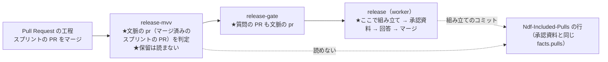
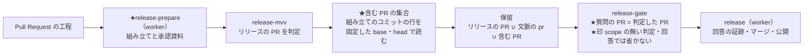
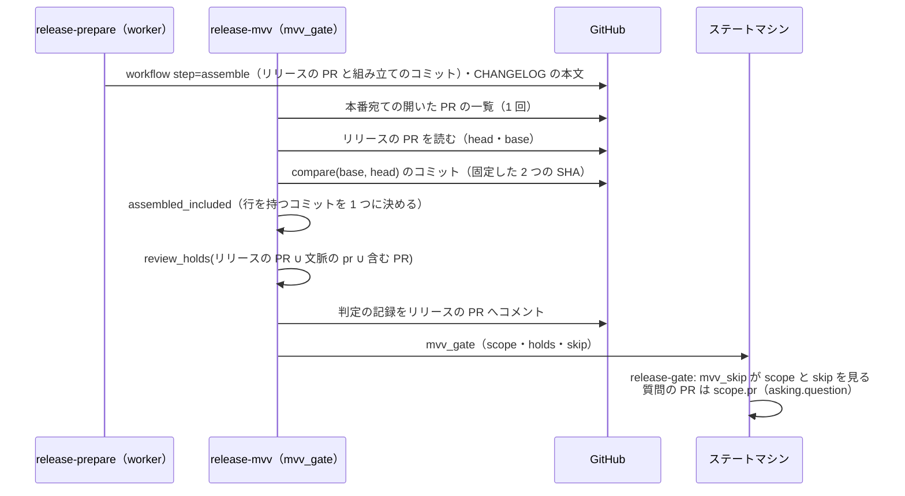

# MVV 判定: リリース承認ゲートで、承認資料と同じ「含む PR」の集合からレビューの保留を読み、保留が無ければ省ける（#4105）

リリース承認ゲートの直前の判定は、承認資料（リリースの PR）ができる前に、マージ済みのスプリントの PR だけを読んでいる。そのため、今回のリリースに含まれる PR のレビューの保留を読めず、#3959 は暫定としてリリース承認ゲートを `fast`・`auto` でも省かない。組み立てを判定の前へ移し、判定はリリースの PR とその組み立てのコミットの「含む PR」の行（承認資料と同じ集合）を固定した SHA で読み、その全体の保留を見てから省くかを決める。判定と回答には保留を読んだ範囲の印を持たせ、印の無い旧版の判定・回答では省かない。採らなかった案は「決定の記録」にある。

## 今の姿

何が起きたか・目的・受け入れ条件は要求仕様（[issue-4105-requirements.md](./issue-4105-requirements.md)、正は #4105 の本文）にある。この設計は #3959 の設計（[issue-3959-4055-design.md](./issue-3959-4055-design.md)・[issue-3959-4055-design-detail.md](./issue-3959-4055-design-detail.md)）の実装の後の形を前提にし、#3959 の「レビューの保留」（`validation_rows`・`review_rows`・`review_holds`・検査 7）をそのまま使う。

★ が変わる位置である。設計に要る今の構造（2026-11-22 の main `428f91f9e` をコードで確かめた）:

| 部品 | 今の振る舞い | 場所 |
| --- | --- | --- |
| デプロイの工程の並び | `release-mvv` → `release-gate` → `release` | `plugins/ndf/contracts/workflow/stages/deploy.json` |
| 判定する PR | 文脈の `pr`（Pull Request の工程の `pr` ステップが書くスプリントの PR。判定の時点でマージ済み） | `records/mvv_gate.py` の `pr_number` |
| 承認ゲートの質問の PR | 文脈の `pr`（設計承認ゲートだけ `design_pr`）。回答を読む前の検証はこの PR の head を見る | `progress/gate/asking.py` の `question`、`answering.py` の `recheck` |
| 組み立て | リリースのプランの worker が workflow（`step=assemble`）を起動し、リリースの PR の本文に承認資料、リリースのコミットに「含む PR」の行を `facts.pulls` から書く | `skills/release/SKILL.md` の「公開する」、`domains/release/assemble.py` の `assemble` |
| 本番宛ての開いたリリースの PR | head がリリースブランチの書式に合うかベースブランチの、本番宛ての開いた PR。組み立ては 1 つでも開いていれば止まる（`ReleaseOpen`） | `assemble.py` の `open_releases` |
| 「含む PR」の行の選び方 | first-parent で辿り、行を持つ最も新しいコミットを採る。件名を見ない | `release/record_decide.py` の `_approved_message` |
| 省いてよい区分 | `MVV_SKIP_GATES = ("design",)`（#3959） | `progress/model.py` |

**判定の時点に、承認資料が確定した集合はどの戦略でも無い。** 組み立ては承認ゲートの後のリリースのプランか工程の外でしか走らない。`trunk` の `production_pr` と版を持たない `merge_base_branch` は組み立てず（`NoReleasePr`）、行も作られない。

## 文脈と制約

- **#3959 の実装が先に main へ入る。** 保留の読み取り・検査 7・`MVV_SKIP_GATES`・`Snapshot.commit`（ベースのコミット）は #3959 が作る。同じ読み取りを 2 か所に作らない
- **#4090・#4099 の設計（PR #4121、未マージ）は `mvv-review` の行の書き方（今回の識別子で判定した行だけ・自由記述は `clean` を通す）を変える。** この設計は行を読むだけで、行の形を変えない
- **承認ゲートを省いてよいのは今どおり `fast`・`auto` だけである**（利用者の方針、2026-11-21）
- **普及の段階に入るまで後方互換は要らない**（利用者の方針、2026-11-16）。ただし受け入れ条件 4 は、印の無い旧版の判定・回答で省かないことを求める
- **このリポジトリはテストを CI に寄せる**（`.ndf/project.json` の `test.ci.only` が真）

## 解き方の全体像

デプロイの工程は「組み立て → 判定 → 承認ゲート → 回答とマージ」の順になる。判定は本番宛ての開いたリリースの PR を 1 つに決めて判定し、その PR の組み立てのコミットの「含む PR」の行（承認資料と CHANGELOG を作った `facts.pulls`）を、MVV を読んだベースと判定した head の 2 つの SHA の間で読む。保留はリリースの PR・文脈の `pr`・含む PR の全体から読み、出力の `mvv_gate.scope` に読んだ範囲を残す。承認ゲートは `scope` を持つ判定と回答でだけ省き、質問と回答の検証は判定した PR の head を見る。範囲を 1 つに決められなければ（組み立ての件名で行を持つコミットが 1 つでない・リリースの PR がベースより遅れている・PR が読めない・組み立てない戦略で集合の記録が無い）判定は省かない側へ倒れる。

## 構成要素

| 構成要素 | 変える | 役割 |
| --- | --- | --- |
| デプロイの工程（`deploy.json`）と組み立てのテンプレート（`templates/release-prepare.json`） | 変更・新設 | 判定の前に組み立てと承認資料を済ませるステップ `release-prepare` を置く |
| 判定（`records/mvv_gate.py`） | 変更 | リリースでは本番宛ての開いたリリースの PR を判定し、含む PR の集合と保留を読み、`scope` を出力に足す |
| 含む PR の読み取り（`release/record.py`・`record_decide.py`） | 変更 | 「含む PR」の行を持つ組み立てのコミットを 1 つに決める規則を、判定とリリース記録で共有する |
| 開いたリリースの PR（`release/assemble.py`） | 変更 | 本番宛ての開いたリリースの PR の探し方を、組み立てと判定で共有する |
| 省略の条件（`progress/model.py`）と回答の読み口（`progress/run.py`・`progress/gate/records.py`） | 変更 | `release` を省いてよい区分に足し、印 `scope` の無い判定と `service:mvv` の回答を採らない |
| 承認ゲートの質問（`progress/gate/asking.py`） | 変更 | リリース承認ゲートの質問の PR を、判定した PR（`mvv_gate.scope.pr`）にする |
| 文脈の型（`context.schema.json`）と手順書 | 変更 | `mvv_gate.scope` を足し、組み立ての時点と承認資料の欄を書き換える |

## 入出力のコントラクト

### `mvv_gate`（文脈と工程の出力の型）に足す `scope`

| キー | 型 | 意味 |
| --- | --- | --- |
| `scope` | オブジェクト（`release` の判定で、含む PR の集合を確定して保留を読んだときだけ） | 保留を読んだ範囲。リリース承認ゲートを省く印 |
| `scope.pr` | 整数 | 判定した PR（本番宛てのリリースの PR） |
| `scope.base` | 40 桁の SHA | MVV と含む PR を読んだベースのコミット |
| `scope.pulls` | 整数の配列（小さい順・重複なし） | 保留を読んだ PR（判定した PR・文脈の `pr`・含む PR の和） |

`design` の判定と、範囲を確定できなかった `release` の判定は `scope` を持たない。`head` は今どおり判定した PR の head である。

### `ndf records mvv gate --gate release`

| 場面 | 判定する PR | 出力 |
| --- | --- | --- |
| 本番宛ての開いたリリースの PR が 1 つ | その PR | `scope` あり。保留があれば `why` と `holds` に載り `skip` は偽 |
| 開いたリリースの PR が 0 で、組み立てない戦略（`trunk` の `production_pr`・版を持たない `merge_base_branch` の PR を文脈の `pr` が指す） | 文脈の `pr` | 保留は first-parent の件名から決めた PR と文脈の `pr` から読み、`holds` に載る。承認資料の集合の記録が無いので `scope` なし（省かない） |
| 開いたリリースの PR が 0 で組み立てる戦略・2 つ以上・組み立てのコミットを 1 つに決められない・リリースの PR がベースより遅れている・PR とコミットを読めない | 文脈の `pr`（読めれば） | `verdict: null`・`skip` 偽・`why` に理由。`scope` なし |

## 処理の流れ

1. `release-prepare` の worker が、リリースの Skill の「組み立て」の手順（workflow の `step=assemble` と CHANGELOG の本文）を済ませる。組み立てない戦略では何もしない
2. `release-mvv` が、MVV と同じベースのコミットのブランチ戦略から本番ブランチ・ベースブランチ・名前の書式を得て、本番宛ての開いたリリースの PR を探す（`assemble` と同じ関数）
3. 判定する PR を読み、PR のコミットを MVV を読んだベースの SHA と head の SHA の間で読む（マージ済みの PR はマージのコミットの第 1 親から head まで）
4. 含む PR を決める。組み立てのコミットが 1 つならその行の番号、行が無ければ first-parent の件名から（リリース記録と同じ規則）。決められなければ省かない
5. 保留をリリースの PR・文脈の `pr`・含む PR の和で読み（#3959 の `review_holds`）、判定と保留から `skip` を決める（#3959 の `may_skip` と検査 7）
6. 承認ゲートのステップは、直前の判定が `release` で `scope` を持ち `skip` が真のときだけ省く。省いた回答の事象の `mvv_gate` にも `scope` が載る

## 決定の記録

### 決定 1: 承認資料が確定した集合を判定が読めるようにするため、組み立てをデプロイの工程の判定の前のステップへ移す

- **質問**: 判定の時点に承認資料（含む PR の集合）がどの戦略でも無いとき、判定が承認資料と同じ集合を読むには何を変えるか
- **選んだ案**: デプロイの工程の先頭にステップ `release-prepare`（`ndf.plan`、テンプレート `release-prepare`、worker が組み立てと CHANGELOG の本文を済ませる）を置き、`release-mvv` → `release-gate` → `release` を続ける。`release` のプランは組み立てを打たず、承認資料の提示・回答の証跡・マージ・公開だけを行う。`release_branch` の手順書（`production-merge.md`）が既に「承認資料の前に組み立てる」順であり、その順をどの戦略にもそろえる
- 採らなかった案: 判定が `assemble._facts` を呼んで集合を計算する（判定と承認資料の 2 回の計算が、間にマージやタグが入ると食い違う。`_facts` はタグの取得・本番の fetch・GraphQL を足す。#4093 の指摘 r2-6・r2-7）
- 採らなかった案: 判定は今のまま範囲を計算して記録し、承認の後の `release-steps answer --by mvv` で承認資料の集合と照らす（同じ集合を 2 か所で作って比べることになり、照らす側がステートマシンの判定を読む新しい経路が要る）
- 採らなかった案: デプロイの前に新しい工程（ステージ）を足し、リリースの PR の番号を文脈へ書く（5 つのモードの定義・工程の表・手順書の工程表が変わる。同じ工程の中のステップの並びで足りる）
- **代償**: リリース承認ゲートで人が「出さない」と答えても、リリースの PR とブランチは作られた後になる（閉じて片付ける）。組み立ての worker の作業が承認ゲートの前に 1 つ増える
- 根拠: Value 1 / Value 8 / Value 11（MVV バージョン 11）

### 決定 2: 人が承認する PR と判定する PR を同じにするため、リリースでは本番宛ての開いたリリースの PR を 1 つに決めて判定し、質問の PR もそれにする

- **質問**: 判定する PR と承認ゲートの質問の PR を、文脈の `pr`（スプリントの PR）のままにするか
- **選んだ案**: `release` の判定は、組み立てと同じ関数（`assemble.open_releases` の中身を `open_release_numbers` に切り出す）で本番宛ての開いたリリースの PR を探し、1 つならそれを判定する。組み立ては開いたリリースの PR が 1 つでもあれば止まる（`ReleaseOpen`）ので、組み立ての後は 1 つに決まる。0 なら、組み立てない戦略では文脈の `pr`（本番の PR を兼ねるスプリントの PR）を判定し、組み立てる戦略では範囲を確定できないとして省かない。2 つ以上も省かない。リリース承認ゲートの質問の PR は `mvv_gate.scope.pr`（判定した PR）にし、無ければ今どおり文脈の `pr`。回答を読む前の検証は判定した PR の head と比べる
- 採らなかった案: 文脈に新しいキー（リリースの PR の番号）を足し、`release-prepare` の出力から渡す（工程のステップの入力は文脈からしか組まれず、同じ工程の前のステップの出力を渡す仕組みが要る。文脈の `release_pr` は既に別の意味（リリース記録を書いた PR）で使われている）
- 採らなかった案: 文脈の `pr` を判定し続ける（マージ済みのスプリントの PR の head は動かないので、判定の後にリリースの PR へ積んだコミットを回答の検証が見ない。人が承認する PR と判定の記録の置き場も食い違う）
- **代償**: 判定ごとに本番宛ての開いた PR の一覧を 1 回読む（REST 1 回）
- 根拠: Value 1 / Value 3（MVV バージョン 11）

### 決定 3: 承認資料と同じ集合を読むため、含む PR を組み立てのコミットの「含む PR」の行から固定した 2 つの SHA の間で読む

- **質問**: 判定する PR から、含む PR の集合をどこから読むか
- **選んだ案**: #3959 から移した設計（#4105 の本文の「移した設計」）を土台にし、マージ済みの PR の読み方・遅れの確かめ・組み立てない戦略の扱いの 3 つを足す。`ndf.domains.release.branch_strategy` を MVV と同じベースのコミットで読み（`load_at_ref(root, base_sha)`）、本番ブランチと名前の書式を得る。PR のコミットは `hub.compare_commits(base_sha, head_sha)` で読み、可変のブランチ名を渡さない（指摘 r3-5）。compare の分岐点が `base_sha` でない（リリースの PR がベースより遅れ、組み立ての後に本番へ入った PR がある）なら範囲を確定できないとする。判定の後にベースが進む場合は #4106 が消費の時点で照らす。マージ済みの PR は、マージのコミットの第 1 親から head までを読む（リリース記録の `_release_commits` と同じ）。組み立てのコミットの行は `facts.pulls`（承認資料と CHANGELOG を作った集合）から書かれるので、同じ集合になる。`release_branch` で複数のスプリントを集めた PR も、一時の作業場所で組んだ範囲の番号が行に入るので、元のスプリントのブランチを読み直さない（指摘 r2-5）。判定した PR と文脈の `pr` を必ず足す。組み立てない戦略（`trunk` の `production_pr`・版を持たない `merge_base_branch`）は行が無く、承認資料（`materials`）の集合も記録に残らないので、first-parent の件名から決めた PR の保留を読んで載せるが、`scope` を付けない（受け入れ条件 2 の「記録が読めない」に当たり、省かない）。`assemble._facts`・`_span`・`_since_by_unit` は呼ばない（指摘 r2-7）
- 採らなかった案: `_facts` を固定の範囲と単位で呼べる形に分け、判定と CHANGELOG で共有する（指摘 r2-6 の提案。タグ・出し済みのバージョン・PR の題をその時点のリモートから読むので、同じ SHA を渡しても集合が変わりうる。共有するのは関数でなく、組み立てが書いた記録にする）
- 採らなかった案: PR の本文の承認資料の「含む PR」を読む（本文は後から編集でき、読むコードも無い）
- 採らなかった案: 組み立てない戦略でも first-parent の件名の集合で `scope` を付けて省く（承認資料は前のタグからの範囲を `materials` で読むので、件名の範囲と一致すると確かめられない。一致しなければ保留を読まない PR を省いて通す）
- **代償**: 組み立てない戦略では、リリース承認ゲートは `fast`・`auto` でも省かれない（承認資料の集合を組み立ての行と同じ形で記録する仕組みが入るまで）。組み立ての後に本番へ別の PR が入ると、組み立て直すまで省かれない
- 根拠: Value 8 / Value 11 / Value 2（MVV バージョン 11）

### 決定 4: 後から足した行で保留を落とさないため、行を持つコミットを 1 つに決め、決められなければ省かない規則を判定とリリース記録で 1 つにする

- **質問**: 組み立ての後の直しのコミットが「含む PR」の行（`Ndf-Included-Pulls: none` など）を持つとき、どの行を採るか（指摘 r3-1）
- **選んだ案**: `record_decide.assembled_message` を足し、first-parent で辿った PR のコミットのうち、件名が `included_decide.RELEASE_TITLE` の形（組み立てが書く件名）で行を持つものを組み立てのコミットとする。1 つならそのメッセージ、2 つ以上なら `ValueError`、0 で行を持つコミットが 1 つも無ければ None、0 で件名の違うコミットだけが行を持つなら `ValueError`。件名の違う直しのコミットの行は読まない（後から足した行で集合が変わらない）。`approved_included`・`approved_units`（リリース記録）もこの関数を通し、`record._included` は `ValueError` を `RecordError` にする。判定は `RecordError` を受けたら `verdict: null`・`skip` 偽にする
- 採らなかった案: 判定だけが新しい規則を使い、リリース記録は最も新しい行を読むまま（#3959 の設計の案。同じ記録の読み方が 2 つになり、承認資料に載らない行でリリース記録を書きうる）
- 採らなかった案: 行を持つコミットが 2 つ以上なら件名によらず止める（#4105 の本文の「移した設計」の案。直しのコミットに行が紛れただけで、人が承認したリリースのマージの後のリリース記録まで止まる）
- 採らなかった案: 最も古い行を採る（組み立てを 2 回打ったブランチで古い集合を読む。どの行が承認資料と同じかは件名と数でしか決められない）
- **代償**: 組み立てを 2 回打ったブランチ（組み立ての件名のコミットが 2 つ）では、判定は省かず、マージの後のリリース記録も `RecordError` で止まる。組み立ては開いたリリースの PR があれば止まり、リリースブランチが既にあれば止まるので、この形は手で組み立てのコミットを積んだときだけ起きる
- 根拠: Value 7 / Value 11（MVV バージョン 11）

### 決定 5: 旧版の判定と回答でリリース承認ゲートを省かないため、保留を読んだ範囲 `scope` を印にし、省略と回答の読み口の両方で求める

- **質問**: `MVV_SKIP_GATES` に `release` を足したとき、#3959 より前の版が書いた判定の `skip: true` と未消費の `service:mvv` の回答をどう扱うか（#4093 の指摘 r8-3。#4105 の本文の「#3959 から引き継ぐ条件」）
- **選んだ案**: 印を判定の出力の `scope` にする（保留を読んだ範囲そのものなので、別の版数の欄を足さない）。`model.mvv_marked(held)` が「区分が `release` なら `scope` が形どおり（`pr` が整数・`base` が 40 桁・`pulls` が整数の配列）」を返し、`mvv_skip` はこれを足して省く。`model.mvv_answer_void(payload)` は、回答した者が `service:mvv` で区分が `release` の回答の `mvv_gate` が印を持たなければ理由を返し、回答の畳み込み（`StepProgress._answered`）はその回答を読まず（承認ゲートは人を待つ）、承認済みの head（`records.answers`）からも外す
- 採らなかった案: 今どおり移行の手順（`ndf progress cancel` で作り直す）だけで扱う（#3959 の決定 3 の扱い。#3959 の版で人の承認待ちを挟んだスプリントは、更新の後に旧版の `skip: true` で省かれる。受け入れ条件 4 を満たさない）
- 採らなかった案: 判定の出力に版数の欄を足す（保留を読んだかを表さず、版を上げるたびに照らす値が変わる）
- 採らなかった案: 回答を消費の時点で判定の対象（PR・宛先・宛先の先端・head）と照合する仕組みもこの Issue で作る（#4106 の範囲。この Issue は印の有無だけを見る。#4106 は同じ `mvv_answer_void` に照合を足す）
- **代償**: 印の無い `service:mvv` の回答は事象の表に残ったまま読まれない（表から消さない）
- 根拠: Value 1 / Value 3 / Value 4（MVV バージョン 11）

### 決定 6: #3959 の暫定を外すため、`release` を省いてよい区分に足し、暫定の理由と手順書の断りを消す

- **質問**: #3959 が置いた暫定（`MVV_SKIP_GATES` の `("design",)`、`why` の「#4105 まで省かない」、承認資料の「リリースの保留は #4105 まで読まない」）をどう外すか
- **選んだ案**: `MVV_SKIP_GATES` を `("design", "release")` にし、`_judged` の `release` の暫定の理由を消す。`pace.md`・`approval-request.md`・`agent-layers.md` の #4105 の断りを、この設計の順（組み立て → 判定 → 承認ゲート）と `scope` の説明に書き換える
- 採らなかった案: 区分の表をやめ、`mvv_marked` だけで省くかを決める（区分の表は省いてよい承認ゲートを 1 か所で示す。新しい区分を足すときに省略が自動で有効にならない）
- **代償**: 無し（暫定が止めていた自動化が戻る）
- 根拠: Value 1 / Value 5（MVV バージョン 11）

### 決定 7: 隣の設計と重ねないため、#4104・#4106・#4128・#4090 #4099 との境をこの設計で決める

- **質問**: 判定と回答の照合・即時修正・本番の PR のマージの順序・cross-review の記録の形と、この設計の重なりをどう分けるか
- **選んだ案**: 次の表のとおりにする

  | 隣の課題 | その課題が持つもの | この設計が持つもの |
  | --- | --- | --- |
  | #4106 | 省いた回答を消費の時点で PR・宛先・宛先の先端・head と照合する。旧版の判定の対象の欄の扱い | 印 `scope` の有無の検査（`mvv_answer_void` を作る。#4106 は同じ関数に照合を足す） |
  | #4104 | 即時修正のマージの前の判定 | 無し（即時修正はリリース承認ゲートを通らない） |
  | #4128 | `trunk` の `production_pr` で本番の PR が `pr-merge` で承認の前に入りうる点 | マージ済みの文脈の `pr` でも含む PR を読む（第 1 親から head） |
  | #4090 #4099 | `mvv-review` の行の書き方 | 行を読むだけ（#3959 の `review_holds`） |

- 採らなかった案: 隣の課題の論点をこの設計に取り込む（#4093 で範囲を分けた理由と同じく、ラウンドが収まらない）
- **代償**: #4106 が入るまで、省いた回答は head だけで照らされる（今と同じ）
- 根拠: Value 5 / Value 9（MVV バージョン 11）

## 影響と危険

- **働く範囲**: 利用先のリポジトリでも働く。リリース承認ゲートを省けるのは承認済みの MVV を持ち `fast`・`auto` のスプリントだけで、ほかは判定の置き場（リリースの PR）と組み立ての時点だけが変わる
- **プロジェクトごとに違うもの**: ブランチ戦略（本番・ベースブランチ・名前の書式）は今どおり `.ndf/project.json` から読む（判定は MVV と同じベースのコミットで読む）。新しい設定のキーは足さない
- **当たるモード**: デプロイの工程を持つ 5 つのモードすべて。進め方はすべて（組み立ての時点が変わる）
- **同じファイルを触る別の変更**: #3959 の実装が `mvv_gate.py`・`model.py`・`checks.py`・`context.schema.json`・`pace.md`・`approval-request.md`・`agent-layers.md` を変える。この Issue の実装は #3959 の実装が main へ入った後の main から切る。#4106 の実装は `model.py` の `mvv_answer_void` と回答の読み口を変えるので、先に入った方に合わせる
- **壊れうる箇所**: 組み立てが承認ゲートの前に走るので、人が「出さない」と答えたリリースの PR とブランチが残る。閉じるまで次の組み立ては `ReleaseOpen` で止まり、その結果が閉じる PR を名指す（今の止まり方と同じ）。閉じる手順はリリースの Skill に置く。リリースの Skill の手順（組み立ての位置）を書き換え忘れると、`release` のプランが組み立てを 2 回打って `ReleaseOpen` で止まる
- **費用**: リリースの判定 1 回につき、本番宛ての開いた PR の一覧（REST 1 回）・リリースの PR（REST 1 回。#3959 で既に読む）・PR のコミットの compare（`github.list-pages` ページまで）が増える。`_facts` を呼ばないので、タグの取得・本番の fetch・GraphQL は増えない。保留の読み取りは #3959 の記録の 1 回の読み取りを共有する

### 代表のリポジトリでの振る舞い

| 代表のリポジトリ | 設定の要点 | 直した後に起きること | この種類で扱えなくなること |
| --- | --- | --- | --- |
| Web サービス | 承認済みの MVV があり、リリースの PR が承認ゲートを通る（`release_branch`・`merge_base_branch` が多い） | 組み立てが承認ゲートの前に走り、判定がリリースの PR に載る。`fast`・`auto` で含む PR に保留が無ければリリース承認ゲートが省かれる | 無し |
| モバイルアプリ | 同上。配布の手段が違うだけ | 同上 | 無し |
| 業務文書だけ | 文書の PR。版を持たない `merge_base_branch` か `trunk` が多く、MVV が無いことが多い | MVV が無ければ判定の形は今と同じ。組み立てない戦略では `release-prepare` が何もしない | 無し |

### このリポジトリだけの事情

- 無し（ai-plugins の `trunk`・`release_pr` は例として使うだけで、仕組みはブランチ戦略の宣言から読む）

## 用語

設計文書の本文で使う新しい語を、実装の PR で用語集へ足す（この設計 PR は `issues/issue-4105-*` だけを触る）。MVV・レッドライン・進め方（`normal`・`auto`・`fast`）などの既存の語は用語集（[docs/glossary.md](../docs/glossary.md)）にあり、決定の根拠の Value の本文は `.ndf/mvv.md`（MVV 版 11）にある。

| 語 | 意味 | 反映 |
| --- | --- | --- |
| 含む PR | 今回のリリースに含まれる PR の集合。組み立てが承認資料と同じ集合を組み立てのコミットの行（`Ndf-Included-Pulls`）に書く | 追加 |
| 保留を読んだ範囲 | リリースの判定が保留を読んだ PR（判定した PR・文脈の `pr`・含む PR）とベースのコミット。判定の出力 `mvv_gate.scope` に残り、リリース承認ゲートを省く印になる | 追加 |

## テスト設計

| 受け入れ条件・決定 | どの振る舞いで縛るか | どう壊したら落ちるべきか |
| --- | --- | --- |
| 1（`trunk`・`release_pr`） | 組み立てのコミットの行に、リリースの PR の差分に現れない単位の PR の番号があり、その PR に `redline` の行がある → `fast` で判定が「従う」でも `skip` 偽、`holds` にその PR | 判定した PR だけの保留を読む・行の番号を落とす |
| 1（`release_branch`） | 2 つのスプリントを集めた組み立てのコミットの行の番号が、承認資料（`collect` の `facts.pulls`）の番号と同じで、両方の保留を読む | スプリントのブランチを読み直す・片方のスプリントを落とす |
| 1・2（組み立てない戦略） | 行の無い PR（マージ済みを含む）で、first-parent の件名の番号と文脈の `pr` の保留を読んで `holds` に載せ、`scope` なし・`skip` 偽。マージ済みの PR は第 1 親から head のコミットを読む | マージ済みの PR で保留を読む PR が空になる・`scope` を付けて省く |
| 2（遅れ） | compare の分岐点が `base_sha` でないリリースの PR → `scope` なし・`skip` 偽 | 遅れたリリースの PR で省く |
| 1（固定した SHA） | `compare_commits` に渡すのは MVV を読んだベースの SHA と head の SHA で、ブランチ名を渡さない | 可変のブランチ名で読む |
| 1（直しの行） | 組み立てのコミットの上に `Ndf-Included-Pulls: none` を持つ直しのコミット → 組み立てのコミットの行の番号を読み、保留を落とさない。リリース記録も同じ番号 | 最も新しい行を採る |
| 2 | 組み立ての件名で行を持つコミットが 2 つ・件名の違うコミットだけが行を持つ・compare の `GitHubError`・開いたリリースの PR が 0（組み立てる戦略）か 2 → `skip` 偽・`scope` なし | 読めないのに省く |
| 2（リリース記録） | 組み立ての件名で行を持つコミットが 2 つの PR で `record` が `RecordError` | どちらかの行で記録を書く |
| 3 | `MVV_SKIP_GATES` が `release` を持ち、`scope` を持つ `skip: true` の判定でリリース承認ゲートが `service:mvv` の回答で通る | 暫定のまま省かない |
| 4 | 印の無い `release` の `skip: true` の判定（#3959 より前の版の形）で `mvv_skip` が None。印の無い判定を添えた未消費の `service:mvv` の回答から `decide` すると承認ゲートが人を待ち（#3959 より前の版から直接更新）、人の承認待ちを挟んだ後に更新しても省かれない。`ndf answer head` がその回答の head を返さない | 印を見ずに省く・回答の読み口だけで止める |
| 決定 2 | リリース承認ゲートの質問の PR が `mvv_gate.scope.pr` で、判定の後にリリースの PR へコミットを積むと回答の検証が待ちへ戻す | スプリントの PR の head と比べる |
| 決定 1 | `deploy.json` のステップの並びが `release-prepare` → `release-mvv` → `release-gate` → `release` | 判定が組み立ての前に走る |
| 費用 | リリースの判定が `assemble._facts`・`_span`・`_since_by_unit` を呼ばない | タグの取得と本番の fetch が増える |

## どこを変えるか

詳細設計は別ファイル [issue-4105-design-detail.md](./issue-4105-design-detail.md) にした。新設する関数が 2 つ以上あり、既存の関数のシグネチャを変えるためである。

## 設計の結果

| 課題 | 扱い | 統合先 | 触るファイル |
| --- | --- | --- | --- |
| #4105 | 実装する | — | `plugins/ndf/contracts/workflow/stages/deploy.json`、`plugins/ndf/contracts/templates/release-prepare.json`、`plugins/ndf/contracts/workflow/context.schema.json`、`plugins/ndf/src/ndf/domains/records/mvv_gate.py`、`plugins/ndf/src/ndf/domains/records/mvv_material_decide.py`、`plugins/ndf/src/ndf/progress/gate/checks.py`、`plugins/ndf/src/ndf/domains/release/record.py`、`plugins/ndf/src/ndf/domains/release/record_decide.py`、`plugins/ndf/src/ndf/domains/release/assemble.py`、`plugins/ndf/src/ndf/progress/model.py`、`plugins/ndf/src/ndf/progress/run.py`、`plugins/ndf/src/ndf/progress/gate/records.py`、`plugins/ndf/src/ndf/progress/gate/asking.py`、`plugins/ndf/skills/release/SKILL.md`、`plugins/ndf/skills/development-workflow/references/pace.md`、`plugins/ndf/skills/development-workflow/references/approval-request.md`、`plugins/ndf/skills/development-workflow/references/agent-layers.md`、`plugins/ndf/skills/development-workflow/references/production-merge.md`、`docs/glossary/glossary.json`、`docs/glossary.md`、`plugins/ndf/tests/domains/records/test_mvv_gate.py`、`plugins/ndf/tests/domains/release/test_release_record.py`、`plugins/ndf/tests/progress/test_model.py`、`plugins/ndf/tests/progress/test_run.py`、`plugins/ndf/tests/progress/gate/test_gate_answer.py`、`plugins/ndf/tests/progress/test_definition.py` |

## 未確認のまま残ること

| 項目 | 内容 |
| --- | --- |
| 組み立てない戦略の省略 | `trunk` の `production_pr`・版を持たない `merge_base_branch` で省けるようにするには、承認資料（`materials`）の集合を記録に残す仕組みが要る。使う利用者がいるかは分からず、この Issue では省かないままにする |
| 判定の後に本番へ入った PR | 判定の後、マージまでの間に本番へ入った PR がリリースの PR のマージで同じタグに入るかを確かめていない。判定の後のベースの進みは #4106 の照合が持つ |
| リリースの Skill の手順の書き換え | `release-prepare` の worker と `release` の worker の手順の分け方（組み立ての待ち方・CHANGELOG の本文を書く時点）は、実装で `skills/release/SKILL.md` を書き換えるときに決める |

## 外部の調査

省く: 既存の組み立ての記録（`Ndf-Included-Pulls`）・判定・工程のステップの並びの延長で、外部の判断が要る形が無い
