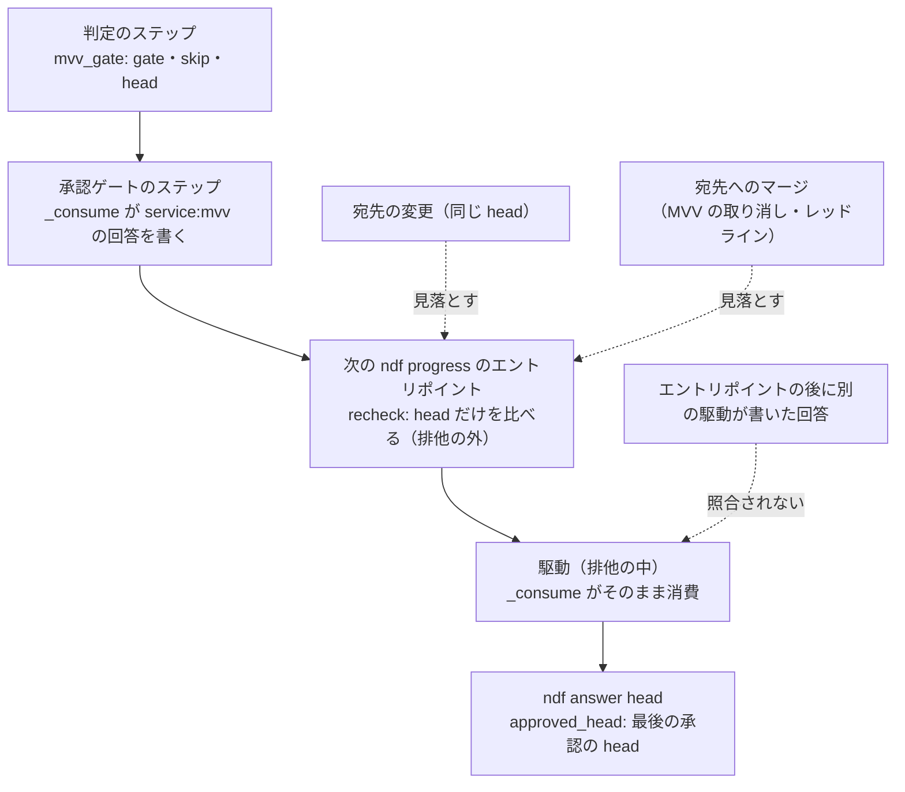
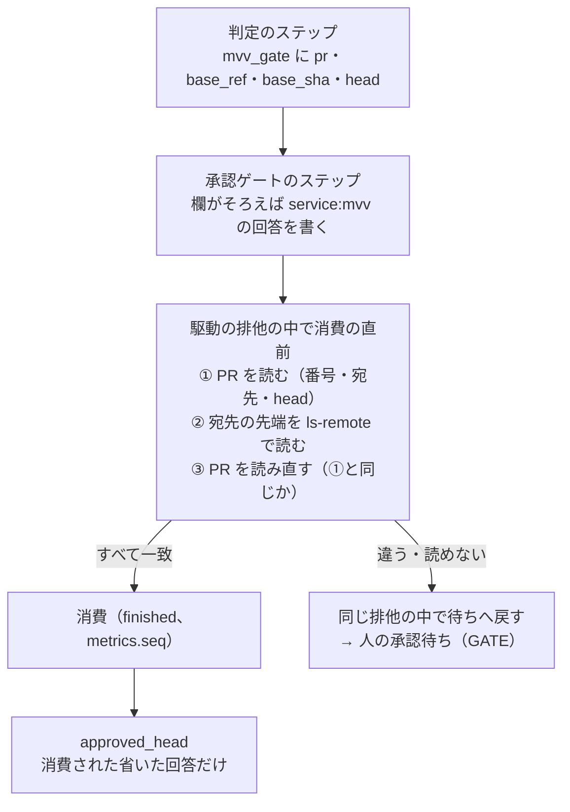
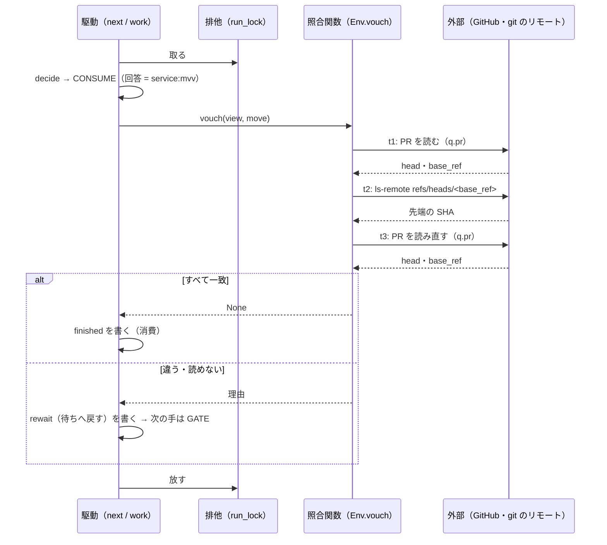

# MVV 判定: 省いた回答を、判定した PR・宛先・宛先の先端・head と消費の直前に照合する（#4106）

MVV 判定で承認ゲートを省いた回答（`service:mvv`）は head だけで判定の対象と結び付き、判定の後に宛先が変わる・宛先が進む・並行する駆動が読む、のどれでも古い規則の省略が通る。判定の出力に PR の番号・宛先・ベースのコミットを足し、回答を消費する駆動が排他の中で消費の直前に 1 か所だけで照合し（PR → 宛先の先端 → PR の順に読む）、違えば同じ排他の中で人の承認待ちへ戻す。マージの側は消費された省いた回答の head だけを承認済みとして読む。分ける前の設計（エントリポイントと排他の中の 2 か所で照合し、事象番号で受け渡す形）を採らなかった理由は決定 1、外部の調査は末尾にある。

## 今の姿

何が起きたか・目的・受け入れ条件は要求仕様（[issue-4106-requirements.md](./issue-4106-requirements.md)、正は #4106 の本文）にある。この文書は「どう解くか」と「なぜその解き方か」だけを書く。

根本原因は 2 つである。1 つは、判定の出力と省いた回答が、判定が規則を読んだ対象（PR の番号・宛先・ベースのコミット）を持たないこと。もう 1 つは、照合する場所（エントリポイントの `recheck`、排他の外）と消費する場所（`_consume`、排他の中）が分かれていて、その間に起きた変更と並行の書き込みを見られないことである。マージの側（`approved_head`）は消費を見ないので、照合を通らなかった省いた回答の head も返す。

関わる今の部品（`main` のコミット `3d5279f9f`）:

| 部品 | 置き場 | 今の振る舞い |
| --- | --- | --- |
| `mvv_gate` の出力 | `domains/records/mvv_material_decide.py` の `gate_outcome` | `gate`・`skip`・`verdict`・`why`・`head` |
| 省いた回答 | `progress/model.py` の `mvv_answer` | payload に判定の出力のコピー（`mvv_gate`）と `seen: {head, material_sha256: null}` |
| エントリポイントの照合 | `progress/gate/answering.py` の `recheck` | `gate_id` を持つ回答なら人の回答も省いた回答も、head と承認資料の sha256 を比べ、違えば待ちへ戻す |
| 消費 | `progress/run.py` の `_consume` | 回答が無ければ省いた回答を書いて `next` を返す。あれば照合せずに消費（ステップの `finished`、`report.metrics.seq` に回答の事象番号） |
| 承認済みの head | `progress/gate/records.py` の `approved_head` | 区分の最後の回答が承認ならその head |

## 文脈と制約

- #3959 の実装（判定がベースの MVV を `Snapshot.commit` で読む・`MVV_SKIP_GATES = ("design",)`）の後に実装する。#3959 の判定の手順 (1) が PR を 1 回読み（head・`base_ref`）、(2) が `git fetch` した宛先の先端を `snap.commit` に持つ。この 2 つをそのまま照合の対象にする
- #4105 の設計（[PR 4132](https://github.com/devbasex/ai-plugins/pull/4132)、未マージ）が `model.mvv_answer_void(payload)` を作り、回答の読み取り（`StepProgress._answered`。事象を順に読んで承認ゲートの回答を決める）と回答の一覧（`records.answers`）がその回答を読まないようにする。#4105 は「#4106 は同じ関数に照合を足す」と分担を書いている。#4105 の印 `scope` の `base` は**ベースの SHA** である。#3959 は `mvv_skip` に区分の表 `MVV_SKIP_GATES` を当てるだけで、回答を読む側（`_answered`・`answers`・`approved_head`）には手を入れない（#3959 の詳細設計の「リリース承認ゲートの省略の止め」）
- `progress/run.py` はステートマシンの駆動で、GitHub と git を直に呼ばない（外との接点は `Env` が持つ）。GitHub と git は `progress/gate/` が `Env` へ差し込む
- 回答を消費するのは `ndf progress next`（`run.advance`）と、`next` が起動する `ndf progress work`（`run.work`）で、どちらも駆動の排他（`store.run_lock`）の中で `_consume` を打つ。どちらも `progress_main` → `entry._progress` を通る
- 後方互換は要らない（MVV Value 4、利用者の方針 2026-11-16）。旧版の状態からの再開は扱わない（#3959 の決定 3）
- 書くのは `issues/issue-4106-*` だけ。#4104・#4105 の設計と、#4090 #4099 の設計（PR 4121）は書き換えない

## 解き方の全体像

- 判定の出力は、判定した PR の番号（`pr`）・宛先の名前（`base_ref`）・規則を読んだベースのコミット（`base_sha`）・head を持つ。省いた回答は今どおり判定の出力のコピーを payload に持ち、照合はそのコピーを読む
- 省いた回答の照合は、回答を消費する駆動が排他の中で、消費の事象を書く直前に 1 か所だけで行う。PR を読み、宛先の先端を読み、PR を読み直し、すべてが一致したら同じ排他の中で続けて消費する。エントリポイントの `recheck` は省いた回答を照合しない。照合の外部の呼び出しは、接続の初期化を含めて 1 つの期限の中で打ち、照合の中は再試行しない（決定 8）
- 照合が通らなければ（違う・読めない・照合関数が無い）、同じ排他の中で承認ゲートのステップを待ちへ戻し、駆動は人の承認待ちを返す。待ちの表示は照合で読んだ PR の値を使い、PR を読めなくても質問と回答ごとのルートを返す
- 欄を 1 つでも欠く判定は省かず、欄を欠く省いた回答と省いてよい区分でない省いた回答は回答の読み取りが採らない。読まない省いた回答がある承認ゲートは、判定の出力がそろっていても省き直さない（人を待つ）
- マージの側は、区分の生の最新の回答が、消費された（`finished` の `metrics.seq` がその回答を指す）省いた回答か人の承認のときだけ head を返す

## ドメインモデル

### コンテキスト

| コンテキスト | 何の語が 1 つの意味に決まるか |
| --- | --- |
| ステートマシンの駆動（`progress`） | 「省いた回答」「消費」「待ちへ戻す」「判定の対象」 |

### 集約

| 集約 | オーナー（書き換えてよいもの） | 根 | エンティティ | 値オブジェクト |
| --- | --- | --- | --- | --- |
| ステートマシン（事象の表） | 駆動（`run`）と承認ゲートのエントリポイント（`progress/gate`）。どちらも `store.append` で事象を足すだけ | ステートマシンの ID | 行（工程）・ステップ | 判定の出力（`mvv_gate`）・判定の対象（`pr`・`base_ref`・`base_sha`・`head`）・回答の payload |

### 不変条件

| # | 集約 | 条件 | 破れたときの扱い |
| --- | --- | --- | --- |
| I1 | ステートマシン | 省いた回答が消費される（`finished` が書かれる）のは、同じ排他の中で、消費の直前に PR（t1）→ 宛先の先端（t2）→ PR（t3）の順に読み、t1 と t3 の PR の番号・宛先・head と t2 の宛先の先端が、回答が添える判定の対象と一致したときだけ。別々の読み取りで保証できるのは「t1 から t3 の間に PR が判定のときのままと 2 回観え、その間の t2 に先端が一致した」ことまでで、t3 の後から事象を書くまでの GitHub の変更・t1 と t3 の間に変えて戻した変更・t2 の後の宛先へのマージは見ない（「残る窓」） | 消費せず、同じ排他の中で待ちへ戻す |
| I2 | ステートマシン | 判定の対象の欄を 1 つでも欠く判定の出力では承認ゲートを省かず、欄を欠く省いた回答と `MVV_SKIP_GATES` に無い区分の省いた回答は承認ゲートの回答として読まれない。そのような回答がある承認ゲートは省き直さない | 人の承認待ちのまま |
| I3 | ステートマシン | 承認済みの head は、区分の生の最新の回答から決める。それが省いた回答なら、読める回答で、かつ消費されたときだけ返し、前の回答へさかのぼらない | `approved_head` が None（マージの側が止まる） |
| I4 | ステートマシン | 人の回答の照合（head・承認資料の sha256・文書だけの差の経路）はこの変更の前と同じ | — |

### ドメインイベント

| # | イベント | 発生元 | 受け手 |
| --- | --- | --- | --- |
| E1 | 判定が対象を読んで `skip: true` を出した | 判定のステップ（`ndf records mvv gate`） | 承認ゲートのステップ |
| E2 | `service:mvv` の回答を書いた | `_consume`（回答が無いとき） | 次の駆動 |
| E3 | 消費の直前に照合した | `_consume`（`Env.vouch`） | 同じ駆動 |
| E3a | 照合が通らず待ちへ戻した（E3 のもう 1 つの結果） | `_consume`（`rewait`） | 待ちの表示（`present`）・人 |
| E4 | 照合を通った省いた回答を消費した | `_consume` | `approved_head` |
| E5 | 承認済みの head を読んだ | `ndf answer head` | マージの側 |

## 構成要素

| 要素 | 責務 |
| --- | --- |
| 判定の対象を出力に持たせる（`mvv_material_decide.gate_outcome`・`mvv_gate._judged`・`context.schema.json`） | 判定の出力に `pr`・`base_ref`・`base_sha` を置く（`head` は今もある） |
| 省く条件と読まない回答（`progress/model.py` の `mvv_targets`・`mvv_skip`・`mvv_answer_void`） | 欄がそろわない判定では省かず、欄を欠く省いた回答を回答の読み取りと一覧から外す。`mvv_targets` は判定の対象の 4 つの欄が形どおりかを確かめる |
| 照合関数（`progress/gate/answering.py` の `mvv_vouch`・`git_base_tip`、`asking.Target.base_ref`、`github_observe`） | PR を読んで番号・宛先・head を比べ、宛先の先端を `git ls-remote` で 1 回読んで比べ、PR を読み直して比べ、理由か None を返す。外部の呼び出しは照合全体の期限（`adapters/deadline.py` の `Deadline`、HTTP は `DeadlineTransport`）で打ち切り、理由に例外の文字列を載せない |
| 消費の直前の照合（`progress/run.py` の `Env.vouch`・`_consume`・`rewait`） | 排他の中で照合関数を呼び、通れば消費、通らなければ待ちへ戻す |
| エントリポイント（`progress/gate/entry.py` の `_progress`、`answering.recheck`） | `Env` に照合関数を差し込む。`recheck` は省いた回答を照合しない |
| 承認済みの head（`progress/gate/records.py` の `approved_head`） | 省いた回答は消費されたものだけを返す |

## 処理の流れ

- 照合関数は、受けた `view` と `move` から承認ゲートの質問を組み（今の `recheck` と同じ `question`）、質問の PR（設計承認ゲートは文脈の `design_pr`、#4105 の後のリリース承認ゲートは `scope.pr`）を `q.pr` として読む
- 図は消費の直前だけを描く。判定の対象を出力に持たせる部品・省く条件・エントリポイント・承認済みの head は「解き方の全体像」の図にある
- 照合関数が無い駆動（エントリポイントを通らずに `run.advance`・`run.work` を呼ぶもの）では `Env.vouch` が None で、省いた回答を消費せずに待ちへ戻す
- 省いた回答を書いた駆動は今どおり消費せずに `next` を返す（書く手と読む手を分けたまま。次の駆動が排他の中で照合する）
- 待ちへ戻した後は `prog.waiting` があるので `_running_move` は省かずに `GATE` を返す。判定のステップを打ち直さない
- 待ちへ戻した同じ CLI の呼び出しの待ちの表示（`present`）は、照合が読んだ PR の値（`Vouched.seen`）を使い、PR を読み直さない。読めなかったときも、PR を読めない別の経路と同じく head 無しの質問・回答ごとのルート・警告を返し、結果は停止でなく承認ゲートの待ち（`gate`）になる
- 照合の理由・警告に載せるのは PR の番号・失敗の区分（上限・届かない・HTTP の状態・リモートの設定）・ブランチ名・SHA だけで、例外の文字列・git の stderr・リモートの URL を載せない（認証情報入りの URL を事象に残さない）
- 人の回答は今どおり、エントリポイントの `recheck` が照合し、`_consume` は照合関数を呼ばずに読む

## 決定の記録

### 決定 1: 照合と消費の間に変更が入る隙を無くすため、省いた回答の照合を消費の直前の 1 か所（駆動の排他の中）に寄せる

- **質問**: 省いた回答の PR の照合と宛先の先端の照合を、どこで打つか
- **選んだ案**: 回答を消費する駆動が、排他（`store.run_lock`）の中で、消費の事象を書く直前に、PR（番号・宛先・head）→ 宛先の先端 → PR の順に読んで照合し、一致すればそのまま消費する。エントリポイントの `recheck` は `by: service:mvv` の回答を照合の対象から外す。照合と消費の間に別の読み取りも並行の書き込みも入らないので、並行する駆動が書いた回答（指摘 r5-3）も、PR を読む間に宛先へ入ったマージ（r6-1）も、消費する駆動の照合に入る。排他は GitHub の変更を止めないので、`ls-remote` を待つ間の head の push・同じ head での宛先の変更は、最後の PR の読み直しで見る（指摘 r1-1）
- 採らなかった案: 分ける前の設計（エントリポイントの `recheck` が PR を照合して事象番号を `Env.checked` へ渡し、排他の中では事象番号の一致と宛先の先端だけを見る）（照合した回答と消費する回答をプロセスをまたいで事象番号で受け渡す状態が増え、#4093 の cross-review の r5-3・r6-1・r6-6 はどれもこの受け渡しの隙と読み違いから出た。1 か所に寄せれば受け渡しが要らない）
- 採らなかった案: エントリポイントと排他の中の両方で同じ照合を打つ（REST の読み取りが 2 回になり、エントリポイントの照合は排他の中の照合に含まれるので何も足さない）
- 採らなかった案: PR を 1 回だけ読む（`ls-remote` を待つ間の PR の変更を見ず、旧宛先の先端が一致するだけで消費する。REST の 1 回を減らす代わりに、守りたい対象の半分が窓に入る）
- **代償**: 排他を持ったまま REST の PR の読み取り 2 回と `git ls-remote` 1 回を打つ（省いた回答を消費する駆動だけ。上限のときと不一致のときの数は詳細設計の「呼び出しの数」）。その間に同じステートマシンへ打った `next` は排他を待つ（最長は決定 8 の上限まで）
- 根拠: Value 1（任せても人の承認は人の手に残る）・Value 3（同じ手順は毎回同じ結果）（MVV バージョン 11）

### 決定 2: 駆動の層が GitHub と git を知らないままにするため、照合関数を `Env` に差し込み、照合関数が無ければ人へ戻す

- **質問**: `progress/run.py` の `_consume` が、GitHub と git を読む照合をどう呼ぶか。照合関数が無い駆動では何をするか
- **選んだ案**: `run.py` に型 `Vouch = Callable[[View, Move], Optional[str]]`（照合が通らない理由か None）と `Env.vouch: Optional[Vouch] = None` を置き、`progress/gate/answering.py` の `mvv_vouch(observe, base_tip)` が照合関数を作り、`entry._progress` が `Env` へ渡す。`Env.vouch` が None の駆動では、省いた回答を消費せずに待ちへ戻す（理由「省いた回答を照合する口が無い」）
- 採らなかった案: `run.py` が GitHub と git を直に読む（駆動の層が外部との接続に依存し、テストで差し替えられなくなる）
- 採らなかった案: 照合関数が無ければ読まずに `next` を返す（分ける前の設計。照合関数を持たない駆動では何度打っても進まず、人にも問わない）
- **代償**: エントリポイントを通らずに `run.advance` を呼ぶテストは、省いた回答で工程が進むことを確かめるときに照合関数のスタブを渡す
- 根拠: Value 9（責務の分かれた設計・外部との接続はインタフェースの裏）・Value 1（AI が決められないことは人へ戻る）（MVV バージョン 11）

### 決定 3: 同じ事実を 2 か所に持たないため、判定の対象は判定の出力だけに置き、照合は回答が添える判定のコピーから読む

- **質問**: 判定の対象（`pr`・宛先・`base_sha`）を回答のどこに持たせるか。名前をどうするか
- **選んだ案**: `gate_outcome` の出力（`mvv_gate`）に任意のキー `pr`（整数）・`base_ref`（宛先のブランチ名）・`base_sha`（判定が規則を読んだベースのコミット、40 桁）を足す。省いた回答は今どおり payload の `mvv_gate` に判定の出力のコピーを持つので、照合はそこから読み、`seen` は今の形（`head`・`material_sha256`）のまま変えない
- 採らなかった案: `seen` に `pr`・`base`・`base_sha` を写す（分ける前の設計。同じ回答の payload の中に同じ値を 2 か所持ち、`Target.differs` の比べ方を人の回答と省いた回答で分ける条件が要る）
- 採らなかった案: 宛先の名前のキーを `base` にする（#4105 の印 `scope.base` はベースの SHA で、同じ `mvv_gate` の中で同じ名前が別の意味になる。GitHub の PR の欄名 `base_ref` にそろえる）
- **代償**: 照合は `seen` でなく `mvv_gate` のコピーを読むので、人の回答と省いた回答で読む欄が違う
- 根拠: Value 8（同じ事実を 2 か所に持たない）・Value 14（語がそろっている）（MVV バージョン 11）

### 決定 4: 判定が読んだ先端と同じものと比べるため、消費の時点の宛先の先端を判定と同じリモートから `git ls-remote` で読む

- **質問**: 消費の時点の宛先の先端を何で読むか
- **選んだ案**: `git_base_tip(cwd)` が、判定が `git fetch` したのと同じリモート（`Git(cwd).remote()`）へ `git ls-remote <リモート> refs/heads/<base_ref>` を 1 回打ち、SHA を返す。読めない・ブランチが無いときは None（照合が通らない）
- 採らなかった案: PR の取得の `base.sha` を使う（判定の `base_sha` は git のリモートから読んだ値で、REST の PR の `base.sha` がいつの宛先の先端を返すかの約束を確かめられなかった（「未確認のまま残ること」）。別の経路の値と比べると、宛先が動いていないのに違うことがある）
- 採らなかった案: `git fetch` してから `rev-parse` する（作業ツリーの参照を書き換え、ls-remote より重い）
- **代償**: 省いた回答の消費ごとに git のネットワークの呼び出しが 1 回増える
- 作り方: 自前で作る・標準に倣う
- 比べた候補: STD1 / PRD1 / PRD2
- 根拠: Value 3（毎回同じ結果）・Value 2（呼び出しは消費の直前の 1 回だけ）（MVV バージョン 11）

### 決定 5: 照合を通らなかった省略がマージに使われないため、承認済みの head は消費された省いた回答だけから返す

- **質問**: `ndf answer head`（`approved_head`）が、消費されていない・待ちへ戻された省いた回答をどう扱うか
- **選んだ案**: 読めない回答を外す前の生の回答から区分の最後の回答を決め、それが読めない回答（`mvv_answer_void` が理由を返す）なら None、`by: service:mvv` なら、その回答の事象番号を `report.metrics.seq` に持つステップの `finished` があるときだけ head を返し、無ければ None。前の回答へさかのぼらない。人の回答の扱いは今のまま
- 採らなかった案: 読めない回答を外した一覧（`answers`）の最後の行を選ぶ（欄の欠けで外れた最新の省いた回答の前にある人の承認などが、マージ用の head として戻る。指摘 r1-4）
- 採らなかった案: `records.answers`（`ndf answer list` の一覧）から消費されていない省いた回答を外す（一覧は書いた回答の記録で、消費されたかは一覧の役割でない。#4105 が外すのは読まない回答（`mvv_answer_void`）だけ）
- 採らなかった案: `mvv_answer_void` で消費を見る（payload だけを見る純粋な関数で、事象の表を読まない）
- **代償**: 省いた回答を書いた直後（消費の前）に `ndf answer head` を打つと承認済みの head が無いと返る
- 根拠: Value 1・Value 13（確かめたことだけが済んだとされる）（MVV バージョン 11）

### 決定 6: 旧版の移行の仕組みを持たずに安全側へ倒すため、欄の欠けを `mvv_skip` と `mvv_answer_void` の 2 か所で落とす

- **質問**: 判定の対象の欄を持たない判定・省いた回答（旧版が書いたもの・欄を書き損ねたもの）をどう扱うか
- **選んだ案**: `mvv_skip` は、判定の出力が `pr`（整数）・`base_ref`（文字列）・`base_sha`（40 桁）・`head`（文字列）をすべて持つときだけ省く。`mvv_answer_void` は、`by: service:mvv` の回答の `mvv_gate` がこの 4 つを持たなければ理由を返す（畳み込みが読まず、承認ゲートは人を待つ）。どちらも版数や旧版の印を見ず、欄の有無だけで決める。読まない省いた回答がある承認ゲートでは、`_running_move` が省き直さない（判定の出力がそろっていても、回答だけが欄を欠くと、読まないだけでは次の省いた回答を書いてしまう。指摘 r1-3）
- 採らなかった案: 旧版の状態を判別する印（版数）を足して読み分ける（普及の段階までは後方互換を持たない。旧版の再開は扱わない）
- 採らなかった案: 照合関数の中でだけ欄を確かめる（回答の読み取りが採ってしまうと、`approved_head` と待ちの表示が別々に欄を見ることになる。#4105 と同じ関数に置けば欄を見る場所が 1 つ）
- **代償**: 判定の出力の形が違う状態から再開したスプリントは、設計承認ゲートで毎回人へ問う
- 根拠: Value 4（後方互換は求めない）・Value 1（MVV バージョン 11）

### 決定 7: 隣の設計と重ねないため、#4104・#4105・#4121 との境をこの設計で決める

- **質問**: 同じ部品を触る未マージの設計と、どこで分けるか
- **選んだ案**: 次の表で分ける。`mvv_answer_void` と、それを読む側の配線（`StepProgress._answered`・`records.answers`・`approved_head`）は先に入る方が作り、後の方が条件を足す（#4105 が先なら欄と区分の条件を足し、この Issue が先なら関数と配線を作って #4105 が `scope` の条件を足す）。関数だけを作って配線を他方に残す入り方はしない（誰も呼ばず、I2 が成り立たない。指摘 r1-5・r1-10）。`mvv_answer_void` は #3959 の `MVV_SKIP_GATES` に無い区分の省いた回答も読まない（許されていない承認ゲートの省いた回答を、書いた経路によらず消費させない）。`gate_outcome` は #4105 の `scope` とこの Issue の 3 つのキーを並べて持ち、リリース判定では同じ値から入れる（詳細設計の「判定の対象を出力に持たせる」）

  | 設計 | 持つもの | この Issue が持つもの |
  | --- | --- | --- |
  | #4105（[PR 4132](https://github.com/devbasex/ai-plugins/pull/4132)） | `MVV_SKIP_GATES` への `release`・印 `scope`・`mvv_marked`・リリース承認ゲートの質問の PR（`scope.pr`） | 判定の対象の欄と照合。区分によらず同じ照合なので、#4105 がリリース承認ゲートを省けるようにすると照合も当たる |
  | #4104 | 即時修正のマージの前の判定とマージをひとまとめにする仕組み | 無し（同じ「判定した対象と消費する対象を同じにする」形だが、承認ゲートを通らない経路） |
  | #4090 #4099（設計 PR [4121](https://github.com/devbasex/ai-plugins/pull/4121)） | MVV のコピーと根拠の行の確かめ（`base_commit` で読む） | 無し（判定の出力と回答の照合を触らない） |

- 採らなかった案: 照合を #4105 に含める（#4105 の設計が「含まない」と決めている。リリースの範囲と照合は別の仕組みで、#4093 の cross-review で指摘が続いた原因と同じまとめ方になる）
- **代償**: `model.py` の同じ関数を 2 つの実装 PR が変えるので、後に入る方が先の方に合わせる
- 根拠: Value 9（1 つのモジュールが 1 つの責務）・Value 11（重複が無い）（MVV バージョン 11）

### 決定 8: 排他を持ったまま止まらないため、照合全体に単調時計の期限を掛け、照合の中は再試行せず、超えたら読めないとして人へ戻す

- **質問**: 排他の中で打つ PR の読み取りと `git ls-remote`（と、その前の接続の初期化）が戻らない・遅いとき、どこで打ち切るか
- **選んだ案**: `contracts/limits.json` に `progress.mvv-vouch` の `per_call`（既定 30 秒。外部の呼び出し 1 回の上限）と `seconds`（既定 60 秒。照合 1 回の実経過時間の期限。以下 `total`）を置く（既存の欄なので `limits.schema.json` と読み手は変えない）。照合関数は呼ばれるたびに 1 つの `Deadline`（単調時計）に `total` の期限を立て、その中で打つ外部の呼び出しすべてに `min(per_call, 残り)` を掛ける。期限を過ぎた後の呼び出しは打たない。中身は次のとおり
  - git（リモート名の解決の `git worktree list`・`git remote get-url`・`git ls-remote`）は `run_git` の `subprocess.run` に残りを `timeout` で渡し、超えたら `GitError`。`gh auth token`（環境変数のトークンが無いときの認証）も同じく `timeout` を渡す。リモート名は `github_observe` と `git_base_tip` が 1 つの解決を共有する
  - HTTP（REST の PR の読み取りと、REST が上限のときの GraphQL への読み替え）は、`client` の transport を `DeadlineTransport` で包み、段階の待ちを残りに縮め、応答の本文の塊を受けるごとに期限を見る。httpx の `timeout` は接続・読み取りなどの段階ごとの待ちで、少しずつ届く応答を要求全体で打ち切れないためである。超えたら `GitHubError(unreached)` → 照合の理由「PR #<番号> を読めない（届かない）」。読み替えの GraphQL も同じ期限の中の 1 要求で、期限を過ぎていれば送らない
  - 照合の中は githubkit に再試行させない（`RetryWithin` が期限の中では 5xx も上限も再試行しない）。githubkit の既定は 5xx を最大 3 回、1・4・9 秒眠って打ち直し（2026-11-22 に `githubkit/retry.py` で確かめた）、REST の 1 要求に上限が何度も掛かるためである。5xx は `Unread(状態 <code>)` で人へ戻す
  - どれも `_consume` が待ちへ戻す事象を書いて `with store.run_lock` を抜け、排他を放す。照合が排他を持つ最長は `total` に、子を止める時間と、環境変数のトークンが無くプロセスで初めて gh を起動するときの `gh --version`（`cli_floor` の固定の 5 秒）を足した値（既定で 65 秒。詳細設計の「呼び出しの数」）
- 採らなかった案: 上限を足さず既定に任せる（`run_git` は timeout を渡さず、githubkit の既定は `httpx.Timeout(None)` で、どちらも上限が無い（2026-11-22 に `adapters/git.py` と `githubkit/config.py` で確かめた）。応答の止まった接続で排他を持ち続け、同じステートマシンの `next`・`work`・中止が進まない）
- 採らなかった案: 呼び出しごとの上限だけを掛け、最長を `per_call` × 呼び出しの数とする（前の版。githubkit の 5xx の再試行が 1 要求に上限を最大 4 回掛け、httpx の段階ごとの待ちは少しずつ届く応答を切らないので、その積は上限にならない。遅延の初期化の `git worktree list`・`git remote get-url`・`gh auth token` も数えていなかった）
- 採らなかった案: 再試行を残し、表の最長を再試行と待ちを含む値に直す（最長が数分に延び、少しずつ届く応答は数えても上限にならない）
- 採らなかった案: 照合の全体に 1 つの上限を掛けて別のスレッドで打ち切る（打ち切った後も子の git と HTTP の要求が残り、後始末が要る。期限を各呼び出しが読む形なら、標準の打ち切り（`subprocess.run` の timeout と httpx の例外）で済む）
- **代償**: GitHub か git のリモートが期限より遅い・GitHub が一時的に 5xx を返すと、省けた承認ゲートが人の承認待ちになる（照合の中では再試行しない）。エントリポイントの GitHub の接続を共有するので、`per_call` が `recheck`・`present` の PR の読み取りにも掛かる（期限の外なので `total` は掛からず、5xx の再試行も今どおり）
- 根拠: Value 1（AI が決められないことは人へ戻る）・Value 3（毎回同じ結果）（MVV バージョン 11）

## 影響と危険

- **働く範囲**: 利用先のリポジトリでも働く（`ndf progress` の駆動と `ndf answer head`）。進め方 `fast`・`auto` で承認ゲートを省くときだけ振る舞いが変わる
- **プロジェクトごとに違うもの**: 無い（リモート名は `Git.remote()`、宛先は PR から読む）
- **当たるモード**: 承認ゲートを持つモードのすべて（進め方 `fast`・`auto` で MVV 判定が省くときだけ）。区分は設計承認ゲートと、#4105 の後のリリース承認ゲート
- **同じファイルを触る別の変更**: #3959 の実装（`mvv_gate.py`・`mvv_material_decide.py`・`model.py`・`context.schema.json`）、#4105 の実装（`model.py`・`run.py`・`records.py`）。この Issue の実装は両方の後の `main` から切る。#4105 より先に入るときは決定 7 のとおり
- **壊れうる箇所**: 排他を持つ時間が REST 2 回と ls-remote の分だけ延びる（決定 1。最長は決定 8 の上限）。GitHub か git のリモートが一時的に読めないと、省けた承認ゲートが人の承認待ちになる（再試行しない。待ちへ戻した後は人が答えるまで待ち、`ndf progress` を打ち直しても省いた承認には戻らない。判定のステップは打ち直さない）

- **残る窓**: 排他が止めるのは同じステートマシンへの書き込みだけで、GitHub の PR と宛先の変更は止めない。別々の読み取りで閉じられないのは、(1) PR の読み直し（t3）の後から消費の事象を書くまで（同じ排他の中の事象 1 つの書き込み）の PR の変更、(2) t1 と t3 の間に変えて戻した PR の変更、(3) `git ls-remote`（t2）の後から事象を書くまでの宛先へのマージ、の 3 つである。この窓は許す。消費の後のマージと同じく、次の判定（次の承認ゲートの判定）が読む。マージの側の承認済みの head の照合（`--expect-head`）は head だけを見るので、この窓のマージを止めない。GitHub の保護ブランチ（外部の調査の PRD1）も、承認の後のマージで承認を取り消すが、マージの直前の同時の更新までは閉じない
- **理由が見えない経路**: 欄を欠く省いた回答は事象を書かずに読まないだけなので、待ちの表示（`present`）には人の承認ゲートの質問だけが出て、読まなかった理由は出ない（判定のステップの出力の `why` と PR のコメントには判定の結果が残る）。照合が通らずに待ちへ戻した経路は、待ちの事象の理由と結果 JSON の警告に理由（PR の番号と失敗の区分まで）が出る

### 代表のリポジトリでの振る舞い

| 代表のリポジトリ | 設定の要点 | 直した後に起きること | この種類で扱えなくなること |
| --- | --- | --- | --- |
| Web サービス | GitHub の PR と CI、`fast`・`auto` で設計承認ゲートを省く | 省いた回答は消費の直前に PR と宛先の先端で照合され、宛先が判定の後に進むと人の承認待ちになる | 無し |
| モバイルアプリ | 同上（宛先が `develop` などのベースブランチ） | 同上。宛先の名前は PR の `base_ref` から読むので、ベースブランチの名前に依らない | 無し |
| 業務文書だけ | `documentation` で設計承認ゲート | 同上 | 無し |

### このリポジトリだけの事情

- 無し（宛先・リモート・ブランチの名前をどれも PR と git の設定から読み、ai-plugins の値を置かない）

## テスト設計

| 受け入れ条件・不変条件 | どの振る舞いで縛るか | どう壊したら落ちるべきか |
| --- | --- | --- |
| 1・I1 | 省いた回答を書いた後に、同じ head で宛先だけを変えた PR を返すスタブで `next` → 消費されず待ちへ戻り、次の手が `GATE` | 宛先を比べずに head だけで消費する |
| 1・I1 | 質問の PR（`design_pr`）が判定の `pr` と違う → 待ちへ戻る | PR の番号を比べない |
| 1・I1 | `base_tip` のスタブの中で PR の head を進める・同じ head のまま宛先を変える → 読み直し（t3）で違い、待ちへ戻る | PR を 1 回だけ読む・読み直しを比べない |
| 2・I1 | 照合関数の PR の読み取りの中（スタブ）で宛先の先端を進める → 先端が判定の `base_sha` と違い、待ちへ戻る | 先端を PR より先に読む・先端を読まない |
| 2・I1 | 宛先の先端を読めない（`git ls-remote` の失敗）・PR を読めない → 待ちへ戻り、例外を外へ出さない | 読めないときに消費する・例外で止まる |
| 2・I1・決定 8 | `ls-remote` が上限を超える（スタブの runner が `TimeoutExpired`）→ 待ちへ戻り、続く `run.advance` が排他を取れる | 上限を掛けない・排他を放さない |
| 2・I1・決定 8 | PR の読み取りの本文を少しずつ返すスタブの transport と、時計を進める `Deadline` → 要求全体が `total` を超えた時点で `Unread(届かない)`、待ちへ戻り、続く `run.advance` が排他を取れる | 段階ごとの待ちだけで打ち切る・排他を放さない |
| 2・I1・決定 8 | 5xx を返すスタブの transport → 照合の中の要求は 1 回だけで待ちへ戻る。REST が上限を返した後に期限が切れる → GraphQL の読み替えを送らない。t1 の後に期限が切れる → t2・t3 を打たない | 照合の中で再試行する・読み替えと後の読み取りを期限の外で打つ |
| 3・決定 8 | 環境変数のトークンが無く `recheck` が PR を読まない `next` → git は `worktree list`・`remote get-url`・`ls-remote` の 3 起動（`worktree list` は 1 回）、`gh auth token` に期限の残りが渡る | リモート名を 2 度解く・初期化の起動に期限を掛けない |
| 2 | PR の取得が続けて失敗する状態で `progress_main` の `next` → 結果は `gate` で、質問・回答ごとのルート・警告があり `stopped` にならない | 待ちの表示が例外で停止する |
| 2 | PR の取得の例外とリモートの解決の例外が URL 入りの文字列を持つスタブ → 事象の理由と警告に URL が無い | 例外の文字列を理由へ写す |
| 3・I1 | エントリポイントを通った後に別の駆動が省いた回答を書いた状態で `advance` → 消費する前に照合関数が 1 回呼ばれる | 照合せずに消費する |
| 3・I1 | `Env.vouch` が None の `run.advance`・`run.work` → 消費されず待ちへ戻る | 照合関数が無いのに消費する・`next` を返し続ける |
| 4・I3 | 消費された省いた回答 → `approved_head` がその head。待ちへ戻された・まだ消費されていない省いた回答が最後 → None。人の承認の後に同じ head の読めない省いた回答が最後 → None | 消費を見ずに最後の承認の head を返す・読めない回答を外した一覧から選ぶ |
| 5・I2 | 欄を 1 つ欠く `skip: true` の判定 → `mvv_skip` が None で `GATE`。欄を欠く省いた回答の事象がある → 回答の読み取りが採らず `GATE`、`approved_head` が None | 欄を見ずに省く・読む |
| 5・I2 | 判定の出力は欄をそろえ、回答だけが欄を欠く事象の列 → `GATE` で 2 つ目の省いた回答を書かず、人の `ndf answer` の承認を受けて進む。`MVV_SKIP_GATES` に無い区分の省いた回答 → 読まれず `GATE` | 読まないだけで省き直す・区分を見ない |
| 6（#4105 の後） | リリース判定の出力が `scope` と `pr`・`base_ref`・`base_sha` を持ち、`scope.pr == pr`・`scope.base == base_sha` で `context.schema.json` に通る | `scope` を落とす・別の値を入れる |
| 6・I1 | 欄がそろい照合が一致 → 1 回の消費で承認ゲートを通る。照合関数の PR の読み取りは 2 回・ls-remote は 1 回。宛先の違いで待ちへ戻した呼び出しの待ちの表示は PR を読み直さない | 照合を 2 か所で打つ・一致しても消費しない・待ちの表示が読み直す |
| 6 | `show`・`wait`・`resync` は省いた回答があっても照合関数を呼ばない（PR の読み取りと `git ls-remote` が増えない） | 回答を消費しない操作でも照合する |
| 6・I4 | 人の回答で、head の違い → エントリポイントの `recheck` が待ちへ戻す。文書だけの差 → 出し直さずに進む（#3020）。人の回答の消費で照合関数を呼ばない | 人の回答にも照合関数を当てる・`recheck` の人の回答の照合が変わる |

詳細設計は [issue-4106-design-detail.md](./issue-4106-design-detail.md) にある（新設する関数と型 9・シグネチャを変える関数 6）。

## 設計の結果

| 課題 | 扱い | 統合先 | 触るファイル |
| --- | --- | --- | --- |
| #4106 | 実装する | — | `plugins/ndf/contracts/limits.json`、`plugins/ndf/src/ndf/adapters/deadline.py`（新設）、`plugins/ndf/src/ndf/adapters/git.py`、`plugins/ndf/src/ndf/adapters/github.py`、`plugins/ndf/src/ndf/domains/records/mvv_material_decide.py`、`plugins/ndf/src/ndf/domains/records/mvv_gate.py`、`plugins/ndf/contracts/workflow/context.schema.json`、`plugins/ndf/src/ndf/progress/model.py`、`plugins/ndf/src/ndf/progress/run.py`、`plugins/ndf/src/ndf/progress/gate/asking.py`、`plugins/ndf/src/ndf/progress/gate/answering.py`、`plugins/ndf/src/ndf/progress/gate/entry.py`、`plugins/ndf/src/ndf/progress/gate/records.py`、`plugins/ndf/tests/adapters/test_git.py`、`plugins/ndf/tests/adapters/test_github.py`、`plugins/ndf/tests/progress/gate/test_gate_mvv_answer.py`（新設）、`plugins/ndf/tests/progress/test_run.py` |

## 未確認のまま残ること

| 項目 | 内容 |
| --- | --- |
| REST の PR の `base.sha` の新しさ | GitHub の REST の PR の取得が返す `base.sha` が、宛先のブランチの今の先端といつ一致するかの約束を、公式の文書で見つけられなかった（外部の調査の「確かめられなかったこと」）。決定 4 はこの値を使わないので、分からなくても設計は変わらない |
| 排他を持つ時間の実測 | 上限（決定 8）は決めたが、REST の PR の読み取り 2 回と `git ls-remote` 1 回の普段の所要は実装のテストでは測らない。並行する `next` が待つ時間が問題になるかは、実装の後に `fast` のスプリントの記録で分かる |

## 外部の調査

| 種類 | 調べるか | 理由 |
| --- | --- | --- |
| 標準・仕様 | 調べる | 期待する値を添えて更新を断る形（楽観的な排他）の約束があるか |
| 主要な製品 | 調べる | GitHub と GitLab が、承認を対象の変化に結び付けて取り消す条件 |
| ライブラリとサービス | 調べない | 照合はステートマシンの事象と git・GitHub の読み取りの組み合わせで、置き換えられる部品の候補が無い（事象の表と排他は既存の `store`） |

### 標準・仕様

| # | 標準・仕様 | 何を定めているか | 設計への反映 | 出典 |
| --- | --- | --- | --- | --- |
| STD1 | GitHub REST API の PR のマージ（`sha` の引数） | 「SHA that pull request head must match to allow merge」。一致しなければ 409 で断る | 承認した対象の値を添え、使う直前に今の値と比べて違えば断る形を、省いた回答の消費に当てる（決定 1・4）。マージの側は既に `--expect-head` でこの形を使っている | https://docs.github.com/en/rest/pulls/pulls#merge-a-pull-request （2026-11-22） |

### 主要な製品

| # | 製品 | どう解いているか | 設計への反映 | 出典 |
| --- | --- | --- | --- | --- |
| PRD1 | GitHub の保護ブランチ（Dismiss stale pull request approvals） | 承認の時点の差分を記録し、新しい push や「related pull request is merged into the target branch」で差分かマージベースが変われば承認を古いとして取り消す | 宛先へのマージで承認を無効にする考え方を採る。差分でなくベースのコミットの一致で見るのは、判定が読んだ規則（MVV・レッドライン）が宛先のコミットにあるため（決定 4） | https://docs.github.com/en/repositories/configuring-branches-and-merges-in-your-repository/managing-protected-branches/about-protected-branches （2026-11-22） |
| PRD2 | GitLab のマージリクエストの承認の設定 | 既定で、承認の後に source branch へコミットが足されると承認を外す（`git patch-id` で比べる）。target branch の変化で外すかは書かれていない | head の変化で無効にするのは今の照合と同じ。宛先の変化は GitLab が扱わないので、PRD1 に倣って足す | https://docs.gitlab.com/user/project/merge_requests/approvals/settings/ （2026-11-22） |

### 確かめられなかったこと

| 対象 | 試した手段 | 結果と理由 |
| --- | --- | --- |
| REST の PR の `base.sha` が宛先の先端に追いつく時点 | https://docs.github.com/en/rest/pulls/pulls を読んだ | マージの `sha` の説明はあったが、`base.sha` の新しさの約束は見つけられなかった |
| GitHub で PR の宛先を変えたときに承認が取り消されるか | PRD1 の文書を読んだ | 文書は宛先の変更そのものに触れていない |

調べた量: 候補 3 件・取得の試み 3 回。
