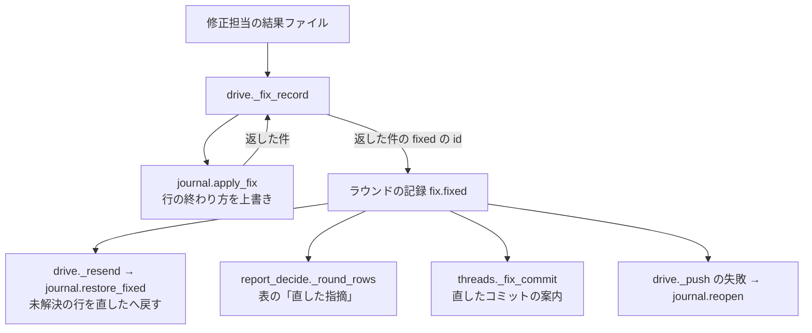
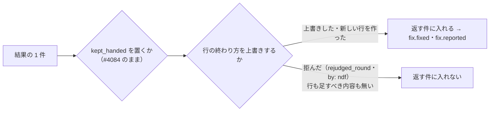

# cross-review の修正の記録: 上書きを拒んだ古い結果を直した指摘に数えず、送り直しで未解決の行を閉じない（#4109）

#4084 の詳細設計どおりに実装すると、再判定した行への古い `fixed` の上書きを拒んでも、その id がラウンドの修正の記録（`fix.fixed`）に残り、次の起動の送り直しで未解決の行が直したに戻る。`apply_fix` が返す件を「行の終わり方を上書きした件」に絞り、`fix.fixed` と `fix.reported` をその件だけから作る契約にして、読み手（送り直し・ラウンドの表・スレッドの案内）は変えない。採らなかった案は「決定の記録」に、#4084 の文書のどこを直すかは「#4084 の文書のどこを置き換えるか」にある。

省いた文書: 詳細設計書（別ファイル）（新設する関数 0・シグネチャを変える関数 0）
省いた文書: 実装計画（課題 1・公開インタフェース 変わらない・触るファイル 4・設計書を省いていない・準備のリファクタリングをしない）
省いた文書: 実行計画（課題 1・PR 1。#4045 の実装の PR に入る）

## 今の姿

何が起きたか・目的・受け入れ条件は要求仕様（[issue-4109-requirements.md](./issue-4109-requirements.md)、正は #4109 の本文）にある。直す対象は #4084 の設計文書 [issue-4084-design.md](./issue-4084-design.md) と詳細設計 [issue-4084-design-detail.md](./issue-4084-design-detail.md) で、#4084 はそれ自体が #4045 の設計（[issue-4045-design.md](./issue-4045-design.md)）の直しである。どれも #4045 の実装の PR で実装する。

`fix.fixed` の読み手は 4 つで、どれも「この取り込みで行を直したにした」と読む。今のコードではその読みが成り立つ。

| 確かめたこと | 今のコード（main `ec8340675`・`sprint/p12-lcrfast-r1` `bfc157af6`） |
| --- | --- |
| `apply_fix` が返す件 | 結果のうち終わり方が直した・見送ったの件をすべて返す（`journal.py` の `apply_fix`） |
| 上書きを拒む経路 | 無い。行があれば必ず上書きし、行が無く足すべき内容（`handed`）にある id は新しい行にする |
| `fix.fixed` | 返した件の `fixed` の id（`drive.py` の `_fix_record`） |
| `restore_fixed` | `fix.fixed` の id のうち、行が未解決のものを直したにする（`journal.py`） |
| `_resend` | 起動の始め（`_start`）で、前の起動の取り込み（`_ingest_pending`）の直後に、最後のラウンドの `fix` が送られていなければ送り直し、送れたら `restore_fixed(fix.fixed)` を打つ（`drive.py`） |

今のコードで `fix.fixed` と行が食い違うのは、ジャーナルにも足すべき内容にも無い id の結果だけである。行は作られないので `restore_fixed` は読み飛ばすが、ラウンドの表の「直した指摘」には載る。

問題を持ち込むのは設計の側で、上書きを拒む規則が 2 つある。

| 規則 | 出所 | 拒む件 |
| --- | --- | --- |
| 再判定した行は古い起動の結果で閉じない | #4084 の決定 5、詳細設計の `apply_fix` の行（#4076 との統合の後） | 行の `rejudged_round` があり、結果を生成した起動のラウンド（`sent_round`）が None かそれより小さい |
| 機械が確かめる MVV の根拠の行は修正担当の結果で閉じない | #4076 の詳細設計の `apply_fix`（`by: ndf` の行） | 行の `by` が `ndf` |

どちらも `apply_fix` の上書きだけを止め、返す件と `fix.fixed` は今のまま（結果の件をすべて）なので、拒んだ id が `fix.fixed` に載る。#4109 が指摘したのは 1 つ目で、2 つ目も同じ形である。

## 文脈と制約

- #4045・#4084 は実装の前で、`issues/issue-4045-*`・`issues/issue-4084-*` はこの PR で書き換えない。#4045 の実装の PR が #4084 の置き換えと一緒にこの設計を当てる
- #4084 の決定 5（上書きを拒む条件）と決定 3・4（`kept_handed` を履歴として置く条件）は変えない
- `restore_fixed`・`reopen`・`_resend`・`report_decide`・`threads` は変えない。読み手が持つ規則を増やさない
- 状態ファイルの項目は足さない（`fix.fixed`・`fix.reported` の意味を、取り込んだ件だけに絞る）

## 解き方の全体像

- `apply_fix` は、行の終わり方を書いた件（既にある行を上書きした件と、足すべき内容から新しい行を作った件）だけを返す。拒んだ件と、行にも足すべき内容にも無い id の件は返さない
- `kept_handed` は今の #4084 の設計どおり、返すかどうかと関係なく上書きの判断の前に置く。拒んだ行にも履歴が残る
- `_fix_record` は今のまま、返った件から `fix.reported`（件数）と `fix.fixed`（`fixed` の id）を作る。`fix.fixed` は「この取り込みで直したにした行」だけになり、4 つの読み手は今の読み方のまま正しく動く
- 送れなかった後の送り直しは、拒まずに取り込んだ `fixed` の行だけを直したへ戻す

## 決定の記録

### 決定 1: `fix.fixed` が直したにした行だけを指すよう、`apply_fix` が返す件を終わり方を書いた件に絞る

- **質問**: 上書きを拒んだ件を、送り直し・ラウンドの表・スレッドの案内のどこで直したと扱わないようにするか
- **選んだ案**: `apply_fix` の返りを「行の終わり方を書いた件」と決め、上書きを拒む規則を持つ `apply_fix` の 1 か所で返す件も決める。`_fix_record` と 4 つの読み手は変えない
- 採らなかった案: `restore_fixed` で行の `rejudged_round` と記録のラウンドを比べる（ラウンドの表とスレッドの案内は直らず、`by: ndf` の規則も別に要る。拒む規則が `apply_fix` と読み手に分かれる）
- 採らなかった案: 送れなかったときに `reopen` が戻した id を記録に足し、`restore_fixed` はその id だけを戻す（項目が 1 つ増え、表とスレッドは直らない）
- 採らなかった案: `apply_fix` の返りを（結果の件・書いた件）の 2 つにして、`fix.reported` の件数は今のまま結果の件で数える（シグネチャが変わり、件数が取り込まなかった件を数え続ける）
- 採らなかった案: `_fix_record` が取り込んだ後の行の終わり方を見て `fix.fixed` から外す（拒む規則を `apply_fix` と `_fix_record` の 2 か所が持つ。同じ結果に同じ id が 2 件あると後の件の終わり方で前の件を外す）
- **代償**: `fix.reported` の件数と、修正担当の注記（「指摘 N 件を扱った」）が、拒んだ件と行の無い id の件を数えなくなる。ラウンドの表の「直した指摘」からも、行の無い id が消える
- 根拠: Value 11「同じ規則・定数・処理は 1 か所にまとまり、ほかはそこを参照する」・Value 13「確かめたことだけが済んだとされる」（MVV 版 11）

## 影響と危険

- **働く範囲**: この PR は設計文書だけで、振る舞いは変わらない。#4045 の実装の後は、利用先のリポジトリでも `ndf cross-review run`・`merge-fix` を打つすべての PR のレビューに効く
- **プロジェクトごとに違うもの**: 無い（NDF のコードが持つ）
- **当たるモード**: cross-review を通すすべてのモード
- **実装の順**: #4045 の実装の PR（#4084 と一緒）で入れる。その PR は「#4084 の文書のどこを置き換えるか」の表のとおり `issues/issue-4084-*` を直し、#4084 の表に従って `issues/issue-4045-*` を直してから実装する
- **同じファイルを触る別の変更（レーン lcrfast が実装中）**:
  - #4076（MVV の根拠の確かめ）: `apply_fix` に `by: ndf` の行を上書きしない規則と `mvv` の引数を足す。#4045 の実装と #4076 の実装のうち後に入る PR が、両方の拒む規則を返す件の外に置き、「テスト設計」の #4076 の行を足す（#4084 の決定 4 の統合の規則と同じ扱い）。#4076 が先に入ると、#4045 の実装までの間は `by: ndf` の行への `fixed` が `fix.fixed` に載る。`by: ndf` の場合は #4109 と同じ原因・同じ形で、分けると片方だけが残るので、起票せずにこの設計の範囲へ入れた（要求仕様の「対象範囲」）
  - #4013（修正担当の会話を続ける）・#4014（起きることを書けない重い指摘）: `_fix_prompt`・修正担当の起動・重さの判定を触る。この設計は `apply_fix` の返す件だけを変え、`_fix_record` 以降は変えないので重ならない
- **壊れうる箇所**: `apply_fix` に上書きしない規則を後から足す変更が、返す件から外すのを忘れると同じ不具合が戻る。返す件の契約を `apply_fix` の説明（docstring）に書き、拒む規則ごとに `fix.fixed` に載らないテストを 1 行置く
- **用語集**: 足す語は無い

### 代表のリポジトリでの振る舞い

| 代表のリポジトリ | 設定の要点 | 直した後に起きること | この種類で扱えなくなること |
| --- | --- | --- | --- |
| Web サービス（nd-factory） | 実装とリファクタリングの PR を cross-review が見る | #4045 の実装の後、古い修正の結果を後から取り込んで送り直しても、再判定した未解決の指摘が直したにならず、表とスレッドにも直したと出ない | 無し |
| モバイルアプリ | 同上 | 同上 | 無し |
| 業務文書だけ | 設計・文書の PR を cross-review が見る | 同上 | 無し |

### ai-plugins だけの事情

- 無し（規則と記録の形は NDF のコードが持ち、このリポジトリの宣言の値を使わない）

## テスト設計

#4045 の実装の PR で縛る。受け入れ条件の番号は #4109 の要求仕様のものである。

| 受け入れ条件 | どの振る舞いで縛るか | どう壊したら落ちるべきか |
| --- | --- | --- |
| 1. 拒んだ id が `fix.fixed` に載らず、送り直しで戻らない | #4084 のテスト設計の「#4076 の旧版の結果を後から取り込む」の状態（ラウンド 1 の結果に `r1-1` が `fixed`、ラウンド 2 で再判定され `rejudged_round: 2`）で `merge_fix` を打つと、ラウンド 2 の `fix.fixed` に `r1-1` が無い。続けて駆動の外で積んだコミットがある状態で `run` を打ち直すと、`_resend` が送り直し、`r1-1` は未解決のまま | 拒んだ件を返す件に入れる・`_fix_record` が結果の件から `fixed` を作る |
| 1. 同上（`round` の無い結果） | `rejudged_round` を持つ行への `round` の無い結果の `fixed` を取り込むと、`fix.fixed` に無い | 照合できない結果を返す件に入れる |
| 2. 拒んだ行の `kept_handed` が残る | 上の取り込みで、`r1-1` に `kept_handed`（`round: 1`・`outcome: fixed`）が置かれる | 返さない件では `kept_handed` も置かない |
| 3. `fix.reported` と `fix.fixed` は書いた件だけ | 書いた件 1・拒んだ件 1・行にも足すべき内容にも無い id の件 1 の結果を取り込むと、`fix.reported` が 1、`fix.fixed` が書いた件の id だけ | 結果の件を数える |
| 4. 拒まずに取り込んだ `fixed` は今のとおり | 再判定の無い行の `fixed` と、足すべき内容から作った行の `fixed` が `fix.fixed` に載る。送れなかった後の送り直しで直したへ戻る（今の `test_resend_after_a_refused_push_restores_the_fixed_findings` が通り続ける） | 書いた件まで返さない |
| 1. 拒んだ id（#4076 との統合。後に入る PR で足す） | `by: ndf` の行への `fixed` を取り込むと、行の終わり方は変わらず、`fix.fixed` に無い。送り直しでも直したにならない | `by: ndf` の行への結果を返す件に入れる |
| 5. #4084 の文書が直っている | #4045 の実装の PR の差分に、「#4084 の文書のどこを置き換えるか」の表のすべての行の直しがある | 表の行を落とす |

## どこを変えるか

詳細設計はこのセクションに畳む（新設する関数 0・シグネチャを変える関数 0 のため）。レビューの単位とリファクタリングの時機は #4045 の実装の PR に含める。

| ファイル | 変える中身 | 決定 |
| --- | --- | --- |
| `plugins/ndf/src/ndf/domains/crossreview/journal.py` | `FindingJournal.apply_fix` の返り。変える前（#4084 の詳細設計）: 結果のうち終わり方が直した・見送ったの件をすべて返す。変えた後: 既にある行の終わり方を上書きした件と、足すべき内容から新しい行を作った件だけを返す。返さない件は、#4076 との統合の後に `rejudged_round` で上書きを拒んだ件・`by: ndf` の行への件（#4076）と、行にも足すべき内容にも無い id の件。`kept_handed` を置く条件と時点は #4084 のまま（返すかに関わらず上書きの判断の前）。返りの契約を docstring に書く | 決定 1 |
| `plugins/ndf/src/ndf/domains/crossreview/drive.py` | 変えない。`_fix_record` は返った件から `reported` と `fixed` を作る今のまま | 決定 1 |
| `plugins/ndf/tests/domains/crossreview/test_crossreview_journal.py` | `apply_fix` の返す件（受け入れ条件 2・3・4、#4076 との統合の行） | — |
| `plugins/ndf/tests/domains/crossreview/test_crossreview_store.py` | `merge_fix` の後のラウンドの `fix.fixed`・`fix.reported`（受け入れ条件 1・3） | — |
| `plugins/ndf/tests/domains/crossreview/test_crossreview_run.py` | `run` の打ち直しの送り直しで拒んだ行が未解決のまま（受け入れ条件 1・4） | — |

## #4084 の文書のどこを置き換えるか

#4045 の実装の PR は、#4084 の「#4045 の文書のどこを置き換えるか」の表を当てる前に、次の表のとおり `issues/issue-4084-design.md` と `issues/issue-4084-design-detail.md` を直す。#4084 の表の行が #4084 の詳細設計を指して `issues/issue-4045-*` へ写す箇所は、直した後の中身で写す。要求仕様（`issues/issue-4084-requirements.md`・`issues/issue-4045-requirements.md`）は変えない。

| 文書 | 節・決定 | 今の中身 | 置き換えた後 |
| --- | --- | --- | --- |
| #4084 の設計文書 | 決定 5 の「選んだ案」の最後の箇条 | 終わり方と理由の取り込みと、`fix` の記録を最後のラウンドに置く振る舞いは、上書きしない場合を除いて変えない | 続けて「上書きしない件は `apply_fix` が返さず、ラウンドの記録の `fixed` と `reported` に載らない（#4109 の決定 1）」を足す |
| #4084 の設計文書 | テスト設計の「#4076 の旧版の結果を後から取り込む」の行 | 行の終わり方は未解決のまま、`skipped_mvv` は書かれない | 「取り込んだラウンドの `fix.fixed` に行の id が無く、`run` の打ち直しの送り直しの後も未解決のまま」を足す |
| #4084 の詳細設計 | ジャーナルの関数の表の `apply_fix` の「変えた後」 | 上書きの条件と `kept_handed` を置く条件だけ | 末尾に「返すのは終わり方を書いた件（上書きした件と足すべき内容から作った件）だけで、上書きしない件と、行にも足すべき内容にも無い id の件は返さない（#4109）」を足す |
| #4084 の詳細設計 | 異常系の処理の表 | `apply_fix` の「結果の id が `kept_sent` に無い」の行まで | 行を足す: 関数 `apply_fix`・失敗「結果の id が行にも足すべき内容にも無い」・原因「修正担当が指示に無い id を返した」・扱い「行を作らず、返す件に入れない」・出力「無し」 |
| #4084 の詳細設計 | 駆動の関数の表の `_fix_record` の責務 | 結果を読み、照合して `apply_fix` を打つ | 末尾に「ラウンドの修正の記録の `reported`・`fixed` は `apply_fix` が返した件から作る（今のまま。上書きしない件は載らない）」を足す |
| #4084 の詳細設計 | 単体テストの観点 | `apply_fix` の `kept_handed` の行と、#4076 との統合の行 | この文書の「テスト設計」の受け入れ条件 1〜4 と #4076 との統合の行を、`test_crossreview_journal.py`・`test_crossreview_store.py`・`test_crossreview_run.py` の観点として足す |

## 設計の結果

| 課題 | 扱い | 統合先 | 触るファイル |
| --- | --- | --- | --- |
| #4109 | マージする | #4045 | |

## 外部の調査

省く: #4084 の設計で決めた取り込みの規則の中で、関数の返りを規則に合わせるだけで、比べる新しい形が無い
