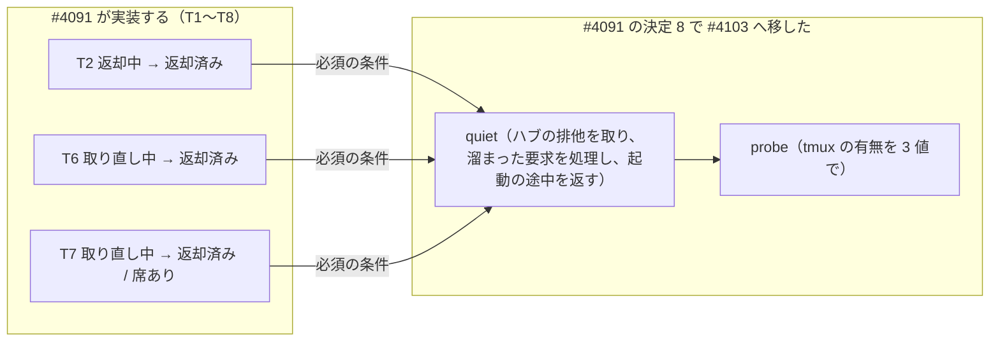
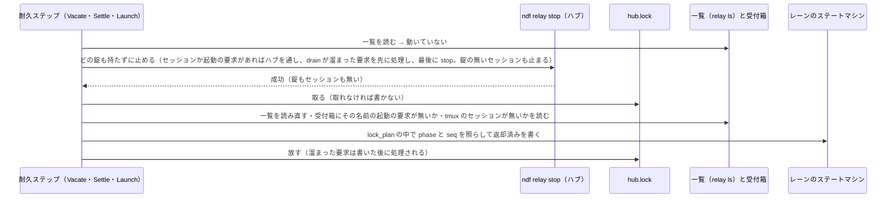

# #4091 の席の返却: #4091 だけを実装しても、ラッパーを止めてハブの起動と排他してから席を返す（#4110）

#4091 の設計は、返却済みへ移す遷移（T2・T6・T7）の「不在」の確かめを `quiet`・`probe` に頼りながら、その 2 つを決定 8 で #4103 へ移したため、#4091 だけを実装したときに席を返す振る舞いが決まらない。#4091 だけの段階の確かめを「停止の確かめ」と名付けて 1 つの関数に置く。中身は、ハブを通してラッパーを止め（溜まった起動の要求もそこで処理される）、ハブの排他（`hub.lock`）を持ったまま、一覧で動いていないことと受付箱にその名前の起動の要求が無いことを確かめてから書く、の 3 段である。ハブの錠と受付箱の置き場は、層の規則で `progress` から読めるよう `core` へ移す。採らなかった案は「決定の記録」に、#4091 の文書をどう置き換えるかは「#4091 の設計の置き換え」にある。

## 今の姿

何が起きたか・受け入れ条件は要求仕様（[issue-4110-requirements.md](./issue-4110-requirements.md)、正は #4110 の本文）にある。パスは `plugins/ndf/` からの相対で書く。直す対象は #4091 の設計（[issue-4091-design.md](./issue-4091-design.md)・[issue-4091-design-detail.md](./issue-4091-design-detail.md)）で、#4103 の設計（[issue-4103-design.md](./issue-4103-design.md)）が後から乗る。

#4091 の文書は、T2・T6・T7 を「ハブの排他の中で、一覧で動いていない・未処理の起動の要求も錠を持たない tmux のセッションも無い」ときだけ書くとし、その確かめの部品に #4103 の印を付けた。#4103 の設計はその部品を作らず、別の仕組み（起動の券と起動の印・一覧の `starting`・`admit.lock` の中の `launch_ticket.quiet`）で置き換える。そのため #4091 だけを実装する人は、T2 を進めないか、ハブと排他せずに書くかを自分で選ぶことになる。

設計に要る今の構造:

| 部品 | 今の振る舞い | 場所 |
| --- | --- | --- |
| ラッパーの停止 | `ndf relay stop <名前>` は tmux のセッションがあれば `stop` の要求をハブへ出す（`hub.submit`）。ハブは `drain` の中で受付箱の要求を古い順に処理し、`stop` はラッパーの錠が持たれているかセッションがあればセッションを止め、錠が空くまで待つ。錠もセッションも無ければ「動いていない」で成功 | `domains/relay/cli.py` の `_stop_one`、`domains/relay/hub.py` の `submit`・`drain`・`stop` |
| ハブの排他と受付箱 | 錠は `<状態の保存先>/<relay-hub の場所>/hub.lock`、受付箱は今の版が `requests-v2/`、導入を読まない旧版が `requests/`。どちらの版の `drain` も同じ `hub.lock` を取ってから処理する | `hub.py` の `LOCK_FILE`・`REQUESTS_DIR`・`hub_dir` |
| 起動の確かめ | `_confirm` はラッパーが錠を取るのを `relay.started` の秒だけ待ち、取れなければ失敗を返すがセッションを残す | `hub.py` の `_launch`・`_confirm` |
| 層の規則 | `contracts → adapters → core → progress → domains` の順で、下の層から上の層を import すると検査（`layer`）で落ちる。`ndf.identity` と `ndf.contracts.facts` はどの層からも読める | `src/ndf/checks/rules.json` の `structure.layers`、`src/ndf/checks/structure.py` の `_import_findings` |

## 文脈と制約

- #4091 の状態と事象の表・段階・数える規則（`LaneRow.counted`）・照らす条件（`phase` と `seq`）は変えない。変えるのは、返却済みへ移す前の「不在」の読み方と、その部品の置き場と持ち主だけである
- #4103 の実装は #4091 の実装の後に入る（#4103 の設計の「影響と危険」）。#4091 だけの段階は、#4103 が入るまで実際に動く版になりうる
- `progress` の層は `domains` を import できない（今の姿の層の規則）。#4091 の詳細設計の「`lane/launch.py` が `domains/relay/hub.py` の `quiet` を import する」形はこの規則で落ちる。#4091 が「未確認のまま残ること」に置いた点はこれで確かめた
- ラッパーの一覧（`launch.wrappers()`）は読めないことがある（`None`）。生存は名前の有無でなく `liveness.wrapper_running` で読む（#4091 の「生存の判定は 1 つ」のまま）
- 錠の順は #4091 のとおり `admit.lock` → `hub.lock` → `lock_plan` の 1 方向で、ハブの `drain` は `admit.lock`・`lock_plan` を取らない。停止の確かめは `admit.lock` を持たずに打つ（決定 1）ので、その中で取るのは `hub.lock` → `lock_plan` だけである
- `relay stop` の `drain` は、ほかのレーンの溜まった起動の要求も処理し、1 件ごとに `_confirm` が `relay.started` の秒まで待つ。錠を持ったまま `relay stop` を打つと、その錠を待つほかの処理が同じだけ止まる
- 他の課題の文書（#4091・#4103）は設計 PR では変えない。#4091 の文書は #4091 の実装の PR で、#4103 の文書は #4103 の実装の PR で合わせる

## 解き方の全体像

- 返却済みへ移す遷移（T2・T6・T7）は、どれも `plan/run.py` の 1 つの関数 `_confirm_seat` を通る。#4091 だけの段階の中身は「停止の確かめ」（上の図）で、#4103 の実装がこの関数の中身を一覧の 3 つの生存と `admit.lock` の中の `launch_ticket.quiet` に置き換える（#4103 の詳細設計の `_confirm_seat` と同じ名前と役割）
- ハブの錠のパスと受付箱の名前は `core/relay_hub.py` が持ち、ハブ（`domains/relay/hub.py`）と `_confirm_seat` の両方がそこを読む。`hub.lock` を持つ文脈（`relay_hub.hold`）もそこに置く
- `quiet`（リレーと `lane/launch.py` の 2 つ）・`_drain_held`・`probe` は #4091 では作らない。`probe` は #4103 が作る
- 一覧で動いている取り直し中の行は、止めずに席あり（T5・T7）へ進む。止めるのは、返却済みを書こうとする行だけである

## 構成要素

| 構成要素 | 責務 | 場所 | #4103 の実装の後 |
| --- | --- | --- | --- |
| `relay_hub`（新設のモジュール） | ハブの置き場（`hub_dir`）・錠の名前（`LOCK_FILE`）・受付箱の名前（`INBOXES`）・tmux のソケット（`SOCKET`）を 1 か所に持ち、受付箱の起動の要求（`starting`）と tmux のセッションの有無の 3 値（`session`）を読み、`hub.lock` を持つ文脈 `hold` を出す | `src/ndf/core/relay_hub.py` | `hold` は消す。置き場と名前は残り、`launch_ticket` とハブが読む（どちらへ寄せるかは #4103 の実装が決める）。`session` は #4103 の `probe` が読む |
| ハブの定数 | `hub_dir`・`LOCK_FILE`・`REQUESTS_DIR` を `relay_hub` から、`SOCKET` を `tmux.py` が `relay_hub` から読む（定義を移すだけで振る舞いは変えない） | `domains/relay/hub.py`・`tmux.py` | #4103 のとおり |
| 名前つきの停止 | tmux のセッションが無くても、今の版の受付箱にその名前の起動の要求があればハブへ `stop` を出す | `domains/relay/cli.py` の `_stop_one` | #4103 の `stop` の世代の照らし方が乗る |
| `_confirm_seat`（新設） | 返却済みを書く遷移（T2・T6・T7）と、取り直し中の席あり（T7）の確かめを 1 か所で行う | `progress/plan/run.py` | #4103 の `_confirm_seat` が中身と引数を置き換える |
| `vacate_lane`・`settle_seat`・`launch_lane` | 返却済みや席ありを書く所は `_confirm_seat` を打つ | `progress/plan/run.py` | #4103 のとおり |

関数の粒度は詳細設計（[issue-4110-design-detail.md](./issue-4110-design-detail.md)。新設する関数が 2 つ（`relay_hub.hold`・`_confirm_seat`）あるため別ファイル）にある。

## 決定の記録

### 決定 1: #4091 だけでも席を返せてハブの起動と食い違わないため、返却済みの前の「不在」を「止めてから、ハブの排他の中で一覧と受付箱を読む」で確かめる

- **質問**: #4091 だけを実装した状態で、T2・T6・T7 の「不在」を何で確かめるか（#4110 の受け入れ条件 1・2）
- **選んだ案**: 「停止の確かめ」の 3 段にする。(1) 一覧で動いていない行について、どの錠（`admit.lock` を含む）も持たずに `launch.stop` を打つ。`relay stop` は、tmux のセッションがあるか、今の版の受付箱にその名前の起動の要求があればハブを通す（今の `_stop_one` はセッションがあるときだけハブを通すので、起動の要求だけが残る行でハブを動かさない。そこを変える）。ハブの `drain` は受付箱の要求を古い順に処理してから最後にこの `stop` を処理するので、頼む側を失って残った起動の要求も、`_confirm` の期限切れの後に錠を取らずに残ったセッションも、ここで処理されるか止まる (2) `relay_hub.hold` で `hub.lock` を取り、その中で一覧を読み直して動いていないこと、受付箱（`requests-v2/` と旧版の `requests/`）にその名前の起動の要求（種類 `spawn`・`replace`・`restart`）が無いこと、tmux にその名前のセッションが無いこと（`relay_hub.session`。「無い」と答えたときだけ無いとし、不明は「ある」と同じに扱う）を読む。(1) の後・錠の前に処理された起動は、一覧で動いているか、錠を取らないセッションとしてここに出る (3) どれも満たせば、その錠を持ったまま `move_seat` で返却済みを書く。満たさない・錠を取れない・一覧を読めない・止められないときは書かず、行は数え続ける。錠を持つ間はハブが要求を処理しないので、読んでから書くまでにラッパーが起きない。取り直しの手順の 4・5 も、起動の排他（`admit.lock`）を放してから停止の確かめを打つ（T5・T6 は数える席を増やさない）
- 採らなかった案: #4091 の詳細設計の `quiet` のとおり、`hub.lock` の中で溜まった要求を自分で処理する（`_drain_held`）。耐久ステップが別のレーンの起動まで処理し、その応答待ちと失敗を背負う。3 ラウンドの cross-review で穴が出続けた形で、#4103 は作らないと決めた（#4103 の「#4091 の設計の置き換え」）ので、実装しても捨てる
- 採らなかった案: #4103 が入るまで T2 を書かない（返却中のまま数え続ける）。受け入れ条件 2 を満たさず、#4091 の席の返却が #4103 まで働かない
- 採らなかった案: 一覧だけで不在と読み、`hub.lock` を取らない。ハブが起動を処理している最中（tmux のセッションを作り、`_confirm` が錠を待つ数十秒）は一覧で動いていないので、起動の途中の行を返却済みにする
- 採らなかった案: 止めることと不在の確かめを同じ `hub.lock` の中で行う。`relay stop` は `submit` の `drain` で `hub.lock` を取るので、錠を持ったまま打つと自分の錠を待って応答待ちが切れる。錠の中で tmux を読むことで、止めた後・錠の前に起きた起動を拾う
- 採らなかった案: 取り直しの手順の 4・5 を `admit.lock` の中で打つ（#4091 の今の形）。`relay stop` の `drain` がほかのレーンの起動を 1 件ずつ数十秒かけて処理する間、同じマシンのほかの計画のレーンが `admit.lock` を `parallel-machine.admit-lock` の秒で取れずに起動の許可が止まる
- **代償**: 返却済みを書こうとするたびにハブへ `stop` の要求を 1 本出す（止めるものが無ければ錠とセッションを読んで終わる）。取り直し中の行では、一覧を読んだ後に錠を取ったばかりのラッパーを止めることがある（そのときは T6・T7 で返却済みになり、同じ続きの手が次の観測で T4 から起動し直す。失敗の 1 回に数える）
- 根拠: Value 3「同じ操作を打ち直しても、結果は 1 回打ったときと変わらない」・Value 5「完璧なものより、小さく「たぶん動く」ものが早く届く」（MVV 版 11）。#4110 の受け入れ条件 2

### 決定 2: 層の規則に沿ってハブの錠を 1 か所で持つため、ハブの置き場・錠・受付箱の名前を `core` へ移し、ハブと席の確かめの両方がそこを読む

- **質問**: `progress` の層にある席の手から、`domains` の層にあるハブの錠をどう取るか
- **選んだ案**: `src/ndf/core/relay_hub.py` を新設し、`hub_dir`（今の `hub.py` と同じく `facts.value("locations", "relay-hub", "path")` から作る）・`LOCK_FILE`・`INBOXES`（受付箱の名前の並び）・`SOCKET`（tmux のソケット）と、受付箱を読む `starting`・tmux のセッションを 3 値で読む `session`・錠を取る文脈 `hold` を置く。`domains/relay/hub.py`・`tmux.py` はこれらを `relay_hub` から読み、自分では定義しない。錠の取り方は `core` の `durable.open_lock_file` と `durable_locks.try_flock`（`machine.admit_lock` と同じ形）で、ハブの `signals.held`（`fcntl.flock`）と同じファイルの同じ種類の錠なので、プロセスをまたいで排他になる
- 採らなかった案: `lane/launch.py` から `domains/relay/hub.py` を import する（#4091 の詳細設計の形。層の検査で落ちる）
- 採らなかった案: 錠と受付箱の名前を `progress` の側に写す（同じ名前を 2 か所に持ち、片方だけ変わると排他が外れる）
- 採らなかった案: 「`hub.lock` を持ったまま渡したコマンドを打つ」リレーの CLI を足す（公開の CLI が増え、返却済みの書き込みを別のプロセスへ渡す形が要る）
- **代償**: 無し（`hub.py` の定義を移すだけで、値と振る舞いは変わらない）
- 根拠: Value 11「同じ規則・定数・処理は 1 か所にまとまり、ほかはそこを参照する」・Value 9「1 つのモジュール・クラス・関数が 1 つの責務を持ち」（MVV 版 11）

### 決定 3: #4103 と持ち物を重ねないため、#4091 は停止の確かめと `_confirm_seat` の入口だけを持ち、起動の途中の検出と照会の 3 値は #4103 に残す

- **質問**: #4091 の決定 8 が #4103 へ移した箇所のうち、どこを #4091 へ戻し、どこを #4103 に残すか
- **選んだ案**: 次の表で分ける。#4091 へ戻すのは、返却済みを書く前に「ハブの起動と排他して、止まったと確かめる」ことだけで、#4103 の仕組み（券・印・`starting`）には触れない。入口の関数の名前と役割を #4103 の詳細設計の `_confirm_seat` に合わせ、#4103 の実装はその中身を差し替えるだけにする

| 持ち物 | #4091（#4110 の直しを含む） | #4103 |
| --- | --- | --- |
| T2・T6・T7 の書き込みの入口 | `_confirm_seat`（停止の確かめ） | 同じ関数の中身を、一覧の 3 つの生存と `admit.lock` の中の `launch_ticket.quiet` に置き換える |
| ハブの排他 | `relay_hub.hold`（`hub.lock`。確かめと書き込みの間だけ持つ） | 使わない（`hold` を消す） |
| 溜まった要求 | `relay stop` の `drain` が処理する。受付箱に残る要求は読むだけで処理しない | 券の生存の錠の空いた要求を捨てる |
| 錠を持たないセッション | `relay stop` が止め、`hub.lock` の中で `relay_hub.session` が残っていないと確かめる | 起動の印と `_retire` |
| tmux の照会の失敗 | `hub.lock` の中の照会だけ 3 値で読み（`relay_hub.session`）、不明なら書かない。`relay stop` の中の照会は今の `has` のまま | `probe`（`relay_hub.session` の規則を読む）と `sessions` |
| 手動の再起動の直列化・期限を越えて生きる手・`Settle` を打ち切らない（S8・S9） | 扱わない（#4091 の決定 8 のまま） | 決定 4・5 |

- 採らなかった案: `quiet`・`probe` をそのまま #4091 へ戻す（#4103 が作らないと決めた部品を作り、#4103 の実装で消すことになる。`quiet` は層の規則でも落ちる）
- **代償**: #4103 が入るまで、次の 2 つの窓が残る。どちらも #4091 の決定 8 の代償（手動の再起動は #4044 の数え方の範囲でしか守られない）と同じ種類で、#4103 の券と印が塞ぐ。(a) 停止の確かめの後に、頼む側を失った子のプロセスや手動の `relay restart` が書いた起動の要求は、返却済みの後に処理される。ラッパーが錠を取るまでの数十秒は一覧で動いていないので、起動の許可が数えない (b) 旧版の受付箱（`requests/`）に残った起動の要求は今の版の `drain` が処理しないので、旧版の頼む側が応答を待たずに落ちていると、その行は返却中のまま数え続ける（上限を超えない側。#4118 の版の混在の範囲）。tmux を打てない・時間切れのとき、`relay stop` の中の今の `has` は「無い」を返して錠の無いセッションを止めずに成功を返しうるが、錠の中の `relay_hub.session` が不明を返すので返却済みは書かない
- 根拠: Value 11「文書も正本が 1 か所にあり、写さずに指す」・Value 9「まだ要らない仕組みは先回りして作らず」（MVV 版 11）。#4103 の決定 7

### 決定 4: 取り直しの失敗で席を残し続けないため、#4091 だけの段階でも T6・T7 の返却済みを停止の確かめで書く

- **質問**: #4091 の決定 8 は、#4103 が入るまで「取り直しの起動の結果が「起動しなかった」と確定しない限り取り直し中のまま数え続け」るとした。停止の確かめを持った後も、T6・T7 の返却済みを書かないままにするか
- **選んだ案**: 書く。停止の確かめは、起動の結果を待って読むのではなく、ハブを通して止めたうえで不在を確かめるので、起動の確かめの失敗・ハブの応答待ちの切れ・中断の後でも「起動していない」と確定できる。ハブの上限の断り（T6 の `refused`）も同じ確かめを通す。一覧で動いていれば止めずに席あり（T5・T7 の `present`）にする
- 採らなかった案: 決定 8 の安全側のまま、取り直し中の行を #4103 まで数え続ける。起動の確かめが一度失敗した行は、人がレーンを中止するまで枠を使い続ける
- **代償**: 決定 1 の代償のとおり、一覧を読んだ後に錠を取ったばかりの conductor を止めることがある
- 根拠: Value 3「判断の要らない手順（待ち・集計・検査・記録・整形・起動の組み立て）は仕組みが進めるので、結果が実行ごとにばらつかない」（MVV 版 11）

## 影響と危険

- **働く範囲**: 利用先のリポジトリでも働く。並列の計画のスプリントの行を流すすべてのマシンに効く（#4091 と同じ）
- **プロジェクトごとに違うもの**: 無し（錠を待つ秒は今の `parallel-machine.admit-lock`、止める秒は今の `relay.stop-wait`、tmux の照会の秒は今の `relay.tmux`）
- **当たるモード**: 並列の計画で流すすべてのモード
- **壊れうる箇所**:
  - `hub.lock` を持つ間（一覧を 1 回読み、受付箱を読み、tmux を 1 回照会し（`relay.tmux` の秒まで）、1 行を書く間）、同じマシンのリレーの起動・停止はハブの処理を待つ。`submit` は `relay.hub-wait` の秒まで `drain` を打ち直すので、失敗にはならない。錠の中ではハブの処理を待たない（`relay stop` は錠の外）
  - 停止の確かめの `relay stop` は、ほかのレーンの溜まった起動を処理し終えるまで返らない（1 件ごとに `relay.started` の秒まで）。どの錠も持たずに打つので、待つのはその手だけで、ほかの計画のレーンの起動の許可（`admit.lock`）は止まらない。`relay.hub-wait` の秒を越えれば `stop_failed` で、止める手の失敗の 1 回になる
  - `relay stop` は、セッションが無くても今の版の受付箱にその名前の起動の要求があればハブへ `stop` を出す。手動の `relay stop` でも、残った起動を処理してから止める（止めた名前が後から起きない）
  - `_confirm_seat` が書かずに返した `Settle` は、#4091 の今の数え方で期限を越えるたびに失敗の 1 回になり、回数が尽きると知らせを 1 回出して打ち切られる（打ち切らない形は #4103 の決定 5）。行は数え続ける（上限を超えない側）ので、人がレーンを中止するか、計画を実行し直すと続く
  - 決定 3 の代償の 2 つの窓
- **同じファイルを触る別の変更と実装の順**:
  - 実装の順: #4050・#4044 → #4091（この設計の直しを含む）→ #4103 → #4118。この課題は #4091 の実装の PR で実装し、単独の PR を出さない
  - #4103 は `domains/relay/hub.py` の受付箱を `requests-v3` へ変え、券と印を `core/launch_ticket.py` に置く。`relay_hub` の名前の並び（`INBOXES`）と `hold` は #4103 の実装が合わせる（`hold` は消す）
  - #4118（リレーの版が混在する間の検出と照合）は、同じレーンの別の設計が並行して決めている。この設計の受付箱の読み方（今の版と旧版の 2 つ）は #4103 が入るまでの間だけのもので、版の混在の検出と照合には踏み込まない。#4118 の設計が受付箱の名前を変えても、#4091 だけの段階の確かめは `relay_hub.INBOXES` の 1 か所を合わせれば足りる

### 代表のリポジトリでの振る舞い

| 代表のリポジトリ | 設定の要点 | 直した後に起きること | この種類で扱えなくなること |
| --- | --- | --- | --- |
| Web サービス（nd-factory） | 並列の計画でスプリントのレーンを流す。上限はマシンの設定 | #4091 だけの版でも、承認や実装を待つ行がラッパーを止めて枠を返す。取り直しの起動に失敗した行も枠を返す | 無し |
| モバイルアプリ | 同上 | 同上 | 無し |
| 業務文書だけ | 同上（文書のスプリントのレーン） | 同上 | 無し |

### このリポジトリだけの事情

- 無し（席の振る舞いは NDF の製品の振る舞いで、ai-plugins の運用の値を持たない）

## 用語

| 語 | 意味 | 反映 |
| --- | --- | --- |
| 停止の確かめ | 返却済みを書く前に、ハブを通してラッパーを止め、ハブの排他の中で一覧と受付箱を読んで、そのレーンのラッパーが動いておらず起動の要求も無いと確かめること。#4103 の実装までの形 | 追加（用語集へは #4091 の実装の PR で足す） |

## テスト設計

| 受け入れ条件 | どの振る舞いで縛るか | どう壊したら落ちるべきか |
| --- | --- | --- |
| 2 | 返却中の行で、別のスレッドが `hub.lock` を持つ間は T2 が書かれず（`busy`）、放した後の観測で書かれる | `hold` を取らずに書くと落ちる |
| 2 | 停止の確かめの (1) の後・(2) の前に、そのレーンの起動の要求を受付箱へ置くと、T2 を書かない。次の観測の `relay stop` の `drain` がその要求を処理して止め、その後の確かめで返却済みになる | 受付箱を読まないと落ちる。読むだけで次の観測で止めないと、返却中のまま残って落ちる |
| 2 | `hold` を持つ間に別のプロセスが起動の要求を書いて `drain` を試すと、その処理は返却済みの書き込みの後に並ぶ。処理で起きたラッパーは、起動の許可（`count`）が動いているラッパーとして数え、上限 1 の別の計画の行を待たせる | 書き込みの前に要求が処理されると落ちる |
| 2 | 錠を持たない tmux のセッションが残る行（`_confirm` の期限切れの後を作る）で、T2 が `relay stop` でセッションを止めてから返却済みを書く | 一覧だけで不在と読むと、セッションが残ったまま書いて落ちる |
| 2 | 停止の確かめの (1) の後・(2) の前に、ラッパーの錠を取らない tmux のセッションを作ると、一覧も受付箱も空でも T2 を書かず、次の観測で止めてから返却済みになる。照会が不明でも書かない | 錠の中で tmux を読まないと、セッションが残ったまま書いて落ちる |
| 2 | 中断で起動の要求だけが今の版の受付箱に残り tmux のセッションが無い返却中の行で、ほかのリレーの操作を挟まずに 1 回の確かめで返却済みになる | `relay stop` がセッションの無いときにハブを動かさないと、毎回 `starting` で残って落ちる |
| 2 | 取り直しの手順の 4・5 で停止の確かめを打つ間、別のスレッドが `admit.lock` をすぐに取れる。手順の 4 で錠の中の読み直しが席ありを書けば成功の結果を返す | `admit.lock` を持ったまま `relay stop` を打つと落ちる。手順の 4 で `waiting` を返すと落ちる |
| 2 | 一覧に `registered: true, running: false` の行だけが載るレーンで、T2・T7 が返却済みへ進む | 名前の有無で生存を読むと落ちる |
| 2 | 取り直し中の行で、起動の確かめの失敗・応答待ちの切れの後に一覧で動いていれば席あり（止めない）、動いていなければ止めてから返却済み。ハブの断りの後に手動で起きていれば書かずに `waiting` | 動いている行を止めると、確かめずに返却済みにすると落ちる |
| 1 | `src/ndf/progress` の下に `ndf.domains` の import が無く、構造の検査（`layer`）が通る。`hub.py` が `LOCK_FILE`・`REQUESTS_DIR`・`hub_dir` を自分で定義しない | `progress` から `domains/relay/hub.py` を読むと落ちる |

詳細の観点は詳細設計の「単体テストの観点」にある。

## #4091 の設計の置き換え

#4091 の実装の PR で、#4091 の文書の次の箇所をこの設計に合わせる。設計 PR では変えない（「文脈と制約」）。#4103 の実装が先に確定仕様化されていれば、その確定仕様も合わせる。

| #4091 の文書の箇所 | 置き換え |
| --- | --- |
| `issue-4091-design.md` の「文脈と制約」の 5・6 つ目の項目（ハブの要求と起動の確かめ・ハブの排他を取れても要求が処理済みとは限らないこと） | 事実の記述は残し、結論の文（「返却済みへ移す前の「不在」は…」「返却済みを書く手がハブの排他の中で先に処理する」「不在と不明を分けて読む」）を「#4091 だけの段階は、返却済みを書く前に停止の確かめを通す（#4110 の決定 1）。起動の要求の生存と残ったセッションの確定は #4103」に置き換える。7 つ目の項目（手動の `restart` の `held`）は #4103 の印を付けて残す |
| 同 コンテキストの表のリレーの行 | 「変えない（#4091 は `relay stop` を打つだけ）。ハブの置き場・錠・受付箱の名前を `core/relay_hub.py` へ移す」にする。`quiet`・`probe`・手動の `restart` は #4103 の行へ移す |
| 同 状態と事象の表の T2・T6・T7 | 引き金と照らす条件の「ハブの排他の中で一覧を読めて動いていない」「未処理の起動の要求も錠を持たない tmux のセッションも無い」を「停止の確かめを通った（`_confirm_seat`）」に置き換える。排他の列は T2・T6・T7 のどれも `hub.lock` → `lock_plan`（T6 も `admit.lock` を持たない） |
| 同 不変条件 S1 の守る所 | 「`hub.lock` の中で、止めた後に読んだ一覧で動いておらず、受付箱にその名前の起動の要求が無いことを確かめる」にする。錠を持たない tmux のセッションの記述は「`relay stop` が止める」に、手動の再起動の直列化は #4103 の印に置き換える |
| 同 構成要素の表の `quiet`・`probe`・手動の `restart` の頼む側の行 | 削り、`relay_hub`（`core/relay_hub.py`）と `_confirm_seat`（`plan/run.py`）の行を足す |
| 同 決定 4 の「ハブの排他の中で一覧を読み」・決定 6 の「T2 はハブの排他の中で」 | 「停止の確かめで」に置き換える |
| 同 決定 8 | 選んだ案の「この版の文書のうち、次の箇所は #4103 の設計の材料として残し」の列挙から `quiet`・`probe` と T6・T7 の条件を外し、「返却済みの前の確かめは #4110 の停止の確かめで #4091 が持つ」を足す。「#4091 の実装は、この境では安全側（…取り直し中のまま数え続け…）」を #4110 の決定 4 に置き換える。#4110 の設計へのリンクを足す |
| 同 影響と危険の `domains/relay/cli.py`・`hub.py`・`tmux.py` の行 | `hub.py`・`tmux.py` は定数の移動だけ、`cli.py` は `_stop_one` の変更だけにし、`probe` と手動の `restart` の頼む側は #4103 へ移す |
| `issue-4091-design-detail.md` の冒頭と並行と排他の表の錠の順（「`admit.lock` を取るのは取り直しの手順の 5 と手動の `restart` の頼む側だけ」） | 取り直しの手順の 4・5 は `admit.lock` を放した後に打つ（#4110 の詳細設計の「停止の確かめを打つ所」）。`admit.lock` を取るのは取り直しの手順の 1〜3 と手動の `restart` の頼む側（#4103）だけにする |
| 同 未確認のまま残ることの 2 つ目（`launch.py` から `hub.py` の import） | 「層の規則で落ちるので、`core/relay_hub.py` へ移した（#4110 の決定 2）」に置き換える。`cli.py` が `admit_lock` を読む点は #4103 へ移す |
| 同 設計の結果の触るファイル | `src/ndf/core/relay_hub.py`・`tests/core/test_relay_hub.py` を足す。`domains/relay/tmux.py`（`SOCKET` の移動）・`domains/relay/cli.py`（`_stop_one`）・`tests/domains/relay/test_relay_cli.py` は残す |
| `issue-4091-design-detail.md` の冒頭の段落と地図の `launch.py`・`hub.py`・`tmux.py`・`cli.py` の行 | 地図を #4110 の詳細設計の地図に合わせる |
| 同 「生存の判定は 1 つ」の後半（返却済みへ移す前の「不在」）と「返却済みはハブの排他の中でだけ書く」の段落 | #4110 の詳細設計の「停止の確かめ」を指す 1 段落に置き換える |
| 同 関数の表の `quiet`（リレー・レーン）・`probe` の行 | 削り、#4110 の詳細設計の `relay_hub.hold`・`_confirm_seat` を指す |
| 同 返却の手順の 4・確かめの手順の 2・3・取り直しの手順の 4・5 | #4110 の詳細設計の「停止の確かめを打つ所」に置き換える |
| 同 失敗の数え方の「起動の途中に当たったとき」の文 | 「`_confirm_seat` が書かなかったとき」に置き換える。`Settle` を打ち切らない記述と `RunState.kept_alive`・`_notice_stalls`・`Observe.expiring` は #4103 の印のまま残す |
| 同 「手動の再起動と起動の許可の直列化」 | #4103 の印を付ける（#4091 では実装しない） |
| 同 並行と排他の表の返却済みの書き込みの行 | #4110 の詳細設計の並行と排他の表を指す |
| 同 単体テストの観点の「起動の途中」「ハブの排他」 | #4110 の詳細設計の単体テストの観点に置き換える。「手動の再起動の直列化」「手動の再起動と落ちた席」「`Settle` の打ち切りなし」「生存を理由に残した手と止まり」は #4103 の印を付ける |

## #4103 の設計との読み合わせ

#4103 の設計の「#4091 の設計の置き換え」の表は、#4091 の文書の `quiet`・`probe`・「ハブの排他の中で」の箇所を置き換えると書く。#4091 の実装の PR でこの設計が入った後は、その行は「#4110 の停止の確かめ（`relay_hub.hold` と `_confirm_seat` の中身）」を置き換えるものとして読む。#4103 の実装の PR は、その表と、`_confirm_seat` を「新設」と書いた行（#4091 の実装で既にある）を合わせる。この設計 PR では #4103 の文書を変えない。

## 設計の結果

| 課題 | 扱い | 統合先 | 触るファイル |
| --- | --- | --- | --- |
| #4110 | 統合する（#4091 の実装の PR で実装する） | #4091 | （#4091 の行に足す）`plugins/ndf/src/ndf/core/relay_hub.py`、`plugins/ndf/src/ndf/domains/relay/hub.py`、`plugins/ndf/src/ndf/domains/relay/tmux.py`、`plugins/ndf/src/ndf/domains/relay/cli.py`、`plugins/ndf/src/ndf/progress/plan/run.py`、`plugins/ndf/tests/core/test_relay_hub.py`、`plugins/ndf/tests/domains/relay/test_relay_cli.py`、`plugins/ndf/tests/progress/test_plan_run.py`、`plugins/ndf/tests/progress/test_run_hold.py`、`issues/issue-4091-design.md`、`issues/issue-4091-design-detail.md` |

## 未確認のまま残ること

- `durable.open_lock_file` と `durable_locks.try_flock` で取る錠と、ハブの `signals.held`（`os.open` と `fcntl.flock`）が同じファイルで排他になることは、どちらも同じファイルへの `flock` の `LOCK_EX` であることから読んだ。#4091 の実装の PR で、別のプロセスが `signals.held` を持つ間に `hold` が取れないテストで確かめる
- `hub.lock` を持ったまま `relay ls` を打てることは、今の `hub.listing` が `hub.lock` を取らないことから読んだ。#4103 は一覧から `_review_launches`（`hub.lock` の中）を呼ぶので、その変更は `hold` を消すのと同じ #4103 の実装の PR で入る（`hold` の中で `relay ls` が錠を待って詰まらない）
- `relay stop` の `drain` が、自分の `stop` より古い受付箱の要求を先に処理することは、`drain` がファイル名（時刻の頭）の順に処理するコードから読んだ。ほかのプロセスが `drain` 中なら、そのプロセスが同じ順で処理する

## 外部の調査

| 種類 | 調べるか | 理由 |
| --- | --- | --- |
| 標準・仕様 | 調べない | 同じマシンの中の錠と起動の順序で、公開の仕様が定める領域ではない |
| 主要な製品 | 調べない | #4091 の設計の PRD1・PRD2（終わっていないものを数え、観測が記録と実物から次の手を求める）の範囲で、新しい形を足さない |
| ライブラリとサービス | 調べない | 新しい依存を足さない。錠は今の `fcntl.flock` を使う |
