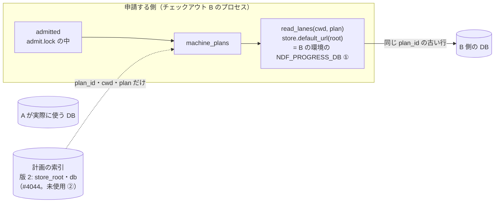
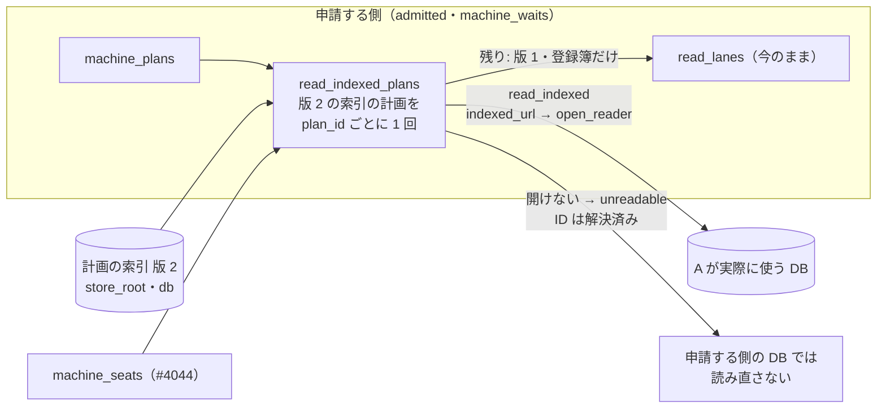
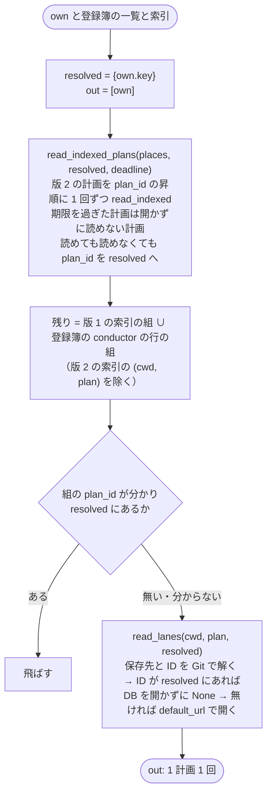

# 起動の許可: ほかの計画を、その計画が実際に使う DB から読んで数える（#4113）

起動の許可（`machine_plans`）は、ほかの計画を申請する側の `NDF_PROGRESS_DB` と作業ディレクトリで解いた DB から読むので、別の DB に同じ `plan_id` の古い行があればその行で数え、実行中のレーンを数え落とす。#4044 が索引に足す接続先（版 2 の `db`）を使う `read_indexed` で版 2 の計画を読み、開けない計画は申請する側の DB へ落とさずに読めない計画にし、接続先を持たない計画（版 1・登録簿にだけ載る）だけを今の `read_lanes` で読む（ID を DB を開く前に解き、解決済みなら申請する側の DB を開かない）。PostgreSQL は、URL と環境変数の組で接続先が一意に決まるときだけ読み（決定 6）、索引の読み取り全体に時間の予算を置いて、応答しない DB があっても `admit.lock` を放す（決定 7）。`read_lanes` に接続先を渡す案・接続先を持たない計画を読めない計画にする案を採らなかった理由は「決定の記録」に、PostgreSQL の接続の振る舞いの出典は「外部の調査」にある。

## 今の姿

何が起きたか・目的・受け入れ条件は要求仕様（[issue-4113-requirements.md](./issue-4113-requirements.md)、正は #4113 の本文）にある。この文書は「どう解くか」と「なぜその解き方か」だけを書く。パスは `plugins/ndf/` からの相対で書く。

① が根本原因である。`read_lanes` は計画の所在を作業ディレクトリと計画の名前から解き、DB の接続先を、読む計画でなく申請する側のプロセスの環境（`store.default_url`）で決める。計画のステートマシンの ID は Git の所在（`repo_id`）と計画の名前だけで決まり、DB に依らないので、B 側の DB に A と同じ ID の行があれば読み取りは成功し、`unreadable` にも載らない。② の索引の接続先は #4044 の設計で足されるが、#4044 の決定 3 は起動の許可（`machine_plans`）にそれを使わせないと決めている。

設計に要る今の構造（#4044・#4092・#4100 の設計を含む）:

| 部品 | 今の振る舞い | 場所 |
| --- | --- | --- |
| `machine_plans`（実装済み） | 自分の計画・登録簿の conductor の行の計画・索引の計画を `(cwd, plan)` の昇順に 1 回ずつ `read_lanes` で読む。読んだ計画の ID は `seen` に入れ、索引の `plan_id` が `seen` にある組は飛ばす | `src/ndf/progress/lane/machine.py` |
| `read_lanes`（実装済み） | `command.store_root_of(cwd)`（Git）→ `store.default_url(root)` → SQLite のファイルが無ければ読めない計画 → `store.open_store`（書き込み用。表の用意・検査）→ `repo_id`（Git）で ID を解き、`skip` にあれば None | 同上 |
| `machine_plans` の呼び手（実装済み） | 起動の許可 `admitted` と、`ndf lanes status` の待ちの理由 `machine_waits` | `machine.py`、`src/ndf/progress/plan/__init__.py` |
| 索引の版 2（#4044・#4100 の設計） | `store_root` と `db`（`{"url", "exact"}`。SQLite は書いたプロセスが開いた実ファイルの絶対パス）を持つ。`indexed()` は形が正しいときだけ `PlanPlace` の `store_root`・`db` を載せ、版 1 は None | [issue-4044-design-detail.md](./issue-4044-design-detail.md) の `PlanPlace`、[issue-4100-design.md](./issue-4100-design.md) の決定 1 |
| `read_indexed`（#4044 の設計） | 版 1 なら開かずに読めない計画。`store.indexed_url(db, environ)` で接続先を解き（None なら読めない計画）、#4092 の `read_plan_at`（`store.open_reader` で読み取りだけで開き `read_view`・`lanes_of`）で読む。Git を起こさない | 同上の `read_indexed`、[issue-4092-design-detail.md](./issue-4092-design-detail.md) の `read_plan_at` |
| `machine_seats`（#4044 の設計） | 索引の計画を `plan_id` ごとに 1 回 `read_indexed` で読み、版 1 と登録簿にだけ載る計画を読めない計画にする | 同上の `machine_seats` |

同じ形の箇所: `read_lanes` で他の計画を読むのは `machine_plans` だけである（#4092 の設計で、`unindex_idle` は `advance` の解決済みの接続先を `read_plan_at` へ渡す形に直っている）。`machine_waits` は `machine_plans` を通るので、この課題の直しで一緒に直る。

## 文脈と制約

- 索引の版 2 の形・書く時点・値の決め方は #4044・#4100 が持ち、索引を消す時点と条件は #4051・#4092 が持つ。この課題は読む側だけを変える
- `read_indexed`・`read_plan_at`・`store.open_reader`・`store.indexed_url` は #4044・#4051 の実装が足す。この課題の実装はそれらの後に入る
- 起動の許可は `admit.lock` の中で読む。読む時間が延びると、ほかの起動の許可が錠を `parallel-machine.admit-lock` の秒の間に取れず `lock` で待つ。`parallel-machine.admit-lock` は錠を取る側の待ち時間で、錠を持つ側の接続や問い合わせの時間を縛らない。#4044 の `ndf lanes seats` のサブプロセスのタイムアウトも、起動の許可の直接の呼び出しには効かない
- PostgreSQL の libpq は、URL に無い接続の値（ホスト・ポート・DB 名・`hostaddr`・サービス・`options`）を、接続するプロセスの環境変数（`PGHOST`・`PGPORT`・`PGDATABASE`・`PGHOSTADDR`・`PGSERVICE`・`PGOPTIONS` など）と、ビルドに埋め込まれた既定値（Unix ソケットのディレクトリ）で補う。索引に書いた URL が一致しても、書いた側と読む側で実際の接続先が一致するとは限らない
- 計画の DB の表のバージョンが違えば、今の `open_store` も `open_reader` も読まずに止まる（読めない計画になる）
- 数える行の規則（`lanes_of`・`held_seats`・`count`）は #4050・#4091 が持ち、変えない

## 解き方の全体像

- 起動の許可と `ndf lanes status` は、版 2 の索引に載る計画を、索引の接続先と保存先で読み取りだけで開いて数える。申請する側の `NDF_PROGRESS_DB` と作業ディレクトリは、その計画の読みに使わない（決定 1）
- 版 2 の計画を開けないとき（パスワードつきの接続先で申請する側に同じ `NDF_PROGRESS_DB` が無い・DB が無い・表のバージョンが違う）は読めない計画として `unreadable` に載せ、その ID を解決済みにして、登録簿の行や版 1 の経路から `read_lanes` で読み直さない（決定 2）
- 索引の接続先を持たない計画（版 1 の索引・登録簿にだけ載る）だけを、今のとおり `read_lanes` で読む。この計画が別の DB を読み得ることは、確定仕様の既知の限界に縮めて残す（決定 3）。`read_lanes` は計画の ID を DB を開く前に解き、`skip`（解決済み）にあれば申請する側の DB の接続先を解かず、開かず、ファイルの有無も見ずに None を返す（決定 2）
- 版 2 の索引の計画を読む手順は `read_indexed_plans` の 1 か所に置き、#4044 の `machine_seats` も同じ関数で読む（決定 4）
- PostgreSQL の計画は、URL がホスト・ポート・DB 名を明示し、書いた側と読む側の環境に接続先を変える libpq の環境変数（`PGHOSTADDR`・`PGSERVICE`・`PGOPTIONS`）が無いときだけ開く。書いた側はその判定を索引の `db.pinned` に書き、読む側は `pinned` が偽か自分の環境が判定に通らなければ開かずに読めない計画にする（決定 6）
- 版 2 の索引の計画の読み取り全体（接続と問い合わせを含む）に、宣言 `parallel-machine.read-plans` の秒の予算を置く。PostgreSQL の読み取りは予算の残りで打ち切り、期限を過ぎた計画は読めない計画にして錠を放す（決定 7）

## 処理の流れ

`machine_plans(own, listed, places)` の読む順:

版 2 の計画を先に読むのは、同じ計画が登録簿の別の作業ディレクトリの行にも載るとき、昇順で先に来た登録簿の行を `read_lanes` が申請する側の DB で読み、その ID を `seen` に入れて、索引の正しい読みを飛ばすことを防ぐためである。

## 決定の記録

### 決定 1: 計画が使う DB を読むため、起動の許可は版 2 の索引の計画を `read_indexed` で読む

- **質問**: 起動の許可（`machine_plans`）は、ほかの計画をどの接続先からどう開いて読むか。#4044・#4092 の設計が索引に足す接続先を使えば直るのか、別の手段が要るのか
- **選んだ案**: 版 2 の索引に載る計画は、#4044 の `read_indexed(place)` で読む。接続先は索引の `db` を `store.indexed_url` で解き（SQLite は #4100 の決定 1 で絶対パス。パスワードつきの接続先は申請する側の `NDF_PROGRESS_DB` と認証情報の外が一致するときだけ。PostgreSQL はさらに決定 6 の条件を満たすときだけ）、保存先は索引の `store_root` を使い、`store.open_reader` で読み取りだけで開く。要求仕様の 2 つの場面はどちらも、A の索引の `db.url` が A の DB の実ファイルの絶対パスを指すので、B の環境と作業ディレクトリによらず A の DB を開いて直る。索引の接続先を使うだけでは足りず、決定 2（開けないときに落とさない）と決定 3・処理の流れ（読む順）が要る
- 採らなかった案: `read_lanes` に接続先の引数を足して索引の `db` を渡す（`open_store` が書き込み用に開いて表の用意と検査を走らせ、別の計画の DB に表を作り得る。Git を計画ごとに 3 本ほど起こし、`admit.lock` を持ったままほかのレーンの書き込みを待つ。#4044 の決定 3 が `ndf lanes seats` で退けた理由と同じ）
- 採らなかった案: 起動の許可のための読み方を別に書く（`read_indexed` と同じ「接続先を解く・開く・読む・読めない例外の扱い」が 2 か所に分かれ、Value 11 に反する）
- 採らなかった案: 計画の DB の接続先を登録簿の行に書く（登録簿はリレーの持ち物で、ラッパーが止まると行が消える。実行中の行を持つ計画を見つけるための索引が既にある）
- **代償**: 起動の許可が版 2 の計画を読むのに、索引のファイルの値を信じる。索引を書いた後にチェックアウトや DB のファイルを移すと、次の起動の許可がその計画の索引を書き直すまで読めない計画になる（#4100 の影響と危険の「壊れうる箇所」と同じ）
- 根拠: Value 7「不具合は、現象が出た場所ではなく根本原因の場所で直され」・Value 11「同じ規則・定数・処理は 1 か所にまとまり、ほかはそこを参照する」（MVV バージョン 11）

### 決定 2: 別の DB の行で数えないため、版 2 の計画を開けないときは申請する側の DB へ落とさずに読めない計画にする

- **質問**: 版 2 の索引の計画を開けないとき（`indexed_url` が None・DB が無い・表のバージョンが違う・戻しの最中）に、起動の許可は何をするか
- **選んだ案**: `read_indexed` の返す読めない計画（鍵は `<cwd>:<plan>`）をそのまま `out` に載せ、その `plan_id` を解決済み（`resolved`）に入れる。同じ計画が登録簿の conductor の行（別の作業ディレクトリを含む）に載っていても、`read_lanes` は ID を解いた段階で `resolved` にあるので None を返し、申請する側の DB の行を読まない。そのため `read_lanes` の順を「`store_root_of(cwd)` → `repo_id(cwd, root)` で ID を解く → `skip` にあれば None → `default_url(root)`・ファイルの有無・`open_store`」に入れ替える。今の順（`open_store` の後に ID を解く）では、解決済みの計画でも申請する側の DB で表の用意・検査・バックアップが走り、DB が無ければ ID の照合の前に別の `unreadable` を返す。`repo_id` は保存先（`root`）だけを要し、DB を要さないので、入れ替えで ID の値は変わらない。読めない計画のラッパーは、今のとおり一覧で動いていれば `count` が数える
- 採らなかった案: 開けなければ `read_lanes` へ落とす（落とした先が申請する側の `NDF_PROGRESS_DB` で、この課題の経路そのものに戻る。パスワードつきの接続先で申請する側に変数が無い場面は、申請する側の既定の SQLite を読む）
- 採らなかった案: 開けない計画があれば起動を待たせる（読めない計画は今も数えずに起動を通す。起動の可否の規則を変えるのはこの課題の範囲の外で、待たせると 1 つの壊れた DB がマシンのすべての起動を止める）
- **代償**: 今は読み取りに成功していた（別の DB を読んでいた）計画が `unreadable` に載る。`ndf lanes status` の `metrics.machine.unreadable` と待ちの `unreadable` に、その鍵が出る
- 根拠: Value 7「不具合は、現象が出た場所ではなく根本原因の場所で直され、形を変えて戻ってこない」（MVV バージョン 11）

### 決定 3: 数えられる計画を数え落とさないため、接続先を持たない計画（版 1・登録簿にだけ載る）は今の `read_lanes` で読み続ける

- **質問**: 索引の接続先を持たない計画を、起動の許可は `read_lanes` で読むか、読めない計画として扱うか（起票者の推定 S2）
- **選んだ案**: `read_lanes` で読み続ける。版 1 の索引は、その計画の次の起動の許可が `index_plan` で版 2 に書き直す移行の間だけのもので、登録簿にだけ載る計画は、#4051 の実装の後は索引を書く前の版で行を始めた計画だけになる。どちらも計画の環境と申請する側の環境が同じ多くの場面では正しい DB を読むので、読めない計画にすると、ラッパーの止まった実行中のレーンを今より多く数え落とす。別の DB を読み得ることは、確定仕様の既知の限界の行を「索引の接続先を持たない計画」に縮めて残す
- 採らなかった案: 読めない計画にする（版 1 の計画を数え続けると決めた #4044 の決定 3 の理由と同じく、プラグインの更新の直後に版 1 のまま残る計画のラッパーの止まったレーンの席を、別の計画が空きとして使う）
- 採らなかった案: 読んだ DB が計画の使う DB かを確かめてから数える（接続先を持たない計画では、比べる値がどこにも無い）
- **代償**: 版 1 の索引の計画と登録簿にだけ載る計画は、計画と申請する側の `NDF_PROGRESS_DB` が違うと、別の DB の行で数え得る（既知の限界。欠ける条件は (a)）。これらの計画を読む間は今のとおり Git を起こす
- 根拠: Value 5「完璧なものより、小さく「たぶん動く」ものが早く届く」・Value 7「不具合が根本原因から直される」（MVV バージョン 11）

### 決定 4: 起動の許可と `ndf lanes seats` で読み方を 1 か所にするため、版 2 の索引の計画を読む部分を `read_indexed_plans` に置く

- **質問**: `machine_plans`（起動の許可）と #4044 の `machine_seats`（`ndf lanes seats`）は、どちらも索引の計画を `plan_id` ごとに 1 回 `read_indexed` で読む。この手順をどこに置くか
- **選んだ案**: `machine.read_indexed_plans(places, resolved) -> tuple[list[PlanLanes], list[PlanPlace]]` を足す。索引の計画のうち `store_root` と `db` を持つものを `plan_id` の昇順に 1 回ずつ、`resolved` にある ID を飛ばして `read_indexed` で読み、読めても読めなくても `plan_id` を `resolved` に足す。返すのは読んだ計画（読めない計画を含む）と、接続先を持たない索引の計画（版 1）である。`machine_plans` は版 1 の計画を `read_lanes` で読み、`machine_seats` は版 1 の計画を読めない計画と `legacy` に数える（#4100 の決定 2 のまま）
- 採らなかった案: `machine_plans` と `machine_seats` に同じ繰り返しを書く（版 2 の判定・`plan_id` ごとに 1 回・読めない計画の扱いが 2 か所に分かれ、片方だけ直すと起動の許可とハブの数がずれる）
- **代償**: #4044 の実装の `machine_seats` の中身を、この課題の実装の PR がこの関数の呼び出しに直す（`machine_seats` の契約は変えない）
- 根拠: Value 11「同じ規則・定数・処理は 1 か所にまとまり、ほかはそこを参照する」（MVV バージョン 11）

### 決定 5: 持ち物を重ねないため、#4044 の実装の後に別の PR で入れ、#4044 の決定 3 の起動の許可の部分だけを置き換える

- **質問**: 同じ部品を触る #4044・#4051・#4092・#4100・#4091・#4103・#4110 と、どこで分け、どの順で実装するか
- **選んだ案**:

| 課題 | 境界 | 実装の順 |
| --- | --- | --- |
| #4044（#4100 を含む） | この課題は #4044 の設計の決定 3 の「版 1 の索引」の項のうち「起動の許可（`machine_plans`）は索引の `store_root`・`db` を使わず、今のとおり `read_lanes` で所在を解く（`machine_plans` の本体は変えない）」を、版 2 の計画について置き換える。版 1 の計画を起動の許可が数え続けることは変えない。#4044 の実装はその文のとおり `machine_plans` を変えずに入れ、この課題の実装が変える。#4044・#4100 が新設する `index_url`・`indexed_url`・`open_reader`・`read_indexed` には、この課題の実装が PostgreSQL の接続先の同一性（決定 6：`db.pinned`）と時間の予算（決定 7：`timeout`）を足す。#4044・#4100 の SQLite の扱い・`exact` の判定・認証情報を索引に書かない約束は変えない。#4044 の実装を先に入れるのは、版 2 の索引と `read_indexed` が無いとこの課題が読む値が無いためである | #4044 → この課題 |
| #4051・#4092 | 索引を消す時点と条件、`unindex_idle`・`read_plan_at` には触らない。`read_plan_at` は `read_indexed` から呼ばれるだけである | #4051 → #4044 → この課題 |
| #4091・#4110 | 数える行の規則（`lanes_of`）と席を返す・取り直す手順には触らない。#4110 の取り直しは `admitted` を通るので、この課題の後は取り直しの許可も計画の DB から数える。`admitted` の契約と `go` は変えない。触るファイルは重ならない | 順は問わない |
| #4103 | 条件 (b) を成り立たせる仕組みには触らない。この課題は条件 (a) の欠けの 1 行を縮めるだけである | 順は問わない |

- 採らなかった案: #4044 の実装の PR に含める（#4100 と同じ扱い。#4044 の PR が既に #4100 の分だけ大きく、この課題の直しは #4044 が新設する関数の誤りでなく、実装済みの `machine_plans` の直しなので、後から入れても誤った版を新しく出さない）
- **代償**: #4044 の実装からこの課題の実装までの間、確定仕様の既知の限界に「起動の許可の読み方の直しは #4113」の行が残る。その間 `ndf lanes seats` は、PostgreSQL の環境変数だけが違う計画を別のサーバーから数え得る（サブプロセスのタイムアウトがあるので止まりはしない）
- 根拠: Value 5「完璧なものより、小さく「たぶん動く」ものが早く届く」・Value 11「同じ規則・定数・処理は 1 か所にまとまり、ほかはそこを参照する」（MVV バージョン 11）

### 決定 6: 別のサーバーの行で数えないため、PostgreSQL は URL と環境で接続先が一意に決まるときだけ開く

- **質問**: 索引の `db.url` が一致しても、libpq が URL に無い値を接続するプロセスの環境変数で補うため、書いた側と読む側で実際の接続先が違い得る（例: A と B がともに `postgresql://user@/ndf` を使い、`PGHOST` だけが違うと、B は別のサーバーの同じ `plan_id` の行を数える）。同一性をどこで、どの条件で保証するか
- **選んだ案**: 判定を `store.pg_pinned(url: str, environ: Mapping[str, str]) -> bool` の 1 か所に置き、書く側と読む側の両方で呼ぶ。真になるのは、URL がホスト（ネットロケーションか `host` クエリ）・ポート・DB 名を明示し、`service` クエリを持たず、`environ` に `PGHOSTADDR`・`PGSERVICE`・`PGOPTIONS` のどれも無いときだけである（明示した値は `PGHOST`・`PGPORT`・`PGDATABASE` より優先されるので、この 3 つは在っても構わない。`PGHOSTADDR` はホストを明示しても接続先の IP を上書きし、`PGSERVICE` は明示しなかった `hostaddr` などを補い、`PGOPTIONS` は `search_path` を変えて別の表を読ませ得る）。書く側の `index_url(url, environ)` は SQLite では `pinned` を真に、PostgreSQL では書いたプロセスの環境での `pg_pinned` の値を `db.pinned` に書く。読む側の `indexed_url(db, environ)` は、PostgreSQL の `db` で `pinned` が真でない（無いを含む）か、自分の環境で `pg_pinned` が偽なら None を返し、`read_indexed` は開かずに読めない計画にする。定数 `store.PG_TARGET_ENV = ("PGHOSTADDR", "PGSERVICE", "PGOPTIONS")` に変数を並べる。ホスト名の名前解決が書く側と読む側で違う場面（コンテナごとの `/etc/hosts`）は、同じマシンで動く計画どうしなので扱わない
- 採らなかった案: 書く側で実効の接続先を確定して URL に書き込む（libpq の既定の Unix ソケットのディレクトリはビルドごとに違い、サービスファイルの中身も読む側と違い得るので、書く側で確定した値を読む側で再現できない。`PGHOSTADDR` を書き込んでも、読む側の環境の同じ変数が無いことは別に確かめる必要が残る）
- 採らなかった案: 読む側だけで判定する（書いた側の環境の `PGHOSTADDR` などで、書いた側が URL と違うサーバーへ書いていた場合を見分けられない）
- 採らなかった案: 読む側の環境から libpq の変数を外して開く（`PGHOST` などを外しても、書いた側がそれで補っていた値は戻らず、別の既定値へつなぐだけになる）
- **代償**: ホスト・ポート・DB 名を省いた PostgreSQL の URL の計画、`PGSERVICE` などを使う計画は、ほかの計画から `unreadable` に載る（ラッパーの止まった実行中のレーンは数えない）。版 2 の索引で `pinned` の無いものは、その計画の次の起動の許可が書き直すまで `unreadable` に載る
- 根拠: Value 7「不具合は、現象が出た場所ではなく根本原因の場所で直され、形を変えて戻ってこない」・Value 11「同じ規則・定数・処理は 1 か所にまとまり、ほかはそこを参照する」（MVV バージョン 11）

### 決定 7: 応答しない DB で起動を止めないため、索引の読み取り全体に時間の予算を置き、期限を過ぎた計画を読めない計画にする

- **質問**: `admit.lock` の中で別の計画の PostgreSQL を開くと、その DB が応答しないとき、申請する側がローカルの SQLite を使っていても、マシン全体の起動の許可が `lock` で待つ。接続と問い合わせの時間をどう縛るか
- **選んだ案**: 宣言 `contracts/limits.json` に `parallel-machine.read-plans`（秒。値は 5。`parallel-machine.admit-lock` の 10 より短くし、錠を待つ側がたいてい 1 回の待ちの間に取れるようにする）を足す。`machine_plans`・`machine_seats` は読み始めに `deadline = time.monotonic() + limits.seconds("parallel-machine.read-plans")` を決めて `read_indexed_plans(places, resolved, deadline)` へ渡す。`read_indexed_plans` は計画ごとに残りの秒を計り、0 以下なら開かずに読めない計画にし、正なら `read_indexed(place, timeout=残り)` を呼ぶ。`read_indexed` は SQLite ではそのまま読み（ローカルのファイルで `busy_timeout` は 0）、PostgreSQL では読み取り（`open_reader` から `lanes_of` まで）を daemon のスレッドで走らせて残りの秒だけ `join` し、終わらなければ待たずに読めない計画を返す。スレッドが接続を持ったまま残らないよう、`open_reader(url, root, timeout)` は PostgreSQL へ `connect_timeout`（`max(2, ceil(timeout))`。libpq は 2 未満を 2 にする）・`keepalives=1`・`keepalives_idle=1`・`keepalives_interval=1`・`keepalives_count=ceil(timeout)`・`tcp_user_timeout`（ミリ秒）を渡し、トランザクションの頭で `SET LOCAL statement_timeout` と `SET LOCAL lock_timeout` を残りのミリ秒にする。錠を持つ時間は、版 2 の計画の読み取りについて予算の秒と SQLite の 1 計画の読み取りの和で上から押さえられる
- 採らなかった案: libpq と PostgreSQL のタイムアウトだけで縛る（`connect_timeout` は 1 ホストごとで最小 2 秒、`statement_timeout` はサーバーが応答しているときしか効かず、計画の数だけ積み上がるので、読み取り全体の上限にならない）
- 採らなかった案: #4044 の `ndf lanes seats` と同じく、サブプロセスに読ませてタイムアウトで止める（起動の許可ごとに CLI を 1 本余分に起こし、処理の回数を増やす）
- 採らなかった案: 読めない計画があれば起動を待たせる（決定 2 と同じく、1 つの止まった DB がマシンのすべての起動を止める）
- **代償**: 予算を超えた計画は `unreadable` に載り、ラッパーの止まった実行中のレーンは数えない。打ち切ったスレッドは、libpq のタイムアウトが効くまでプロセスに残る。`read_lanes` で読む計画（版 1・登録簿にだけ載る）は申請する側の `NDF_PROGRESS_DB` を開き、それは自分の計画を読むのと同じ DB なので、予算の外に置く（その DB が止まれば自分の計画も読めない）
- 根拠: Value 7「不具合は、現象が出た場所ではなく根本原因の場所で直され、形を変えて戻ってこない」（MVV バージョン 11）。[PostgreSQL の接続のパラメーター](https://www.postgresql.org/docs/current/libpq-connect.html)・[PostgreSQL の接続の環境変数](https://www.postgresql.org/docs/16/libpq-envars.html)

## 影響と危険

- **働く範囲**: 利用先のリポジトリでも働く。計画ごとに別の `NDF_PROGRESS_DB` を使うマシン（相対の SQLite・保存先の外の SQLite・PostgreSQL）で、起動の許可と `ndf lanes status` がほかの計画をその計画の DB から数える
- **プロジェクトごとに違うもの**: 無し（接続先は今のとおり環境変数 `NDF_PROGRESS_DB` で受け、索引がその値を運ぶ。読む時間の予算は製品の宣言 `contracts/limits.json` の値で、プロジェクトごとに変えない）
- **当たるモード**: 並列の計画（`ndf lanes run`）を流すすべてのモード
- **壊れうる箇所**:
  - パスワードつきの接続先の計画は、申請する側に同じ `NDF_PROGRESS_DB` が無いと `unreadable` に載る。今は申請する側の DB を読んで成功したことになっていた場面で、ラッパーの止まった実行中のレーンは今と同じく数えない（数えない理由が `unreadable` で見えるようになる）
  - 起動の許可が版 2 の計画を開く方法が `open_store` から `open_reader` に変わる。表を作らず、検査とバックアップもしないので、ほかの計画の DB に書かない。`BEGIN`（DEFERRED）で読むので、ほかのレーンの書き込みを待たない。一方で別の計画の PostgreSQL へ `admit.lock` の中でつなぐようになるので、決定 7 の予算で錠を持つ時間を押さえる
  - PostgreSQL の URL でホスト・ポート・DB 名を省いた計画と、`PGHOSTADDR`・`PGSERVICE`・`PGOPTIONS` を使う計画は、ほかの計画から `unreadable` に載る（決定 6）
  - `read_lanes` が解決済みの計画について申請する側の DB を開かなくなる（表の用意・検査・バックアップが走らない）。Git で ID を解くのは今と同じ
  - `admit.lock` の中で起こす Git の子プロセスが、版 2 の計画の分だけ減る
- **同じファイルを触る別の変更と実装の順**: 決定 5 の表のとおり。この課題が触るのは `machine.py` の `read_lanes`・`machine_plans`・`machine_seats`・`read_indexed`（後ろ 2 つは #4044 の新設）と新設の `read_indexed_plans`、`store.py` の `index_url`・`indexed_url`・`open_reader`（#4044 の新設）と新設の `pg_pinned`、`contracts/limits.json` の 1 行である
- **書きかけの文書**: 同じレーンで #4110 の設計が並行して書かれている。#4110 は `run.py` の取り直しと `relay_hub.py` を触り、`machine.py` を触らない

### 代表のリポジトリでの振る舞い

| 代表のリポジトリ | 設定の要点 | 直した後に起きること | この種類で扱えなくなること |
| --- | --- | --- | --- |
| Web サービス（nd-factory） | 並列の計画をレーンで流す。`NDF_PROGRESS_DB` は使っても使わなくてもよい | 計画ごとに別の `NDF_PROGRESS_DB` を使っても、起動の許可がほかの計画をその DB から数える | 無し |
| モバイルアプリ | 同上 | 同上 | 無し |
| 業務文書だけ | 同上（文書のスプリントのレーン） | 同上 | 無し |

### このリポジトリだけの事情

- 無し（読む接続先は NDF の製品の振る舞いで、ai-plugins の運用の値を持たない）

## テスト設計

| 受け入れ条件 | どの振る舞いで縛るか | どう壊したら落ちるべきか |
| --- | --- | --- |
| 1 | チェックアウト A・B がどちらも `NDF_PROGRESS_DB=sqlite:///progress.db` で、A の計画が版 2 の索引に載り実行中の行を持つレーン 1 本（ラッパーは一覧に無い）を持ち、B 側の DB に同じ `plan_id` の実行中の行の無い計画がある。B を作業ディレクトリにした `admitted` が上限 1 で `machine-lanes` の待ちを返し、`go` を呼ばない | 版 2 の計画を `read_lanes` で読むと B 側の行で数えて起動し、落ちる |
| 2 | A が保存先の外の SQLite を `NDF_PROGRESS_DB` で使って版 2 の索引に載り、B の環境に `NDF_PROGRESS_DB` が無いとき、B の `machine_plans` が A の DB の行（A のレーンの実行中の行）を返す | 申請する側の `default_url` で解くと、A のチェックアウトの既定の DB を読んで落ちる |
| 3 | 版 2 の計画の `indexed_url` が None（パスワードつきの接続先で申請する側に変数が無い）・DB が無いとき、`machine_plans` がその計画を `readable` の偽で返し、申請する側の DB に同じ `plan_id` の行があっても読まない。同じ計画を別の作業ディレクトリの登録簿の conductor の行にも載せたとき、その組が `read_lanes` で読まれても読み取りの結果に申請する側の DB の行が出ず、`store.open_store` と `store.default_url` が呼ばれない（差し替えて呼ばれないことを確かめる）。申請する側の DB のファイルが無いときも、その組の鍵の `unreadable` が `out` に出ない | 開けないときに `read_lanes` へ落とすと、解決済みに入れずに登録簿の行を `read_lanes` で読むと、版 2 を後に読む順にすると、`read_lanes` が ID の照合の前に DB を開く・ファイルの有無を見ると落ちる |
| 3 | PostgreSQL の同一性: 書く側と読む側がともに `postgresql://user@/ndf`（`exact` が真）で、書く側の環境だけに `PGHOST=db-a`、読む側だけに `PGHOST=db-b` があるとき、`indexed_url` が None を返し `open_reader` が呼ばれない。`postgresql://user@db-a:5432/ndf` を両側が使い環境変数が無ければ開く。同じ URL で読む側の環境に `PGHOSTADDR`（または `PGSERVICE`・`PGOPTIONS`）があれば None、書く側の環境にあれば `index_url` が `pinned` を偽で書き、読む側は開かない。`pinned` の無い版 2 の PostgreSQL の `db` は開かない。SQLite は環境変数によらず `pinned` が真 | URL の文字列の一致だけで開くと、書く側か読む側の一方だけで判定すると、`pinned` が無いのを真とみなすと落ちる |
| 3 | 応答しない DB: `read_indexed` の PostgreSQL の読み取りを、止めておいた `threading.Event` を待つものに差し替え、`parallel-machine.read-plans` を 0.2 秒にしたとき、`admitted` がその計画を `unreadable` にして返り、返った直後に別の `admit_lock(0)` が取れる。予算を使い切った後の版 2 の計画は `read_indexed` が呼ばれずに `unreadable`。`open_reader` が PostgreSQL の接続へ `connect_timeout`・`keepalives*`・`tcp_user_timeout` を渡し、`SET LOCAL statement_timeout`・`lock_timeout` を打つ（`create_engine` と実行した文を差し替えて記録する）。受け付けて応答しない TCP のサーバーを手元に立てた PostgreSQL の URL でも `read_indexed(timeout=1)` が `unreadable` を返す（回数と結果で縛り、所要の秒を合否にしない） | 予算を置かないと、残りの秒で `join` しないと、libpq の値を渡さないと落ちる（テストは Event を待ったまま返らない） |
| 4 | 版 1 の索引の計画と、索引に無く登録簿の conductor の行にだけ載る計画が、今のとおり `read_lanes` で読まれ、実行中の行を持つレーンが数えられる | 接続先を持たない計画を読めない計画にすると落ちる |
| 5 | 版 2 の索引の計画だけがある状態で `machine_plans` を読む間、`subprocess.run`・`subprocess.Popen` が呼ばれない | 版 2 の計画を `read_lanes`（Git で所在を解く）で読むと落ちる |
| 5 | `machine_seats` と `machine_plans` が、同じ索引について版 2 の計画を `read_indexed_plans` の 1 回の呼び出しで読む（`read_indexed` を差し替えて、`plan_id` ごとに 1 回だけ呼ばれる） | どちらかが自前で繰り返すと、同じ計画を 2 回読むと落ちる |
| 6 | 確定仕様の「稼働中の数の数え方」と既知の限界の行を、決定 1〜3 と読み合わせる（文言のテストは書かない） | — |

## どこを変えるか

新設する関数 2（`read_indexed_plans`・`store.pg_pinned`）・シグネチャを変える実装済みの関数 0（`read_lanes` は手順の順だけを変える）・#4044 が新設する関数に引数を足すもの 4（`index_url`・`indexed_url`・`open_reader`・`read_indexed`）のため、詳細設計を別ファイルにせずここに畳む。

| ファイル | 変える中身 | 決定 |
| --- | --- | --- |
| `src/ndf/progress/lane/machine.py` | **`read_lanes`（手順の順を変える。シグネチャと返す値は変えない）**: `store_root_of(cwd)` → `model.machine_id("plan", command.repo_id(cwd, root), plan)` で ID を解き、`skip` にあれば None を返す。その後で `default_url(root)`・SQLite のファイルの有無・`open_store`・`read_view` を今のとおり行う。ID を解く間の Git の失敗は今のとおり読めない計画 | 2 |
| 同上 | **`read_indexed_plans(places: Sequence[PlanPlace], resolved: set[str], deadline: float) -> tuple[list[PlanLanes], list[PlanPlace]]`（新設）**: `places` のうち `store_root` と `db` が None でないものを `plan_id` の昇順に、同じ `plan_id` は 1 回だけ、`resolved` にある ID を飛ばして、`deadline`（`time.monotonic()` の値）までの残りが正なら `read_indexed(place, timeout=残り)` で読み、0 以下なら開かずに読めない計画にし、読んだ行（読めない計画を含む）を 1 つ目に並べ、`plan_id` を `resolved` に足す（引数を書き換える）。`store_root` か `db` が None のもの（版 1）は読まずに 2 つ目に並べる。例外を投げない（`read_indexed` が読めない例外を `readable` の偽にする）。Git を起こさない | 1・2・4 |
| 同上 | **`machine_plans`（責務を変える。シグネチャは変えない）**: 前は登録簿と索引の組を `(cwd, plan)` の昇順にすべて `read_lanes` で読んだ。後は、`resolved = {own.key}` と `deadline = time.monotonic() + limits.seconds("parallel-machine.read-plans")` で `read_indexed_plans(索引, resolved, deadline)` を先に呼んで版 2 の計画を読み、残り（版 1 の索引の組と、登録簿の conductor の行の組のうち版 2 の索引の `(cwd, plan)` に無いもの）を `(cwd, plan)` の昇順に `read_lanes(cwd, plan, resolved)` で読む。版 1 の組は索引の `plan_id` が `resolved` にあれば読まずに飛ばす。`read_lanes` が返した行の鍵が `resolved` に無ければ足して並べる。1 計画 1 回の約束と、読めない計画を `readable` の偽で返すことは変わらない | 1・2・3・7 |
| 同上 | **`machine_seats`（#4044 の新設。契約は変えない）**: 索引の計画を読む部分を `read_indexed_plans(indexed(), set(), deadline)`（`deadline` は `machine_plans` と同じ宣言から）の呼び出しにし、返った版 1 の計画を読めない計画の鍵と `legacy` に数える | 4・7 |
| 同上 | **`read_indexed(place, environ=os.environ, timeout: float)`（#4044 の新設に引数を足す）**: `store.indexed_url(place.db, environ)` が None なら開かない（決定 6 の判定を含む）。PostgreSQL の URL なら `open_reader(url, root, timeout)` から `lanes_of` までを daemon のスレッドで走らせて `timeout` 秒だけ `join` し、終わらなければ読めない計画を返す。SQLite は今の設計のまま同じスレッドで読む | 6・7 |
| `src/ndf/progress/store.py` | **`PG_TARGET_ENV`（新設の定数）と `pg_pinned(url, environ) -> bool`（新設）**: 決定 6 の条件。SQLite の URL では真。**`index_url(url, environ=os.environ)`（#4044 の新設に引数を足す）**: 返す `db` に `pinned`（`pg_pinned(url, environ)`）を足す。**`indexed_url(db, environ)`（#4044 の新設の判定を足す）**: PostgreSQL では `db.get("pinned") is True` かつ `pg_pinned(db["url"], environ)` のときだけ、今の `exact` の判定へ進む。**`open_reader(url, root, timeout: Optional[float] = None)`（#4044 の新設に引数を足す）**: `timeout` があり PostgreSQL なら、決定 7 の libpq の値を `connect_args` に渡し、トランザクションの頭で `SET LOCAL statement_timeout`・`lock_timeout` を打つ。SQLite では使わない | 6・7 |
| `contracts/limits.json` | `parallel-machine.read-plans`（`seconds`: 5、要約「起動の許可とハブの数が、版 2 の索引の計画の DB を読む時間の予算。超えた計画は読めない計画にする（#4113 の決定 7）」）を足す | 7 |
| `docs/specifications/ndf-parallel-machine-plan-limit.md`（リポジトリの根から） | 「稼働中の数の数え方」の `machine_plans` の段落に「索引の版 2 に載る計画は索引の接続先と保存先で読み取りだけで開き、申請する側の `NDF_PROGRESS_DB` と作業ディレクトリでは解かない。開けなければ読めない計画にし、ほかの経路でも読み直さない。PostgreSQL は URL がホスト・ポート・DB 名を明示し、書いた側と読む側の環境に `PGHOSTADDR`・`PGSERVICE`・`PGOPTIONS` が無いときだけ開く。版 2 の索引の計画を読む時間は `parallel-machine.read-plans` の秒までで、超えた計画は読めない計画にする。版 1 の索引の計画と登録簿にだけ載る計画は、申請する側の環境で所在と接続先を解いて読む」を足す。#4044 の実装が足す「常に成り立つ条件」の (a) の括弧の中の「`machine_plans` は版 2 の索引の `db.url` を使わず…読めない計画が無いことだけでは確かめられない」を「版 1 の索引の計画と登録簿にだけ載る計画を読んだときは、読めない計画が無いことだけでは確かめられない」に直す。既知の限界の「起動の許可が、計画の使う DB と別の DB を読めてしまう計画」の行を「版 1 の索引の計画と登録簿にだけ載る計画で、計画と申請する側の `NDF_PROGRESS_DB` が違う」に縮める（欠ける条件は (a) のまま） | 1・3・6・7 |
| `tests/progress/test_lane_machine.py` | 「テスト設計」の受け入れ条件 1〜5 の行（PostgreSQL の同一性・応答しない DB の行を含む） | 1〜4・6・7 |
| `tests/progress/test_store_sqlite.py`・PostgreSQL の store のテスト | `pg_pinned`・`index_url` の `pinned`・`open_reader` の `timeout` の行 | 6・7 |

用語集へ足す語は無い（「版 2 の索引」「接続先」は #4044・#4100 の設計の語のまま使う）。

## 設計の結果

| 課題 | 扱い | 統合先 | 触るファイル |
| --- | --- | --- | --- |
| #4113 | 実装する | — | `plugins/ndf/src/ndf/progress/lane/machine.py`、`plugins/ndf/src/ndf/progress/store.py`、`plugins/ndf/contracts/limits.json`、`docs/specifications/ndf-parallel-machine-plan-limit.md`、`plugins/ndf/tests/progress/test_lane_machine.py`、`plugins/ndf/tests/progress/test_store_sqlite.py` |

## 外部の調査

- 計画の索引の形と読み方は #4044・#4100 の設計の範囲（Kubernetes の ResourceQuota）の外の形を足さない
- PostgreSQL の接続先の補い方は [PostgreSQL の接続の環境変数](https://www.postgresql.org/docs/16/libpq-envars.html)（URL に無い値を `PGHOST`・`PGHOSTADDR`・`PGPORT`・`PGDATABASE`・`PGSERVICE`・`PGOPTIONS` などで補う）に拠る。決定 6 の条件はこれに合わせた
- 時間の縛り方は [PostgreSQL の接続のパラメーター](https://www.postgresql.org/docs/current/libpq-connect.html)（`connect_timeout` は 1 ホストごとで 2 秒未満は 2 秒、`keepalives*`・`tcp_user_timeout`）に拠る。libpq の値だけでは読み取り全体の上限にならないので、決定 7 でスレッドの `join` の期限を重ねた
