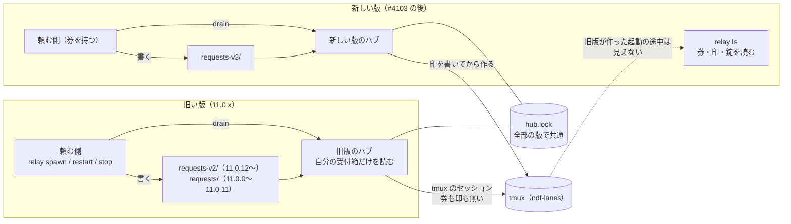
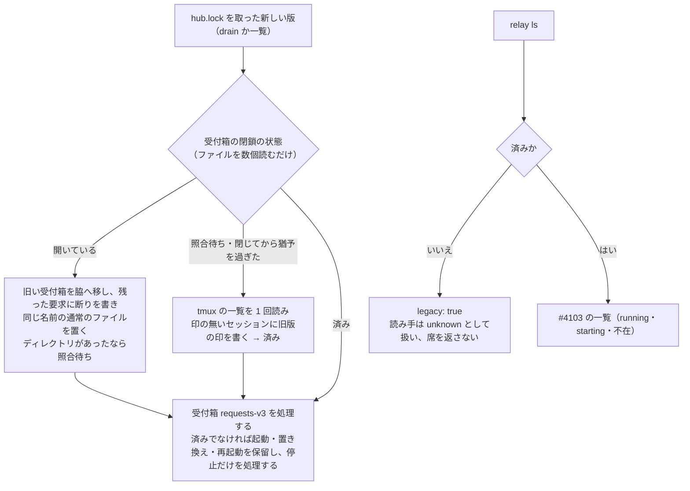
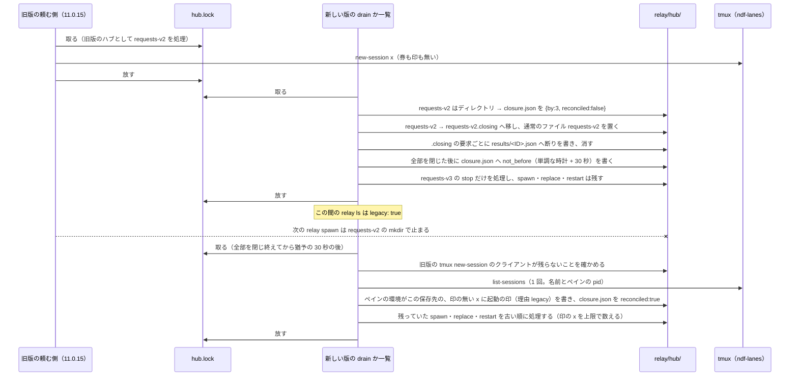

# リレーの版の混在: 新しい版が旧い版の受付箱を閉じ、旧版が残したセッションを照らしてから新しい版の判定へ戻る（#4118）

版を上げた直後に旧い版のハブが同じ保存先で動くと、新しい版の一覧が旧版の起動を見落とし、席を返して上限を超えうる（[要求仕様](./issue-4118-requirements.md)）。この設計では、旧版を見分けて照合し続ける代わりに、新しい版が最初にハブの排他を取った時点で旧い版の受付箱を通常のファイルに置き換えて閉じ、旧版のハブが処理できる要求を無くす。閉じる前に旧版が作ったセッションは、閉じた後に猶予を置いて tmux の一覧を 1 回だけ読んで起動の印を付け、それが済むまで一覧は「読めない」を返し、ハブは上限に関わる起動を保留して停止だけを処理する。採らなかった案（共存して旧版を検出し照合する #4112 のラウンド 1 の版など）は決定 1 にあり、外部の調査は付録にある。

## 今の姿

何が起きたか・目的・受け入れ条件は要求仕様（[issue-4118-requirements.md](./issue-4118-requirements.md)、正は #4118 の本文）にある。パスは `plugins/ndf/` からの相対で書く。この設計は #4103 の設計（[issue-4103-design.md](./issue-4103-design.md)・[issue-4103-design-detail.md](./issue-4103-design-detail.md)）の起動の券・起動の印・印の見直し・一覧の `starting` と `relay_protocol` の上に乗り、#4103 の決定 6 が #4118 へ分けた箇所を置き換える（「#4103 の設計の置き換え」）。

**具体例.** 利用者が 11.0.15 で並列の計画を流している最中に、#4103 とこの課題の入った版（以下「新しい版」）へ上げたとする。11.0.15 の conductor のセグメントはまだ動いていて、手動で `ndf relay spawn --name x` を打つ。11.0.15 の `ndf` は要求を `relay/hub/requests-v2/` へ書き、自分で `hub.lock` を取ってハブになり、tmux の `x` のセッションを作る。ラッパーが錠を取る前（起動の確かめの 15 秒の間）に、新しい版の耐久ワークフローが `ndf relay ls` を読む。新しい版の一覧は `requests-v3/` と券と印しか見ないので、`x` を不在と読む。その一覧で席を返して別のレーンを起こすと、`x` のラッパーが錠を取った時点で上限を超えて 2 本が動く。旧版のハブが `x` を作った直後に落ち、頼む側が待ち切れで要求を消すと、記録（`hub-log.jsonl`）にも何も残らない。

今のコードと、リリース済みの各版のタグで確かめた事実（2026-11-22）:

| # | 事実 | 実物 |
| --- | --- | --- |
| F1 | ハブは常駐しない。要求を書いた頼む側が `drain` で `hub.lock` を待たずに取り、取れたら自分の版の受付箱の要求を古い順に処理する。処理は全部 `hub.lock` の中で行う | `src/ndf/domains/relay/hub.py` の `submit`・`drain` |
| F2 | 受付箱は版ごとに違う。11.0.0〜11.0.11 は `requests/`、11.0.12〜11.0.15 は `requests-v2/`、#4103 の後は `requests-v3/` である。各版のハブは自分の受付箱だけを読み、`hub.lock` は全部の版で共通である | `git show ndf--v11.0.<n>:plugins/ndf/src/ndf/domains/relay/hub.py` を 11.0.0〜11.0.15 の全部のタグで読んだ |
| F3 | 全部の版のハブは、`hub.lock` を取った直後に `hub.json`（`pid`・`version`・`at`）を書き、放すときに消さない。記録 `hub-log.jsonl` は要求を処理した後に書く | 同上 |
| F4 | 旧版の頼む側は、要求を書く前に受付箱の親を `Path.mkdir(parents=True, exist_ok=True)` で作る。受付箱のパスが通常のファイルだと `FileExistsError` で止まり、要求を書かない。旧版の `drain` は受付箱が `is_dir()` でなければ何も処理しない | `signals.replace_text`・`hub.drain`。手元で `requests-v2` を通常のファイルにして試した |
| F5 | 旧版の CLI は、サブコマンドの捕まえない例外を結果 JSON（`stopped`・`unknown`・終了コード 1）で返す。受付箱を通常のファイルにした一時の保存先で、導入済みの 11.0.15 の `relay stop` と 11.0.11 の `relay spawn` は `FileExistsError` で止まり、要求もセッションも作らなかった。11.0.15 の `relay ls` はそのまま動いた | `src/ndf/cli.py` の `_call`。`NDF_STATE_HOME=<一時の保存先> ~/.claude/plugins/cache/ai-plugins/ndf/11.0.15/bin/ndf relay stop nosuch` ほかを打った（2026-11-22） |
| F6 | 新しい版の耐久ワークフローは、観測のたびに自分の導入の `ndf relay ls` を打つ。起動（`spawn`）は導入の一覧から選んだ `bin/ndf`（`installed_entry`）で、停止と一覧は自分の導入の `bin/ndf`（`_entry`）で打つ | `src/ndf/progress/lane/launch.py` の `spawn`・`stop`・`wrappers` |
| F7 | レーンの conductor は、終わるときに自分のセグメントの導入の `ndf relay stop "$NDF_RELAY_NAME"` で自分のラッパーを止める。プラグインを上げると、次のセグメントの Claude から新しい導入を読む | `skills/development-workflow/references/asking.md`・`relay.md` の「変更が効く時点」 |

版の組み合わせごとの振る舞い（「#4103 だけ」は #4103 の設計を実装し、この課題を実装していない姿）:

| # | 組み合わせ | #4103 だけ | この設計の後 |
| --- | --- | --- | --- |
| M1 | 旧版のハブが処理中 × 新しい版の頼む側 | 新しい版の要求は `requests-v3` にあり、旧版のハブは読まない。新しい版の頼む側は `hub.lock` が空くのを待つ。その間、新しい版の一覧は旧版の起動の途中を見ず、不在と読みうる | 受付箱をまだ閉じていない間、一覧は `legacy: true`（読めない）を返す。旧版のハブが `hub.lock` を放した後、新しい版の最初の排他の持ち主が受付箱を閉じる |
| M2 | 新しい版のハブ × 旧版の頼む側 | 旧版の要求は `requests-v2` にあり、新しい版のハブは今の処理のまま扱う（#4103 は扱いを決めていない） | 閉じる時点で残っていた旧版の要求には断りの結果を書く。閉じた後の旧版の頼む側は、要求を書けずに止まる（F4・F5） |
| M3 | 両方の新旧が同時（旧版のハブ・新しい版のハブ・両方の頼む側） | `hub.lock` で直列になるが、旧版のハブは券と印を数えずに上限を判定し、新しい版の一覧は旧版の起動を見ない | 閉じる前は一覧が読めない。閉じた後は旧版のハブが処理できる要求が無い。旧版が閉じる前に作ったセッションは、照合で印を付けるまで一覧が読めない。照合が済むまで、新しい版のハブは上限に関わる起動を保留する |
| M4 | 旧版のハブがセッションを作った後に落ち、記録も要求も残らない | 跡が無く、新しい版は不在と読む | 閉じる時点で旧い受付箱のディレクトリがあれば照合を要すると決め、記録を読まない。tmux の一覧に残るセッションに印を付ける |
| M5 | 新しい版の読み手 × 旧版の `relay ls` の応答 | 応答の `relay_protocol` が 3 に満たなければ読めない（#4103 の決定 6） | 変えない |
| M6 | 旧版の読み手（旧版の耐久ワークフロー）× 新しい版のハブ | 旧版の一覧は券と印を読まない。旧版の起動は `installed_entry` で新しい版の子を打つことが多く、上限は新しい版のハブが判定する | 同左。加えて、旧版の耐久ワークフローの停止（旧版の `relay stop`）は閉じた後に止まる（決定 1 の代償） |
| M7 | 動いている旧版のラッパー × 新しい版のハブ | ラッパーの錠で `running` と数える。`hub_decide.mixed` はメジャーバージョンが同じなら断らない | 同左。照合で印も付き、セッションが終わった後に印の見直し（#4103 の R9）が消す |
| M8 | この版 × 後の版（受付箱 4） | 決まっていない | 後の版が `requests-v3` を閉じる。この版の一覧は `legacy: true`、この版の頼む側は要求を書かずに断る（決定 6） |

## 文脈と制約

- 旧い版のコードは変えられない。この設計が使えるのは、旧版が今していることだけである（F1〜F5）
- 旧版のハブが何かをするのは、`hub.lock` を持つ間だけである（F1）。セッションを作るのも、要求を読むのも、`hub.lock` の中で行う。例外は、旧版のハブが `tmux new-session` の途中で落ちたときに生き残った tmux のクライアントで、後からセッションを作りうる（#4103 の「文脈と制約」の `Tmux._run` の段落）
- 旧版のラッパーは起動の印も世代も知らない。旧版のハブが起こしたラッパーは、印に依らず錠を取れば動く
- 新しい版の一覧は、#4103 で `hub.lock` が空いていれば取り、印を見直す（tmux を打つのは高々 1 回）。この設計の閉鎖と照合も、同じ `hub.lock` の持ち主の処理として行う
- 普及のフェーズに入るまで、後方互換は求めない（MVV 版 11 の Value 4）。旧版の頼む側が版を上げた後も動き続けることは保証しない。保証するのは、新しい版の上限と席の判定が旧版の起動を見落とさないことである
- この課題の実装は #4103 の実装と同じ版で出す（「影響と危険」）

## 解き方の全体像

- **新しい版は、ハブの排他を最初に取った時点で旧い版の受付箱を閉じる。** `requests/` と `requests-v2/` を同じ名前の通常のファイルに置き換える。旧版の頼む側は要求を書けずに止まり（F4・F5）、旧版のハブは処理する要求が無い。閉じる処理は `hub.lock` の中なので、旧版のハブの処理と重ならない
- **閉じる前に旧版が作ったセッションは、猶予の後の 1 回の tmux の一覧で照らす。** 閉じる時点で旧い受付箱がディレクトリとしてあれば（旧版が一度でも頼んだ跡）、照合待ちにする。全部を閉じ終えてから猶予（`relay.stop-wait` の契約の 30 秒）を過ぎ、旧版の `tmux new-session` のクライアントが残っていなければ、`hub.lock` の持ち主が tmux の一覧を 1 回読み、この保存先で動く印の無いセッションに理由 `legacy` の起動の印を書く。確かめられなければ猶予の後に試し直す。以後は #4103 の印の規則で数え、片付ける
- **照合が済むまで、一覧は読めない扱いで、ハブは起動を保留する。** 一覧は `legacy: true` を返し、読み手は `unknown` として扱う。ハブは上限に関わる起動（`spawn`・`replace`・`restart`）を受付箱に残し、停止だけを処理する
- **済んだ後は、新しい版だけの判定に戻り、費用は増えない。** 状態は通常のファイルかの確かめ 3 つと、小さな状態のファイル 1 つで決まり、記録や受付箱の過去を読まない
- **後の版がこの版の受付箱を閉じたら、この版も同じ規則で引き下がる。** 受付箱の名前の表を `contracts/relay-protocol.json` に 1 つ置く。閉じる側は何かを移す前に `closure.json` へ自分の番号を書き、閉じられる側の一覧と CLI はそれを読む

## ドメインモデル

### コンテキスト

| コンテキスト | 持つもの | この設計で変えること |
| --- | --- | --- |
| リレー（`domains/relay`） | ラッパーの起動・停止・一覧、ハブの排他と受付箱、起動の印の見直し | 受付箱の閉鎖と照合（新設の `inbox_closure`）、ハブが済むまで起動を保留する分岐、一覧の `legacy`、頼む側の「後の版が閉じた」の断り |
| 起動の券と起動の印（`core/launch_ticket`。#4103 が新設） | 券と印のパス・書き方・読み方 | 変えない。照合は `write_launch` を理由 `legacy` で呼ぶ |
| レーン（`progress/lane`） | 一覧の読み方（`launch.wrappers`） | `legacy: true` の応答を None にする（1 行の条件を足す） |

### 集約

**受付箱の閉鎖は、リレーの状態の保存先 1 つにつき 1 つで、旧い版の受付箱を閉じて旧版の跡を照らし終えたかを表す。** 書くのは `hub.lock` の持ち主（新しい版の `drain` と一覧）だけである。状態は保存して持たず、次の 3 つから毎回決める。

- 自分の受付箱（`requests-v3`）がディレクトリか、無いか
- 旧い版の受付箱のパス（`requests`・`requests-v2`）が通常のファイルか
- 照合の記録 `relay/hub/closure.json`（閉じた版の番号・照合が済んだか・次に照合を試してよい時刻）。読むのは最後で、後の版が閉鎖を始めたことはここで読む（V7）

| 状態 | 決め方 | 一覧 | ハブ |
| --- | --- | --- | --- |
| 開いている（`open`） | 旧い受付箱のパスのどれかが通常のファイルでない（ディレクトリ・無い・シンボリックリンク） | `legacy: true` | 閉じる処理を行う。閉じきれなければ起動を保留する |
| 照合待ち（`pending`） | 全部が通常のファイルで、`closure.json` が無い・読めない・`reconciled` が偽 | `legacy: true` | 猶予を過ぎていれば照合する。済むまで起動を保留する |
| 済み（`settled`） | 全部が通常のファイルで、`closure.json` の `reconciled` が真 | `legacy: false`（#4103 の一覧のまま） | 保留しない |
| 後の版が閉じた（`superseded`） | 自分の受付箱のパスがあり、ディレクトリでない。または `closure.json` の `by` が自分の受付箱の番号より大きい | `legacy: true` | 処理する要求が無い。頼む側は CLI の副作用の前に断る |

`superseded` は他の 3 つより先に判定する。

### 状態と事象の表

この表が振る舞いの正本で、詳細設計の関数はどれもこの表の 1 行を実装する。

| # | 前 | 引き金 | 後 | 書き手 | 排他 | 書く前に照らす条件 | 失敗・中断のとき | 打ち直し |
| --- | --- | --- | --- | --- | --- | --- | --- | --- |
| C1 | 開いている | `hub.lock` を取った新しい版（`drain` の始め・一覧） | 次のどれかなら照合待ち、どれでもなければ済み。旧い受付箱のどれかがディレクトリだった・脇の `.closing` が残っていた・`closure.json` があり `reconciled` が真でなかった（前の閉鎖の中断・前の版の照合待ち・壊れている） | `hub.lock` の持ち主 | `hub.lock` | 何かを移す前に、照合の要否に依らず `closure.json` を `{"by": 自分の番号, "reconciled": false}` で書く（閉鎖の始まりの印）。全部を閉じた後に時刻を読み、照合待ちなら `closed_at` と `not_before`（その時点の単調な時計 + 猶予）を、済みなら `reconciled: true` を書く | 途中で落ちても、旧い受付箱が通常のファイルになっていない限り開いているのまま。`reconciled: false` は次の閉鎖に引き継がれ、受付箱が元から無く閉鎖ファイルを置くだけの回でも済みにならない。全部を閉じた後に `closure.json` を書く前に落ちると照合待ち（照合の要らない保存先でも 1 回照らす。安全側） | 次の `hub.lock` の持ち主が同じ手順を最初から行う |
| C2 | 開いている（閉じる途中） | 旧い受付箱のディレクトリを `<名前>.closing` へ移した後、同じ名前に通常のファイルを置く | 閉じた | 同上 | 同上 | — | 移した後に旧版の頼む側がディレクトリを作り直していれば、ファイルを置けない（`rename(2)` の `EISDIR`）。置かずに開いているのまま返す（起動は保留される） | 次の持ち主が、作り直されたディレクトリをまた脇へ移す |
| C3 | 脇の `.closing` がある | C1・C2 の中 | 中の `*.json` ごとに `results/<要求 ID>.json` へ断りを書き、要求を消す。最後にディレクトリごと消す | 同上 | 同上 | 要求の中身は読まない（形が違っても断る） | 書けなければ残す（次の持ち主が続きから断る） | 何度打っても同じ。同じ要求 ID へ同じ断りを書く |
| C4 | 照合待ち | `hub.lock` の持ち主で、単調な時計が `not_before` より前（同じ起動のとき） | 照合待ち（何もしない。tmux も `/proc` も読まない） | — | — | — | — | — |
| C5 | 照合待ち | 同上で、単調な時計が `not_before` 以後か、起動が変わった | 次を全部通れば、印の無い自分の保存先のセッションごとに `write_launch(名前, "legacy")` を書いてから `reconciled: true` を書く → 済み ・この保存先の旧版の `tmux new-session` のクライアントが生きていない ・tmux の一覧が名前とペインの pid を返す ・どの名前も所属を確かめられる | 同上 | 同上 | セッションの名前の形（`launch_ticket.check_name`）。印の有無。ペインのプロセスの環境から解いた保存先が自分か（別の `NDF_STATE_HOME` のセッションには書かない）。ラッパーの錠は試さない | クライアントが残る・一覧が不明（None）・所属を確かめられない・印を書けないなら `reconciled` を書かず、`not_before` を今 + 猶予に進めて照合待ちのまま | 猶予の後の持ち主が、もう一度照らす。既に印のある名前には書かない。その間も停止は処理される（C7） |
| C6 | 済み | 一覧・`drain` | 済み（O(1) の確かめだけ） | — | — | — | 旧い受付箱が再びディレクトリになっていれば（人が通常のファイルを消し、旧版が作り直した）開いているへ戻り、C1 から | — |
| C7 | 開いている・照合待ち | `drain` が受付箱 `requests-v3` の要求を処理する番 | `stop` は処理する。`spawn`・`replace`・`restart` は処理せず受付箱に残す（処理の錠を取らず、結果を書かない） | ハブ | `hub.lock` | 種別 | 頼む側は応答を待ち、待ち切れなら #4103 のとおり券を放して `wait_timeout` を返す。残った要求は次の `drain` で生存の錠が空いていれば `abandoned` | 済みになった後の `drain` が古い順に処理する |
| C8 | 閉じた（旧い受付箱が通常のファイル） | 旧版の頼む側が要求を書こうとする | 要求を書けずに止まる | 旧版の頼む側 | — | — | 旧版の CLI が `stopped`・`unknown` で返す（F5） | 新しい版の `ndf` で打ち直す |
| C9 | 後の版が閉じた | この版の頼む側（`ndf relay spawn`・`restart`・`stop`・`stop --all`）が打たれる | CLI の最初で、券を受けず（`adopt` しない）・取らず、席を読まず、停止シグナルファイルを置かず、要求を書かずに断る（`precondition`） | この版の頼む側 | — | 自分の受付箱のパスがディレクトリでない・`closure.json` の `by` が自分より大きい | 確かめた後に閉じられたら、書くときの `FileExistsError`・`NotADirectoryError` を同じ断りにする | 後の版の `ndf` で打ち直す |
| C10 | 脇の `.closing` が残っている（どの状態でも。後の版が閉じたを除く） | `hub.lock` の持ち主の `settle` の始め | C3 と同じく断りを書き、要求を消し、脇を消す。状態は変えない | `hub.lock` の持ち主 | `hub.lock` | — | 書けなければ残す | 次の持ち主が続きから断る。閉じた後に断りを書けなかった旧い要求も、照合待ち・済みのまま断られる |

### 不変条件

| # | 条件 | 守る所 |
| --- | --- | --- |
| V1 | 旧い受付箱がどれも通常のファイルになった後は、旧版のハブはどの要求も処理しない。旧版の頼む側は要求を書けない | 旧版の `drain` は自分の受付箱が `is_dir()` のときだけ読み、頼む側は親の `mkdir(exist_ok=True)` で止まる（F4）。閉じる処理は `hub.lock` の中なので、旧版のハブの処理の途中に閉じることは無い（F1） |
| V2 | 一覧が `legacy: false` を返すのは、状態が済みのときだけである。済みは、閉じた時点で旧い受付箱のディレクトリも脇も引き継いだ照合待ちも無かったか、全部の受付箱を閉じ終えてから猶予の後に、旧版のクライアントが残らないことを確かめて読んだ tmux の一覧で印を書き終えたかのどちらかである。猶予は契約の `relay.stop-wait` の秒（30 秒）で、呼び出し元の環境変数でも壁時計の前進でも短くならない | `closure.json` の `reconciled` を真にするのは C1（照合が要らないとき）と C5 だけ。閉鎖の始めに偽を書き、偽は次の閉鎖へ引き継ぐ。`not_before` は全部を閉じた後の単調な時計から決める |
| V3 | 済みの時点で、旧版のハブが作ったセッションは、動いているラッパー（錠）・起動の印・tmux に無いのどれかである | V1 で閉じた後は旧版がセッションを作らず、C5 が閉じた後に読んだ一覧のセッションに印を付ける。印は #4103 の R9 が tmux の不在を確かめてから消す。生き残った tmux のクライアントは、それが終わってから猶予の後まで照合を確定しない（C5）ので例外にならない |
| V4 | 済みでない間、新しい版のハブは上限に関わる起動をしない。停止はする | C7 |
| V5 | 状態を決める読み取りは、パスの確かめ 3 つと `closure.json` の 1 つで、記録・受付箱・結果の数に依らない。`settle` は加えて脇の `.closing` の確かめ 2 つを行う | `inbox_closure.state`・`settle` |
| V7 | 後の版が閉鎖を始めた後に、この版の一覧が `legacy: false` を返さない | 後の版は何かを移す前に `closure.json` に自分の `by` を書く（C1）。一覧は `closure.json` を状態の読み取りの最後に読み、行を読み終えた後にもう一度読む（`superseded_since`） |
| V6 | 新しい版のハブは、旧い版の要求を処理しない（置き換え・停止を含む）。断りの結果を書くだけである | C3 |

### ドメインイベント

リレーの記録（`hub-log.jsonl`）に次を足す。席の事象（#4091 の `row_seat`）は足さない。

- 旧い受付箱を閉じた（`{"event": "inbox_closed", "inbox": <名前>, "pending": <照合を要するか>}`）
- 旧い要求に断りを書いた（今の要求の行の形。`cause` は `precondition`）
- 照合した（`{"event": "legacy_reconciled", "marked": [<印を書いた名前>]}`）

`cause` の種類は足さない。

## 構成要素

| 構成要素 | 責務 | 置き場 |
| --- | --- | --- |
| 受付箱の閉鎖（`inbox_closure`。新設） | 状態を決める・閉じる・旧い要求に断りを書く・照合する | `src/ndf/domains/relay/inbox_closure.py` |
| ハブの処理（`drain`） | `hub.lock` の中で、閉鎖と照合 → #4103 の印の見直し → 券の掃除 → 受付箱の処理の順に進める。済みでなければ起動を保留する | `src/ndf/domains/relay/hub.py` |
| 一覧（`listing`） | `hub.lock` を取れたら閉鎖と照合を行ってから印を見直す。結果に `legacy` と `legacy_reason` を載せる | `src/ndf/domains/relay/hub.py`・`cli.py` |
| 頼む側（CLI の `_hub`・`submit`） | 自分の受付箱が後の版に閉じられていれば、CLI の副作用（券の受け取り・席の読み取り・停止シグナルファイル）の前に断る | `src/ndf/domains/relay/cli.py`・`hub.py` |
| 受付箱の名前の表 | 版ごとの受付箱の名前を 1 か所に置く。今の版の受付箱と、閉じる旧い受付箱をここから引く | `contracts/relay-protocol.json`（#4103 が新設するファイルに足す） |
| 一覧の読み方（`launch.wrappers`） | 応答の `legacy` が真なら None を返す | `src/ndf/progress/lane/launch.py` |

## データ構造

- 受付箱の名前の表: `contracts/relay-protocol.json` を `{"inbox": 3, "inboxes": {"1": "requests", "2": "requests-v2", "3": "requests-v3"}}` にする。自分の受付箱は `inboxes[str(inbox)]`、閉じる旧い受付箱は番号が `inbox` より小さい行のすべてである。`hub.REQUESTS_DIR` はこの表から引く（#4103 の `requests-v3` の定数を置き換える）
- 閉じた受付箱: `<状態の保存先>/relay/hub/<旧い受付箱の名前>` の通常のファイル。中身は `{"closed_by": <inbox の番号>, "at": <時刻>, "note": "この受付箱は閉じた。新しい版の ndf で打ち直す"}`。判定はファイルの種類だけで決め、中身を読まない（人が開いたときの説明）
- 脇へ移した受付箱: `<旧い受付箱の名前>.closing`（ディレクトリ。C3 が断りを書いた後に消す）
- 照合の記録: `<状態の保存先>/relay/hub/closure.json`。中身は `{"by": <閉じた側の受付箱の番号>, "reconciled": <真偽>, "closed_at": <エポック秒か null>, "not_before": <単調な時計（`time.monotonic()`）の秒か null>, "boot": <起動の識別子か null>}`。`closed_at` は人と記録のためで、判定には `not_before` と `boot` を使う。書くのは `hub.lock` の持ち主だけで、一時のファイルと `os.replace` で置き換える。錠を持たない一覧も読む
- 旧版の印: #4103 の起動の印に、理由 `legacy`・券 `null` で書く。形は変えない
- 旧い要求への断り: 旧版の頼む側が読む今の結果の形 `{"ok": false, "summary": <文>, "cause": "precondition", "items": []}`。文は「リレーの受付箱は新しい版（受付箱 3）へ移った。新しい版の ndf で打ち直す」
- 一覧の結果: 最上位に `legacy: bool` と `legacy_reason`（`open`・`pending`・`superseded`・`null`）を足す
- 新しい上限の値は足さない。照合の猶予と試し直しの間隔は `relay.stop-wait` の契約の秒（30 秒）を `limits.seconds` で読む。`NDF_RELAY_STOP_WAIT` の上書きは停止の待ちにだけ効き、猶予には効かない

## 入出力のコントラクト

- `ndf relay ls` の結果の JSON の最上位に `legacy`・`legacy_reason` を足す（`docs/contracts/commands.md`）。`legacy` が真の間も、行（`running`・`starting` など）は今のとおり載せる（人が見るため）。読み手は行を使わない
- `launch.wrappers()` は、`relay_protocol` が 3 以上で、かつ `legacy` が偽の応答だけを表として返す。ほかは None（生存は `unknown`）
- `ndf relay spawn`・`restart`・`stop`（`--all` を含む）は、自分の受付箱が後の版に閉じられていれば、CLI の最初で、受け継いだ券を受けず・券を取らず・停止シグナルファイルを置かず・要求も書かずに `precondition`（「リレーの受付箱は後の版（<閉じた側の inbox の番号>）が閉じた。新しい版の ndf で打ち直す」）で断る。終了コードは `precondition` の 3
- 済みでない間に待ち切れた頼む側の `wait_timeout` の文に、「旧い版の照合を待っている（受付箱の閉鎖: <状態>）」を足す
- 旧版の CLI の振る舞い（閉じた後に `FileExistsError` で止まる）は旧版のコードのまま変えられない。手順書 `references/relay.md` に、版を上げた後の旧版の `ndf relay` の止まり方と打ち直し方を書く

## 処理の流れ

`drain` の `hub.lock` の中の順は、閉鎖と照合（C1〜C5）→ #4103 の印の見直し（`_review_launches`）→ 券の掃除（`sweep`）→ 受付箱の処理（C7）である。照合と印の見直しが同じ回に tmux を要するときは、`list-sessions` を 1 回だけ打ち、結果を両方で使う。一覧は `hub.lock` を待たずに試し、取れたら閉鎖と照合 → 印の見直しを行って放してから、券 → 印 → 錠の順に読む（#4103 の U2 の順を変えない）。最後に `closure.json` を読み直し、後の版の `by` に変わっていれば `superseded` を返す（V7）。tmux の一覧は `list-sessions -F '#{session_name}\t#{pane_pid}'` の 1 回で、印の見直しは名前を、照合は名前とペインの pid を使う。

## 決定の記録

### 決定 1: 旧版のハブが新しい版の判定の外で起動しないよう、新しい版は最初にハブの排他を取った時点で旧い版の受付箱を通常のファイルに置き換えて閉じる

- **質問**: 旧い版のハブと頼む側が同じ保存先で動く間、新しい版はどう見分け、どう安全を守るか
- **選んだ案**: 新しい版の `hub.lock` の持ち主（`drain` と一覧）は、受付箱の閉鎖の状態が「開いている」なら、旧い受付箱（`requests/`・`requests-v2/`）を脇へ移し、同じ名前に通常のファイルを置く。旧版の頼む側は要求を書けずに止まり、旧版のハブは処理する要求が無い（F4・F5。V1）。閉じた後は旧版を見分ける必要が無いので、ハブの排他の持ち主を推し量らない
- 採らなかった案: 共存して旧版を検出し照合する（PR #4112 のラウンド 1 の版。新しい版のハブが `hub-v3.lock` を併せて持ち、記録の照合済みの位置まで読む）。2 つの錠の有無では持ち主を決められず（r2-6）、記録は処理の後にしか書かれず（r2-7）、記録の位置を読み進める費用が累積する（r2-10）。直しても、旧版のハブは券と印を数えずに上限を判定し続けるので、共存する限り旧版の起動が新しい版の起動の途中と重なって上限を超える経路が残る
- 採らなかった案: 新しい版の長く生きるプロセス（耐久ワークフロー・ラッパー）が `hub.lock` に共有の錠を持ち、旧版の `drain` の排他を取らせない。新しい版のプロセスが 1 つも無い間は締め出せず、錠の持ち替え（共有と排他の切り替え）は原子的でない（`flock(2)`）ので、持ち替えの隙に旧版のハブが入る
- 採らなかった案: `hub.lock` をディレクトリにして旧版の `drain` を例外で止める。旧版の頼む側は要求を書いた後に `drain` で止まるので、頼む側のいない要求が受付箱に残る。旧版が既に開いていた錠のファイルの記述子からは排他を取れる
- 採らなかった案: 旧版の受付箱の要求を新しい版のハブが新しい規則で処理し、旧版の頼む側を動かし続ける。旧版の頼む側は自分の `drain` でも処理するので、新しい版が先に処理する保証が無い
- **代償**: 閉じた後は、旧版の `ndf relay spawn`・`restart`・`stop` が `FileExistsError` で止まる（F5）。旧版で流れている耐久ワークフローは、次の停止（旧版の `relay stop`）で止まり、新しい版で実行を起動し直すまで進まない。旧版のセグメントの conductor が自分を止める `relay stop` も止まり、そのラッパーは動いているとして数え続ける（耐久ワークフローの `relay restart` が新しい版で止めてから起動し直す）。止まった後も作業と回答は残り、新しい版で続きから進む
- 根拠: Value 4「普及のフェーズに入るまで、後方互換は求めない。旧い設定の形を残す互換の仕組みを持たず、移行のコマンドできれいな最終形へ移す」・Value 7「不具合は、現象が出た場所ではなく根本原因の場所で直され、形を変えて戻ってこない」・Value 3「版上げ・再起動・セッションの入れ替えをまたいでも、進行中の作業と人の回答は失われず、止まった所から続く」（MVV 版 11）

### 決定 2: 記録が残らない旧版の起動も数え落とさないため、照合の要否は閉じる時点の旧い受付箱のディレクトリの有無で決め、閉じてから猶予の後に tmux の一覧を 1 回読んで印の無いセッションに印を書く

- **質問**: 旧版のハブが閉じる前に作ったセッションを、記録や要求が残らないときも含めてどう数えるか（r2-7）
- **選んだ案**:
  - 照合の要否は、閉じる時点で旧い受付箱がディレクトリとしてあったか（脇の `.closing` が残っていたかを含む）で決める。旧版のハブは自分の受付箱の要求からしか起動せず、旧版の頼む側は要求を書く前に受付箱のディレクトリを作る（F2・F4）。ディレクトリが無ければ旧版のハブは一度も起動していないので、照合を省いて済みにする。新しい版だけの保存先では照合も待ちも起きない
  - 照合は、全部の受付箱を閉じ終えた時点の単調な時計から猶予（`relay.stop-wait` の契約の 30 秒）を過ぎた後の `hub.lock` の持ち主が行う。猶予は `limits.seconds` で直に読み、停止の待ちを短くする `NDF_RELAY_STOP_WAIT` には従わない。比べるのは `time.monotonic()` と起動の識別子で、壁時計を前へ進めても短くならない
  - 照合の前に、この保存先の旧版のハブが打った `tmux -L ndf-lanes new-session` のクライアントが生きていないことを確かめる（Linux は `/proc` の引数と環境で、無ければ `ps` の引数で所属を問わずに）。強制終了したハブの生き残ったクライアントには親のタイムアウトが効かないので、猶予の経過だけでは作成が終わった証明にならない。クライアントが見えたら照合を確定せず、見えなくなってから猶予の後に試す。tmux の一覧が不明（None）のときも同じく猶予の後に試し、その間は tmux を打たない（停止は処理する）
  - tmux の一覧は名前とペインの pid を 1 回で読む。名前の形が合い、起動の印が無く、ペインのプロセスの環境（`NDF_STATE_HOME`・`XDG_STATE_HOME`・`HOME`）から 11.0.x と同じ規則で解いた保存先がこの保存先のセッションのすべてに、理由 `legacy` の印を書く。`ndf-lanes` のソケットは保存先に依らず共通なので、別の保存先のセッションは飛ばす（この保存先の上限にも迷子の停止にも入れない）。ペインのプロセスを読めない名前があれば確定しない。`/proc` の無い環境（macOS）では所属を確かめられないので、名前の形が合えば書く（数え過ぎの側）。動いている旧版のラッパーのセッションにも書く（錠を試さない）
  - 印を書いた後は #4103 の規則で扱う。一覧は `starting`（錠があれば `running`）と読み、上限の判定は 1 本と数え、印の見直し（R9）が tmux の不在を確かめてから消す。旧版のラッパーは印を読まないので、印があっても動き方は変わらない
- 採らなかった案: 記録（`hub-log.jsonl`）の旧版の行を照合済みの位置まで読む（r1 の版）。記録は処理の後に書かれるので落ちた実行を見落とし（r2-7）、位置を進める条件が費用を累積させる（r2-10）
- 採らなかった案: `hub.json` の `version` を読み、最後の持ち主が旧版なら照合する。閉じた後は旧版の持ち主が要らなくなり、閉じる前の跡は受付箱のディレクトリで足りる
- 採らなかった案: 錠の空いたセッションにだけ印を書く。錠を試す一瞬の排他が、起動の途中のラッパーの「待たずに取る錠」と重なり、そのラッパーを終わらせうる。動いているラッパーに印が付いても、`running` が勝つので数は変わらない
- 採らなかった案: 閉じた直後に照合する。旧版のハブが `new-session` の途中で落ちたとき、生き残った tmux のクライアントが後からセッションを作りうる。tmux のクライアントの上限（`relay.tmux` の 10 秒）を越える猶予として、#4103 が印の照会の間隔に使う `relay.stop-wait` の秒を使う
- 採らなかった案: 猶予の経過だけで照合を確定する（前の版）。ハブが強制終了すると生き残ったクライアントにタイムアウトが効かず、一覧の直後にセッションができうる（r1-3）
- 採らなかった案: 名前の形だけで印を書く（前の版）。別の `NDF_STATE_HOME` のリレーのセッションも同じソケットに並ぶので、この保存先の上限と迷子の停止に入る（r1-5）
- 採らなかった案: 猶予の新しい上限の値を足す。値を増やさず、契約の `relay.stop-wait` を上書きの効かない形で読めば足りる
- **代償**: 旧版の跡がある保存先では、最初に閉じてから最短で 30 秒の間、起動が保留され、一覧が読めない。1 つの保存先で 1 回だけである。旧版の生き残ったクライアントが止まったままなら、それが終わるまで保留が続く（待ち切れの文に pid を載せる）。照合の 1 回に `/proc` の走査（無ければ `ps` 1 回）が足される。動いている旧版のラッパーの名前は、終わるまで印を持つ
- 根拠: Value 2「費用・時間・繰り返しの上限に当たれば、手を広げずにやめるか縮める」・Value 8「データ構造は正規化を既定にし、同じ事実を 2 か所に持たない」（照合の要否は旧い受付箱という 1 つの事実から決める）（MVV 版 11）

### 決定 3: 照合を確定できない間に上限を超えないよう、済むまでハブは起動・置き換え・再起動を受付箱に残して保留し、停止だけを処理する

- **質問**: 閉じきれない・照合待ち・tmux の一覧が不明の間、新しい版の要求をどう扱うか（r2-8）
- **選んだ案**: 状態が済みでない間、`drain` は受付箱 `requests-v3` の要求のうち `stop` だけを処理する。`spawn`・`replace`・`restart` は処理の錠を取らず、結果も書かずに受付箱に残す。頼む側は券を持ったまま応答を待ち、済みになった後の `drain` が古い順に処理する。待ち切れたら #4103 のとおり `wait_timeout` を返し、券を放した要求は次の `drain` で `abandoned` になる。保留の間も一覧は券を `starting` と読み、別の計画の起動の許可はそれを数える
- 採らなかった案: 起動を断りの結果で返す。耐久ワークフローは断りを起動の失敗に数え、失敗の上限でレーンを止めうる。済むまでの待ちは 1 回の猶予（30 秒）で、頼む側の待ち（`relay.hub-wait` の 120 秒）に収まる
- 採らなかった案: 照合を待たずに処理する。上限の判定が旧版のセッションを数えられず、旧版のラッパーが後から錠を取ると上限を超える（r2-8）
- 採らなかった案: 停止も保留する。停止は本数を増やさず、席の返却（`Vacate`）と迷子のセッションの片付けを止めると、保留の間に上限の空きが戻らない
- **代償**: 保留の間、同じ受付箱の中で停止が先の起動を追い越す。頼む側は 1 つの要求の結果を受け取ってから次を頼むので、同じ頼む側の順は変わらない。違う頼む側の停止と起動の順は、#4103 の印の世代を添えた `stop` が照らす
- 根拠: Value 3「同じ操作を打ち直しても、結果は 1 回打ったときと変わらない」（保留した要求はそのまま後で処理される）・Value 5「人の承認・ほかのレーン・背景の作業・CI を待つ間も待つだけで止まらない」（停止は進める）（MVV 版 11）

### 決定 4: ハブの排他の持ち主を推し量らずに済むよう、一覧を読めない扱いにする条件は受付箱の閉鎖の状態だけで決め、済みになったら新しい版だけの判定へ戻る

- **質問**: 一覧が `legacy: true` を返す条件と、`false` へ戻る条件は何か（r2-6・r2-10）
- **選んだ案**: 一覧は、受付箱の閉鎖の状態が済みでなければ `legacy: true` と、理由（`open`・`pending`・`superseded`）を返す。済みなら `legacy: false` を返し、#4103 の一覧の判定だけを使う。状態は、旧い受付箱のパス 2 つが通常のファイルか・自分の受付箱がディレクトリか・`closure.json` の `reconciled` の 3 つで決める（V5）。閉じる前は、誰が `hub.lock` を持っていても読めない。閉じた後は旧版が何もできない（V1）ので、持ち主が旧版かを問わない
- 採らなかった案: `hub.lock` と `hub-v3.lock` の持たれ方で旧版の処理中を見分ける。新しい版が 2 つの錠の間にいる時点と旧版が処理中の時点を区別できない（r2-6）
- 採らなかった案: `hub.json` に新しい版の持ち主の記録を書き、放すときに消す。持ち主が落ちると記録が残り、次に旧版が取ってから `hub.json` を書くまでの間を新しい版と読む。閉じた後はこの区別が要らない
- **代償**: 閉じる前の短い間（版を上げた後、新しい版の最初の `drain` か一覧が `hub.lock` を取るまで）は、新しい版だけが動いていても一覧が読めない。新しい版の一覧は `hub.lock` が空いていれば自分で閉じるので、続くのは旧版が `hub.lock` を持つ間だけである
- 根拠: Value 11「同じ規則・定数・処理は 1 か所にまとまり、ほかはそこを参照する」（一覧もハブも `inbox_closure.state` だけを読む）・Value 2「費用が小さい」（MVV 版 11）

### 決定 5: 生存を確かめられない旧い要求で起動しないため、閉じる時点で残っていた旧版の要求は、置き換え・停止を含めて処理せず、断りの結果を書く

- **質問**: 旧版の頼む側の要求（起動・置き換え・再起動・停止）を、新しい版のハブがどう扱うか（r2-9）
- **選んだ案**: 閉じる時点で旧い受付箱に残っていた要求は、中身を読まずに要求 ID ごとに断りの結果（`precondition`）を `results/` へ書いて消す。旧版の頼む側は今の結果の形（`hub.submit` が読む `ok`・`summary`・`cause`・`items`）で読んで終わる。閉じた後の旧版の要求は書かれない（V1）
- 採らなかった案: 旧版の置き換えを、親の `admit.lock` を根拠に通す。旧版の要求には錠の生存を確かめる手段が無く、親と子が落ちた後の古い `held` で置き換えうる（r2-9）
- 採らなかった案: 旧版の停止だけを処理する。頼む側の生存を確かめられないので、頼む側が落ちた後に残った古い停止が、後から同じ名前で起きた新しいラッパーを止めうる
- **代償**: 閉じる時点で待っていた旧版の頼む側は、断りを受けて打ち直しが要る
- 根拠: Value 7「既存の契約を壊さず」（旧版の頼む側は今の結果の形で断りを読める）・Value 4（MVV 版 11）

### 決定 6: 後の版との間も同じ形で安全にするため、受付箱の名前の表を 1 か所に置き、この版も自分の受付箱が閉じられたことを読んで引き下がる

- **質問**: 受付箱 4 の版が出たとき、この版は旧版として正しく振る舞えるか
- **選んだ案**: `contracts/relay-protocol.json` に版ごとの受付箱の名前の表 `inboxes` を置き、自分の受付箱と閉じる旧い受付箱をそこから引く。自分の受付箱のパスがあってディレクトリでないか、`closure.json` の `by` が自分より大きければ（後の版が閉じた・閉じ始めた）、一覧は `legacy: true`（`superseded`）を返し、頼む側は CLI の最初で、受け継いだ券の `adopt`・席の読み取り・`stop --all` の停止シグナルファイル・券の取得・要求の書き込みのどれよりも前に `precondition` で断る。後の版は表に 1 行足すだけで同じ閉鎖を行う
  - 閉じる側は、何かを移す前に `closure.json` へ自分の番号 `by` を書く。自分の受付箱は作られる前は無いので、パスの種類だけでは閉鎖の途中（脇へ移した直後）と区別できない。錠を持たない一覧は `closure.json` を状態の読み取りの最後に読み、行を読み終えた後にもう一度読む。読み直しで `by` が変わらなければ、行を読み終えた時点で後の版は閉鎖を始めておらず、閉鎖の前に後の版がセッションを作ることも無い
  - 閉じる側は、前の版の `closure.json` の `reconciled: false` を照合待ちとして引き継ぎ、自分の閉鎖の済みで上書きしない
- 採らなかった案: 旧い受付箱の名前をコードの定数に並べる。後の版で受付箱を足すたびに、閉じる側と表の両方を直す必要がある
- **代償**: 一覧は `closure.json` を 1 回多く読む。CLI の頼む側は打つたびにパス 1 つの種類と `closure.json` を読む
- 根拠: Value 11「同じ規則・定数・処理は 1 か所にまとまり、ほかはそこを参照する」・Value 3「版上げ…をまたいでも、進行中の作業と人の回答は失われず、止まった所から続く」（MVV 版 11）

### 決定 7: 持ち物を重ねないため、#4103 の決定 6 が分けた箇所をこの設計で置き換え、#4110 とは一覧の `legacy` を境にする

- **質問**: #4103・#4110 の設計とどこで分けるか
- **選んだ案**:
  - #4103 の決定 6 の「版が混在する間の扱いは #4118 へ分ける」の 3 点（旧版のハブの検出と一覧の扱い・旧版が残したセッションの照合と戻る条件・`requests-v2` に残る要求の扱い）は、この設計の決定 1〜5 が持つ。#4103 の他の決定（子の版の確かめ・`requests-v3`・`relay_protocol`）は変えない
  - #4110 は、#4091 だけを実装した状態の T2 の排他と不在の確かめを持つ。この設計は一覧の `legacy` と、ハブが起動を保留する条件を持つ。T2 の不在の確かめは、一覧が `legacy: true` なら不在と読まない（#4103 の `unknown` の扱いのまま）。#4110 が #4091 だけの状態で一覧を読むときは、`legacy` の欄が無い（#4103・#4118 の前の版の）応答も今のまま読む
- **代償**: 無し
- 根拠: Value 11（MVV 版 11）

## 影響と危険

- **働く範囲**: 利用先のリポジトリでも働く。リレーハブを通るすべての起動・再起動・停止と一覧に効く
- **プロジェクトごとに違うもの**: 無し（保存先は状態の保存先の下、秒は今の上限の設定）
- **当たるモード**: 並列の計画で流すすべてのモードと、`ndf relay` を直接使うすべての利用者
- **壊れうる箇所**:
  - 新しい版が一度でも `drain` か一覧を行った保存先では、旧い版の `ndf relay spawn`・`restart`・`stop` が `FileExistsError` で止まる（決定 1 の代償）。旧版で流れている耐久ワークフロー・旧版のセグメントの conductor・旧い端末の `ndf` が当たる。手順書に打ち直し方を書く
  - 旧い版の `ndf relay stop --all` は、停止シグナルファイルを置いた後の要求で止まる。シグナルファイルは置かれるので、ラッパーは今のセッションの後に止まる
  - 旧版の跡がある保存先では、最初に閉じてから最大 30 秒、起動が保留され、一覧が読めない（決定 2 の代償）。耐久ワークフローの席の返却と起動の許可はその間待つ
  - 人が閉じた受付箱のファイルを消すと、旧版が再び受付箱を作れる。次の新しい版の `hub.lock` の持ち主が閉じ直し、照合し直す（C6）
- **同じファイルを触る別の変更と実装の順**:
  - 実装の順: #4044 → #4091 → #4103 → この課題。**この課題は #4103 と同じ版で出す。** #4103 だけを出すと、版を上げた直後の旧版のハブが券と印を数えずに起動する経路が残る（#4103 の決定 6 の代償）
  - #4103 の `hub.py`（`drain`・`listing`・`submit`）、`cli.py`（`ls` の出力）、`launch.py`（`wrappers`）、`contracts/relay-protocol.json` の上に乗る。#4103 の実装の PR の後に入れ、同じ関数を触るので rebase する
  - #4110 は `issues/issue-4091-design*.md` と #4091 の T2 を触る。この課題は T2 を変えない
  - 確定仕様 `docs/specifications/ndf-parallel-machine-plan-limit.md` の既知の限界と、手順書 `references/relay.md` の「変更が効く時点」に、受付箱の閉鎖・照合の待ち・旧版の CLI の止まり方を書き足す（#4103 が書く旧版との混在の段落を置き換える）

### 代表のリポジトリでの振る舞い

| 代表のリポジトリ | 設定の要点 | 直した後に起きること | この種類で扱えなくなること |
| --- | --- | --- | --- |
| Web サービス（nd-factory） | 並列の計画でスプリントのレーンを流し、プラグインの更新で `relay restart` を打つ | 版を上げた直後も席の返却が旧版の起動を見落とさない。旧版で流れていた計画は、新しい版で起動し直すと続きから進む | 無し |
| モバイルアプリ | 同上 | 同上 | 無し |
| 業務文書だけ | 同上（文書のスプリントのレーン） | 同上 | 無し |

### このリポジトリだけの事情

- 無し（リレーハブの受付箱の閉鎖は NDF の製品の振る舞いで、ai-plugins の運用の値を持たない）

## 用語

| 語 | 意味 | 反映 |
| --- | --- | --- |
| 受付箱の閉鎖 | 新しい版のハブが、旧い版の受付箱のディレクトリを同じ名前の通常のファイルに置き換えること。旧い版の頼む側は要求を書けず、旧い版のハブは処理する要求が無くなる | 追加（用語集へは実装の PR で足す） |
| 旧版の照合 | 受付箱を閉じた後、猶予の後に tmux の一覧を 1 回読み、起動の印の無いセッションに理由 `legacy` の印を書くこと。済むまで一覧は読めない扱いで、ハブは起動を保留する | 追加（同上） |

## テスト設計

| 受け入れ条件 | どの振る舞いで縛るか | どう壊したら落ちるべきか |
| --- | --- | --- |
| 1 | 次を縛る。 ・**旧版のハブが処理中**: `requests-v2` のディレクトリがある保存先で、別のプロセスが `hub.lock` を持ったまま tmux のセッションを作る（旧版のハブの再現）。その間の新しい版の一覧は `legacy: true`（`open`）を返し、`launch.wrappers()` は None、`Settle` と T2 は返却済みを書かない ・**閉じた後**: その持ち主が放した後の一覧は受付箱を閉じて `pending` を返し、猶予の後の一覧が照合して `legacy: false` を返す。照合の後は、そのセッションの名前が `starting`（錠があれば `running`）で載る | 次のどれかで落ちる。 ・`hub.lock` の持ち主の推し量りで `legacy: false` を返す ・閉じた直後（猶予の前）に済みにする ・一覧が閉じる処理を行わない |
| 2 | 旧版のハブの再現がセッションを作った後、記録も要求も残さずに落ちる（要求のファイルを消し、`hub-log.jsonl` を書かない）。新しい版の最初の排他の持ち主は照合待ちにし、猶予の後の照合がそのセッションに印を書く。上限 1 で、照合の後に別の名前の `spawn` を頼むと断られる。照合の前に頼むと保留される | 次のどれかで落ちる。 ・照合の要否を記録や要求から決める ・錠の空いたセッションにだけ印を書く（錠を持つ旧版のラッパーを外す試験と、錠を試す一瞬に起きたラッパーが終わる試験の 2 つで） ・印を書かずに済みにする |
| 3 | 照合待ちの間（猶予の前・tmux の一覧が None のとき）、`requests-v3` に `spawn`・`replace`・`restart`・`stop` の 4 つを入れて `drain` を打つ。`stop` だけが処理され、ほかは受付箱に残り、結果も処理の錠も無い。一覧は券を `starting` と読む。済んだ後の `drain` が残りを古い順に処理する。頼む側が待ち切れたら `wait_timeout` の文に照合の状態が載る | 次のどれかで落ちる。 ・照合を待たずに起動を処理する ・停止も保留する ・保留した要求を断る・消す |
| 4 | 済みの保存先で、`hub-log.jsonl` を 10 万行・`results/` を 1 万件にしても、一覧と `drain` の状態の決め方は記録と結果を開かない（読み取りを数える替え玉で 0 回）。状態の決め方が読むパスは、旧い受付箱 2 つ・自分の受付箱・`closure.json` だけである。旧い受付箱が一度も無かった保存先では、最初の `drain` で済みになり、tmux を打たない | 次のどれかで落ちる。 ・記録を走査する ・照合の要らない保存先で照合待ちにする |
| 5 | 次を縛る。 ・**閉じる時点の旧い要求**: `requests-v2` と `requests` に起動・置き換え・停止の要求を置き、新しい版の `drain` を打つ。それぞれの要求 ID に `{"ok": false, "cause": "precondition", …}` の結果が書かれ、要求は消え、tmux のセッションは作られない ・**閉じた後の旧版の頼む側**: 旧版の `submit` と同じ書き方（親の `mkdir(parents=True, exist_ok=True)` → 一時のファイル → `os.replace`）は `FileExistsError` で止まり、旧版の `drain` と同じ読み方（`is_dir()` のときだけ `glob`）は何も読まない ・**作り直しの競り合い**: 脇へ移した直後に受付箱のディレクトリを作り直す順を入れると、閉鎖は通常のファイルを置かずに `open` を返し、次の `drain` が閉じ直す。作り直したディレクトリの要求にも断りが書かれる ・**途中で落ちる**: 脇の `.closing` を残して止めると、次の持ち主が続きから断る | 次のどれかで落ちる。 ・旧い要求を処理する ・ディレクトリを残したまま閉じたと読む ・脇の `.closing` を読まない |
| 6 | `requests-v3` を通常のファイルにした保存先で、この版の一覧は `legacy: true`（`superseded`）を返し、`relay spawn`・`restart`・`stop` は券も要求も作らずに `precondition` で断る。確かめた後に閉じられる順を入れても、書くときの例外が同じ断りになる | 次のどれかで落ちる。 ・自分の受付箱の種類を見ない ・書くときの例外を `unknown` で返す |
| 2（照合の確かさ） | 次を縛る。 ・**猶予の起点と長さ**: `_answer_old` を遅くした替え玉で、猶予は最後の閉鎖ファイルを置いた時点から数える。`NDF_RELAY_STOP_WAIT=1` の呼び出しでも、壁時計を 1 時間進めても、30 秒の前は照合しない ・**生き残ったクライアント**: この保存先の環境で `tmux -L ndf-lanes new-session` を引数に持つ替え玉のプロセスが生きている間は、猶予を過ぎても済みにならない。消えてから猶予の後に済みになる ・**別の保存先**: 別の `NDF_STATE_HOME` の環境で同じソケットに作ったセッションに印を書かず、この保存先の上限にも `Settle` の迷子の停止にも入らない ・**印の置き場**: 照合の後、`hub.listing` と上限の判定が `state_dir` の下の同じ印を読み、`relay/hub/relay/hub` が作られない ・**試し直しの間隔**: tmux が即座にエラーを返す替え玉で、頼む側の待ちの間に `drain` が何度打たれても `list-sessions` は猶予ごとに 1 回で、`stop` は処理される ・**中断**: `requests/` を閉じ、元から無い `requests-v2` に閉鎖ファイルを置く前に止める。`pending`（`by: 3`）の保存先で受付箱 4 の替え玉が `requests-v3`（作られていない）を閉じる。どちらも照合を経ずに済みにならない | 次のどれかで落ちる。 ・猶予を閉鎖の前から数える・`ctx.stop_wait` を使う・壁時計で比べる ・クライアントを見ずに確定する ・名前の形だけで印を書く ・リレーハブの置き場を `write_launch` へ渡す ・失敗した照合を毎回打ち直す ・照合待ちを閉鎖の済みで上書きする |
| 5（断りの後始末） | `_answer_old` を書けなくした替え玉で閉鎖を進め、旧い受付箱を全部通常のファイルにした後、脇の `.closing` が残る保存先で、書けるように戻してから次の `drain` を打つ。照合待ち・済みのどちらでも断りが書かれ、脇が消える | 脇の `.closing` を状態が開いているのときしか見ない |
| 6（CLI の副作用） | 後の版が閉じた保存先で、この版の `ndf relay stop --all` は停止シグナルファイルを 1 つも置かない（tmux の外のラッパーを含む）。`--ticket`・`--ticket-fd` を添えた `spawn` は `adopt` を打たず、席も読まない。`hub.lock` を取れなかった一覧が `requests-v3` を読んだ直後に、受付箱 4 の替え玉が `by: 4` を書いて閉鎖を進めても、一覧は `superseded` を返す | 次のどれかで落ちる。 ・断りを `submit` の中だけで行う ・閉鎖の始まりを `closure.json` に書かない・一覧が読み直さない |
| 1〜3・5 | 状態と事象の表の C1〜C10 を 1 本ずつ通す。どの時点でも、ハブの上限の判定と別の計画の起動の許可が数える本数が、実際に錠を持つラッパーの数と上限を下回らない | — |

旧版の振る舞いは、旧版のコードの書き方を写した替え玉で縛る（F4 の 2 つの操作）。実装の PR では、導入済みの 11.0.15 と 11.0.11 の `bin/ndf` を一時の状態の保存先で 1 回打ち、閉じた後に要求もセッションも作らないことを PR に残す（F5 と同じ確かめ）。

詳細設計は [issue-4118-design-detail.md](./issue-4118-design-detail.md) にある（新設の関数が 2 つ以上あるため別ファイル）。

## #4103 の設計の置き換え

この課題の実装の PR で、#4103 の文書（確定仕様化が先ならその確定仕様）の次の箇所をこの設計に合わせる。設計 PR では変えない（決定 7）。

| #4103 の文書の箇所 | 置き換え |
| --- | --- |
| `issue-4103-design.md` の「文脈と制約」の「この設計は、新しい版のハブと頼む側だけが同じ状態の保存先を使う前提で…」 | 「版が混在する間は、#4118 の受付箱の閉鎖と旧版の照合が済むまで、一覧は読めない扱いでハブは起動を保留する」 |
| 同 不変条件 U1 の「券を持たない旧い要求は…無い（版の混在の間は #4118）」 | 「受付箱の閉鎖の後は、旧い要求は処理されない（#4118 の V1・V6）」 |
| 同 決定 6 の「版が混在する間の扱いは #4118 へ分ける」と代償の段落・影響と危険・未確認のまま残ることの #4118 の行 | この設計の決定 1〜5 を指す |
| 同 入出力のコントラクトの「`requests-v2` の要求の扱い…は #4118 が決める」・`launch.wrappers()` の条件 | この設計の入出力のコントラクト（`legacy` を足す） |
| `issue-4103-design-detail.md` の `drain` の「`requests-v2` の扱いは #4118 が決め、この課題では今の処理を変えない」・`listing`・`wrappers` の行 | この課題の詳細設計の `drain`・`listing`・`wrappers` の行 |

## 設計の結果

| 課題 | 扱い | 統合先 | 触るファイル |
| --- | --- | --- | --- |
| #4118 | 実装する | — | `plugins/ndf/src/ndf/domains/relay/inbox_closure.py`、`plugins/ndf/src/ndf/identity.py`、`plugins/ndf/src/ndf/domains/relay/tmux.py`、`plugins/ndf/src/ndf/domains/relay/hub.py`、`plugins/ndf/src/ndf/domains/relay/cli.py`、`plugins/ndf/src/ndf/progress/lane/launch.py`、`plugins/ndf/contracts/relay-protocol.json`、`plugins/ndf/docs/contracts/commands.md`、`plugins/ndf/skills/development-workflow/references/relay.md`、`docs/specifications/ndf-parallel-machine-plan-limit.md`、`docs/glossary/ndf-relay.md`、`issues/issue-4103-design.md`、`issues/issue-4103-design-detail.md`、`plugins/ndf/tests/domains/relay/test_relay_inbox_closure.py`、`plugins/ndf/tests/domains/relay/test_relay_hub.py`、`plugins/ndf/tests/progress/test_lane_launch.py`、`plugins/ndf/tests/domains/relay/test_relay_cli.py` |

## 未確認のまま残ること

- 生き残った tmux のクライアントが消えた後、サーバーがその要求を処理するまでの時間は測っていない。クライアントが見えなくなってから猶予（30 秒）を置くので足りると見ている
- `/proc` の無い環境（macOS）では、照合で所属を確かめられず、別の保存先の同じ名前のセッションにも印を書く（数え過ぎの側。上限は超えない）。別の保存先の `new-session` のクライアントも待つので、そちらが起動を続ける間は照合が遅れうる
- `relay-protocol.json` の形（`inbox` と `inboxes`）は、#4103 の実装の PR が作るファイルに足す。#4103 の実装で形が変われば合わせる

## 外部の調査

| 種類 | 調べるか | 理由 |
| --- | --- | --- |
| 標準・仕様 | 調べる | 閉鎖は `rename(2)` と Python の `Path.mkdir(exist_ok=True)` の振る舞いに乗るので、一次の仕様で確かめる |
| 主要な製品 | 調べる | 保存先の形の版を保存先に持たせ、別の版の実行を締め出す既存の形と比べる |
| ライブラリとサービス | 調べない | 新しい依存を足さない。ファイルの操作は標準ライブラリで足りる |

### 標準・仕様

| # | 対象 | 定めていること | 設計への反映 | 出典 |
| --- | --- | --- | --- | --- |
| STD1 | Linux の `rename(2)` | `newpath` が既にあるディレクトリで `oldpath` がディレクトリでないとき、`EISDIR` で失敗する。`newpath` が既にあれば原子的に置き換える | 脇へ移した後に旧版がディレクトリを作り直したら、通常のファイルを置けずに開いているのまま返す（C2）。閉じたファイルは一時の名前から置き換える | https://man7.org/linux/man-pages/man2/rename.2.html （2026-11-22） |
| STD2 | Python の `Path.mkdir(parents=True, exist_ok=True)` | パスが既にあり、ディレクトリでなければ `FileExistsError` を送出する | 旧版の頼む側が閉じた受付箱へ書けない根拠（F4）。手元で通常のファイルにしたパスで確かめ、導入済みの旧版の CLI でも確かめた（F5） | 手元で打った（2026-11-22）。`signals.replace_text` |

### 主要な製品

| # | 製品 | どう解いているか | 設計への反映 | 出典 |
| --- | --- | --- | --- | --- |
| PRD1 | PostgreSQL のデータディレクトリの `PG_VERSION` | データディレクトリに、それを作ったメジャーバージョンの番号のファイルを置き、保存先そのものに形の版を持たせる | 保存先の側（受付箱のパスの種類と `relay-protocol.json` の表）に版の境を持たせ、実行の側の推し量り（ハブの持ち主の版）に頼らない（決定 1・決定 6） | https://www.postgresql.org/docs/current/storage-file-layout.html （2026-11-22） |

調べた量: 候補 3 件・取得の試み 2 回（`Path.mkdir` は手元で確かめた）。

### 確かめられなかったこと

- 無し
