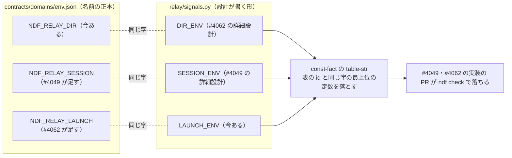
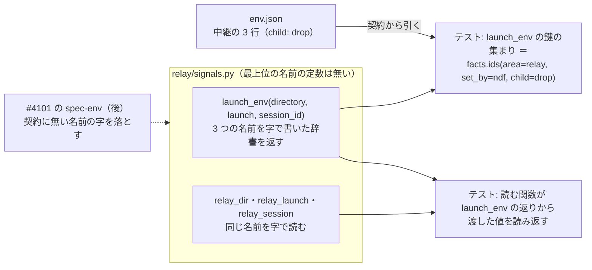

# 中継の環境変数の名前: 契約に載せたまま検査を通し、ラッパーが渡す名前と契約をテストで結ぶ（#4126）

#4049 と #4062 の設計は中継の 3 つの環境変数の名前を `signals` の最上位の定数に持つと書くが、契約に行を足すと検査 `const-fact` がその定数を落とし、2 つの実装の PR が CI で落ちる。名前を写した定数を置かず、名前は使う所に字で書き、ラッパーが子へ渡す名前と契約の行は契約から引くテストで結ぶ（#4101 の決定 2 と同じ扱い）。直しは新しい PR を足さず、#4049 と #4062 の実装の PR がそれぞれ行を足すときに入れる。採らなかった案（契約の組の列から引く・検査の例外）は「決定の記録」に、2 つの設計の読み替えは決定 4 にある。

## 今の姿

何が起きたか・受け入れ条件は要求仕様（[issue-4126-requirements.md](./issue-4126-requirements.md)、正は課題 #4126 の本文）にある。この文書は「どう解くか」と「なぜその解き方か」だけを書く。パスは `plugins/ndf/` からの相対で書く。

設計に要る今の構造（`origin/main` の `ec8340675` で読んだ）:

| 部品 | 今の振る舞い | 場所 |
| --- | --- | --- |
| 名前の定数 | `LAUNCH_ENV = "NDF_RELAY_LAUNCH"` を最上位に置き、`launch_env` と `relay_launch` が使う。`NDF_RELAY_DIR` は `relay_dir` と `launch_env` に字で書く | `src/ndf/domains/relay/signals.py` |
| 子の環境の組み立て | ラッパーの `_start` が `signals.launch_env(self.dir, launch)` の返りを子の環境に重ねる。#4049 の後は `launch_env(directory, launch, session_id)` が 3 つを返す | `src/ndf/domains/relay/wrapper.py` の 759 行目 |
| 検査 `const-fact` | モジュールの最上位の、大文字の名前（`CONST` の形 `^_?[A-Z][A-Z0-9_]*$`）の定数を集める。値が事実の表の `id` と等しい字なら `table-str`、`id` を 2 つ以上含む字の集まりなら `table-set` で落とす。右辺を読む関数 `lit` は字・数・字だけの組しか読まず、`*` の展開を含む組は読まない。関数の中の値と、テスト（`tests/`）は見ない | `src/ndf/checks/facts.py` の `table_hits` |
| 契約から名前を引く関数 | `facts.ids("env", child="drop")` のように列の値で絞った `id` を表の順で返す。`ndf.contracts` を import するので、hook の経路からは呼べない | `src/ndf/contracts/facts.py` の `ids` |

**根本原因**: 3 つの設計がそれぞれ「hook の経路は契約を import しないので、名前は `signals` の定数が持つ」と決め、`const-fact` が契約の `id` を定数へ写すことを禁じていることと突き合わせなかった。設計の工程に、設計の形をコードの写し（`origin/main` を一時の場所へ取り出したコピー）に当てて `ndf check` を打つ手順が無く、#4101 の設計で写しに当てて初めて見つかった。

## 文脈と制約

- hook の経路は `ndf.contracts` を import しない（`signals.py` の冒頭・決定 111）。hook が読む名前は字か定数でしか書けない
- `const-fact` は変えない。#4101 の決定 2 が、同じ検査のまま名前を写した定数を外すと決めた
- 実装の順は #4049 → #4061・#4062（3 課題の実装の 2 本の PR のうち 1 本目）→ #4101 で、それぞれの設計が決めている（#4062 の決定 8・#4101 の決定 8）。#4049 と #4062 の実装はまだ始まっていない（2026-11-22 に `gh pr list` と `git branch -r` で確かめた）
- #4049・#4062 の設計文書は書き換えない（AI の起動指示、2026-11-22）。読み替えはこの文書に置く
- 普及のフェーズの前で、互換の経路を持たない（MVV 版 11 の Value 4）

## 解き方の全体像

- `child: drop` は契約の列の値で、「子へは受け継いだ値を渡さない（ラッパーが自分の値を入れ直す）」を表す
- 名前の正本は `env.json` だけで、`signals.py` は中継の 3 つの名前を使う所に字で書く。名前を写した最上位の定数（`LAUNCH_ENV`・`SESSION_ENV`・`DIR_ENV`）も、名前を並べた最上位の組も無い
- ラッパーが子へ渡す名前と契約の行は、契約から名前を引くテストで等しさを確かめる。hook が読む字とラッパーが書く字は、読み返しのテストで結ぶ。#4101 の後は、#4101 が足す検査 `spec-env`（コードが読み書きする環境変数の名前が契約にあるかを見る）が、契約に無い名前の字も落とす
- 直しは #4049 と #4062 の実装の PR が、それぞれ行を足すときに入れる。この課題の実装の PR は無い

## 決定の記録

### 決定 1: 名前の正本を契約の 1 か所にするため、中継の 3 つの名前は最上位の定数に置かず、使う所に字で書く

- **質問**: 契約に行を足すと `const-fact` で落ちる名前の定数（`LAUNCH_ENV`、#4049 の `SESSION_ENV`、#4062 の `DIR_ENV`）をどうするか
- **選んだ案**: 定数を置かない。`launch_env` は `{"NDF_RELAY_DIR": …, "NDF_RELAY_LAUNCH": …, "NDF_RELAY_SESSION": …}` を返し、`relay_dir`・`relay_launch`・`relay_session` は `env.get("NDF_RELAY_…")` で読む。変えるのは名前の書き方だけで、空の値の扱いは今のまま（`relay_launch` と #4049 の `relay_session` は、無い・空のどちらも None を返す）。`NDF_RELAY_DIR` の今の書き方にそろえ、#4101 の決定 2 と同じ扱いにする。各名前の字は `signals.py` の中で 2 か所（書く `launch_env` と読む関数）に現れる。写しのツリーで 3 行を足してこの形にすると、`const-fact` は違反 0 件だった（「影響と危険」の実測の表）
- 採らなかった案: 契約に組の列（#4101 の `group` に `relay-launch` などの値）を置き、`facts.ids` で名前を引く（`signals` は hook の経路で `ndf.contracts` を import できない。`launch_env` は 3 つの名前にそれぞれ別の値を入れるので、組を回しても名前と値の対応をコードが持つことになり、組から引いても字は消えない。#4101 の `group` は「コードが組で引く名前の集まり」で、引くコードの無い組を置くと列の意味が崩れる）
- 採らなかった案: 組の列はテストの期待する集まりにだけ使う（hook の経路の import の制約には当たらない。ただし中継の、NDF が値を入れる、子へ受け継がない行を足して組の値を付け忘れると、テストが見逃す。決定 2 は今ある 3 列（`area`・`set_by`・`child`）から期待する集まりを導くので、付け忘れの余地が無い。#4101 の `group` は実行の時に名前の組をまとめて引くためのもので、こちらは名前ごとに別の値を入れる）
- 採らなかった案: `env.json` を `shared_names` にする（`table-set` も外れ、どの名前の組もコードに写せるようになる。#4101 の決定 2 で採らなかった理由と同じ）
- 採らなかった案: 定数の名前を変えて検査を避ける（`_LAUNCH_ENV` は `const-fact` の名前の形に当たり、写しで落ちた。小文字の名前やクラスの属性にすれば検査をすり抜けるが、契約の写しを持つことは変わらず、検査の意図を外す）
- 採らなかった案: 名前の定数を `env.json` から生成するモジュールに置く（生成と検査の 2 つを保つことになり、hook の経路が生成物を import する。#4101 の決定 2 で採らなかった理由と同じ）
- **代償**: 名前の字が `signals.py` の中で 2 か所に並ぶ。打ち間違いは決定 2 の読み返しのテストが落とす。#4101 の後は `spec-env` も契約に無い名前を落とすが、契約にある別の名前への打ち間違い（`NDF_RELAY_DIR` と `NDF_RELAY_SESSION` の取り違え）は落とさないので、主な守りは読み返しのテストである
- 根拠: Value 8・Value 11（MVV 版 11）。名前という事実の正本は契約の 1 か所で、コードの字はその名前を使う所での参照である。参照の字が 2 か所に並んでも、名前の定義を 2 か所に持つことにはならない。Value 8「同じ事実を 2 か所に持たない」。Value 11「同じ規則・定数・処理は 1 か所にまとまり、ほかはそこを参照する」

### 決定 2: ラッパーが渡す名前と契約の食い違いを落とすため、テストは契約から名前を引いて等しさを確かめ、読む関数の字は読み返しで結ぶ

- **質問**: 定数を外した後、ラッパーの `launch_env` が返す名前の組と、契約の行と、hook が読む字の 3 つをどう結ぶか
- **選んだ案**: テストを 2 つにする。(1) `set(signals.launch_env(d, "a" * 32, "s"))` が `set(facts.ids("env", area="relay", set_by="ndf", child="drop"))` と等しい（#4062 の決定 4 のテストのまま。期待する名前を字の集まりで書かず、契約から引く）。(2) `relay_dir`・`relay_launch`・`relay_session` に `launch_env(d, L, S)` の返りを渡すと、`d`・`L`・`S` が返る（今の `test_launch_env_passes_the_launch_id_and_the_hook_reads_it` を 3 つに広げる）。写しのツリーで (1) を打つと通った。名前と値の対応（`NDF_RELAY_LAUNCH` に起動の ID、`NDF_RELAY_SESSION` に会話の ID が入るか）は、#4062 の詳細設計の「ラッパーの `_start`」のテスト（差し替えた `spawn` が受けた環境の 3 つが、その起動の保存先・起動の ID・会話の ID と等しい）が確かめ、そのまま残す。書く側と読む側の両方で 2 つの名前を入れ替える取り違えは (1) と (2) を通るが、このテストで落ちる。このテストは差し替えた `spawn` が受けた環境で確かめるので、子の環境を組む関数が `_start` から `Wrapper._env_for` へ移った後（「未確認のまま残ること」）も同じ形で書ける
- 採らなかった案: テストの中で期待する名前を字の集まり（`{"NDF_RELAY_DIR", …}`）で書く（`const-fact` はテストを見ないので検査は通るが、契約の写しがテストにできる。行を足しても消してもテストの字を直すまで食い違いが残る。#4101 の詳細設計の「名前の定数の外し方」と同じ理由）
- 採らなかった案: 契約の行と照らすのを `spec-env`（#4101）に任せ、テストを置かない（`spec-env` は字が契約にあるかを見るだけで、ラッパーが入れ直さない `drop` の中継の行は落とせない。#4101 は #4062 の後に入る）
- **代償**: 絞り込みの条件（`area`・`set_by`・`child` の 3 列）がテストに現れる。中継の、NDF が値を入れる、子へ受け継がない行を足すと、ラッパーが入れ直さない限りテストが落ちる（#4062 の決定 4 が意図した等しさ）
- 根拠: Value 13・Value 8（MVV 版 11）。Value 13（載ったと言えるのは検査が確かめたときだけ）

### 決定 3: 設計を直すために PR を増やさないため、直しは #4049 と #4062 の実装の PR が行を足すときに入れ、#4101 の順は変えない

- **質問**: 直しをどの PR に入れるか。#4062 の実装の PR か、その前の別の PR か。#4101 とどちらが先か
- **選んだ案**: 行を足す PR が、その名前の書き方も持つ。#4049 の実装の PR は `NDF_RELAY_SESSION` の行を足し、`SESSION_ENV` を置かずに字で書く。#4061・#4062 の実装の PR（1 本目）は `NDF_RELAY_LAUNCH` の行を足し、`LAUNCH_ENV` を外して字で書き、`DIR_ENV` を置かない。#4101 の実装はその後のまま（#4101 の決定 8）で、`spec-env` は字になった 3 つの名前を見る

| 順 | PR | `const-fact` に当たる変更 | この課題の直し |
| --- | --- | --- | --- |
| 1 | #4049 の実装 | `NDF_RELAY_SESSION` の行を足す | `SESSION_ENV` を置かない。`relay_session` と `launch_env` に字で書く |
| 2 | #4061・#4062 の実装（1 本目） | `NDF_RELAY_LAUNCH` の行を足し、3 行を `child: drop` にする | `LAUNCH_ENV` を外す。`DIR_ENV` を置かない。決定 2 のテスト |
| 3 | #4064 の実装（2 本目） | 無し | 無し |
| 3 と並べてよい | #4101 の実装（lracct・#4049・#4062 のマージが前提。#4101 の決定 8） | ほかの行と `spec-env` | 無し（3 つの名前は 2 で字になっている） |

- 採らなかった案: #4049 の前に、`LAUNCH_ENV` を外すだけの PR を出す（行の無いうちは `LAUNCH_ENV` は落ちないので、外す理由が PR の中に無い。PR とレビューのラウンドが 1 本増え、#4049 と #4062 は `signals.py` を触るので rebase も増える）
- 採らなかった案: 3 つの名前をすべて #4062 の実装の PR で直す（#4049 の実装の PR は `NDF_RELAY_SESSION` の行と `SESSION_ENV` を同時に足すので、#4049 の PR が先に落ちる）
- **代償**: この課題を閉じるのは #4062 の実装の PR のマージの後になる。#4049 と #4062 の実装は、それぞれの設計に加えてこの文書の決定 4 の読み替えを読む必要がある
- 根拠: Value 5・Value 2（MVV 版 11）。Value 5「並べられる作業は並べて進め、待つだけで止まらない」。Value 2（rebase と衝突の手直しに費用を使わない）

### 決定 4: 3 つの設計を食い違わせないため、#4049 と #4062 の設計の該当する記述をこの文書の読み替えで上書きする

- **質問**: 設計文書を書き換えずに、実装する人がどちらに従うかをどう決めるか
- **選んだ案**: 下の表の記述は、この文書の決定 1・2 で読み替える。2 つの設計のほかの記述（行の値・`child`・`relay_role`・テストの残り）は変えない。設計承認ゲートの後、conductor が #4049 と #4062 の課題の本文の「関連」にこの文書を足し、実装計画が読むようにする

| 文書 | 節 | 元の記述 | 読み替え |
| --- | --- | --- | --- |
| `issue-4049-design-detail.md` | 「地図」の表の `relay/signals.py` の行 | 定数 `SESSION_ENV` を足す | 足さない。`relay_session` と `launch_env` は `"NDF_RELAY_SESSION"` を字で書く |
| `issue-4049-design-detail.md` | 「背景の作業の記録（`signals`）」の「内部のデータと定数」 | `SESSION_ENV` は `NDF_RELAY_SESSION` | 行ごと無い |
| `issue-4061-4062-4064-design.md` | 「文脈と制約」の 2 つ目の項目 | 環境変数の名前は文字列の定数で持つ | 環境変数の名前は使う所に字で書く |
| `issue-4061-4062-4064-design.md` | 決定 4 の「選んだ案」 | hook の経路は契約を import しないので、名前は `signals` の定数が持ち、テストで結ぶ | 名前は `signals.py` の使う所の字が持ち、決定 2 の 2 つのテストで結ぶ |
| `issue-4061-4062-4064-design-detail.md` | 「子の会話の見分け（`signals.relay_role`）」の「内部のデータと定数」 | `DIR_ENV` は `"NDF_RELAY_DIR"`（文字列を 1 か所に寄せる） | 行ごと無い。`relay_dir`・`launch_env`・`relay_role` は字で書く |
| `issue-4061-4062-4064-design-detail.md` | 冒頭の段落（#4049 の実装を前提にする文） | `relay_session`・`SESSION_ENV`・`launch_env(directory, launch, session_id)` を前提にする | 前提から `SESSION_ENV` だけを外す。ほかの 2 つはそのまま |
| `issue-4061-4062-4064-design.md` | 「テスト設計」の受け入れ条件 6・7 の行 | `launch_env` の鍵の集まりと契約の行の等しさ・`child_env` が 3 つを外すこと | 鍵の集まりの比べだけを読み替え、期待する名前は `facts.ids` で引く（決定 2）。読み返しのテストを足す。`child_env` の行と、詳細設計の「ラッパーの `_start`」のテストはそのまま |

- 採らなかった案: #4049・#4062 の設計文書を直す PR を出す（AI の起動指示が書き換えないと決めた。2 つは設計承認済みで、直すと承認した文と食い違う）
- 採らなかった案: 読み替えを課題のコメントに書く（コメントは設計 PR のレビューと承認の外にあり、承認した内容として残らない）
- **代償**: 実装する人は 2 本の文書を読む。定数を置く読み替えを見落とすと、`ndf check` が `const-fact` で落とすので、取り込まれる前に気付ける。テストの期待する名前を字の集まりで書く読み違いは検査を通るので、実装の PR のコードレビューで見る
- 根拠: Value 14・Value 3（MVV 版 11）。Value 14「判断の理由が残り、語がそろっている」。Value 3（判断の要らない確かめは仕組みが進める）

### 決定 5: 利用者の全体の設計方針（#4069）に照らし、この設計は文脈とリソースの方針を変えず、手戻りを減らす側に働く

- **質問**: #4069 の方針（文脈の再利用・最適な文脈量・キャッシュ・リソースを使い切る・処理待ちを作らない）に合うか
- **選んだ案**: 合う。名前の書き方とテストだけを変え、文脈・キャッシュ・レーンの数に触れない。#4049 と #4062 の実装の PR が CI で落ちてから設計へ戻る手戻り（#4069 の配慮する事項 5）と、そのあいだ後ろの #4101 が待つ処理待ちを、実装の前に無くす。#4069 へ足す課題は無い
- 採らなかった案: 無し（照らし合わせだけの決定）
- **代償**: 無し
- 根拠: Value 2・Value 5（MVV 版 11）。#4069 の配慮する事項 5（手戻りの費用）

## 影響と危険

- 働く範囲: NDF の開発（このリポジトリの `ndf check` と、#4049・#4062 の実装）。利用先のリポジトリでの振る舞いは変わらない（子へ渡す名前と値は同じ）
- プロジェクトごとに違うものは無い。当たるモードは無い
- 書きかけの文書・同じファイルを触る別の変更: #4049・#4061・#4062・#4064・#4068・#4101 が `relay/signals.py` か `env.json` を触る。順は決定 3 の表のとおりで、この課題は順を変えない
- 範囲の外の現れ: `relay/account_login.py` の最上位の組 `AUTH_ENV` は、契約から引いた名前に `"NDF_RELAY_DIR"` の字を 1 つ足す（ログインの子を中継の外にするため）。3 つの名前の 1 つだけを含む組で、受け入れ条件 3 にも `const-fact` の `table-set` にも当たらないので、この課題は変えない（展開を含む組は `const-fact` の `lit` が読まない。範囲の外の発見として報告する）
- 壊れうる箇所: 名前の字の打ち間違い（決定 2 の読み返しのテストが落とす）。テストの中で名前を字の集まりで書き戻す（検査は落とさない。コードレビューで見る）

写しのツリーで確かめた形（2026-11-22、`origin/main` の `ec8340675` を `git archive` で一時の場所へ取り出した写しで、`git init` して写しの `bin/ndf check --only const-fact` を打った。写しは確かめた後に消した）:

| 当てた形 | 結果 |
| --- | --- |
| `NDF_RELAY_LAUNCH`・`NDF_RELAY_SESSION` の行を足す（`NDF_RELAY_DIR` を含む 3 行を `child: drop`） | 違反 1 件（`table-str: LAUNCH_ENV`） |
| 行は今のまま、`DIR_ENV = "NDF_RELAY_DIR"` を足す | 違反 1 件（`table-str: DIR_ENV`） |
| 行を足し、`SESSION_ENV = "NDF_RELAY_SESSION"` を足す | 違反 2 件（`LAUNCH_ENV`・`SESSION_ENV`） |
| 行を足し、定数の名前を `_LAUNCH_ENV` にする | 違反 1 件（`table-str: _LAUNCH_ENV`） |
| 行を足し、定数を外して字で書く（決定 1。`launch_env` は 3 つの名前の辞書を返す） | 違反 0 件 |
| 上に加えて、最上位に 3 つの名前の組 `LAUNCH_NAMES` を置く | 違反 1 件（`table-set: LAUNCH_NAMES`） |
| 決定 1 の形で、テストの最上位に 3 つの名前の字の集まりを置く | 違反 0 件（`const-fact` はテストを見ない） |
| 決定 1 の形で、決定 2 の (1) のテストを足す | 違反 0 件。そのテストを pytest で打つと通った |

### 代表のリポジトリでの振る舞い

| 種類 | 直した後に起きること | この種類で扱えなくなること |
| --- | --- | --- |
| Web サービス | 中継の子へ渡る名前と値は今のとおり。名前の書き方だけが変わる | 無し |
| モバイルアプリ | 同上 | 無し |
| 業務文書だけ | 同上 | 無し |

### ai-plugins だけの事情

- 無し（名前の書き方とテストは NDF のプラグインの中のもので、このリポジトリの運用の値を持たない）

## テスト設計

| 受け入れ条件 | どの振る舞いで縛るか | どう壊したら落ちるべきか |
| --- | --- | --- |
| 1 | #4049 の実装の PR の CI の `ndf check`（既存のジョブ） | `SESSION_ENV` を最上位に戻すと落ちる（この時点では `NDF_RELAY_LAUNCH` の行が無いので、`LAUNCH_ENV` は落ちない） |
| 2 | #4061・#4062 の実装の PR の CI の `ndf check` | `LAUNCH_ENV` か `DIR_ENV` を最上位に戻す・3 つのうち 2 つ以上の名前の最上位の組を足すと落ちる |
| 3 | 2 の PR の後に、`plugins/ndf/src` の 3 つの名前の字の現れをすべて挙げ、名前を値に持つ最上位の定数と、2 つ以上を含む最上位の組が無いことを読んで確かめる（実装の PR の完了判定。受け入れ条件 3 の `git grep` は 1 行の代入だけを拾う補助で、複数行の組と、`const-fact` の `lit` が読まない展開を含む組は、現れの一覧で見る） | — |
| 4 | `set(signals.launch_env(d, "a" * 32, "s"))` が `set(facts.ids("env", area="relay", set_by="ndf", child="drop"))` と等しい | 行を消す・`child` を外す・`launch_env` に名前を足す・減らすと落ちる |
| 5 | `relay_dir`・`relay_launch`・`relay_session` に `launch_env(d, L, S)` の返りを渡すと `d`・`L`・`S` が返る。空の `NDF_RELAY_SESSION` では `relay_session` が None（#4049 のテスト） | 書く側か読む側の字を打ち間違えると落ちる。2 つの名前を書く側と読む側の両方で入れ替える取り違えは、#4062 の「ラッパーの `_start`」のテストが落とす |
| 6 | ドキュメントレビューで見る（文言を突き合わせるテストは書かない） | — |

## どこを変えるか

新設する関数 0・シグネチャを変える関数 0（`launch_env` のシグネチャの変更と `relay_session` の新設は #4049 の詳細設計が持つ）のため、詳細設計はここに畳む。

| ファイル | 入れる PR | 変えること |
| --- | --- | --- |
| `src/ndf/domains/relay/signals.py` | #4049 の実装 | `relay_session` は `return env.get("NDF_RELAY_SESSION") or None  # noqa: NDF501 利用者の入力: 空の環境変数は会話の ID が無いとして扱う` で読む（無い・空は None。#4049 の詳細設計のとおり）。空の既定値へのフォールバックは `NDF501` が落とすので、既存の `relay_launch` と同じく利用者の入力の境界として抑制コメントを付ける。`launch_env` は `"NDF_RELAY_SESSION"` を字で返す。`SESSION_ENV` を置かない |
| `src/ndf/domains/relay/signals.py` | #4061・#4062 の実装 | `LAUNCH_ENV` を消し、`launch_env` と `relay_launch` は `"NDF_RELAY_LAUNCH"` を字で書く。`relay_role` は `NDF_RELAY_DIR` を `relay_dir` と同じく字で読む。`DIR_ENV` を置かない |
| `tests/domains/relay/test_relay_parts.py` | #4049 の実装 | 今の読み返しのテストに `relay_session` を足す（受け入れ条件 5） |
| `tests/domains/relay/test_relay_parts.py` | #4061・#4062 の実装 | 契約と `launch_env` の等しさのテストを `facts.ids` で書く（受け入れ条件 4）。`LAUNCH_ENV` を使うテストがあれば字にする |

異常系は無い（名前の書き方だけで、失敗の扱いは変えない）。

## 設計の結果

| 課題 | 扱い | 統合先 | 触るファイル |
| --- | --- | --- | --- |
| #4126 | 統合する（この課題の実装の PR は無い） | #4049 の実装の PR・#4061・#4062 の実装の PR | `plugins/ndf/src/ndf/domains/relay/signals.py`、`plugins/ndf/tests/domains/relay/test_relay_parts.py` |

## 未確認のまま残ること

| 項目 | 内容 |
| --- | --- |
| #4049 の実装の形 | #4049 の実装はまだ始まっていない。`relay_session` の名前とシグネチャは #4049 の詳細設計のとおりと置いた。違う形で実装されたら、決定 2 の (2) のテストをその形で書く |
| `launch_env` の呼び出し元 | #4049 の詳細設計は `Wrapper._start` で `launch_env(self.dir, launch, req.session_id)` を組むと書くが、中継のアカウントの切り替え（lracct。#3604・#3864）のマージの後の `main` では呼び出し元が `Wrapper._env_for`（`cli_floor.require` と `wrapper_launch.py` の 2 つの起動の経路が使う）に移っている。会話の ID をそこまで届ける形は #4049 の実装が決める（この課題の範囲の外。名前の書き方には関わらない） |

## 外部の調査

省く: 外部の製品・標準に依らない内部の約束（NDF の検査 `const-fact` と環境変数の契約）の食い違いの直しで、比べる候補は #4101 の設計の外部の調査の表にある設定の読み込みのライブラリ（pydantic-settings・environs）と同じである
