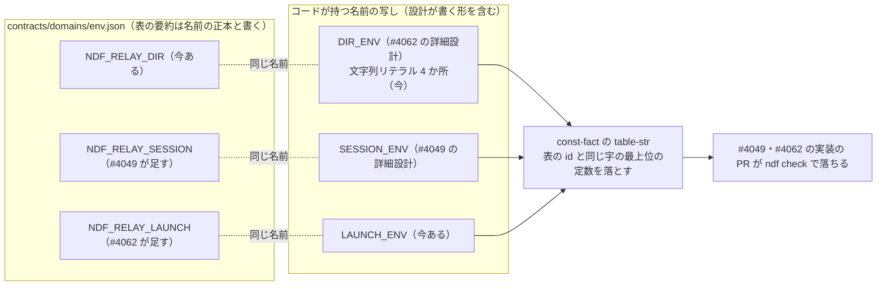
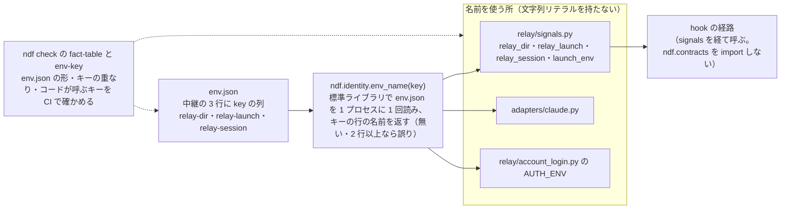

# 中継の環境変数の名前: 契約の 1 か所に持ち、hook の経路を含むコードが契約のキーから名前を引く（#4126）

#4049 と #4062 の設計は中継の 3 つの環境変数の名前を `signals` の最上位の定数に持つと書くが、契約に行を足すと検査 `const-fact` がその定数を落とし、2 つの実装の PR が CI で落ちる。名前は環境変数の契約の行にだけ置き、行にキー（新しい列 `key`）を持たせ、コードは `ndf.identity` の軽い読み手でキーから名前を引く。hook の経路が契約を読めないという制約は jsonschema の読み込みにだけ当たり、標準ライブラリで契約を読む増分は測りの揺れの内だった（決定 2）。採らなかった案（文字列リテラルとテスト・生成物・起動時に渡す）は「決定の記録」に、#4049・#4062・#4101 の設計の読み替えは決定 5、#4101 に及ぶかは決定 6 にある。

## 今の姿

何が起きたか・受け入れ条件は要求仕様（[issue-4126-requirements.md](./issue-4126-requirements.md)、正は課題 #4126 の本文）にある。この文書は「どう解くか」と「なぜその解き方か」だけを書く。パスは `plugins/ndf/` からの相対で書く。

設計に要る今の構造（`origin/main` の `ec8340675` で読んだ）:

| 部品 | 今の振る舞い | 場所 |
| --- | --- | --- |
| 名前の写し | 実行に使う写しは 4 つのファイルの 6 か所で、`bin`・シェル・hook の登録のコマンドには無い（`git grep -n -E 'NDF_RELAY_(DIR|LAUNCH|SESSION)\b' -- plugins/ndf/src plugins/ndf/bin plugins/ndf/hooks` の 13 件のうち 7 件は docstring の説明の文）。`LAUNCH_ENV = "NDF_RELAY_LAUNCH"` を最上位に置く。`"NDF_RELAY_DIR"` を `signals.py` の `relay_dir`・`launch_env`、`adapters/claude.py` の `_inherited`、`relay/account_login.py` の `AUTH_ENV` に文字列リテラルで書く | `src/ndf/domains/relay/signals.py` ほか |
| 環境変数の契約 | 表の要約は「コードは名前をこの表から引き、表に無い名前を読まない」と書く。行の `id` が名前で、コードが行を引くキーの列は無い | `contracts/domains/env.json` |
| 契約の読み手（検証つき） | `facts.ids("env", child="drop")` のように列の値で行を絞る。表を読むたびに jsonschema で形を確かめる。`ndf/contracts/__init__.py` が jsonschema を import するので、`ndf.contracts` の下はどのモジュールを import しても jsonschema が読まれる | `src/ndf/contracts/facts.py` |
| 契約の読み手（hook の経路） | hook は `contracts/hooks/*.json` を標準ライブラリの `json` で直に読む（`hooks/tables.py`。形は CI が確かめる）。`signals.py` は標準ライブラリと `ndf.identity` だけを import する（決定 111） | `src/ndf/domains/hooks/tables.py`・`src/ndf/domains/relay/signals.py` |
| 名前を 1 か所から引く前例 | `ndf.identity` はプラグイン名を `plugin.json` の `name` だけから求め、コードは自分の名前を文字列で持たない。標準ライブラリだけで書かれ、hook の経路・`ndf.contracts`・adapters のどれからも読まれる | `src/ndf/identity.py` |
| 層の規則 | 層は `ndf.contracts` → `ndf.adapters` → `ndf.core` → `ndf.progress` → `ndf.domains` の向きで、下の層は上の層を import しない。`ndf.identity` は層の外にある。モジュールを新設すると、作り直しの子の表（`checks/children.json`。正本は #3347 の設計）に載せる必要がある | `src/ndf/checks/rules.json`・`children.json` |

**根本原因**: 名前の事実をコードに写す設計（定数か文字列リテラル）を、3 つの設計がそれぞれ選んだ。理由は「hook の経路は契約を import しない」で、これを「契約を読めない」と読み、契約から名前を引く手を比べなかった。実際の制約は jsonschema の読み込みの時間だけである（決定 2）。

## 文脈と制約

- hook は Tool の呼び出しのたびに起動する。1 回の起動に足す時間を増やさない（`ndf.contracts` を import すると 1 回に約 54〜64 ms 増える。決定 2）
- `const-fact` は変えない
- 実装の順は #4049 → #4061・#4062（3 課題の実装の 2 本の PR のうち 1 本目）→ #4101 で、それぞれの設計が決めている。#4049 と #4062 の実装はまだ始まっていない（2026-11-22 に `gh pr list` と `git branch -r` で確かめた）
- #4049・#4062・#4101 の設計文書は書き換えない（AI の起動指示、2026-11-22・2026-11-23）。読み替えはこの文書に置く
- 普及のフェーズの前で、互換の経路を持たない（MVV 版 11 の Value 4）

## 解き方の全体像

- 名前は `env.json` の行にだけある。中継の 3 行はキー（`key` の列）を持ち、コードは `identity.env_name("relay-dir")` のようにキーから名前を引く。名前を変えるときに直すのは `env.json` の 1 行だけである
- 読み手は `ndf.identity` の 1 つで、hook の経路・adapters・domains のどこからも呼べる。`env.json` を標準ライブラリの `json` で 1 プロセスに 1 回読む。表の形は今のとおり CI の `ndf check`（`fact-table`）が jsonschema で確かめる
- キーの誤り（無いキー・重なるキー・文字列リテラルでないキー）は、新しい規則 `env-key` が CI の `ndf check` で落とす。実行時に読み手が誤りになるのは、導入したプラグインの契約が壊れたときだけで、そのとき読み手は名前を推したり文字列リテラルへ戻したりせずに誤りを投げる。hook の経路はそれを「中継の子と確かめられない」として何も書かず、ラッパーは子を起動する前に止まる
- 直しは #4049 と #4062 の実装の PR が、それぞれ行を足すときに入れる。この課題の実装の PR は無い

## データ構造

`contracts/domains/env.json` に列を 1 つ足す。ほかの列の意味は変えない。

| 列 | 型 | 意味 |
| --- | --- | --- |
| `key`（新設・任意） | string | コードが名前を引くキー。表の中で 1 つの行だけが同じキーを持つ。キーを持つ行の名前は、コードが `identity.env_name` でキーから引き、文字列リテラルで書かない |

| `id` | `key` | 足す PR |
| --- | --- | --- |
| `NDF_RELAY_DIR` | `relay-dir` | #4049 の実装（行は今ある。キーを足す） |
| `NDF_RELAY_SESSION` | `relay-session` | #4049 の実装（行とキーを足す） |
| `NDF_RELAY_LAUNCH` | `relay-launch` | #4061・#4062 の実装（行とキーを足す） |

キーの形は `<area>-<役割>` の小文字と `-` で、名前の頭（`NDF_RELAY_`）を写さない。キーは名前でなく「コードがどの行を使うか」の識別子で、`facts.ids("env", child="drop")` の `drop` と同じく、列の値をコードが指す形である。

## 決定の記録

### 決定 1: 名前の正本を契約の 1 か所にするため、行にキーの列 `key` を足し、コードはキーから名前を引く

- **質問**: 中継の 3 つの名前を、コードがどこから得るか
- **選んだ案**: `env.json` に任意の列 `key` を足し、中継の 3 行に `relay-dir`・`relay-launch`・`relay-session` を置く。`signals.py` の `relay_dir`・`relay_launch`・`relay_session`・`launch_env`・`relay_role`（#4061）と、`adapters/claude.py`・`relay/account_login.py` は `identity.env_name(<キー>)` で名前を得る。`plugins/ndf/src` に 3 つの名前の文字列リテラルは残らない。取り出した作業ツリーでこの形にすると、`ndf check` は違反 0 件で、関係するテスト 472 件が通った（「影響と危険」の実測の表）
- 採らなかった案: 名前を使う所に文字列リテラルで書き、契約との一致をテストで確かめる（最初の設計。利用者が設計承認ゲートで差し戻した。名前の事実が契約とコードの 2 か所に分かれ、一致はテストが通る間しか保てない）
- 採らなかった案: #4101 の `group` の列に 3 行を 1 つの組として置き、表の順で名前を受け取る（`dir, launch, session = ids(group=…)`）。3 つの名前にはそれぞれ別の値が入るので、表の行の順とコードの受け取る順の対応が隠れた約束になる。行を並べ替えると黙って取り違える
- 採らなかった案: `id`（名前そのもの）で行を引く（引く引数が名前の文字列リテラルになり、写しが残る）
- 採らなかった案: 名前の定数を `env.json` から生成したモジュールに置く（生成物と正本の 2 つを保つことになり、生成し直しを忘れた差を見る検査が要る。生成物の定数は `const-fact` に当たる）
- **代償**: キーの文字列（`"relay-dir"` など）はコードに現れる。キーは契約の列の値で、名前の事実ではないので写しに当たらない。名前はラッパー・hook・子の claude が共有する外向きの事実で、変えることがある。キーは NDF の中だけで使う識別子で、外の誰とも共有せず、変える理由が無い。名前を変えるときに直すのは `env.json` の 1 行だけで、コードも検査も触らない（差し戻された形では、名前を変えるとコードの文字列リテラルとテストの両方を直す）。キーの打ち間違い・付け忘れ・重なりは、規則 `env-key` が CI で落とす（決定 3）。#4101 の規則 `spec-env` は、名前が式で決まる読み出しを追わないので、キーで引く読み出しは見ない（決定 6 の読み替えでキーを解くようにする）
- 根拠: Value 8・Value 11（MVV 版 11）。Value 8「同じ事実を 2 か所に持たない」。Value 11「同じ規則・定数・処理は 1 か所にまとまり、ほかはそこを参照する」

### 決定 2: hook の経路を遅くせずに契約を読むため、読み手を `ndf.identity` に置き、標準ライブラリで `env.json` を読む

- **質問**: 「hook の経路は契約を import できない」は本当か。hook の経路へ契約の値を届けるにはどの手がよいか
- **確かめたこと**: 制約は「`ndf.contracts` を import しない」で、理由は jsonschema の読み込みの時間である（`hooks/tables.py`・`signals.py` の冒頭）。契約のファイルを読むこと自体は禁じていない。`hooks/tables.py` は今も `contracts/hooks/*.json` を `json` で直に読む。新しいプロセスで 20 回ずつ打った中央値は次のとおり（2026-11-23）

| 打ったもの | 中央値 | 最小 |
| --- | ---: | ---: |
| `signals` を import するだけ（今の hook の経路の頭） | 44.4 ms | 42.8 ms |
| 上に加えて `json` で `env.json` を読み、行を絞る | 45.1 ms | 43.4 ms |
| `ndf.contracts.facts` を import するだけ | 98.6 ms | 94.9 ms |
| `facts.ids("env", area="relay")`（形の検証つき） | 108.2 ms | 104.1 ms |

- **選んだ案**: `ndf.identity` に `env_name(key) -> str` と、`env.json` を 1 プロセスに 1 回読む内部の関数を足す。`identity` は層の外の標準ライブラリだけのモジュールで、`signals.py` が既に import しており、hook の経路の import は増えない。プラグイン名を `plugin.json` から引く同じ形の前例を持つ。コピーで今の形（文字列リテラル）と比べた中央値は 43.6 ms と 43.8 ms、別の時刻に打ち直すと最小値で 47.0 ms と 45.7 ms で、差は測りの揺れの内だった。ここでの測りは `signals` の import と読み手の呼び出しだけで、hook の入口（`hooks/entry.py`）から guard を選んで import するまでの全体ではない。実装の PR で、同じ Python・同じ入力で実際の PreToolUse の入口を変更の前後で交互に打って比べ、guard を呼んだ後に `ndf.contracts`・`jsonschema` が import されていないことも確かめる（テスト設計の受け入れ条件 6）
- 採らなかった案: `ndf.contracts.facts` を hook の経路でも使う（1 回の起動に約 54〜64 ms 足す。hook は Tool の呼び出しのたびに動く）
- 採らなかった案: `ndf.contracts` の jsonschema の読み込みを、形を確かめる時まで遅らせる（実行時の検証を残すかぎり、表を読む時点で jsonschema を読むので hook の時間は減らない）
- 採らなかった案: `ndf.contracts` の実行時の形の検証を外す（すべての表の読み手の約束が変わり、この課題の範囲を越える）
- 採らなかった案: 読み手を `hooks/tables.py` に置く（`adapters/claude.py` は adapters の層で、domains の `hooks` を import できない。読み手が 2 つになる）
- 採らなかった案: 読み手を新しい最上位のモジュール（`ndf/env_names.py`）に置く（作り直しの子の表 `children.json` に載せる必要があり、その正本の #3347 の設計を先に直すことになる。コピーで `child-deps` が落ちた）
- 採らなかった案: ラッパーが起動の時に名前を渡す（hook が値を読むにはまず変数の名前が要るので、名前を渡す変数の名前がまたコードに要る。3 つを 1 つの JSON の変数にまとめても、その 1 つの名前が写しとして残り、契約の 3 行の意味も変わる）
- **代償**: 契約の表を読む仕組みは、検証つきの `facts` と、検証しない `identity.env_name`・`hooks.tables` に分かれたままになる（今の `hooks.tables` と同じ分け方）。環境変数の名前をキーから引く関数は `identity.env_name` の 1 つである。形の誤りは実行時でなく CI の `ndf check` が見つける
- 根拠: Value 2・Value 12（MVV 版 11）。Value 2（安く使える。hook の 1 回の起動に費用を足さない）。Value 12（調べて分析したやり方で作る。前例の `identity` の形に寄せる）

### 決定 3: 名前を取り違えず、契約の誤りで hook とラッパーを壊さないため、キーの誤りは CI で落とし、実行時の誤りは hook では「確かめられない」、ラッパーでは起動の前の停止にする

- **質問**: キーの行が無い・2 行以上ある・`env.json` が読めないとき、読み手と、それを呼ぶ hook・ラッパー・ログインはどう振る舞うか
- **選んだ案**: 4 つに分ける
  - CI: 新しい規則 `env-key` が、`env.json` の `key` の値が重ならないことと、`plugins/ndf/src` の `identity.env_name(...)` の呼び出しがどれも 1 つの文字列リテラルの引数を持ち、そのキーの行がちょうど 1 行あることを確かめる。呼び出しがあるのに `env.json` が無い・読めないときも `env-key` が落とす（`fact-table` は実在する表しか見ないので、ファイルが無いことは言わない）。キーの打ち間違い・付け忘れ・重なりは、取り込む前に落ちる
  - 読み手: 契約が読めない・表の型が外れる（`rows` が無いか配列でない・辞書でない行がある・`key` か `id` が空でない文字列でない）・キーの行が 1 行でないときは `identity.EnvNameError`（`LookupError` の子）を投げる。既定の名前へ戻さず、先の行も使わない。CI を通った後に起きるのは、導入したプラグインの契約が壊れたときだけである
  - hook の経路: `signals.relay_role` は子の会話と判定する前に、guard が後で使う名前のキーをすべて解く（#4061・#4062 の後は `relay-dir`・`relay-session`・`relay-launch` の 3 つ）。どれかで `EnvNameError` を受けたら `NESTED`（中継の保存先にもオーガナイザーの保存先にも書かない）を返す。3 つが解けたなら `_env_keys` の結果は同じプロセスに残る（`lru_cache`）ので、`CHILD` の後に guard が呼ぶ `relay_dir`・`relay_launch` は同じ表を引き、`EnvNameError` を上げない。#4061 の後は、中継へ書く 6 つの guard がどれも `relay_role` で頭を決め、`CHILD` のときだけ `relay_dir`・`relay_launch` を読むので、guard が例外を上げない。#4049 の時点（`relay_role` の前）は、`fail_closed` の 2 つの guard の頭の判定（`relay_busy._target` と `ask-forward` の `check`・`on_deadline` の頭）が、副作用の前に `relay-dir` と `relay-session` の両方を解き、`EnvNameError` を受けたら対象外・書かずに通すに倒す（決定 5 の読み替え）。`relay-busy`（`fail_closed`・すべての PreToolUse に当たる）が契約の誤りで全 Tool を止めることは無い。`context-limit` の上限の判定は役割と別に今のとおり行い、案内の文だけが中継の外の文になる。今の `context_limit.check` は上限を超えたときの案内の分岐で `relay_dir` を直に呼び、`fail_closed` が偽なので、そこで `EnvNameError` が出ると guard の例外として拒否ごと失われる。このため #4049 の実装は `context_limit.check` の案内の分岐に限って `EnvNameError` を受け、中継の外（`under_relay` は偽）の案内で拒否を返す。上限の判定と、引き継ぎの文書を書く次の 1 手を通す判定は例外の受けの外に置く。この扱いは #4061 の後も残す
  - ラッパー: 子を起動する前（`ndf relay` の起動の入口）に、その時点の契約にある中継のキーを解く。#4049 の実装では `relay-dir`・`relay-session` の 2 つ（`relay-launch` の行は #4062 まで無いので、ここで必須にすると正常な契約でも起動できない）、#4061・#4062 の実装から `relay-launch` を加えた 3 つにする。各段階の PR で、正常な契約のまま起動の入口が `config_broken` を返さず子を起こすことを確かめる。解けずに`EnvNameError` なら結果 JSON の `stopped`・`config_broken` で止まる。起動の副作用（`launch.json` を書く・子を起こす）の前に止まる
  - ログイン: `relay/account_login.py` の最上位の `AUTH_ENV` を外し、ログインの子の環境を組む関数の中で名前を引く。`relay status` などログインと関係ない操作が、モジュールの import でキーの誤りに巻き込まれない
  - ラッパーと `relay status` が受け持つ範囲: `relay/cli.py` は import の時に `account_registry`（`PROVIDER_ENV = facts.ids("env", provider=True)`）・`session_env`（`METERED_FIXED`）・`account_dir`（`AUTH_VALUE_ENV`）を読み込み、どれも `ndf.contracts.facts` で `env.json` を形の検証つきで読む（`origin/main` の `ec8340675` で確かめた）。このため `env.json` が無い・JSON でない・`rows` が配列でないなど表ごと壊れた導入では、`relay` のどのサブコマンドも入口に届く前に `FactsError` で終わる。これは今の振る舞いで、この課題は変えない（import の時の読み込みを遅らせるのは `env.json` のほかの読み手にも及び、名前の持ち方を変えるこの課題の範囲を越える。CI の `fact-table` が表の形を確かめ、導入した後に表ごと壊れることはまず起きない）。ラッパーの `config_broken` と `relay status` が動き続けることが受け持つのは、表の形の検証を通るが `identity.env_name` が解けない誤り（キーの行が無い・2 行以上ある）である。hook の経路は `ndf.contracts` を読まないので、表ごと壊れた導入でも `EnvNameError` として受ける
- 採らなかった案: キーが無ければ None を返し、呼ぶ側が中継の外として扱う（契約の誤りが「中継の外」に化け、`ask-forward` がオーガナイザーの保存先へ書く。#4061 の入れ子の claude の見分けも黙って外れる）
- 採らなかった案: hook の guard の例外としてそのまま上げる（`relay-busy` は `fail_closed` で Tool を問わず当たるので、契約の誤りで中継の外の `Read` まで止める）
- 採らなかった案: 誤りを実行時だけで見つける（導入した後に初めて分かる）
- **代償**: 規則 `env-key` が 1 つ増える。`relay_role` は誤りを受けたとき、本当の子の会話でも中継へ書かない（質問が中継へ回らない）。起きるのは壊れた導入だけである。導入の時点で壊れていればラッパーは起動の前に止まる。動いているラッパーの下でプラグインを壊れた版へ更新したときは、次のセグメントの hook が中継へ書かなくなり、質問は子の会話の画面に出るだけになる（ラッパーは止まらず、契約を直した版へ更新すれば戻る）
- 根拠: Value 7・Value 13・Value 3（MVV 版 11）。Value 7（不具合は根本原因から直され、形を変えて戻らない）。Value 13（確かめたことだけが済んだとされる）。Value 3（判断の要らない確かめは仕組みが進める）

### 決定 4: 設計を直すために PR を増やさないため、直しは #4049 と #4062 の実装の PR が行を足すときに入れ、#4101 の順は変えない

- **質問**: 直しをどの PR に入れるか。#4062 の実装の PR か、その前の別の PR か。#4101 とどちらが先か
- **選んだ案**: 先に入る #4049 の実装の PR が、キーの列・`identity.env_name`・`NDF_RELAY_DIR` のキーを足し、`NDF_RELAY_DIR` を使う 4 か所をキーで引く形にし、`NDF_RELAY_SESSION` の行をキーつきで足す。#4061・#4062 の実装の PR は `NDF_RELAY_LAUNCH` の行をキーつきで足し、`LAUNCH_ENV` を消す

| 順 | PR | 契約の変更 | この課題の直し |
| --- | --- | --- | --- |
| 1 | #4049 の実装 | 列 `key`。`NDF_RELAY_DIR` にキー。`NDF_RELAY_SESSION` の行（キーつき） | `identity.env_name` と規則 `env-key` を足す。`signals.py`・`adapters/claude.py`・`relay/account_login.py` の `NDF_RELAY_DIR` と、`relay_session`・`launch_env` の `NDF_RELAY_SESSION` をキーで引く。`AUTH_ENV` を関数の中へ移す。ラッパーの起動の入口で `relay-dir`・`relay-session` の 2 つのキーを解く。`SESSION_ENV` を置かない |
| 2 | #4061・#4062 の実装（1 本目） | `NDF_RELAY_LAUNCH` の行（キーつき）。3 行を `child: drop` | `LAUNCH_ENV` を消し、`relay_launch`・`launch_env` をキーで引く。`relay_role` はキーで引き、判定の前に 3 つのキーを解き、`EnvNameError` を `NESTED` にする。ラッパーの起動の入口で `relay-launch` も解く。`DIR_ENV` を置かない |
| 3 | #4064 の実装（2 本目） | 無し | 無し |
| 3 と並べてよい | #4101 の実装（lracct・#4049・#4062 のマージが前提。#4101 の決定 8） | ほかの行と `spec-env` | 決定 6 の読み替えに従う |

- 採らなかった案: #4049 の前に、キーの列と読み手だけを足す PR を出す（その時点でキーで引けるのは `NDF_RELAY_DIR` だけで、#4049 が直後に同じ所を触る。PR とレビューのラウンドが 1 本増え、`signals.py` の rebase も増える）
- 採らなかった案: 3 つの名前をすべて #4062 の実装の PR で直す（#4049 の実装の PR は `NDF_RELAY_SESSION` の行を足すので、#4049 の時点で名前の写しが要る形になる）
- **代償**: この課題を閉じるのは #4062 の実装の PR のマージの後になる。#4049 の実装の PR の差分が、キーの列と読み手の分だけ増える
- 根拠: Value 5・Value 2（MVV 版 11）。Value 5「並べられる作業は並べて進め、待つだけで止まらない」。Value 2（rebase と衝突の手直しに費用を使わない）

### 決定 5: 3 つの設計を食い違わせないため、#4049・#4062 の設計の該当する記述をこの文書の読み替えで上書きする

- **質問**: 設計文書を書き換えずに、実装する人がどちらに従うかをどう決めるか
- **選んだ案**: 下の表の記述は、この文書の決定 1〜4 で読み替える。2 つの設計のほかの記述（行の値・`child`・`relay_role` の振る舞い・テストの残り）は変えない。設計承認ゲートの後、conductor が #4049・#4062・#4101 の課題の本文の「関連」にこの文書を足し、実装計画が読むようにする

| 文書 | 節 | 元の記述 | 読み替え |
| --- | --- | --- | --- |
| `issue-4049-design-detail.md` | 「地図」の表の `relay/signals.py` の行 | 定数 `SESSION_ENV` を足す | 足さない。`relay_session` と `launch_env` は `identity.env_name("relay-session")` で名前を得る |
| `issue-4049-design-detail.md` | 「背景の作業の記録（`signals`）」の「内部のデータと定数」 | `SESSION_ENV` は `NDF_RELAY_SESSION` | 行ごと無い |
| `issue-4049-design-detail.md` | 「地図」の表の `contracts/domains/env.json` の行と、「guard `relay-busy`」の「内部のデータと定数」の後の `env.json` の段落 | `NDF_RELAY_SESSION` の行を足す | 行に `"key": "relay-session"` を足す。あわせて列 `key` と `NDF_RELAY_DIR` の `"key": "relay-dir"` を足す（決定 4） |
| `issue-4049-design-detail.md` | 「guard `relay-busy`」の「関数の仕様」の `_target` の責務 | `env` の `NDF_RELAY_DIR` が空でない文字列で、`relay_session(env)` が None でなく… | `env` の `identity.env_name("relay-dir")` の名前の値が空でない文字列で、`relay_session(env)`（`relay-session` のキーで引く）が None でなく…。2 つの名前を引く間に `EnvNameError` が出たら偽（対象外）を返し、例外を外へ出さない。`relay_role` が無い #4049 の時点で、契約の誤りが `fail_closed` の `relay-busy` へ漏れて全 Tool を止めるのを防ぐ（決定 3）。#4061 の後は `relay_role` が同じ扱いを引き継ぐ |
| `issue-4049-design-detail.md` | 「guard `relay-busy`」の「関数の仕様」の `check` の事後条件（先に行う判定）と「異常系の処理」 | `_target` はファイルに触れず、先に行う判定は例外を上げない | `_target` は初回だけ名前を引くために `env.json` を読む（`lru_cache`）。契約の誤りは `_target` が偽にする（#4061 の後は `relay_role` が `NESTED` にする）ので、先に行う判定は今のとおり例外を上げない（決定 3） |
| `issue-4049-design-detail.md` | 「guard `relay-busy`」の「単体テストの観点」の `check`・`on_deadline` の行 | 中継の外・入れ子の claude の入力で例外の経路に入らない | 加えて、`relay-session` のキーを欠いた契約と `relay-dir` のキーを欠いた契約のそれぞれで、子の会話の環境のまま `check` と `on_deadline` に背景の Agent と `Read` を渡すと、どちらも None で例外を上げず、記録に触れない。入口から流しても拒否されない |
| `issue-4049-design-detail.md` | 「guard `relay-busy`」の後（段落を足す） | 記述無し（`ask-forward` は変えない） | `ask-forward` も `fail_closed` で、#4049 の後は `signals.relay_dir` がキーで名前を引くので、契約の誤りで AskUserQuestion を止めうる。#4049 の実装は `ask.check`・`ask.on_deadline` の頭で、中継へ書く・オーガナイザーや通知へ転送するといった副作用の前に、`identity.env_name("relay-dir")` と `identity.env_name("relay-session")` の両方を解く。どちらかで `EnvNameError` を受けたら、中継にもオーガナイザーにも通知にも書かずに通す（`check` は `passing(forwarded=[])`、`on_deadline` は None）。`relay_dir` の呼び出しだけで受けると、`relay-session` のキーだけを欠く契約では `relay_dir` が成功して中継へ質問を書くので、両方を先に解く。テストは上と同じ 2 つの壊した契約（`relay-dir` のキーを欠く・`relay-session` のキーだけを欠く）のそれぞれで、子の会話の環境のまま AskUserQuestion を入口から流し、拒否されず、中継とオーガナイザーのどちらの保存先にも書かれず、通知も送られないこと。#4061 の後は `relay_role` の `NESTED` が同じ扱いを引き継ぐ |
| `issue-4061-4062-4064-design.md` | 「文脈と制約」の 2 つ目の項目 | 環境変数の名前は文字列の定数で持つ | 環境変数の名前は `identity.env_name` で契約のキーから引く |
| `issue-4061-4062-4064-design.md` | 決定 4 の「選んだ案」 | hook の経路は契約を import しないので、名前は `signals` の定数が持ち、テストで結ぶ | 名前は契約の行にだけあり、`signals` はキーで引く。名前と契約を結ぶテストは置かない |
| `issue-4061-4062-4064-design.md` | 「データ構造」の 3 行 | `NDF_RELAY_LAUNCH` の行の値 | 行に `"key": "relay-launch"` を足す |
| `issue-4061-4062-4064-design.md` | 「テスト設計」の受け入れ条件 6・7 の行 | `launch_env` のキーの集まりと契約の行の等しさ・`child_env` が 3 つを外すこと | キーの集まりの等しさのテストは置かない（名前は契約から引く）。`child_env` の行と、詳細設計の「ラッパーの `_start`」のテスト（子の環境の 3 つの値）はそのまま |
| `issue-4061-4062-4064-design-detail.md` | 冒頭の段落（#4049 の実装を前提にする文） | `relay_session`・`SESSION_ENV`・`launch_env(directory, launch, session_id)` を前提にする | 前提から `SESSION_ENV` を外し、`identity.env_name` を足す |
| `issue-4061-4062-4064-design-detail.md` | 「子の会話の見分け（`signals.relay_role`）」の「内部のデータと定数」 | `DIR_ENV` は `"NDF_RELAY_DIR"` | 行ごと無い。`relay_role` は `identity.env_name("relay-dir")`・`("relay-session")` で名前を得て、判定の前に `("relay-launch")` も解く |
| `issue-4061-4062-4064-design-detail.md` | 「子の会話の見分け（`signals.relay_role`）」の「関数の仕様」の事前条件・事後条件・副作用 | 例外を上げない。`env.get("NDF_RELAY_DIR")` で読む。ファイルに触れない | 例外を上げない。`CHILD` と判定する前に、guard が使う 3 つのキー（`relay-dir`・`relay-session`・`relay-launch`）を解き、どれかで `EnvNameError` を受けたら `NESTED`。名前はキーで引く。初回だけ `env.json` を読む（決定 3） |
| `issue-4061-4062-4064-design-detail.md` | 「子の会話の見分け（`signals.relay_role`）」の単体テストと、中継へ書く guard の入口のテスト | — | 加えて、`relay-launch` のキーだけを欠いた契約で、子の会話の環境の `relay_role` が `NESTED` を返す。同じ契約で AskUserQuestion・背景の Agent・`Read` の PreToolUse と Stop を入口から流すと、拒否されず、中継の保存先にもオーガナイザーの保存先にも書かれない |
| `issue-4061-4062-4064-design-detail.md` | 「中継の変数の契約（`env.json`）」 | `NDF_RELAY_DIR` の行を直し、`NDF_RELAY_LAUNCH`・`NDF_RELAY_SESSION` を同じ形で並べる | #4049 が足した `NDF_RELAY_DIR`・`NDF_RELAY_SESSION` のキーを残し、`NDF_RELAY_LAUNCH` に `"key": "relay-launch"` を足して並べる |
| `issue-4061-4062-4064-design-detail.md` | 「契約と `launch_env`」のテストの行 | `set(signals.launch_env(…))` が契約の行の `id` の集まりと等しい | 行ごと無い |

- 採らなかった案: 3 つの設計文書を直す PR を出す（AI の起動指示が書き換えないと決めた。3 つは設計承認済みで、直すと承認した文と食い違う）
- 採らなかった案: 読み替えを課題のコメントに書く（コメントは設計 PR のレビューと承認の外にあり、承認した内容として残らない）
- **代償**: 実装する人は 2 本の文書を読む。名前の定数を置く読み違いは `ndf check` が `const-fact` で落とす。文字列リテラルで書く読み違いは、#4101 の `spec-env` が入るまでは検査に掛からないので、実装の PR のコードレビューと受け入れ条件 3 の `git grep` で見る
- 根拠: Value 14・Value 3（MVV 版 11）。Value 14「判断の理由が残り、語がそろっている」。Value 3（判断の要らない確かめは仕組みが進める）

### 決定 6: 同じ否定が #4101 にも及ぶため、#4101 の検査をキーで引く形に合わせ、17 個の名前の移し方は #4101 の判断として渡す

- **質問**: 利用者の差し戻し（名前を文字列リテラルで書いて一致を検査やテストで縛る形を採らず、設定ファイルにまとめる）は、#4101 の決定 2（名前を写した定数を外し、使う所の文字列リテラルにする）にも及ぶか
- **選んだ案**: 2 つに分けて及ぶ
  - 中継の 3 つ（確定）: #4101 の規則 `spec-env` は、この課題の形（キーで引く）を前提に見る。下の表の読み替えがそのまま #4101 の実装に当たる
  - #4101 の 17 個の名前（方向）: 名前の事実が契約とコードの 2 か所に分かれる形は、縛る手が検査でも同じで、利用者が否定した形に当たると判断する。差し戻しの文が対象にしたのは中継の 3 つで、17 個まで移すかの決定は #4101 の設計の判断として残す（conductor へ「#4101 に及ぶ」と知らせる）。移すなら、この課題の列 `key` と `identity.env_name` をそのまま使い、新しい仕組みを足さない

| 文書 | 節 | 元の記述 | 読み替え |
| --- | --- | --- | --- |
| `issue-4101-design.md` | 決定 1 の (1) 読み出しの名前の解き方 | 名前を字・定数・組を回す変数から解く | 加えて、読み出しでも書き込み（子へ渡す辞書のキー）でも、`identity.env_name(<キーの文字列リテラル>)` の呼び出しを契約のキーの行の名前に解く |
| `issue-4101-design.md` | 決定 1 の (2) `NDF_` の字 | 契約に無い `NDF_` の字を落とす | 加えて、キーを持つ行の名前の文字列リテラルを、Python（`NDF_` で始まらない名前を含む）とシェルの両方で落とす（キーで引くべき名前の写し） |
| `issue-4101-design.md` | 決定 1 の (4) 逆向き | `NDF_` の行が (1)〜(3) のどこにも現れなければ落とす | キーを持つ行は、そのキーの文字列リテラルが `identity.env_name` の呼び出しに現れれば、現れたと数える |
| `issue-4101-design.md` | 決定 7 の「選んだ案」と表の #4062 の行 | 新しい列は `group` だけにする。`signals.launch_env` の名前と契約を結ぶテスト | 新しい列は `group` と、この課題の `key` の 2 つになる。`launch_env` の名前と契約を結ぶテストは無い（決定 5） |
| `issue-4101-design-detail.md` | 「規則 `spec-env`」の「処理の手順」と「単体テストの観点」 | 読み出しの名前を字・定数・組から解く | `identity.env_name` の呼び出しをキーで解く手順と、そのテスト（キーで引く読み出しが契約の名前に解ける・キーを持つ行の名前の文字列リテラルが落ちる）を足す。無いキー・重なるキーは規則 `env-key` が落とすので、`spec-env` では見ない |
| `issue-4101-design-detail.md` | 「名前の定数の外し方」 | 定数を字にする | 17 個を移すと #4101 が決めたら、定数を外して行にキーを足し、`identity.env_name` で引く。`relay/signals.py` の `LAUNCH_ENV` は #4062 の実装が外す（今のまま） |

- 採らなかった案: 及ばないとし、#4101 は文字列リテラルのまま進める（同じ契約の名前の持ち方が 2 通りになり、利用者が否定した形が 17 か所に残る）
- 採らなかった案: この課題で 17 個の移し方まで決める（差し戻しの文の対象は中継の 3 つで、17 個のキーの値・`group` との関係・`testing/isolation.py` などの組の扱いは #4101 の設計の材料が要る）
- **代償**: #4101 の規則 `spec-env` に、キーで引く呼び出しを解く見方と、キーを持つ名前の文字列リテラルを落とす見方が足される。17 個を移すなら、#4101 の実装の差分がキーの値の分だけ増える
- 根拠: Value 8・Value 11（MVV 版 11）。同じ契約の名前の持ち方を 1 つにする

### 決定 7: 利用者の全体の設計方針（#4069）に照らし、この設計は文脈とリソースの方針を変えず、手戻りを減らす側に働く

- **質問**: #4069 の方針（文脈の再利用・最適な文脈量・キャッシュ・リソースを使い切る・処理待ちを作らない）に合うか
- **選んだ案**: 合う。名前の持ち方だけを変え、文脈・キャッシュ・レーンの数に触れない。hook の 1 回の起動の時間も増やさない（決定 2）。#4049 と #4062 の実装の PR が CI で落ちてから設計へ戻る手戻り（#4069 の配慮する事項 5）と、そのあいだ後ろの #4101 が待つ処理待ちを、実装の前に無くす。#4069 へ足す課題は無い
- 採らなかった案: 無し（照らし合わせだけの決定）
- **代償**: 無し
- 根拠: Value 2・Value 5（MVV 版 11）。#4069 の配慮する事項 5（手戻りの費用）

## 影響と危険

- 働く範囲: NDF の開発（このリポジトリの `ndf check` と、#4049・#4062・#4101 の実装）。利用先のリポジトリでの振る舞いは変わらない（子へ渡す名前と値は同じ）
- プロジェクトごとに違うものは無い。当たるモードは無い
- 書きかけの文書・同じファイルを触る別の変更: #4049・#4061・#4062・#4064・#4068・#4101 が `relay/signals.py` か `env.json` を触る。順は決定 4 の表のとおりで、この課題は順を変えない
- 壊れうる箇所: キーの打ち間違いは規則 `env-key` が CI で落とす。導入した契約が壊れたときの振る舞いは決定 3 のとおり
- 版をまたぐ名前の変更: キーを持つ行の名前はラッパーと hook の間の約束で、ラッパーは起動した時の版の名前で値を渡し、hook は更新後の版の名前で読む。名前を変える変更は、中継の約束を変える変更と同じく、ラッパーの起動し直しを要する変更として扱う（`relay.md` の「変更が効く時点」）。この課題は名前を変えない

取り出した作業ツリーで確かめた形（`origin/main` を `git archive` で一時の場所へ取り出したコピーで、`git init` してコピーの `bin/ndf check` を打った。コピーは確かめた後に消した）:

| 当てた形 | 結果 |
| --- | --- |
| 中継の行を足すだけ（2026-11-22、`ec8340675`） | `const-fact` の違反 1 件（`table-str: LAUNCH_ENV`） |
| 行は今のまま、`DIR_ENV = "NDF_RELAY_DIR"` を足す（同上） | 違反 1 件（`table-str: DIR_ENV`） |
| 行を足し、`SESSION_ENV` を足す（同上） | 違反 2 件（`LAUNCH_ENV`・`SESSION_ENV`） |
| 行を足し、定数の名前を `_LAUNCH_ENV` にする（同上） | 違反 1 件 |
| 列 `key` と 3 行のキーを足し、読み手を新しい最上位のモジュールに置く（2026-11-23、`62431b5bc`） | `child-deps` の違反 1 件（作り直しの子の表に無いモジュール） |
| 列 `key` と 3 行のキーを足し、読み手を `identity.env_name` に置き、3 つの名前を使う 4 つのファイルをキーで引く形にする（同上。生成文書は `--write-spec` で作り直した） | `ndf check` の違反 0 件。`src` の 3 つの名前の文字列リテラル 0 件。`test_relay_parts.py`・`test_guards.py`・`tests/identity`・`test_claude_args.py` と `account_login` を使う 3 本のテストの 472 件が通った |

### 代表のリポジトリでの振る舞い

| 種類 | 直した後に起きること | この種類で扱えなくなること |
| --- | --- | --- |
| Web サービス | 中継の子へ渡る名前と値は今のとおり。名前の持ち方だけが変わる | 無し |
| モバイルアプリ | 同上 | 無し |
| 業務文書だけ | 同上 | 無し |

### ai-plugins だけの事情

- 無し（名前の持ち方は NDF のプラグインの中のもので、このリポジトリの運用の値を持たない）

## 用語

| 用語 | 意味 | 反映 |
| --- | --- | --- |
| 環境変数のキー | 環境変数の契約の行の `key` の列の値。コードはこのキーから名前を引き、名前を文字列リテラルで書かない | 追加（用語集への反映は #4049 の実装の PR が行う） |

## テスト設計

| 受け入れ条件 | どの振る舞いで縛るか | どう壊したら落ちるべきか |
| --- | --- | --- |
| 1 | #4049 の実装の PR の CI の `ndf check`（既存のジョブ） | `SESSION_ENV` を最上位に置くと落ちる |
| 2 | #4061・#4062 の実装の PR の CI の `ndf check` | `LAUNCH_ENV` か `DIR_ENV` を最上位に置くと落ちる |
| 3 | 2 の PR の後に、受け入れ条件 3 の `git grep`（引用符を付けない名前で `src`・`bin`・`hooks`）の当たりを、実行に使う名前と説明の文に分け、実行に使う名前が 0 件（実装の PR の完了判定で打つ） | — |
| 4 | 実装の PR のコードレビュー（読み手が 1 つで、`identity` が `ndf.contracts` を import しない） | — |
| 5 | `identity.env_name` の単体テスト: キーの行が 1 行なら名前を返す。0 行・2 行以上・契約のファイルが無い・JSON でない・`rows` が無い・`{"rows": null}`・辞書でない行・`key` が配列・キーの行の `id` が空のときは `EnvNameError`（ほかの例外の型を出さない）。hook の入口へ流す壊した契約に `{"rows": null}` と `key` が配列の行も加え、同じく何も書かれず止められないこと。規則 `env-key` のテスト: 無いキー・重なるキー・文字列リテラルでない引数を落とす。呼び出しがあるのに `env.json` が無い・JSON でないときも落とす。壊した契約を置いて hook の入口へ AskUserQuestion と `Read` の PreToolUse を流すと、中継の保存先とオーガナイザーの保存先に何も書かれず、`Read` は止められない。壊し方は、#4049 の PR では `relay-dir` のキーを欠く・`relay-session` のキーを欠くの 2 つ（`relay_busy` の `check` と `on_deadline` の両方を通す）、#4062 の PR では加えて `relay-launch` のキーだけを欠く。ラッパーの起動の入口は、キーの行を欠いた契約と同じキーを 2 行に置いた契約で `stopped`・`config_broken` を返し、`launch.json` を書かない。必須のキーは #4049 の PR では `relay-dir`・`relay-session` の 2 つ、#4062 の PR から `relay-launch` を加えた 3 つで、各 PR で正常な契約のまま起動の入口が `config_broken` を返さず子を起こすこと（#4049 の PR では `relay-launch` の行が無い契約が正常）。`context-limit` は、#4049 の PR の 2 つの壊した契約（`relay-dir` のキーを欠く・`relay-session` のキーを欠く）と、#4062 の PR の `relay-launch` のキーだけを欠く契約で、子の会話の環境のまま上限を超えた会話の記録を付けて `Read` の PreToolUse を入口から流すと、例外にならず中継の外の案内（引き継ぎの文書）で拒否され、計測の `under_relay` が偽になる。`relay status` は同じ 2 つの契約で動く（表ごと壊れた契約は決定 3 のとおり今の `FactsError` のままで、この条件に含めない） | 既定の名前へ戻す・先の行を使う・`relay_role` が例外を上げる・ラッパーが起動の副作用の後に止まる・`AUTH_ENV` を import の時に組むと落ちる |
| 6 | 実装の PR で、同じ Python・同じ入力（中継の内と外）で、hook の入口（`hooks/entry.py`）の PreToolUse を変更の前後で交互に打って時間の分布を比べ、guard を呼んだ後に `ndf.contracts`・`jsonschema` が import されていないことを確かめる（設計では決定 2 の実測） | — |
| 7 | ドキュメントレビューで見る（文言を突き合わせるテストは書かない） | — |

hook とラッパーの振る舞いのテスト（hook が読む値・`child_env` が 3 つを外すこと・ラッパーの `_start` が子へ渡す 3 つの値）は #4049・#4062 の設計のとおりに置く。名前と契約が一致することを確かめるテストは置かない（名前は契約から引くので、一致は構造で決まる）。

## どこを変えるか

詳細設計は [issue-4126-design-detail.md](./issue-4126-design-detail.md) にある（新設する関数 3（`identity.env_name`・`identity._env_keys`・規則 `env-key` の `checks.facts.env_key_findings`）のため）。

## 設計の結果

| 課題 | 扱い | 統合先 | 触るファイル |
| --- | --- | --- | --- |
| #4126 | 統合する（この課題の実装の PR は無い） | #4049 の実装の PR・#4061・#4062 の実装の PR | `plugins/ndf/src/ndf/identity.py`、`plugins/ndf/src/ndf/domains/relay/signals.py`、`plugins/ndf/src/ndf/adapters/claude.py`、`plugins/ndf/src/ndf/domains/hooks/guards/relay_busy.py`、`plugins/ndf/src/ndf/domains/hooks/guards/ask.py`、`plugins/ndf/src/ndf/domains/hooks/guards/context_limit.py`、`plugins/ndf/src/ndf/domains/relay/account_login.py`、`plugins/ndf/src/ndf/domains/relay/cli.py`、`plugins/ndf/src/ndf/checks/facts.py`、`plugins/ndf/src/ndf/checks/README.md`、`plugins/ndf/contracts/domains/env.json`、`plugins/ndf/docs/contracts/env.md`、`plugins/ndf/tests/identity/test_env_name.py`、`plugins/ndf/tests/checks/test_facts.py`、`docs/glossary/glossary.json`、`docs/glossary.md` |

## 未確認のまま残ること

| 項目 | 内容 |
| --- | --- |
| #4049 の実装の形 | #4049 の実装はまだ始まっていない。`relay_session` の名前とシグネチャは #4049 の詳細設計のとおりと置いた |
| `launch_env` の呼び出し元 | #4049 の詳細設計は `Wrapper._start` で `launch_env(self.dir, launch, req.session_id)` を組むと書くが、中継のアカウントの切り替え（lracct。#3604・#3864）のマージの後の `main` では、呼び出し元が `Wrapper._env_for`（`cli_floor.require` と `wrapper_launch.py` の 2 つの起動の経路が使う）に移っている。会話の ID をそこまで届ける形は #4049 の実装が決める（この課題の範囲の外。名前の持ち方には関わらない） |

## 外部の調査

省く: 外部の製品・標準に依らない内部の約束（NDF の環境変数の契約と、その読み手）の直しで、比べる候補は #4101 の設計の外部の調査の表にある設定の読み込みのライブラリ（pydantic-settings・environs）と同じである。どちらも hook の経路へ依存を足すことになり、名前を契約の 1 か所から引く機能は持たない
