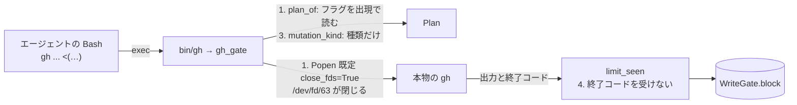
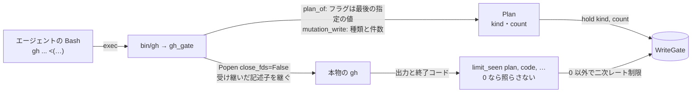

# gh の包み: ファイル記述子・フラグの値・mutation の数・終了コードを本物の gh と同じに扱う（#4172）

#4059 の詳細設計のとおりに `gh_gate` を作ると、プロセス置換のパスを本物の `gh` が開けず、`--silent=false` でも本文を隠し、複数の mutation を 1 件と数え、成功した `gh` の出力で共有の停止を書く（[要求仕様](./issue-4172-requirements.md)）。本物の `gh` を走らせる子に包みが受け継いだ記述子を継ぎ、フラグは pflag と同じく最後の指定の値で読み、GraphQL は実行される最上位のフィールドを数え、二次レート制限の見分けに終了コードを渡す。手元の `gh` 2.103.3 の実測は末尾の「外部の調査」に、#4059 の文書のどこをどう読み替えるかは「#4059 の設計を置き換える箇所」にある。

## 今の姿

何が起きたか・受け入れ条件は要求仕様（[issue-4172-requirements.md](./issue-4172-requirements.md)、正は #4172 の本文）にある。直す先は #4059 の設計（[issue-4059-design.md](./issue-4059-design.md)・[issue-4059-design-detail.md](./issue-4059-design-detail.md)、設計 PR #4115）と、そこから読み替える #4016 の設計（[issue-4016-design-detail.md](./issue-4016-design-detail.md)、設計 PR #4058）で、どれも未実装である。

| # | 直す箇所（#4059 の詳細設計） | 今の書き方 | 実装したときの事象（実測は STD 列） |
| --- | --- | --- | --- |
| 1 | `run_child` の副作用（86 行） | `subprocess.Popen(..., restore_signals=True)` で起動する | 既定の `close_fds=True` で 0〜2 以外の記述子が閉じ、`--input <(…)`・`-F query=@<(…)`・`--body-file <(…)` が `open /dev/fd/63: no such file or directory` で失敗する（STD1） |
| 2 | 処理の手順 (b)・(c)・(e)、出力の写し方（107・118・143〜144・172〜174 行） | ブール値のフラグ（`--silent`・`-i`・`--paginate`・`--verbose`・`--help`・`--draft` など）と `--jq`・`--template` を、出現したかで読む | `--silent=false` でも本文を隠す。`--help=false` の書き込みを読み取りに分けうる。`--draft=false` のリリースを 1 件少なく数える（STD2） |
| 3 | (d) の `mutation_kind`（133 行）と `WriteGate.hold` の件数 | 最上位のフィールドは種類を決めるだけで、件数は 1 | GitHub は最上位の mutation のフィールドを 1 つずつ実行する（STD3）ので、2 つの書き込みを 1 件と数える |
| 4 | `limit_seen` の行（75 行）と事後条件（92 行） | 「終了コードが 0 なら None」と書くが、引数に終了コードが無い | 成功した `gh` も `GH_DEBUG=api` で応答の本文を標準エラーへ出す（STD4）。実装が終了コードを見ないと、本文の語で停止を書く |

## 文脈と制約

- **#4059 の要求の受け入れ条件 4（読み取りの引数・標準入力・出力・終了コードは `gh` を直に打ったときと同じ）と決定 1〜7 の選んだ案は変えない。** この設計はその詳細の読み違いだけを直す
- **フラグの読み方の基準は GitHub CLI v2.103.3 と、それが使う pflag である**（#4059 の (c) のまま）。pflag のブール値のフラグは `--x`（真）・`--x=<値>`（Go の `strconv.ParseBool` が読む `1`・`t`・`T`・`TRUE`・`true`・`True`・`0`・`f`・`F`・`FALSE`・`false`・`False`）で、最後の指定が効き、読めない値は送る前に引数の誤りで終わる
- **#4059 の実装の PR で、#4059 の文書をこの設計のとおりに直す**（要求の受け入れ条件 6）。この設計 PR の差分は `issues/issue-4172-*` だけにする
- 決定の根拠の行の `Value <番号>` は、プロジェクト MVV（`.ndf/mvv.md`、MVV 版 11）の判断の基準の番号である

## 解き方の全体像

- 本物の `gh` は、包みが受け継いだファイル記述子をそのまま持って走る。`exec` で置き換わる読み取りの経路と同じで、プロセス置換やリダイレクトの記述子を指すパスを、どのフラグに渡しても読める
- `plan_of` はブール値のフラグと `--jq`・`--template` を pflag と同じく最後の指定の値で読み、`--silent` を外すか・ヘルプか・リリースの件数を、その値で決める
- GraphQL の書き込みは、実行される mutation の最上位のフィールドを応答のキーごとに数え、その件数で順番を取る。NDF のコードの GraphQL の要求も同じ規則で数える
- 二次レート制限の見分けは本物の `gh` の終了コードを受け取り、0 なら出力を照らさない

## 決定の記録

### 決定 1: プロセス置換を渡す gh も直に打ったときと同じに動かすため、本物の gh を close_fds=False で起動し、包みが受け継いだ記述子を継ぐ

- **質問**: `run_child` が起動する本物の `gh` に、0〜2 以外のどの記述子を渡すか
- **選んだ案**: `subprocess.Popen(..., close_fds=False)` にする。包みが `bin/gh` の `exec` から受け継いだ記述子（Bash のプロセス置換の 63 番など）は継がれる。包み自身が開いた記述子（順番の記録とロックのファイル・出力のパイプ・先読みの写し）は Python 3.4 からの既定で継がれない記述子として作られるので、本物へ漏れない（STD1 で、`close_fds=False` の子が持つのは受け継いだ 63 番だけで、Python が開いた 3 つは持たないことを確かめた）。読み取りの経路は `execve` で置き換わるので、もともとすべてを継いでいる。書き込みの経路も同じ集合になる
- 採らなかった案: `--input` と `-F <名前>=@<パス>` の参照先が `/dev/fd/<n>`・`/proc/self/fd/<n>` なら、その記述子だけを `pass_fds` で継ぐ（起票の期待する結果 1）。`gh pr comment --body-file`・`gh issue create -F`・`gh release create --notes-file` なども同じく失敗する（STD1）ので、ファイルを読むフラグの表をサブコマンドごとに持つことになり、表の漏れがそのまま失敗になる。閉じた番号を `pass_fds` に渡すと `Popen` が `OSError`（`EBADF`）で本物を起動できないので、開いているかの確かめも要る
- **代償**: 包みを起動したプロセスが、継がれる印を付けたまま渡した記述子は、本物の `gh` も持つ。`gh` を直に打ったときと同じなので、新しい漏れではない
- 作り方: 標準に倣う（Python の `subprocess` の `close_fds`・PEP 446）
- 比べた候補: STD1
- 根拠: Value 3・Value 4（MVV 版 11）

### 決定 2: gh と同じ値でフラグを読むため、ブール値と文字列のフラグを pflag と同じく最後の指定の値で読む

- **質問**: `plan_of` が `--silent` を外すか・ヘルプか・件数を決めるのに、フラグの出現と値のどちらを使うか
- **選んだ案**: 値を使う。対象は `plan_of` が判断に使うすべてのフラグ
  - ブール値のフラグ（`gh api` の `--silent`・`-i`・`--include`・`--paginate`・`--verbose`、`release create` の `--draft`・`-d`・`--generate-notes`、`release upload` の `--clobber`）は、`--x`・`-x` を真、`--x=<値>`・`-x=<値>` を `strconv.ParseBool` の規則で読み、最後の指定の値にする。読めない値（`--silent=yes`）は本物の `gh` も送らずに断る（STD2）ので、#4059 の「読めない語は書き込みの側へ倒す」のとおり `CONTENT`・件数 1 にし、引数はそのまま渡す
  - `--jq`・`-q`・`--template`・`-t` は最後の指定の値で読み、空の値は指定なしとする（`gh` の併用の誤りの判定は値が空でないかで決まる。STD2 の `--silent --jq .x --jq=` は断られずに本文を隠す）
  - ヘルプは、`--help`・`-h` を真、`--help=<値>` をブール値の規則、`-h=<値>` を値によらず偽と読み、最後の指定の値にする。`gh api` では、値として消費した語と `--` の後の語を除いて読み、最後の指定の値が真なら、エンドポイント・`-X POST`・フィールドがあっても読み取り（本物の `gh` はヘルプを出して要求を送らない。STD2）。#4059 の (b) の語数の制限は `gh api` のほかに残す。`--help=<偽>` が最後なら本物の `gh` で要求を送る（STD2）ので読み取りにしない。`-h=<値>` と、`-h --help=false` のように最後が `--help=<偽>` の指定は、本物ではヘルプを出すが書き込みの側に倒す（ヘルプを書き込みと誤っても順番を待つだけで済み、逆は書き込みが順番の外へ出る）
  - `--silent` を外すのは、書き込みで、親の標準出力が端末でなく、`GH_FORCE_TTY` が空か無く（空でなければ `gh` はパイプでも端末として扱い、`--silent` が無いときだけページャーを起こす。STD5）、`--silent` の値が真で、`--verbose` の値が偽で、`--jq`・`--template` の値が空で、本物の `gh` の版が読めたとき。外すときは `--silent` と `--silent=<値>` の語をすべて除き（値が偽になる 1 語を足すより、本物が受ける引数を元に近く保つ）、版が 2.97.0 以上なら `--allow-escape-sequences` を `--` より前のフラグの列の末尾へ足す（`--silent` のとき `gh` は JSON でない本文を検査なしで捨てるが、外すと端末のエスケープを含む本文で、書き込みが成功しても終了コード 1 になる。STD2。末尾に置くのは、利用者の `--allow-escape-sequences=false` より後ろで最後の指定にするため）。2.97.0 より前の版はこのフラグを知らず、渡すと要求を送らずに引数の誤りで終わるが、本文の検査も無いので足さない（STD5）。版は本物の `gh` の実体ごとに 1 度だけ `gh --version` で読んで覚える（読めなかった結果も覚え、開発版のように形が合わなければ同じ実体では読み直さず、0 以外・時間切れなどの一時的な失敗は 1 時間おきにだけ読み直す。同時に走る包みはロックで 1 回の起動にまとめ、読みは順番を取る前に済ませる）。`stdout_shown` は `-i`・`--include` の値が偽なら `"none"`、真で `--paginate` の値が偽なら `"headers"`、ほかは外さずに `"all"`。`--silent` の値が偽なら外さずに `"all"` で、本文は親へ写りながら `limit_seen` で照らされる
- 採らなかった案: 起票どおり `--silent` と `--include` だけを値で読む（同じ原因の `--help=false`・`--draft=false` が残る。前者は書き込みを順番の外へ出す）
- **代償**: `plan_of` のフラグの読みに値の規則が 1 つ足される。`-h=<値>`・`-h --help=false` の `gh api` の書き込みは、本物がヘルプを出すだけでも順番を待つ。`--silent` を外した 2.97.0 以上の本物の `gh` は `--allow-escape-sequences` も受ける（本文は親へ写さないので、エスケープは利用者の端末へ届かない）。本物の `gh` を入れ替えた後の最初の外す書き込みで、版を読む `gh` の起動が 1 回（最大 10 秒）増える。`gh --version` が一時的に失敗する環境では、1 時間に 1 回まで増える。版が読めない `gh`（開発版）と `GH_FORCE_TTY` の環境では `--silent` を外さず、422 の本文の `code: abuse` を見分けない
- 作り方: 標準に倣う（pflag の `bool` のフラグと `NoOptDefVal`）
- 比べた候補: STD2
- 根拠: Value 3・Value 4（MVV 版 11）

### 決定 3: 1 つの要求の中の複数の mutation も決定 7 の件数に入れるため、実行される最上位のフィールドを応答のキーごとに数え、NDF のコードの要求にも同じ数を使う

- **質問**: 1 つの GraphQL の要求に最上位の mutation のフィールドが複数あるとき、何件と数えるか。#4016 の `kind_of` を通る NDF のコードの要求も数えるか
- **選んだ案**: graphql-core の `parse` で読んだ文書の、実行される操作の最上位の選択から、GraphQL の仕様の CollectFields と同じくフラグメントの展開とインラインフラグメントをたどって集めたフィールドを、応答のキー（別名、無ければ名前）ごとに 1 件と数える（STD3。仕様は同じ応答のキーのフィールドを 1 つにまとめて 1 回実行する）。`@skip(if: true)`・`@include(if: false)` のリテラルの付いたフィールドは数えない。変数の付いたものは数える（決定 7 と同じく上限の見積もり）。種類は、集めたフィールドの名前のどれかが `create`・`add` で始まれば `CONTENT`、ほかは `WRITE`（#4059 のまま）
  - `write_rules.mutation_kind(document, operation_name) -> Optional[str]` を `mutation_write(document, operation_name) -> Optional[Writes]` に置き換える。`Writes` は種類と件数の組で、読み取り（query）は None、決まらない・構文の誤り・`subscription` は `Writes(CONTENT, 1)`
  - #4016 の `kind_of(request) -> Optional[str]` を `write_of(request) -> Optional[Writes]` に置き換え、`WriteGate.acquire` は `with self.hold(w.kind, w.count):` で順番を取る。GraphQL 以外の要求は件数 1
- 採らなかった案: `gh` の経路だけ数え、NDF のコードの要求は 1 件のままにする。今の NDF の文書は最上位のフィールドが 1 つ（`grep` で 4 つを確かめた）なので振る舞いは変わらないが、同じ要求を 2 つの経路で別の件数に数える規則が残り、後で複数のフィールドの文書を足すと黙って少なく数える
- 採らなかった案: 内容を作るフィールドとほかのフィールドを分けて数え、`hold` に 2 つの件数を渡す（`hold`・`reserve`・`sent` の引数が増える。混ぜた要求はまれで、まとめて `CONTENT` の間隔で数えても多く空くだけ）
- **代償**: 内容を作るフィールドとほかのフィールドを混ぜた要求は、すべてを内容を作る書き込みの間隔（7.2 秒）で数える。#4016 の `kind_of` の名前と返り値が変わり、#4016 と #4059 の文書の参照を読み替える
- 作り方: 標準に倣う（GraphQL の仕様の CollectFields）
- 比べた候補: STD3
- 根拠: Value 3・Value 9（MVV 版 11）

### 決定 4: 成功した gh の出力で共有の停止を書かないため、limit_seen に終了コードを渡し、0 なら照らさない

- **質問**: 「終了コードが 0 なら照らさない」を、`limit_seen` の引数と呼び手のどちらの契約にするか
- **選んだ案**: `limit_seen(plan, code, out, err, now)` にして終了コードを受け取り、`code == 0` なら最初に None を返す。`run_held` は `run_child` の返した終了コードを渡し、終了コードによらず呼ぶ。`gh` は HTTP の誤りでも GraphQL の誤り（HTTP 200）でも 1 で終わり、成功は 0 である（STD4）
- 採らなかった案: 引数を変えず、`run_held` が 0 以外のときだけ呼ぶ契約を書く（`limit_seen` の単体テストで「0 なら照らさない」を縛れず、呼び手が増えたときに契約が抜ける）
- **代償**: 無い（引数が 1 つ増えるだけ）
- 作り方: 自前で作る
- 比べた候補: STD4
- 根拠: Value 3（MVV 版 11）

## 影響と危険

- **働く範囲**: #4059 と同じ（NDF のリレーが起動したセッションの `gh`）。決定 3 の件数は NDF のコードの GraphQL の書き込みにも当たるが、今の NDF の文書はどれも最上位のフィールドが 1 つなので振る舞いは変わらない
- **設定と引数**: 新しい設定は無い。プロジェクトごとに違うものは無い
- **当たるモード**: どのモードでも同じ（`gh` の包みはモードを見ない）
- **書きかけの文書・同じファイルを触る別の変更**: #4059 と #4016 の設計文書。実装は同じレーン（lcrrate）が #4016 → #4059 の順で受け持つ。#4016 の実装の PR は `kind_of` を `write_of` の形で作る（#4016 の実装の時点で #4059 と #4172 の読み替えが承認済みのため）
- **壊れうる箇所**: 決定 1 で、包みを起動したプロセスが継がれる印を付けて渡した記述子を本物の `gh` が持つ。`gh` を直に打ったときと同じ集合で、包みが開いた記述子は含まない（STD1）

### 代表のリポジトリでの振る舞い

| 代表のリポジトリ | 設定の要点 | 直した後に起きること | この種類で扱えなくなること |
| --- | --- | --- | --- |
| Web サービス | NDF のリレーで並列のレーンを動かし、エージェントが `gh` で PR とコメントを書く | プロセス置換・`--silent=false` の `gh` が直に打ったときと同じに動き、複数の mutation の要求は件数の分だけ間隔を空ける。設計・cross-review・MVV 判定の振る舞いは変わらない | 無し |
| モバイルアプリ | 同上 | 同上 | 無し |
| 業務文書だけ | 同上（PR で文書をレビューする） | 同上 | 無し |

### このリポジトリだけの事情

- 無し（直すのは `gh` と GraphQL の振る舞いの読み違いで、ai-plugins の運用の値を使わない）

## #4059 の設計を置き換える箇所

この設計 PR は #4059 と #4016 の文書を変えない。**#4059 の実装の PR で、次の節をこの設計のとおりに書き換える**（要求の受け入れ条件 6）。関数の契約の新しい形は詳細設計 [issue-4172-design-detail.md](./issue-4172-design-detail.md) にある。

| 文書と節 | 置き換える中身 | この設計の決定 |
| --- | --- | --- |
| #4059 の詳細設計「gh_gate」の関数の仕様の `run_child` の副作用 | `subprocess.Popen(..., restore_signals=True, close_fds=False)` で起動し、包みが受け継いだ記述子を本物へ継ぐ。包みが開く記述子は継がれない記述子で作る | 決定 1 |
| #4059 の詳細設計「先読みの契約」の 2 つ目の箇条 | 「引数はそのまま本物へ渡す」の後に「記述子は `run_child` の `close_fds=False` で本物へ継がれるので、本物の `gh` が読める」を足す | 決定 1 |
| #4059 の詳細設計「処理の手順」(b) | 詳細設計の「フラグの値」の (b) の箇条に置き換える（`gh api` は最後のヘルプの指定の値で決め、語数の制限を掛けない。ほかは語数の制限のまま、`--help=<偽>`・`-h=<値>` をヘルプとして数えない） | 決定 2 |
| #4059 の詳細設計「処理の手順」(c) の箇条 | 「同じフラグが複数あれば」の箇条を、詳細設計の「フラグの値」の規則（ブール値と文字列のフラグは最後の指定の値、読めないブール値は `CONTENT`・件数 1）に置き換える。118 行の `--silent` を外す条件を、詳細設計の `plan_of` の `--silent` の規則に置き換える。値を取らないフラグの一覧に `--allow-escape-sequences` を足す。`plan_of` に `forced_tty` と `version` の引数を足す | 決定 2 |
| #4059 の詳細設計「処理の手順」(e) の `release create`・`release upload` の件数 | `--draft`・`-d`・`--generate-notes`・`--clobber` の「あるとき」「無いとき」を「値が真のとき」「偽のとき」に読み替える | 決定 2 |
| #4059 の詳細設計「出力の写し方」の `--silent` の 3 つの箇条 | 条件を「(c) の条件に当たる」から詳細設計の `plan_of` の `--silent` の規則へ読み替える（中身の写し分けは変えない） | 決定 2 |
| #4059 の設計「決定 4」の照らせる範囲、「影響と危険」の端末と `--silent` | 「`-i`・`--jq`・`--template`・`--verbose` と併用していない」を「`--verbose` の値が偽で `--jq`・`--template` の値が空」に、「`--paginate` が無ければ」を「`--paginate` の値が偽なら」に読み替える | 決定 2 |
| #4059 の詳細設計「処理の手順」(d) の最後の段落と、表 (c) の `graphql` の行 | `mutation_kind` を `mutation_write` に置き換え、結果の種類と件数を `Plan.kind`・`Plan.count` にする。件数は詳細設計の `mutation_write` のとおり | 決定 3 |
| #4059 の詳細設計の地図の表の `write_rules.py`・`write_gate.py` の行、「WriteGate.hold」の関数の仕様の `mutation_kind`・`kind_of`・`acquire` の行と事後条件 | `mutation_kind` → `mutation_write`、`kind_of` → `write_of`（返り値は `Optional[Writes]`）、`acquire` は `hold(w.kind, w.count)`。`Writes` を `write_rules.py` に足す | 決定 3 |
| #4059 の設計「#4016 の設計を置き換える箇所」の `kind_of` の行と `acquire` の行、決定 3・決定 7 の本文 | 同上。決定 7 の件数の一覧に「`gh api graphql`: 実行される mutation の最上位のフィールドの応答のキーの数」を足す | 決定 3 |
| #4059 の詳細設計「gh_gate」の関数の仕様の `limit_seen`・`run_held` の行と事後条件 | `limit_seen(plan, code, out, err, now)`。`run_held` は `run_child` の終了コードを `code` に渡す | 決定 4 |
| #4059 の詳細設計「単体テストの観点」、#4059 の設計「テスト設計」 | 下の「テスト設計」の行を足す | 決定 1〜4 |

## テスト設計

テストは #4059 の実装の PR で書く（`test_gh_gate.py`・`test_write_rules.py`・`test_write_gate.py`）。

| 決定・受け入れ条件 | 確かめること | 防ぐ誤り |
| --- | --- | --- |
| 決定 1・受け入れ条件 1 | `bash -c` から包みを起動し、`--input <(…)`・`-F query=@<(…)`・`gh pr comment 1 --body-file <(…)` を渡すと、偽の本物の `gh` が中身を読み、書き込みの経路（`run_held`）で終了コード 0。偽の本物の `gh` が持つ記述子に、包みが開いた順番の記録とロックのファイルが無い | 既定の `close_fds` のまま起動する・`--input` と `-F` だけを継ぐ・包みの記述子を漏らす |
| 決定 2・受け入れ条件 2 | 書き込みの `--silent=false`・`--silent --silent=false` → 偽の本物の `gh` が受けた引数はそのままで、本文が親の標準出力に出る。`--silent=false --silent` → `--silent` の語がすべて除かれ、利用者の標準出力は空。`--silent --jq .x --jq=` → 外して `"none"`。`--silent --verbose=false -i=true` → 外して `"headers"`。`--silent=yes` → `CONTENT`・引数はそのまま。外したときは 2.97.0 以上の版で `--allow-escape-sequences` が `--` より前の末尾に足され、端末のエスケープを含む JSON でない本文の 201 で、直に打ったときと包みを通したときの終了コードがどちらも 0（利用者の `--allow-escape-sequences=false` があっても 0）。`gh version 2.96.0` を名乗りこのフラグを断る偽の本物の `gh` では、フラグを足さずに書き込みが 1 回送られて 0。`GH_FORCE_TTY=1` と `GH_PAGER` の環境で標準出力をファイルへ向けた書き込みは `--silent` を外さず、ページャーが起きない | 出現で読む・`=false` の語を残したまま `--silent` だけを除く |
| 決定 2・受け入れ条件 3 | `gh api -X POST repos/o/r/issues --help=false` → `CONTENT`。`gh api -X POST … --help`・`--help=false --help` → 読み取り。`--help --help=false`・`-h=false` → 書き込みの側。`gh release create v1 a.zip --draft=false` → 3 件、`--draft=true` → 2 件、`--generate-notes=false` → 足さない、`gh release upload v1 a.zip --clobber=false` → 1 件 | ヘルプの語の出現で読み取りにする・件数の式を出現で決める |
| 決定 3・受け入れ条件 4 | `mutation { addComment … resolveReviewThread … }` → `CONTENT`・2 件。`a: addComment b: addComment` → 2 件。同じ応答のキーの `addComment` が 2 つ → 1 件。フラグメントとインラインフラグメントの中の 2 つ → 2 件。`@skip(if: true)` のフィールドは数えず、`@include(if: $v)` は数える。フラグメントの循環でも止まる。`write_of` を通る NDF のコードの 2 つのフィールドの要求で `hold` が件数 2 で呼ばれる | 最上位のフィールドを種類だけに使う・別名を名前でまとめる・`gh` の経路だけ数える |
| 決定 4・受け入れ条件 5 | `limit_seen(plan, 0, …)` に、標準エラーの `gh: secondary rate limit (HTTP 403)` と `-i` の 403 の出力を渡す → None で、`run_held` は `gate.block` を呼ばない。同じ出力で `code=1` → `BLOCK_SECONDS` | 終了コードを見ずに照らす |

## どこを変えるか

詳細設計は別のファイル [issue-4172-design-detail.md](./issue-4172-design-detail.md) にある（#4059 の詳細設計の関数のシグネチャを 3 つ変えるため。`limit_seen`・`mutation_kind`→`mutation_write`・`kind_of`→`write_of`）。

## 設計の結果

| 課題 | 扱い | 統合先 | 触るファイル |
| --- | --- | --- | --- |
| #4172 | #4059 の実装の PR で一緒に直す | #4059 | #4059 の設計の「設計の結果」の触るファイルと同じ（新しいファイルは無い）。あわせて `issues/issue-4059-design.md`・`issues/issue-4059-design-detail.md` を直す |

## 未確認のまま残ること

| 項目 | 内容 |
| --- | --- |
| 複数の mutation を GitHub の二次レート制限が何件と数えるか | 実行はフィールドごとに行われる（STD3）が、内容を作る上限（1 時間 500 件）の数え方は GitHub の文書に書かれていない。決定 7 と同じく上限の見積もりとして、多い側に数える |
| `-h=<値>` が本物の `gh` でヘルプになる理由 | 実測（STD2）だけで、コードの経路は追っていない。書き込みの側へ倒すので、理由によらず順番の外へは出ない |

## 外部の調査

| 種類 | 調べるか | 理由 |
| --- | --- | --- |
| 標準・仕様 | 調べる | 4 点はどれも `gh`・pflag・Python・GraphQL の振る舞いの読み違いの疑いで、実物で確かめるのが決定の前提になる |
| 主要な製品 | 調べない | 直すのは #4059 の詳細の読み違いで、比べる製品の案は #4059 の外部の調査のまま |
| ライブラリとサービス | 調べない | graphql-core（3.2 系）は #4059 で選んだもの。この設計は `parse` の構文木を読むだけで、新しいライブラリを足さない |

### 標準・仕様

確かめた環境: `gh version 2.103.3 (2026-10-26)`（STD5 は `gh version 2.96.0 (2026-07-02)` も）、Python 3.14.4、graphql-core 3.2.14（2026-11-22、このマシン）。GitHub へ内容を作る書き込みはしていない。

| # | 対象 | 分かったこと | 効く決定 | 出所 |
| --- | --- | --- | --- | --- |
| STD1 | Python の `subprocess` と `gh` のファイルの引数 | `gh api graphql --input <(…)` を直に打つと通る。同じ引数を `subprocess.run` の既定（`close_fds=True`）で起動すると `open /dev/fd/63: no such file or directory`、`-F query=@<(…)` は `error parsing "query" value: open /dev/fd/63: …` で終了コード 1。`gh pr comment 1 -R <存在しないリポジトリ> --body-file <(…)` も既定では `open /dev/fd/63` で失敗し、`close_fds=False` ではリポジトリの解決の誤りまで進む（本文を読めた）。`pass_fds=[63]` でも通るが、閉じた番号を渡すと `OSError: [Errno 9] Bad file descriptor` で起動できない。`close_fds=False` の子が持つ記述子は 0・1・2 と受け継いだ 63 だけで、Python が開いたファイルとパイプ（3・4・5）は持たない。`/proc/self/fd/63` も同じ | 決定 1 | 読み取りの `query{viewer{login}}` と存在しないリポジトリへの要求で実測。https://docs.python.org/3/library/subprocess.html#subprocess.Popen ・ https://peps.python.org/pep-0446/ |
| STD2 | `gh api` と `gh release create` のブール値のフラグ | `gh api rate_limit` で、`--silent=false`・`--silent --silent=false`・`--silent=F`・`-i=0` は本文を出し、`--silent=false --silent`・`--silent=true`・`--silent=1` は隠す。`--silent=yes` は `invalid argument "yes" for "--silent" flag: strconv.ParseBool` で終了コード 1。`--silent --jq .rate.limit` は併用の誤りで終了コード 1、`--silent=false --jq …` と `--silent --jq .x --jq=` は通る（`api.go` の `MutuallyExclusive` は `opts.Silent` と `opts.FilterOutput != ""` の値で判定する）。`--help=false`・`--help=0`・`--help --help=false` は要求を送り、`--help`・`--help=true`・`--help=false --help`・`-h --help=false`・`-h=false`・`-h=0` はヘルプを出す。`gh api --hostname nonexistent.invalid -X POST repos/o/r/issues` に `--help`・`-f a=b --help`・`-ih` を続けてもヘルプを出して 0（エンドポイントと方法とフィールドはヘルプを妨げない）。`--silent` は本文の書き込み先を `io.Discard` にし、JSON でない本文はそのとき `io.Copy` で捨てられ、ほかでは `--allow-escape-sequences` が無いと `iostreams.CopyGuardedContent` を通る（api.go の 349〜351・534〜548 行）。`gh release create … --draft=false`・`-d=false` は受け付けて要求へ進み、`--draft=yes` は引数の誤り | 決定 2 | 実測と https://github.com/cli/cli/blob/v2.103.3/pkg/cmd/api/api.go の 248〜306 行 |
| STD3 | GraphQL の最上位の mutation のフィールドの実行 | 存在しない ID への `mutation { a: addReaction(…) b: removeReaction(…) }` を GitHub へ 1 回送ると、`errors` に `path: ["a"]` と `path: ["b"]` の 2 つの `NOT_FOUND` が返る（2 つのフィールドがそれぞれ実行された。何も作られていない）。graphql-core の `parse` の構文木を CollectFields の規則でたどると、別名の違う同じフィールドは 2 つ、同じ応答のキーは 1 つ、フラグメントの中は展開して数えられる。仕様は応答のキーごとにフィールドをまとめ、mutation の最上位は順に 1 つずつ実行する | 決定 3 | 実測と https://spec.graphql.org/October2021/#sec-Mutation ・ https://spec.graphql.org/October2021/#CollectFields() |
| STD4 | `gh` の終了コードと標準エラー | 存在しないリポジトリへの `gh api` は `gh: Not Found (HTTP 404)` で 1。STD3 の GraphQL の誤り（HTTP 200）も 1。`gh api repos/devbasex/ai-plugins/issues/4016` は 0 で、`GH_DEBUG=api` を付けると応答の本文（`secondary rate limit` を含む課題の本文）が標準エラーに出て、終了コードは 0 のまま | 決定 4 | 実測 |
| STD5 | `gh` の版と `--allow-escape-sequences`・`GH_FORCE_TTY` とページャー | `--allow-escape-sequences` と `iostreams.CopyGuardedContent` の検査は、どちらも 2.97.0 の `pkg/cmd/api/api.go` で入り、2.96.0 には無い。`gh` 2.96.0 は `gh api --hostname nonexistent.invalid --allow-escape-sequences -X POST repos/o/r/issues -f a=b` を `unknown flag: --allow-escape-sequences` で 1 にし、接続しない（フラグを除くと接続の誤りまで進む）。`gh --version` の 1 行目は 2.96.0・2.103.3 とも `gh version <版> (<日付>)`。go-gh の `term.FromEnv` は `GH_FORCE_TTY` が空でなければ標準出力を端末とし、`IOStreams.StartPager` はページャーが空か `cat` か端末でないときだけ起こさない。2.103.3 で `GH_FORCE_TTY=1` と `GH_PAGER` を設定し標準出力をファイルへ向けると、`gh api rate_limit` はページャーを起こしてファイルが 0 バイト、`--silent` 付きは起こさない | 決定 2 | 実測（2.96.0 は公式のリリースの linux_amd64 の配布物）と https://github.com/cli/cli/security/advisories/GHSA-3m3g-3wcr-px46 ・ https://github.com/cli/cli/blob/v2.103.3/pkg/iostreams/iostreams.go ・ https://github.com/cli/go-gh/blob/trunk/pkg/term/env.go |
