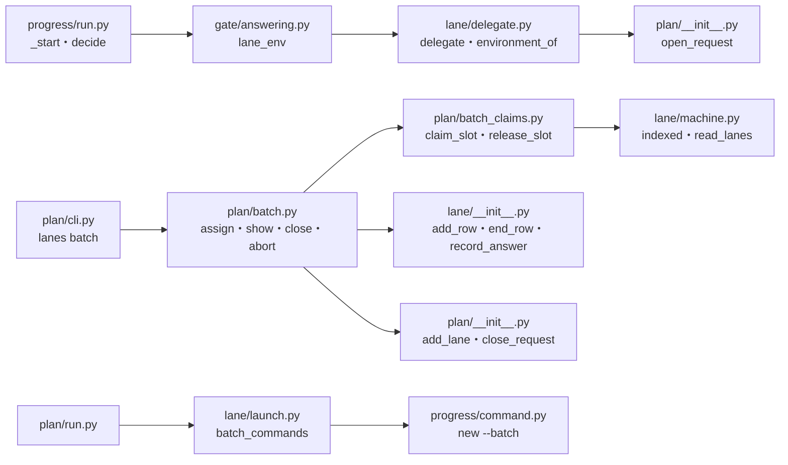

# #4211 の詳細設計: 委ねのリクエスト・まとめのコマンド・マシン全体の取りかかり・種類 `batch` の行

設計文書（[issue-4211-design.md](./issue-4211-design.md)）の構成要素を、ファイルと関数の粒度へ下ろす。パスは `plugins/ndf/` からの相対で書く。#4050 の詳細設計（main の `issues/issue-4050-design-detail.md`）の `Env`・`_start`・`decide`・`phases.json` の `carrier` を前提にし、そのうち「#4210・#4211 へ分けたもの」の表の #4211 の行（`Env.delegate`・`delegate`・`_start` の委ねの枝・`_consume_delegated`・`delegate_answered`・節「まとめた検証と棚卸し」・`request_opened` の `lane-verify`・`lane-backlog`）を、この文書で置き換える。#4050 の詳細設計の節「まとめた検証と棚卸し」の `batch claim`・`--phase release`・`ndf lanes release --batch`・`policy.batch_ttl`・`superseded_from` は作らない（設計文書の決定 2・3・5・6）。

## 地図

| パス | 種類 | 役割 1 文 | 依存する先 | クラスまたはモジュール | メソッドと最上位の関数 |
| --- | --- | --- | --- | --- | --- |
| `src/ndf/progress/lane/delegate.py` | 新設 | 計画の行の委ねのリクエストを組み、計画へ 1 回だけ書く | `plan/__init__.py`・`lane/__init__.py` | モジュール | `delegate`・`environment_of`・`delegation_key`（新設） |
| `src/ndf/progress/run.py` | 変更 | 担い手 `organizer` のフェーズで `Env.delegate` を呼び、委ねた回答を消費する | `phases.json`（#4050） | `Env` | `Env.delegate`（新設の欄）・`_start`・`decide`・`_consume_delegated`（新設） |
| `src/ndf/progress/gate/answering.py` | 変更 | 計画の行のスプリントでだけ `delegate` をつなぐ | `lane/delegate.py` | モジュール | `lane_env` |
| `src/ndf/progress/plan/batch.py` | 新設 | まとめの 4 つの手を計画のトランザクションで行う | `batch_claims.py`・`lane/__init__.py`・`plan/__init__.py` | モジュール | `assign`・`show`・`close`・`abort`・`check_version`（新設） |
| `src/ndf/progress/plan/batch_claims.py` | 新設 | マシン全体の取りかかりの記録の確認・確保・消去 | `lane/machine.py` | モジュール | `claim_slot`・`release_slot`・`slot_free`・`batch_lock`（新設） |
| `src/ndf/progress/plan/cli.py` | 変更 | `ndf lanes batch assign / show / close / abort` の引数と書き手の見分け | `plan/batch.py` | モジュール | `_batch_parser`・`_writer`（新設）、`_row_end`・`_row_cancel`（変更） |
| `src/ndf/progress/plan/__init__.py` | 変更 | 委ねとまとめの事象の畳み込みと表示 | `lane/fold.py` | `PlanView` | `open_batches`・`failed_backlogs`（新設）、`status`（変更） |
| `src/ndf/progress/lane/fold.py`・`types.py` | 変更 | `batch_claimed`・`batch_closed` を `PlanView` に畳む | — | `PlanView`・`Batch`（新設の型） | `fold_plan`（変更） |
| `src/ndf/progress/lane/launch.py` | 変更 | 種類 `batch` の行を始める入力を組む | `progress/command.py` | モジュール | `batch_commands`（新設）、`start_commands`・`start_prompt`（変更） |
| `src/ndf/progress/plan/run.py` | 変更 | 種類 `batch` の行を開発ループの行と同じく生死の判定へ渡す | `lane/liveness.py`（変更なし） | モジュール | 生死の判定の呼び手（変更） |
| `src/ndf/progress/command.py` | 変更 | `ndf progress new --batch <id>` で工程を持たない子のステートマシンを作る | — | モジュール | `new`（変更） |
| `contracts/workflow/progress.json` | 変更 | 事象 `batch_claimed`・`batch_closed`（計画）と `delegate_answered`（スプリント）、リクエストの種類 `lane-verify`・`lane-backlog` | — | — | — |
| `contracts/workflow/parallel-plan.schema.json` | 変更 | 行の入力 `kind: batch` | — | — | — |
| `contracts/workflow/context.schema.json` | 変更 | 文脈のキー `verification` | — | — | — |
| `contracts/schemas/io/lanes.args.schema.json`・`docs/contracts/commands.md` | 変更 | `lanes batch` の引数と説明 | — | — | — |
| `contracts/domains/locations.json` | 変更 | 状態の保存先の行 `parallel/batches/` | — | — | — |
| `skills/development-workflow/schemas/project.schema.json` | 変更 | `branch_strategy.verify.environment`（文字列） | — | — | — |
| `skills/development-workflow/references/parallel.md`・`skills/release-verification/SKILL.md`・`skills/backlog-refinement/SKILL.md` | 変更 | オーガナイザーのまとめの手順と、担い手の手順（版を前後で読む・`batch close`） | — | — | — |

## 委ねの口（`run`・`answering`・`delegate`）

満たす決定: 決定 1・決定 4・決定 6、受け入れ条件 1・3

### 関数の仕様

| 関数 | 保存先 | 種類 | シグネチャ | 責務 |
| --- | --- | --- | --- | --- |
| `Env.delegate` | `src/ndf/progress/run.py` | 新設の欄 | `Callable[[Any, View, Phase, list[str]], Optional[str]]`（既定は `lambda *_: None`） | 委ねたらリクエストのキーを返し、委ねなければ None を返す。計画の外は既定のままで、今のとおり工程を流す |
| `_start` | `src/ndf/progress/run.py` | 変更 | 今のまま | フェーズの最初の工程で `phase.carrier == "organizer"` なら `env.delegate` を呼ぶ。キーが返れば、検証は工程を始めずに `DELEGATED` を返し、棚卸しは同じトランザクションで委ねた工程を `completed` にして次の候補へ進む |
| `decide` | `src/ndf/progress/run.py` | 変更 | 今のまま | 委ねた検証の工程の状態で手を選ぶ（下の「処理の手順」） |
| `_consume_delegated` | `src/ndf/progress/run.py` | 新設 | `(conn, v: View, answer: dict) -> list[EventDraft]` | 今の委ねのキーの `delegate_answered` を読み、`done` なら委ねた工程の並びをすべて `completed` にし、文脈の `verification` へリポート・要求の版・読んだ版を写す。`failed` なら並びの先頭を `failed`（`cause: delegate_failed`・リポート）にし、残りは未着手のまま |
| `lane_env` | `src/ndf/progress/gate/answering.py` | 変更 | 今のまま | 計画の行のスプリントの `Env` に `delegate=lambda conn, v, phase, stages: delegate.delegate(conn, v, phase, stages)` を足す |
| `delegate` | `src/ndf/progress/lane/delegate.py` | 新設 | `(conn, v: View, phase: str, stages: list[str]) -> Optional[str]` | スプリントの行（`lane.sprint_row`）を引き、無ければ None。計画の排他（`lane.lock_plan`）の中で、同じ委ねのキーの `request_opened` があればそのキーを返し、無ければ中身（設計文書の「データ構造」）を組んで `open_request` で書く |
| `delegation_key` | `src/ndf/progress/lane/delegate.py` | 新設 | `(v: View, phase: str) -> str` | `<スプリントの ID>:<フェーズ>:<試み>`。試みは、そのフェーズの最初の工程の `stage_retried` の数 |
| `environment_of` | `src/ndf/progress/lane/delegate.py` | 新設 | `(repo_root: Path, repo: str) -> str` | `.ndf/project.json` の `branch_strategy.verify.environment` を読み、空でない文字列ならそれ、無いか `verify` が `null` なら `repo`（`<owner>/<name>`）を返す |

### 処理の手順

| 関数 | 条件の組み合わせ | 結果 |
| --- | --- | --- |
| `_start` | 担い手 `lane` のフェーズ | 今のとおり（#4050） |
| `_start` | 担い手 `organizer`・`env.delegate` が None | 計画の外。今のとおり工程を始める |
| `_start` | 担い手 `organizer`・検証・キーが返る | 工程を始めず `DELEGATED`。結果は `status: ok`・`metrics.delegated`・`next` 無し（conductor は応答を終える） |
| `_start` | 担い手 `organizer`・棚卸し・キーが返る | 委ねた工程を `completed`（`summary` に委ねのキー）にし、同じ `next` で次の候補へ進む。候補が無ければスプリントの完了（今のとおり `Env.ended` で行が終わる） |
| `decide` | 委ねた検証の工程に `delegate_answered`（今の委ねのキー）が無い | `DELEGATED`（打ち直しでリクエストを書き足さない）。#4210 が入るまでは、ほかの候補を始めない |
| `decide` | `done` の回答がある | `_consume_delegated` の手。その後は今のとおり次の候補（振り返り） |
| `decide` | `failed` の回答がある | `_consume_delegated` の手。その後は `FAILED` |
| `decide` | 古い委ねのキーの回答だけがある（`retry` の後） | 読まない。新しい委ねのキーで `_start` がリクエストを書く |

`documentation` の検証は、体裁レビューとリリース後テストを 1 件の `lane-verify`（`stages` に 2 つ）で委ね、1 件の回答で 2 つとも消費する。モードが持たない工程は `stages` に入らない。

### 異常系の処理

| 関数 | 失敗 | 原因 | 検出する場所 | 扱い | 利用者に見える出力と終了コード | 後始末と再実行の可否 |
| --- | --- | --- | --- | --- | --- | --- |
| `delegate` | 検証の版が無い | デプロイの出力に `version` が無い（リリースを出さなかった） | 文脈の `version` を読む所 | 止める | `stopped`・`precondition`（「検証する版が文脈に無い」） | デプロイを直してから `next` を打ち直す。リクエストは書かれない |
| `environment_of` | `.ndf/project.json` が読めない・形が違う | 利用者の設定の誤り | 読み込み | 止める | `stopped`・`precondition`（ファイルと誤り） | 設定を直して `next` を打ち直す |
| `delegate` | 計画の排他を取れない | 別の書き手が長く持つ | `lock_plan` | 呼び出し元へ返す | `stopped`・`transient` | そのまま打ち直せる（キーで冪等） |
| `_consume_delegated` | 回答のリポートが空 | 担い手の誤り（`close` が断るので起きない） | — | 既定値で続ける | 無し | — |

### 単体テストの観点

| 関数 | 正常 | 境界値 | 異常 |
| --- | --- | --- | --- |
| `delegate`・`_start` | 計画の行の検証の境で `lane-verify` が 1 件・結果が `DELEGATED`。棚卸しの境で `lane-backlog` が 1 件・棚卸しの工程が `completed`・行が完了 | 打ち直しで増えない。`retry` の後は試みの進んだ新しいキーで 1 件 | 計画の外では書かない。版の無い文脈で `precondition` |
| `_consume_delegated` | `done` で委ねた工程がすべて完了し `verification` に要求の版と読んだ版が載る。`documentation` で 2 工程とも完了 | 古い委ねのキーの回答を読まない | `failed` で先頭が `failed`・`decide` が `FAILED` |
| `environment_of` | 宣言があればその名前 | `verify: null`・キー無し・空の文字列でリポジトリの名前 | 形の違う設定で `precondition` |

## まとめのコマンド（`plan/batch`・`plan/cli`）

満たす決定: 決定 2・決定 4・決定 5・決定 7、受け入れ条件 1〜4

### 関数の仕様

| 関数 | 保存先 | 種類 | シグネチャ | 責務 |
| --- | --- | --- | --- | --- |
| `assign` | `src/ndf/progress/plan/batch.py` | 新設 | `(cwd: Path, plan: str, requests: list[str], lane: Optional[str], reason: str) -> dict` | リクエストを確かめ、`batch_lock` の中で `claim_slot` を確かめ、計画のトランザクションで `batch_claimed` と担い手の行（名指したレーンへ `add_row`、無ければ `add_lane` で `b<id>`）を書き、コミットの後に取りかかりの記録を書く |
| `show` | `src/ndf/progress/plan/batch.py` | 新設 | `(cwd, plan, batch_id) -> dict` | まとめの中身と、担い手が打つ `close` の雛形（`--observed-version` の並び）を返す。書かない |
| `close` | `src/ndf/progress/plan/batch.py` | 新設 | `(cwd, plan, batch_id, result: str, report: Path, observed: dict[str, tuple[str, str]], cause: Optional[str], reason: str, caller: Writer) -> dict` | 書き手と版を確かめ、1 つのトランザクションで `batch_closed`・リクエストの閉じ・回答・担い手の行の終わりを書き、コミットの後に `release_slot` |
| `abort` | `src/ndf/progress/plan/batch.py` | 新設 | `(cwd, plan, batch_id, reason, caller: Writer) -> dict` | 書き手を確かめ、1 つのトランザクションで担い手の行の中止（未着手なら `cancel_row`、実行中なら子のステートマシンの ID で `end_row` の `cancelled`）と `batch_closed`（`aborted`）を書き、コミットの後に `release_slot`。実行中だった担い手のラッパーは、最後の行が終わったレーンとして耐久ワークフローが今のとおり止める（`plan/run.py` の `_halts`） |
| `check_version` | `src/ndf/progress/plan/batch.py` | 新設 | `(batch: Batch, result: str, observed: dict[str, tuple[str, str]], cause: Optional[str]) -> Optional[str]` | 検証の `done` に読んだ版の前後の一致と要求の版以上を求め、`failed` には原因を求める。誤りの文を返す |
| `_writer` | `src/ndf/progress/plan/cli.py` | 新設 | `(environ: Mapping[str, str]) -> Writer` | `NDF_RELAY_PLAN` が無ければ `organizer`、あれば `conductor`（計画の名前とラッパーの名前 `NDF_RELAY_NAME` を持つ） |
| `_row_end`・`_row_cancel` | `src/ndf/progress/plan/cli.py` | 変更 | 今のまま | 種類 `batch` の行を断る（`precondition`。`batch close` か `batch abort` を案内する） |
| `open_batches`・`failed_backlogs` | `src/ndf/progress/plan/__init__.py` | 新設 | `(view: PlanView) -> list[dict]` | 取りかかり中のまとめ（フェーズ・キー・担い手・経過時間）と、`failed` で閉じた棚卸しのまとめ（リクエストが開いたまま）を `ndf lanes status` の `metrics` へ出す |

### 処理の手順

`assign` の確かめ（どれかに当たれば何も書かずに `stopped`・`precondition`）:

| 確かめ | 断る条件 |
| --- | --- |
| 書き手 | `conductor` |
| リクエスト | 開いていない・委ねのリクエストでない・種類が混ざる・検証で環境が混ざる。既に開いたまとめ（`batch_claimed` があり `batch_closed` が無い）に入っている |
| レーン（`--lane`） | 計画に無い・未着手か実行中の行がある・行が 1 つも無い |
| 取りかかり | `claim_slot` が「使用中」を返す（中身に持ち主の計画・まとめの id・経過時間） |

`assign` の書き込み:

1. `batch_lock` を取る（`admit_lock` と同じ待ち方。`parallel-machine.admit-lock` の秒）
2. `claim_slot` で確かめる（下の「取りかかりの記録」）
3. 計画の排他（`lock_plan`）の中の 1 つのトランザクションで、id を採って `batch_claimed` を書き、`--lane` があれば `add_row(lane, {"kind": "batch", "batch": id, "phase": …})`、無ければ `add_lane({"name": "b<id>", "touches": [], "after": [], "rows": [同じ入力]})`
4. コミットの後、`batches.lock` の中のまま取りかかりの記録を書き、排他を外す

3 の後・4 の前に落ちたら、計画には開いたまとめが残る。打ち直しの `assign` は、同じリクエストを束ねた開いたまとめを見つけたら、新しいまとめを作らずに 2 と 4 だけを行い、同じ id を返す。

`close` の書き込み（1 つのトランザクション）:

| フェーズと結果 | `batch_closed` | リクエスト | 各行 | 担い手の行 |
| --- | --- | --- | --- | --- |
| 検証・`done` | 書く（読んだ版・リポート） | 閉じる | `row_answered`（中身に `request`）とスプリントの `delegate_answered`（`done`） | `end_row(completed)` と子のステートマシンの完了 |
| 検証・`failed` | 書く（原因） | 閉じる | `row_answered` と `delegate_answered`（`failed`・原因） | 同上 |
| 棚卸し・`done` | 書く | 閉じる | 書かない（工程は委ねた時点で終えている） | 同上 |
| 棚卸し・`failed` | 書く | 開いたまま | 書かない | 同上 |

閉じた後に同じ id の `close` を打つと、何も書かずに前の `batch_closed` を返す。`close` が通る書き手は、オーガナイザーと、ラッパーの名前がまとめの担い手のレーンのラッパーと同じ conductor である。

`check_version`（検証だけ。棚卸しは見ない）:

| 結果 | 条件 | 判定 |
| --- | --- | --- |
| `done` | まとめのリポジトリの `--observed-version` が無い | 断る |
| `done` | 前と後が違う | 断る（`failed --cause version_changed` で閉じる） |
| `done` | 前と後が同じで、まとめのそのリポジトリのどれかのリクエストの版より古い（semver） | 断る（`failed --cause version_mismatch` で閉じる） |
| `done` | 前と後が同じで、どのリクエストの版以上 | 受ける |
| `failed` | `--cause` が無い | `work_failed` を入れて受ける |
| `failed` | `--cause` が `version_changed`・`version_mismatch` で、`--observed-version` が無い | 断る（原因の根拠が無い） |

### 異常系の処理

| 関数 | 失敗 | 原因 | 検出する場所 | 扱い | 利用者に見える出力と終了コード | 後始末と再実行の可否 |
| --- | --- | --- | --- | --- | --- | --- |
| `assign` | 取りかかり中 | 同じ環境（棚卸しは同じリポジトリ）のまとめが動いている | `claim_slot` | 止める | `stopped`・`precondition`（持ち主の計画・id・経過時間）、終了コード 1 | 閉じた後に打ち直す。持ち主の計画が `paused` なら `abort` してから |
| `assign` | `batches.lock` を取れない | 別の `assign`・`close` が長く持つ | `batch_lock` | 呼び出し元へ返す | `stopped`・`transient` | そのまま打ち直せる |
| `assign` | 記録を書く前に落ちた | プロセスの終わり | — | — | — | 打ち直しが同じ id で記録を書き直す |
| `close` | 版の照合に落ちた | 検証の途中のリリース・環境の巻き戻り | `check_version` | 止める | `stopped`・`precondition`（照合の表のどの行か） | `failed` と原因で閉じ直す |
| `close` | 書き手が違う | 別のレーンの conductor | `_writer` | 止める | `stopped`・`precondition` | — |
| `close` | トランザクションの途中で落ちた | プロセスの終わり | — | — | — | 何も残らず、打ち直せる |
| `close` | コミットの後に記録を消す前に落ちた | 同上 | — | — | — | 次の `claim_slot` が `batch_closed` を読んで空きとみなす |
| `close` | リポートのファイルが無い・64 KiB を超える | 担い手の誤り | 読み込み | 止める | `stopped`・`precondition` | 直して打ち直す |
| `abort` | 別の計画のオーガナイザーで、持ち主の計画が `running` | — | `slot_free` の読み | 止める | `stopped`・`precondition`（持ち主の計画） | 持ち主に任せる |

### 単体テストの観点

| 関数 | 正常 | 境界値 | 異常 |
| --- | --- | --- | --- |
| `assign` | `--lane C` で C に種類 `batch` の行が 1 つ増え、名指さなければ `b<id>` のレーンが増える。どちらも次の読み直しで今の行の起動（上限の判定）で始まる | 上限 1 で埋まっているとき担い手の行は起動を待つ。記録を書く前に落とした打ち直しが同じ id を返す | 混ざったリクエスト・実行中の行のあるレーン・conductor の書き手・取りかかり中で断る |
| `close` | 検証の `done` で 2 行に回答、担い手の行が完了、記録が消える | 閉じた後の打ち直しが何も書かない。3 行のうち 1 行目の後に落とすと何も残らない | 別のレーンの conductor で断る |
| `check_version` | 前後が同じで要求以上を受ける | 要求と同じ版を受ける・要求より新しい版を受ける | 前後の違い・要求より古い・読んだ版の無い `done` を断る |
| `abort` | 持ち主のオーガナイザーで担い手の行が中止、リクエストは開いたまま、回答は無い | 別の計画で持ち主が `paused` なら通る | 持ち主が `running` の別の計画で断る |
| `_row_end`・`_row_cancel` | スプリントの行は今のとおり | — | 種類 `batch` の行で断る |

## マシン全体の取りかかり（`plan/batch_claims`）

満たす決定: 決定 3、受け入れ条件 2

### 関数の仕様

| 関数 | 保存先 | 種類 | シグネチャ | 責務 |
| --- | --- | --- | --- | --- |
| `batch_lock` | `src/ndf/progress/plan/batch_claims.py` | 新設 | `(seconds: float) -> ContextManager[None]` | `<状態の保存先>/parallel/batches.lock` の flock。`machine.admit_lock` と同じ待ち方で、取れなければ `LockBusy` |
| `slot_free` | 同上 | 新設 | `(record: Optional[dict], read: Callable[[Path, str], Optional[PlanLanes]]) -> bool` | 記録が無い・持ち主の計画が終わったか読めない・持ち主に同じ id の `batch_closed` がある、のどれかなら真 |
| `claim_slot` | 同上 | 新設 | `(kind: str, key: str, own: PlanPlace, batch_id: str, write: bool) -> Optional[dict]` | `batch_lock` の中で呼ぶ。記録を読み、`slot_free` が偽ならその記録を返す。真で `write` なら自分の記録を書き、None を返す |
| `release_slot` | 同上 | 新設 | `(kind: str, key: str, batch_id: str) -> None` | `batch_lock` を取り、記録のまとめの id が同じときだけ消す |

記録のファイル名は `<種類>-<キーの sha256 の頭 16 字>.json`（キーの字に依らない）。中身はキーの元の文字列を持つ。持ち主の計画は `machine.indexed()` の場所から `machine.read_lanes` と同じ読み方で開く。

### 並行と排他

| 同時に走りうる処理 | 共有する資源 | 排他の取り方 | 冪等性と中断からの再開 |
| --- | --- | --- | --- |
| 2 つの計画の同じ環境の `assign` | 取りかかりの記録 | `batches.lock` の中で確認と書き込み | 後の方が使用中で断られる |
| `assign` と同じ計画の `close`・`abort` | 計画の事象 | `assign` は `batches.lock` → `lock_plan` の順で入れ子、`close`・`abort` は `lock_plan` のトランザクションをコミットした後に `batches.lock` を別に取る（入れ子にしない） | 錠の順が一方向なので行き詰まらない |
| `close` の打ち直し | 計画の事象 | `lock_plan` | 閉じた id を見て書かない |
| `release_slot` と別の計画の `claim_slot` | 取りかかりの記録 | `batches.lock` | 消す前に別の計画が空きとみなして上書きしていたら、id が違うので消さない |

### 単体テストの観点

| 関数 | 正常 | 境界値 | 異常 |
| --- | --- | --- | --- |
| `claim_slot` | 空きで書き、使用中で記録を返す | 持ち主の計画が `completed`・`cancelled`・読めない・`batch_closed` ありで空き | 別の保存先の 2 つの計画を差し替えた錠の待ち合わせで同時に打つと片方だけが書く |
| `release_slot` | 同じ id で消す | 違う id では消さない | — |

## 種類 `batch` の行（`launch`・`command`・`liveness`）

満たす決定: 決定 8、受け入れ条件 4

### 関数の仕様

| 関数 | 保存先 | 種類 | シグネチャ | 責務 |
| --- | --- | --- | --- | --- |
| `batch_commands` | `src/ndf/progress/lane/launch.py` | 新設 | `(plan: str, lane: str, lane_table: str, row: LaneRow) -> list[dict]` | `ndf progress new <名前> --batch <id> --parent <レーン>` → `ndf lanes row start … --sprint` → `ndf lanes batch show <計画> <id>` |
| `start_commands` | 同上 | 変更 | 今のまま | 種類 `batch` を `batch_commands` へ回す |
| `start_prompt` | 同上 | 変更 | 今のまま | 種類 `batch` の行は `/goal` に「まとめ <id> を `show` の手順で流し、`ndf lanes batch close` を打つ」を終わりの条件として渡す |
| `new` | `src/ndf/progress/command.py` | 変更 | 引数に `--batch <id>` | `--loop` と同じく工程を持たない子のステートマシンを作る。`--mode`・`--issues`・`--loop` と一緒には渡せない。`--parent` が要る |
| 生死の判定の呼び手 | `src/ndf/progress/plan/run.py` | 変更 | 今のまま | 種類 `batch` の行を開発ループの行と同じく、子のステートマシンの ID で `judge` へ渡す（工程が無いので `ndf progress wait` は承認待ちを返さず、ラッパーの生死で決まる） |
| 回答の後の入力 | `src/ndf/progress/lane/launch.py` | 変更なし | — | 種類 `batch` の行には回答を書かないので使わない |

`show` が返す担い手の手順（`release-verification` の手順と `parallel.md` の新しい節が持つ）:

| フェーズ | 手順 |
| --- | --- |
| 検証 | 環境の版を読む（前）→ リクエストごとの課題を `release-verification` の手順で確かめる（`documentation` の行は先に `layout-review`）→ 環境の版を読む（後）→ `ndf lanes batch close … --observed-version <リポジトリ>=<前>,<後>` |
| 棚卸し | リクエストの課題をまとめて `backlog-refinement` の手順で流す → `ndf lanes batch close` |

### 単体テストの観点

| 関数 | 正常 | 境界値 | 異常 |
| --- | --- | --- | --- |
| `batch_commands`・`start_commands` | 種類 `batch` の行の入力が 3 つのコマンドを並べる | — | 未知の種類は今のとおり `Unsupported` |
| `new` | `--batch` で工程の無い子ができる | — | `--batch` と `--mode` の組で断る。`--parent` 無しで断る |
| 生死の判定の呼び手 | 担い手のラッパーが止まると今の `lane_stalled` が出る | — | — |

## 手順書と契約

| ファイル | 足すこと |
| --- | --- |
| `skills/development-workflow/references/parallel.md` | 「まとめたリリース」の後ろに節「まとめた検証と棚卸し」: `lane-verify`・`lane-backlog` の知らせを受けたら、同じ環境（棚卸しは計画）のリクエストを `ndf lanes batch assign` で束ね、空いたレーンがあれば `--lane` で名指す。断られたら `ndf lanes status` の取りかかり中のまとめを見て待つ。担い手の止まりは `lane_stalled`・`launch_failed` で受け、`batch abort` から打ち直す。検証の `failed` の行は直した後に `ndf progress retry` を打つか行を中止する。棚卸しの `failed` は `assign` からやり直すか `request close` で閉じる |
| `skills/release-verification/SKILL.md` | 並列の計画の担い手として呼ばれたとき、版を前後で読み `batch close` に渡すこと（手順 1 の版の確かめを前と後の 2 回にする） |
| `skills/backlog-refinement/SKILL.md` | 並列の計画の担い手として呼ばれたとき、`show` の課題の一覧をまとめて扱い `batch close` で閉じること |
| `docs/contracts/commands.md`・`contracts/schemas/io/lanes.args.schema.json` | `lanes batch` の 4 つの手 |
| `contracts/domains/locations.json` | 状態の保存先の行 `parallel/batches/`（起点 `state`）。#3500 の子の課題が一覧を作り直した後ならその形で足す |
| `docs/glossary/glossary.json`・`docs/glossary.md` | 設計文書の「用語」の表の 6 語 |
