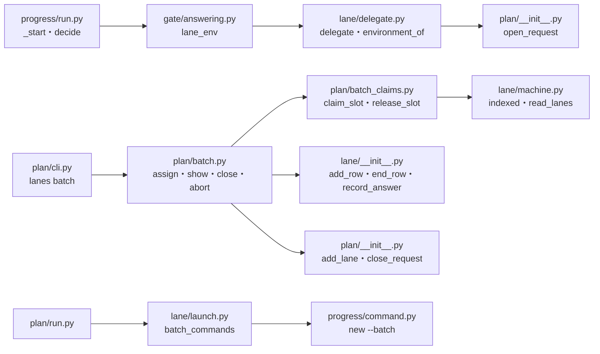

# #4211 の詳細設計: 委譲リクエスト・バッチのコマンド・マシン全体の実行中のロック（claim）・種類 `batch` のまとめた検証

設計文書（[issue-4211-design.md](./issue-4211-design.md)）の構成要素を、ファイルと関数の粒度へ下ろす。パスは `plugins/ndf/` からの相対で書く。#4050 の詳細設計（main の `issues/issue-4050-design-detail.md`）の `Env`・`_start`・`decide`・`phases.json` の `carrier` を前提にし、そのうち「#4210・#4211 へ分けたもの」の表の #4211 の行（`Env.delegate`・`delegate`・`_start` の委譲の枝・`_consume_delegated`・`delegate_answered`・節「まとめた検証と棚卸し」・`request_opened` の `lane-verify`・`lane-backlog`）を、この文書で置き換える。#4050 の詳細設計の節「まとめた検証と棚卸し」の `batch claim`・`--phase release`・`ndf lanes release --batch`・`policy.batch_ttl`・`superseded_from` は作らない（設計文書の決定 2・3・5・6）。

## 地図

| パス | 種類 | 役割 1 文 | 依存する先 | クラスまたはモジュール | メソッドと最上位の関数 |
| --- | --- | --- | --- | --- | --- |
| `src/ndf/progress/lane/delegate.py` | 新設 | 計画のスプリントの委譲リクエストを組み、計画へ 1 回だけ書く | `plan/__init__.py`・`lane/__init__.py` | モジュール | `delegate`・`environment_of`・`delegation_key`（新設） |
| `src/ndf/progress/run.py` | 変更 | 担当 `organizer` のフェーズで `Env.delegate` を呼び、委譲した回答を消費する | `phases.json`（#4050） | `Env` | `Env.delegate`（新設の欄）・`_start`・`decide`・`_consume_delegated`（新設） |
| `src/ndf/progress/gate/answering.py` | 変更 | 計画のスプリントでだけ `delegate` をつなぐ | `lane/delegate.py` | モジュール | `lane_env` |
| `src/ndf/progress/plan/batch.py` | 新設 | バッチの 4 つのアクションを計画のトランザクションで行う | `batch_claims.py`・`lane/__init__.py`・`plan/__init__.py` | モジュール | `assign`・`show`・`close`・`abort`・`check_version`（新設） |
| `src/ndf/progress/plan/batch_claims.py` | 新設 | マシン全体のロックファイルの確認・確保・消去 | `lane/machine.py` | モジュール | `claim_slot`・`release_slot`・`slot_free`・`owner_of`・`db_ref`・`batch_lock`（新設） |
| `src/ndf/progress/plan/cli.py` | 変更 | `ndf lanes batch assign / show / close / abort` の引数と書き込み元の見分け | `plan/batch.py` | モジュール | `_batch_parser`・`_writer`（新設）、`_row_end`・`_row_cancel`（変更） |
| `src/ndf/progress/plan/__init__.py` | 変更 | 委譲とバッチのイベントの畳み込みと表示・委譲リクエストの閉じ方・種類 `batch` のまとめた検証を移さない | `lane/fold.py` | `PlanView` | `open_batches`・`failed_backlogs`（新設）、`status`・`close_request`・`move_row`・`stop_plan`（変更） |
| `src/ndf/progress/lane/__init__.py` | 変更 | 種類 `batch` のまとめた検証の終わりと中止を `batch.py` の経路だけに絞る | — | モジュール | `end_row`・`cancel_row`・`cancel_pending`（変更） |
| `src/ndf/progress/plan/wait_decide.py` | 変更 | `batch_closed` の `failed`・`aborted` を通知する | — | モジュール | `NOTICE_KINDS`（変更） |
| `src/ndf/progress/command.py`（`wait`） | 変更 | 委譲した検証の待ちを `status: gate` で返す | `run.py` | モジュール | `wait`（変更） |
| `skills/development-workflow/SKILL.md` | 変更 | 引数 `--batch <id>` | — | — | — |
| `src/ndf/progress/lane/fold.py`・`types.py` | 変更 | `batch_claimed`・`batch_revoked`・`batch_closed` を `PlanView` に畳む | — | `PlanView`・`Batch`（新設の型） | `fold_plan`（変更） |
| `src/ndf/progress/lane/launch.py` | 変更 | 種類 `batch` のまとめた検証を始める・続ける・中止する入力を組む | `progress/command.py` | モジュール | `batch_commands`・`batch_of`・`BATCH_GOAL_END`（新設）、`start_commands`・`start_prompt`・`goal_prompt`・`_going_on`・`cancel_commands`・`_workflow_args`（変更） |
| `src/ndf/progress/plan/run.py` | 変更 | 種類 `batch` のまとめた検証を開発ループと同じく死活監視へ渡し、取り消したバッチの担当を起動しない | `lane/liveness.py`（変更なし） | モジュール | 死活監視の呼び出し元・`first_input`・`launch_lane`（変更） |
| `src/ndf/progress/command.py` | 変更 | `ndf progress new --batch <id>` で工程を持たない子のステートマシンを作る | — | モジュール | `new`（変更） |
| `contracts/workflow/progress.json` | 変更 | イベント `batch_claimed`・`batch_revoked`・`batch_closed`（計画）と `delegate_answered`（スプリント）、リクエストの種類 `lane-verify`・`lane-backlog` | — | — | — |
| `contracts/workflow/parallel-plan.schema.json` | 変更 | レーンの作業の入力 `kind: batch` | — | — | — |
| `contracts/workflow/context.schema.json` | 変更 | 文脈のキー `verification` | — | — | — |
| `contracts/schemas/io/lanes.args.schema.json`・`docs/contracts/commands.md` | 変更 | `lanes batch` の引数と説明 | — | — | — |
| `contracts/domains/locations.json` | 変更 | 状態ディレクトリの行 `parallel/batches/` | — | — | — |
| `skills/development-workflow/schemas/project.schema.json` | 変更 | `branch_strategy.verify.environment`（文字列） | — | — | — |
| `skills/development-workflow/references/parallel.md`・`skills/release-verification/SKILL.md`・`skills/backlog-refinement/SKILL.md` | 変更 | オーガナイザーのバッチの手順と、担当の手順（バージョンのあるリポジトリは検証の前後にバージョンを読む・`batch close`） | — | — | — |

## 委譲のインターフェース（`run`・`answering`・`delegate`）

満たす決定: 決定 1・決定 4・決定 6、受け入れ条件 1・3

### 関数の仕様

| 関数 | 保存先 | 種類 | シグネチャ | 責務 |
| --- | --- | --- | --- | --- |
| `Env.delegate` | `src/ndf/progress/run.py` | 新設の欄 | `Callable[[Any, View, Phase, list[str]], Optional[str]]`（既定は `lambda *_: None`） | 委譲したらリクエストのキーを返し、委譲なければ None を返す。計画の外は既定のままで、今のとおり工程を流す |
| `_start` | `src/ndf/progress/run.py` | 変更 | 今のまま | フェーズの最初の工程で `phase.carrier == "organizer"` なら `env.delegate` を呼ぶ。キーが返れば、検証は工程を始めずに `DELEGATED` を返し、棚卸しは同じトランザクションで委譲した工程を `completed` にして次の候補へ進む |
| `decide` | `src/ndf/progress/run.py` | 変更 | 今のまま | 委譲した検証の工程の状態でアクションを選ぶ（下の「処理の手順」） |
| `wait` | `src/ndf/progress/command.py`（`ndf progress wait`） | 変更 | 今のまま | 今の委譲のキーの `delegate_answered` が無い委譲した検証の待ちを、承認ゲートの回答待ちと同じ `status: gate`（`metrics.delegated`・`metrics.gate: "delegated"`）で返す。死活監視（`liveness.sprint_wait`）はこれを `SPRINT_GATE` と読む（下の「委譲した待ちと死活監視」） |
| `_consume_delegated` | `src/ndf/progress/run.py` | 新設 | `(conn, v: View, answer: dict) -> list[EventDraft]` | 今の委譲のキーの `delegate_answered` を読み、`done` なら委譲した工程の並びをすべて `completed` にし、文脈の `verification` へ、そのスプリントのリクエストのレポート（条件ごとの合否・保留）・要求のバージョン・読んだバージョン・証跡を書いた PR を写す。`failed` なら並びの先頭を `failed`（`cause: delegate_failed`・レポート）にし、残りは未着手のまま |
| `lane_env` | `src/ndf/progress/gate/answering.py` | 変更 | 今のまま | 計画のスプリントの `Env` に `delegate=lambda conn, v, phase, stages: delegate.delegate(conn, v, phase, stages)` を追加する |
| `delegate` | `src/ndf/progress/lane/delegate.py` | 新設 | `(conn, v: View, phase: str, stages: list[str]) -> Optional[str]` | スプリント（`lane.sprint_row`）を引き、無ければ None。計画の排他（`lane.lock_plan`）の中で、同じ委譲のキーの `request_opened` があればそのキーを返し、無ければ中身（設計文書の「データ構造」）を組んで `open_request` で書く。検証は文脈の `version`（無ければ null）・`release_pr`（無ければ null）を、棚卸しはそのスプリントの棚卸しの範囲 `since_ref`（下の「棚卸しの範囲」）を中身に入れる |
| `delegation_key` | `src/ndf/progress/lane/delegate.py` | 新設 | `(v: View, phase: str) -> str` | `<スプリントの ID>:<フェーズ>:<試み>`。試みは、そのフェーズの最初の工程の `stage_retried` の数 |
| `environment_of` | `src/ndf/progress/lane/delegate.py` | 新設 | `(repo_root: Path, repo: str) -> str` | `.ndf/project.json` の `branch_strategy.verify.environment` を読み、空でない文字列ならそれ、無いか `verify` が `null` なら `repo`（`<owner>/<name>`）を返す |

### 処理の手順

| 関数 | 条件の組み合わせ | 結果 |
| --- | --- | --- |
| `_start` | 担当 `lane` のフェーズ | 今のとおり（#4050） |
| `_start` | 担当 `organizer`・`env.delegate` が None | 計画の外。今のとおり工程を始める |
| `_start` | 担当 `organizer`・検証・キーが返る | 工程を始めず `DELEGATED`。結果は承認ゲートの回答待ちと同じ `status: gate`（`metrics.gate: "delegated"`・`metrics.delegated`）で、conductor は承認ゲートと同じく応答を終える（`next` を再実行しない） |
| `_start` | 担当 `organizer`・棚卸し・キーが返る | 委譲した工程を `completed`（`summary` に委譲のキー）にし、同じ `next` で次の候補へ進む。候補が無ければスプリントの完了（今のとおり `Env.ended` でスプリントが終わる） |
| `decide` | 委譲した検証の工程に `delegate_answered`（今の委譲のキー）が無い | `DELEGATED`（リトライでリクエストを追記しない。結果は上と同じ `status: gate`）。#4210 が入るまでは、ほかの候補を始めない |
| `decide` | `done` の回答がある | `_consume_delegated` のアクション。その後は今のとおり次の候補（振り返り） |
| `decide` | `failed` の回答がある | `_consume_delegated` のアクション。その後は `FAILED` |
| `decide` | 古い委譲のキーの回答だけがある（`retry` の後） | 読まない。新しい委譲のキーで `_start` がリクエストを書く |

`documentation` の検証は、体裁レビューとリリース後テストを 1 件の `lane-verify`（`stages` に 2 つ）で委譲し、1 件の回答で 2 つとも消費する。モードが持たない工程は `stages` に入らない。

**バージョンを出さない変更。** 文脈に `version` が無い（デプロイの `delivery.versioned` が偽・デプロイの工程を持たないリポジトリ・今回の変更ではバージョンを出さない）検証は止めずに、`version: null` のリクエストで委譲する。そのリクエストはバージョンの照合（`check_version`）の対象にならず、担当は今の環境でそのスプリントの受け入れ条件（`documentation` なら体裁レビュー）だけを確かめる。確かめる対象は #4249 が決め、それまでは今の `release-verification` の手順に従う。バージョンの無いことで止めるのは、文脈の `delivery.versioned` が真なのに `version` が無いとき（デプロイの出力の欠け）だけである。

**委譲した待ちと死活監視。** 委譲した検証の待ちは、承認ゲートの回答待ちと同じ形でつなぐ。

| 読み込み元 | 回答の前 | 回答の後（`row_answered` が載った） |
| --- | --- | --- |
| `ndf progress next`・`ndf progress wait --timeout 0` | `status: gate`（`metrics.gate: "delegated"`） | `next` は `_consume_delegated` のアクションを返す |
| 死活監視（`liveness.judge`） | `sprint_wait` が `SPRINT_GATE` と読み、`WAITING_ANSWER`。ラッパーが消えていても止まりにも再起動の対象にもならない | 今のとおり `awaiting_next` の `RESUMING` で、耐久ワークフローが回答の後の入力（`resume_commands`）で起こす |
| `/goal` の終わりの条件 | 承認ゲートと同じく応答を終える（終わりの条件の文に「`status: gate` が返ったら応答を終える」を追加する。承認ゲートの今の扱いと同じ文） | 今のとおり |

**棚卸しの範囲。** 差分の棚卸しは、振り返りの範囲の始まり（`ndf issues candidates --since-ref` に渡す、前のリリースのタグ）より後に起票した課題を扱う。`delegate` は棚卸しのリクエストに、そのスプリントが自分で流したなら渡したはずの `since_ref`（片付けた後の作業場所を読まないよう、リポジトリの根で `git describe --tags --abbrev=0 origin/<基のブランチ>` が返す、基のブランチから届く最新のタグ。タグが無ければ null で、全件が対象）と、スプリントの課題 `issues` を書く。バッチでは各リクエストの範囲の和集合を処理する: `since_ref` のうち最も古いコミットのもの（1 つでも null なら null）を `--since-ref` に渡し、各リクエストの `issues` を `--add` に渡す。

### 異常系の処理

| 関数 | 失敗 | 原因 | 検出する場所 | 扱い | 利用者に見える出力と終了コード | クリーンアップと再実行の可否 |
| --- | --- | --- | --- | --- | --- | --- |
| `delegate` | 検証のバージョンが無い | 文脈の `delivery.versioned` が真なのに、デプロイの出力に `version` が無い | 文脈の `version` を読む所 | 止める | `stopped`・`precondition`（「バージョンを出すデプロイなのに検証するバージョンが文脈に無い」） | デプロイを直してから `next` を再実行する。リクエストは書かれない。`versioned` が偽か `delivery` が無いときは止めず、`version: null` で委譲する |
| `delegate` | 棚卸しの範囲を読めない | git が失敗する | `since_ref` を読む所 | 止める | `stopped`・`transient` | そのまま再実行できる |
| `environment_of` | `.ndf/project.json` が読めない・形が違う | 利用者の設定の誤り | 読み込み | 止める | `stopped`・`precondition`（ファイルと誤り） | 設定を直して `next` を再実行する |
| `delegate` | 計画の排他を取れない | 別の書き込み元が長く持つ | `lock_plan` | 呼び出し元へ返す | `stopped`・`transient` | そのまま再実行できる（キーで冪等） |
| `_consume_delegated` | 回答のレポートが空 | 担当の誤り（`close` が拒否するので起きない） | — | 既定値で続ける | 無し | — |

### 単体テストの観点

| 関数 | 正常 | 境界値 | 異常 |
| --- | --- | --- | --- |
| `delegate`・`_start` | 計画のスプリントの検証の境で `lane-verify` が 1 件・結果が `status: gate`。棚卸しの境で `lane-backlog` が 1 件（`since_ref` と `issues` を持つ）・棚卸しの工程が `completed`・スプリントが完了 | リトライで増えない。`retry` の後は試みの進んだ新しいキーで 1 件。`versioned` が偽の `documentation` のスプリントは `version: null` で委譲し、バージョンの無い `done` の回答で 2 工程とも完了する | 計画の外では書かない。`versioned` が真でバージョンの無い文脈で `precondition` |
| `wait`・`liveness.judge` | 回答の前の委譲した待ちで `progress wait --timeout 0` が `gate` を返し、ラッパーの無いスプリントの判定が `WAITING_ANSWER` | 回答の後は `RESUMING` | — |
| `_consume_delegated` | `done` で委譲した工程がすべて完了し `verification` にそのスプリントのレポート・要求のバージョン・読んだバージョンが載る。`documentation` で 2 工程とも完了 | 古い委譲のキーの回答を読まない。レポートに不合格や `not_run` の条件があっても `done` なら完了し振り返りへ進む | `failed` で先頭が `failed`・`decide` が `FAILED` |
| `environment_of` | 宣言があればその名前 | `verify: null`・キー無し・空の文字列でリポジトリの名前 | 形の違う設定で `precondition` |

## バッチのコマンド（`plan/batch`・`plan/cli`）

満たす決定: 決定 2・決定 4・決定 5・決定 7、受け入れ条件 1〜4

### 関数の仕様

| 関数 | 保存先 | 種類 | シグネチャ | 責務 |
| --- | --- | --- | --- | --- |
| `assign` | `src/ndf/progress/plan/batch.py` | 新設 | `(cwd: Path, plan: str, requests: list[str], lane: Optional[str], reason: str) -> dict` | `batch_lock` を取り、計画の排他（`lock_plan`）の中の 1 つのトランザクションで、リクエストとレーンを確かめ直し、開いたバッチのリトライかを決め、`claim_slot` でロックファイルを書き、`batch_claimed` とまとめた検証（名指したレーンへ `add_row`、無ければ `add_lane` で `b<id>`）を書いてコミットする（下の「`assign` の書き込み」） |
| `show` | `src/ndf/progress/plan/batch.py` | 新設 | `(cwd, plan, batch_id) -> dict` | バッチの中身と、担当が実行する `close` のテンプレート（`--observed-version` の並びとレポートの形）を返す。ロックファイルがこのバッチ（状態ディレクトリ・計画・id の組）を指していないか、バッチに `batch_revoked` か `batch_closed` があれば `stopped`・`precondition` で手順を返さない（担当は作業を始めず、オーガナイザーが `abort` する）。書かない |
| `close` | `src/ndf/progress/plan/batch.py` | 新設 | `(cwd, plan, batch_id, result: str, report: Path, observed: dict[str, Observed], cause: Optional[str], reason: str, caller: Writer) -> dict` | 書き込み元・バージョン・レポートの形を確かめ、1 つのトランザクションで `batch_closed`・リクエストの閉じ・回答・まとめた検証の終わりを書き、コミットの後に `release_slot` |
| `abort` | `src/ndf/progress/plan/batch.py` | 新設 | `(cwd, plan, target: BatchRef, reason, caller: Writer) -> dict` | 下の「`abort` の手順」。`plan` は呼び出し元自身の計画（`cwd` の状態ディレクトリから開く）、`target` は自分の計画のバッチの id か、別の計画の実行中のロック（`--claim <種類>:<キー>`）。まとめた検証が実行中なら、そのラッパーを止めて止まったことを確かめてから書き、確かめられなければ何も書かずに枠を保つ |
| `check_version` | `src/ndf/progress/plan/batch.py` | 新設 | `(batch: Batch, result: str, observed: dict[str, Observed], cause: Optional[str]) -> Optional[str]` | 検証の `done` に、バージョンのあるリクエストを持つリポジトリの検証の前後のバージョンの一致と、それが要求のバージョン以上であることを求め（`Observed` は検証の前と後のバージョンの組）、`failed` には原因を求める。バージョンがすべて null のリポジトリは照合しない。誤りの文を返す |
| `check_report` | `src/ndf/progress/plan/batch.py` | 新設 | `(batch: Batch, report: dict) -> Optional[str]` | 検証のレポートが、バッチのすべてのリクエストの節（条件ごとの `pass`・`fail`・`not_run` と証跡を書いた PR）を持つかを確かめる。誤りの文を返す |
| `_writer` | `src/ndf/progress/plan/cli.py` | 新設 | `(environ: Mapping[str, str]) -> Writer` | `NDF_RELAY_PLAN` が無ければ `organizer`、あれば `conductor`（計画の名前とラッパーの名前 `NDF_RELAY_NAME` を持つ） |
| `lane.end_row`・`lane.cancel_row`・`plan.move_row`・`lane.cancel_pending` | `src/ndf/progress/lane/__init__.py`・`src/ndf/progress/plan/__init__.py` | 変更 | `end_row`・`cancel_row` に `by_batch: bool = False` を追加する | 種類 `batch` のまとめた検証の変更を、エントリポイントでなく書き込みの共通の経路で拒否する: `end_row`・`cancel_row` は `by_batch` が偽なら `Refused`（`batch close` か `batch abort` を案内する）。`move_row` は種類 `batch` のまとめた検証を移さない。`ndf lanes row end`・`row cancel`・`ndf progress cancel`（子を経由する `end_row`）・`ndf lanes move` はすべてこの経路で拒否される。`cancel_pending`（`ndf lanes stop --now`）は未着手の種類 `batch` のまとめた検証を中止にするとき、同じトランザクションで `batch_closed`（`aborted`・理由は計画の中止）を書き、コミットの後に `release_slot` する |
| `close_request` | `src/ndf/progress/plan/__init__.py`（`ndf lanes request close`） | 変更 | 今のまま | 委譲リクエストの閉じ方を種類で分ける（下の「委譲リクエストを単独で閉じる」） |
| `open_batches`・`failed_backlogs` | `src/ndf/progress/plan/__init__.py` | 新設 | `(view: PlanView) -> list[dict]` | ロック中のバッチ（フェーズ・キー・担当・経過時間）と、`failed` で閉じた棚卸しのバッチ（リクエストが開いたまま）を `ndf lanes status` の `metrics` へ出す |
| `NOTICE_KINDS` | `src/ndf/progress/plan/wait_decide.py` | 変更 | — | `ndf lanes wait` の通知に、結果が `failed`・`aborted` の `batch_closed` を追加する（`done` は通知しない）。オーガナイザーは受けたら `assign` で割り当て直すか、リクエストを閉じる |

### 処理の手順

`assign` の確かめ（どれかに当たれば何も書かずに `stopped`・`precondition`）。書き込み元のほかは、すべて `lock_plan` を取った後の同じトランザクションの中で読む（排他の前に読んだ値では決めない）:

| 確かめ | 拒否する条件 |
| --- | --- |
| 書き込み元 | `conductor` |
| リクエスト | 開いていない・委譲リクエストでない・種類が混ざる・検証で環境が混ざる・検証で要求元のスプリントが終わっている。既に開いたバッチ（`batch_claimed` があり `batch_closed` が無い）に、ほかのリクエストと一緒に入っている（同じリクエストの組ならリトライとして扱う） |
| レーン（`--lane`） | 新しいバッチのときだけ確かめる: 計画に無い・未着手か実行中のレーンの作業がある・レーンの作業が 1 つも無い。リトライ（同じリクエストの組の開いたバッチがある）では確かめない（最初の割り当てが追加したまとめた検証がそのレーンに未着手か実行中で残っているため）。リトライの `--lane` が前のバッチの担当のレーンと違うときは、前のバッチを返す（`metrics.batch` に前のレーン） |
| 実行中のロック | `claim_slot` が「使用中」を返す（中身にオーナーの計画・バッチの id・経過時間）か、オーナーを読めない（`transient`） |

`assign` の書き込み:

1. `batch_lock` を取る（`admit_lock` と同じ待ち方。`parallel-machine.admit-lock` の秒）
2. 計画の排他（`lock_plan`）を取ってトランザクションを始め、書き込み元とリクエストを確かめた後、まず同じリクエストの組の開いたバッチを照合する。あればリトライで、その id を使い（3 の新しい id とまとめた検証は作らない）、レーンの確かめを省く。無ければ新しいバッチで、レーンと実行中のロックを確かめる
3. 新しいバッチなら id を採る
4. `claim_slot(write=True)` で、記録が空き（下の「ロックファイル」）なら自分の記録（状態ディレクトリ・計画・id）を書く。リトライで記録が既に自分を指していれば書かない
5. 新しいバッチなら同じトランザクションで `batch_claimed` を書き、`--lane` があれば `add_row(lane, {"kind": "batch", "batch": id, "phase": …})`、無ければ `add_lane({"name": "b<id>", "touches": [], "after": [], "rows": [同じ入力]})` を書く
6. コミットし、`lock_plan`・`batches.lock` の順に外す

記録を計画のコミットより先に書くので、まとめた検証が計画に現れた時点で、ロックファイルはかならずそのバッチを指している。4 の後・6 のコミットの前に落ちると、記録だけが残り、オーナーの計画にはその id の `batch_claimed` が無い。`batches.lock` の中で読む次の `claim_slot` は、それを残骸として空きとみなす（書き込み元のプロセスは flock と一緒に消えているので、書きかけと見分けられる）。6 のコミットの後に落ちても、記録とまとめた検証はそろっている。まとめた検証の起動は、`show` が記録のオーナーの組を確かめてから手順を返すことで、記録の確保と結び付ける（別の計画が記録を書き換えていれば作業を始めない）。

`abort` の手順（書き込み元はオーガナイザーか、バッチのまとめた検証のラッパーの conductor。後者は計画の中止の入力（`cancel_commands`）からだけ実行する）:

| 呼び出し元と対象 | 通す条件 | 書くもの |
| --- | --- | --- |
| オーナーの計画のオーガナイザー（`<計画> <id>`） | 計画の状態を問わない | 下の起動の取り消しと停止の確かめの後、1 つのトランザクションでまとめた検証の中止（未着手なら `cancel_row`、実行中なら子のステートマシンの `end_row` の `cancelled`。どちらも `by_batch`）と、計画が終わっていなければ `batch_closed`（`aborted`）。コミットの後に `release_slot` |
| 別の計画のオーガナイザー（`<自分の計画> --claim <種類>:<キー>`） | ロックファイルのオーナーの計画（記録の状態ディレクトリから開く）が `running` でなく、まとめた検証が実行中でない（未着手か終わっている） | オーナーの計画を記録の状態ディレクトリで開き、上と同じもの（起動の取り消しを含む）を書く。まとめた検証が実行中なら拒否する（`paused` の計画は実行中のレーンの作業を流し続けるため） |
| まとめた検証の conductor（`<計画> <id> --self`） | ラッパーの名前がバッチの担当のレーンと合う・計画が中止された（`cancelled`） | 呼び出し元自身が担当なので停止の確かめを省き、まとめた検証の中止と子の中止を書く。計画は終わっているので `batch_closed` は書かず、コミットの後に `release_slot` |

**起動の取り消し。** 呼び出し元が担当でない `abort`（上の表の 1 行目と 2 行目）は、停止の確かめより前に、オーナーの計画の排他の中で計画のイベント `batch_revoked`（id・理由）を書いてコミットする（既にあれば書かない。リトライはここから進む）。これがそのバッチの担当の起動を無効にするマーカーで、次の 3 か所がそれぞれの読みの中で確かめる。オーナーの計画が終わっている（`completed`・`cancelled`）ときは、`model.check_event` が終わった計画へのイベントを拒否するので `batch_revoked` を書かず、計画が終わっていることをマーカーと同じに扱う（下の表の 3 か所は「マーカーか `batch_closed` があるか、計画が終わっている」で確かめる）。

| 確かめる所 | マーカーか `batch_closed` があるとき |
| --- | --- |
| `plan/run.py` の `launch_lane`（レーンの作業の起動・回答の後の起動・`/goal` の入れ直し・止まりからの再起動。耐久ワークフローが前に決めた起動も、このステップの中のポーリングで確かめる） | 起動せず `{"ok": False, "final": True}`（理由に取り消し）。中止の入力（`cancel_commands`・`--self`）だけは通す |
| `show` | `stopped`・`precondition` で手順を返さない。担当は作業を始めない |
| `close` | `stopped`・`precondition`（`abort` が先に決まったので結果を書かない） |

順序の保証: マーカーのコミットより後に始まった担当は、`show` で拒否されて作業を始めない。マーカーのコミットより前に `show` を通った担当は、その時点でラッパーが動いているので、続く停止の確かめで止まったことを確かめられる（耐久ワークフローがその間に同じ名前のラッパーを置き換えても、新しいラッパーはマーカーの後に `show` を読むので作業を始めない）。したがって停止を確かめた後に枠を空けても、次のバッチと同じ環境を触る担当は残らない。

**中止した計画の復旧。** `ndf lanes stop --now` の後に担当の `--self` が実行されなかった（ラッパーが中止の入力を受ける前に落ちた・実行したが失敗した）ときは、オーナーの計画のオーガナイザーが `abort <計画> <id>` を実行する。計画は `cancelled` なので `batch_revoked` を書かず（上の段落）、停止の確かめへ進み、止まったことを確かめた後に、担当のレーンのステートマシンへまとめた検証の中止と子のステートマシンの中止（`by_batch`）を書き（計画のステートマシンには書かない。`batch_closed` も書かない）、コミットの後に `release_slot` する。その後に遅れて届いた `--self` は、まとめた検証が既に中止なので何も書かず、`release_slot` もオーナーの組の記録が無いので何もしない。別の計画のオーガナイザーの `--claim` も、オーナーの計画が `cancelled` でまとめた検証が実行中でなければ同じ経路で進む。

停止の確かめ（まとめた検証が実行中で、呼び出し元が担当でないとき。上の取り消しの後）: 今のラッパーを止める関数（`launch.stop`）で担当のレーンのラッパーを止め、ラッパーの一覧（`launch.wrappers`）でそのラッパーが動いていないことを確かめてから書く。一覧を読めない・まだ動いているときは何も書かずに `stopped`・`transient` を返し、ロックファイルは残す（枠を空けない）。復旧はそのまま `abort` を再実行することで、繰り返し止まらないときは人がラッパーの一覧で残ったプロセスを確かめて止めてから再実行する（手順は `parallel.md` の新しい節に書く）。

**委譲リクエストを単独で閉じる**（`ndf lanes request close`）:

| リクエスト | 扱い |
| --- | --- |
| 開いたバッチに入っている | 拒否する（`precondition`。先に `batch abort` を案内する） |
| バッチに入っていない `lane-verify` | 要求元のスプリントが実行中なら、同じトランザクションで、要求元のスプリントへ `row_answered` とスプリントの `delegate_answered`（`failed`・原因 `delegate_withdrawn`・理由）を書いてから閉じる。要求元は回答の後の入力で起き、`FAILED` で止まる（オーガナイザーは `retry` かスプリントの中止を選ぶ）。要求元のスプリントが終わっている（`completed`・`cancelled`）なら回答を書かずに閉じる（下の「終わった要求元への回答」） |
| バッチに入っていない `lane-backlog` | そのまま閉じる（要求元のスプリントは委譲した時点で終えているので、待つスプリントが無い） |

**終わった要求元への回答。** `row_answered` は契約で実行中（`running`）のレーンの作業にしか書けず、スプリントの `delegate_answered` も終わったスプリントには書けない。検証を委譲して待つスプリントは、オーガナイザーによるスプリントの中止（`row cancel`・`progress cancel`）や計画の中止で回答の前に終わりうる。そこで `close`・`request close` は計画の排他の中で各要求元のスプリントの状態を読み直し、次の規則で書く。

| 要求元のスプリント | `row_answered`・`delegate_answered` | リクエスト |
| --- | --- | --- |
| 実行中 | 書く | 閉じる（棚卸しの `failed` は今のとおり開いたまま） |
| 終わっている（`completed`・`cancelled`） | 書かない（`metrics.closed` の `skipped` にスプリントとその状態を載せる） | 実行中の要求元と同じく閉じる。ほかのスプリントへの回答はロールバックしない |

`assign` は、要求元のスプリントが終わっている `lane-verify` をまとめない（`precondition`。`request close` で閉じるよう案内する）。まとめた後に要求元が終わったときは、上の規則で `close` が回答を省く。

`close` の書き込み（1 つのトランザクション）:

| フェーズと結果 | `batch_closed` | リクエスト | 各スプリント | まとめた検証 |
| --- | --- | --- | --- | --- |
| 検証・`done` | 書く（読んだバージョン・レポート） | 閉じる | `row_answered`（中身に `request`）とスプリントの `delegate_answered`（`done`） | `end_row(completed)` と子のステートマシンの完了 |
| 検証・`failed` | 書く（原因） | 閉じる | `row_answered` と `delegate_answered`（`failed`・原因） | 同上 |
| 棚卸し・`done` | 書く | 閉じる | 書かない（工程は委譲した時点で終えている） | 同上 |
| 棚卸し・`failed` | 書く | 開いたまま | 書かない | 同上 |

表の「各スプリント」の回答は、要求元のスプリントが実行中のときだけ書く（下の「終わった要求元への回答」）。閉じた後に同じ id の `close` を実行すると、何も書かずに前の `batch_closed` を返す。`close` が通る書き込み元は、オーガナイザーと、ラッパーの名前がバッチの担当のレーンのラッパーと同じ conductor である。

**結果と条件の合否の対応**（今の `release-verification` の閉じ方に合わせる）:

| 状況 | 結果 | 要求元のスプリント |
| --- | --- | --- |
| 確かめをやり終えた（各条件が `pass`・`fail`・`not_run` のどれかに決まった。不合格や、次のバージョンで確かめる `not_run` を含む） | `done` | 今の `release-verification` と同じく振り返りへ進む。不合格と `not_run` は、そのスプリントのレポートの節として `verification` に写り、振り返りが拾う |
| 確かめをやり終えられなかった（環境が壊れている・バージョンが照合できない・手順が途中で止まった） | `failed` | `FAILED` で止まり、`retry` かスプリントの中止を待つ |
| 複数のリクエストのうち一部の条件だけが不合格 | `done` | スプリントごとに自分の節（自分の課題の条件の合否）だけを受け取る。バッチ全体の `failed` にはしない |

レポート（`--report` のファイル）は JSON で、`{"common": <環境とバージョンのセットアップの結果>, "requests": {"<リクエストのキー>": {"criteria": [{"issue", "id", "verdict": "pass"|"fail"|"not_run", "evidence"}], "evidence_pr": <証跡を書いた PR か null>}}}`。`check_report` が、検証の `done` でバッチのすべてのリクエストの節があることを確かめる。各スプリントの `delegate_answered` には、そのスプリントの節と `common` だけを載せる。

`check_version`（検証だけ。棚卸しは見ない）:

| 結果 | 条件 | 判定 |
| --- | --- | --- |
| `done` | バッチのそのリポジトリのリクエストのバージョンがすべて null（バージョンを出さない変更だけ） | 照合しない（`--observed-version` は要らない）。バージョンのあるリクエストが 1 つでもあれば、下の行でバージョンのあるものだけと照合する |
| `done` | バッチのリポジトリの `--observed-version` が無い | 拒否する |
| `done` | 前と後が違う | 拒否する（`failed --cause version_changed` で閉じる） |
| `done` | 前と後が同じで、バッチのそのリポジトリのどれかのリクエストのバージョンより古い（semver） | 拒否する（`failed --cause version_mismatch` で閉じる） |
| `done` | 前と後が同じで、どのリクエストのバージョン以上 | 受ける |
| `failed` | `--cause` が無い | `work_failed` を入れて受ける |
| `failed` | `--cause` が `version_changed`・`version_mismatch` で、`--observed-version` が無い | 拒否する（原因の根拠が無い） |

### 異常系の処理

| 関数 | 失敗 | 原因 | 検出する場所 | 扱い | 利用者に見える出力と終了コード | クリーンアップと再実行の可否 |
| --- | --- | --- | --- | --- | --- | --- |
| `assign` | ロック中 | 同じ環境（棚卸しは同じリポジトリ）のバッチが動いている | `claim_slot` | 止める | `stopped`・`precondition`（オーナーの計画・id・経過時間）、終了コード 1 | 閉じた後に再実行する。オーナーの計画が `paused` でまとめた検証が実行中でなければ `abort --claim` してから |
| `assign` | オーナーを読めない | オーナーの状態ディレクトリの DB に一時的につながらない・読み取りの失敗 | `owner_of` | 枠を保ったまま止める | `stopped`・`transient` | そのまま再実行できる |
| `assign` | オーナーの DB を特定できない | 呼び出し元の `NDF_PROGRESS_DB` が記録の DB の参照と違う・記録の SQLite のファイルが無い | `owner_of` | 枠を保ったまま止める | `stopped`・`precondition`（記録の DB の参照・計画・id） | 記録の DB を指す接続先で再実行するか、オーナーが閉じるのを待つ |
| `assign` | `batches.lock` を取れない | 別の `assign`・`close` が長く持つ | `batch_lock` | 呼び出し元へ返す | `stopped`・`transient` | そのまま再実行できる |
| `assign` | 記録を書いた後、計画のコミットの前に落ちた | プロセスの終わり | — | — | — | 計画には何も残らない。残った記録は次の `claim_slot` が残骸として空きとみなす |
| `abort` | 担当の停止を確かめられない | ラッパーの一覧を読めない・止めても動いている | 停止の確かめ | 起動の取り消し（`batch_revoked`）のほかは書かずに止める | `stopped`・`transient`（ラッパーの名前） | 再実行する（取り消しは残っているので、その間に担当が起動し直しても作業を始めない）。止まらなければ人がプロセスを止めてから再実行する |
| `show` | ロックファイルが別のバッチを指す | 記録の残骸を別の計画が空きとみなして書き換えた | `show` | 止める | `stopped`・`precondition` | 担当は作業を始めない。オーガナイザーが `abort` する |
| `close` | バージョンの照合に落ちた | 検証の途中のリリース・環境の巻き戻り | `check_version` | 止める | `stopped`・`precondition`（照合の表のどの行か） | `failed` と原因で閉じ直す |
| `close` | 書き込み元が違う | 別のレーンの conductor | `_writer` | 止める | `stopped`・`precondition` | — |
| `close` | トランザクションの途中で落ちた | プロセスの終わり | — | — | — | 何も残らず、再実行できる |
| `close` | コミットの後に記録を消す前に落ちた | 同上 | — | — | — | 次の `claim_slot` が `batch_closed` を読んで空きとみなす |
| `close` | レポートのファイルが無い・64 KiB を超える | 担当の誤り | 読み込み | 止める | `stopped`・`precondition` | 直して再実行する |
| `abort` | 別の計画のオーガナイザーで、オーナーの計画が `running` かまとめた検証が実行中 | — | `owner_of` の読み | 止める | `stopped`・`precondition`（オーナーの計画） | オーナーに任せる |

### 単体テストの観点

| 関数 | 正常 | 境界値 | 異常 |
| --- | --- | --- | --- |
| `assign` | `--lane C` で C に種類 `batch` のまとめた検証が 1 つ増え、名指さなければ `b<id>` のレーンが増える。どちらも次のポーリングで今のレーンの作業の起動（マシン全体の上限の判定を通る）で始まる | 計画のコミットの直後に落とした（差し替えたコミットの後の処理で例外）状態で、別の状態ディレクトリの計画の同じ環境の `assign` が拒否され、元のまとめた検証の `show` が手順を返す。記録を書いた後・コミットの前に落とした状態では、別の計画の `assign` が通り、元の計画にまとめた検証が無い。同じリクエストのリトライが同じ id を返す。`--lane C` のリトライ（C に最初の割り当てのまとめた検証が未着手か実行中で残る）も拒否されずに同じ id を返し、まとめた検証を追加しない | 混ざったリクエスト・実行中のレーンの作業のあるレーン・conductor の書き込み元・ロック中で拒否する。`lock_plan` を取る前に差し替えた読みでリクエストを閉じる・名指したレーンへまとめた検証を追加すると、排他の中の確かめで拒否する |
| `close` | 検証の `done` で 2 つのスプリントに回答（各スプリントに自分の節）、まとめた検証が完了、記録が消える | 閉じた後のリトライが何も書かない。3 つのスプリントのうち 1 つ目の後に落とすと何も残らない。1 つのスプリントの条件が `fail`・もう 1 つのスプリントが `pass` の `done` で両方が振り返りへ進む | 別のレーンの conductor で拒否する。リクエストの節の欠けたレポートで拒否する。2 つのスプリントのうち 1 つの要求元を中止した後の検証の `done` は、中止したスプリントへ回答を書かずにリクエストを閉じ、もう 1 つのスプリントへ回答を書く（契約の違反でロールバックしない） |
| `show` | リクエストごとのバージョンと `release_pr` を返し、バージョンのあるリポジトリのテンプレートに `--observed-version` を載せる | バージョンがすべて null のリポジトリのテンプレートに `--observed-version` が無い | — |
| `check_version` | 前と後が同じで要求以上を受ける | 要求と同じバージョンを受ける・要求より新しいバージョンを受ける・バージョンがすべて null のバッチは読んだバージョン無しで受ける | 前後の違い・要求より古い・読んだバージョンの無い `done`（バージョンのあるリクエストを含む）を拒否する |
| `abort` | オーナーのオーガナイザーでまとめた検証が中止、リクエストは開いたまま、回答は無い。オーナーの計画が動いていても通る | 別の計画（`--claim`）でオーナーが `paused`・まとめた検証が未着手なら通る。計画の中止の入力の `--self` がまとめた検証を中止し記録を消す | オーナーが `running`、または `paused` でもまとめた検証が実行中の別の計画で拒否する。差し替えたラッパーの一覧が「動いている」を返すと `batch_revoked` のほかは書かず記録が残る。停止の確かめの直前に耐久ワークフローの前に決めた起動（`launch_lane`）を差し込むと、起動されないか、起動された担当の `show` が拒否する。`batch_revoked` の後の `close` を拒否する。`stop --now` で `cancelled` にした計画で `--self` を実行せずにオーガナイザーの `abort` を実行すると、`batch_revoked` を書かずに停止を確かめ、まとめた検証と子を中止して記録を消す（`check_event` に拒否されない）。その後の `--self` は何も書かない |
| `end_row`・`cancel_row`・`move_row` | スプリントは今のとおり | `stop --now` で未着手のまとめた検証が中止になり、同じトランザクションで `batch_closed`（`aborted`）が書かれ記録が消える | 種類 `batch` のまとめた検証への `row end`・`row cancel`・`progress cancel`（子）・`lanes move` を拒否する |
| `close_request` | バッチに入っていない `lane-verify` を閉じると要求元に `failed`（`delegate_withdrawn`）の回答が載る | `lane-backlog` はそのまま閉じる。要求元のスプリントを中止した後の `lane-verify` は回答を書かずに閉じる | 開いたバッチに入ったリクエストで拒否する |
| `NOTICE_KINDS` | `failed`・`aborted` の `batch_closed` を `ndf lanes wait` が通知する | `done` は通知しない | — |

## マシン全体の実行中のロック（`plan/batch_claims`）

満たす決定: 決定 3、受け入れ条件 2

### 関数の仕様

| 関数 | 保存先 | 種類 | シグネチャ | 責務 |
| --- | --- | --- | --- | --- |
| `batch_lock` | `src/ndf/progress/plan/batch_claims.py` | 新設 | `(seconds: float) -> ContextManager[None]` | `<状態ディレクトリ>/parallel/batches/batches.lock` の flock（すべてのコマンドがこの 1 つのパスを開く。`locations.json` の行も同じパス）。`machine.admit_lock` と同じ待ち方で、取れなければ `LockBusy` |
| `owner_of` | 同上 | 新設 | `(record: dict) -> SlotOwner` | 記録の DB の参照（`db`。下の「オーナーの DB の参照」）からオーナーの DB の URL を解き、`state_dir` の計画を開いて `SlotOwner`（計画の状態・その id の `batch_claimed` があるか・`batch_closed` があるか・まとめた検証が実行中か）を返す。呼び出し元の `NDF_PROGRESS_DB` と `store.default_url` は、参照と同じ DB を指すと確かめられたときだけ使う。DB は開けたが計画が無い（消された）なら `SlotOwner.gone`。参照から DB を特定できない（呼び出し元の接続先が参照と違う・参照のファイルが無い）なら `OwnerUnresolved`、DB につながらない・読み取りが失敗したなら `OwnerUnreadable` を投げる（どちらも空きとみなさない） |
| `db_ref` | 同上 | 新設 | `(url: str) -> str` | 記録に書く DB の参照を作る。SQLite は DB のファイルの絶対パス（`store.sqlite_path` の解決後）、ほかは `<ドライバー>://<ホスト>:<ポート>/<DB 名>?<接続先を変える引数>`。接続先を変える問い合わせの引数（`host`・`hostaddr`・`port`・`dbname`・`service`）は、キーの順に並べて参照に残す（どれも認証情報を含まない）。利用者名・パスワードと、そのほかの問い合わせの引数（`sslpassword`・`passfile` など認証にかかわるものを含む）は落とし、認証情報を記録へ書かない。接続先を URL から確定できない（ホストが URL のどこにも無く、`PGHOST` などの環境変数や既定のソケットで決まる）URL は `DbRefUnresolved` を投げる |
| `slot_free` | 同上 | 新設 | `(record: Optional[dict], owner: Optional[SlotOwner]) -> bool` | 記録が無い・オーナーが `gone`・オーナーにその id の `batch_claimed` が無い（`assign` の書きかけの残骸）・その id の `batch_closed` がある・オーナーの計画が終わり（`completed`・`cancelled`）かつまとめた検証が実行中でない、のどれかなら真。`paused` と `running` は、まとめた検証の状態によらず偽 |
| `claim_slot` | 同上 | 新設 | `(kind: str, key: str, own: SlotRef, write: bool) -> Optional[dict]` | `batch_lock` の中で呼ぶ。記録を読み、`owner_of` と `slot_free` が偽ならその記録を返す（`OwnerUnreadable` はそのまま上げる）。真で `write` なら自分の記録を書き、None を返す |
| `release_slot` | 同上 | 新設 | `(kind: str, key: str, own: SlotRef) -> None` | `batch_lock` を取り、記録のオーナーの組が `own` と同じときだけ消す |

`SlotRef` は記録のオーナーの組（オーナーの DB の参照 `db`・状態ディレクトリ `state_dir`・計画の ID・バッチの id）で、記録の照合はいつもこの組で行う。バッチの id（`<計画>-<n>`）は計画の中でしか一意でなく、別の状態ディレクトリに同じ名前の計画があれば同じ id になるためである。記録のファイル名は `<種類>-<キーの sha256 の頭 16 字>.json`（キーの字に依らない）。中身はキーの元の文字列と `SlotRef` を持つ。オーナーの計画は `machine.read_lanes` と同じ読み方で開くが、接続先は呼び出し元の環境から決めず、記録の `db` から決める（今の `PlanLanes` は計画の状態と `batch_closed` を持たないので、`owner_of` の専用の戻り値 `SlotOwner` で読む）。

**オーナーの DB の参照。** `claim_slot(write=True)` は、書き込み元が計画を開いた URL（`store.default_url` の結果）を `db_ref` に通して記録の `db` に書く。`owner_of` は次で接続先を決める。

| 記録の `db` | 接続先 | 特定できないとき |
| --- | --- | --- |
| SQLite のファイルのパス | そのパスの SQLite（呼び出し元の `NDF_PROGRESS_DB` を見ない） | ファイルが無い: `OwnerUnresolved`（DB ごと消えたのか、別のマシンの記録か見分けられないため、空きとみなさない） |
| サーバーの DB の参照 | 呼び出し元の `NDF_PROGRESS_DB` を `db_ref` に通した値が記録の `db` と同じなら、その URL（認証情報は呼び出し元のもの） | 呼び出し元に `NDF_PROGRESS_DB` が無いか違う DB を指す: `OwnerUnresolved` |

`db_ref` が `DbRefUnresolved` を投げたとき、書き込み元（`claim_slot(write=True)`）は記録を書かずに `assign` を `stopped`・`precondition`（「`NDF_PROGRESS_DB` にホストを書く」）で返し、読み込み元（`owner_of` が呼び出し元の URL を照合する所）は `OwnerUnresolved` にする。どちらも同一性を確かめられない URL を同じ DB とみなさない。

`OwnerUnresolved` と `OwnerUnreadable` は、どちらも記録を上書きせず枠を保つ。`assign` は前者を `stopped`・`precondition`（記録の `db`・計画・バッチの id と「その DB を指す `NDF_PROGRESS_DB` で再実行するか、オーナーの計画のオーガナイザーが閉じるのを待つ」）、後者を `stopped`・`transient` で返す。

### 並行と排他

| 同時に走りうる処理 | 共有する資源 | 排他の取り方 | 冪等性と中断からの再開 |
| --- | --- | --- | --- |
| 2 つの計画の同じ環境の `assign` | ロックファイル | `batches.lock` の中で確認と書き込み | 後の方が使用中で拒否される |
| `assign` と同じ計画の `close`・`abort` | 計画のイベント | `assign` は `batches.lock` → `lock_plan` の順で入れ子、`close`・`abort` は `lock_plan` のトランザクションをコミットした後に `batches.lock` を別に取る（入れ子にしない） | ロックの順序が一方向なので行き詰まらない |
| `close` のリトライ | 計画のイベント | `lock_plan` | 閉じた id を見て書かない |
| `release_slot` と別の計画の `claim_slot` | ロックファイル | `batches.lock` | 消す前に別の計画が空きとみなして上書きしていたら、オーナーの組（状態ディレクトリ・計画・id）が違うので消さない |
| オーナーの計画の一時停止・中止と別の計画の `claim_slot` | ロックファイルと担当のラッパー | `paused` は空きにしない。`cancelled` はまとめた検証が終わる（`abort --self` か停止を確かめた `abort`）まで空きにしない | 元の担当と次の担当が同じ環境を同時に触らない |

### 単体テストの観点

| 関数 | 正常 | 境界値 | 異常 |
| --- | --- | --- | --- |
| `claim_slot` | 空きで書き、使用中で記録を返す | オーナーの計画が `completed`・消された・`batch_closed` あり・その id の `batch_claimed` 無し（残骸）で空き。`cancelled` でまとめた検証が終わっていれば空き | 別の状態ディレクトリの 2 つの計画を差し替えたロックの同期で同時に実行すると片方だけが書く。オーナーが `paused`、または `cancelled` でまとめた検証が実行中なら使用中。差し替えた読みで DB の接続を失敗させると `transient` で、記録を上書きしない。オーナーが SQLite の DB で書いた記録を、別の `NDF_PROGRESS_DB` を持つ呼び出し元が読んでも記録のパスの DB を開き、使用中と判定する。サーバーの DB の記録を、別のサーバーを指す呼び出し元が読むと `precondition` で記録を上書きしない。ホストを問い合わせの `host` だけで変えた 2 つの PostgreSQL の URL が別の参照になり、後の呼び出し元が `precondition` で記録を上書きしない。ホストの無い URL（`postgresql:///ndf`）は書き込み元でも読み込み元でも `precondition`。記録に利用者名・パスワード・`sslpassword` が載らない |
| `release_slot` | 同じオーナーの組で消す | 別の状態ディレクトリの同じ名前の計画（同じバッチの id）の記録を消さない | — |

## 種類 `batch` のまとめた検証（`launch`・`command`・`liveness`）

満たす決定: 決定 8、受け入れ条件 4

### 関数の仕様

| 関数 | 保存先 | 種類 | シグネチャ | 責務 |
| --- | --- | --- | --- | --- |
| `batch_commands` | `src/ndf/progress/lane/launch.py` | 新設 | `(plan: str, lane: str, lane_table: str, row: LaneRow) -> list[dict]` | `ndf progress new <名前> --batch <id> --parent <レーン>` → `ndf lanes row start … --sprint` → `ndf lanes batch show <計画> <id>` |
| `start_commands` | 同上 | 変更 | 今のまま | 種類 `batch` を `batch_commands` へ回す |
| `start_prompt` | 同上 | 変更 | 今のまま | 種類 `batch` のまとめた検証は `/goal` に「バッチ <id> を `show` の手順で流し、`ndf lanes batch close` を実行する」を渡す。終わりの条件は `GOAL_END` でなく `BATCH_GOAL_END`（「このまとめた検証が `ndf lanes batch close` か `batch abort` で終わったとき」） |
| `batch_of`・`_workflow_args` | 同上 | 新設・変更 | `batch_of(row: LaneRow) -> Optional[tuple[str, str]]`（バッチの id とフェーズ） | 種類 `batch` のまとめた検証を見分ける（`loop_of` と同じ位置づけ）。`_workflow_args` は種類 `batch` のまとめた検証で `input["issues"]` を読まず `["--batch", <id>]` を返す（`development-workflow` の引数に `--batch <id>` を追加し、`show` の手順へ回す） |
| `_going_on`・`goal_prompt` | 同上 | 変更 | 引数の `loop` を、レーンの作業の続け方 `Continue`（`sprint`・`loop`・`batch`）に置き換える | 種類 `batch` のまとめた検証の続けは `ndf progress next` を実行せず（工程の無い子への `next` はレーンの作業を終える）、`ndf lanes batch show <計画> <id>` から手順をやり直す。`show` がバッチを閉じたと返したら何もしない。`goal_prompt` は種類 `batch` のまとめた検証で `--batch <id>` と `BATCH_GOAL_END` を使う。`plan/run.py` の `first_input` は `loop_of` の代わりに続け方を求めて渡す |
| `cancel_commands` | 同上 | 変更 | 同上 | 種類 `batch` のまとめた検証の中止の入力は `ndf lanes batch abort <計画> <id> --self --reason <STOP_REASON>` の 1 つ（`progress cancel` と `row end` は実行しない。共通の経路が拒否するため）。`batch_closed` は書かず（計画は中止で終わっている）、まとめた検証と子の中止を書いてロックファイルを消す（上の「`abort` の手順」） |
| `new` | `src/ndf/progress/command.py` | 変更 | 引数に `--batch <id>` | `--loop` と同じく工程を持たない子のステートマシンを作る。`--mode`・`--issues`・`--loop` と一緒には渡せない。`--parent` が要る |
| 死活監視の呼び出し元 | `src/ndf/progress/plan/run.py` | 変更 | 今のまま | 種類 `batch` のまとめた検証を開発ループと同じく、子のステートマシンの ID で `judge` へ渡す（工程が無いので `ndf progress wait` は承認待ちを返さず、ラッパーの死活で決まる）。止まり（`STALLED`）の再起動は上の `goal_prompt` の続け方で `show` からやり直す |
| 回答の後の入力 | `src/ndf/progress/lane/launch.py` | 変更なし | — | 種類 `batch` のまとめた検証には回答を書かないので使わない |
| まとめた検証の起動 | `src/ndf/progress/plan/run.py`（`launch_lane`） | 変更 | 今のまま | 種類 `batch` のまとめた検証は検証も棚卸しも今のレーンの作業の起動で始め、マシン全体の上限の判定を通る。取り消したバッチの担当は起動しない（上の「起動の取り消し」） |

`show` が返す担当の手順（`release-verification` の手順と `parallel.md` の新しい節が持つ）。環境と観測したバージョンに共通するセットアップと検証はバッチで 1 回、課題に固有の受け入れ条件だけを課題ごとに流す:

| フェーズ | 手順 |
| --- | --- |
| 検証 | バッチで 1 回、`release-verification` の環境の用意を流して結果をレポートの `common` に書く → リクエストごとに、その課題に固有の受け入れ条件だけを `release-verification` の手順で確かめる（`documentation` のスプリントは先に `layout-review`）。証跡はそのリクエストの `release_pr`（無ければ書かず、レポートだけに残す）へ書く → `ndf lanes batch close … --report <ファイル>`。バージョンのあるリクエストを持つリポジトリは、検証の前と後に環境のバージョンを読み、`--observed-version <リポジトリ>=<検証の前>,<検証の後>` を渡す（バージョンが null のリクエストだけのリポジトリは渡さない）。確かめる対象とバージョンの読み方は #4249 が決め、それまでは今の `release-verification` の手順に従う |
| 棚卸し | 各リクエストの範囲の和集合（上の「棚卸しの範囲」: 最も古い `since_ref` と、各リクエストの `issues` の `--add`）で `backlog-refinement` の差分の棚卸しを 1 回流す → `ndf lanes batch close` |

`show` はリクエストごとに、レーン・スプリント・課題・工程・要求のバージョン・`release_pr`・`since_ref` を返し、`close` のテンプレート（バージョンのあるリクエストを持つリポジトリだけの `--observed-version` の並び）を返す。

### 単体テストの観点

| 関数 | 正常 | 境界値 | 異常 |
| --- | --- | --- | --- |
| `batch_commands`・`start_commands` | 種類 `batch` のまとめた検証の入力が 3 つのコマンドを並べる | — | 未知の種類は今のとおり `Unsupported` |
| `goal_prompt`・`_going_on`・`_workflow_args` | 種類 `batch` のまとめた検証の再起動の入力が `--batch <id>`・`BATCH_GOAL_END`・`batch show` を持ち、`progress next` を持たない | `issues` の無い入力で落ちない | — |
| `cancel_commands` | 種類 `batch` のまとめた検証の中止の入力が `batch abort --self` の 1 つ | — | — |
| `new` | `--batch` で工程の無い子ができる | — | `--batch` と `--mode` の組で拒否する。`--parent` 無しで拒否する |
| 死活監視の呼び出し元 | 担当のラッパーが止まると今の `lane_stalled` が出る | — | — |
| まとめた検証の起動 | 要求元が委譲して待つ間、検証のまとめた検証が今のレーンの作業の起動で上限の判定を通り、空きがあれば起動して `close` の回答で要求元が振り返りへ進む（耐久ワークフローの判断の関数を、差し替えた観測で回す） | 上限が委譲して待つスプリントで埋まっていれば、検証と棚卸しのまとめた検証は起動を待つ | 取り消したバッチの担当を起動しない |

## 手順書と契約

| ファイル | 追加すること |
| --- | --- |
| `skills/development-workflow/references/parallel.md` | 「まとめたリリース」の後ろに節「まとめた検証と棚卸し」: `lane-verify`・`lane-backlog` の通知を受けたら、同じ環境（棚卸しは計画）のリクエストを `ndf lanes batch assign` でまとめ、空きレーンがあれば `--lane` で名指す。拒否されたら `ndf lanes status` のロック中のバッチを見て待つ。担当の止まりは `lane_stalled`・`launch_failed` で受け、`batch abort` から再実行する。`abort` が担当の停止を確かめられないときの復旧（リトライ、止まらなければプロセスを確かめて止める）。`ndf lanes wait` が通知する `batch_closed` の `failed`・`aborted` を受けたら、`assign` で割り当て直すか、リクエストを閉じる（検証のリクエストを閉じると要求元へ失敗の回答が載る）。検証の `failed` のスプリントは直した後に `ndf progress retry` を実行するかスプリントを中止する |
| `skills/development-workflow/SKILL.md` | 引数 `--batch <id>`: `ndf lanes batch show` の手順を流して `batch close` を実行する（まとめた検証の `/goal` の再起動のエントリポイント） |
| `skills/release-verification/SKILL.md` | 並列の計画の担当として呼ばれたとき、`show` の手順（環境の用意はバッチで 1 回・課題ごとには固有の受け入れ条件だけ・バージョンのあるリポジトリは検証の前後に環境のバージョンを読んで `--observed-version` に渡す・証跡はリクエストごとの `release_pr` へ。確かめる対象とバージョンの読み方は #4249 が追加する）で流し、条件ごとの合否をレポートの形で `batch close` に渡すこと |
| `skills/backlog-refinement/SKILL.md` | 並列の計画の担当として呼ばれたとき、`show` の範囲の和集合（最も古い `since_ref` と各リクエストの課題）で差分の棚卸しを 1 回流し、`batch close` で閉じること |
| `docs/contracts/commands.md`・`contracts/schemas/io/lanes.args.schema.json` | `lanes batch` の 4 つのアクション |
| `contracts/domains/locations.json` | 状態ディレクトリの行 `parallel/batches/`（起点 `state`）。#3500 の子の課題が一覧を作り直した後ならその形で追加する |
| `docs/glossary/glossary.json`・`docs/glossary.md` | 設計文書の「用語」の表の 6 語 |
