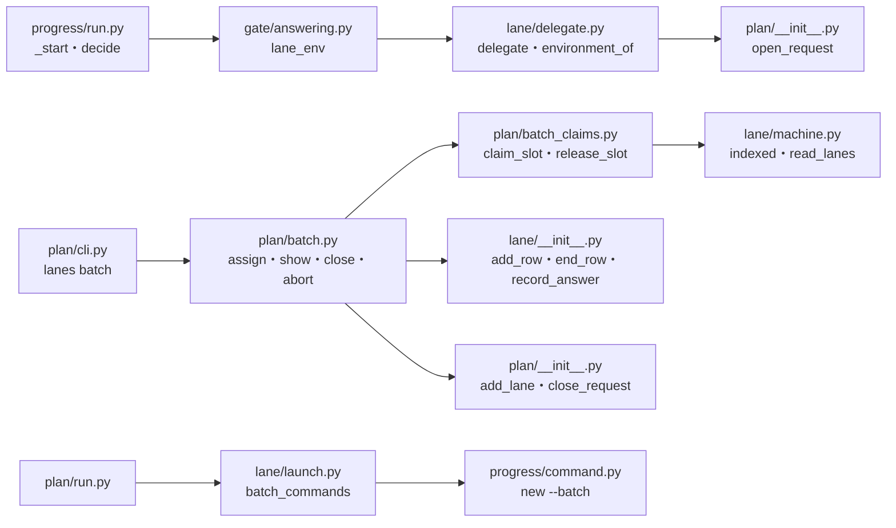

# #4211 の詳細設計: 委ねのリクエスト・まとめのコマンド・マシン全体の取りかかり・種類 `batch` の行

設計文書（[issue-4211-design.md](./issue-4211-design.md)）の構成要素を、ファイルと関数の粒度へ下ろす。パスは `plugins/ndf/` からの相対で書く。#4050 の詳細設計（main の `issues/issue-4050-design-detail.md`）の `Env`・`_start`・`decide`・`phases.json` の `carrier` を前提にし、そのうち「#4210・#4211 へ分けたもの」の表の #4211 の行（`Env.delegate`・`delegate`・`_start` の委ねの枝・`_consume_delegated`・`delegate_answered`・節「まとめた検証と棚卸し」・`request_opened` の `lane-verify`・`lane-backlog`）を、この文書で置き換える。#4050 の詳細設計の節「まとめた検証と棚卸し」の `batch claim`・`--phase release`・`ndf lanes release --batch`・`policy.batch_ttl`・`superseded_from` は作らない（設計文書の決定 2・3・5・6）。

## 地図

| パス | 種類 | 役割 1 文 | 依存する先 | クラスまたはモジュール | メソッドと最上位の関数 |
| --- | --- | --- | --- | --- | --- |
| `src/ndf/progress/lane/delegate.py` | 新設 | 計画の行の委ねのリクエストを組み、計画へ 1 回だけ書く | `plan/__init__.py`・`lane/__init__.py` | モジュール | `delegate`・`environment_of`・`delegation_key`（新設） |
| `src/ndf/progress/run.py` | 変更 | 担い手 `organizer` のフェーズで `Env.delegate` を呼び、委ねた回答を消費する | `phases.json`（#4050） | `Env` | `Env.delegate`（新設の欄）・`_start`・`decide`・`_consume_delegated`（新設） |
| `src/ndf/progress/gate/answering.py` | 変更 | 計画の行のスプリントでだけ `delegate` をつなぐ | `lane/delegate.py` | モジュール | `lane_env` |
| `src/ndf/progress/plan/batch.py` | 新設 | まとめの 4 つの手を計画のトランザクションで行う | `batch_claims.py`・`lane/__init__.py`・`plan/__init__.py` | モジュール | `assign`・`show`・`close`・`abort`・`check_version`（新設） |
| `src/ndf/progress/plan/batch_claims.py` | 新設 | マシン全体の取りかかりの記録の確認・確保・消去 | `lane/machine.py` | モジュール | `claim_slot`・`release_slot`・`slot_free`・`owner_of`・`db_ref`・`batch_lock`（新設） |
| `src/ndf/progress/plan/cli.py` | 変更 | `ndf lanes batch assign / show / close / abort` の引数と書き手の見分け | `plan/batch.py` | モジュール | `_batch_parser`・`_writer`（新設）、`_row_end`・`_row_cancel`（変更） |
| `src/ndf/progress/plan/__init__.py` | 変更 | 委ねとまとめの事象の畳み込みと表示・委ねのリクエストの閉じ方・種類 `batch` の行を移さない | `lane/fold.py` | `PlanView` | `open_batches`・`failed_backlogs`（新設）、`status`・`close_request`・`move_row`・`stop_plan`（変更） |
| `src/ndf/progress/lane/__init__.py` | 変更 | 種類 `batch` の行の終わりと中止を `batch.py` の経路だけに絞る | — | モジュール | `end_row`・`cancel_row`・`cancel_pending`（変更） |
| `src/ndf/progress/plan/wait_decide.py` | 変更 | `batch_closed` の `failed`・`aborted` を知らせる | — | モジュール | `NOTICE_KINDS`（変更） |
| `src/ndf/progress/command.py`（`wait`） | 変更 | 委ねた検証の待ちを `status: gate` で返す | `run.py` | モジュール | `wait`（変更） |
| `skills/development-workflow/SKILL.md` | 変更 | 引数 `--batch <id>` | — | — | — |
| `src/ndf/progress/lane/fold.py`・`types.py` | 変更 | `batch_claimed`・`batch_revoked`・`batch_closed` を `PlanView` に畳む | — | `PlanView`・`Batch`（新設の型） | `fold_plan`（変更） |
| `src/ndf/progress/lane/launch.py` | 変更 | 種類 `batch` の行を始める・続ける・中止する入力を組む | `progress/command.py` | モジュール | `batch_commands`・`batch_of`・`BATCH_GOAL_END`（新設）、`start_commands`・`start_prompt`・`goal_prompt`・`_going_on`・`cancel_commands`・`_workflow_args`（変更） |
| `src/ndf/progress/plan/run.py` | 変更 | 種類 `batch` の行を開発ループの行と同じく生死の判定へ渡し、担い手の行に要求元の席を貸し、取り消したまとめの担い手を起動しない | `lane/liveness.py`（変更なし） | モジュール | 生死の判定の呼び手・`first_input`・`launch_lane`（変更） |
| `src/ndf/progress/command.py` | 変更 | `ndf progress new --batch <id>` で工程を持たない子のステートマシンを作る | — | モジュール | `new`（変更） |
| `contracts/workflow/progress.json` | 変更 | 事象 `batch_claimed`・`batch_revoked`・`batch_closed`（計画）と `delegate_answered`（スプリント）、リクエストの種類 `lane-verify`・`lane-backlog` | — | — | — |
| `contracts/workflow/parallel-plan.schema.json` | 変更 | 行の入力 `kind: batch` | — | — | — |
| `contracts/workflow/context.schema.json` | 変更 | 文脈のキー `verification` | — | — | — |
| `contracts/schemas/io/lanes.args.schema.json`・`docs/contracts/commands.md` | 変更 | `lanes batch` の引数と説明 | — | — | — |
| `contracts/domains/locations.json` | 変更 | 状態の保存先の行 `parallel/batches/` | — | — | — |
| `skills/development-workflow/schemas/project.schema.json` | 変更 | `branch_strategy.verify.environment`（文字列） | — | — | — |
| `skills/development-workflow/references/parallel.md`・`skills/release-verification/SKILL.md`・`skills/backlog-refinement/SKILL.md` | 変更 | オーガナイザーのまとめの手順と、担い手の手順（版を前後で読む・`batch close`） | — | — | — |

## 委ねの口（`run`・`answering`・`delegate`）

満たす決定: 決定 1・決定 4・決定 6、受け入れ条件 1・3

### 関数の仕様

| 関数 | 保存先 | 種類 | シグネチャ | 責務 |
| --- | --- | --- | --- | --- |
| `Env.delegate` | `src/ndf/progress/run.py` | 新設の欄 | `Callable[[Any, View, Phase, list[str]], Optional[str]]`（既定は `lambda *_: None`） | 委ねたらリクエストのキーを返し、委ねなければ None を返す。計画の外は既定のままで、今のとおり工程を流す |
| `_start` | `src/ndf/progress/run.py` | 変更 | 今のまま | フェーズの最初の工程で `phase.carrier == "organizer"` なら `env.delegate` を呼ぶ。キーが返れば、検証は工程を始めずに `DELEGATED` を返し、棚卸しは同じトランザクションで委ねた工程を `completed` にして次の候補へ進む |
| `decide` | `src/ndf/progress/run.py` | 変更 | 今のまま | 委ねた検証の工程の状態で手を選ぶ（下の「処理の手順」） |
| `wait` | `src/ndf/progress/command.py`（`ndf progress wait`） | 変更 | 今のまま | 今の委ねのキーの `delegate_answered` が無い委ねた検証の待ちを、承認ゲートの回答待ちと同じ `status: gate`（`metrics.delegated`・`metrics.gate: "delegated"`）で返す。生死の判定（`liveness.sprint_wait`）はこれを `SPRINT_GATE` と読む（下の「委ねた待ちと生死の判定」） |
| `_consume_delegated` | `src/ndf/progress/run.py` | 新設 | `(conn, v: View, answer: dict) -> list[EventDraft]` | 今の委ねのキーの `delegate_answered` を読み、`done` なら委ねた工程の並びをすべて `completed` にし、文脈の `verification` へ、その行のリクエストのリポート（条件ごとの合否・保留）・要求の版・読んだ版・証跡を書いた PR を写す。`failed` なら並びの先頭を `failed`（`cause: delegate_failed`・リポート）にし、残りは未着手のまま |
| `lane_env` | `src/ndf/progress/gate/answering.py` | 変更 | 今のまま | 計画の行のスプリントの `Env` に `delegate=lambda conn, v, phase, stages: delegate.delegate(conn, v, phase, stages)` を足す |
| `delegate` | `src/ndf/progress/lane/delegate.py` | 新設 | `(conn, v: View, phase: str, stages: list[str]) -> Optional[str]` | スプリントの行（`lane.sprint_row`）を引き、無ければ None。計画の排他（`lane.lock_plan`）の中で、同じ委ねのキーの `request_opened` があればそのキーを返し、無ければ中身（設計文書の「データ構造」）を組んで `open_request` で書く。検証は文脈の `version`（無ければ null）・`release_pr`（無ければ null）を、棚卸しはその行の棚卸しの範囲 `since_ref`（下の「棚卸しの範囲」）を中身に入れる |
| `delegation_key` | `src/ndf/progress/lane/delegate.py` | 新設 | `(v: View, phase: str) -> str` | `<スプリントの ID>:<フェーズ>:<試み>`。試みは、そのフェーズの最初の工程の `stage_retried` の数 |
| `environment_of` | `src/ndf/progress/lane/delegate.py` | 新設 | `(repo_root: Path, repo: str) -> str` | `.ndf/project.json` の `branch_strategy.verify.environment` を読み、空でない文字列ならそれ、無いか `verify` が `null` なら `repo`（`<owner>/<name>`）を返す |

### 処理の手順

| 関数 | 条件の組み合わせ | 結果 |
| --- | --- | --- |
| `_start` | 担い手 `lane` のフェーズ | 今のとおり（#4050） |
| `_start` | 担い手 `organizer`・`env.delegate` が None | 計画の外。今のとおり工程を始める |
| `_start` | 担い手 `organizer`・検証・キーが返る | 工程を始めず `DELEGATED`。結果は承認ゲートの回答待ちと同じ `status: gate`（`metrics.gate: "delegated"`・`metrics.delegated`）で、conductor は承認ゲートと同じく応答を終える（`next` を打ち直さない） |
| `_start` | 担い手 `organizer`・棚卸し・キーが返る | 委ねた工程を `completed`（`summary` に委ねのキー）にし、同じ `next` で次の候補へ進む。候補が無ければスプリントの完了（今のとおり `Env.ended` で行が終わる） |
| `decide` | 委ねた検証の工程に `delegate_answered`（今の委ねのキー）が無い | `DELEGATED`（打ち直しでリクエストを書き足さない。結果は上と同じ `status: gate`）。#4210 が入るまでは、ほかの候補を始めない |
| `decide` | `done` の回答がある | `_consume_delegated` の手。その後は今のとおり次の候補（振り返り） |
| `decide` | `failed` の回答がある | `_consume_delegated` の手。その後は `FAILED` |
| `decide` | 古い委ねのキーの回答だけがある（`retry` の後） | 読まない。新しい委ねのキーで `_start` がリクエストを書く |

`documentation` の検証は、体裁レビューとリリース後テストを 1 件の `lane-verify`（`stages` に 2 つ）で委ね、1 件の回答で 2 つとも消費する。モードが持たない工程は `stages` に入らない。

**版を出さない変更。** 文脈に `version` が無い（デプロイの `delivery.versioned` が偽・デプロイの工程を持たないリポジトリ・今回の変更では版を出さない）検証は止めずに、`version: null` のリクエストで委ねる。そのリクエストは版の照合（`check_version`）の対象にならず、担い手は今の環境でその行の受け入れ条件（`documentation` なら体裁レビュー）だけを確かめる。版の無いことで止めるのは、文脈の `delivery.versioned` が真なのに `version` が無いとき（デプロイの出力の欠け）だけである。

**委ねた待ちと生死の判定。** 委ねた検証の待ちは、承認ゲートの回答待ちと同じ形でつなぐ。

| 読み手 | 回答の前 | 回答の後（`row_answered` が載った） |
| --- | --- | --- |
| `ndf progress next`・`ndf progress wait --timeout 0` | `status: gate`（`metrics.gate: "delegated"`） | `next` は `_consume_delegated` の手を返す |
| 生死の判定（`liveness.judge`） | `sprint_wait` が `SPRINT_GATE` と読み、`WAITING_ANSWER`。ラッパーが消えていても止まりにも再起動の対象にもならない | 今のとおり `awaiting_next` の `RESUMING` で、耐久ワークフローが回答の後の入力（`resume_commands`）で起こす |
| `/goal` の終わりの条件 | 承認ゲートと同じく応答を終える（終わりの条件の文に「`status: gate` が返ったら応答を終える」を足す。承認ゲートの今の扱いと同じ文） | 今のとおり |

**棚卸しの範囲。** 差分の棚卸しは、振り返りの範囲の始まり（`ndf issues candidates --since-ref` に渡す、前のリリースのタグ）より後に起票した課題を扱う。`delegate` は棚卸しのリクエストに、その行が自分で流したなら渡したはずの `since_ref`（行の作業場所で `git describe --tags --abbrev=0` が返す、基のブランチから届く最新のタグ。タグが無ければ null で、全件が対象）と、行のスプリントの課題 `issues` を書く。まとめでは各リクエストの範囲の和集合を処理する: `since_ref` のうち最も古いコミットのもの（1 つでも null なら null）を `--since-ref` に渡し、各リクエストの `issues` を `--add` に渡す。

### 異常系の処理

| 関数 | 失敗 | 原因 | 検出する場所 | 扱い | 利用者に見える出力と終了コード | 後始末と再実行の可否 |
| --- | --- | --- | --- | --- | --- | --- |
| `delegate` | 検証の版が無い | 文脈の `delivery.versioned` が真なのに、デプロイの出力に `version` が無い | 文脈の `version` を読む所 | 止める | `stopped`・`precondition`（「版を出すデプロイなのに検証する版が文脈に無い」） | デプロイを直してから `next` を打ち直す。リクエストは書かれない。`versioned` が偽か `delivery` が無いときは止めず、`version: null` で委ねる |
| `delegate` | 棚卸しの範囲を読めない | 作業場所が無い・git が失敗する | `since_ref` を読む所 | 止める | `stopped`・`transient` | そのまま打ち直せる |
| `environment_of` | `.ndf/project.json` が読めない・形が違う | 利用者の設定の誤り | 読み込み | 止める | `stopped`・`precondition`（ファイルと誤り） | 設定を直して `next` を打ち直す |
| `delegate` | 計画の排他を取れない | 別の書き手が長く持つ | `lock_plan` | 呼び出し元へ返す | `stopped`・`transient` | そのまま打ち直せる（キーで冪等） |
| `_consume_delegated` | 回答のリポートが空 | 担い手の誤り（`close` が断るので起きない） | — | 既定値で続ける | 無し | — |

### 単体テストの観点

| 関数 | 正常 | 境界値 | 異常 |
| --- | --- | --- | --- |
| `delegate`・`_start` | 計画の行の検証の境で `lane-verify` が 1 件・結果が `status: gate`。棚卸しの境で `lane-backlog` が 1 件（`since_ref` と `issues` を持つ）・棚卸しの工程が `completed`・行が完了 | 打ち直しで増えない。`retry` の後は試みの進んだ新しいキーで 1 件。`versioned` が偽の `documentation` の行は `version: null` で委ね、版の無い `done` の回答で 2 工程とも完了する | 計画の外では書かない。`versioned` が真で版の無い文脈で `precondition` |
| `wait`・`liveness.judge` | 回答の前の委ねた待ちで `progress wait --timeout 0` が `gate` を返し、ラッパーの無い行の判定が `WAITING_ANSWER` | 回答の後は `RESUMING` | — |
| `_consume_delegated` | `done` で委ねた工程がすべて完了し `verification` にその行のリポート・要求の版・読んだ版が載る。`documentation` で 2 工程とも完了 | 古い委ねのキーの回答を読まない。リポートに不合格や `not_run` の条件があっても `done` なら完了し振り返りへ進む | `failed` で先頭が `failed`・`decide` が `FAILED` |
| `environment_of` | 宣言があればその名前 | `verify: null`・キー無し・空の文字列でリポジトリの名前 | 形の違う設定で `precondition` |

## まとめのコマンド（`plan/batch`・`plan/cli`）

満たす決定: 決定 2・決定 4・決定 5・決定 7、受け入れ条件 1〜4

### 関数の仕様

| 関数 | 保存先 | 種類 | シグネチャ | 責務 |
| --- | --- | --- | --- | --- |
| `assign` | `src/ndf/progress/plan/batch.py` | 新設 | `(cwd: Path, plan: str, requests: list[str], lane: Optional[str], reason: str) -> dict` | `batch_lock` を取り、計画の排他（`lock_plan`）の中の 1 つのトランザクションで、リクエストとレーンを確かめ直し、開いたまとめの打ち直しかを決め、`claim_slot` で取りかかりの記録を書き、`batch_claimed` と担い手の行（名指したレーンへ `add_row`、無ければ `add_lane` で `b<id>`）を書いてコミットする（下の「`assign` の書き込み」） |
| `show` | `src/ndf/progress/plan/batch.py` | 新設 | `(cwd, plan, batch_id) -> dict` | まとめの中身と、担い手が打つ `close` の雛形（`--observed-version` の並びとリポートの形）を返す。取りかかりの記録がこのまとめ（保存先・計画・id の組）を指していないか、まとめに `batch_revoked` か `batch_closed` があれば `stopped`・`precondition` で手順を返さない（担い手は作業を始めず、オーガナイザーが `abort` する）。書かない |
| `close` | `src/ndf/progress/plan/batch.py` | 新設 | `(cwd, plan, batch_id, result: str, report: Path, observed: dict[str, tuple[str, str]], cause: Optional[str], reason: str, caller: Writer) -> dict` | 書き手・版・リポートの形を確かめ、1 つのトランザクションで `batch_closed`・リクエストの閉じ・回答・担い手の行の終わりを書き、コミットの後に `release_slot` |
| `abort` | `src/ndf/progress/plan/batch.py` | 新設 | `(cwd, plan, target: BatchRef, reason, caller: Writer) -> dict` | 下の「`abort` の手順」。`plan` は呼び手自身の計画（`cwd` の保存先から開く）、`target` は自分の計画のまとめの id か、別の計画の取りかかり（`--claim <種類>:<キー>`）。担い手の行が実行中なら、そのラッパーを止めて止まったことを確かめてから書き、確かめられなければ何も書かずに枠を保つ |
| `check_version` | `src/ndf/progress/plan/batch.py` | 新設 | `(batch: Batch, result: str, observed: dict[str, tuple[str, str]], cause: Optional[str]) -> Optional[str]` | 検証の `done` に、版のあるリクエストを持つリポジトリの読んだ版の前後の一致と要求の版以上を求め、`failed` には原因を求める。版がすべて null のリポジトリは照らさない。誤りの文を返す |
| `check_report` | `src/ndf/progress/plan/batch.py` | 新設 | `(batch: Batch, report: dict) -> Optional[str]` | 検証のリポートが、まとめのすべてのリクエストの節（条件ごとの `pass`・`fail`・`not_run` と証跡を書いた PR）を持つかを確かめる。誤りの文を返す |
| `_writer` | `src/ndf/progress/plan/cli.py` | 新設 | `(environ: Mapping[str, str]) -> Writer` | `NDF_RELAY_PLAN` が無ければ `organizer`、あれば `conductor`（計画の名前とラッパーの名前 `NDF_RELAY_NAME` を持つ） |
| `lane.end_row`・`lane.cancel_row`・`plan.move_row`・`lane.cancel_pending` | `src/ndf/progress/lane/__init__.py`・`src/ndf/progress/plan/__init__.py` | 変更 | `end_row`・`cancel_row` に `by_batch: bool = False` を足す | 種類 `batch` の行の変更を、呼び口でなく書き込みの共通の経路で断る: `end_row`・`cancel_row` は `by_batch` が偽なら `Refused`（`batch close` か `batch abort` を案内する）。`move_row` は種類 `batch` の行を移さない。`ndf lanes row end`・`row cancel`・`ndf progress cancel`（子を経由する `end_row`）・`ndf lanes move` はすべてこの経路で断られる。`cancel_pending`（`ndf lanes stop --now`）は未着手の種類 `batch` の行を中止にするとき、同じトランザクションで `batch_closed`（`aborted`・理由は計画の中止）を書き、コミットの後に `release_slot` する |
| `close_request` | `src/ndf/progress/plan/__init__.py`（`ndf lanes request close`） | 変更 | 今のまま | 委ねのリクエストの閉じ方を種類で分ける（下の「委ねのリクエストを単独で閉じる」） |
| `open_batches`・`failed_backlogs` | `src/ndf/progress/plan/__init__.py` | 新設 | `(view: PlanView) -> list[dict]` | 取りかかり中のまとめ（フェーズ・キー・担い手・経過時間）と、`failed` で閉じた棚卸しのまとめ（リクエストが開いたまま）を `ndf lanes status` の `metrics` へ出す |
| `NOTICE_KINDS` | `src/ndf/progress/plan/wait_decide.py` | 変更 | — | `ndf lanes wait` の知らせに、結果が `failed`・`aborted` の `batch_closed` を足す（`done` は知らせない）。オーガナイザーは受けたら `assign` で割り当て直すか、リクエストを閉じる |

### 処理の手順

`assign` の確かめ（どれかに当たれば何も書かずに `stopped`・`precondition`）。書き手のほかは、すべて `lock_plan` を取った後の同じトランザクションの中で読む（排他の前に読んだ値では決めない）:

| 確かめ | 断る条件 |
| --- | --- |
| 書き手 | `conductor` |
| リクエスト | 開いていない・委ねのリクエストでない・種類が混ざる・検証で環境が混ざる。既に開いたまとめ（`batch_claimed` があり `batch_closed` が無い）に、ほかのリクエストと一緒に入っている（同じリクエストの組なら打ち直しとして扱う） |
| レーン（`--lane`） | 新しいまとめのときだけ確かめる: 計画に無い・未着手か実行中の行がある・行が 1 つも無い。打ち直し（同じリクエストの組の開いたまとめがある）では確かめない（最初の割り当てが足した担い手の行がそのレーンに未着手か実行中で残っているため）。打ち直しの `--lane` が前のまとめの担い手のレーンと違うときは、前のまとめを返す（`metrics.batch` に前のレーン） |
| 取りかかり | `claim_slot` が「使用中」を返す（中身に持ち主の計画・まとめの id・経過時間）か、持ち主を読めない（`transient`） |

`assign` の書き込み:

1. `batch_lock` を取る（`admit_lock` と同じ待ち方。`parallel-machine.admit-lock` の秒）
2. 計画の排他（`lock_plan`）を取ってトランザクションを始め、書き手とリクエストを確かめた後、まず同じリクエストの組の開いたまとめを照らす。あれば打ち直しで、その id を使い（3 の新しい id と行は作らない）、レーンの確かめを省く。無ければ新しいまとめで、レーンと取りかかりを確かめる
3. 新しいまとめなら id を採る
4. `claim_slot(write=True)` で、記録が空き（下の「取りかかりの記録」）なら自分の記録（保存先・計画・id）を書く。打ち直しで記録が既に自分を指していれば書かない
5. 新しいまとめなら同じトランザクションで `batch_claimed` を書き、`--lane` があれば `add_row(lane, {"kind": "batch", "batch": id, "phase": …})`、無ければ `add_lane({"name": "b<id>", "touches": [], "after": [], "rows": [同じ入力]})` を書く
6. コミットし、`lock_plan`・`batches.lock` の順に外す

記録を計画のコミットより先に書くので、担い手の行が計画に現れた時点で、取りかかりの記録はかならずそのまとめを指している。4 の後・6 のコミットの前に落ちると、記録だけが残り、持ち主の計画にはその id の `batch_claimed` が無い。`batches.lock` の中で読む次の `claim_slot` は、それを残骸として空きとみなす（書き手のプロセスは flock と一緒に消えているので、書きかけと見分けられる）。6 のコミットの後に落ちても、記録と行はそろっている。担い手の行の起動は、`show` が記録の持ち主の組を確かめてから手順を返すことで、記録の確保と結び付ける（別の計画が記録を書き換えていれば作業を始めない）。

`abort` の手順（書き手はオーガナイザーか、まとめの担い手の行のラッパーの conductor。後者は計画の中止の入力（`cancel_commands`）からだけ打つ）:

| 呼び手と対象 | 通す条件 | 書くもの |
| --- | --- | --- |
| 持ち主の計画のオーガナイザー（`<計画> <id>`） | 計画の状態を問わない | 下の起動の取り消しと停止の確かめの後、1 つのトランザクションで担い手の行の中止（未着手なら `cancel_row`、実行中なら子のステートマシンの `end_row` の `cancelled`。どちらも `by_batch`）と、計画が終わっていなければ `batch_closed`（`aborted`）。コミットの後に `release_slot` |
| 別の計画のオーガナイザー（`<自分の計画> --claim <種類>:<キー>`） | 取りかかりの記録の持ち主の計画（記録の保存先から開く）が `running` でなく、担い手の行が実行中でない（未着手か終わっている） | 持ち主の計画を記録の保存先で開き、上と同じもの（起動の取り消しを含む）を書く。担い手の行が実行中なら断る（`paused` の計画は実行中の行を流し続けるため） |
| 担い手の行の conductor（`<計画> <id> --self`） | ラッパーの名前がまとめの担い手のレーンと合う・計画が中止された（`cancelled`） | 呼び手自身が担い手なので停止の確かめを省き、行の中止と子の中止を書く。計画は終わっているので `batch_closed` は書かず、コミットの後に `release_slot` |

**起動の取り消し。** 呼び手が担い手でない `abort`（上の表の 1 行目と 2 行目）は、停止の確かめより前に、持ち主の計画の排他の中で計画の事象 `batch_revoked`（id・理由）を書いてコミットする（既にあれば書かない。打ち直しはここから進む）。これがそのまとめの担い手の起動を無効にする印で、次の 3 か所がそれぞれの読みの中で確かめる。

| 確かめる所 | 印か `batch_closed` があるとき |
| --- | --- |
| `plan/run.py` の `launch_lane`（行の起動・回答の後の起動・`/goal` の入れ直し・止まりからの再起動。耐久ワークフローが前に決めた起動も、このステップの中の読み直しで確かめる） | 起動せず `{"ok": False, "final": True}`（理由に取り消し）。中止の入力（`cancel_commands`・`--self`）だけは通す |
| `show` | `stopped`・`precondition` で手順を返さない。担い手は作業を始めない |
| `close` | `stopped`・`precondition`（`abort` が先に決まったので結果を書かない） |

順序の保証: 印のコミットより後に始まった担い手は、`show` で断られて作業を始めない。印のコミットより前に `show` を通った担い手は、その時点でラッパーが動いているので、続く停止の確かめで止まったことを確かめられる（耐久ワークフローがその間に同じ名前のラッパーを置き換えても、新しいラッパーは印の後に `show` を読むので作業を始めない）。したがって停止を確かめた後に枠を空けても、次のまとめと同じ環境を触る担い手は残らない。

停止の確かめ（担い手の行が実行中で、呼び手が担い手でないとき。上の取り消しの後）: 今のラッパーを止める口（`launch.stop`）で担い手のレーンのラッパーを止め、ラッパーの一覧（`launch.wrappers`）でそのラッパーが動いていないことを確かめてから書く。一覧を読めない・まだ動いているときは何も書かずに `stopped`・`transient` を返し、取りかかりの記録は残す（枠を空けない）。復旧はそのまま `abort` を打ち直すことで、繰り返し止まらないときは人がラッパーの一覧で残ったプロセスを確かめて止めてから打ち直す（手順は `parallel.md` の新しい節に書く）。

**委ねのリクエストを単独で閉じる**（`ndf lanes request close`）:

| リクエスト | 扱い |
| --- | --- |
| 開いたまとめに入っている | 断る（`precondition`。先に `batch abort` を案内する） |
| まとめに入っていない `lane-verify` | 同じトランザクションで、要求元の行へ `row_answered` とスプリントの `delegate_answered`（`failed`・原因 `delegate_withdrawn`・理由）を書いてから閉じる。要求元は回答の後の入力で起き、`FAILED` で止まる（オーガナイザーは `retry` か行の中止を選ぶ） |
| まとめに入っていない `lane-backlog` | そのまま閉じる（要求元の行は委ねた時点で終えているので、待つ行が無い） |

`close` の書き込み（1 つのトランザクション）:

| フェーズと結果 | `batch_closed` | リクエスト | 各行 | 担い手の行 |
| --- | --- | --- | --- | --- |
| 検証・`done` | 書く（読んだ版・リポート） | 閉じる | `row_answered`（中身に `request`）とスプリントの `delegate_answered`（`done`） | `end_row(completed)` と子のステートマシンの完了 |
| 検証・`failed` | 書く（原因） | 閉じる | `row_answered` と `delegate_answered`（`failed`・原因） | 同上 |
| 棚卸し・`done` | 書く | 閉じる | 書かない（工程は委ねた時点で終えている） | 同上 |
| 棚卸し・`failed` | 書く | 開いたまま | 書かない | 同上 |

閉じた後に同じ id の `close` を打つと、何も書かずに前の `batch_closed` を返す。`close` が通る書き手は、オーガナイザーと、ラッパーの名前がまとめの担い手のレーンのラッパーと同じ conductor である。

**結果と条件の合否の対応**（今の `release-verification` の閉じ方に合わせる）:

| 状況 | 結果 | 要求元の行 |
| --- | --- | --- |
| 確かめをやり終えた（各条件が `pass`・`fail`・`not_run` のどれかに決まった。不合格や、次の版で確かめる `not_run` を含む） | `done` | 今の `release-verification` と同じく振り返りへ進む。不合格と `not_run` は、その行のリポートの節として `verification` に写り、振り返りが拾う |
| 確かめをやり終えられなかった（環境が壊れている・版が照らせない・手順が途中で止まった） | `failed` | `FAILED` で止まり、`retry` か行の中止を待つ |
| 複数のリクエストのうち一部の条件だけが不合格 | `done` | 行ごとに自分の節（自分の課題の条件の合否）だけを受け取る。まとめ全体の `failed` にはしない |

リポート（`--report` のファイル）は JSON で、`{"common": <環境と版のセットアップの結果>, "requests": {"<リクエストのキー>": {"criteria": [{"issue", "id", "verdict": "pass"|"fail"|"not_run", "evidence"}], "evidence_pr": <証跡を書いた PR か null>}}}`。`check_report` が、検証の `done` でまとめのすべてのリクエストの節があることを確かめる。各行の `delegate_answered` には、その行の節と `common` だけを載せる。

`check_version`（検証だけ。棚卸しは見ない）:

| 結果 | 条件 | 判定 |
| --- | --- | --- |
| `done` | まとめのそのリポジトリのリクエストの版がすべて null（版を出さない変更だけ） | 照らさない（`--observed-version` は要らない）。版のあるリクエストが 1 つでもあれば、下の行で版のあるものだけと照らす |
| `done` | まとめのリポジトリの `--observed-version` が無い | 断る |
| `done` | 前と後が違う | 断る（`failed --cause version_changed` で閉じる） |
| `done` | 前と後が同じで、まとめのそのリポジトリのどれかのリクエストの版より古い（semver） | 断る（`failed --cause version_mismatch` で閉じる） |
| `done` | 前と後が同じで、どのリクエストの版以上 | 受ける |
| `failed` | `--cause` が無い | `work_failed` を入れて受ける |
| `failed` | `--cause` が `version_changed`・`version_mismatch` で、`--observed-version` が無い | 断る（原因の根拠が無い） |

### 異常系の処理

| 関数 | 失敗 | 原因 | 検出する場所 | 扱い | 利用者に見える出力と終了コード | 後始末と再実行の可否 |
| --- | --- | --- | --- | --- | --- | --- |
| `assign` | 取りかかり中 | 同じ環境（棚卸しは同じリポジトリ）のまとめが動いている | `claim_slot` | 止める | `stopped`・`precondition`（持ち主の計画・id・経過時間）、終了コード 1 | 閉じた後に打ち直す。持ち主の計画が `paused` で担い手の行が実行中でなければ `abort --claim` してから |
| `assign` | 持ち主を読めない | 持ち主の保存先の DB に一時的につながらない・読み取りの失敗 | `owner_of` | 枠を保ったまま止める | `stopped`・`transient` | そのまま打ち直せる |
| `assign` | 持ち主の DB を特定できない | 呼び手の `NDF_PROGRESS_DB` が記録の DB の参照と違う・記録の SQLite のファイルが無い | `owner_of` | 枠を保ったまま止める | `stopped`・`precondition`（記録の DB の参照・計画・id） | 記録の DB を指す接続先で打ち直すか、持ち主が閉じるのを待つ |
| `assign` | `batches.lock` を取れない | 別の `assign`・`close` が長く持つ | `batch_lock` | 呼び出し元へ返す | `stopped`・`transient` | そのまま打ち直せる |
| `assign` | 記録を書いた後、計画のコミットの前に落ちた | プロセスの終わり | — | — | — | 計画には何も残らない。残った記録は次の `claim_slot` が残骸として空きとみなす |
| `abort` | 担い手の停止を確かめられない | ラッパーの一覧を読めない・止めても動いている | 停止の確かめ | 起動の取り消し（`batch_revoked`）のほかは書かずに止める | `stopped`・`transient`（ラッパーの名前） | 打ち直す（取り消しは残っているので、その間に担い手が起動し直しても作業を始めない）。止まらなければ人がプロセスを止めてから打ち直す |
| `show` | 取りかかりの記録が別のまとめを指す | 記録の残骸を別の計画が空きとみなして書き換えた | `show` | 止める | `stopped`・`precondition` | 担い手は作業を始めない。オーガナイザーが `abort` する |
| `close` | 版の照合に落ちた | 検証の途中のリリース・環境の巻き戻り | `check_version` | 止める | `stopped`・`precondition`（照合の表のどの行か） | `failed` と原因で閉じ直す |
| `close` | 書き手が違う | 別のレーンの conductor | `_writer` | 止める | `stopped`・`precondition` | — |
| `close` | トランザクションの途中で落ちた | プロセスの終わり | — | — | — | 何も残らず、打ち直せる |
| `close` | コミットの後に記録を消す前に落ちた | 同上 | — | — | — | 次の `claim_slot` が `batch_closed` を読んで空きとみなす |
| `close` | リポートのファイルが無い・64 KiB を超える | 担い手の誤り | 読み込み | 止める | `stopped`・`precondition` | 直して打ち直す |
| `abort` | 別の計画のオーガナイザーで、持ち主の計画が `running` か担い手の行が実行中 | — | `owner_of` の読み | 止める | `stopped`・`precondition`（持ち主の計画） | 持ち主に任せる |

### 単体テストの観点

| 関数 | 正常 | 境界値 | 異常 |
| --- | --- | --- | --- |
| `assign` | `--lane C` で C に種類 `batch` の行が 1 つ増え、名指さなければ `b<id>` のレーンが増える。どちらも次の読み直しで行の起動（下の「担い手の行の席」）で始まる | 計画のコミットの直後に落とした（差し替えたコミットの後の処理で例外）状態で、別の保存先の計画の同じ環境の `assign` が断られ、元の担い手の行の `show` が手順を返す。記録を書いた後・コミットの前に落とした状態では、別の計画の `assign` が通り、元の計画に行が無い。同じリクエストの打ち直しが同じ id を返す。`--lane C` の打ち直し（C に最初の割り当ての担い手の行が未着手か実行中で残る）も断られずに同じ id を返し、行を足さない | 混ざったリクエスト・実行中の行のあるレーン・conductor の書き手・取りかかり中で断る。`lock_plan` を取る前に差し替えた読みでリクエストを閉じる・名指したレーンへ行を足すと、排他の中の確かめで断る |
| `close` | 検証の `done` で 2 行に回答（各行に自分の節）、担い手の行が完了、記録が消える | 閉じた後の打ち直しが何も書かない。3 行のうち 1 行目の後に落とすと何も残らない。1 行の条件が `fail`・もう 1 行が `pass` の `done` で両方が振り返りへ進む | 別のレーンの conductor で断る。リクエストの節の欠けたリポートで断る |
| `check_version` | 前後が同じで要求以上を受ける | 要求と同じ版を受ける・要求より新しい版を受ける・版がすべて null のまとめは読んだ版無しで受ける | 前後の違い・要求より古い・読んだ版の無い `done`（版のあるリクエストを含む）を断る |
| `abort` | 持ち主のオーガナイザーで担い手の行が中止、リクエストは開いたまま、回答は無い。持ち主の計画が動いていても通る | 別の計画（`--claim`）で持ち主が `paused`・担い手の行が未着手なら通る。計画の中止の入力の `--self` が行を中止し記録を消す | 持ち主が `running`、または `paused` でも担い手の行が実行中の別の計画で断る。差し替えたラッパーの一覧が「動いている」を返すと `batch_revoked` のほかは書かず記録が残る。停止の確かめの直前に耐久ワークフローの前に決めた起動（`launch_lane`）を差し込むと、起動されないか、起動された担い手の `show` が断る。`batch_revoked` の後の `close` を断る |
| `end_row`・`cancel_row`・`move_row` | スプリントの行は今のとおり | `stop --now` で未着手の担い手の行が中止になり、同じトランザクションで `batch_closed`（`aborted`）が書かれ記録が消える | 種類 `batch` の行への `row end`・`row cancel`・`progress cancel`（子）・`lanes move` を断る |
| `close_request` | まとめに入っていない `lane-verify` を閉じると要求元に `failed`（`delegate_withdrawn`）の回答が載る | `lane-backlog` はそのまま閉じる | 開いたまとめに入ったリクエストで断る |
| `NOTICE_KINDS` | `failed`・`aborted` の `batch_closed` を `ndf lanes wait` が知らせる | `done` は知らせない | — |

## マシン全体の取りかかり（`plan/batch_claims`）

満たす決定: 決定 3、受け入れ条件 2

### 関数の仕様

| 関数 | 保存先 | 種類 | シグネチャ | 責務 |
| --- | --- | --- | --- | --- |
| `batch_lock` | `src/ndf/progress/plan/batch_claims.py` | 新設 | `(seconds: float) -> ContextManager[None]` | `<状態の保存先>/parallel/batches/batches.lock` の flock（すべてのコマンドがこの 1 つのパスを開く。`locations.json` の行も同じパス）。`machine.admit_lock` と同じ待ち方で、取れなければ `LockBusy` |
| `owner_of` | 同上 | 新設 | `(record: dict) -> SlotOwner` | 記録の DB の参照（`db`。下の「持ち主の DB の参照」）から持ち主の DB の URL を解き、`state_dir` の計画を開いて `SlotOwner`（計画の状態・その id の `batch_claimed` があるか・`batch_closed` があるか・担い手の行が実行中か）を返す。呼び手の `NDF_PROGRESS_DB` と `store.default_url` は、参照と同じ DB を指すと確かめられたときだけ使う。DB は開けたが計画が無い（消された）なら `SlotOwner.gone`。参照から DB を特定できない（呼び手の接続先が参照と違う・参照のファイルが無い）なら `OwnerUnresolved`、DB につながらない・読み取りが失敗したなら `OwnerUnreadable` を投げる（どちらも空きとみなさない） |
| `db_ref` | 同上 | 新設 | `(url: str) -> str` | 記録に書く DB の参照を作る。SQLite は DB のファイルの絶対パス（`store.sqlite_path` の解決後）、ほかは `<ドライバー>://<ホスト>:<ポート>/<DB 名>`（利用者名・パスワード・問い合わせの引数を落とす）。認証情報を記録へ書かない |
| `slot_free` | 同上 | 新設 | `(record: Optional[dict], owner: Optional[SlotOwner]) -> bool` | 記録が無い・持ち主が `gone`・持ち主にその id の `batch_claimed` が無い（`assign` の書きかけの残骸）・その id の `batch_closed` がある・持ち主の計画が終わり（`completed`・`cancelled`）かつ担い手の行が実行中でない、のどれかなら真。`paused` と `running` は、担い手の行の状態によらず偽 |
| `claim_slot` | 同上 | 新設 | `(kind: str, key: str, own: SlotRef, write: bool) -> Optional[dict]` | `batch_lock` の中で呼ぶ。記録を読み、`owner_of` と `slot_free` が偽ならその記録を返す（`OwnerUnreadable` はそのまま上げる）。真で `write` なら自分の記録を書き、None を返す |
| `release_slot` | 同上 | 新設 | `(kind: str, key: str, own: SlotRef) -> None` | `batch_lock` を取り、記録の持ち主の組が `own` と同じときだけ消す |

`SlotRef` は記録の持ち主の組（持ち主の DB の参照 `db`・状態の保存先 `state_dir`・計画の ID・まとめの id）で、記録の照合はいつもこの組で行う。まとめの id（`<計画>-<n>`）は計画の中でしか一意でなく、別の保存先に同じ名前の計画があれば同じ id になるためである。記録のファイル名は `<種類>-<キーの sha256 の頭 16 字>.json`（キーの字に依らない）。中身はキーの元の文字列と `SlotRef` を持つ。持ち主の計画は `machine.read_lanes` と同じ読み方で開くが、接続先は呼び手の環境から決めず、記録の `db` から決める（今の `PlanLanes` は計画の状態と `batch_closed` を持たないので、`owner_of` の専用の戻り値 `SlotOwner` で読む）。

**持ち主の DB の参照。** `claim_slot(write=True)` は、書き手が計画を開いた URL（`store.default_url` の結果）を `db_ref` に通して記録の `db` に書く。`owner_of` は次で接続先を決める。

| 記録の `db` | 接続先 | 特定できないとき |
| --- | --- | --- |
| SQLite のファイルのパス | そのパスの SQLite（呼び手の `NDF_PROGRESS_DB` を見ない） | ファイルが無い: `OwnerUnresolved`（DB ごと消えたのか、別のマシンの記録か見分けられないため、空きとみなさない） |
| サーバーの DB の参照 | 呼び手の `NDF_PROGRESS_DB` を `db_ref` に通した値が記録の `db` と同じなら、その URL（認証情報は呼び手のもの） | 呼び手に `NDF_PROGRESS_DB` が無いか違う DB を指す: `OwnerUnresolved` |

`OwnerUnresolved` と `OwnerUnreadable` は、どちらも記録を上書きせず枠を保つ。`assign` は前者を `stopped`・`precondition`（記録の `db`・計画・まとめの id と「その DB を指す `NDF_PROGRESS_DB` で打ち直すか、持ち主の計画のオーガナイザーが閉じるのを待つ」）、後者を `stopped`・`transient` で返す。

### 並行と排他

| 同時に走りうる処理 | 共有する資源 | 排他の取り方 | 冪等性と中断からの再開 |
| --- | --- | --- | --- |
| 2 つの計画の同じ環境の `assign` | 取りかかりの記録 | `batches.lock` の中で確認と書き込み | 後の方が使用中で断られる |
| `assign` と同じ計画の `close`・`abort` | 計画の事象 | `assign` は `batches.lock` → `lock_plan` の順で入れ子、`close`・`abort` は `lock_plan` のトランザクションをコミットした後に `batches.lock` を別に取る（入れ子にしない） | 錠の順が一方向なので行き詰まらない |
| `close` の打ち直し | 計画の事象 | `lock_plan` | 閉じた id を見て書かない |
| `release_slot` と別の計画の `claim_slot` | 取りかかりの記録 | `batches.lock` | 消す前に別の計画が空きとみなして上書きしていたら、持ち主の組（保存先・計画・id）が違うので消さない |
| 持ち主の計画の一時停止・中止と別の計画の `claim_slot` | 取りかかりの記録と担い手のラッパー | `paused` は空きにしない。`cancelled` は担い手の行が終わる（`abort --self` か停止を確かめた `abort`）まで空きにしない | 元の担い手と次の担い手が同じ環境を同時に触らない |

### 単体テストの観点

| 関数 | 正常 | 境界値 | 異常 |
| --- | --- | --- | --- |
| `claim_slot` | 空きで書き、使用中で記録を返す | 持ち主の計画が `completed`・消された・`batch_closed` あり・その id の `batch_claimed` 無し（残骸）で空き。`cancelled` で担い手の行が終わっていれば空き | 別の保存先の 2 つの計画を差し替えた錠の待ち合わせで同時に打つと片方だけが書く。持ち主が `paused`、または `cancelled` で担い手の行が実行中なら使用中。差し替えた読みで DB の接続を失敗させると `transient` で、記録を上書きしない。持ち主が SQLite の DB で書いた記録を、別の `NDF_PROGRESS_DB` を持つ呼び手が読んでも記録のパスの DB を開き、使用中と判定する。サーバーの DB の記録を、別のサーバーを指す呼び手が読むと `precondition` で記録を上書きしない。記録に利用者名とパスワードが載らない |
| `release_slot` | 同じ持ち主の組で消す | 別の保存先の同じ名前の計画（同じまとめの id）の記録を消さない | — |

## 種類 `batch` の行（`launch`・`command`・`liveness`）

満たす決定: 決定 8、受け入れ条件 4

### 関数の仕様

| 関数 | 保存先 | 種類 | シグネチャ | 責務 |
| --- | --- | --- | --- | --- |
| `batch_commands` | `src/ndf/progress/lane/launch.py` | 新設 | `(plan: str, lane: str, lane_table: str, row: LaneRow) -> list[dict]` | `ndf progress new <名前> --batch <id> --parent <レーン>` → `ndf lanes row start … --sprint` → `ndf lanes batch show <計画> <id>` |
| `start_commands` | 同上 | 変更 | 今のまま | 種類 `batch` を `batch_commands` へ回す |
| `start_prompt` | 同上 | 変更 | 今のまま | 種類 `batch` の行は `/goal` に「まとめ <id> を `show` の手順で流し、`ndf lanes batch close` を打つ」を渡す。終わりの条件は `GOAL_END` でなく `BATCH_GOAL_END`（「この行が `ndf lanes batch close` か `batch abort` で終わったとき」） |
| `batch_of`・`_workflow_args` | 同上 | 新設・変更 | `batch_of(row: LaneRow) -> Optional[tuple[str, str]]`（まとめの id とフェーズ） | 種類 `batch` の行を見分ける（`loop_of` と同じ位置づけ）。`_workflow_args` は種類 `batch` の行で `input["issues"]` を読まず `["--batch", <id>]` を返す（`development-workflow` の引数に `--batch <id>` を足し、`show` の手順へ回す） |
| `_going_on`・`goal_prompt` | 同上 | 変更 | 引数の `loop` を、行の続け方 `Continue`（`sprint`・`loop`・`batch`）に置き換える | 種類 `batch` の行の続けは `ndf progress next` を打たず（工程の無い子への `next` は行を終える）、`ndf lanes batch show <計画> <id>` から手順をやり直す。`show` がまとめを閉じたと返したら何もしない。`goal_prompt` は種類 `batch` の行で `--batch <id>` と `BATCH_GOAL_END` を使う。`plan/run.py` の `first_input` は `loop_of` の代わりに続け方を求めて渡す |
| `cancel_commands` | 同上 | 変更 | 同上 | 種類 `batch` の行の中止の入力は `ndf lanes batch abort <計画> <id> --self --reason <STOP_REASON>` の 1 つ（`progress cancel` と `row end` は打たない。共通の経路が断るため）。`batch_closed` は書かず（計画は中止で終わっている）、行と子の中止を書いて取りかかりの記録を消す（上の「`abort` の手順」） |
| `new` | `src/ndf/progress/command.py` | 変更 | 引数に `--batch <id>` | `--loop` と同じく工程を持たない子のステートマシンを作る。`--mode`・`--issues`・`--loop` と一緒には渡せない。`--parent` が要る |
| 生死の判定の呼び手 | `src/ndf/progress/plan/run.py` | 変更 | 今のまま | 種類 `batch` の行を開発ループの行と同じく、子のステートマシンの ID で `judge` へ渡す（工程が無いので `ndf progress wait` は承認待ちを返さず、ラッパーの生死で決まる）。止まり（`STALLED`）の再起動は上の `goal_prompt` の続け方で `show` からやり直す |
| 回答の後の入力 | `src/ndf/progress/lane/launch.py` | 変更なし | — | 種類 `batch` の行には回答を書かないので使わない |
| 担い手の行の席 | `src/ndf/progress/plan/run.py`（`launch_lane`） | 変更 | 今のまま | 検証のまとめの担い手の行は、まとめた要求元の行のうち委ねた検証の待ちで実行中のものが 1 つでもあれば、その席を借りて起動する（`continues` と同じく `seated=True` で、マシン全体の上限で待たせない）。要求元は回答を待って応答を終えており、担い手が閉じるまで動かないので、同時に作業する会話の数は上限を越えない。要求元が実行中でない（棚卸しのまとめ・要求元を中止した）ときは今の行の起動の上限の判定を通る |

`show` が返す担い手の手順（`release-verification` の手順と `parallel.md` の新しい節が持つ）。環境と観測した版に共通するセットアップと検証はまとめで 1 回、課題に固有の受け入れ条件だけを課題ごとに流す:

| フェーズ | 手順 |
| --- | --- |
| 検証 | 1. 環境の版を読む（前。読むだけで、導入し直さない）→ 2. まとめで 1 回だけ、`release-verification` の環境の用意（導入し直し・`.ndf/release.json` の検証コマンド）を流し、結果をリポートの `common` に書く（版がすべて null のまとめは導入し直さない）→ 3. リクエストごとに、その課題に固有の受け入れ条件だけを確かめる（`documentation` の行は先に `layout-review`）。確かめる ref は読んだ版（前）のタグ、証跡はそのリクエストの `release_pr`（無ければ書かず、リポートだけに残す）へ、要求の版・読んだ版・課題を添えて書く → 4. 環境の版を読む（後。読むだけ）→ 5. `ndf lanes batch close … --observed-version <リポジトリ>=<前>,<後> --report <ファイル>` |
| 棚卸し | 各リクエストの範囲の和集合（上の「棚卸しの範囲」: 最も古い `since_ref` と、各リクエストの `issues` の `--add`）で `backlog-refinement` の差分の棚卸しを 1 回流す → `ndf lanes batch close` |

`show` はリクエストごとに、レーン・行・課題・工程・要求の版・`release_pr`・`since_ref` を返す。

### 単体テストの観点

| 関数 | 正常 | 境界値 | 異常 |
| --- | --- | --- | --- |
| `batch_commands`・`start_commands` | 種類 `batch` の行の入力が 3 つのコマンドを並べる | — | 未知の種類は今のとおり `Unsupported` |
| `goal_prompt`・`_going_on`・`_workflow_args` | 種類 `batch` の行の再起動の入力が `--batch <id>`・`BATCH_GOAL_END`・`batch show` を持ち、`progress next` を持たない | `issues` の無い入力で落ちない | — |
| `cancel_commands` | 種類 `batch` の行の中止の入力が `batch abort --self` の 1 つ | — | — |
| `new` | `--batch` で工程の無い子ができる | — | `--batch` と `--mode` の組で断る。`--parent` 無しで断る |
| 生死の判定の呼び手 | 担い手のラッパーが止まると今の `lane_stalled` が出る | — | — |
| 担い手の行の席 | 上限 1 の計画で、要求元 1 行が委ねて回答を待つ間に担い手の行が席を借りて起動し、`close` の回答で要求元が振り返りへ進む（耐久ワークフローの判断の関数を、差し替えた観測で回す） | 要求元が実行中でない棚卸しのまとめは上限の判定を通り、埋まっていれば待つ | — |

## 手順書と契約

| ファイル | 足すこと |
| --- | --- |
| `skills/development-workflow/references/parallel.md` | 「まとめたリリース」の後ろに節「まとめた検証と棚卸し」: `lane-verify`・`lane-backlog` の知らせを受けたら、同じ環境（棚卸しは計画）のリクエストを `ndf lanes batch assign` で束ね、空いたレーンがあれば `--lane` で名指す。断られたら `ndf lanes status` の取りかかり中のまとめを見て待つ。担い手の止まりは `lane_stalled`・`launch_failed` で受け、`batch abort` から打ち直す。`abort` が担い手の停止を確かめられないときの復旧（打ち直し、止まらなければプロセスを確かめて止める）。`ndf lanes wait` が知らせる `batch_closed` の `failed`・`aborted` を受けたら、`assign` で割り当て直すか、リクエストを閉じる（検証のリクエストを閉じると要求元へ失敗の回答が載る）。検証の `failed` の行は直した後に `ndf progress retry` を打つか行を中止する |
| `skills/development-workflow/SKILL.md` | 引数 `--batch <id>`: `ndf lanes batch show` の手順を流して `batch close` を打つ（担い手の行の `/goal` の再起動の入口） |
| `skills/release-verification/SKILL.md` | 並列の計画の担い手として呼ばれたとき、`show` の手順（版を前後で読むだけ・環境の用意はまとめで 1 回・課題ごとには固有の受け入れ条件だけ・証跡はリクエストごとの `release_pr` へ）で流し、条件ごとの合否をリポートの形で `batch close` に渡すこと |
| `skills/backlog-refinement/SKILL.md` | 並列の計画の担い手として呼ばれたとき、`show` の範囲の和集合（最も古い `since_ref` と各リクエストの課題）で差分の棚卸しを 1 回流し、`batch close` で閉じること |
| `docs/contracts/commands.md`・`contracts/schemas/io/lanes.args.schema.json` | `lanes batch` の 4 つの手 |
| `contracts/domains/locations.json` | 状態の保存先の行 `parallel/batches/`（起点 `state`）。#3500 の子の課題が一覧を作り直した後ならその形で足す |
| `docs/glossary/glossary.json`・`docs/glossary.md` | 設計文書の「用語」の表の 6 語 |
