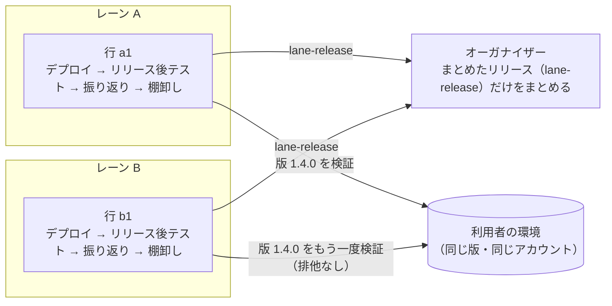
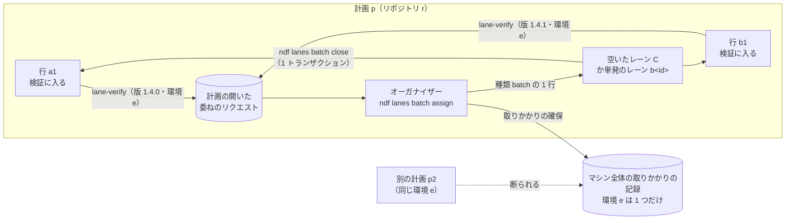
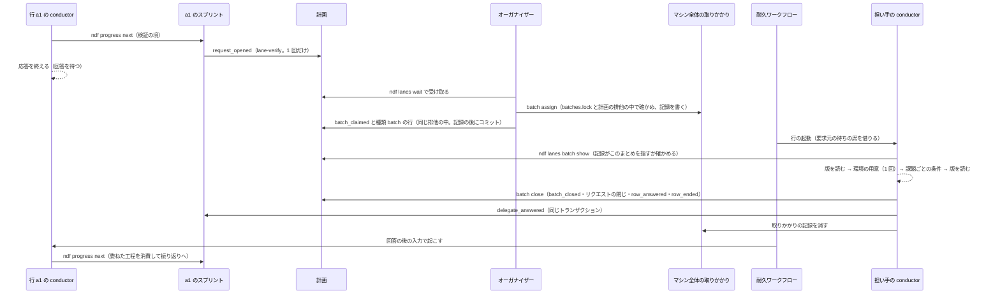

# 並列の計画: 検証と棚卸しをオーガナイザーが環境・リポジトリごとにまとめ、空いたレーンか単発のレーンで 1 本ずつ流す（#4211）

並列の計画の検証（体裁レビュー・リリース後テスト）と棚卸しは、行ごとにレーンの conductor が流し、同じ版の検証を行の数だけ繰り返し、同じ環境での検証が重なっても止まらない（要求は [issue-4211-requirements.md](./issue-4211-requirements.md)、正は #4211 の本文）。計画の行は検証と棚卸しを委ねのリクエストで計画へ渡し、オーガナイザーが同じ環境（棚卸しは同じリポジトリ）のリクエストを 1 つのまとめにして、マシン全体で 1 つだけの取りかかりを確保すると同時に、空いたレーンか単発のレーンへ 1 行として割り当てる。担い手の行の conductor が流した結果を 1 つのトランザクションで各行へ回答し、検証の版はリリースと排他を取らずに検証の前後で環境から読んだ版で照らす。#4050 の設計の材料（決定 20 と詳細設計の「まとめた検証と棚卸し」）から変えた所と採らなかった案は「決定の記録」に、比べた製品は付録の「外部の調査」にある。

## 今の姿

何が起きたか・目的・受け入れ条件は要求仕様（[issue-4211-requirements.md](./issue-4211-requirements.md)、正は #4211 の本文）にある。この文書は「どう解くか」と「なぜその解き方か」だけを書く。パスは `plugins/ndf/` からの相対で書き、行番号は main の `d5da7b601` のものである。

設計に要る今の構造:

| 部品 | 今の振る舞い | 場所 |
| --- | --- | --- |
| 閉じの工程 | 行のスプリントの工程として、レーンの conductor の `ndf progress next` が流す。`standard` はデプロイ → リリース後テスト → 振り返り → 棚卸し、`documentation` はリリース後テストの前に体裁レビュー、`light` は棚卸しだけを持つ | `contracts/workflow/modes/*.json`、`contracts/workflow/stages/{release-verification,layout-review,backlog}.json` |
| 検証の入力 | 文脈の `version`（デプロイが書く出した版）だけを取る | `stages/release-verification.json`・`layout-review.json`、`contracts/workflow/context.schema.json:17-19` |
| 委ねる前例 | リリース承認ゲートで `lane-release` のリクエストを計画へ書き、オーガナイザーが 1 本のリリースにまとめて `ndf lanes release` で閉じ、`ndf lanes answered` で行へ回答を載せる。回答が載った行は耐久ワークフローが回答の後の入力で起こす | `src/ndf/progress/gate/release.py:52-119`、`src/ndf/progress/plan/__init__.py:230-317`、`src/ndf/progress/plan/run_decide.py:89-117` |
| 行の種類 | 起動の入力は `sprint` と `loop` の 2 種類だけ。`ndf lanes row start` は `--sprint` が必須で、開発ループの行は工程を持たない子のステートマシン（`ndf progress new --loop … --parent`）を作ってから行を始める | `src/ndf/progress/lane/launch.py:182-216`、`src/ndf/progress/plan/cli.py:275-282`、`src/ndf/progress/command.py:22`・`:572-591` |
| 起動の上限 | 行を始める起動だけが、マシンの起動の排他（`<状態の保存先>/parallel/admit.lock`）の中でマシン全体の上限を照らす | `src/ndf/progress/lane/machine.py:297-329`、`src/ndf/progress/plan/run.py:254-280` |
| 行の終わり | `lane.end_row`（`row_ended`）だけ。スプリントの完了と同じトランザクションで打つ。計画は全行が終わり、開いたリクエストが無いときに完了する | `src/ndf/progress/lane/__init__.py:288-302`、`src/ndf/progress/lane/rules.py:240-243` |
| 排他の単位 | 計画・ステートマシン・実行のキー・マシンだけ。リポジトリ・環境・版を単位にした排他は無い | `src/ndf/core/durable_locks.py`、`src/ndf/progress/store.py:513-560`、`machine.py:49-52` |
| 環境の値 | 検証の環境を表す値は無い。`branch_strategy.verify`（`null` か `{"kind": "marketplace" \| "deploy"}`）はスキーマにあるが、読むコードが無い | `skills/development-workflow/schemas/project.schema.json:834-853` |
| 計画のリポジトリ | 計画のレーンはすべて計画のリポジトリで動く。別のリポジトリのレーンは起動できない失敗にする | `src/ndf/progress/plan/run.py:239-241` |

調べたコマンドと検索の 0 件は、作業ディレクトリの調査（`.ndf/tmp/lcrrate/設計-4211/survey-code.md`。リポジトリの外）に残した。

## 文脈と制約

- **この課題は #4050 の設計（PR #4072・#4082・#4198 でマージ済み）の上に立つ。** フェーズの表（`contracts/workflow/phases.json`）が検証と棚卸しに `carrier: organizer`・`exclusion: organizer_batch` を持ち、`ndf progress next` がフェーズの境で `Env` の口を呼ぶ。#4050 は「#4211 が入るまで検証と棚卸しはレーンの conductor が今のとおり流し、`organizer_batch` の判定は『入る』を返す」と決めた（#4050 の設計の「解き方の全体像」の表、決定 21）
- **#4050 の設計の材料は 3 ラウンドの cross-review で毎ラウンド新しい重い穴を出した**（r1-2・r1-10〜r1-13・r3-5・r3-6・r3-9）。穴は 3 か所に集まった: リリースとの相互排他（版を出した後の記録でしか止まらない r3-5）・取りかかりの放置（`claim` の後に閉じられない r3-9）・版の再試行（旧い行が新しい版で閉じられない r3-6）
- **担い手は `ndf:supervisor` でなく、空いたレーンか単発のレーンである**（2026-11-23 の利用者の決定。#4050 の決定 20）
- **席の返却・本数の数え・起動の許可（#4091・#4103・#4110・#4113・#4180・#4181）は #4171 の領域で、この設計では扱わない。** 割り当てた行の起動は、今の行の起動（マシン全体の上限の判定を含む）に乗せる
- **同じ行の中で回答の待ちを越えて工程を流すこと（#4210）は扱わない**
- **耐久ワークフローは GitHub を読まない**（二次レート制限 #4016）。まとめと割り当てはオーガナイザーの打つコマンドに置く
- **置き場は #3500 の決まりに合わせる**（2026-11-23 に承認。4 種: 追跡する設定・人が読む作業状態・機械だけが読む状態・使い捨て。マシンと利用者の単位の状態の保存先は 4 種の外で今のまま）
- **後方互換は要らない**（普及の前）。守るのは代表のリポジトリの種類を扱えることだけ

## 解き方の全体像

- 計画の行が担い手 `organizer` のフェーズ（検証・棚卸し）に入ると、`ndf progress next` が委ねのリクエスト（`lane-verify`・`lane-backlog`）を計画へ 1 回だけ書く。検証は回答を待ち、棚卸しは書いた時点で工程を終える。計画の外のスプリントは今のとおり自分で流す
- オーガナイザーは同じ環境（棚卸しは同じリポジトリ）のリクエストを `ndf lanes batch assign` でまとめる。1 回のコマンドで、マシン全体の取りかかりの記録を確保し、まとめを種類 `batch` の 1 行として空いたレーンへ足すか、単発のレーンを足して置く。同じ環境の取りかかりは、別の計画のものを含めてマシンで 1 つだけになる
- 耐久ワークフローがその行を始め（検証は回答を待つ要求元の席を借り、ほかは今の行の起動のマシン全体の上限の判定を通る）、そのレーンの conductor が検証か棚卸しを 1 本流して `ndf lanes batch close` を打つ。`batch close` はまとめの結果・リクエストの閉じ・各行への回答・担い手の行の終わりを 1 つのトランザクションで書き、取りかかりを空ける
- 検証の成功は、検証の前後で環境から読んだ版が同じで、まとめの各リクエストの版以上のときだけ受ける。リリースは検証を待たず、検証の途中で版が変わればその検証はやり直しになる

## 構成要素

| 構成要素 | 責務 | 場所 |
| --- | --- | --- |
| 委ねの口（`Env.delegate`） | 担い手 `organizer` のフェーズの最初の工程の手前で、計画の行なら委ねのリクエストを 1 回だけ書く。計画の外なら何もせず「委ねない」を返す | `src/ndf/progress/run.py`（`Env`・`_start` の枝）、`src/ndf/progress/gate/answering.py`（`lane_env`）、`src/ndf/progress/lane/delegate.py`（新設） |
| 委ねた回答の消費 | 検証の回答（`delegate_answered`）を読み、委ねた工程の並びを完了か失敗にし、文脈の `verification` へ写す | `src/ndf/progress/run.py`（`decide`・`_consume_delegated`） |
| 検証の環境 | 行のリポジトリの宣言 `branch_strategy.verify.environment` を読む。無ければ `<owner>/<name>` | `src/ndf/progress/lane/delegate.py`（`environment_of`）、`skills/development-workflow/schemas/project.schema.json` |
| まとめのコマンド | `ndf lanes batch assign / show / close / abort` | `src/ndf/progress/plan/batch.py`（新設）、`src/ndf/progress/plan/cli.py` |
| マシン全体の取りかかりの記録 | 環境（棚卸しはリポジトリ）ごとに 1 つの取りかかりを、計画をまたいで確認と確保を不可分にする | `src/ndf/progress/plan/batch_claims.py`（新設）。置き場は `<状態の保存先>/parallel/batches/` |
| 種類 `batch` の行 | 工程を持たない子のステートマシンを作って行を始め、担い手の conductor に手順を渡す | `src/ndf/progress/lane/launch.py`、`src/ndf/progress/command.py`（`--batch`）、`contracts/workflow/parallel-plan.schema.json` |
| 表示 | `ndf lanes status` に取りかかり中のまとめ・失敗した棚卸しを出す | `src/ndf/progress/plan/__init__.py` |
| 手順書 | オーガナイザーのまとめの手順・担い手の手順 | `skills/development-workflow/references/parallel.md`、`skills/release-verification/SKILL.md`、`skills/backlog-refinement/SKILL.md` |

## データ構造

**委ねのリクエスト**（計画のステートマシンの `request_opened` の中身。`lane-release` と同じ置き場）:

| キー | 型 | 検証 | 棚卸し | 意味 |
| --- | --- | --- | --- | --- |
| `kind` | 文字列 | `lane-verify` | `lane-backlog` | 種類 |
| `lane`・`row`・`sprint_state` | 文字列 | 要る | 要る | 委ねた行と、そのスプリントのステートマシンの ID |
| `issues` | 整数の配列 | 要る | 要る | スプリントの課題 |
| `stages` | 文字列の配列 | 要る | 要る | 委ねた工程の並び（`documentation` の検証は `体裁レビュー`・`リリース後テスト` の 2 つ） |
| `delegation` | 文字列 | 要る | 要る | 委ねのキー `<スプリント>:<フェーズ>:<試み>`。試みは同じフェーズを `ndf progress retry` で戻した回数 |
| `version` | 文字列（semver）か null | 要る | 無い | 検証する版（デプロイの出力の `version`）。版を出さない変更（`delivery.versioned` が偽・デプロイの無いリポジトリ）は null で、版の照合をしない |
| `target_ref` | 文字列か null | 要る | 無い | 版が null のリクエストで確かめる ref（委ねた時点の行の作業場所の `HEAD` のコミット。今回の変更を含む）。版があるときは null で、担い手は導入した版のタグで確かめる |
| `release_pr` | 文字列か null | 要る | 無い | 要求の版のリリース記録を持つ PR（文脈の `release_pr`）。担い手がそのリクエストの証跡を書く先 |
| `environment` | 文字列 | 要る | 無い | 検証の環境の名前 |
| `since_ref` | 文字列か null | 無い | 要る | その行の差分の棚卸しの範囲の始まり（`ndf issues candidates --since-ref` に渡す、前のリリースのタグ）。まとめは各リクエストの範囲の和集合を処理する |

**まとめ**（計画のステートマシンの事象。id は計画の中で一意の連番 `<計画>-<n>`）:

| 事象 | 中身 |
| --- | --- |
| `batch_claimed` | id・フェーズ（`verify` か `backlog`）・取りかかりのキー（環境の名前かリポジトリ）・リクエストのキーの並び・リクエストごとの版・担い手のレーンと行・単発のレーンを足したか・時刻 |
| `batch_closed` | id・結果（`done`・`failed`・`aborted`）・理由・リポート（JSON。64 KiB まで。環境と版に共通する結果 `common` と、リクエストごとの条件の合否 `pass`・`fail`・`not_run` と証跡を書いた PR）・リポジトリごとの読んだ版（前と後）・失敗の原因（`version_changed`・`version_mismatch`・`work_failed`） |

`done` は「確かめをやり終えた」（条件の不合格や、次の版で確かめる `not_run` を含む。今の `release-verification` と同じく振り返りへ進む）、`failed` は「確かめをやり終えられなかった」（環境の故障・版の食い違い）を表す。一部のリクエストの条件だけが不合格でも、まとめは `done` で閉じ、各行は自分の節だけを受け取る。

**取りかかりの記録**（マシン全体。`<状態の保存先>/parallel/batches/<種類>-<キーの写し>.json`。種類は `env` か `backlog`）: 持ち主の組（計画の状態の保存先・計画の ID・まとめの id）・フェーズ・取りかかりの時刻。照合はいつも持ち主の組で行う（まとめの id は計画の中でしか一意でない）。排他は同じフォルダの `<状態の保存先>/parallel/batches/batches.lock`（flock。すべてのコマンドがこの 1 つのパスを開く）。

**スプリントの事象 `delegate_answered`**: 委ねのキー・結果（`done` か `failed`）・その行のリポートの節と `common`・要求の版・読んだ版・失敗の原因（`delegate_withdrawn` を含む）。文脈の `verification`（新しいキー）に、成功のリポート・要求の版・読んだ版を写す。

**種類 `batch` の行の入力**（`parallel-plan.schema.json` の `$defs/input` に足す）: `{"kind": "batch", "batch": "<まとめの id>", "phase": "verify" | "backlog"}`。

**置き場（#3500 の 4 種との対応）**:

| 置き場 | 種 | 理由 |
| --- | --- | --- |
| 委ねのリクエスト・まとめの事象・`delegate_answered` | 機械だけが読む状態（ステートマシンの DB） | 計画とスプリントの事象に追記する。`NDF_PROGRESS_DB` を共有すれば別のマシンでも読める |
| 取りかかりの記録と `batches.lock` | 状態の保存先（マシンと利用者の単位。4 種の外） | 別の保存先を持つ計画どうしの排他に要る。同じ場所の `admit.lock`・計画の索引 `plans/` と同じ単位 |
| リポート | DB の `batch_closed` の本文 | `--report` のファイルは担い手の使い捨てで、閉じた後に要らない |
| 検証の環境の宣言 | 追跡する設定（`.ndf/project.json` の `branch_strategy.verify.environment`） | プロジェクトの持ち物で、リポジトリと一緒に変わる |

## 入出力のコントラクト

| コマンド | 書き手 | 入力 | 出力（結果 JSON） |
| --- | --- | --- | --- |
| `ndf progress next`・`ndf progress wait`（委ねの境） | レーンの conductor・生死の判定 | 今のとおり | 検証: 回答の前は承認ゲートの回答待ちと同じ `status: gate`（`metrics.gate: "delegated"`・`metrics.delegated`）。conductor は応答を終え、生死の判定は回答待ち（止まりでない）と読む。棚卸し: 委ねた工程を終えて次の手を返す |
| `ndf lanes batch assign <計画> <リクエスト>... [--lane <レーン>] --reason <理由>` | オーガナイザー | 開いた同じ種類の委ねのリクエスト。検証は同じ環境 | `ok`・`metrics.batch`（id・担い手のレーンと行・取りかかりのキー）。断るときは `stopped`・`precondition`（取りかかり中のまとめの計画と id・経過時間、または断った理由） |
| `ndf lanes batch show <計画> <id>` | 担い手の conductor・オーガナイザー | — | まとめ（フェーズ・環境・リクエストごとのレーン・行・課題・工程・版・確かめる対象（版のタグか `target_ref`））と、担い手が打つ `close` の雛形 |
| `ndf lanes batch close <計画> <id> --result done\|failed --report <ファイル> [--observed-version <リポジトリ>=<前>,<後>] [--cause <原因>] --reason <理由>` | 担い手の行の conductor・オーガナイザー | 検証の `done` は `--observed-version` が要る | `ok`・`metrics.closed`（閉じたリクエスト・回答した行）。閉じた後の打ち直しは前の結果を返す |
| `ndf lanes batch abort <計画> (<id> \| --claim <種類>:<キー>) [--self] --reason <理由>` | 持ち主の計画のオーガナイザー（`<id>`。計画の状態を問わない）・別の計画のオーガナイザー（`<計画>` は自分の計画、`--claim` で取りかかりを名指す。持ち主の計画が `running` でなく担い手の行が実行中でないときだけ）・担い手の conductor（`--self`。計画の中止の入力からだけ） | — | `ok`。担い手の行は中止し、リクエストは開いたまま。担い手の行が実行中なら、ラッパーを止めて止まったことを確かめてから書き、確かめられなければ何も書かずに `transient` |
| `ndf lanes request close <計画> <リクエスト>`（変更） | オーガナイザー | 委ねのリクエスト | 開いたまとめに入っていれば断る。まとめに入っていない `lane-verify` は、要求元へ `failed`（`delegate_withdrawn`）の回答を同じトランザクションで書いてから閉じる |

書き手の見分けは、中継の子の環境変数で行う。`NDF_RELAY_PLAN` を持つ呼び出し（レーンの conductor）は `assign` と `--self` でない `abort` を断られ、`close` と `abort --self` はまとめの担い手の行のレーンのラッパー（`NDF_RELAY_NAME`）と合うときだけ通る。`NDF_RELAY_PLAN` を持たない呼び出しはオーガナイザーとして扱う。呼び手の計画は `cwd` の保存先から開く名前で、持ち主の計画は取りかかりの記録の保存先から開く。

種類 `batch` の行の終わりと中止は、呼び口（`row end`・`row cancel`・`progress cancel`・`lanes move`）でなく、書き込みの共通の経路（`lane.end_row`・`cancel_row`・`move_row`）で `batch close`・`batch abort` からのものだけを通す。計画の中止（`stop --now`）は未着手の担い手の行の中止と同じトランザクションで `batch_closed`（`aborted`）を書く。`ndf lanes wait` は `batch_closed` の `failed`・`aborted` も知らせる。

## 処理の流れ

棚卸しは、行が `lane-backlog` を書いた `next` で棚卸しの工程を終え、行はそのまま完了する。まとめは計画を完了させない開いたリクエストとして残り、担い手の `batch close --result done` で閉じる。

## 決定の記録

### 決定 1: 委ねの書き手を 1 つにするため、#4050 のフェーズの境の口に `Env.delegate` を足し、計画の行だけが委ねる

- **質問**: 検証と棚卸しを、だれが・どの時点で計画へ渡すか
- **選んだ案**: `ndf progress next` の `_start` が、フェーズの表で担い手が `organizer` のフェーズの最初の工程を始める手前で `Env.delegate` を呼ぶ。計画の行のスプリントでは `lane_env` が計画の排他の中で委ねのリクエストを書き（同じ委ねのキーのリクエストがあれば書かない）、計画の外では何もせず、今のとおり工程を流す。検証は回答を待つ（#4210 が入るまでは承認ゲートの回答待ちと同じく応答を終える）。棚卸しはリクエストを書いた同じトランザクションで委ねた工程を完了にする（#4050 の材料と同じ）。#4050 の設計の「解き方の全体像」の表の「検証・棚卸し」の行（`organizer_batch` は「入る」を返す）を置き換える
- 採らなかった案: オーガナイザーが `ndf lanes status` の行の工程を見てまとめる（計画はスプリントの工程を見られない。#4050 の「文脈と制約」）
- 採らなかった案: 棚卸しも回答を待つ（棚卸しは振り返りより後の最後の工程で、待つと行が終わらずレーンの席を使い続ける。リクエストが開いている間は計画が完了しないので、取りこぼしは起きない）
- **代償**: 検証の回答が来るまでその行の振り返りは始まらない（#4050 の順序の決まり）。#4210 が入るまで、その間に確定仕様化も流れない
- 根拠: Value 9「責務の分かれた設計で作られる」・Value 11「重複と冗長が無い」（MVV 版 11）

### 決定 2: 取りかかったまま割り当てない記録を作らないため、`batch claim` と `batch assign` を 1 つのコマンド `batch assign` にする

- **質問**: 本文の「`ndf lanes batch claim / assign`」の 2 つの手を、別のコマンドにするか 1 つにするか
- **選んだ案**: `ndf lanes batch assign` の 1 回で、マシン全体の取りかかりの確認と確保、計画への `batch_claimed`、担い手の行（名指したレーンへの行の追加か、単発のレーンの追加）を行う。ロックは `batches.lock` を外、計画の書き込みの排他を内に取り、リクエストの確かめ直し・レーンの空きの判定・開いたまとめの打ち直しの判定を計画の排他の中の同じトランザクションで行う。取りかかりの記録は計画のコミットより先に書く。記録の後・コミットの前に落ちると記録だけが残るが、持ち主の計画にその id の `batch_claimed` が無いので、次の確かめが残骸として空きとみなす。コミットの後に落ちても記録と行はそろっているので、担い手の行が起動できる間に別の計画が同じ環境を取ることは無い。担い手は `show` で記録がこのまとめを指すことを確かめてから作業を始める（記録と起動の結び付け）
- 採らなかった案: #4050 の材料のとおり `claim` と `assign` を分ける（オーガナイザーが `claim` の後に落ちると、取りかかりだけが残って別の計画の同じ環境を止め続ける（r3-9）。それを空けるために期限（`policy.batch_ttl`）と別の計画からの `abort` が要った）
- **代償**: 本文の対象範囲の語（`claim`）と受け入れ条件 2 の「取りかかり」は、`assign` が書く取りかかりの記録を指すと読み替える（承認資料で知らせる）。空いたレーンが無い間に取りかかりだけを先に押さえることはできない（単発のレーンを足せば同時に押さえられる）
- 根拠: Value 6「使うほど散らからない」・Value 11「重複と冗長が無い」（MVV 版 11）

### 決定 3: 環境を共有する別の計画とも重ならないため、取りかかりの記録をマシンの状態の保存先に置き、記録の持ち主の計画の状態で空きを決める

- **質問**: 「同じ環境の取りかかりは 1 つ（別の計画からも断る）」をどこで確かめ、取りかかりが空く時点をどう決めるか
- **選んだ案**: `<状態の保存先>/parallel/batches/` に取りかかりの記録と `batches.lock` を置き、`assign` がその排他の中で確かめて書く（#4050 の材料と同じ）。記録があっても、持ち主の計画が消された・その計画にその id の `batch_claimed` が無い（書きかけの残骸）・同じ id の `batch_closed` がある・計画が終わっていて（`completed`・`cancelled`）担い手の行も終わっている、のどれかなら空きとみなして上書きする。`paused` は実行中の行を流し続け、`stop --now` は担い手が止まる前に `cancelled` を書くので、計画の状態だけでは空けない。持ち主を読めない（DB の一時的な障害・読み取りの失敗）ときは空きとみなさず枠を保つ。期限は置かない。持ち主の計画が動いている間に担い手が止まったら、今の `lane_stalled`・`launch_failed` の知らせを持ち主のオーガナイザーが受けて `batch abort` を打つ。`abort` は担い手の行が実行中ならそのラッパーを止め、止まったことを確かめてから枠を空ける。別の計画のオーガナイザーは、持ち主の計画が `running` でなく担い手の行が実行中でないときだけ `abort --claim` できる
- 採らなかった案: 計画ごとの `lock_plan` と `read_lanes` で確かめる（別の保存先を持つ計画の取りかかりと不可分に確かめられない。#4050 の r1-2）
- 採らなかった案: 期限（`policy.batch_ttl`）を越えたら別の計画から放棄できる（決定 2 で取りかかりと行が同時にできるので、取りかかりが残るのは担い手の行が動いているか止まっているときだけになり、止まりは持ち主の計画が知らせる。期限は長い検証を誤って奪う）
- **代償**: 持ち主の計画が動いたまま担い手が止まり、持ち主のオーガナイザーも動いていないと、別の計画の同じ環境の検証は持ち主が `abort` するまで待つ
- 根拠: Value 3「同じ手順は毎回同じ結果になる」・Value 8「正しいデータ構造で作られる」（MVV 版 11）。PRD1

### 決定 4: まとめの範囲を計画のリポジトリに閉じるため、1 つのまとめは 1 つの計画のリクエストだけを束ね、検証は同じ環境・棚卸しは計画ごとにする

- **質問**: 1 件の結果で閉じてよいリクエストの範囲と、同時実行を防ぐ範囲をどう分けるか
- **選んだ案**: 1 つのまとめは 1 つの計画のリクエストだけを束ねる。計画のレーンはすべて計画のリポジトリで動く（`plan/run.py:239-241`）ので、まとめは 1 つのリポジトリに閉じる。検証は同じ環境のリクエストを、版が違ってもまとめてよい（決定 6）。棚卸しは計画の `lane-backlog` をまとめる。同時実行を防ぐ範囲は、検証は環境（マシンのすべての計画）、棚卸しはリポジトリ（同じ）である。環境は `.ndf/project.json` の `branch_strategy.verify.environment`（文字列）で名指し、無ければ `<owner>/<name>` にする。読むのは `environment_of` の 1 つだけで、委ねのリクエストを書くときに読み、ほかは記録の `environment` を読む
- 採らなかった案: 新しいトップレベルのキー `verify.environment`（#4050 の材料。検証の形を宣言する `branch_strategy.verify` が既にあり、同じものを 2 か所に分ける）
- 採らなかった案: 別の計画のリクエストも 1 つのまとめに束ねる（まとめの担い手の行は 1 つの計画のレーンで動き、別の計画の行へ回答を書く手を持てない。別の保存先の計画のトランザクションをまたげない）
- **代償**: 同じ環境を使う 2 つの計画の検証は、まとめが 2 本になって順に流れる。宣言を書き忘れた別のリポジトリが同じ環境を使うと、2 本が同時に動き得る（「未確認のまま残ること」）
- 根拠: Value 4「どのプロジェクトでもそのまま使える」・Value 8「正しいデータ構造で作られる」（MVV 版 11）

### 決定 5: リリースを検証で止めないため、リリースとの相互排他を取らず、`batch close` で検証の前後に環境から読んだ版を照らす

- **質問**: 検証の途中に同じ環境へ新しい版が入って、旧い版の検証を成功と記録しないために、リリースと検証をどう組み合わせるか
- **選んだ案**: リリースは取りかかりを取らず、今のまとめたリリースのまま出す（`ndf lanes release` は変えない）。担い手は検証の始めと終わりに環境の版を読み、`batch close --result done` に `--observed-version <リポジトリ>=<前>,<後>` を渡す。`done` は、前と後が同じで、まとめのそのリポジトリのどのリクエストの版以上（semver）のときだけ受ける（版が null のリクエスト、つまり版を出さない変更は照らさず、そのリポジトリのリクエストがすべて null なら `--observed-version` も要らない）。前と後が違えば `failed`（`version_changed`）、前と後が同じでも要求の版より古ければ `failed`（`version_mismatch`）でだけ閉じられる。後の版は前の版の変更を含む（同じリポジトリの基のブランチから順に出す）ので、新しい版の成功で旧い版の行も完了とし、文脈の `verification` に要求の版と読んだ版を両方写す
- 採らなかった案: リリースも取りかかり（`batch claim --phase release`）を取り、検証と相互に断る（#4050 の材料。版を出す前の手順に取りかかりを足し、`ndf lanes release` に `--batch` を求め、リリースの放棄の扱いも要る。r3-5・r3-9 の穴が出た所で、検証の間はリリースが止まる）
- 採らなかった案: 終わりに 1 回だけ版を読む（途中で版が入れ替わった検証を、終わりの版の成功と記録してしまう）
- **代償**: 検証の途中で同じ環境へリリースが入ると、その検証は `failed` になってやり直しになる。版を読む手段は担い手の手順（`release-verification`）に任せ、機械は担い手が渡した値を照らすだけである。リリースの承認者は、検証中の環境へ版を出すとその検証がやり直しになることを `ndf lanes status` の取りかかり中のまとめで見られる
- 根拠: Value 5「速く届く」・Value 13「確かめたことだけが済んだとされる」・Value 11「重複と冗長が無い」（MVV 版 11）。STD1

### 決定 6: 失敗の後の再試行に例外の規則を持たないため、版の照合を「要求の版以上」にし、再試行は `ndf progress retry` の 1 つにする

- **質問**: 検証が `failed` で閉じた行を、どの口で・どの版で再試行するか
- **選んだ案**: 検証の `failed` は、行の委ねた工程の並びの先頭を `failed`（`delegate_failed`）にし、`decide` が `FAILED` を返して振り返りへ進まない。直した後に `ndf progress retry <スプリント> <工程>` を打つと、次の `next` が試みを 1 つ進めた委ねのキーで新しい `lane-verify` を書く。版はいつもデプロイの出力の版で、環境に新しい版が入っていれば決定 5 の「要求の版以上」で成功できる。環境が巻き戻っていれば、オーガナイザーは環境を直してから再試行するか、行を中止する
- 採らなかった案: `version_mismatch` の後だけ読んだ版で書き直す（#4050 の材料の `superseded_from`。決定 5 で要らなくなる例外で、r3-6 の穴を直すために足した）
- **代償**: 失敗した行は、オーガナイザーかレーンの conductor が `retry` を打つまで進まない（行ごとの判断を人の側に残す）
- 根拠: Value 3「同じ手順は毎回同じ結果になる」・Value 11「重複と冗長が無い」（MVV 版 11）

### 決定 7: 閉じと回答の片方だけが残らないため、`batch close` がまとめの結果・リクエストの閉じ・各行への回答・担い手の行の終わりを 1 つのトランザクションで書く

- **質問**: まとめの結果を、リクエストと各行と担い手の行へどう反映するか。放棄はどう表すか
- **選んだ案**: `batch close` は計画の排他の中の 1 つのトランザクションで、`batch_closed`・リクエストの閉じ・検証なら各行の `row_answered` とスプリントの `delegate_answered`・担い手の行の `row_ended`（`completed`）と子のステートマシンの完了を書き、コミットの後に取りかかりの記録を消す。棚卸しの `failed` はリクエストを閉じない（開いたリクエストが計画を完了させない）。行ごとに回答を打つ口（`ndf lanes answered --request`）は作らない。種類 `batch` の行の終わりと中止は、書き込みの共通の経路（`end_row`・`cancel_row`・`move_row`）で断り（`row end`・`row cancel`・`progress cancel`・`lanes move` のどれから来ても）、途中でやめるのは `batch abort`（担い手の行の中止・`batch_closed` の `aborted`・リクエストは開いたまま・回答は書かない）と、計画の中止（`stop --now` の未着手の行の中止と、実行中の担い手の中止の入力 `batch abort --self`）だけにする。委ねのリクエストを `request close` で単独に閉じるのは、まとめに入っていないものだけで、検証なら要求元へ失敗の回答を同じトランザクションで書く
- 採らなかった案: `batch close` がリクエストだけを閉じ、オーガナイザーが行ごとに `ndf lanes answered` を打つ（途中で落ちると、閉じたリクエストの行が回答を待ち続ける。#4050 の r1-12）
- 採らなかった案: 担い手の行を `ndf lanes row end` で終える（まとめを閉じずに行だけが終わり、取りかかりが残る）
- **代償**: `batch close` の 1 回のトランザクションは、まとめの行の数に比例して大きくなる（1 つの計画の行の数が上限）
- 根拠: Value 8「正しいデータ構造で作られる」・Value 13「確かめたことだけが済んだとされる」（MVV 版 11）

### 決定 8: 担い手の行を今の行の仕組みで動かすため、種類 `batch` の行は開発ループの行と同じく工程を持たない子のステートマシンを持つ

- **質問**: スプリントを持たない担い手の行を、起動・生死の判定・行の終わりにどうつなぐか
- **選んだ案**: 起動の入力は `ndf progress new <名前> --batch <id> --parent <レーンのステートマシン>`（工程を持たない子のステートマシン）→ `ndf lanes row start … --sprint <子>` → `ndf lanes batch show` で、担い手の conductor に `release-verification`（まとめに `documentation` の行があれば `layout-review` も）か `backlog-refinement` の手順を流させ、`batch close` を打たせる。生死の判定は、子のステートマシンの ID で開発ループの行と同じに受ける。止まりからの再起動（`/goal` の入れ直し）は、種類 `batch` の続け方として `progress next` でなく `batch show` からやり直し、終わりの条件は `batch close`・`batch abort` で行が終わったときにする（工程の無い子への `next` は行を終えるため）。計画の中止の入力は `batch abort --self` にする。検証の担い手の行は、まとめた要求元の行が委ねた検証の待ちで実行中なら、その席を借りて上限で待たずに起動する（要求元は応答を終えて回答を待つので、作業する会話の数は増えない。上限 1 の計画でも、要求元が席を埋めたまま担い手が起動できずに止まることが無い）。要求元が実行中でないときは今の行の起動で、マシン全体の上限の判定を通る。空いたレーン（計画の中で行がすべて完了か中止のレーン）へ足すと、レーンは未着手の行を持つので耐久ワークフローの起動の対象に戻る。単発のレーンは名前 `b<id>`・`touches` と `after` は空で、その 1 行で終わる
- 採らなかった案: 担い手の行をスプリントの行にし、新しいモード（検証だけ・棚卸しだけ）で流す（リリース後テストの工程はリリースのステップが前に要る検査（`stages.py:147-171` の I8b）を持ち、検証だけのモードに合わない）
- 採らなかった案: 子のステートマシンを持たない行（`row start` が `--sprint` を求め、生死の判定はスプリントの ID の無い行を判定しない。`liveness.py:143`）
- **代償**: 担い手の行の会話は、委ねた行の会話の文脈を持たない（検証と棚卸しは文脈の依存が薄い。#4050 の「文脈の依存と担い手」）
- 根拠: Value 9「責務の分かれた設計で作られる」・Value 11「重複と冗長が無い」（MVV 版 11）

## 影響と危険

- **働く範囲**: NDF を導入したすべてのリポジトリの並列の計画（`--parallel`）。計画の外のスプリントは変わらない
- **プロジェクトごとに違うもの**: 検証の環境は設定（`.ndf/project.json` の `branch_strategy.verify.environment`）で受け、無ければリポジトリの名前にする。版を環境から読む手段は `release-verification` の手順が持ち、プロジェクトのリリースの形（マーケットプレイス・デプロイ）で違う
- **当たるモード**: 検証は `standard`・`documentation`・`operation`・`legacy-refactor`（`documentation` は体裁レビューを含む）、棚卸しは 5 つのモードのすべて
- **順番**: #4050 の実装（フェーズの表・`Env` の口・工程の並び）が入った後に入れる。#4050 の前には委ねる境が無い
- **#4210 との境界**: どちらが先でもよい。#4210 の前は委ねた検証の待ちは承認ゲートの回答待ちと同じ `status: gate` で応答を終え、生死の判定も回答待ちと読み、回答の後の入力で起き直す。#4210 の後は委ねた検証の待ちが「越えてよい待ち」に加わり、確定仕様化を並べて流せる。この設計は結果に `metrics.delegated` を載せるだけで、待ちの間の流し方は #4210 が持つ。ただし検証の担い手に席を貸している要求元（詳細設計の「席の貸し出し」）は、#4210 の後も委ねた待ちを越えて工程を始めない。席を貸すのは、委ねた待ちで進行中の工程を持たない要求元だけにする
- **#4171 との境界**: 席の返却と本数の数えは変えない。委ねた検証を待つ行は今の承認待ちの行と同じく枠を使う（#4091 が入るまで）。その代わり、検証の担い手の行はまとめた要求元の待ちの席を借りて起動する（決定 8）。#4091 が待ちの席を返すようになったら、借りる口は要らなくなり今の行の起動に戻せる
- **#3702・#4049・#4070（lctx）・`parallel.md`（lctx）**: `src/ndf/progress/run.py` の `decide` は #4050 と #3702 が触る。`src/ndf/progress/plan/__init__.py`・`plan/cli.py` は #4050 と #4070 が触る。`references/parallel.md` は #3995（lctx）と #4050 が触る。実装の PR の時点で開いた PR の変更ファイルを確かめ、後から入る側が rebase する。`parallel.md` は「まとめたリリース」の節の後ろへ「まとめた検証と棚卸し」の節を足す
- **#3500 との境界**: 新しい置き場は DB の事象と状態の保存先の取りかかりの記録だけで、リポジトリの中にファイルを作らない。#3500 の子の課題が置き場の一覧（`contracts/domains/locations.json`）を作り直すとき、状態の保存先の行 `parallel/batches/` を足す（この課題の実装が先なら今の形の一覧へ足す）
- **壊れうる箇所**: 検証の途中のリリースは検証をやり直させる（決定 5 の代償）。担い手が止まって持ち主のオーガナイザーも動かないと、同じ環境の別の計画が待ち続ける（決定 3 の代償）。担い手が渡す読んだ版は機械では確かめられず、担い手の手順の正しさに頼る

### 代表のリポジトリでの振る舞い

| 代表のリポジトリ | 設定の要点 | 直した後に起きること | この種類で扱えなくなること |
| --- | --- | --- | --- |
| Web サービス | 並列の計画でフロントとバックエンドのレーンを組み、本番環境へデプロイする | 同じ版を出した複数の行のリリース後テストが 1 本にまとまり、本番環境の検証は別の計画を含めて 1 本ずつ流れる。棚卸しは計画ごとに 1 本で、最後の行が終わった後に空いたレーンで流れる。設計・設計の検査・cross-review・MVV 判定の振る舞いは変わらない | 無し |
| モバイルアプリ | アプリとサーバーのレーン。ストアの審査を通す | 同上。審査を待つ間に別の版が出ると検証の前後の版が食い違い、検証はやり直しになる | 無し |
| 業務文書だけ | `documentation` のスプリントの行 | 体裁レビューとリリース後テストを 1 件のリクエストで委ね、担い手が両方の手順を流して 1 件の結果で閉じる | 無し |

### このリポジトリだけの事情

- 無し（ai-plugins の運用の値を使わない。環境の名前はどのリポジトリでも宣言かリポジトリの名前から決まる）

## 用語

| 用語 | 意味 | 用語集への反映 |
| --- | --- | --- |
| 委ねのリクエスト | 担い手が `organizer` のフェーズ（検証・棚卸し）に入った計画の行が計画へ書くリクエスト（`lane-verify`・`lane-backlog`）。リリースのリクエストと同じ形 | 追加（実装の PR で用語集へ足す） |
| まとめ | オーガナイザーが同じ環境（棚卸しは同じ計画）の委ねのリクエストを束ね、1 つの担い手の行で 1 本の検証か棚卸しとして流す単位。`ndf lanes batch assign` で作り、`batch close` か `batch abort` で閉じる | 追加（同上） |
| 取りかかり | まとめが環境（棚卸しはリポジトリ）を占めていること。マシン全体で 1 つの環境に 1 つだけ。`batch assign` が確保し、`batch close`・`batch abort` か、持ち主の計画が終わって担い手の行も終わったときに空く | 追加（同上） |
| 検証の環境 | 検証が使う利用者の環境とアカウントの名前。`.ndf/project.json` の `branch_strategy.verify.environment` で宣言し、無ければリポジトリの名前 | 追加（同上） |
| 空いたレーン | 計画の中で、行がすべて完了か中止のレーン。まとめの行を足して流させてよい | 追加（同上。#4050 の用語の表と同じ意味） |
| 単発のレーン | まとめ 1 つのために足すレーン（名前 `b<まとめの id>`・`touches` と `after` は空）。その 1 行を流して終わる | 追加（同上） |

## テスト設計

| 受け入れ条件 | どの振る舞いで縛るか | どう壊したら落ちるべきか |
| --- | --- | --- |
| 1 | 計画の行が検証に入った `next` が `lane-verify` を 1 件書き、打ち直しても増えない。同じ環境の 2 行のリクエスト（版 1.4.0 と 1.4.1）を 1 回の `batch assign` で束ね、`batch close --result done --observed-version r=1.4.1,1.4.1` が両方の行に回答を書き、それぞれの次の `next` で検証の工程が終わり振り返りへ進む。計画の外のスプリントは委ねない | 打ち直しのたびに書くと 2 件目で落ちる。版の違うリクエストを断ると 1.4.0 の束ねで落ちる。計画の外で委ねると落ちる |
| 2 | 同じ環境の取りかかり中に、同じ計画と別の保存先の計画からの `batch assign` が `stopped`・`precondition` で断られる（差し替えた排他の待ち合わせで 2 つの計画を同時に打つと片方だけ通る）。`batch abort` と `batch close` の後、持ち主の計画を中止して担い手の行が終わった後は通る。持ち主が `paused`、または `cancelled` で担い手の行が実行中なら断られる。別の計画の `abort --claim` は持ち主の計画が `running` か担い手の行が実行中なら断られ、`paused` で担い手が未着手なら通る。持ち主の読み取りを失敗させると `transient` で記録を上書きしない | 計画ごとの排他で確かめると同時のテストで落ちる。計画の状態だけで空けると一時停止・中止のテストで落ちる。読めない持ち主を空きとみなすと読み取りの失敗のテストで落ちる |
| 2 | `assign` の計画のコミットの直後に落とすと（差し替えたコミットの後の処理で例外）、別の保存先の計画の同じ環境の `assign` が断られ、元の担い手の行の `show` が手順を返す。記録を書いた後・コミットの前に落とすと、別の計画の `assign` が通る。同じリクエストの打ち直しは新しいまとめを作らない。別の保存先の同じ名前の計画（同じまとめの id）の記録を `release_slot` が消さない | コミットの後に記録を書くと、コミットの直後に落とすテストで別の計画が通って落ちる。id だけで照らすと同じ名前の計画のテストで落ちる |
| 3 | 棚卸しに入った行が `lane-backlog` を書いた `next` で棚卸しの工程を終え、行が完了する。開いた `lane-backlog` が残る間は計画が完了しない。`batch close --result failed` の後もリクエストは開いたままで計画は完了せず、`ndf lanes status` の `metrics` に失敗した棚卸しが出る。同じリクエストの `assign` からやり直せる | 棚卸しで回答を待つと行が終わらずに落ちる。`failed` でリクエストを閉じると計画が完了して落ちる |
| 3 | 検証の `failed` の回答の後の `next` が委ねた工程の先頭を `failed` にして `FAILED` を返し、振り返りへ進まない。`ndf progress retry` の後の `next` が試みを進めた新しい `lane-verify` を書く | 失敗を完了と読むと振り返りへ進んで落ちる |
| 4 | `batch assign --lane C`（C の行がすべて完了）が C へ種類 `batch` の行を足す。名指さなければ `b<id>` のレーンを足す。C に未着手か実行中の行があれば断る。上限 1 の計画で要求元 1 行が委ねて待つ間に、検証の担い手の行が席を借りて起動し、`close` の回答で要求元が振り返りへ進む。要求元が実行中でない棚卸しの担い手の行は、上限が埋まっていれば起動を待つ | 実行中の行のあるレーンへ足すと落ちる。席を借りないと上限 1 のテストで止まって落ちる。棚卸しで上限の判定を通さないと上限のテストで落ちる |
| 4 | 委ねた検証の待ちで `progress wait --timeout 0` が `gate` を返し、ラッパーの無い要求元の行を生死の判定が回答待ちと読む（止まりにも再起動にもならない）。担い手の行の止まりからの再起動の入力が `batch show` からやり直し、`progress next` を打たない。計画の中止の入力が `batch abort --self` で、計画が `stopped` に届く | 委ねた待ちを `ok` で返すと生死の判定のテストで止まりになって落ちる。再起動で `next` を打つと行だけが終わって落ちる |
| 4 | 担い手の行の conductor の `batch close` が 1 つのトランザクションで各行の回答と担い手の行の `row_ended` を書き、3 行のうち 1 行目を書いた後に落とすと何も残らず、打ち直すと 3 行すべてに回答が載る。閉じた後の打ち直しは何も書き足さない。別のレーンの conductor の `close` と、conductor の `assign`・`--self` でない `abort` は断られる。種類 `batch` の行への `row end`・`row cancel`・子への `progress cancel`・`lanes move` は断られる。開いたまとめに入ったリクエストの `request close` は断られ、まとめに入っていない `lane-verify` の `request close` は要求元に失敗の回答を載せる。`batch_closed` の `failed` を `ndf lanes wait` が知らせる | 行ごとに別のトランザクションで書くと落とすテストで落ちる。書き手を見ないと落ちる。CLI の分岐だけで断ると `progress cancel` のテストで落ちる |
| 1・3 | 版を出さない（`delivery.versioned` が偽の）`documentation` の行が `version: null` で委ね、読んだ版無しの `done` で体裁レビューとリリース後テストが完了する。リポートで 1 行の条件が `fail` の `done` で、両方の行が振り返りへ進み、各行は自分の節だけを受け取る。棚卸しのまとめの `show` が、各リクエストの `since_ref` のうち最も古いものと各リクエストの課題を返す | 版の無い検証を止めると落ちる。`fail` を含むリポートを `failed` に読むと落ちる。1 行の範囲だけを渡すと落ちる |
| 決定 5 | `--observed-version` の無い検証の `done`、前と後が違う `done`、要求の版より古い `done` は断られ、`failed` では閉じられる（原因 `version_changed`・`version_mismatch`）。前と後が同じで要求の版より新しい `done` は受け、文脈の `verification` に要求の版と読んだ版が両方載る | 終わりの版だけで照らすと前後の違うテストで落ちる。一致だけを求めると新しい版のテストで落ちる |
| 手順書 | 手順書の文言はテストで縛らない（AGENTS.md の DON'T）。ドキュメントレビューで見る | — |

## どこを変えるか

詳細設計は別ファイル（[issue-4211-design-detail.md](./issue-4211-design-detail.md)）にした。新設する関数が 2 つ以上（`delegate`・`environment_of`・`assign`・`close`・`abort`・`claim_slot`・`batch_commands` ほか）あるためである。

## 設計の結果

| 課題 | 扱い | 統合先 | 触るファイル |
| --- | --- | --- | --- |
| #4211 | 実装する | — | `plugins/ndf/src/ndf/progress/run.py`、`plugins/ndf/src/ndf/progress/gate/answering.py`、`plugins/ndf/src/ndf/progress/lane/delegate.py`（新設）、`plugins/ndf/src/ndf/progress/lane/launch.py`、`plugins/ndf/src/ndf/progress/plan/run.py`、`plugins/ndf/src/ndf/progress/lane/__init__.py`、`plugins/ndf/src/ndf/progress/lane/fold.py`、`plugins/ndf/src/ndf/progress/lane/types.py`、`plugins/ndf/src/ndf/progress/command.py`、`plugins/ndf/src/ndf/progress/plan/__init__.py`、`plugins/ndf/src/ndf/progress/plan/batch.py`（新設）、`plugins/ndf/src/ndf/progress/plan/batch_claims.py`（新設）、`plugins/ndf/src/ndf/progress/plan/cli.py`、`plugins/ndf/src/ndf/progress/plan/wait_decide.py`、`plugins/ndf/contracts/workflow/progress.json`、`plugins/ndf/contracts/workflow/parallel-plan.schema.json`、`plugins/ndf/contracts/workflow/context.schema.json`、`plugins/ndf/contracts/schemas/io/lanes.args.schema.json`、`plugins/ndf/contracts/domains/locations.json`、`plugins/ndf/skills/development-workflow/schemas/project.schema.json`、`plugins/ndf/docs/contracts/commands.md`、`plugins/ndf/skills/development-workflow/references/parallel.md`、`plugins/ndf/skills/development-workflow/SKILL.md`、`plugins/ndf/skills/release-verification/SKILL.md`、`plugins/ndf/skills/backlog-refinement/SKILL.md`、`docs/glossary/glossary.json`、`docs/glossary.md`、`plugins/ndf/tests/progress/test_lane_delegate.py`（新設）、`plugins/ndf/tests/progress/test_plan_batch.py`（新設）、`plugins/ndf/tests/progress/test_lane_launch.py`、`plugins/ndf/tests/progress/test_plan_run.py` |

## 未確認のまま残ること

| 項目 | 内容 |
| --- | --- |
| 環境の宣言の漏れ | 同じ利用者の環境を使う別のリポジトリが宣言を書き忘れると、2 本の検証が同時に動き得る（決定 4 の代償）。漏れの頻度は入れた後の計画で確かめる |
| 検証の途中のリリースの頻度 | 検証がやり直しになる頻度（決定 5 の代償）は、入れた後の計画の `batch_closed` の `version_changed` の数で数える |
| 版を環境から読む手段 | マーケットプレイスは導入し直した一覧の版数で読める（`release-verification` の手順 1）。デプロイの形では環境ごとに違い、手順書に読み方の例を足すまで担い手の判断に任せる |

## 外部の調査

| 種類 | 調べるか | 理由 |
| --- | --- | --- |
| 標準・仕様 | 調べる | 読んだ版を照らして古い状態への書き込みを断る形（条件付きの要求）に標準がある |
| 主要な製品 | 調べる | CI の主要な製品が、環境ごとの同時実行の排他をどう表すかを比べる |
| ライブラリとサービス | 調べない | 排他は今の flock（`machine.py` の `admit.lock` と同じ形）で足り、新しい依存を足さない |

### 標準・仕様

| # | 標準 | 中身 | 設計への反映 | 出典 |
| --- | --- | --- | --- | --- |
| STD1 | RFC 9110 の `If-Match`（13.1.1） | 書き手が読んだ版（ETag）を添え、今の版が違えばサーバーが要求を断る（412）。読んでから書くまでの間の変更を、ロックを取らずに検出する | 決定 5。リリースを止めるロックの代わりに、検証の前後に読んだ版を `batch close` で照らし、違えば成功を断る | https://www.rfc-editor.org/rfc/rfc9110#section-13.1.1 （取得はしていない。下の表） |

### 主要な製品

| # | 製品 | どう解いているか | 設計への反映 | 出典 |
| --- | --- | --- | --- | --- |
| PRD1 | GitHub Actions の `concurrency` | 同じグループのジョブかワークフローは同時に 1 つだけ動き、後から来たものは保留で待つ。グループの名前に環境の名前を使う例がある | 決定 3・決定 4。同時実行の単位を環境の名前にし、計画をまたいで 1 つにする。保留で待たせず、オーガナイザーへ断って知らせる（担い手の行の席を空けておかない） | https://docs.github.com/en/actions/how-tos/write-workflows/choose-when-workflows-run/control-workflow-concurrency （2026-11-22。#4050 の設計の外部の調査） |

### 確かめられなかったこと

| 対象 | 試した手段 | 結果と理由 |
| --- | --- | --- |
| STD1 の本文 | 試していない | 二次レート制限と並列のレーンの負荷を避け、取得を省いた。引いたのは条件付きの要求の考え方だけで、ヘッダーの細部には頼らない |

調べた量: 候補 2 件・取得の試み 0 回（PRD1 は #4050 の設計の取得を引いた）。
