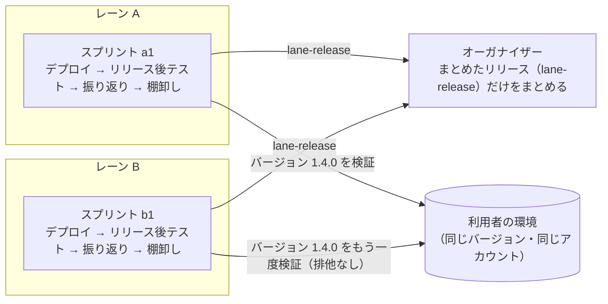
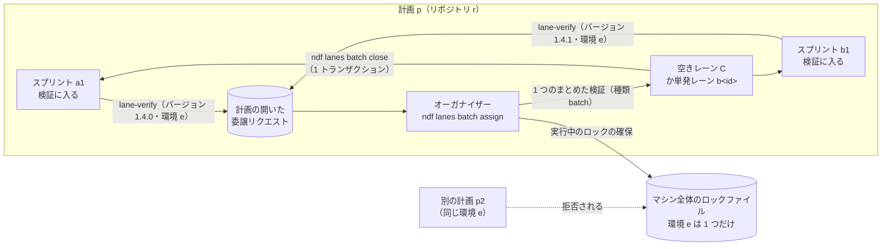
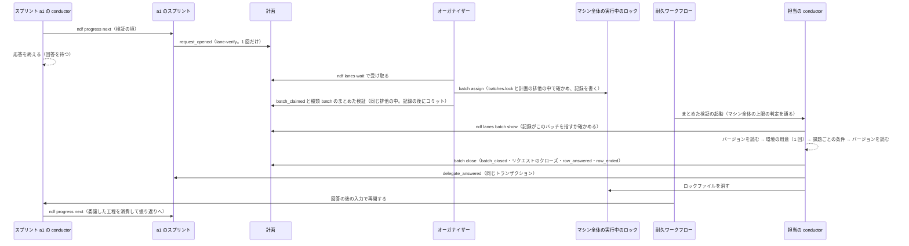

# 並列の計画: 検証と棚卸しをオーガナイザーが環境・リポジトリごとにまとめ、空きレーンか単発レーンで 1 本ずつ流す（#4211）

並列の計画の検証（体裁レビュー・リリース後テスト）と棚卸しは、スプリントごとにレーンの conductor が流し、同じバージョンの検証をスプリントの数だけ繰り返し、同じ環境での検証が重なっても止まらない（要求は [issue-4211-requirements.md](./issue-4211-requirements.md)、正は #4211 の本文）。計画のスプリントは検証と棚卸しを委譲リクエストで計画へ渡し、オーガナイザーが同じ環境（棚卸しは同じリポジトリ）のリクエストを 1 つのバッチにして、マシン全体で 1 つだけの実行中のロック（claim）を確保すると同時に、空きレーンか単発レーンへ 1 つのまとめた検証として割り当てる。まとめた検証の conductor が流した結果を 1 つのトランザクションで各スプリントへ回答し、検証のバージョンはリリースと排他を取らずに検証の前後で環境から読んだバージョンで照合する。#4050 の設計の材料（決定 20 と詳細設計の「まとめた検証と棚卸し」）から変えた所・採らなかった案・#4249 へ分けた範囲は「決定の記録」に、比べた製品は付録の「外部の調査」にある。

## 今の姿

何が起きたか・目的・受け入れ条件は要求仕様（[issue-4211-requirements.md](./issue-4211-requirements.md)、正は #4211 の本文）にある。この文書は「どう解くか」と「なぜその解き方か」だけを書く。パスは `plugins/ndf/` からの相対で書き、行番号は main の `d5da7b601` のものである。

設計に要る今の構造:

| 部品 | 今の振る舞い | 場所 |
| --- | --- | --- |
| クローズ処理 | スプリントの工程として、レーンの conductor の `ndf progress next` が流す。`standard` はデプロイ → リリース後テスト → 振り返り → 棚卸し、`documentation` はリリース後テストの前に体裁レビュー、`light` は棚卸しだけを持つ | `contracts/workflow/modes/*.json`、`contracts/workflow/stages/{release-verification,layout-review,backlog}.json` |
| 検証の入力 | 文脈の `version`（デプロイが書く出したバージョン）だけを取る | `stages/release-verification.json`・`layout-review.json`、`contracts/workflow/context.schema.json:17-19` |
| 委譲する前例 | リリース承認ゲートで `lane-release` のリクエストを計画へ書き、オーガナイザーが 1 本のリリースにまとめて `ndf lanes release` でクローズし、`ndf lanes answered` でスプリントへ回答を載せる。回答が載ったスプリントは耐久ワークフローが回答の後の入力で再開する | `src/ndf/progress/gate/release.py:52-119`、`src/ndf/progress/plan/__init__.py:230-317`、`src/ndf/progress/plan/run_decide.py:89-117` |
| レーンの作業の種類 | 起動の入力は `sprint` と `loop` の 2 種類だけ。`ndf lanes row start` は `--sprint` が必須で、開発ループは工程を持たない子のステートマシン（`ndf progress new --loop … --parent`）を作ってから開発ループを始める | `src/ndf/progress/lane/launch.py:182-216`、`src/ndf/progress/plan/cli.py:275-282`、`src/ndf/progress/command.py:22`・`:572-591` |
| 起動の上限 | レーンの作業を始める起動だけが、マシンの起動の排他（`<状態ディレクトリ>/parallel/admit.lock`）の中でマシン全体の上限を照合する | `src/ndf/progress/lane/machine.py:297-329`、`src/ndf/progress/plan/run.py:254-280` |
| レーンの作業の終わり | `lane.end_row`（`row_ended`）だけ。スプリントの完了と同じトランザクションで実行する。計画はレーンの作業がすべて終わり、開いたリクエストが無いときに完了する | `src/ndf/progress/lane/__init__.py:288-302`、`src/ndf/progress/lane/rules.py:240-243` |
| 排他の単位 | 計画・ステートマシン・実行のキー・マシンだけ。リポジトリ・環境・バージョンを単位にした排他は無い | `src/ndf/core/durable_locks.py`、`src/ndf/progress/store.py:513-560`、`machine.py:49-52` |
| 環境の値 | 検証の環境を表す値は無い。`branch_strategy.verify`（`null` か `{"kind": "marketplace" \| "deploy"}`）はスキーマにあるが、読むコードが無い | `skills/development-workflow/schemas/project.schema.json:834-853` |
| 計画のリポジトリ | 計画のレーンはすべて計画のリポジトリで動く。別のリポジトリのレーンは起動できない失敗にする | `src/ndf/progress/plan/run.py:239-241` |

調べたコマンドと検索の 0 件は、作業ディレクトリの調査（`.ndf/tmp/lcrrate/設計-4211/survey-code.md`。リポジトリの外）に残した。

## 文脈と制約

- **この課題は #4050 の設計（PR #4072・#4082・#4198 でマージ済み）の上に立つ。** フェーズの表（`contracts/workflow/phases.json`）が検証と棚卸しに `carrier: organizer`・`exclusion: organizer_batch` を持ち、`ndf progress next` がフェーズの境で `Env` のインターフェースを呼ぶ。#4050 は「#4211 が入るまで検証と棚卸しはレーンの conductor が今のとおり流し、`organizer_batch` の判定は『入る』を返す」と決めた（#4050 の設計の「解き方の全体像」の表、決定 21）
- **#4050 の設計の材料は 3 ラウンドの cross-review で毎ラウンド新しい重い穴を出した**（r1-2・r1-10〜r1-13・r3-5・r3-6・r3-9）。穴は 3 か所に集まった: リリースとの相互排他（バージョンを出した後の記録でしか止まらない r3-5）・実行中のロックの放置（`claim` の後にクローズできない r3-9）・バージョンの再試行（旧いスプリントが新しいバージョンでクローズできない r3-6）
- **担当は `ndf:supervisor` でなく、空きレーンか単発レーンである**（2026-11-23 の利用者の決定。#4050 の決定 20）
- **シートの返却・本数のカウント・起動の許可（#4091・#4103・#4110・#4113・#4180・#4181）は #4171 の領域で、この設計では扱わない。** 割り当てたまとめた検証の起動は、今のレーンの作業の起動（マシン全体の上限の判定を含む）に乗せる
- **同じスプリントの中で回答の待ちを越えて工程を流すこと（#4210）は扱わない**
- **耐久ワークフローは GitHub を読まない**（二次レート制限 #4016）。バッチと割り当てはオーガナイザーの実行するコマンドに置く
- **保存先は #3500 の決まりに合わせる**（2026-11-23 に承認。4 種: 追跡する設定・人が読む作業状態・機械だけが読む状態・使い捨て。マシンと利用者の単位の状態ディレクトリは 4 種の外で今のまま）
- **後方互換は要らない**（普及の前）。守るのは代表のリポジトリの種類を扱えることだけ

## 解き方の全体像

- 計画のスプリントが担当 `organizer` のフェーズ（検証・棚卸し）に入ると、`ndf progress next` が委譲リクエスト（`lane-verify`・`lane-backlog`）を計画へ 1 回だけ書く。検証は回答を待ち、棚卸しは書いた時点で工程を終える。計画の外のスプリントは今のとおり自分で流す
- オーガナイザーは同じ環境（棚卸しは同じリポジトリ）のリクエストを `ndf lanes batch assign` でまとめる。1 回のコマンドで、マシン全体のロックファイルを確保し、バッチを 1 つのまとめた検証（種類 `batch`）として空きレーンへ追加するか、単発レーンを追加して置く。同じ環境の実行中のロックは、別の計画のものを含めてマシンで 1 つだけになる
- 耐久ワークフローがそのまとめた検証を今のレーンの作業の起動で始め（検証も棚卸しもマシン全体の上限の判定を通る）、そのレーンの conductor が検証か棚卸しを 1 本流して `ndf lanes batch close` を実行する。`batch close` はバッチの結果・リクエストのクローズ・各スプリントへの回答・まとめた検証の終わりを 1 つのトランザクションで書き、実行中のロックを解放する
- 検証の成功は、検証の前後で環境から読んだバージョンが同じで、バッチの各リクエストのバージョン以上のときだけ受ける（バージョンを出さない変更は照合しない）。確かめる対象とバージョンの読み方は #4249 が決める。リリースは検証を待たず、検証の途中でバージョンが変わればその検証はやり直しになる

## 構成要素

| 構成要素 | 責務 | 場所 |
| --- | --- | --- |
| 委譲のインターフェース（`Env.delegate`） | 担当 `organizer` のフェーズの最初の工程の手前で、計画のスプリントなら委譲リクエストを 1 回だけ書く。計画の外なら何もせず「委譲しない」を返す | `src/ndf/progress/run.py`（`Env`・`_start` の枝）、`src/ndf/progress/gate/answering.py`（`lane_env`）、`src/ndf/progress/lane/delegate.py`（新設） |
| 結果の受け取り | 検証の回答（`delegate_answered`）を読み、委譲した工程の並びを完了か失敗にし、文脈の `verification` へコピーする | `src/ndf/progress/run.py`（`decide`・`_consume_delegated`） |
| 検証の環境 | スプリントのリポジトリの宣言 `branch_strategy.verify.environment` を読む。無ければ `<owner>/<name>` | `src/ndf/progress/lane/delegate.py`（`environment_of`）、`skills/development-workflow/schemas/project.schema.json` |
| バッチのコマンド | `ndf lanes batch assign / show / close / abort` | `src/ndf/progress/plan/batch.py`（新設）、`src/ndf/progress/plan/cli.py` |
| マシン全体のロックファイル | 環境（棚卸しはリポジトリ）ごとに 1 つの実行中のロックを、計画をまたいで確認と確保を不可分にする | `src/ndf/progress/plan/batch_claims.py`（新設）。保存先は `<状態ディレクトリ>/parallel/batches/` |
| 種類 `batch` のまとめた検証 | 工程を持たない子のステートマシンを作ってまとめた検証を始め、担当の conductor に手順を渡す | `src/ndf/progress/lane/launch.py`、`src/ndf/progress/command.py`（`--batch`）、`contracts/workflow/parallel-plan.schema.json` |
| 表示 | `ndf lanes status` にロック中のバッチ・失敗した棚卸しを出す | `src/ndf/progress/plan/__init__.py` |
| 手順書 | オーガナイザーのバッチの手順・担当の手順 | `skills/development-workflow/references/parallel.md`、`skills/release-verification/SKILL.md`、`skills/backlog-refinement/SKILL.md` |

## データ構造

**委譲リクエスト**（計画のステートマシンの `request_opened` の中身。`lane-release` と同じ保存先）:

| キー | 型 | 検証 | 棚卸し | 意味 |
| --- | --- | --- | --- | --- |
| `kind` | 文字列 | `lane-verify` | `lane-backlog` | 種類 |
| `lane`・`row`・`sprint_state` | 文字列 | 要る | 要る | 委譲したスプリントと、そのスプリントのステートマシンの ID |
| `issues` | 整数の配列 | 要る | 要る | スプリントの課題 |
| `stages` | 文字列の配列 | 要る | 要る | 委譲した工程の並び（`documentation` の検証は `体裁レビュー`・`リリース後テスト` の 2 つ） |
| `delegation` | 文字列 | 要る | 要る | 委譲のキー `<スプリント>:<フェーズ>:<試み>`。試みは同じフェーズを `ndf progress retry` で戻した回数 |
| `version` | 文字列（semver）か null | 要る | 無い | 検証するバージョン（デプロイの出力の `version`）。バージョンを出さない変更（`delivery.versioned` が偽・デプロイの無いリポジトリ）は null で、バージョンの照合をしない |
| `release_pr` | 文字列か null | 要る | 無い | 要求のバージョンのリリース記録を持つ PR（文脈の `release_pr`）。担当がそのリクエストの証跡の書き込み先 |
| `environment` | 文字列 | 要る | 無い | 検証の環境の名前 |
| `since_ref` | 文字列か null | 無い | 要る | そのスプリントの差分の棚卸しの範囲の始まり（`ndf issues candidates --since-ref` に渡す、前のリリースのタグ）。バッチは各リクエストの範囲の和集合を処理する |

**バッチ**（計画のステートマシンのイベント。id は計画の中で一意の連番 `<計画>-<n>`）:

| イベント | 中身 |
| --- | --- |
| `batch_claimed` | id・フェーズ（`verify` か `backlog`）・実行中のロックのキー（環境の名前かリポジトリ）・リクエストのキーの並び・リクエストごとのバージョン・担当のレーンとまとめた検証・単発レーンを追加したか・時刻 |
| `batch_revoked` | id・理由。担当でない `abort` が停止の確かめの前に書く、担当の起動を無効にするマーカー。まとめた検証の起動・再起動・`show`・`close` はこれがあれば進まない |
| `batch_closed` | id・結果（`done`・`failed`・`aborted`）・理由・レポート（JSON。64 KiB まで。環境とバージョンに共通する結果 `common` と、リクエストごとの条件の合否 `pass`・`fail`・`not_run` と証跡を書いた PR）・リポジトリごとの読んだバージョン（検証の前・検証の後）・失敗の原因（`version_changed`・`version_mismatch`・`work_failed`） |

`done` は「確かめをやり終えた」（条件の不合格や、次のバージョンで確かめる `not_run` を含む。今の `release-verification` と同じく振り返りへ進む）、`failed` は「確かめをやり終えられなかった」（環境の故障・バージョンの食い違い）を表す。一部のリクエストの条件だけが不合格でも、バッチは `done` でクローズし、各スプリントは自分の節だけを受け取る。

**ロックファイル**（マシン全体。`<状態ディレクトリ>/parallel/batches/<種類>-<キーのハッシュ>.json`。種類は `env` か `backlog`）: オーナーキー（オーナーの DB の参照・計画の状態ディレクトリ・計画の ID・バッチの id）・フェーズ・ロックの取得時刻。DB の参照は、SQLite なら DB のファイルの絶対パス、ほかは利用者名・パスワードを落とした `<ドライバー>://<ホスト>:<ポート>/<DB 名>` で、認証情報を書かない。オーナーはこの参照で開き、呼び出し元の `NDF_PROGRESS_DB` は参照と同じ DB を指すときだけ使う。特定できなければスロットを保つ。照合はいつもオーナーキーで行う（バッチの id は計画の中でしか一意でない）。排他は同じフォルダの `<状態ディレクトリ>/parallel/batches/batches.lock`（flock。すべてのコマンドがこの 1 つのパスを開く）。

**スプリントのイベント `delegate_answered`**: 委譲のキー・結果（`done` か `failed`）・そのスプリントのレポートの節と `common`・要求のバージョン・読んだバージョン・失敗の原因（`delegate_withdrawn` を含む）。文脈の `verification`（新しいキー）に、成功のレポート・要求のバージョン・読んだバージョンをコピーする。

**種類 `batch` のまとめた検証の入力**（`parallel-plan.schema.json` の `$defs/input` に追加する）: `{"kind": "batch", "batch": "<バッチの id>", "phase": "verify" | "backlog"}`。

**保存先（#3500 の 4 種との対応）**:

| 保存先 | 種 | 理由 |
| --- | --- | --- |
| 委譲リクエスト・バッチのイベント・`delegate_answered` | 機械だけが読む状態（ステートマシンの DB） | 計画とスプリントのイベントに追記する。`NDF_PROGRESS_DB` を共有すれば別のマシンでも読める |
| ロックファイルと `batches.lock` | 状態ディレクトリ（マシンと利用者の単位。4 種の外） | 別の状態ディレクトリを持つ計画どうしの排他に要る。同じ場所の `admit.lock`・計画の索引 `plans/` と同じ単位 |
| レポート | DB の `batch_closed` の本文 | `--report` のファイルは担当の使い捨てで、クローズした後に要らない |
| 検証の環境の宣言 | 追跡する設定（`.ndf/project.json` の `branch_strategy.verify.environment`） | プロジェクトに属し、リポジトリと一緒に変わる |

## 入出力のコントラクト

| コマンド | 書き込み元 | 入力 | 出力（結果 JSON） |
| --- | --- | --- | --- |
| `ndf progress next`・`ndf progress wait`（委譲の境） | レーンの conductor・死活監視 | 今のとおり | 検証: 回答の前は承認ゲートの回答待ちと同じ `status: gate`（`metrics.gate: "delegated"`・`metrics.delegated`）。conductor は応答を終え、死活監視は回答待ち（停止でない）と読む。棚卸し: 委譲した工程を終えて次のアクションを返す |
| `ndf lanes batch assign <計画> <リクエスト>... [--lane <レーン>] --reason <理由>` | オーガナイザー | 開いた同じ種類の委譲リクエスト。検証は同じ環境 | `ok`・`metrics.batch`（id・担当のレーンとまとめた検証・実行中のロックのキー）。拒否するときは `stopped`・`precondition`（ロック中のバッチの計画と id・経過時間、または拒否した理由） |
| `ndf lanes batch show <計画> <id>` | 担当の conductor・オーガナイザー | — | バッチ（フェーズ・環境・リクエストごとのレーン・スプリント・課題・工程・バージョン・`release_pr`）と、担当が実行する `close` のテンプレート |
| `ndf lanes batch close <計画> <id> --result done\|failed --report <ファイル> [--observed-version <リポジトリ>=<検証の前>,<検証の後>] [--cause <原因>] --reason <理由>` | まとめた検証の conductor・オーガナイザー | 検証の `done` は、バージョンのあるリクエストを持つリポジトリの `--observed-version` が要る | `ok`・`metrics.closed`（クローズしたリクエスト・回答したスプリント）。クローズした後のリトライは前の結果を返す |
| `ndf lanes batch abort <計画> (<id> \| --claim <種類>:<キー>) [--self] --reason <理由>` | オーナーの計画のオーガナイザー（`<id>`。計画の状態を問わない）・別の計画のオーガナイザー（`<計画>` は自分の計画、`--claim` で実行中のロックを指定する。オーナーの計画が `running` でなくまとめた検証が実行中でないときだけ）・担当の conductor（`--self`。計画の中止の入力からだけ） | — | `ok`。まとめた検証は中止し、リクエストは開いたまま。担当でない呼び出し元は先に `batch_revoked` を書いて担当の起動を無効にし、まとめた検証が実行中なら、ラッパーを止めて止まったことを確かめてから書き、確かめられなければ `batch_revoked` のほかは書かずに `transient` |
| `ndf lanes request close <計画> <リクエスト>`（変更） | オーガナイザー | 委譲リクエスト | 開いたバッチに入っていれば拒否する。バッチに入っていない `lane-verify` は、依頼元のスプリントが実行中なら `failed`（`delegate_withdrawn`）の回答を同じトランザクションで書いてからクローズし、依頼元のスプリントが終わっていれば回答を書かずにクローズする |

書き込み元の判別は、中継の子の環境変数で行う。`NDF_RELAY_PLAN` を持つ呼び出し（レーンの conductor）は `assign` と `--self` でない `abort` を拒否され、`close` と `abort --self` はバッチのまとめた検証のレーンのラッパー（`NDF_RELAY_NAME`）と合うときだけ通る。`NDF_RELAY_PLAN` を持たない呼び出しはオーガナイザーとして扱う。呼び出し元の計画は `cwd` の状態ディレクトリから開く名前で、オーナーの計画はロックファイルの状態ディレクトリから開く。

種類 `batch` のまとめた検証の終わりと中止は、エントリポイント（`row end`・`row cancel`・`progress cancel`・`lanes move`）でなく、書き込みの共通の経路（`lane.end_row`・`cancel_row`・`move_row`）で `batch close`・`batch abort` からのものだけを通す。計画の中止（`stop --now`）は未着手のまとめた検証の中止と同じトランザクションで `batch_closed`（`aborted`）を書く。`ndf lanes wait` は `batch_closed` の `failed`・`aborted` も通知する。

## 処理の流れ

棚卸しは、スプリントが `lane-backlog` を書いた `next` で棚卸しの工程を終え、スプリントはそのまま完了する。バッチは計画を完了させない開いたリクエストとして残り、担当の `batch close --result done` でクローズする。

## 決定の記録

### 決定 1: 委譲の書き込み元を 1 つにするため、#4050 のフェーズの境のインターフェースに `Env.delegate` を追加し、計画のスプリントだけが委譲する

- **質問**: 検証と棚卸しを、だれが・どの時点で計画へ渡すか
- **選んだ案**: `ndf progress next` の `_start` が、フェーズの表で担当が `organizer` のフェーズの最初の工程を始める手前で `Env.delegate` を呼ぶ。計画のスプリントでは `lane_env` が計画の排他の中で委譲リクエストを書き（同じ委譲のキーのリクエストがあれば書かない）、計画の外では何もせず、今のとおり工程を流す。検証は回答を待つ（#4210 が入るまでは承認ゲートの回答待ちと同じく応答を終える）。棚卸しはリクエストを書いた同じトランザクションで委譲した工程を完了にする（#4050 の材料と同じ）。#4050 の設計の「解き方の全体像」の表の「検証・棚卸し」の行（`organizer_batch` は「入る」を返す）を置き換える
- 採らなかった案: オーガナイザーが `ndf lanes status` のスプリントの工程を見てまとめる（計画はスプリントの工程を見られない。#4050 の「文脈と制約」）
- 採らなかった案: 棚卸しも回答を待つ（棚卸しは振り返りより後の最後の工程で、待つとスプリントが終わらずレーンのシートを使い続ける。リクエストが開いている間は計画が完了しないので、取りこぼしは起きない）
- **代償**: 検証の回答が来るまでそのスプリントの振り返りは始まらない（#4050 の順序の決まり）。#4210 が入るまで、その間に確定仕様化も流れない
- 根拠: Value 9「責務の分かれた設計で作られる」・Value 11「重複と冗長が無い」（MVV バージョン 11）

### 決定 2: ロックを取ったまま割り当てない記録を作らないため、`batch claim` と `batch assign` を 1 つのコマンド `batch assign` にする

- **質問**: 本文の「`ndf lanes batch claim / assign`」の 2 つのアクションを、別のコマンドにするか 1 つにするか
- **選んだ案**: `ndf lanes batch assign` の 1 回で、マシン全体の実行中のロックの確認と確保、計画への `batch_claimed`、まとめた検証（指定したレーンへの追加か、単発レーンの追加）を行う。ロックは `batches.lock` を外、計画の書き込みの排他を内に取り、リクエストの確かめ直し・レーンの空きの判定・開いたバッチのリトライの判定を計画の排他の中の同じトランザクションで行う。ロックファイルは計画のコミットより先に書く。記録の後・コミットの前に落ちると記録だけが残るが、オーナーの計画にその id の `batch_claimed` が無いので、次の確かめが残骸として空きとみなす。コミットの後に落ちても記録とまとめた検証はそろっているので、まとめた検証が起動できる間に別の計画が同じ環境を取ることは無い。担当は `show` で記録がこのバッチを指すことを確かめてから作業を始める（記録と起動の結び付け）
- 採らなかった案: #4050 の材料のとおり `claim` と `assign` を分ける（オーガナイザーが `claim` の後に落ちると、実行中のロックだけが残って別の計画の同じ環境を止め続ける（r3-9）。それを解放するために期限（`policy.batch_ttl`）と別の計画からの `abort` が要った）
- **代償**: 本文の対象範囲の語（`claim`）と受け入れ条件 2 の「実行中のロック」は、`assign` が書くロックファイルを指すと読み替える（承認資料で通知する）。空きレーンが無い間に実行中のロックだけを先に確保することはできない（単発レーンを追加すれば同時に確保できる）
- 根拠: Value 6「使うほど散らからない」・Value 11「重複と冗長が無い」（MVV バージョン 11）

### 決定 3: 環境を共有する別の計画とも重ならないため、ロックファイルをマシンの状態ディレクトリに置き、記録のオーナーの計画の状態で空きを決める

- **質問**: 「同じ環境の実行中のロックは 1 つ（別の計画からも拒否する）」をどこで確かめ、実行中のロックが解放される時点をどう決めるか
- **選んだ案**: `<状態ディレクトリ>/parallel/batches/` にロックファイルと `batches.lock` を置き、`assign` がその排他の中で確かめて書く（#4050 の材料と同じ）。記録があっても、オーナーの計画が消された・その計画にその id の `batch_claimed` が無い（書きかけの残骸）・同じ id の `batch_closed` がある・計画が終わっていて（`completed`・`cancelled`）まとめた検証も終わっている、のどれかなら空きとみなして上書きする。`paused` は実行中のレーンの作業を流し続け、`stop --now` は担当が止まる前に `cancelled` を書くので、計画の状態だけでは解放しない。オーナーを読めない（DB の一時的な障害・読み取りの失敗）ときは空きとみなさずスロットを保つ。期限は置かない。オーナーの計画が動いている間に担当が止まったら、今の `lane_stalled`・`launch_failed` の通知をオーナーのオーガナイザーが受けて `batch abort` を実行する。`abort` はまとめた検証が実行中ならそのラッパーを止め、止まったことを確かめてからスロットを解放する。別の計画のオーガナイザーは、オーナーの計画が `running` でなくまとめた検証が実行中でないときだけ `abort --claim` できる
- 採らなかった案: 計画ごとの `lock_plan` と `read_lanes` で確かめる（別の状態ディレクトリを持つ計画の実行中のロックと不可分に確かめられない。#4050 の r1-2）
- 採らなかった案: 期限（`policy.batch_ttl`）を越えたら別の計画から中止できる（決定 2 で実行中のロックとまとめた検証が同時にできるので、実行中のロックが残るのはまとめた検証が動いているか止まっているときだけになり、停止はオーナーの計画が通知する。期限は長い検証を誤って奪う）
- **代償**: オーナーの計画が動いたまま担当が停止し、オーナーのオーガナイザーも動いていないと、別の計画の同じ環境の検証はオーナーが `abort` するまで待つ
- 根拠: Value 3「同じ手順は毎回同じ結果になる」・Value 8「正しいデータ構造で作られる」（MVV バージョン 11）。PRD1

### 決定 4: バッチの範囲を計画のリポジトリの中に限るため、1 つのバッチは 1 つの計画のリクエストだけをまとめ、検証は同じ環境・棚卸しは計画ごとにする

- **質問**: 1 件の結果でクローズしてよいリクエストの範囲と、同時実行を防ぐ範囲をどう分けるか
- **選んだ案**: 1 つのバッチは 1 つの計画のリクエストだけをまとめる。計画のレーンはすべて計画のリポジトリで動く（`plan/run.py:239-241`）ので、バッチは 1 つのリポジトリの中に限る。検証は同じ環境のリクエストを、バージョンが違ってもまとめてよい（決定 6）。棚卸しは計画の `lane-backlog` をまとめる。同時実行を防ぐ範囲は、検証は環境（マシンのすべての計画）、棚卸しはリポジトリ（同じ）である。環境は `.ndf/project.json` の `branch_strategy.verify.environment`（文字列）で指定し、無ければ `<owner>/<name>` にする。読むのは `environment_of` の 1 つだけで、委譲リクエストを書くときに読み、ほかは記録の `environment` を読む
- 採らなかった案: 新しいトップレベルのキー `verify.environment`（#4050 の材料。検証の形を宣言する `branch_strategy.verify` が既にあり、同じものを 2 か所に分ける）
- 採らなかった案: 別の計画のリクエストも 1 つのバッチにまとめる（バッチのまとめた検証は 1 つの計画のレーンで動き、別の計画のスプリントへ回答を書く手段を持てない。別の状態ディレクトリの計画のトランザクションをまたげない）
- **代償**: 同じ環境を使う 2 つの計画の検証は、バッチが 2 本になって順に流れる。宣言を書き忘れた別のリポジトリが同じ環境を使うと、2 本が同時に動き得る（「未確認のまま残ること」）
- 根拠: Value 4「どのプロジェクトでもそのまま使える」・Value 8「正しいデータ構造で作られる」（MVV バージョン 11）

### 決定 5: リリースを検証で止めないため、リリースとの相互排他を取らず、`batch close` で検証の前後に環境から読んだバージョンを照合する

- **質問**: 検証の途中に同じ環境へ新しいバージョンが入って、旧いバージョンの検証を成功と記録しないために、リリースと検証をどう組み合わせるか
- **選んだ案**: リリースは実行中のロックを取らず、今のまとめたリリースのまま出す（`ndf lanes release` は変えない）。担当は検証の始めと終わりに環境のバージョンを読み、`batch close --result done` に `--observed-version <リポジトリ>=<検証の前>,<検証の後>` を渡す。`done` は、前と後が同じで、バッチのそのリポジトリのどのリクエストのバージョン以上（semver）のときだけ受ける（バージョンが null のリクエスト、つまりバージョンを出さない変更は照合せず、そのリポジトリのリクエストがすべて null なら `--observed-version` も要らない）。前と後が違えば `failed`（`version_changed`）、同じでも要求のバージョンより古ければ `failed`（`version_mismatch`）でだけクローズできる。確かめる対象とバージョンの読み方は #4249 が決める（決定 9）。後のバージョンは前のバージョンの変更を含む（同じリポジトリの基のブランチから順に出す）ので、新しいバージョンの成功で旧いバージョンのスプリントも完了とし、文脈の `verification` に要求のバージョンと読んだバージョンを両方コピーする
- 採らなかった案: リリースも実行中のロック（`batch claim --phase release`）を取り、検証と相互に拒否する（#4050 の材料。バージョンを出す前の手順に実行中のロックを追加し、`ndf lanes release` に `--batch` を求め、リリースの中止の扱いも要る。r3-5・r3-9 の穴が出た所で、検証の間はリリースが止まる）
- 採らなかった案: 終わりに 1 回だけバージョンを読む（途中でバージョンが入れ替わった検証を、終わりのバージョンの成功と記録してしまう）
- **代償**: 検証の途中で同じ環境へリリースが入ると、その検証は `failed` になってやり直しになる。バージョンを読む手段は担当の手順（`release-verification`。#4249 が決める）に任せ、機械は担当が渡した値を照合するだけである。リリースの承認者は、検証中の環境へバージョンを出すとその検証がやり直しになることを `ndf lanes status` のロック中のバッチで見られる
- 根拠: Value 5「速く届く」・Value 13「確かめたことだけが済んだとされる」・Value 11「重複と冗長が無い」（MVV バージョン 11）。STD1

### 決定 6: 失敗の後の再試行に例外の規則を持たないため、バージョンの照合を「要求のバージョン以上」にし、再試行は `ndf progress retry` の 1 つにする

- **質問**: 検証が `failed` でクローズしたスプリントを、どのコマンドで・どのバージョンで再試行するか
- **選んだ案**: 検証の `failed` は、スプリントの委譲した工程の並びの先頭を `failed`（`delegate_failed`）にし、`decide` が `FAILED` を返して振り返りへ進まない。直した後に `ndf progress retry <スプリント> <工程>` を実行すると、次の `next` が試みを 1 つ進めた委譲のキーで新しい `lane-verify` を書く。バージョンはいつもデプロイの出力のバージョンで、環境に新しいバージョンが入っていれば決定 5 の「要求のバージョン以上」で成功できる。環境が巻き戻っていれば、オーガナイザーは環境を直してから再試行するか、スプリントを中止する
- 採らなかった案: `version_mismatch` の後だけ読んだバージョンで書き直す（#4050 の材料の `superseded_from`。決定 5 で要らなくなる例外で、r3-6 の穴を直すために追加した）
- **代償**: 失敗したスプリントは、オーガナイザーかレーンの conductor が `retry` を実行するまで進まない（スプリントごとの判断を人の側に残す）
- 根拠: Value 3「同じ手順は毎回同じ結果になる」・Value 11「重複と冗長が無い」（MVV バージョン 11）

### 決定 7: クローズと回答の片方だけが残らないため、`batch close` がバッチの結果・リクエストのクローズ・各スプリントへの回答・まとめた検証の終わりを 1 つのトランザクションで書く

- **質問**: バッチの結果を、リクエストと各スプリントとまとめた検証へどう反映するか。中止はどう表すか
- **選んだ案**: `batch close` は計画の排他の中の 1 つのトランザクションで、`batch_closed`・リクエストのクローズ・検証なら各スプリントの `row_answered` とスプリントの `delegate_answered`・まとめた検証の `row_ended`（`completed`）と子のステートマシンの完了を書き、コミットの後にロックファイルを消す。棚卸しの `failed` はリクエストをクローズしない（開いたリクエストが計画を完了させない）。スプリントごとに回答を書くコマンド（`ndf lanes answered --request`）は作らない。種類 `batch` のまとめた検証の終わりと中止は、書き込みの共通の経路（`end_row`・`cancel_row`・`move_row`）で拒否し（`row end`・`row cancel`・`progress cancel`・`lanes move` のどれから来ても）、途中でやめるのは `batch abort`（まとめた検証の中止・`batch_closed` の `aborted`・リクエストは開いたまま・回答は書かない）と、計画の中止（`stop --now` の未着手のまとめた検証の中止と、実行中の担当の中止の入力 `batch abort --self`）だけにする。委譲リクエストを `request close` で単独でクローズするのは、バッチに入っていないものだけで、検証なら依頼元へ失敗の回答を同じトランザクションで書く。`close`・`request close` とも、回答は依頼元のスプリントが実行中のときだけ書き、終わった依頼元（回答の前に中止したスプリント）への回答は省いてリクエストをクローズする（`row_answered` は実行中のレーンの作業にしか書けないため）
- 採らなかった案: `batch close` がリクエストだけをクローズし、オーガナイザーがスプリントごとに `ndf lanes answered` を実行する（途中で落ちると、クローズしたリクエストのスプリントが回答を待ち続ける。#4050 の r1-12）
- 採らなかった案: まとめた検証を `ndf lanes row end` で終える（バッチをクローズせずにまとめた検証だけが終わり、実行中のロックが残る）
- **代償**: `batch close` の 1 回のトランザクションは、まとめた検証の数に比例して大きくなる（1 つの計画のスプリントの数が上限）
- 根拠: Value 8「正しいデータ構造で作られる」・Value 13「確かめたことだけが済んだとされる」（MVV バージョン 11）

### 決定 8: まとめた検証を今のレーンの作業の仕組みで動かすため、種類 `batch` のまとめた検証は開発ループと同じく工程を持たない子のステートマシンを持つ

- **質問**: スプリントを持たないまとめた検証を、起動・死活監視・レーンの作業の終わりにどうつなぐか
- **選んだ案**: 起動の入力は `ndf progress new <名前> --batch <id> --parent <レーンのステートマシン>`（工程を持たない子のステートマシン）→ `ndf lanes row start … --sprint <子>` → `ndf lanes batch show` で、担当の conductor に `release-verification`（バッチに `documentation` のスプリントがあれば `layout-review` も）か `backlog-refinement` の手順を流させ、`batch close` を実行させる。死活監視は、子のステートマシンの ID で開発ループと同じに受ける。停止からの再起動（`/goal` の入れ直し）は、種類 `batch` の続け方として `progress next` でなく `batch show` からやり直し、終わりの条件は `batch close`・`batch abort` でまとめた検証が終わったときにする（工程の無い子への `next` はレーンの作業を終えるため）。計画の中止の入力は `batch abort --self` にする。まとめた検証は検証も棚卸しも今のレーンの作業の起動で始まり、マシン全体の上限の判定を通る（シートの返却・本数のカウント・起動の許可は #4171 の領域）。空きレーン（計画の中でレーンの作業がすべて完了か中止のレーン）へ追加すると、レーンは未着手のレーンの作業を持つので耐久ワークフローの起動の対象に戻る。単発レーンは名前 `b<id>`・`touches` と `after` は空で、その 1 つのまとめた検証で終わる
- 採らなかった案: まとめた検証をスプリントにし、新しいモード（検証だけ・棚卸しだけ）で流す（リリース後テストの工程はリリースのステップが前に要る検査（`stages.py:147-171` の I8b）を持ち、検証だけのモードに合わない）
- 採らなかった案: 子のステートマシンを持たないレーンの作業（`row start` が `--sprint` を求め、死活監視はスプリントの ID の無いレーンの作業を判定しない。`liveness.py:143`）
- 採らなかった案: 検証の担当が、委譲して待つ依頼元のスプリントのシートを借りて上限で待たずに起動する（cross-review で追加した案。シートの返却と起動の許可は #4171 の領域で、この課題では扱わない）
- **代償**: まとめた検証の会話は、委譲したスプリントの会話の文脈を持たない（検証と棚卸しは文脈の依存が薄い。#4050 の「文脈の依存と担当」）。委譲した検証を待つ依頼元のスプリントは今の承認待ちのスプリントと同じくスロットを使い続けるので、上限が委譲して待つスプリントで埋まるとまとめた検証は起動を待ち、空きが出るまで検証が進まない（上限 1 なら委譲したスプリントが 1 つあるだけで進まない）。解くのは待つスプリントのシートを返す #4091（#4171 の領域）で、それまではオーガナイザーが上限（`relay.max-named`）を上げるか、ほかのレーンの作業が終わるのを待つ
- 根拠: Value 9「責務の分かれた設計で作られる」・Value 11「重複と冗長が無い」（MVV バージョン 11）

### 決定 9: 3 ラウンドで同じ仕組みの穴が続いたため、検証で確かめる対象と読んだバージョンの取り方を #4249 へ分け、#4211 は委譲・バッチ・実行中のロック・照合の規則を届ける

- **質問**: 担当が検証で確かめる対象（導入物・ref・コミット）と、照合に渡す読んだバージョンの取り方を、この課題で決めるか
- **選んだ案**: #4249 へ分ける。#4211 はリクエストの `version`（バージョンを出さない変更は null）と文脈の `pr`・`release_pr` を渡し、`batch close` の照合の規則（バージョンのあるリクエストを持つリポジトリだけ前と後のバージョンを求め、前と後が同じで要求のバージョン以上なら `done`）を届ける。担当は `release-verification` の手順（`documentation` のスプリントは先に `layout-review`）で確かめ、バージョンのあるリポジトリは検証の前と後に環境のバージョンを読んで `close` に渡す。確かめる対象とバージョンの読み方は #4249 が決め、それまでは今の `release-verification` の手順に従う
- 採らなかった案: #4211 に残して直し続ける（#4050 の決定 21・#4091 と同じく、1 つの仕組みの穴を毎ラウンド直すとほかの部分の承認が止まる）
- **代償**: #4249 が入るまで、担当が確かめる対象と読んだバージョンの取り方は今の `release-verification` の手順と担当の判断に頼り、`--observed-version` の値が実際に確かめた対象と結び付くことを機械では保証しない
- 根拠: Value 5「速く届く」・Value 13「確かめたことだけが済んだとされる」（MVV バージョン 11）。#4249

## 影響と危険

- **働く範囲**: NDF を導入したすべてのリポジトリの並列の計画（`--parallel`）。計画の外のスプリントは変わらない
- **プロジェクトごとに違うもの**: 検証の環境は設定（`.ndf/project.json` の `branch_strategy.verify.environment`）で受け、無ければリポジトリの名前にする。バージョンを環境から読む手段は `release-verification` の手順が持ち、プロジェクトのリリースの形（マーケットプレイス・デプロイ）で違う
- **対象のモード**: 検証は `standard`・`documentation`・`operation`・`legacy-refactor`（`documentation` は体裁レビューを含む）、棚卸しは 5 つのモードのすべて
- **順番**: #4050 の実装（フェーズの表・`Env` のインターフェース・工程の並び）が入った後に入れる。#4050 の前には委譲する境が無い
- **#4210 との境界**: どちらが先でもよい。#4210 の前は委譲した検証の待ちは承認ゲートの回答待ちと同じ `status: gate` で応答を終え、死活監視も回答待ちと読み、回答の後の入力で再開する。#4210 の後は委譲した検証の待ちが「越えてよい待ち」に加わり、確定仕様化を並べて流せる。この設計は結果に `metrics.delegated` を載せるだけで、待ちの間の流し方は #4210 が持つ
- **#4171 との境界**: シートの返却・本数のカウント・起動の許可は変えない。まとめた検証は今のレーンの作業の起動で、マシン全体の上限の判定を通る。委譲した検証を待つ依頼元のスプリントは今の承認待ちのスプリントと同じくスロットを使い続けるので、上限が委譲して待つスプリントで埋まるとまとめた検証は起動を待ち、空きが出るまで検証が進まない（上限 1 なら委譲したスプリントが 1 つあるだけで進まない。決定 8 の代償）。解くのは待つスプリントのシートを返す #4091 で、それまではオーガナイザーが上限（`relay.max-named`）を上げるか、ほかのレーンの作業が終わるのを待つ
- **#4249 との境界**: 検証で確かめる対象（導入物・ref・コミット）と読んだバージョンの取り方は #4249 が決める（決定 9）。#4211 が先でよく、#4249 は担当の手順と `show` の返す対象を追加する。それまで担当は今の `release-verification` の手順に従う
- **#3702・#4049・#4070（lctx）・`parallel.md`（lctx）**: `src/ndf/progress/run.py` の `decide` は #4050 と #3702 が触る。`src/ndf/progress/plan/__init__.py`・`plan/cli.py` は #4050 と #4070 が触る。`references/parallel.md` は #3995（lctx）と #4050 が触る。実装の PR の時点で開いた PR の変更ファイルを確かめ、後から入る側が rebase する。`parallel.md` は「まとめたリリース」の節の後ろへ「まとめた検証と棚卸し」の節を追加する
- **#3500 との境界**: 新しい保存先は DB のイベントと状態ディレクトリのロックファイルだけで、リポジトリの中にファイルを作らない。#3500 の子の課題が保存先の一覧（`contracts/domains/locations.json`）を作り直すとき、状態ディレクトリの行 `parallel/batches/` を追加する（この課題の実装が先なら今の形の一覧へ追加する）
- **壊れうる箇所**: 検証の途中のリリースは検証をやり直させる（決定 5 の代償）。担当が止まってオーナーのオーガナイザーも動かないと、同じ環境の別の計画が待ち続ける（決定 3 の代償）。担当が渡す読んだバージョンは機械では確かめられず、担当の手順の正しさに頼る（決定 9 の代償）。上限が委譲して待つスプリントで埋まると、まとめた検証が起動を待つ（決定 8 の代償）

### 代表のリポジトリでの振る舞い

| 代表のリポジトリ | 設定の要点 | 直した後に起きること | この種類で扱えなくなること |
| --- | --- | --- | --- |
| Web サービス | 並列の計画でフロントとバックエンドのレーンを組み、本番環境へデプロイする | 同じバージョンを出した複数のスプリントのリリース後テストが 1 本にまとまり、本番環境の検証は別の計画を含めて 1 本ずつ流れる。棚卸しは計画ごとに 1 本で、最後のスプリントが終わった後に空きレーンで流れる。設計・設計の検査・cross-review・MVV 判定の振る舞いは変わらない | 無し |
| モバイルアプリ | アプリとサーバーのレーン。ストアの審査を通す | 同上。審査を待つ間に別のバージョンが出ると検証の前後のバージョンが食い違い、検証はやり直しになる | 無し |
| 業務文書だけ | `documentation` のスプリント | 体裁レビューとリリース後テストを 1 件のリクエストで委譲し、担当が両方の手順を流して 1 件の結果でクローズする | 無し |

### このリポジトリだけの事情

- 無し（ai-plugins の運用の値を使わない。環境の名前はどのリポジトリでも宣言かリポジトリの名前から決まる）

## 用語

| 用語 | 意味 | 用語集への反映 |
| --- | --- | --- |
| レーンの作業 | レーンが順に流す 1 単位（`ndf lanes row`）。種類はスプリント・開発ループ・まとめた検証（棚卸しのバッチも種類 `batch`）。工程・フェーズ・待ちはレーンの作業に付き、`touches`・`after`・conductor・ラッパーはレーンのものを使う | 意味の変更（今の用語集と #4050 の設計の「行」を改める。マージ済みの文書・コード・用語集の直しは #4250 で行う） |
| 委譲リクエスト | 担当が `organizer` のフェーズ（検証・棚卸し）に入った計画のスプリントが計画へ書くリクエスト（`lane-verify`・`lane-backlog`）。リリースのリクエストと同じ形 | 追加（実装の PR で用語集へ追加する） |
| バッチ | オーガナイザーが同じ環境（棚卸しは同じ計画）の委譲リクエストをまとめ、1 つのまとめた検証で 1 本の検証か棚卸しとして流す単位。`ndf lanes batch assign` で作り、`batch close` か `batch abort` でクローズする | 追加（同上） |
| 実行中のロック | バッチが環境（棚卸しはリポジトリ）を占めていること。マシン全体で 1 つの環境に 1 つだけ。`batch assign` が確保し、`batch close`・`batch abort` か、オーナーの計画が終わってまとめた検証も終わったときに解放される | 追加（同上） |
| 検証の環境 | 検証が使う利用者の環境とアカウントの名前。`.ndf/project.json` の `branch_strategy.verify.environment` で宣言し、無ければリポジトリの名前 | 追加（同上） |
| 空きレーン | 計画の中で、レーンの作業がすべて完了か中止のレーン。まとめた検証を追加して流させてよい | 追加（同上。#4050 の用語の表と同じ意味） |
| 単発レーン | バッチ 1 つのために追加するレーン（名前 `b<バッチの id>`・`touches` と `after` は空）。その 1 つのまとめた検証を流して終わる | 追加（同上） |

## テスト設計

| 受け入れ条件 | どの振る舞いをテストするか | どう壊したら落ちるべきか |
| --- | --- | --- |
| 1 | 計画のスプリントが検証に入った `next` が `lane-verify` を 1 件書き、再実行しても増えない。同じ環境の 2 つのスプリントのリクエスト（バージョン 1.4.0 と 1.4.1）を 1 回の `batch assign` でまとめ、`batch close --result done --observed-version r=1.4.1,1.4.1` が両方のスプリントに回答を書き、それぞれの次の `next` で検証の工程が終わり振り返りへ進む。計画の外のスプリントは委譲しない | リトライのたびに書くと 2 件目で落ちる。バージョンの違うリクエストを拒否すると 1.4.0 をまとめる所で落ちる。計画の外で委譲すると落ちる |
| 2 | 同じ環境のロック中に、同じ計画と別の状態ディレクトリの計画からの `batch assign` が `stopped`・`precondition` で拒否される（差し替えた排他の同期で 2 つの計画を同時に実行すると片方だけ通る）。`batch abort` と `batch close` の後、オーナーの計画を中止してまとめた検証が終わった後は通る。オーナーが `paused`、または `cancelled` でまとめた検証が実行中なら拒否される。別の計画の `abort --claim` はオーナーの計画が `running` かまとめた検証が実行中なら拒否され、`paused` で担当が未着手なら通る。オーナーの読み取りを失敗させると `transient` で記録を上書きしない | 計画ごとの排他で確かめると同時のテストで落ちる。計画の状態だけで解放すると一時停止・中止のテストで落ちる。読めないオーナーを空きとみなすと読み取りの失敗のテストで落ちる |
| 2 | `assign` の計画のコミットの直後に落とすと（差し替えたコミットの後の処理で例外）、別の状態ディレクトリの計画の同じ環境の `assign` が拒否され、元のまとめた検証の `show` が手順を返す。記録を書いた後・コミットの前に落とすと、別の計画の `assign` が通る。同じリクエストのリトライは新しいバッチを作らない。別の状態ディレクトリの同じ名前の計画（同じバッチの id）の記録を `release_slot` が消さない | コミットの後に記録を書くと、コミットの直後に落とすテストで別の計画が通って落ちる。id だけで照合すると同じ名前の計画のテストで落ちる |
| 3 | 棚卸しに入ったスプリントが `lane-backlog` を書いた `next` で棚卸しの工程を終え、スプリントが完了する。開いた `lane-backlog` が残る間は計画が完了しない。`batch close --result failed` の後もリクエストは開いたままで計画は完了せず、`ndf lanes status` の `metrics` に失敗した棚卸しが出る。同じリクエストの `assign` からやり直せる | 棚卸しで回答を待つとスプリントが終わらずに落ちる。`failed` でリクエストをクローズすると計画が完了して落ちる |
| 3 | 検証の `failed` の回答の後の `next` が委譲した工程の先頭を `failed` にして `FAILED` を返し、振り返りへ進まない。`ndf progress retry` の後の `next` が試みを進めた新しい `lane-verify` を書く | 失敗を完了と読むと振り返りへ進んで落ちる |
| 4 | `batch assign --lane C`（C のレーンの作業がすべて完了）が C へ種類 `batch` のまとめた検証を追加する。指定しなければ `b<id>` のレーンを追加する。C に未着手か実行中のレーンの作業があれば拒否する。検証と棚卸しのまとめた検証は今のレーンの作業の起動でマシン全体の上限の判定を通り、空きがあれば起動して `close` の回答で依頼元が振り返りへ進み、上限が埋まっていれば起動を待つ | 実行中のレーンの作業のあるレーンへ追加すると落ちる。上限の判定を通さずに起動すると上限のテストで落ちる |
| 4 | 委譲した検証の待ちで `progress wait --timeout 0` が `gate` を返し、ラッパーの無い依頼元のスプリントを死活監視が回答待ちと読む（停止にも再起動にもならない）。まとめた検証の停止からの再起動の入力が `batch show` からやり直し、`progress next` を実行しない。計画の中止の入力が `batch abort --self` で、計画が `stopped` に届く | 委譲した待ちを `ok` で返すと死活監視のテストで停止になって落ちる。再起動で `next` を実行するとまとめた検証だけが終わって落ちる |
| 4 | まとめた検証の conductor の `batch close` が 1 つのトランザクションで各スプリントの回答とまとめた検証の `row_ended` を書き、3 つのスプリントのうち 1 つ目を書いた後に落とすと何も残らず、再実行すると 3 つのスプリントすべてに回答が載る。クローズした後のリトライは何も追記しない。別のレーンの conductor の `close` と、conductor の `assign`・`--self` でない `abort` は拒否される。種類 `batch` のまとめた検証への `row end`・`row cancel`・子への `progress cancel`・`lanes move` は拒否される。開いたバッチに入ったリクエストの `request close` は拒否され、バッチに入っていない `lane-verify` の `request close` は依頼元に失敗の回答を載せる。`batch_closed` の `failed` を `ndf lanes wait` が通知する | スプリントごとに別のトランザクションで書くと落とすテストで落ちる。書き込み元を見ないと落ちる。CLI の分岐だけで拒否すると `progress cancel` のテストで落ちる |
| 1・3 | バージョンを出さない（`delivery.versioned` が偽の）`documentation` のスプリントが `version: null` で委譲し、読んだバージョン無しの `done` で体裁レビューとリリース後テストが完了する。レポートで 1 つのスプリントの条件が `fail` の `done` で、両方のスプリントが振り返りへ進み、各スプリントは自分の節だけを受け取る。棚卸しのバッチの `show` が、各リクエストの `since_ref` のうち最も古いものと各リクエストの課題を返す | バージョンの無い検証を止めると落ちる。`fail` を含むレポートを `failed` に読むと落ちる。1 つのスプリントの範囲だけを渡すと落ちる |
| 決定 5 | `--observed-version` の無い検証の `done`、前と後が違う `done`、要求のバージョンより古い `done` は拒否され、`failed` ではクローズできる（原因 `version_changed`・`version_mismatch`）。前と後が同じで要求のバージョンより新しい `done` は受け、文脈の `verification` に要求のバージョンと読んだバージョンが両方載る | 終わりのバージョンだけで照合すると前後の違うテストで落ちる。一致だけを求めると新しいバージョンのテストで落ちる |
| 手順書 | 手順書の文言はテストで固定しない（AGENTS.md の DON'T）。ドキュメントレビューで見る | — |

## どこを変えるか

詳細設計は別ファイル（[issue-4211-design-detail.md](./issue-4211-design-detail.md)）にした。新設する関数が 2 つ以上（`delegate`・`environment_of`・`assign`・`close`・`abort`・`claim_slot`・`batch_commands` ほか）あるためである。

## 設計の結果

| 課題 | 扱い | 統合先 | 触るファイル |
| --- | --- | --- | --- |
| #4211 | 実装する | — | `plugins/ndf/src/ndf/progress/run.py`、`plugins/ndf/src/ndf/progress/gate/answering.py`、`plugins/ndf/src/ndf/progress/lane/delegate.py`（新設）、`plugins/ndf/src/ndf/progress/lane/launch.py`、`plugins/ndf/src/ndf/progress/plan/run.py`、`plugins/ndf/src/ndf/progress/lane/__init__.py`、`plugins/ndf/src/ndf/progress/lane/fold.py`、`plugins/ndf/src/ndf/progress/lane/types.py`、`plugins/ndf/src/ndf/progress/command.py`、`plugins/ndf/src/ndf/progress/plan/__init__.py`、`plugins/ndf/src/ndf/progress/plan/batch.py`（新設）、`plugins/ndf/src/ndf/progress/plan/batch_claims.py`（新設）、`plugins/ndf/src/ndf/progress/plan/cli.py`、`plugins/ndf/src/ndf/progress/plan/wait_decide.py`、`plugins/ndf/contracts/workflow/progress.json`、`plugins/ndf/contracts/workflow/parallel-plan.schema.json`、`plugins/ndf/contracts/workflow/context.schema.json`、`plugins/ndf/contracts/schemas/io/lanes.args.schema.json`、`plugins/ndf/contracts/domains/locations.json`、`plugins/ndf/skills/development-workflow/schemas/project.schema.json`、`plugins/ndf/docs/contracts/commands.md`、`plugins/ndf/skills/development-workflow/references/parallel.md`、`plugins/ndf/skills/development-workflow/SKILL.md`、`plugins/ndf/skills/release-verification/SKILL.md`、`plugins/ndf/skills/backlog-refinement/SKILL.md`、`docs/glossary/glossary.json`、`docs/glossary.md`、`plugins/ndf/tests/progress/test_lane_delegate.py`（新設）、`plugins/ndf/tests/progress/test_plan_batch.py`（新設）、`plugins/ndf/tests/progress/test_lane_launch.py`、`plugins/ndf/tests/progress/test_plan_run.py` |

## 未確認のまま残ること

| 項目 | 内容 |
| --- | --- |
| 環境の宣言の漏れ | 同じ利用者の環境を使う別のリポジトリが宣言を書き忘れると、2 本の検証が同時に動き得る（決定 4 の代償）。漏れの頻度は入れた後の計画で確かめる |
| 検証の途中のリリースの頻度 | 検証がやり直しになる頻度（決定 5 の代償）は、入れた後の計画の `batch_closed` の `version_changed` の数でカウントする |
| バージョンを環境から読む手段 | 確かめる対象と読んだバージョンの取り方は #4249 が決める。それまでは今の `release-verification` の手順と担当の判断に任せる（決定 9 の代償） |
| 委譲して待つスプリントによる起動の待ち | 上限が委譲して待つスプリントで埋まり、まとめた検証が起動を待つ頻度（決定 8 の代償）は、入れた後の計画で、まとめた検証が上限で起動を待った回数をカウントする |

## 外部の調査

| 種類 | 調べるか | 理由 |
| --- | --- | --- |
| 標準・仕様 | 調べる | 読んだバージョンを照合して古い状態への書き込みを拒否する形（条件付きの要求）に標準がある |
| 主要な製品 | 調べる | CI の主要な製品が、環境ごとの同時実行の排他をどう表すかを比べる |
| ライブラリとサービス | 調べない | 排他は今の flock（`machine.py` の `admit.lock` と同じ形）で足り、新しい依存を追加しない |

### 標準・仕様

| # | 標準 | 中身 | 設計への反映 | 出典 |
| --- | --- | --- | --- | --- |
| STD1 | RFC 9110 の `If-Match`（13.1.1） | 書き込み元が読んだバージョン（ETag）を添え、今のバージョンが違えばサーバーが要求を拒否する（412）。読んでから書くまでの間の変更を、ロックを取らずに検出する | 決定 5。リリースを止めるロックの代わりに、検証の前後に読んだバージョンを `batch close` で照合し、違えば成功を拒否する | https://www.rfc-editor.org/rfc/rfc9110#section-13.1.1 （取得はしていない。下の表） |

### 主要な製品

| # | 製品 | どう解いているか | 設計への反映 | 出典 |
| --- | --- | --- | --- | --- |
| PRD1 | GitHub Actions の `concurrency` | 同じグループのジョブかワークフローは同時に 1 つだけ動き、後から来たものは保留で待つ。グループの名前に環境の名前を使う例がある | 決定 3・決定 4。同時実行の単位を環境の名前にし、計画をまたいで 1 つにする。保留で待たせず、オーガナイザーへ拒否して通知する（まとめた検証のシートを空けておかない） | https://docs.github.com/en/actions/how-tos/write-workflows/choose-when-workflows-run/control-workflow-concurrency （2026-11-22。#4050 の設計の外部の調査） |

### 確かめられなかったこと

| 対象 | 試した手段 | 結果と理由 |
| --- | --- | --- |
| STD1 の本文 | 試していない | 二次レート制限と並列のレーンの負荷を避け、取得を省いた。引用したのは条件付きの要求の考え方だけで、ヘッダーの細部には頼らない |

調べた量: 候補 2 件・取得の試み 0 回（PRD1 は #4050 の設計の取得結果を引用した）。
