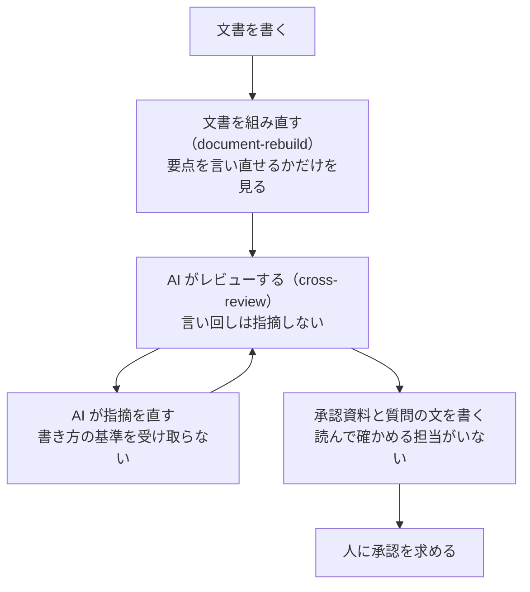

# 文書の作成とレビュー: 想定した読み手に通じない文を、承認を求める前に見つけて直す（#4285）

承認を求めた文書の意味が読み手に通じず、承認が何度も見送られた。文書の種類ごとの読み手と、通じない文の見分け方を 1 つの基準にまとめ、文書を書く担当・レビューする AI・指摘を直す AI・読んで確かめる AI に渡す。あわせて、経緯を知らない AI が読み手の立場で文書を読み、その確かめの記録が無ければ承認の質問を止める。採らなかった案は決定ごとに書き、調べた規格と指針は末尾の「外部の調査」にある。

## 今の姿

何が起きたか・目的・受け入れ条件は、要求仕様（[issue-4285-requirements.md](./issue-4285-requirements.md)、正は #4285 の本文）にある。この文書は「どう解くか」と「なぜその解き方か」だけを書く。

設計文書を書いてから承認を求めるまでの流れと、文章の書き方の基準が渡っていない箇所は次のとおりである。

| 部品 | 今の振る舞い |
| --- | --- |
| cross-review（複数の AI で Pull Request をレビューし、指摘が無くなるまで直す仕組み） | レビューする AI と指摘を直す AI への指示は、`criteria_decide.py` が `review-criteria.json` から組み立てる。`not_written`（指摘しないもの）に「字句や言い回し」がある。重要度が critical か major の指摘だけが、レビューの終了を妨げ、直す AI に渡る |
| document-rebuild（書き上げた文書を組み直す手順） | 経緯を知らない AI（読み手役）に文書だけを渡し、要点を言い直させる。言い直せれば合格である。自動実行では、組み直しを担当する AI がほかの AI を起動できないので、読み手役を使えないことがある |
| document-style（文章の書き方の規則）のルール 11 | 文書を「開発に関わる文書」と「ビジネス文書」に分け、前者（要求仕様を含む）はエンジニアの言葉で書くと定める |
| approval-request.md（承認を求める手順） | 承認資料に載せる項目を定める。文を読み手の立場で読み直す手順は無い |

## 文脈と制約

- レビューする AI（Codex・Kiro CLI）は、レビューする作業ディレクトリの外のファイルを読めるとは限らない
- cross-review の中心のファイル（`drive.py`）は 998 行で、1 ファイル 1,000 行の上限に近い
- 同じファイルを変える作業がほかに 2 つある。1 つは、指摘を直す AI に渡す情報をまとめる課題（#4350）である。もう 1 つは、上限値を設定ファイルへ移すスプリントの Pull Request で、レビュー中である（ https://github.com/devbasex/ai-plugins/pull/4367 ）
- レビューの回数が上限に達したときに、最後の直しを軽く確かめて終えるようにする課題（#4284）が、設計待ちである

## 解き方の全体像

- **原則**: NDF の共通原則に「文書は、想定した読み手に通じる言葉で書く」という 1 文を加える
- **指示**: 基準を `plugins/ndf/contracts/data/writing-criteria.md` にまとめ、書く・レビューする・直す・確かめる AI への指示に、プログラムが本文を入れる。手順書はこのファイルへリンクする
- **記録**: 読み手役が文書と質問の文を読み、担当がその結果を記録する。hook（質問を出す直前に動くプログラム）と承認の手順は、記録が今の質問の文と PR の head に合うかだけを調べる

## 文書の基準

`writing-criteria.md` に書く内容の要点である。文の全体は、利用者が確認している基準の文書をそのまま移す。確認で言い回しが変わっても、この設計は変わらない。

### 文書の種類ごとの読み手

読み手は、立場（何をする人か、読んだ後に何を判断・作業するか）・ふだん使う言葉・知識の 3 点で想定する。

| 文書 | 読み手と、読んだ後にすること | 知らないこと | 使う言葉 |
| --- | --- | --- | --- |
| ビジネス文書（提案書・稟議書・定例報告・発表資料・運用マニュアル） | ビジネスパーソン。採否や承認を判断する。運用マニュアルは読みながら作業する | 開発の知識 | 日本のビジネスの場で使われている言葉 |
| 要求仕様書・Issue の本文 | 要求を出した非エンジニア、PM、エンジニア。取り組むべき問題か、完了条件は妥当かを判断する | 製品の内部の仕組みと開発の用語（非エンジニア） | 3 者のどの立場でも分かる言葉 |
| 設計書・詳細設計書・実装計画・リリース後の仕様書 | エンジニア。設計の妥当性を判断し、実装し、保守する | 機能の経緯、開発チームの中だけの呼び名 | 日本のエンジニアが使っている言葉 |
| PR の題と本文・コミットメッセージ・レビューの指摘と返信 | エンジニア。マージしてよいかを判断し、後から変更の理由を調べる | PR を作るまでの会話 | 日本のエンジニアが使っている言葉 |
| 変更履歴・README・利用者への案内 | 製品の利用者。自分への影響を判断し、使い始める | 製品の内部の仕組み | 製品を使うときの言葉 |
| 承認を求める文・承認資料 | 承認する人。進めてよいかを判断する | 作業の経過、役割分担、開発チームの中だけの呼び名 | 承認する人がふだん使う言葉 |
| AI への手順書 | 手順を実行する AI と、手順書を保守するエンジニア | 手順書を書くまでの会話 | 日本のエンジニアが使っている言葉 |

- 読み手が複数いるときは、知識が最も少ない人に合わせる。エンジニアだけに必要な詳細は、その節の最後の「エンジニア向けの補足」にまとめる
- プロジェクトの指示書（AGENTS.md など）や文書自身が読み手を決めていれば、表より優先する。表に無い文書は、書く担当が 3 点を決める
- 「使う言葉」は文書の言語に合わせる。英語の文書なら、その読み手が使う英語とする

### 通じない文の 4 つの型

| 型 | 見分け方 | 直し方 |
| --- | --- | --- |
| A 知らない言葉 | 説明が無いと、読み手には意味が分からない（内部の呼び名・番号・略語・造語） | 内容を書く。読み手に必要のない呼び名は消す |
| B 不自然な日本語 | 単語は分かるが、その組み合わせや言い回しを日本語では使わない（英語の直訳・「の」の連続など） | 口頭で説明するときの言い方で書き直す |
| C 説明の不足 | 「誰が」「何のために」「それで何が困るのか」と聞き返す | 主語・目的・影響を補う |
| D 詰め込みすぎ | 1 回読んだだけでは頭に入らない | 1 つの文に 1 つの内容を書く |

型に当たる文は、「判断や作業を誤らせる文」と「読みにくいだけの文」に分ける。同じ意味に取れる文を好みで言い換える指摘はしない。単語を置き換えるのではなく、文や段落を書き直す。事実（数・日付・条件・原因と結果など）は変えない。

### 直し方の例

利用者が差し戻した 3 つの文を、それぞれの文書の読み手に合わせて直した例である。

| 読み手 | 差し戻された文 | 型 | 直した文 |
| --- | --- | --- | --- |
| エンジニア（設計書） | 足した行の廃止した語 | B・C | 変更で追加した行に含まれる、使わないと決めた用語 |
| 非エンジニア・PM・エンジニア（要求仕様書） | 計画 p9 のレーン lz2-ci で #3959 の設計を進めていた。 | A・C | 設計がプロジェクトの判断基準に合うかを承認の前に AI が判定する機能（ https://github.com/devbasex/ai-plugins/issues/3959 ）を設計していた。 |
| 非エンジニア・PM・エンジニア（要求仕様書） | 語の決まり | B | 言葉の選び方のルール |

## 構成要素

| 要素 | 責務 |
| --- | --- |
| `writing-criteria.md`（新設） | 読み手の表・4 つの型・書き方と直し方・例をまとめた、ただ 1 つの基準 |
| `ndf-common-principles.md`（変更） | 「人と AI の対話」に、読み手に通じる言葉で書くという 1 文を持つ |
| cross-review の指示（変更。`criteria_decide.py`・`review-criteria.json`） | 文書を含む Pull Request のときだけ、指摘の基準 5 と `writing-criteria.md` の本文を、レビューする AI と直す AI への指示に入れる |
| worker の指示（変更。`progress/gate/entry.py`） | 文書を書く作業の worker（作業を 1 つ受け持つ AI）への指示に、`writing-criteria.md` の本文を入れる |
| 読み手役の指示と記録（新設。`ndf records reading`） | 読み手役への指示を組み立て、確かめの結果を追記し、質問を出してよいかを調べる |
| `reading-check`（新設。hook の guard） | 質問を出す直前に、記録を調べて止めるか通すかを決める |
| 手順書（変更） | 読み手役の手順（`document-rebuild`）・承認の前の確かめ（`approval-request.md`）・読み手役を起動してよい担当（`agent-layers.md`） |

関数の単位の設計は [issue-4285-design-detail.md](./issue-4285-design-detail.md) にある。

## 決定の記録

### 決定 1: 基準が守られたことまで確かめられるようにするため、原則・指示・記録の 3 つに分けて置く

- **質問**: 読み手に通じる文を書かせるために、基準をどこに置き、どう守らせるか
- **選んだ案**: 共通原則に 1 文を置き（原則）、基準の本文を AI への指示に入れ（指示）、読み手役が確かめた記録があるかを承認の前に調べる（記録）。利用者は設計承認で確かめる
- 採らなかった案: 原則（共通原則や MVV）だけに書く（読むのは承認の自動判定だけで、文書を書く AI は読まない。今も原則はあるのに守られていない）
- 採らなかった案: 指示だけに入れる（AI が指示に従わなかったときに、誰も気づかない）
- 採らなかった案: hook で文の良し悪しを判定する（言葉の有無では通じるかを判定できない。質問のたびに hook から AI を起動すると、3 秒の上限に収まらない）
- 採らなかった案: プロジェクトの MVV（Value 14）から共通原則を指す（`.ndf/` の書き換えと MVV の改訂が必要になり、原則の 1 文はそれが無くても効く）
- **代償**: hook と記録のコマンドが増える。記録が事実かどうか（本当に読み手役に読ませたか）は確かめられない
- 根拠: Value 3・Value 13（MVV バージョン 1）

### 決定 2: 全員が同じ基準を使うため、読み手の表と 4 つの型を 1 つの Markdown ファイルに置く

- **質問**: 基準をどこに、どの形で置くか
- **選んだ案**: `plugins/ndf/contracts/data/writing-criteria.md` に置く。手順書はリンクし、cross-review は本文を読み込んで指示に入れる。NDF の共通原則（`ndf-common-principles.md`）が、すでに同じ形で人と AI の両方に読まれている。読み手役の手順は書き方の基準とは別の話なので、`document-rebuild` の SKILL.md に書く
- 採らなかった案: `document-style` の SKILL.md に置く（ほかの規則と合わせて約 400 行あり、本文をレビューの指示に入れると、その分の費用が毎回かかる）
- 採らなかった案: JSON に置く（人と AI が読む文章なので、読める形に組み立てるコードが別に必要になる）
- 採らなかった案: プロジェクトの設定ファイル（`.ndf/`）で読み手の表を上書きできるようにする（設定の項目と、読み込む関数が増える。指示書や文書に書けば同じことができる）
- **代償**: 手順書を読む人は、基準を見るためにリンク先を開く
- 根拠: Value 9・Value 11（MVV バージョン 1）

### 決定 3: 要求仕様を非エンジニアにも通じる文にするため、言葉の選び方を文書の読み手で決める

- **質問**: `document-style` のルール 11 の「開発に関わる文書はエンジニアの言葉」という分け方をどう直すか
- **選んだ案**: 文書を 2 つに分けるのをやめ、言葉の選び方を読み手の表で決める。ルール 11 の言い換えの表と `document-drafting` の言葉の表は、それぞれエンジニア向け・ビジネスパーソン向けの例として残す
- 採らなかった案: 要求仕様だけを別の分類に移す（承認資料や手順書のように、読み手がエンジニアとは限らない文書が、エンジニアの言葉のまま残る）
- **代償**: 書き始める前に、表で文書の行を確かめる手間が増える
- 根拠: 利用者の指示（要求仕様の「リクエスト（原文）」）。STD1・STD2。Value 14（MVV バージョン 1）

### 決定 4: レビューで通じない文が見つかるように、指摘の基準に「読み手に通じない文」を加える

- **質問**: レビューする AI に、どの文を、どの重要度で指摘させるか
- **選んだ案**: 文書を含む Pull Request に限り、基準 5「文書の読み手に通じない文（4 つの型）」を加える。「判断や作業を誤らせる文」は major、「読みにくいだけの文」は minor とする。指摘には、文の引用・型・読み手がつまずく理由・書き直した案を書かせる。`not_written` の「字句や言い回し」は「読み手に通じる文の、好みの言い換え」に狭める
- 採らなかった案: 文の指摘をすべて major にする（好みに近い指摘が毎回出て、レビューが終わらない）
- 採らなかった案: 文の指摘をすべて minor にする（minor は直す AI に渡らないので、判断を誤らせる文も直されない）
- **代償**: 「読みにくいだけの文」は、レビューでは直らない。読み手役の確かめで、書いた担当が直すかどうかを決める
- 根拠: Value 1・Value 2（MVV バージョン 1）

### 決定 5: 文の指摘でレビューが終わらなくなるのを防ぐため、2 回目以降の major を新しく読む文に限る

- **質問**: 直した文への新しい指摘が、回を重ねるたびに出続けるのをどう止めるか
- **選んだ案**: 2 回目以降の指示に「基準 5 を major にしてよいのは、まだ読んでいないセクションの文と、前のラウンドの後に書き換わった文だけ」と書く。それでも残ったときは、今あるラウンドの上限（既定 3 回）で終わる
- 採らなかった案: 指摘された行が差分に含まれるかをコードで調べ、外れた指摘の重要度を下げる（指摘がどの基準に当たるかを返す項目を増やす必要があり、行番号の無い指摘は調べられない）
- 採らなかった案: 2 回目以降は文の指摘を出させない（AI が直した文が通じなくても、見つからない）
- **代償**: 指示に従わない AI の指摘までは防げない。#4284 ができるまでは、上限まで回って未解決の指摘が残ることがある
- 根拠: Value 2（MVV バージョン 1）

### 決定 6: 基準を確実に受け取らせるため、書く・レビューする・直す・確かめる AI の指示に本文を入れる

- **質問**: AI に、基準のファイルの場所を渡すか、本文を渡すか
- **選んだ案**: 本文を指示に入れる。文書を書く worker は、`kinds.json` で `document-style` を読む作業（設計・要求など）だけに入れる。cross-review は、Pull Request に Markdown があるときだけ入れる。読み手役には、4 つの型の節だけを入れる。直す AI には「単語を置き換えずに文や段落を書き直し、前後の段落と一緒に読み手の立場で読み直す」と指示する
- 採らなかった案: ファイルの場所だけを渡す（読んだかどうかを確かめられず、「基準を受け取っていない」状態に戻りうる）
- 採らなかった案: すべての worker とすべての Pull Request に入れる（コードだけを扱う作業の費用が増える）
- **代償**: 文書を扱う指示が 1 回あたり約 80〜100 行ずつ長くなる。supervisor が手で組む worker への指示には入らないので、読む Skill（`document-style`）からのリンクで補う
- 根拠: Value 3（MVV バージョン 1）

### 決定 7: 不自然な文でも合格してしまうのを防ぐため、読み手役に通じない文を引用で挙げさせる

- **質問**: 読み手役に何を渡し、何を返させ、何をもって合格とするか
- **選んだ案**: 文書・想定した読み手の 3 点・4 つの型だけを渡す。経緯と、使わない言葉の一覧は渡さない。返させるのは、(1) 要点の言い直し、(2) 通じない文の一覧（引用・型・つまずく理由・書き直した案・「判断や作業を誤らせる文」か「読みにくいだけの文」か）、(3) 迷って入れなかった文を最大 3 つ、である。言い直しが文書と合っていて、「判断や作業を誤らせる文」が 0 件なら合格とする。要求仕様書は、非エンジニア・PM・エンジニアの立場ごとに別の読み手役に読ませる。今ある、課題と解き方の言い直しの質問は続ける
- 採らなかった案: 言い直しだけで合否を決める（今の形。不自然な日本語でも言い直せるので、通じない文が見つからない。試した結果、差し戻された「語の決まり」を 1 件も挙げなかった）
- 採らなかった案: 使わない言葉の出現回数を数える（言葉を避けても、意味の取れない文は残る。実際に差し戻された）
- 採らなかった案: 通じない文が 0 件になるまで直す（読み手役が変わると件数が揺れ、終わらない）
- **代償**: 読み手役の返す文が長くなり、要求仕様書では起動が 3 回になる
- 根拠: 利用者の指摘（要求仕様の「リクエスト（原文）」）。STD1。Value 1（MVV バージョン 1）

### 決定 8: レビューで直した文と承認の文も読まれるようにするため、承認を求める前に、合格していない部分を読ませる

- **質問**: 何を、誰が、いつ読み手役に読ませるか
- **選んだ案**: 対象は、要求仕様書・設計書・リリース後の仕様書・ビジネス文書・変更履歴・承認を求める文と承認資料・リリースする Pull Request の題と本文とする。書き終えた後に 1 回、`document-rebuild` の中で読ませる。承認を求める前に、担当が、合格の記録が無い文書の全文と、合格の後に直した部分（前後の段落を含む）と、承認の文を読ませる。担当は、計画の実行（`ndf plan`）で進めたときは conductor、代わりに 1 つのフェーズを通す AI（supervisor）が進めたときは supervisor である。読み手役には、新しく起動した `ndf:worker` を使い、指示は `ndf records reading prompt` で作る。自動の承認で人に尋ねないときは、承認の前の確かめをしない
- 採らなかった案: 文書の組み直しのときだけ読ませる（その後のレビューで直した文と、承認の文が読まれない）
- 採らなかった案: 計画のテンプレートに、読ませる手順を 1 つ加える（承認資料と質問の文は計画の後に書くので、そこでは読めない）
- 採らなかった案: CI で確かめる（AI の起動が必要で、CI に課金と認証情報を持たせることになる）
- **代償**: 承認のたびに、文書と立場の組ごとに 1〜2 回の AI の起動が加わる
- 根拠: Value 1・Value 2（MVV バージョン 1）

### 決定 9: 直しの繰り返しが終わらなくなるのを防ぐため、立場ごとに 2 回までとし、残りは承認を求める文に書く

- **質問**: 「判断や作業を誤らせる文」が無くならないとき、いつ承認へ進むか
- **選んだ案**: 1 件でもあれば承認を求めずに直し、不合格だった立場だけ、別の読み手役に読み直させる。2 回目にも残ったら確かめを終え、残った文と直さなかった理由を承認を求める文に書き、承認する人が判断する。承認を求めない文書では Pull Request の本文に書く。リリースの承認で、マージ済みの文書から作られていて直せない文は、質問の文で内容を補う。レビューで直した後の確かめは、回数を数え直す
- 採らなかった案: 0 件になるまで繰り返す（費用に上限が無い）
- 採らなかった案: 1 回だけ読ませる（直した文が通じるかを確かめられない）
- **代償**: 通じない文が承認の場に残ることがある。その文は、引用されて人に見える
- 根拠: Value 1・Value 2（MVV バージョン 1）

### 決定 10: 確かめ忘れを防ぐため、承認の質問の前に記録を調べ、合わなければ止める

- **質問**: 記録を何と比べ、どの質問を、どこで止めるか
- **選んだ案**: 記録には、質問の文のハッシュ値、承認する Pull Request とその head、読ませた文書・立場・回数・結果を書く。`AskUserQuestion` の区分（`metadata.source`）が `ndf-gate:`（設計とリリースの承認）か `ndf-ask:`（利用者への質問）で始まる質問だけを調べる。どちらも、質問の文のハッシュ値が一致する記録があることを求める。`ndf-gate:` では、記録した head と、手元の `origin/<ブランチ>` が一致することも求める。結果は「合格」と「2 回目にも残った」のどちらでもよい（残った文は承認する人が判断するため）。GitHub の head と比べる確かめは、承認の手順で `ndf records reading check` を打って行う
- 採らなかった案: hook から GitHub に head を問い合わせる（hook の時間の上限 3 秒に収まらないことがある）
- 採らなかった案: 区分の無い質問も止める（NDF を使わない質問まで止まる）
- 採らなかった案: `ask-forward`（質問を転送する今の guard）の中で調べる（質問の転送と確かめは別の責務で、転送に失敗したときの扱いも違う）
- 採らなかった案: 合格の記録だけを認める（2 回目にも残った文があると、承認する人に尋ねられなくなる）
- **代償**: 利用者への質問を 1 つ出すたびに、読み手役の起動が 1 回加わる。PR を別のマシンから push すると、手元の `origin/<ブランチ>` が古いままのことがある（承認の手順の確かめで見つかる）
- 根拠: Value 3・Value 13（MVV バージョン 1）

### 決定 11: hook の不具合や記録の欠けで質問が出せなくなるのを防ぐため、止めるのは同じ理由で 2 回までとする

- **質問**: 記録が用意できないとき、どう抜けられるようにするか
- **選んだ案**: 止めるときは、足りないものと、記録を作るコマンドを理由に書く。同じ理由で 2 回止めた後は、今ある仕組み（`hook.deny-repeat`）で、注意を添えて質問を通す。hook の処理が失敗したとき・記録のファイルを読めないとき・git が失敗したときは通す（guard の `fail_closed` は偽）。今ある環境変数 `NDF_HOOK_OFF` に `reading-check` を書けば、止めない
- 採らなかった案: 記録ができるまで必ず止める（読み手役を起動できない環境で、人に尋ねる手段が無くなる）
- 採らなかった案: 止めずに注意だけを出す（注意は読み飛ばせる。今も手順書に書いてあるだけで守られていない）
- **代償**: 記録が無いまま質問が出ることがある。その場合は、質問の前に注意が出て、承認する人に見える
- 根拠: Value 1・Value 3（MVV バージョン 1）

### 決定 12: 読み手役の指摘で文を直してもレビューをやり直さないため、担当が差分を 1 回だけ確かめる

- **質問**: レビューの後に文を直すと、レビューしていない変更が残る。どう扱うか
- **選んだ案**: この直しでは事実（数・日付・条件・決定など）を変えない。承認を求める担当が、直しの差分で事実が変わっていないことを確かめ、確かめたコミットを承認資料に書く。レビューの上限に達した後の最後の直し（#4284）があるときは、読み手役の確かめを先に終え、2 つの直しをまとめて 1 回で確かめる
- 採らなかった案: レビューをもう一度最初から回す（文の書き直しのたびに、複数の AI の起動が加わる）
- **代償**: 担当の見落としがあれば、レビューしていない意味の変更が残る
- 根拠: Value 2・Value 5（MVV バージョン 1）

### 決定 13: 言葉の一覧に頼らない基準にするため、使わない言葉を機械で探す検査を作らない

- **質問**: 前の設計の中心だった、用語集の「使わない言葉」を機械で探す検査を残すか
- **選んだ案**: 作らない。用語集の設定（`.ndf/glossary.json`）も変えない。今ある検査（`ndf check` と用語集の検査）は変えない
- 採らなかった案: 補助の検査として小さくして残す（登録した言葉しか見つからず、利用者が差し戻した文には当たらない。今ある文書での約 46,000 件の出現を対象から除く仕組みが別に要る）
- **代償**: 登録済みの言葉を文書が使っても、機械は知らせない
- 根拠: Value 6・Value 9（MVV バージョン 1）

## 影響と危険

- **働く範囲**: 利用先のリポジトリでも働く。文書（Markdown）を含む Pull Request のレビューと、人に承認を求める場面に限る
- **プロジェクトごとに違うもの**: 読み手は、プロジェクトの指示書や文書が決めていればそれに従う。設定は増やさない。言葉は文書の言語に合わせる
- **当たるモード**: cross-review を通るモードと、人に承認を求めるモードのすべて
- **費用**: 文書を含む Pull Request では、レビューする AI 2 つと直す AI への指示が、それぞれ 1 ラウンドあたり約 80〜100 行長くなる。承認の前は、文書と立場の組ごとに 1〜2 回、利用者への質問では 1 回、読み手役を起動する
- **既定で働く範囲**: hook の guard が 1 つ増え、Claude Code の `AskUserQuestion` の前に必ず動く。区分の無い質問はすぐに通す。区分のある質問では、記録のファイルを 1 つ読み、git を 1 回起動する
- **止まらないもの**: 区分の無い質問・自動の承認（質問を出さない）・人のいない実行（`NDF_FACTORY_RUN`）・Codex（`AskUserQuestion` が無い。承認の手順の `ndf records reading check` だけが働く）
- **用語集や設定の無いプロジェクト**: 基準も記録も設定を読まないので、同じように働く。記録はプロジェクトの外（NDF の状態の保存先）に書き、リポジトリには何も増えない
- **並列に進める開発**: 各レーン（並行する作業の流れ）が出す質問は、そのレーンの hook が調べる。複数のレーンの質問をまとめて利用者へ出すオーガナイザー（レーンを調整する AI）の質問も、その文に対する記録が必要になる
- **壊れうる箇所**: 基準 5 の major の指摘が多く出て、レビューが上限まで回ること。実装の後に、文書を含む Pull Request のラウンド数を、設計 Pull Request の今の実績（上限の 3 ラウンド）と比べる
- **同じ所を変える変更**: 上限値を設定ファイルへ移すスプリント（#4367）は、`criteria_decide.py` と `drive.py` の別の行を変える。先にマージされてから実装を始める。#4350 は、指摘を直す AI に渡す情報を 1 つにまとめる課題で、この設計の cross-review の指示（`document_block`）を、その部品の 1 つとして使う。この課題が持つのは文書の書き方の基準だけで、変更の目的・時間の上限・テストは #4350 のほかの子の課題が持つ
- **外した範囲**: 要求仕様のひな形の見出しの言い換え（#4258）は、前の設計では、見出しの言葉を使わない言葉として登録するので必要だった。検査を作らないので、別の課題のまま残す

### 代表のリポジトリでの振る舞い

| 代表のリポジトリ | 設定の要点 | 直した後に起きること | この種類で扱えなくなること |
| --- | --- | --- | --- |
| Web サービス | 設定は要らない | 要求仕様や設計書を含む Pull Request で、通じない文が指摘される。コードだけの Pull Request は変わらない。承認の質問の前に記録が調べられる | 無し |
| モバイルアプリ | 同上 | 同上 | 無し |
| 業務文書だけ | 同上 | ビジネス文書の読み手はビジネスパーソンとして扱われ、開発の言葉がそのまま残った文が指摘される | 無し |

### このリポジトリだけの事情

- 無し（このリポジトリの値を使わない）

## 用語

| 用語 | 意味 | 用語集への反映 |
| --- | --- | --- |
| 読み手役 | 文書と、想定した読み手の説明と、通じない文の 4 つの型だけを渡され、会話や経緯を知らずに読む AI。要点の言い直しと、読み手に通じない文の引用を返す | 意味の変更 |

## テスト設計

| 受け入れ条件 | どの振る舞いを確かめるか | どう壊したら落ちるべきか |
| --- | --- | --- |
| 7 | Markdown を含む Pull Request の 2 つの指示と、文書を書く作業の worker の指示に、`writing-criteria.md` の本文が入る（本文はファイルから読んだ値と比べる） | どれか 1 つの指示から本文を外す |
| 11 | Markdown を含まない Pull Request の指示と、文書を書かない作業の worker の指示には入らない | 条件を見ずに常に入れる |
| 10 | 2 ラウンド目のレビューの指示にだけ、major を限る文が入る | 1 ラウンド目にも入れる・2 ラウンド目に入れない |
| 9 | `impact`（何が起きるかの 1 文）の無い文の指摘は minor になり、直す AI に渡らない（今ある規則のまま） | 基準 5 だけ別の扱いにする |
| 12 | `reading prompt` の指示に、読み手の説明と 4 つの型が入り、文書の経緯を渡す引数が無い | 4 つの型を外す |
| 17・18 | 記録が無い・質問の文が違う・head が違うときに止まり、理由に足りないものが入る。3 回目は注意を付けて通る | 比べる項目を 1 つ外す |
| 19 | 区分の無い質問・読めない記録・git の失敗で止まらない | 失敗を止める側に倒す |
| 1〜6・8・13〜16・20 | 手順書と基準の変更は、今ある検査がリンク切れを確かめ、中身はレビューで読む。文言を照合するテストは書かない | — |

## 設計の結果

| 課題 | 扱い | 統合先 | 触るファイル |
| --- | --- | --- | --- |
| #4285 | 実装する | — | [詳細設計書](./issue-4285-design-detail.md) の「地図」と「手順書の変更」のファイル |

## 未確認のまま残ること

| 項目 | 内容 |
| --- | --- |
| レビューのラウンド数と費用の増え方 | 実装した後の最初の数回のレビューで測る。`not_written` を狭めたことで、軽い指摘（minor）がどれだけ増えるかも見る |
| Codex と Kiro CLI が基準 5 を同じ重さで読むか | 実装した後、この課題の Pull Request の差分で 1 回レビューして確かめる |
| 読み手役の判定の揺れ | 試したのは 1 文書につき 1 回ずつで、繰り返しは測っていない。実装した後、同じ文書を 3 回読ませて件数の幅を見る |

## 外部の調査

| 種類 | 調べるか | 理由 |
| --- | --- | --- |
| 標準・仕様 | 調べる | 読み手を決めて書くことを定めた国際規格と公的な指針があるため |
| 主要な製品 | 調べない | 前の設計で調べた文書の検査の製品（textlint・Vale）は登録した言葉を探すもので、この設計では使わない |
| ライブラリとサービス | 調べない | 今ある AI の起動だけで足り、新しい部品を使わない |

### 標準・仕様

| # | 標準・仕様 | 何を定めているか | 設計への反映 | 出典 |
| --- | --- | --- | --- | --- |
| STD1 | ISO 24495-1:2023（平易な言葉の原則と指針） | 想定した読み手が、必要なものを見つけ、理解し、使えることを平易な言葉とする。読みやすさの数値より、読み手が使えるかを重く見る | 読み手を先に決める。合否を点数や言葉の数で決めない | https://www.iplfederation.org/iso-standard/ （2026-11-24 取得） |
| STD2 | 公用文作成の考え方（文化審議会の建議、2022 年 1 月） | 読み手の知識に合わせ、専門用語は言い換えるか説明を付ける | 読み手の知識を想定に入れ、知らない言葉は「日本語の説明（名前）」の形で書く | https://www.bunka.go.jp/seisaku/bunkashingikai/kokugo/hokoku/pdf/93651301_01.pdf （2026-11-24 検索で要点を確認） |

### 確かめられなかったこと

| 対象 | 試した手段 | 結果と理由 |
| --- | --- | --- |
| ISO 24495-1 の本文 | 検索（有料の規格） | 本文は読めず、策定団体の説明と規格の販売元の要約で確かめた |

調べた量: 候補 2 件・取得の試み 2 回。
