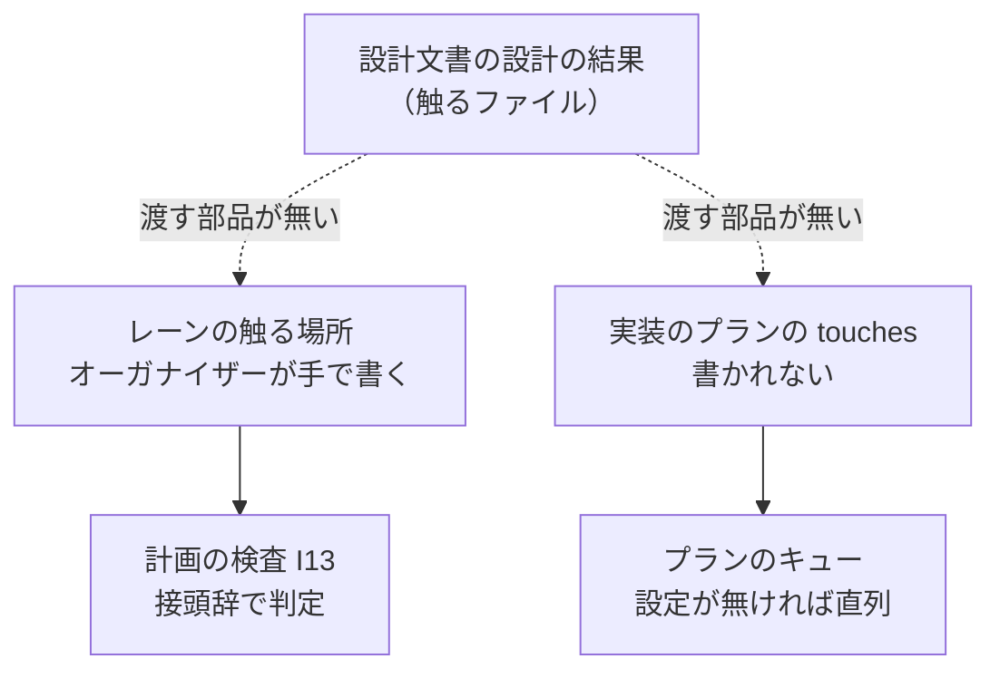
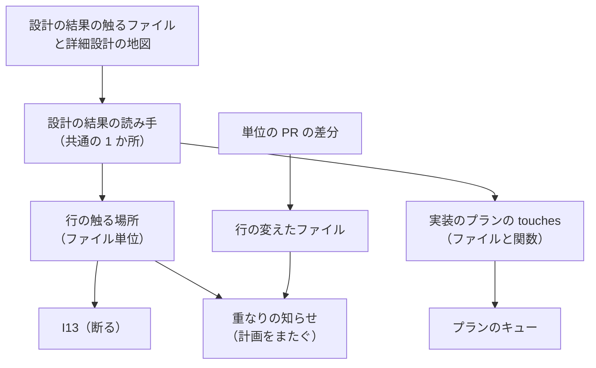
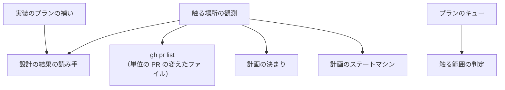
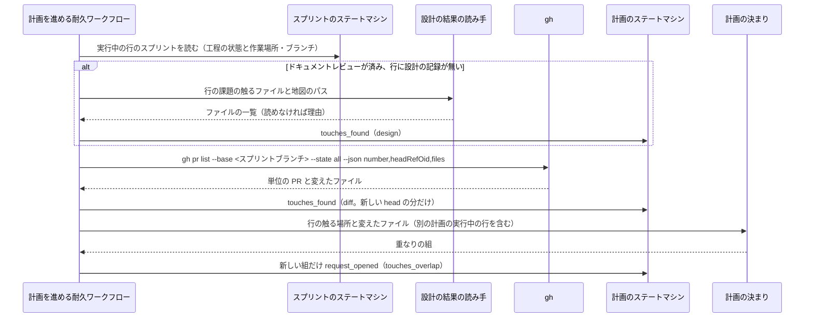
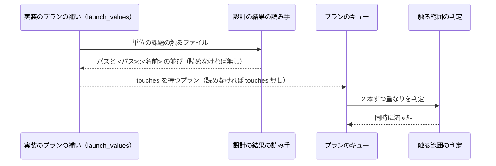

# 並列の計画とプランのキュー: 設計で確定した触るファイルと関数で重なりを決め、実際に変えたファイルの重なりを知らせる（#4295 #2037）

並列の計画のレーンはディレクトリ単位で書いた触る場所で待たされ、スプリントの中の実装のプランは触るファイルを持たずにすべて直列になっていた。設計の結果の「触るファイル」を両方の重なりの判定へ機械で渡し、レーンはファイル単位、プランは関数の単位まで分けて判定する。実装の途中で触る範囲が広がっても止めず、単位の PR が変えたファイルを拾って、ほかのレーンと重なればオーガナイザーへ知らせる。比べた案は「決定の記録」に、調べた製品と標準は末尾の「外部の調査」にある。

## 今の姿

何が起きたか・目的・受け入れ条件は要求仕様（[issue-4295-requirements.md](./issue-4295-requirements.md)、正は #4295 の本文。[issue-2037-requirements.md](./issue-2037-requirements.md)、正は #2037 の本文）にある。この文書は「どう解くか」と「なぜその解き方か」だけを書く。

**2 つの課題の根本原因は共通である。設計で確定した触るファイル（設計の結果の表の列）を、重なりの判定へ渡す部品が無い。** そのため判定は、人が手で書いた粗い触る場所か、触る範囲が無いこと（すべてと重なるとみなす）を見ている。2 つの判定は同じ「触る範囲」の値を読むので、1 本の設計で読み手と書き方をそろえる。



設計に要る今の構造は次のとおりである（main `c04537518`、2026-11-25 に確かめた）。

| 箇所 | 今の振る舞い |
| --- | --- |
| レーンの触る場所 | 計画のステートマシンのレーンの行（`LaneSpec.touches`。`plugins/ndf/src/ndf/progress/lane/types.py`）がレーンに 1 つだけ持つ。変えるのはオーガナイザーの `ndf lanes set` だけで、新しい I13 の誤りが出れば断る（`progress/plan/__init__.py` の `change_lane`） |
| I13 | 同時に動き得る別のレーンの行どうしで、レーンの触る場所が接頭辞か glob で重なれば誤り（`progress/lane/rules.py` の `_touch_errors`・`touch_hit`）。行の追加（`lane/__init__.py`）・レーンの追加と変更（`plan/__init__.py`）は新しく出た誤りで断る |
| 計画を進める耐久ワークフロー | `ndf lanes run` の 1 周ごとに、実行中の行のスプリントのステートマシンを読み、止まりを知らせる（`progress/plan/run.py`）。マシンのほかの計画は索引（`<状態の保存先>/parallel/plans/`）と中継の登録簿から読める（`progress/lane/machine.py`） |
| プランのキュー | 2 本のプランの `touches` に同じファイルがあれば重なる。設定の無いプランはすべてと重なり、`/` で終わる値は数えない（`core/plan/queue_decide.py`） |
| 実装のプランを組む所 | `ndf route render implement` と工程の経路は、`review` と `acceptance` を補う同じ関数（`core/route/__init__.py` の `launch_values`）を通るが、`touches` を書かない。テンプレート `contracts/templates/impl.json` に `touches` の差し込みは無い |
| 設計の結果を読む所 | `domains/materials/collect.py` の `design_rows`・`design_files` だけが読む。名前の正規表現（`DESIGN_FILE`）は先頭の番号だけと突き合わせるため、`issue-4295-2037-design.md` のような複数の番号の設計文書を拾えない（`re.match` で確かめて `False`） |

## 文脈と制約

- 計画に書いた触る場所の外のファイルを変えることを、手順書・hook・検査のどれでも禁じない（#4295 の受け入れ条件 5・8。利用者の決定、2026-11-24）
- 設計のフェーズの排他は、7 つのフェーズを分ける課題（ https://github.com/devbasex/ai-plugins/issues/4050 、未実装）が持つ。この設計は、#4050 が実装のフェーズの手前で確かめる「触る場所が確定している」の中身を受け持つ
- 計画の JSON（`plan.json`）の `touches` の形（パスか glob の文字列の並び）と、プランの JSON の `touches` の形（文字列の並び）は変えない
- プランの `touches` が無いときはすべてと重なり、ディレクトリの値は数えない（#2037 の受け入れ条件 5・6。退行させない）
- 計画のステートマシンの事象は追記だけで持ち、今の値は畳み込みで引く（Value 8）
- 判定の関数は DB とプロセスを読まない純粋な関数に置く（今の `rules.py`・`queue_decide.py` の形）

## 解き方の全体像



- 設計の結果を読む部品を 1 か所に置き、レーンとプランの両方がそこから触る範囲を得る
- 行のドキュメントレビュー（設計 Pull Request のマージ）が済むと、計画を進める耐久ワークフローがその行の触る場所を、設計の結果と地図のファイルの一覧へ置き換える。I13 は行の単位で、置き換えた一覧を見る
- 単位の PR を出した後は、耐久ワークフローが PR の変えたファイルを行へ足し、同じ時間帯に動くほかのレーン（別の計画を含む）の触る場所と重なれば、オーガナイザーへリクエストで知らせる。変えたファイルでは I13 で断らず、レーンも止めない
- 実装のプランは、組む時点で設計の結果の触るファイルを `touches` に持つ。触るファイルのセルに `<パス>::<名前>` と書いた関数は、同じファイルでも名前が交わらなければ重ならない

## ドメインモデル

### コンテキスト

| コンテキスト | 何の語が 1 つの意味に決まるか |
| --- | --- |
| `ndf-design`（NDF の設計） | 設計の結果・触るファイル・触るシンボル |
| `ndf-parallel`（NDF の並列の計画） | レーンの触る場所・変えたファイル・重なりの知らせ |
| `ndf-supervise`（NDF のプランの実行） | プランの `touches`・重なりの組 |

コンテキストマップの関係: `ndf-design` の設計の結果の表を**公表された言語**とし、`ndf-parallel` と `ndf-supervise` はその表を同じ読み手で読む。表の形は `ndf-design` だけが変える。

### 集約

| 集約 | オーナー（書き換えてよいもの） | 根 | エンティティ | 値オブジェクト |
| --- | --- | --- | --- | --- |
| 計画（計画のステートマシン） | オーガナイザー（触る場所の設定の変更・リクエストを閉じる）と計画を進める耐久ワークフロー（設計の触る場所・変えたファイル・重なりの知らせ） | 計画 | レーン・リクエスト | 触る場所の並び・行ごとの設計の触る場所・行ごとの変えたファイル |
| プラン（プランの JSON） | プランを組む `ndf route`（工程の経路と単発の経路） | プラン | ステップ | `touches`（ファイルか `<パス>::<名前>` の並び） |

### 不変条件

| # | 集約 | 条件 | 破れたときの扱い |
| --- | --- | --- | --- |
| I1 | 計画 | 行の触る場所は、設計の触る場所を記録した行ではその一覧、記録の無い行ではレーンの触る場所の設定（計画に書いた値と `ndf lanes set` の値）である。記録の後にオーガナイザーが `ndf lanes set --touches` を打てば、終わっていない行の記録より設定が勝つ | 畳み込みが常にこの規則で値を出す。破れる経路を持たない |
| I2 | 計画 | 変えたファイルは I13 の誤りに入らない。計画の検査が断るのは、触る場所の設定と設計の触る場所の重なりだけである | テストで縛る（#4295 の受け入れ条件 5） |
| I3 | 計画 | 設計の触る場所を読めない・置き換えられないとき、行の状態と触る場所の設定を変えない | 「置き換えなかった」記録だけを残す |
| I4 | 計画 | 同じレーン・相手の行・ファイルの組の重なりの知らせは 1 回だけ書く。組へファイルが増えたら書き直す | 書く前に開いた・閉じた知らせを読んで突き合わせる |
| I5 | プラン | `touches` が無いプランはすべてと重なる。`/` で終わる値は重なりに数えない。同じファイルで片方が名前を持たなければ重なる。両方が名前を持てば、名前が等しいか一方が `<名前>.` で始まるときだけ重なる | テストで縛る（#2037 の受け入れ条件 2〜6） |

### ドメインイベント

番号は要求のドメインイベントを `<課題>-E<番号>` で引き継ぐ。

| # | イベント | 発生元 | 受け手 |
| --- | --- | --- | --- |
| 4295-E1 | レーンを計画に書いた触る場所で載せた | オーガナイザー | I13 |
| 4295-E2 | 行の設計 Pull Request をマージした（ドキュメントレビューの工程が済んだ） | スプリントのステートマシン | 計画を進める耐久ワークフロー |
| 4295-E3 | 行の触る場所を設計の触るファイルで置き換えた（読めなければ置き換えなかったと記録した） | 耐久ワークフロー（事象 `touches_found`、`source: design`） | I13・#4050 の「確定」の確かめ |
| 4295-E4 | 置き換えた触る場所で I13 を確かめ直し、重なれば知らせた | 耐久ワークフロー（`request_opened`、`kind: touches_overlap`） | オーガナイザー |
| 4295-E5 | 単位の PR の変えたファイルを行へ足した | 耐久ワークフロー（事象 `touches_found`、`source: diff`） | 重なりの知らせ |
| 4295-E6 | 変えたファイルがほかのレーンと重なったことを知らせた | 耐久ワークフロー（`request_opened`、`kind: touches_overlap`） | オーガナイザー |
| 4295-E7 | オーガナイザーが順序を付け直した、またはそのまま進めた | オーガナイザー（`ndf lanes set`・`request close`） | 計画 |
| 2037-E1 | 設計の結果に触るファイルと関数を書いた | 設計の工程 | 設計の結果の読み手 |
| 2037-E2 | 実装のプランを組み、`touches` を入れた（読めなければ入れなかった） | `ndf route`（`launch_values`） | プランのキュー |
| 2037-E3 | キューが同時に流す組を決めた | `ndf plan queue` | — |
| 2037-E4 | 同じファイルの 2 本がマージの順で衝突し、base-sync がマージ先をマージした | 2 本目のマージ | — |

## 構成要素

| 要素 | 責務 |
| --- | --- |
| 設計の結果の読み手（新設。`core/design_results.py`） | 課題の番号から、名前の番号のどれかが一致する設計文書を探し、設計の結果の触るファイル（`<パス>::<名前>` を含む）と詳細設計の地図の表のパスを返す。`domains/materials/collect.py` の `design_rows`・`design_files` をここへ移し、複数の番号の名前も拾う |
| 触る範囲の判定（`core/plan/queue_decide.py`） | 値を「パス」と「名前」に分け、不変条件 I5 で 2 本のプランの重なりを決める |
| 実装のプランの補い（`core/route/__init__.py` の `launch_values`） | `touches` を渡されなければ、単位の課題の設計の結果から補う。読めなければ補わない |
| 行の触る場所の畳み込み（`progress/lane/fold.py`・`types.py`） | 事象 `touches_found` から、行ごとの設計の触る場所と変えたファイルを持つ |
| 計画の決まり（`progress/lane/rules.py`） | I13 を行の触る場所で判定する。重なりの知らせの組（同じ計画の同時に動き得る行と、別の計画の実行中の行）を求める |
| 触る場所の観測（`progress/plan/run.py`・`run_decide.py`） | 間隔（新設の上限 `parallel-run.touches`）ごとに、実行中の行のスプリントを読み、設計の触る場所と変えたファイルを記録し、知らせを書く |
| 事象のコントラクト（`contracts/workflow/progress.json`） | 事象 `touches_found`（書き込み元 `workflow`）を足す |
| オーガナイザーの手順（`skills/development-workflow/references/parallel.md` の知らせの表） | 今の表は `launch_failed`・`lane_stalled` などの種類ごとに扱いを持ち、`touches_overlap` の行が無い。`after` で順序を付け直すか、そのまま進めて base-sync で直すかを決めて閉じる行を足す |



## データ構造

計画のステートマシンへ事象の種類を 1 つ足す。テーブルの形は変えず、移行は無い。

| 事象 | 書き込み元 | 行のキー | 中身（`payload`） |
| --- | --- | --- | --- |
| `touches_found`（新設） | `workflow` | レーンの名前 | `row`（レーンの行のキー）・`source`（`design` か `diff`）・`files`（パスの並び。`design` で読めなかったときは `null`）・`from`（`design` なら読んだ設計文書のパス、`diff` なら PR の番号と head のコミット）・`reason`（読めなかった理由。読めたときは無い） |
| `request_opened`（今の事象） | `workflow` | レーンの名前 | 今の形のまま。中身の `kind` に `touches_overlap` を足す（下の「入出力のコントラクト」） |

畳み込みは、`source: design` の最後の事象を行の設計の触る場所に、`source: diff` の事象の `files` の和を行の変えたファイルにする。同じ PR の同じ head は 2 回書かない。

## 入出力のコントラクト

### 設計の結果の触るファイルのセル

| 書き方 | 意味 | 例 |
| --- | --- | --- |
| `` `<パス>` `` | ファイル全体を触る（今と同じ） | `` `plugins/ndf/src/ndf/core/plan/queue_decide.py` `` |
| `` `<パス>::<名前>` `` | ファイルの中の関数・クラス・メソッドを触る。名前は `<クラス>.<メソッド>` の形も書ける。1 つの名前を 1 つのバッククォートに書き、同じパスを繰り返してよい | `` `plugins/ndf/src/ndf/core/plan/queue_decide.py::overlaps` `` |

読み手はどちらの形も触るファイルとして読み、ファイルの存在を見る側（材料の収集）は `::` より前をパスとして扱う。レーンは `::` より前だけを使う（決定 4）。

### プランの `touches`

形は文字列の並びのまま変えない。値は上のセルの形のどちらかで、判定は不変条件 I5 に従う。

### 重なりの知らせ（`request_opened` の `body`）

```json
{
  "kind": "touches_overlap",
  "lane": "lphase",
  "row": "r1",
  "source": "diff",
  "files": ["plugins/ndf/src/ndf/progress/plan/run.py"],
  "with": {"plan": "p9", "lane": "lsplit", "row": "r2"}
}
```

`source` は重なりを見つけた側の値（`design`・`diff`）である。`ndf lanes wait` は今のリクエストと同じに知らせ、オーガナイザーが `ndf lanes request close` で閉じる。

## 処理の流れ



- スプリントや PR を読めない周は、何も書かずに次の周で読み直す（行は止めない）
- 設計の触るファイルを読めなかったときは、`files: null` と理由を 1 度だけ書き、同じ行では読み直さない（不変条件 I3）

実装のプランを組んで流す側は次のとおりである。



図に含めない要素は、呼び出しを持たない定義と文書である（行の触る場所の畳み込みは計画のステートマシンの読み出しの中で働き、事象のコントラクトとオーガナイザーの手順は呼ばれない）。

## 決定の記録

### 決定 1: 2 つの判定が同じ値を読むよう、設計の結果の読み手を core に 1 つ置く

- **質問**: レーンとプランが設計の触るファイルを読む部品を、どこに何本置くか
- **選んだ案**: `domains/materials/collect.py` の `design_rows`・`design_files` を `core/design_results.py` へ移し、材料の収集・レーンの観測・プランの補いの 3 か所がそこを呼ぶ。設計文書の名前は `-` で区切った番号のどれかと一致するものを拾う
- 採らなかった案: レーンとプランでそれぞれ読み手を書く（同じ表の解釈が 2 か所に分かれ、片方だけ直されて食い違う）
- 採らなかった案: `progress`・`core` から `domains/materials` をそのまま呼ぶ（下の層が上の層を読む依存になる。`plugins/ndf/src/ndf/core` に `from ndf.domains` は 0 件）
- **代償**: 材料の収集のテストの import を移す作業が増える
- 根拠: Value 11 / Value 9（MVV バージョン 11）

### 決定 2: AC1 の「地図に載ったファイル」を漏らさないよう、置き換えの元を設計の結果と地図の表のパスの和にする

- **質問**: 行の触る場所を、設計文書のどの表から作るか
- **選んだ案**: 行の課題ごとに、設計の結果の触るファイルと、詳細設計を別ファイルにしたときの地図の表の「パス」の列の和を取る。詳細設計を畳んだ設計では、設計の工程が「どこを変えるか」と設計の結果の触るファイルを一致させるため、設計の結果だけを読む
- 採らなかった案: 地図の表だけを読む（詳細設計を畳んだ設計には地図が無く、多くの行で置き換わらない）
- 採らなかった案: 設計の結果だけを読む（別ファイルの地図と設計の結果の一致を確かめる検査が無く、地図だけに載ったファイルが落ちる）
- **代償**: 2 つの表が食い違うと、広い側（和）で判定する。待ちが減る量は小さくなる
- 根拠: Value 3 / Value 13（MVV バージョン 11）

### 決定 3: オーガナイザーが打たなくても置き換わるよう、計画を進める耐久ワークフローがドキュメントレビューの完了を見て置き換える

- **質問**: 置き換えをいつ、だれが行うか
- **選んだ案**: `ndf lanes run` の観測が、実行中の行のスプリントでドキュメントレビューの工程（設計 Pull Request のマージ）が済んだのを見て置き換える。行の課題と作業場所・ブランチはスプリントの文脈から読む
- 採らなかった案: 設計 Pull Request をマージするステップの後に、スプリントからコマンドを打つ（スプリントは自分のレーンと計画を知らず、計画のステートマシンの書き込み元が 2 つに分かれる）
- 採らなかった案: オーガナイザーが `ndf lanes set` を打つ今の形を手順で求める（受け入れ条件 1 が打たなくても置き換わることを求める）
- **代償**: 置き換わるまでに、観測の間隔（上限 `parallel-run.touches`）ぶん遅れる
- 根拠: Value 3「判断の要らない手順（待ち・集計・検査・記録・整形・起動の組み立て）は仕組みが進める」（MVV バージョン 11）

### 決定 4: 行ごとに確定した値で判定するよう、触る場所を行の単位で持ち、レーンの判定はファイル単位にする

- **質問**: 触る場所をレーン・行・レビューの単位のどれに持つか（#4295 の未決 2）。レーンの判定に関数の名前を使うか
- **選んだ案**: 設計の触る場所と変えたファイルは行（スプリント）ごとに持ち、I13 は行の組ごとに判定する。記録の無い行はレーンの触る場所の設定を使う。レビューの単位ごとの待ちは、スプリントの中の実装のプランのキューが受け持つ（決定 8）。レーンの判定は `::` より前のファイルだけを見る
- 採らなかった案: レーンに 1 つの値を持ち、設計で上書きする（後の行が前の行の設計の値で判定され、後の行が触る別のディレクトリが漏れる）
- 採らなかった案: レーンをまたいでレビューの単位ごとに待たせる（キューはスプリントごとにあり、別のスプリントの単位を待たせる仕組みが無い。#4295 の受け入れ条件 7 はこの形を採ったときだけの条件で、採らない）
- 採らなかった案: レーンの判定も関数の名前で分ける（スプリントブランチが分かれて長く並行するため、同じファイルの衝突を直す費用がプランの間より大きい）
- **代償**: 同じファイルの別の関数だけを触る 2 本のレーンは、今と同じく前後の鎖を求められる
- 根拠: Value 5 / Value 8（MVV バージョン 11）

### 決定 5: 本当に重なる組の順序を残すため、先に書いた触る場所で I13 が断る形を続け、その外の変更は知らせで補う

- **質問**: 触る場所を先に書いて排他を掛ける形を続けるか、排他を多くのレーンが書き足すファイルだけに絞って残りを base-sync と CI に任せるか（#4295 の未決 3）
- **選んだ案**: I13 の排他を続け、粒度をファイルへ下げる。書いた触る場所の外へ広がった分は、変えたファイルとして拾って知らせる
- 採らなかった案: 排他をやめ、衝突したら base-sync と CI で直す（lsplit と lphase のように 14 ファイルで重なる組を同時に流すと、同じファイルの衝突を後から AI が直すことになる。merge queue も SubmitQueue も、衝突しうる変更を検出して順に並べる。PRD1・PRD2）
- 採らなかった案: 排他を多くのレーンが書き足すファイル（`contracts/limits/`・用語集など）だけに絞る（同じ関数を書き換える組を見分けられず、上の組を同時に流す）
- **代償**: ファイルが重なる組は、関数が交わらなくてもレーンの間では待つ
- 作り方: 標準に倣う・自前で作る
- 比べた候補: STD1 / PRD1 / PRD2 / PRD3
- 根拠: Value 5「決められた範囲の資源はできるだけ使われる」・Value 7（MVV バージョン 11）。STD1・PRD2

### 決定 6: 重なりに早く気づけるよう、変えたファイルは単位の PR を出した後、head が変わるたびに拾う

- **質問**: 単位の PR の差分を拾う時点（#4295 の未決 4）
- **選んだ案**: 観測の周ごとに `gh pr list --base <スプリントブランチ> --state all --json number,headRefOid,files` を 1 回打ち、前に記録した head と違う PR の変えたファイルを足す。マージした PR も含める
- 採らなかった案: マージしたときだけ拾う（マージの時点ではもう衝突が起きていて、知らせても順序を付け直せない）
- 採らなかった案: 手元の `git diff --name-only` で拾う（単位の worktree が消えた後と、別のマシンで動く単位を読めない）
- **代償**: 実行中の行ごとに、観測の間隔で GitHub の API を 1 回呼ぶ
- 作り方: ライブラリやサービスを使う
- 比べた候補: LIB1 / LIB2
- 根拠: Value 5 / Value 2（MVV バージョン 11）。LIB1

### 決定 7: 触る場所の外の変更で止めないよう、耐久ワークフローの書き込みは I13 で断らず、重なりはリクエストで知らせる

- **質問**: 設計の触る場所や変えたファイルを書いた結果、I13 の誤りや重なりが新しく出たとき、断るか知らせるか
- **選んだ案**: 耐久ワークフローの `touches_found` は断らずに書く。設計の触る場所で新しく出た I13 の誤りと、変えたファイルを含めた重なりは、`touches_overlap` のリクエストでオーガナイザーへ知らせる。変えたファイルは I13 に入れない（不変条件 I2）
- 採らなかった案: 変えたファイルを触る場所の設定へ足して I13 で判定する（オーガナイザーの変更やレーンの行の追加が、新しく出た誤りで断られ、レーンが止まる。受け入れ条件 5 に反する）
- 採らなかった案: 重なりを見つけたら後の行を止める（止める判断はオーガナイザーが持つ。#4295 の前提 2）
- **代償**: 知らせのリクエストを閉じるまで計画は完了しない（今の I16）。オーガナイザーが閉じる手間が増える
- 根拠: Value 1「AI が決められないことは、理由と根拠を添えて人へ戻ってくる」・Value 5（MVV バージョン 11）

### 決定 8: 設計が関数で分けたプランを並べるよう、関数の交わりは設計に書いた名前で決める

- **質問**: 関数が交わるかを、設計書に書いた名前で決めるか、実際の差分の行で確かめるか（#2037 の未決 1）
- **選んだ案**: 触るファイルのセルの `<パス>::<名前>` の名前で決める（不変条件 I5）。マージの順で衝突したら、今の base-sync がマージ先をマージして直す
- 採らなかった案: 差分の行で確かめる（キューが組を決めるのはプランを流す前で、差分はまだ無い）
- 採らなかった案: 構文解析で関数の範囲を求めて比べる（言語ごとの解析器が要り、業務文書だけのリポジトリでは使えない）
- **代償**: 設計に書いた名前の外の関数を実装で変えると、重ならないとされた 2 本が同じ箇所を変えることがある。git は別の箇所の変更を自動でマージし、同じ箇所なら base-sync で直す（STD1）
- 作り方: 標準に倣う・自前で作る
- 比べた候補: STD1 / STD2
- 根拠: Value 5（MVV バージョン 11）。STD1

### 決定 9: 設計の結果の 1 か所に書けるよう、関数は触るファイルのセルに `<パス>::<名前>` で書く

- **質問**: 関数の名前を設計文書のどこにどの形で書くか
- **選んだ案**: 設計の結果の触るファイルのセルに、`` `<パス>::<名前>` `` を 1 つの名前ごとに書く。区切りは pytest のノード ID と同じ `::` にする（STD2）
- 採らなかった案: 設計の結果に関数の列を足す（4 列の見出しを読む既存の読み手と文書を、すべて書き換える）
- 採らなかった案: 括弧の注記に関数を書く（括弧の中は読まない決まりで、注記と値の区別が崩れる）
- 採らなかった案: 詳細設計の地図の「メソッドと最上位の関数」の列から読む（詳細設計を畳んだ設計には地図が無い）
- **代償**: 同じパスを名前の数だけ繰り返して書く
- 作り方: 標準に倣う
- 比べた候補: STD2
- 根拠: Value 11 / Value 14（MVV バージョン 11）。STD2

### 決定 10: 工程の経路と単発の経路で同じ値になるよう、実装のプランの `touches` は `launch_values` が設計の結果から補う

- **質問**: 触る範囲を設計書から実装のプランへ入れる時点と担当（#2037 の未決 2）
- **選んだ案**: プランを組む時点で、`launch_values` が単位の課題（`acceptance` の `--issue` の並び。無ければ `issue`）の設計の結果の触るファイルの和を `touches` に入れる。`--add touches=` で渡されたときは渡された値を使う。どの課題の設計の結果も読めなければ `touches` を書かない（すべてと重なる。#2037 の受け入れ条件 5）
- 採らなかった案: `ndf progress new` が書き出すときに入れる（実装のフェーズの supervisor がレビューの単位ごとにプランを組み直すと値が落ちる）
- 採らなかった案: supervisor が手で `--add touches=` を渡す手順にする（手順が増え、渡し忘れると直列に戻る）
- 採らなかった案: 読めないとき空の並びを入れる（空の並びはどれとも重ならず、すべてと同時に流れる）
- **代償**: 同じ課題を分けたレビューの単位どうしは、同じ触るファイルを持つので直列に流れる
- 根拠: Value 3 / Value 15（MVV バージョン 11）

## 影響と危険

- **働く範囲**: 利用先のリポジトリでも働く。並列の計画を使うリポジトリではレーンの判定と知らせが、スプリントを流すリポジトリではプランのキューが変わる
- **プロジェクトごとに違うもの**: 無い。観測の間隔は上限の設定（`contracts/limits/parallel-run.touches.json`）で持つ
- **当たるモード**: レーンの置き換えは設計 Pull Request を出す `standard`・`legacy-refactor`（設計の結果があるとき）。プランの `touches` は設計の結果を持つすべてのモード
- **同じファイルを触る別の変更**: #4050（ https://github.com/devbasex/ai-plugins/issues/4050 ）の設計が `progress/plan/run.py`・`progress/lane/*.py` を変える。実装の順はオーガナイザーが計画で決め、後に入る側が base-sync で直す
- **壊れうる箇所**: I13 を行の単位に変えるため、今の `test_touch_overlap_errors_as_they_are_now` の期待は設計の記録の無い計画で変わらないことを確かめる。設計の結果の読み手を移すため、材料の収集（`ndf materials`）の結果が変わらないことを確かめる
- **費用**: 実行中の行 1 本につき、観測の間隔ごとに `gh pr list` を 1 回打つ

### 代表のリポジトリでの振る舞い

| 代表のリポジトリ | 設定の要点 | 直した後に起きること | この種類で扱えなくなること |
| --- | --- | --- | --- |
| Web サービス | 言語とテストのコマンドは設定で受ける | 設計の結果のファイルと関数の名前で、レーンとプランが分かれて流れる。関数の名前は言語を問わない文字列として比べる | 無し |
| モバイルアプリ | 同上 | 同上。画面の定義のように関数を持たないファイルは、ファイルの単位で判定する | 無し |
| 業務文書だけ | テストのコマンドを持たない | 触るファイルは文書のパスで、`::` を書かなければファイルの単位で判定する | 無し |

### ai-plugins だけの事情

- 無し（ブランチの運用やリリースの形に依らない仕組みで、ai-plugins の値を製品へ入れない）

## 用語

| 用語 | 意味 | 用語集への反映 |
| --- | --- | --- |
| 触るシンボル | 設計の結果の触るファイルのセルに `<パス>::<名前>` で書く、ファイルの中の関数・クラス・メソッドの名前。同じファイルでも触るシンボルが交わらない実装のプランは同時に流れる | 追加（`ndf-design`） |
| 変えたファイル | 単位の PR の差分に現れたファイル。計画を進める耐久ワークフローが拾ってレーンの行へ足し、重なりの知らせに使う。I13 では断らない | 追加（`ndf-parallel`） |
| 重なりの知らせ | 同じ時間帯に動く 2 本のレーンの触る場所か変えたファイルが重なったことを、オーガナイザーへ伝えるリクエスト（`touches_overlap`）。別の計画のレーンとの重なりも含む | 追加（`ndf-parallel`） |

## テスト設計

| 受け入れ条件・不変条件 | どの振る舞いで縛るか | どう壊したら落ちるべきか |
| --- | --- | --- |
| #4295 の 1 | ドキュメントレビューが済んだスプリントの行で、観測の 1 周の後に行の触る場所が設計の結果と地図のパスの和になる。オーガナイザーのコマンドを打たない | 置き換えを `ndf lanes set` の経路だけに残すと落ちる。地図のパスを読み落とすと落ちる |
| #4295 の 2 | 同じディレクトリの別々のファイルを設計の触る場所に持つ 2 本の行は、前後の鎖が無くても I13 の誤りを出さない | I13 がレーンの触る場所の設定（ディレクトリ）を見続けると落ちる |
| #4295 の 3・I1 | 2 本の行の設計の触る場所に同じファイルがあれば I13 が誤りを出す。`test_touch_overlap_errors_as_they_are_now` は設計の記録の無い計画で今のまま通る | 行の単位の判定で設計の値を無視すると落ちる |
| #4295 の 4・I3 | 設計文書が無い・読めない行は触る場所の設定のまま判定され、`files: null` の記録が 1 回だけ残り、行の状態が変わらない | 読めないときに行を止める・空の並びで置き換えると落ちる |
| #4295 の 5・I2 | 触る場所の外のファイルを変えた PR を観測しても、計画の検査の誤りが増えず、行の追加とレーンの変更が断られない | 変えたファイルを I13 へ入れると落ちる |
| #4295 の 6・I4 | 変えたファイルが同じ計画の同時に動き得る行か、別の計画の実行中の行の触る場所と重なると、重なったレーンとファイルを持つ `touches_overlap` が 1 回だけ開く | 別の計画を読まないと落ちる。同じ組で 2 回書くと落ちる |
| #4295 の 7 | 採らない（決定 4）。スプリントの中のレビューの単位の待ちは #2037 の 2・3 の行が縛る | — |
| #4295 の 8 | 触る場所の外の変更を断る分岐を足していないことを、#4295 の 5 の行で縛る | 触る場所の外の変更で単位を落とすと落ちる |
| #2037 の 1 | 設計の結果の触るファイルが重ならない 2 課題について、`launch_values` が組んだ 2 本のプランを `ndf plan check` に渡すと 1 組で返る | `touches` を補わないと 2 組になって落ちる |
| #2037 の 2・I5 | 同じファイルの別々の名前（`a.py::f` と `a.py::g`）のプラン 2 本が 1 組になる | ファイルの単位だけで比べると落ちる |
| #2037 の 3・I5 | 同じ名前か、`a.py::C` と `a.py::C.m` のプランは別の組になる | 名前の前方一致を無視すると落ちる |
| #2037 の 4・I5 | `a.py` と `a.py::f` のプランは別の組になる | 名前の無い値を「どれとも重ならない」と扱うと落ちる |
| #2037 の 5 | 設計の結果を読めない課題のプランは `touches` を持たず、すべてと別の組になる。`test_a_plan_without_touches_overlaps_every_plan` が通る | 空の並びを入れると落ちる |
| #2037 の 6 | ディレクトリの値は重なりに数えない。`test_a_test_directory_does_not_serialize_plans_touching_other_files` が通る | `::` の分解でディレクトリの判定を外すと落ちる |
| 決定 1 | `issue-4295-2037-design.md` を、4295 と 2037 のどちらの番号でも拾う。`78` のような番号の一部とは合わせない | 先頭の番号だけと突き合わせると落ちる |

## 設計の結果

| 課題 | 扱い | 統合先 | 触るファイル |
| --- | --- | --- | --- |
| #4295 | 実装する | — | `plugins/ndf/src/ndf/progress/lane/types.py`、`plugins/ndf/src/ndf/progress/lane/fold.py`、`plugins/ndf/src/ndf/progress/lane/rules.py`、`plugins/ndf/src/ndf/progress/lane/__init__.py`、`plugins/ndf/src/ndf/progress/lane/machine.py`、`plugins/ndf/src/ndf/progress/plan/__init__.py`、`plugins/ndf/src/ndf/progress/plan/run.py`、`plugins/ndf/src/ndf/progress/plan/run_decide.py`、`plugins/ndf/contracts/workflow/progress.json`、`plugins/ndf/contracts/limits/parallel-run.touches.json`（新設）、`plugins/ndf/skills/issue-plan-strategy/references/parallel-plan.md`、`plugins/ndf/skills/development-workflow/references/parallel-checks.md`、`plugins/ndf/skills/development-workflow/references/parallel.md`、`plugins/ndf/tests/progress/test_lane.py`、`plugins/ndf/tests/progress/test_plan_run.py`、`plugins/ndf/tests/progress/test_lane_machine.py` |
| #2037 | 実装する | — | `plugins/ndf/src/ndf/core/design_results.py`（新設）、`plugins/ndf/src/ndf/domains/materials/collect.py`、`plugins/ndf/src/ndf/core/plan/queue_decide.py`、`plugins/ndf/src/ndf/core/route/__init__.py`、`plugins/ndf/contracts/templates/impl.json`、`plugins/ndf/contracts/templates/params.json`、`plugins/ndf/skills/design/references/design-template.md`、`plugins/ndf/skills/development-workflow/references/agent-layers.md`、`plugins/ndf/tests/core/plan/test_queue.py`、`plugins/ndf/tests/core/test_design_results.py`（新設）、`plugins/ndf/tests/route/test_templates.py`、`plugins/ndf/tests/progress/test_invoke_template_values.py`、`plugins/ndf/tests/domains/materials/test_materials_cli.py` |

## 未確認のまま残ること

| 項目 | 内容 |
| --- | --- |
| `gh pr list --json files` の件数の上限 | 1 本の PR で返るファイルの数に上限があるかを確かめていない。100 を超えるファイルを変えた単位の PR が出たとき、実装の単体テストではなく実機の観測で分かる |
| 待ちの短縮の量 | p12 で 24 時間だった待ちがどれだけ減るかは、次の並列の計画の記録で分かる。計測は #4293（ https://github.com/devbasex/ai-plugins/issues/4293 ）が持つ |

## 外部の調査

| 種類 | 調べるか | 理由 |
| --- | --- | --- |
| 標準・仕様 | 調べる | 同じファイルの別の箇所の変更がマージで衝突しないか（git の 3 方向のマージ）と、ファイルの中の名前を指す書き方の慣例を確かめる |
| 主要な製品 | 調べる | 並行する変更の衝突を、先に排他するか後で直すかを主要な製品がどう解いているかを比べる |
| ライブラリとサービス | 調べる | 単位の PR が変えたファイルを得る手段を比べる |

### 標準・仕様

| # | 標準・仕様 | 何を定めているか | 設計への反映 | 出典 |
| --- | --- | --- | --- | --- |
| STD1 | git の 3 方向のマージ（`git merge-file`） | 両方の側が共通の行の範囲を変えたときだけ衝突し、重ならない変更はそのまま結果に入る | 同じファイルの別の関数を触るプランを並べてよい根拠（決定 8）。レーンの間はスプリントブランチが長く分かれるので使わない（決定 4） | https://www.man7.org/linux/man-pages/man1/git-merge-file.1.html （2026-11-25） |
| STD2 | pytest のノード ID | `module.py::class::method`・`module.py::function` の形でファイルの中の名前を指す | 触るシンボルの区切りを `::` にする（決定 9） | https://sources.debian.org/src/pytest/8.4.1-1/doc/en/example/markers.rst （2026-11-25） |

### 主要な製品

| # | 製品 | どう解いているか | 設計への反映 | 出典 |
| --- | --- | --- | --- | --- |
| PRD1 | GitHub merge queue | マージ先・先に並んだ PR・自分の PR を含む一時ブランチで CI を流し、落ちた PR を列から外す。衝突は一時ブランチの CI の失敗として現れる | 後で直す形は CI の時間を待ちに替えるだけで、重なる組の衝突は残る（決定 5） | https://docs.github.com/en/enterprise-server@3.20/repositories/configuring-branches-and-merges-in-your-repository/configuring-pull-request-merges/managing-a-merge-queue （2026-11-25） |
| PRD2 | Uber SubmitQueue | ビルドの対象（target）の単位で変更の衝突のグラフを作り、衝突しない変更を並行に流す | 先に書いた触る場所で排他を掛けつつ、単位を細かくして見かけの衝突を減らす形に倣う（決定 5） | https://blog.acolyer.org/2019/04/18/keeping-master-green-at-scale/ （2026-11-25） |
| PRD3 | Claude Code のエージェントチーム | 同じファイルを 2 人が編集すると上書きが起きるので、担当ごとに別のファイルを持たせることを勧める | 並行する AI の変更はファイルの単位で分けるのが基本で、同じファイルの並行はプランの間に限る（決定 4・5） | https://code.claude.com/docs/en/agent-teams （2026-11-25。本文は取得できず、検索の要約で確かめた） |

### ライブラリとサービス

| # | 候補 | バージョン | ライセンス | 最後のリリースの日付 | 終了のアナウンス | 要件を満たすか | 出典 |
| --- | --- | --- | --- | --- | --- | --- | --- |
| LIB1 | GitHub CLI（`gh pr list --json number,headRefOid,files`） | 2.105.0（手元は 2.103.3） | MIT | 2026-11-18 | 無し | 満たす。スプリントブランチを起点にした PR の変えたファイルを 1 回で返す（`gh pr list --base main --state merged --json number,files` で確かめた） | https://cli.github.com/manual/gh_pr_view 、`gh api repos/cli/cli/releases/latest`（2026-11-25） |
| LIB2 | git（`git diff --name-only <起点>...<ブランチ>`） | 2.53.0（手元） | GPL-2.0 | 確かめていない | 無し | 一部。手元にブランチがある間だけ読め、消えた単位の worktree と別のマシンの単位を読めない | `git diff --name-only origin/main...HEAD` を手元で実行（2026-11-25） |

### 確かめられなかったこと

| 対象 | 試した手段 | 結果と理由 |
| --- | --- | --- |
| Claude Code のエージェントチームの公式の本文 | 検索「Claude Code agent teams avoid file conflicts each teammate owns different set of files docs」 | 検索の結果に公式の本文が載らず、第三者の要約だけが返った。URL の取得は試していない |
| `gh pr list --json files` の件数の上限 | 試していない | 「未確認のまま残ること」に書いた |

調べた量: 候補 7 件・取得の試み 8 回。
